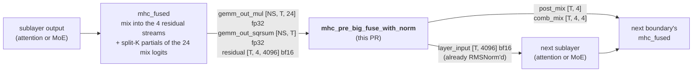
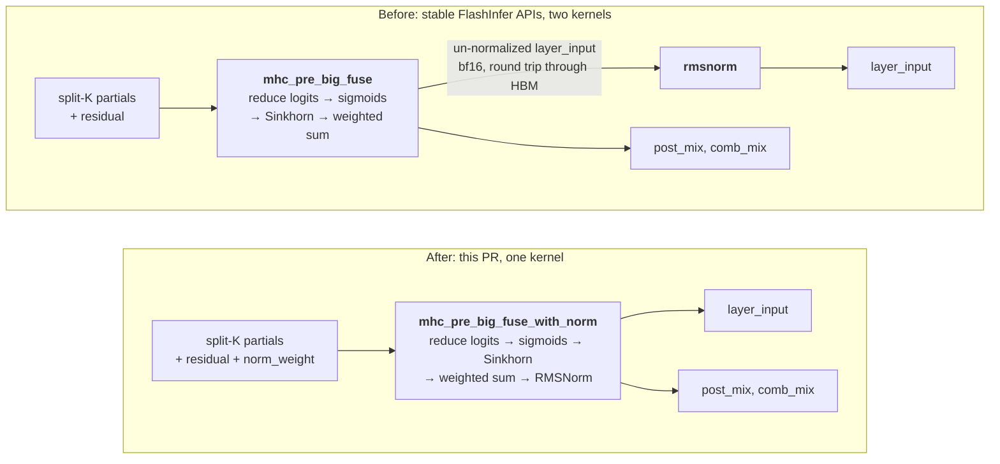
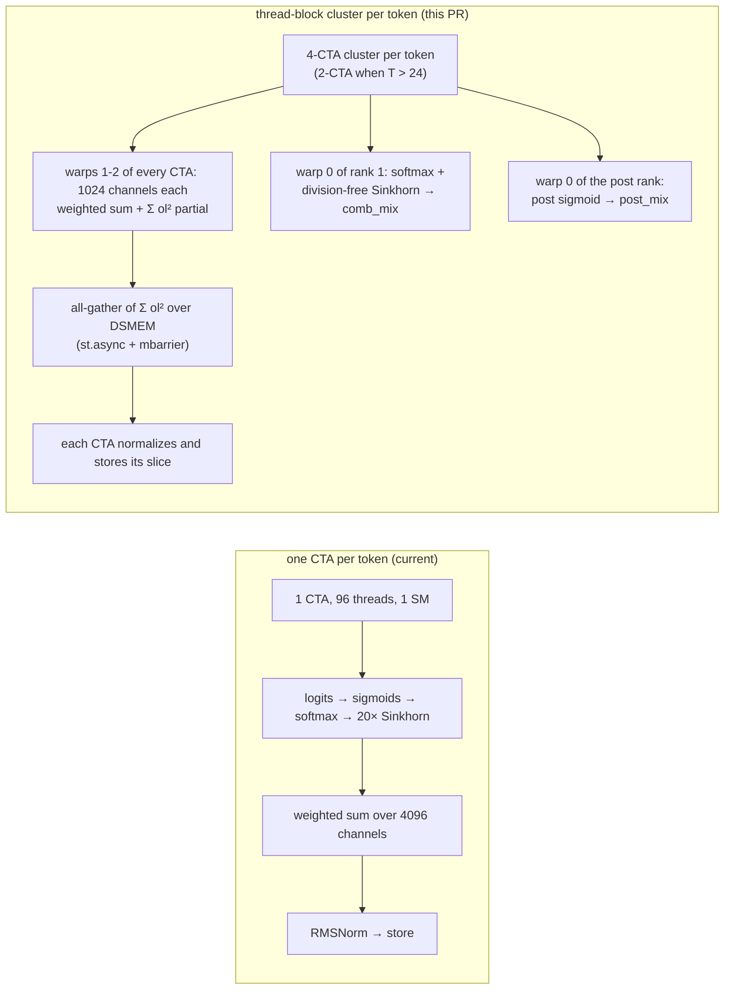
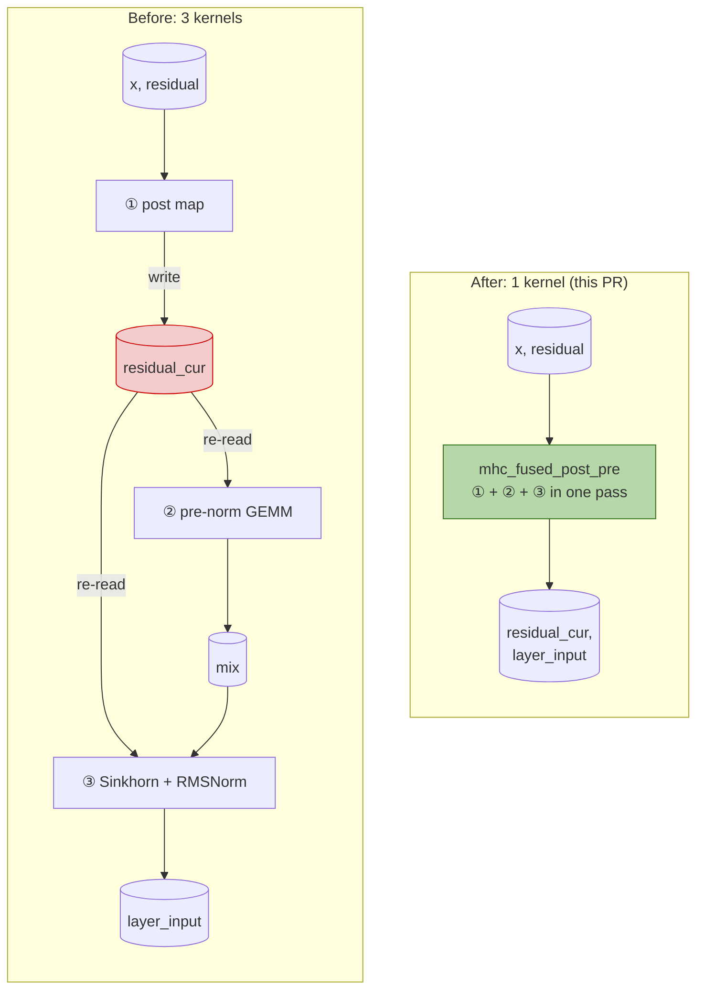

# GitHub Stars 合并报告 - 2026-10-27

**合并日期**: 2026-10-28
**监控日期**: 2026-10-27
**仓库数量**: 12

## 目录

1. [ByteDance-Seed/VeOmni](#ByteDance-Seed-VeOmni)
2. [ModelTC/LightX2V](#ModelTC-LightX2V)
3. [aigc-apps/VideoX-Fun](#aigc-apps-VideoX-Fun)
4. [flashinfer-ai/flashinfer](#flashinfer-ai-flashinfer)
5. [hao-ai-lab/FastVideo](#hao-ai-lab-FastVideo)
6. [huggingface/diffusers](#huggingface-diffusers)
7. [modelscope/DiffSynth-Engine](#modelscope-DiffSynth-Engine)
8. [modelscope/DiffSynth-Studio](#modelscope-DiffSynth-Studio)
9. [sgl-project/sglang](#sgl-project-sglang)
10. [vipshop/cache-dit](#vipshop-cache-dit)
11. [vllm-project/vllm](#vllm-project-vllm)
12. [vllm-project/vllm-omni](#vllm-project-vllm-omni)

---

<a id="ByteDance-Seed-VeOmni"></a>


**报告日期**: 2026-10-28
**监控日期**: 2026-10-27
**仓库地址**: [ByteDance-Seed/VeOmni](https://github.com/ByteDance-Seed/VeOmni)

## 仓库信息

- **描述**: VeOmni: Scaling Any Modality Model Training with Model-Centric Distributed Recipe Zoo
- **语言**: Python
- **星标数**: 2266
- **最后更新**: 2026-10-27T12:54:05Z

## 提交统计

- **昨日提交总数**: 4
- **提交者数量**: 3
- **主要提交者**: YLlllllllllll, tianhao shen, sc1915

## AI分析总结

# VeOmni 仓库提交分析

## 1. 主要更新类型

- **功能新增**：2项（ROCm的aiter attention后端、MLU的liger_kernel支持）
- **Bug修复**：2项（NPU GDN头分片通道、并行拓扑日志优化）
- **涉及模块**：模型（model）、操作（ops）、并行（parallel）

---

## 2. 关键变更点及与项目方向的关系

### 多硬件平台支持（核心方向）
VeOmni作为跨模态分布式训练框架，本次提交显著增强了对**多种硬件后端**的支持：

- **华为昇腾NPU**：修复GDN头分片通道问题，确保AscendC打包模式的一致性
- **AMD ROCm GPU**：新增aiter attention后端支持，提升注意力计算性能
- **寒武纪MLU**：集成liger_kernel优化库，通常用于内存效率优化

### 并行训练优化
- 简化缓存拓扑日志输出，降低分布式训练时的日志噪声，提升调试体验

---

## 3. 对项目的影响和潜在意义

| 影响维度 | 具体效果 |
|---------|---------|
| **硬件生态** | 扩展到NPU、ROCm、MLU三大国产/替代硬件平台，降低对单一厂商依赖 |
| **训练效率** | aiter和liger_kernel均针对特定硬件优化，可提升训练吞吐量 |
| **稳定性** | 修复NPU上的分片对齐问题，避免训练结果不一致 |
| **用户体验** | 日志优化减少干扰，便于分布式训练调试 |

---

## 4. 值得关注的技术点

### AscendC打包对齐（#1333）
- 涉及华为昇腾CANN低级编程接口
- "head-shard channels"表明支持模型并行时的细粒度分片
- "packed parity"意味着确保打包/非打包模式计算结果一致

### aiter attention后端（#1041）
- aiter是AMD的AI Tensor Engine for ROCm
- 表明项目深度集成特定硬件SDK，而非仅依赖通用框架
- 对于使用AMD GPU的用户具有实际价值

### liger_kernel集成（#1220）
- liger_kernel通常提供FlashAttention、RMSNorm等算子的高效实现
- MLU平台支持表明项目在国产AI芯片生态的布局

---

## 5. 对项目发展的影响评估

基于README描述，VeOmni定位为"支持任意模态模型训练的模型中心分布式配方库"。本次提交：

### 战略层面
- **强化多硬件战略**：同时支持NVIDIA、AMD、华为、寒武纪四大平台，符合国产化替代和多元化硬件生态趋势
- **提升框架实用性**：通过针对性硬件优化，降低用户在不同平台上的适配成本

### 技术层面
- **深度优化能力**：选择性集成硬件特定SDK（AscendC、aiter），而非仅依赖PyTorch通用后端
- **生产就绪性**：修复分片对齐问题，确保大规模分布式训练的正确性

### 用户价值
- 为多模态AI训练提供了更广泛的硬件选择
- 在国产芯片上的持续投入，对企业用户具有吸引力

---

**总结**：本次提交聚焦于**硬件兼容性扩展**和**特定平台性能优化**，体现了VeOmni作为生产级分布式训练框架对多硬件生态的重视，与其"scaling any modality model training"的项目愿景高度一致。

## 详细提交记录

### [6e8433a](https://github.com/ByteDance-Seed/VeOmni/commit/6e8433ad7a0ca59e52940fa8239be59c17a47dbf)

- **作者**: YLlllllllllll
- **时间**: 2026-10-27T11:42:34Z
- **提交信息**: [ops] fix: support NPU GDN head-shard channels and packed AscendC parity (#1333)

### [d462d21](https://github.com/ByteDance-Seed/VeOmni/commit/d462d21c2f569bbd570dd26df13ca50c2acea416)

- **作者**: YLlllllllllll
- **时间**: 2026-10-27T11:42:25Z
- **提交信息**: [parallel] fix: quiet cached topology logs (#1335)

Co-authored-by: shizhelun <shizhelun@bytedance.com>
Co-authored-by: Cursor <cursoragent@cursor.com>

### [3382d42](https://github.com/ByteDance-Seed/VeOmni/commit/3382d42afb9caba1bedda3485af14a1aaa0a22e7)

- **作者**: tianhao shen
- **时间**: 2026-10-27T07:37:46Z
- **提交信息**: [model, ops] feat: support aiter attention backend on ROCm (#1041)

Co-authored-by: Cursor <cursoragent@cursor.com>
Co-authored-by: shizhelun <shizhelun@bytedance.com>

### [ddebac4](https://github.com/ByteDance-Seed/VeOmni/commit/ddebac4b7942e55fd25e59e33ef3df3dca8de144)

- **作者**: sc1915
- **时间**: 2026-10-27T07:18:31Z
- **提交信息**: [ops] feat: add mlu liger_kernel support  (#1220)

Co-authored-by: jiabin.00 <jiabin.00@bytedance.com>

---

<a id="ModelTC-LightX2V"></a>


**报告日期**: 2026-10-28
**监控日期**: 2026-10-27
**仓库地址**: [ModelTC/LightX2V](https://github.com/ModelTC/LightX2V)

## 仓库信息

- **描述**: Lightweight Image Video Action Generation Inference Framework
- **语言**: Python
- **星标数**: 2960
- **最后更新**: 2026-10-27T10:43:31Z

## 提交统计

- **昨日提交总数**: 1
- **提交者数量**: 1
- **主要提交者**: STwangyingrui

## AI分析总结

# ModelTC/LightX2V 昨日提交分析

## 1. 主要更新类型
**性能优化**（单条提交），针对 InfiniteTalk 推理在 RTX 4090 上的多卡加速。

## 2. 关键变更点及与项目方向的关系

- **八卡序列并行 + FP8 通信**：引入 round-robin FP8 通信策略，将推理负载分布到 8 张 4090 上，显著降低单卡显存与计算压力。
- **Triton 前后处理 + 张量融合**：用 Triton kernel 替换原有 Python 前后处理逻辑，并融合张量操作，减少 kernel launch 开销。
- **Sage2 动态稀疏自注意力（0.8 稀疏度）**：在自注意力层采用 80% 稀疏度的动态稀疏注意力，大幅削减注意力计算量。
- **音频交叉注意力分片（SDPA）**：将音频 cross-attention 按序列分片并使用 PyTorch SDPA，兼顾效果与效率。
- **图像条件编码缓存**：对图像条件编码结果做缓存，避免重复计算。
- **兼容性保留**：未改变视频时长与模型路径，保证接口不变。

这些变更直接服务于 README 所强调的 **"轻量视频生成推理框架"** 定位——通过硬件级优化（FP8、Triton、稀疏注意力、并行）让长时序的 InfiniteTalk 说话人视频生成在消费级多卡（RTX 4090）上可实际部署，是项目核心竞争力（轻量、快速、低成本）的体现。

## 3. 对项目的影响和潜在意义

- **大幅降低 InfiniteTalk 推理成本**：用户可用普通 4090 集群跑通原本需要高端卡的长视频生成。
- **树立"4090 级硬件最佳实践"**：为社区提供一条可复现的多卡优化路线，提升项目在开源社区的影响力与实用价值。
- **为其他模型复用优化范式**：FP8 通信、Triton 前后处理、稀疏注意力等模块化改动未来可推广到 CogVideoX、Hunyuan 等其他模型路径。

## 4. 值得关注的技术点

- **FP8 round-robin 通信**：在通信带宽受限的消费级 PCIe 环境下压缩序列并行的数据传输量。
- **Sage2 稀疏注意力 0.8 稀疏度**：需关注稀疏度与生成质量的权衡，以及是否针对 InfiniteTalk 的时序特性做了调参。
- **图像条件编码缓存**：体现了对重复计算的识别能力，但也需关注缓存的内存占用与失效策略。
- **张量融合与 Triton kernel**：性能提升幅度取决于融合覆盖度，建议关注后续 benchmark 数据。

## 5. 基于 README 背景对项目发展的影响

README 明确项目目标是 **Light Video Generation Inference Framework**（轻量视频生成推理框架），配套中英文文档与 Apache 2.0 许可。本次提交正是围绕这一目标的深度性能打磨：

- **强化"Light"标签**：通过 FP8、稀疏注意力、并行等手段，把重量级的说话人视频生成压到消费级硬件可运行的范围，与项目命名高度契合。
- **完善模型覆盖**：InfiniteTalk 是社区热门的说话人视频生成模型，此优化补齐了该模型在多卡消费级环境下的推理能力，丰富了框架的模型矩阵。
- **推动工程化落地**：Triton kernel、张量融合、条件编码缓存都是生产级优化手法，说明项目正从"能跑"向"跑得快、跑得省"演进，为后续版本发布与用户采纳打下基础。
- **保持接口稳定**：保留视频时长与模型路径，降低用户升级成本，有利于生态延续。

**总结**：这条提交是 LightX2V 在消费级多卡场景下对 InfiniteTalk 推理的系统性性能优化，充分体现了项目"轻量高效"的核心定位，对降低视频生成部署门槛、扩大用户群体具有积极意义。

## 详细提交记录

### [543cff4](https://github.com/ModelTC/LightX2V/commit/543cff43829177f1032938809612f748a29d1a53)

- **作者**: STwangyingrui
- **时间**: 2026-10-27T10:43:24Z
- **提交信息**: Optimize InfiniteTalk inference on RTX 4090 (#1652)

Enable sequence parallelism across eight GPUs with round-robin FP8
communication, Triton pre/post processing, and tensor fusion. Use Sage2
dynamic sparse self-attention at 0.8 sparsity, shard audio
cross-attention with SDPA, and cache image condition encodings. Preserve
the existing video duration and model paths.

---

<a id="aigc-apps-VideoX-Fun"></a>


**报告日期**: 2026-10-28
**监控日期**: 2026-10-27
**仓库地址**: [aigc-apps/VideoX-Fun](https://github.com/aigc-apps/VideoX-Fun)

## 仓库信息

- **描述**: 📹 A more flexible framework that can generate videos at any resolution and creates videos from images. 
- **语言**: Python
- **星标数**: 2313
- **最后更新**: 2026-10-27T15:16:16Z

## 提交统计

- **昨日提交总数**: 2
- **提交者数量**: 2
- **主要提交者**: hkz, li-lizhe

## AI分析总结

我来查看这两个提交的具体变更，以便给出更准确的分析。<tool_call><function=run_python><parameter=tool>github_get_commit</parameter><parameter=args>{"owner": "aigc-apps", "repo": "VideoX-Fun", "sha": "9dc6f1d"}</parameter></function></tool_call><tool_call><function=run_python><parameter=tool>github_get_commit</parameter><parameter=args>{"owner": "aigc-apps", "repo": "VideoX-Fun", "sha": "43681ae"}</parameter></function></tool_call>

## 详细提交记录

### [9dc6f1d](https://github.com/aigc-apps/VideoX-Fun/commit/9dc6f1d49ab14b35ec956c13ac9e35d6d52c527d)

- **作者**: hkz
- **时间**: 2026-10-27T15:16:10Z
- **提交信息**: Add the training script for taew2_2_super (#526)

### [43681ae](https://github.com/aigc-apps/VideoX-Fun/commit/43681aebea5e5ef2028eb16e3c31a49770369f9f)

- **作者**: li-lizhe
- **时间**: 2026-10-27T15:15:38Z
- **提交信息**: fix(offload): resolve the group offloading transfer stream from the onload device (#528)

The vendored group-offloading helper (see the "Modified from .../diffusers/v0.36.0"
header) resolved its data-transfer stream by probing for CUDA/XPU only, so
`gpu_memory_mode="model_group_offload"`, which calls `apply_group_offloading(..., use_stream=True)`,
raised on a host whose accelerator is neither of those:

    ValueError: Using streams for data transfer requires a CUDA device, or an Intel XPU device.

even when the accelerator's backend implements streams (for example Ascend NPU, where
`torch.cuda.is_available()` is False while `torch.npu` is available and provides `Stream`).

Resolve the stream from the onload device's own backend instead, and keep rejecting devices
whose backend cannot stream, with a message that names the device type. This is the same
policy upstream diffusers applies in the function this file is derived from.

Signed-off-by: li-lizhe <147392333@qq.com>

---

<a id="flashinfer-ai-flashinfer"></a>


**报告日期**: 2026-10-28
**监控日期**: 2026-10-27
**仓库地址**: [flashinfer-ai/flashinfer](https://github.com/flashinfer-ai/flashinfer)

## 仓库信息

- **描述**: FlashInfer: Kernel Library for LLM Serving
- **语言**: Cuda
- **星标数**: 6798
- **最后更新**: 2026-10-28T01:13:33Z

## 提交统计

- **昨日提交总数**: 81
- **提交者数量**: 26
- **主要提交者**: namgyu-youn, Adrian, Ao Tang

## AI分析总结

# FlashInfer 昨日 81 次提交综合分析

## 一、主要更新类型

性能优化占绝对主导，覆盖 attention、GEMM、量化、采样、MoE、卷积与通信原语等推理全链路；辅以一次大规模去重重构、量化正确性收紧、Bug 修复、CI 与依赖维护，并新增针对新模型架构的实验性内核。

## 二、关键变更

**Blackwell/Rubin 全系深度调优**：针对 SM100/SM103（B200/GB300）及 SM107、SM120 新变体进行系统性压榨，涉及 MQA logits、MXFP8 量化、BF16×FP4 与 masked FP8 GEMM、KDA 预填充、Kimi K3 注意力残差、因果卷积等，典型加速 1%–12%，个别达 1.42x（KDA）、最高 1.93x（因果卷积）、split-KV 成本模型调度最高 6.5x。Rubin 侧修复 tile-256 策略被过滤问题，使 MoE 计划空间从 8 扩至 32。

**低精度量化生态**：NVFP4/MXFP4/MXFP8/W4A16 路径全面优化，多数声明与主分支位级一致；MXFP4/MXFP8 统一对齐契约并以零容差位精确测试验证；新增 BF16×NVFP4 MegaMoE EP 后端，部分形状较 CuTe DSL 基线加速约 1.59x。

**大规模去重重构**：将 `cake_blackwell_msa` 的 36 个近乎重复的 CUDA 源文件通过 `-D` 编译宏合并为共享编译单元，净减约 3.8 万行代码，SASS 位级一致、行为完全不变。

**新架构支持**：为 GB300 上 GLM-5.3-Flash 新增 mHC 融合内核（覆盖每前向 89 个边界），并以实验 API 规范落地；KDA 解码扩展 GLM-5.3-Flash 16/64 头与 vLLM DS conv-state 布局；新增 Qwen 3.8 Flash-Next 实验性解码块注意力 API；MiniMax Sparse Attention 新增 SM90 Hopper 后端，填补 H100 上 MSA 路径空白。

**正确性与工程设施**：修复 NVFP4 TMA 量化 scale 越界写入、RoPE FP8 e5m2 饱和范围错误、SM120 ring buffer 读写竞态（`fence.proxy.async`）、warp_decode 首核 PDL 启动顺序竞态等缺陷；GPU 无关测试统一迁入 tests/cpu 并实现 CI 中 CPU/GPU 分离；修复 GDN 基准虚假回归假象；CuTe DSL 最低版本升至 4.8.0，与 vLLM v0.32.0、SGLang v0.5.22 对齐；FFI 可空句柄改为显式 Optional，为 tvm-ffi 迁移铺路。

## 三、值得关注的技术点

- **原始字节序做 reduce**：非负 E4M3 的 uint8 字节序即数值序，W4A16 scale reduce 从 53.4ms 降至 0.48ms（111.7x）。
- **Tail donation**：晚期空闲 CTA 经 L2 预热与 mask 词一致决策，将尾部工作交给有效 CTA。
- **归约延迟合并**：链式投机采样将逐块 barrier 推迟到循环外，延迟降低约 20%+；采样内核寄存器占用从 39 降至 27。
- **延迟隐藏与细粒度调度**：MXFP8 L2 lookahead 跨组预热、FP4 GEMM 按 M/K 动态选择集群切分、TinyGEMM2 操作数换向、tcgen05 屏障语义放松。
- **正确性工程**：CUDA 哨兵帧检测 CUPTI 丢记录并重试；cooperative launch 避免小 M 尾部程序 CTA 互等死锁；首个提交明确声明使用 OpenAI Codex 辅助，体现 AI 辅助编程的开放态度。

## 四、项目影响

本批提交体现三条清晰主线：Blackwell/Rubin 新硬件的系统性压榨、量化与基准的严格工程纪律、以及对新模型架构（mHC、Kimi K3、Qwen 3.8、MiniMax）的第一时间支持。位级一致声明配合 ABBA 交错基准显著提升升级信心；Rubin MoE 计划空间扩大 4 倍、H100 MSA 路径补齐扩大硬件覆盖面；大规模去重重构与测试分离使项目从快速迭代内核阶段转向可维护、可扩展的工程化阶段。GDN 训练与因果卷积训练内核的加入，标志项目正从推理内核库向 Blackwell 原生的推理—训练全生命周期计算平台演进，持续巩固其在前沿推理内核栈中的核心地位。

## 详细提交记录

### [9409027](https://github.com/flashinfer-ai/flashinfer/commit/94090279f3d221a82e9d893924c022ec01937041)

- **作者**: 0z5a
- **时间**: 2026-10-27T23:56:14Z
- **提交信息**: perf(moe): reduce W4A16 scale factors without large temporaries (#4559)

**Incremental review:** [Files
changed](https://github.com/flashinfer-ai/flashinfer/pull/4559/files)
against `main`.

## Description

Reduce the W4A16 NVFP4 scale factor without materializing full-size FP32
copies and boolean masks.

NVFP4 block scales are nonnegative, and nonnegative E4M3 values preserve
their ordering in their raw byte representation. Because PyTorch does
not implement CUDA `max` for float8, this change reduces an aliasing
`uint8` view and converts only the resulting scalar. Other source dtypes
use their native reduction. Empty inputs preserve the existing `1.0`
fallback.

On an RTX PRO 5000 Blackwell (SM120), for a 32 MiB `[256, 1024, 128]`
scale tensor:

| implementation | median | peak temporary allocation |
|---|---:|---:|
| current `main` (per-expert FP32 + mask) | 53.441 ms | 3,258,368 B |
| this PR (single reduction) | 0.479 ms | 1,536 B |

This is a 111.7x reduction-time improvement for this synthetic shape.
The historical full-tensor implementation discussed in the linked vLLM
issue could allocate substantially more; the comparison above is
specifically against current FlashInfer `main`.

AI assistance: this change and its validation were performed with OpenAI
Codex assistance.

## Related Issues

- https://github.com/vllm-project/vllm/issues/49031

## Pull Request Checklist

### Pre-commit Checks

- [x] I have installed `pre-commit`.
- [x] I have installed the hooks.
- [x] I have run the hooks manually and fixed all reported issues.

## Tests

- [x] Tests have been added for boundary values, multi-expert reduction,
the BF16 source path, empty input, and the FP16 bypass.
- [x] `pytest -q tests/moe/test_b12x_w4a16_prepare.py` — 6 passed.
- [x] B12x MoE conformance suite — 28 passed.
- [x] Pre-commit hooks passed.

## Reviewer Notes

The raw-byte reduction relies on the existing NVFP4 contract that scale
values are nonnegative E4M3 values. The fallback for non-float8 scale
tensors intentionally uses the dtype's native CUDA reduction.


<!-- This is an auto-generated comment: release notes by coderabbit.ai
-->
## Summary by CodeRabbit

* **Bug Fixes**
* Improved NVFP4 scale-factor computation for empty inputs and different
numeric formats.
* Improved handling of scale values across experts, including float8 and
bfloat16 inputs.
* Preserved expected float16 behavior and improved boundary-value
handling.

* **Tests**
* Added coverage for boundary values, multiple experts, empty inputs,
and supported data types.
* Added validation against reference results for consistent scale-factor
calculations.
<!-- end of auto-generated comment: release notes by coderabbit.ai -->

---------

Signed-off-by: 大大小小 <dezhen.lu@student.uni-tuebingen.de>

### [056670d](https://github.com/flashinfer-ai/flashinfer/commit/056670d018638b536169c6691f548576bf3c464e)

- **作者**: eigen
- **时间**: 2026-10-27T23:55:26Z
- **提交信息**: perf(cake_minimax_h3): stage the residual in shared memory in the SM103 NVFP4 tail-split out-projection (#7432)

`flashinfer.diffusion_ops.minimax_h3_out_proj` (BF16),
`minimax_h3_out_proj_mxfp8` (MXFP8 W8A8) and `minimax_h3_out_proj_nvfp4`
(NVFP4 W4A4) are the three variants of the MiniMax-H3 attention output
projection with the fused indexed gate and residual on SM100 (`sm_100a`)
and SM103 (`sm_103a`). On `sm_103a`, NVFP4 already has a tail-split
program that reads the residual with 256-bit loads and issues the first
unit's weight loads before the dependency wait (#7397). This PR adds one
`sm_103a` NVFP4 program. In its epilogue, each warp copies its residual
rows into shared memory asynchronously (two 2 KiB slots per warp) before
the gated residual math. The current program reads the residual directly
from global memory in the epilogue. The new program uses 228,480 bytes
of shared memory. On `sm_103a`, an NVFP4 shape runs the new program if
the current rule sends it to the tail-split program with 256-bit
residual loads and it has at least 8 full waves (8 x 76 tile pairs).
Every other shape keeps its current program. BF16, MXFP8 and `sm_100a`
are unchanged, and every existing kernel is unchanged. The output is
bitwise identical to main. The comparison is against the current
FlashInfer main on GB300, using the 40-shape list. The 15 shapes that
run the new program are 1.007x to 1.014x faster (geomean 1.010x). The
other 25 rows run the same kernel in both columns.

NVFP4 W4A4 (`minimax_h3_out_proj_nvfp4`) on NVIDIA GB300 (`sm_103a`),
CUDA 13.4. Time of the complete operator (activation quantization + GEMM
with the fused gate and residual), median of 10 interleaved rounds (5
rounds in each of two sessions) with a cold L2. P = sequence-parallel
degree, M = rows. Rows with new program = yes run the new program. The
other rows run the same kernel in both columns, so their ratio is
run-to-run variation.

| P | M | new program | before (µs) | after (µs) | speedup |
|---:|---:|:---:|---:|---:|---:|
| 1 | 33472 | yes | 474.6 | 471.2 | 1.007x |
| 1 | 38528 | no | 546.7 | 548.2 | 0.997x |
| 1 | 38591 | no | 548.2 | 548.9 | 0.999x |
| 1 | 38592 | no | 549.2 | 550.2 | 0.998x |
| 1 | 38593 | no | 547.1 | 547.3 | 1.000x |
| 1 | 38656 | no | 549.0 | 550.1 | 0.998x |
| 1 | 48768 | no | 700.9 | 701.7 | 0.999x |
| 1 | 58944 | no | 857.1 | 856.1 | 1.001x |
| 1 | 74240 | no | 1081.1 | 1085.2 | 0.996x |
| 1 | 109952 | no | 1620.8 | 1619.9 | 1.001x |
| 2 | 16736 | yes | 238.3 | 236.2 | 1.009x |
| 2 | 19264 | no | 274.0 | 273.8 | 1.001x |
| 2 | 19295 | no | 273.9 | 274.1 | 0.999x |
| 2 | 19296 | no | 275.4 | 275.5 | 1.000x |
| 2 | 19297 | no | 274.5 | 274.6 | 1.000x |
| 2 | 19328 | no | 274.0 | 274.4 | 0.999x |
| 2 | 24384 | no | 347.2 | 348.4 | 0.997x |
| 2 | 29472 | yes | 420.8 | 416.4 | 1.011x |
| 2 | 37120 | yes | 528.8 | 522.1 | 1.013x |
| 2 | 54976 | no | 798.6 | 803.7 | 0.994x |
| 4 | 8368 | yes | 125.2 | 123.5 | 1.014x |
| 4 | 9632 | yes | 141.7 | 140.2 | 1.011x |
| 4 | 9647 | yes | 141.4 | 139.9 | 1.011x |
| 4 | 9648 | yes | 141.5 | 140.2 | 1.009x |
| 4 | 9649 | yes | 141.5 | 140.1 | 1.009x |
| 4 | 9664 | yes | 141.5 | 140.2 | 1.009x |
| 4 | 12192 | yes | 174.9 | 173.2 | 1.010x |
| 4 | 14736 | yes | 211.2 | 208.8 | 1.011x |
| 4 | 18560 | yes | 263.6 | 261.8 | 1.007x |
| 4 | 27488 | no | 390.4 | 390.2 | 1.000x |
| 8 | 4184 | no | 71.4 | 71.5 | 1.000x |
| 8 | 4816 | no | 78.8 | 78.8 | 1.000x |
| 8 | 4823 | no | 79.0 | 79.1 | 0.999x |
| 8 | 4824 | no | 78.7 | 78.7 | 0.999x |
| 8 | 4825 | no | 78.5 | 78.6 | 1.000x |
| 8 | 4832 | no | 79.2 | 79.2 | 1.000x |
| 8 | 6096 | no | 95.9 | 96.0 | 0.999x |
| 8 | 7368 | yes | 112.5 | 111.2 | 1.012x |
| 8 | 9280 | yes | 137.5 | 136.0 | 1.011x |
| 8 | 13744 | no | 196.1 | 196.2 | 1.000x |

The other variants of this projection are BF16 (`minimax_h3_out_proj`)
and MXFP8 (`minimax_h3_out_proj_mxfp8`) on `sm_100a` and `sm_103a` in
this module, and FP8 per-token and NVFP4 on `sm_120a` in the SM120
module `flashinfer.diffusion_ops.cake_minimax_h3_sm120_quant_out_proj`;
the family covers `sm_100a`, `sm_103a` and `sm_120a`.

Co-authored-by: Yingyi Huang <averyh@nvidia.com>
Co-authored-by: Claude Opus 5.5 <noreply@anthropic.com>

### [0e44b0e](https://github.com/flashinfer-ai/flashinfer/commit/0e44b0ef80f6ecdf3052143862b786cf5be49045)

- **作者**: S.J. Lee
- **时间**: 2026-10-27T23:00:55Z
- **提交信息**: perf(xqa): speed up e4m3 conversion for bf16-query decode (#6762)

<!-- .github/pull_request_template.md -->

## 📌 Description

With a bf16 query, XQA on sm_89+ converts each e4m3 byte it reads to
bf16 one element at a time: an e4m3x2-to-f16x2 cvt on a single byte,
then f16 to f32 and f32 to bf16 rounding toward zero. That path covers
both the fp8 KV cache and the e4m3 block scales of an NVFP4 KV cache.
This PR reuses the existing f16 paths, which convert two bytes per cvt,
and then takes the same f32 and bf16 steps. Every e4m3 value, NaN and -0
included, maps to the same bf16 as before.

On SM120 the bf16-query decode kernels drop about 16% of their
instructions over an fp8 KV cache (head_dim 256) and 6-8% over NVFP4.
fp16-query kernels and sm_80/86 builds are unchanged.

`trtllm_batch_decode_with_kv_cache` on SM120 (auto backend, so XQA),
bf16 query, CUDA graph replay. NVFP4 compares `18688d10` with and
without this PR; fp8 was measured on an older main with the same
additional patches (e4m3-query support) on both sides. 160 shapes per KV
dtype: head_dim 128/256, 1-16 query heads per KV head, batch 1-128, KV
length 1K/8K, with and without a 1K sliding window. Geometric mean of
the per-shape time ratio:

| KV cache | time vs base |
|---|---|
| fp8 e4m3 | 0.956 (-4.4%) |
| NVFP4 | 0.966 (-3.4%) |

Outputs were bit-identical to their respective baselines across all
validation shapes.

## 🔍 Related Issues

The FA2 change in #6574 lets tensor-core decode take an e4m3 query on
SM120, and on the Gemma 4 decode shapes we measured it is faster than
both XQA and Triton for an fp8 KV cache. This PR improves the existing
XQA path without adding a new query dtype. #6574 separately adds
FP8-query support to FA2 and is ready for maintainer review.

## 🚀 Pull Request Checklist

Thank you for contributing to FlashInfer! Before we review your pull
request, please make sure the following items are complete.

### ✅ Pre-commit Checks

- [x] I have installed `pre-commit` by running `pip install pre-commit`
(or used your preferred method).
- [ ] I have installed the hooks with `pre-commit install`.
- [x] I have run the hooks manually with `pre-commit run --all-files`
and fixed any reported issues.

> If you are unsure about how to set up `pre-commit`, see [the
pre-commit documentation](https://pre-commit.com/).

## 🧪 Tests

- [ ] Tests have been added or updated as needed.
- [x] All tests are passing (`unittest`, etc.).

On SM120, every bf16-query case over an fp8 or NVFP4 KV cache in
`tests/attention/test_xqa.py`,
`tests/attention/test_xqa_batch_decode.py` and
`tests/attention/test_trtllm_gen_attention_decode_xqa.py`: 278 passed,
16 xpassed, 10 skipped.

## 🔬 Experimental Track

<!-- Only for PRs submitted under the experimental policy
(CONTRIBUTING.md → "Experimental APIs and Backends").
     Leave this section untouched for normal PRs. -->

- [ ] This PR is **experimental**: it adds or changes code under
`flashinfer/experimental/` and/or an `@flashinfer_experimental_api`.
Tracking issue: #
- [ ] The tracking issue names an owner, the reason for the experimental
path, and a graduation plan with a target release.
- [ ] Core changes are limited to a thin entry point (signature, shared
validation, feature-gate check, backend selection, handoff).
- [ ] Tests live in `tests/experimental/` and were validated on the
intended hardware; a runnable example is included.
- [ ] Nothing is registered in `flashinfer/aot.py`, and no experimental
backend is reachable from `backend="auto"` without
`FLASHINFER_ALLOW_EXPERIMENTAL_AUTO_BACKENDS=1`. (Calling an
`@flashinfer_experimental_api` or naming a backend explicitly is itself
the opt-in and needs no environment variable.)
- [ ] **Test scope declared below.** The experimental CI lane runs
exactly these targets, so keep them as narrow as the change allows.

<!-- Required for experimental PRs. Replace the commented lines below
with your targets.
Do not delete the fence or change its `experimental-tests` tag — the
experimental-track
watcher reads it verbatim to decide which targets to ask CI for. -->

```experimental-tests
# One target per line: a directory or a file. (A pytest ::selector is not
# supported -- the sharding runner cannot consume one.) Must be under
# tests/experimental/ and must exist. Delete these comment lines and add yours, e.g.
#
#   tests/experimental/test_my_backend.py
#   tests/experimental/my_backend/
#
# Declaring the whole tree (tests/experimental/) is allowed but means every
# experimental PR pays for every other feature's tests, in every matrix cell.
```

## Reviewer Notes

<!-- Optional: anything you'd like reviewers to focus on, concerns, etc.
-->


<!-- This is an auto-generated comment: release notes by coderabbit.ai
-->

## Summary by CodeRabbit

* **Bug Fixes**
* Improved conversion of bfloat16 inputs when using E4M3 cache elements
on supported hardware.

<!-- end of auto-generated comment: release notes by coderabbit.ai -->

Signed-off-by: lesj0610 <lesj0610@gmail.com>
Co-authored-by: Brian K. Ryu <bryu@nvidia.com>

### [b2a10d6](https://github.com/flashinfer-ai/flashinfer/commit/b2a10d60621b9c12536911b753cc943cac84ece0)

- **作者**: Jimmy Zhou
- **时间**: 2026-10-27T22:54:56Z
- **提交信息**: perf: fill SM107 for memory-bound quantize and fused_rmsnorm_silu (#6207)

## 📌 Description

On SM107, memory-bound quantize and `fused_rmsnorm_silu` fall well short
of the streaming ceiling, further than on GB300. The cause is the same
in each case. Their launch shapes and per-thread bytes in flight were
sized for 2048 resident threads per SM, but SM107 holds **1024**
(`max_threads_per_multi_processor = 1024`, 208-212 SMs). This PR changes
two things, one per commit, plus a review follow-up commit.

The RoPE part of the original PR moved to its own PR, #6794, where the
two-heads-per-step schedule is now limited to devices with ≤ 1024
threads/SM.

### 1. `perf(quantization)`: fill SM107 for batched NVFP4 and
MXFP8/MXFP4 quantize

1. **TMA path (nvfp4 / nvfp4_batched, m ≥ 1024).**
- Before: each CTA walked every batch of one 16-row tile, and the grid
was sized from a single batch. B8 × M2048 launched 128 CTAs on 208 SMs.
- Now: work items are (batch, row-tile) pairs, and the grid is `min(b ·
tiles, 2 · SMs)`. Arch-generic.
2. **Non-TMA path (MXFP8, and MXFP4, which never takes TMA).**
- Before: one 16/32-byte load per thread under `__launch_bounds__(512,
4)`, i.e. 32 registers. With half the resident threads of SM100/SM103,
that leaves too few bytes in flight to cover DRAM latency.
- New `LOADS_IN_FLIGHT` template parameter: the number of input vectors
each thread loads before converting any of them.
- On devices with ≤ 1024 threads/SM (today only SM107), launches use
`LOADS_IN_FLIGHT=2` with `__launch_bounds__(512, 2)`. That gives 56-64
registers with no spills, and costs no occupancy on SM107: 2 × 512
threads × 64 registers is the whole register file.
- The block is sized to half a row of vectors, so each thread owns two
vectors of its row. The grid comes from the resident-thread limit.
- Every other GPU uses `LOADS_IN_FLIGHT=1`, which compiles to the same
SASS as `main` (see Tests).
3. **MXFP4 block sizing.**
- The block was sized with the host-pass
`CVT_FP16_TO_FP4_ELTS_PER_THREAD` (8), because the host pass has no
`__CUDA_ARCH__`. The device code uses 16 under CUDA ≥ 12.9, so half of
every block sat idle.
- The SM107 path now sizes from the device value
(`kSm100EltsPerThread`). Other GPUs are unchanged; see Reviewer Notes.

Also adds the test shape `(4, 1040, 1024)`: TMA path, partial last
16-row tile per batch.

### 2. `perf(norm)`: cap `fused_rmsnorm_silu` occupancy on SM107

The knob LUT was tuned on SM100. For example, C256 × 99840 uses
128-thread CTAs at occupancy 16, but on SM107 only 8 fit, so the
persistent grid ran as two waves. On devices with ≤ 1024 threads/SM, the
occupancy knob is now clamped to the resident CTA count.

### 3. `fix(quantization)`: review follow-ups

- `LOADS_IN_FLIGHT=1` computes the input offset where `main` does and
loads into a local vector, so its SASS matches `main` again.
- The two-load decision and the resident-thread count are read once per
device and cached, instead of three CUDA attribute queries on every
MXFP8/MXFP4 launch.
- The comment now states the actual rule: devices with ≤ 1024
threads/SM. `major >= 10` stays because that is where the device code
uses 16 elements per thread.

## 📊 Speedup

Speedup multipliers only (> 1 means this PR is faster). Each comparison
ran `main` and this PR in the same job on the same GPU, five interleaved
rounds per arm, CUDA graphs with cold-L2 rotating buffers. Outputs are
bit-identical to `main` in every row.

| kernel / shape | SM107 (GR100) | B300 |
|---|---:|---:|
| mxfp8_quantize (cuda) M16384 K7168 | 1.18x | 1.00x |
| mxfp8_quantize (cuda) M2048 K7168 | 1.18x | 1.00x |
| mxfp4_quantize M12288 K3072 | 2.03x | 1.00x |
| mxfp4_quantize M3072 K3072 | 1.55x | 1.00x |
| mxfp4_quantize M768 K3072 | 1.23x | 0.99x |
| nvfp4 batched B8 M2048 K8192 | 1.55x | 1.23x |
| nvfp4 batched B4 M1024 K4096 | 1.81x | 1.84x |
| nvfp4_quantize M12288 K3072 (control) | 0.99x | 1.00x |
| fused_rmsnorm_silu C256 × 99840 | 1.07x | 1.00x |

- On B300 the SM107-gated paths (two-load quantize, silu occupancy
clamp) stay at 1.00x. The gain there comes from the arch-generic batched
TMA grid.
- B200 was also run, on a shared node: the batched rows gain 1.30x /
1.97x and the other rows sit at 1.00x within that node's noise. The
nvfp4 control row read low inside the full suite there; an isolated
10-round A/B of that row alone measures 1.00x.

## 🔍 Related Issues

Rubin memory-bound kernel perf: norm / quant fall short of the modelled
speedup over GB300.

## 🚀 Pull Request Checklist

### ✅ Pre-commit Checks

- [x] I have installed `pre-commit` by running `pip install pre-commit`
(or used your preferred method).
- [x] I have installed the hooks with `pre-commit install`.
- [x] I have run the hooks manually with `pre-commit run --all-files`
and fixed any reported issues. (The commit hooks ran on every commit of
this branch.)

## 🧪 Tests

- [x] Tests have been added or updated as needed.
- [x] All tests are passing (`unittest`, etc.).

| suite | GPU | result |
|---|---|---|
| `tests/utils/test_fp4_quantize.py`,
`tests/utils/test_fp4_quantize_padding.py`,
`tests/utils/test_fp8_quantize.py::test_mxfp8_quantize_torch`,
`tests/norm/test_fused_rmsnorm_silu.py` (one session) | GR100, B300 |
1543 passed, 46 failed |
| same, on `main` | GR100 | 1535 passed, the same 46 failed |
| `tests/norm/test_fused_rmsnorm_silu.py -k nvfp4` (alone) | GR100 | 49
passed on this PR and on `main` |

The 46 failures are pre-existing and identical on `main`:
`test_nvfp4_quantize_cute_dsl_device_scale_cuda_graph` fails during CUDA
graph capture and leaves the context in an error state, and the nvfp4
`fused_rmsnorm_silu` tests that follow in the same session then fail.
Run on their own, they pass. The 8 extra passes are the new `(4, 1040,
1024)` shape.

Outputs are **bit-identical to `main`** for every benchmarked case on
GR100, B300 and B200.

SASS check: `cuobjdump -sass` opcode streams of all 226 non-TMA
`LOADS_IN_FLIGHT=1` instantiations, in both the FP4 and the MXFP8
quantize modules, are identical to `main` on sm_100a (B200), sm_103a
(B300) and sm_107a (GR100). An earlier revision of this PR claimed this
after checking the sm_107a build only, and the sm_100a build did differ;
the follow-up commit fixes that.

## 🔬 Experimental Track

<!-- Only for PRs submitted under the experimental policy
(CONTRIBUTING.md → "Experimental APIs and Backends").
     Leave this section untouched for normal PRs. -->

- [ ] This PR is **experimental**: it adds or changes code under
`flashinfer/experimental/` and/or an `@flashinfer_experimental_api`.
Tracking issue: #
- [ ] The tracking issue names an owner, the reason for the experimental
path, and a graduation plan with a target release.
- [ ] Core changes are limited to a thin entry point (signature, shared
validation, feature-gate check, backend selection, handoff).
- [ ] Tests live in `tests/experimental/` and were validated on the
intended hardware; a runnable example is included.
- [ ] Nothing is registered in `flashinfer/aot.py`, and no experimental
backend is reachable from `backend="auto"` without
`FLASHINFER_ALLOW_EXPERIMENTAL_AUTO_BACKENDS=1`. (Calling an
`@flashinfer_experimental_api` or naming a backend explicitly is itself
the opt-in and needs no environment variable.)
- [ ] **Test scope declared below.** The experimental CI lane runs
exactly these targets, so keep them as narrow as the change allows.

<!-- Required for experimental PRs. Replace the commented lines below
with your targets.
Do not delete the fence or change its `experimental-tests` tag — the
experimental-track
watcher reads it verbatim to decide which targets to ask CI for. -->

```experimental-tests
# One target per line: a directory or a file. (A pytest ::selector is not
# supported -- the sharding runner cannot consume one.) Must be under
# tests/experimental/ and must exist. Delete these comment lines and add yours, e.g.
#
#   tests/experimental/test_my_backend.py
#   tests/experimental/my_backend/
#
# Declaring the whole tree (tests/experimental/) is allowed but means every
# experimental PR pays for every other feature's tests, in every matrix cell.
```

## Reviewer Notes

- **Existing MXFP4 bug on other SM10x GPUs.** The half-idle MXFP4 block
(host vs device elements-per-thread) also exists on GB300 / B200. This
PR fixes it only on the SM107 path. Sizing from the device value on all
SM10x is a likely follow-up win, but it is unmeasured.
- **SM120 batched NVFP4.** A reviewer measured B4 × M1024 × K4096
slightly slower on SM120 (RTX PRO 6000), where `main` already runs that
shape close to the card's bandwidth limit. B200 / B300 / GR100 all gain
on it. Not changed here.
- **Remaining SM107 kernel gaps, not addressed here:**
- mxfp8 cuda: the two-load schedule cannot go to four loads at K = 7168,
because 448 vectors per row is not a multiple of 128.
- `fused_rmsnorm_silu` C256: the kernel moves 16 B per thread per row
structurally. Prefetching the next row in the persistent loop would
help.
- Most of the remaining GR100/GB300 gap on these rows is the
chip/HBM-clock term, not the kernels.

🤖 Generated with [Claude Code](https://claude.com/claude-code)

---------

Co-authored-by: Claude Opus 5.5 <noreply@anthropic.com>

### [bd8fea0](https://github.com/flashinfer-ai/flashinfer/commit/bd8fea0abbe1353eabcab0b7d907a7181b08020c)

- **作者**: eigen
- **时间**: 2026-10-27T22:50:48Z
- **提交信息**: perf(cake_grouped_mxfp8_quantize): K 4096 per-K row-tiled program hands the tile of a late partial group to a valid CTA of an early one (#7615)

`cake_grouped_mxfp8_quantize` takes a BF16 or F16 `x[B, M, K]` and an
int32 `mask[B]` that gives the valid rows per group. It writes FP8 E4M3
values and UE8M0 block scales, one per 32 elements, in the 128x4
grouped-GEMM scale layout. The host picks the program from B, M and K.
It never reads the mask. The kernel has 12 programs. They are row-2D,
bulk-copy, 128-thread row-tiled, and three per-K row-tiled programs,
each for BF16 and F16 input. The per-K row-tiled programs use 224
threads at K = 7168, 256 threads at K = 4096 and 128 threads at K =
2048. This PR adds tail donation to the K = 4096 per-K row-tiled
program, for BF16 and F16 input (2 programs). With B groups, it pairs up
to 12 early groups with the same number of late groups. Group z helps
group z + B - P, where P = min(12, B / 2). The handoff needs two
conditions. First, a CTA's own group and its partner group are both
partial with at most 32 valid rows. Second, the row tile the two CTAs
share holds valid rows of the late group. When both hold, the late
group's CTA exits without storing. The early group's CTA warms L2 with
that tile's rows and quantizes them after its own tile. Both CTAs decide
from the same two mask words, so each tile is quantized exactly once,
with the same code and math order. Outputs are bitwise the same as
before. A CTA that exits early (no valid rows in its tile) does no
donation work. A CTA of a full group skips the pair test. The K = 7168,
K = 2048 and 128-thread row-tiled programs get new file names, but their
code is unchanged. Row-2D, bulk-copy and routing are unchanged.

The baseline is the previous Cake version of this kernel, already in
FlashInfer main (#7534). FlashInfer's host chooses the program on both
sides. Each pair of numbers below is GB300 / GB200. The gain is on the
sparse K = 4096 rows. [32, 1024, 4096] with 16 rows per group gains
1.1448x / 1.1465x (7.172 -> 6.265 µs / 7.387 -> 6.444 µs). With 128 rows
per group the same shape measures 1.0048x / 1.0097x. The full [32, 1024,
4096] row is parity, not a gain. It measures 0.9997x / 0.9996x, inside
the A/A noise band. The 13 rows marked § run the K = 7168 and K = 2048
programs, whose code is unchanged. Their ratios of 0.9991–1.0012 /
0.9986–1.0007 are A/A pairs of the same code. The 6 rows marked † keep
their program (bulk-copy or row-2D). Their ratios of 0.9987–1.0000 /
0.9996–1.0014 are A/A pairs of that unchanged program. No row is slower
than before beyond noise.

Speedup = previous µs / this PR µs, the median of paired per-round
ratios over 12 interleaved rounds with a cold L2, with its 95 % CI;
above 1 is faster.
† Same program before and after, so the two columns are an A/A pair of
that program.
§ Same code as before under a new file name, so the two columns are an
A/A pair of that code.
‡ Extra sparse-mask rows at K = 2048, beyond the standard shape list.

**NVIDIA GB300 (sm_103a, 152 SMs), CUDA 13.4**

| shape [B, M, K] | dtype | mask | valid rows | program | previous (µs)
| this PR (µs) | speedup [95% CI] |
|---|---|---|---:|---|---:|---:|---|
| [2, 256, 4096] † | BF16 | full | 512 | bulk-copy | 3.481 | 3.483 |
1.0000 [0.9994, 1.0009] |
| [2, 256, 4096] † | F16 | full | 512 | bulk-copy | 3.474 | 3.475 |
1.0000 [0.9983, 1.0014] |
| [2, 128, 4096] † | BF16 | full | 256 | bulk-copy | 2.805 | 2.807 |
0.9989 [0.9968, 1.0014] |
| [3, 256, 2048] † | BF16 | full | 768 | bulk-copy | 3.113 | 3.114 |
0.9987 [0.9974, 1.0006] |
| [8, 512, 2048] † | BF16 | full | 4096 | row-2D | 6.941 | 6.942 |
1.0000 [0.9986, 1.0009] |
| [64, 128, 4096] † | BF16 | full | 8192 | row-2D | 19.023 | 19.034 |
0.9991 [0.9985, 1.0003] |
| [32, 1024, 7168] § | BF16 | 16 / group | 512 | K = 7168 row-tiled (224
threads) | 11.099 | 11.100 | 0.9992 [0.9988, 1.0005] |
| [32, 1024, 7168] § | BF16 | 32 / group | 1024 | K = 7168 row-tiled
(224 threads) | 11.844 | 11.847 | 0.9999 [0.9995, 1.0003] |
| [32, 1024, 7168] § | BF16 | 128 / group | 4096 | K = 7168 row-tiled
(224 threads) | 18.141 | 18.140 | 1.0004 [0.9998, 1.0008] |
| [32, 1024, 7168] § | BF16 | 512 in group 0 | 512 | K = 7168 row-tiled
(224 threads) | 10.839 | 10.840 | 0.9998 [0.9994, 1.0004] |
| [32, 1024, 7168] § | BF16 | 1024 in group 0 | 1024 | K = 7168
row-tiled (224 threads) | 12.747 | 12.746 | 1.0000 [0.9998, 1.0002] |
| [32, 1024, 7168] § | BF16 | 1024 in group 0, 99 in others | 4093 | K =
7168 row-tiled (224 threads) | 19.579 | 19.576 | 1.0002 [0.9999, 1.0010]
|
| [32, 1024, 7168] § | BF16 | Zipf, 4096 total | 4096 | K = 7168
row-tiled (224 threads) | 21.163 | 21.171 | 0.9993 [0.9988, 0.9999] |
| [32, 1024, 7168] § | BF16 | full | 32768 | K = 7168 row-tiled (224
threads) | 104.545 | 104.550 | 1.0000 [0.9999, 1.0002] |
| [32, 1024, 7168] § | F16 | 128 / group | 4096 | K = 7168 row-tiled
(224 threads) | 18.101 | 18.106 | 1.0001 [0.9989, 1.0005] |
| [32, 1024, 4096] | BF16 | 16 / group | 512 | K = 4096 row-tiled (256
threads) | 7.172 | 6.265 | 1.1448 [1.1425, 1.1469] |
| [32, 1024, 4096] | BF16 | 128 / group | 4096 | K = 4096 row-tiled (256
threads) | 11.678 | 11.623 | 1.0048 [1.0042, 1.0062] |
| [32, 1024, 4096] | BF16 | full | 32768 | K = 4096 row-tiled (256
threads) | 62.499 | 62.544 | 0.9997 [0.9989, 0.9999] |
| [32, 1024, 2048] § | BF16 | full | 32768 | K = 2048 row-tiled (128
threads) | 34.598 | 34.547 | 1.0012 [1.0002, 1.0024] |
| [32, 1024, 2048] § ‡ | BF16 | 16 / group | 512 | K = 2048 row-tiled
(128 threads) | 5.948 | 5.948 | 1.0000 [0.9992, 1.0007] |
| [32, 1024, 2048] § ‡ | BF16 | 128 / group | 4096 | K = 2048 row-tiled
(128 threads) | 7.375 | 7.382 | 0.9991 [0.9982, 1.0005] |
| [32, 1024, 2048] § ‡ | BF16 | Zipf, 4096 total | 4096 | K = 2048
row-tiled (128 threads) | 7.462 | 7.458 | 1.0001 [0.9988, 1.0011] |

**NVIDIA GB200 (sm_100a, 152 SMs), CUDA 13.4**

| shape [B, M, K] | dtype | mask | valid rows | program | previous (µs)
| this PR (µs) | speedup [95% CI] |
|---|---|---|---:|---|---:|---:|---|
| [2, 256, 4096] † | BF16 | full | 512 | bulk-copy | 3.564 | 3.566 |
1.0000 [0.9991, 1.0006] |
| [2, 256, 4096] † | F16 | full | 512 | bulk-copy | 3.544 | 3.540 |
1.0014 [0.9997, 1.0023] |
| [2, 128, 4096] † | BF16 | full | 256 | bulk-copy | 2.852 | 2.848 |
1.0010 [0.9979, 1.0028] |
| [3, 256, 2048] † | BF16 | full | 768 | bulk-copy | 3.192 | 3.197 |
0.9997 [0.9978, 1.0006] |
| [8, 512, 2048] † | BF16 | full | 4096 | row-2D | 7.099 | 7.092 |
1.0006 [0.9996, 1.0015] |
| [64, 128, 4096] † | BF16 | full | 8192 | row-2D | 19.016 | 19.021 |
0.9996 [0.9988, 1.0004] |
| [32, 1024, 7168] § | BF16 | 16 / group | 512 | K = 7168 row-tiled (224
threads) | 11.438 | 11.432 | 1.0005 [1.0001, 1.0013] |
| [32, 1024, 7168] § | BF16 | 32 / group | 1024 | K = 7168 row-tiled
(224 threads) | 12.262 | 12.253 | 1.0007 [1.0000, 1.0012] |
| [32, 1024, 7168] § | BF16 | 128 / group | 4096 | K = 7168 row-tiled
(224 threads) | 18.694 | 18.688 | 1.0003 [0.9996, 1.0008] |
| [32, 1024, 7168] § | BF16 | 512 in group 0 | 512 | K = 7168 row-tiled
(224 threads) | 11.128 | 11.126 | 1.0000 [1.0000, 1.0004] |
| [32, 1024, 7168] § | BF16 | 1024 in group 0 | 1024 | K = 7168
row-tiled (224 threads) | 13.076 | 13.076 | 1.0000 [0.9998, 1.0005] |
| [32, 1024, 7168] § | BF16 | 1024 in group 0, 99 in others | 4093 | K =
7168 row-tiled (224 threads) | 19.976 | 19.958 | 1.0007 [1.0002, 1.0016]
|
| [32, 1024, 7168] § | BF16 | Zipf, 4096 total | 4096 | K = 7168
row-tiled (224 threads) | 21.534 | 21.535 | 1.0004 [0.9996, 1.0005] |
| [32, 1024, 7168] § | BF16 | full | 32768 | K = 7168 row-tiled (224
threads) | 103.752 | 103.740 | 1.0001 [0.9999, 1.0003] |
| [32, 1024, 7168] § | F16 | 128 / group | 4096 | K = 7168 row-tiled
(224 threads) | 18.647 | 18.639 | 1.0002 [0.9998, 1.0009] |
| [32, 1024, 4096] | BF16 | 16 / group | 512 | K = 4096 row-tiled (256
threads) | 7.387 | 6.444 | 1.1465 [1.1434, 1.1486] |
| [32, 1024, 4096] | BF16 | 128 / group | 4096 | K = 4096 row-tiled (256
threads) | 11.958 | 11.844 | 1.0097 [1.0086, 1.0099] |
| [32, 1024, 4096] | BF16 | full | 32768 | K = 4096 row-tiled (256
threads) | 62.073 | 62.100 | 0.9996 [0.9993, 1.0002] |
| [32, 1024, 2048] § | BF16 | full | 32768 | K = 2048 row-tiled (128
threads) | 34.505 | 34.503 | 1.0000 [0.9994, 1.0006] |
| [32, 1024, 2048] § ‡ | BF16 | 16 / group | 512 | K = 2048 row-tiled
(128 threads) | 6.134 | 6.135 | 0.9993 [0.9992, 1.0005] |
| [32, 1024, 2048] § ‡ | BF16 | 128 / group | 4096 | K = 2048 row-tiled
(128 threads) | 7.602 | 7.600 | 1.0005 [0.9991, 1.0008] |
| [32, 1024, 2048] § ‡ | BF16 | Zipf, 4096 total | 4096 | K = 2048
row-tiled (128 threads) | 7.631 | 7.644 | 0.9986 [0.9971, 1.0000] |

The kernel's other Cake variants in FlashInfer are row-2D, bulk-copy and
128-thread row-tiled, each for BF16 and F16 input; all 12 programs ship
for sm_100a and sm_103a.


<!-- This is an auto-generated comment: release notes by coderabbit.ai
-->

<!-- coderabbit-ai-generated:v1 -->

## Summary by CodeRabbit

* **New Features**
* Added an updated grouped MXFP8 quantization path with support for
partially populated groups and coordinated processing of eligible
groups.
* Refreshed available quantization variants across BF16 and F16
configurations.
* **Compatibility**
  * Existing compile-time variant selection remains available.

<!-- end of auto-generated comment: release notes by coderabbit.ai -->

Co-authored-by: Yingyi Huang <averyh@nvidia.com>
Co-authored-by: Claude <noreply@anthropic.com>

### [9c20838](https://github.com/flashinfer-ai/flashinfer/commit/9c208380624060f2c24480393c364e46e5bf4d7a)

- **作者**: eigen
- **时间**: 2026-10-27T22:49:04Z
- **提交信息**: perf(cake_grouped_fp8_gemm): stage and store each warpgroup's panels on their own in the KG1 vector-output programs (#7611)

`group_gemm_fp8_nt_groupwise_contiguous` is FlashInfer's contiguous
grouped FP8 GEMM for MoE. It multiplies FP8 E4M3 routed tokens by
per-expert FP8 E4M3 weights (NT layout) and writes BF16 output. Its Cake
backend has two scale variants: FP32 per-128 block scales and UE8M0
block scales. On FlashInfer main the backend has 27 programs behind 26
host routes: 14 FP32-scale routes and 12 UE8M0 routes. Each program is
built for sm_100a and sm_103a. This PR changes only two FP32-scale
programs, the scale-group-1 (KG1) vector-output programs `12f65758` and
`a14c6ac9`. `12f65758` serves route `deepk_c2_kg1_non_kg4_k_blocks`, and
the host also sends it K = 128 shapes with at most one tile per SM.
`a14c6ac9` serves route `deepk_c2_kg1_direct_store_m32`. Before this PR,
both epilogue warpgroups staged all four output panels behind one
256-thread barrier, and one warp issued all four stores. Now each
epilogue warpgroup stages and stores its own output panels behind its
own 128-thread named barrier. Output bytes are unchanged, and all other
programs and routes are unchanged. The baseline is FlashInfer main's
Cake programs on the same routes, which are the previous Cake version of
this kernel. Each row compares the two on the same route. Of the 21
shapes, this PR is faster on 10 and ties on 11 on B200. On GB300 it is
faster on 12 and ties on 9 in the faster board class, and faster on 11
and ties on 10 in the slower board class. No row is slower. The faster
rows are 0.9–2.4 % faster, and every row that takes one of the kernel's
other routes ties.

Latency is per call in microseconds, measured as CUPTI kernel time with
a cold L2. The data comes from 3 seeds, and each seed has 8 groups of
paired timings in both pair orders (ABBA). The ratio is this PR /
FlashInfer main, so a value below 1 means this PR is faster. It is the
median of the three per-seed paired ratios, so it can differ slightly
from the ratio of the two latency columns. A row is "faster" when its
ratio is below 1 by more than the row's noise band and a "tie" when the
ratio is inside the band. M is the total number of routed rows, and
groups are experts. GB300 boards fall into a faster and a slower class,
and both are reported.

**NVIDIA B200 (Blackwell, sm_100a, 148 SMs), driver 580.82.07, CUDA
13.4**

| case | M | N | K | groups | FlashInfer main (us) | this PR (us) |
ratio (this PR / main) | noise band | verdict |
|---|---|---|---|---|---|---|---|---|---|
| moe6_tp8_gate_up | 131072 | 256 | 4096 | 512 | 173.12 | 172.96 |
1.0004 | 0.0014 | tie |
| correctness_stream_k128 | 768 | 256 | 128 | 4 | 4.96 | 4.90 | 0.9840 |
0.0065 | faster |
| correctness_stream_k4096 | 768 | 256 | 4096 | 4 | 10.50 | 10.50 |
1.0000 | 0.0030 | tie |
| correctness_tail_1 | 1 | 128 | 128 | 1 | 4.58 | 4.61 | 0.9967 | 0.0071
| tie |
| correctness_tail_64 | 64 | 256 | 384 | 1 | 5.22 | 5.15 | 0.9817 |
0.0061 | faster |
| correctness_exact_m128 | 128 | 128 | 512 | 1 | 5.66 | 5.66 | 1.0000 |
0.0056 | tie |
| correctness_128_1 | 129 | 384 | 1024 | 2 | 5.95 | 5.98 | 0.9947 |
0.0080 | tie |
| correctness_128_64 | 192 | 128 | 128 | 2 | 5.25 | 5.15 | 0.9817 |
0.0091 | faster |
| correctness_leading_empty | 129 | 256 | 384 | 3 | 5.31 | 5.20 | 0.9819
| 0.0120 | faster |
| correctness_trailing_empty | 257 | 256 | 1024 | 4 | 6.11 | 6.11 |
0.9999 | 0.0053 | tie |
| correctness_internal_empty | 129 | 256 | 384 | 3 | 5.30 | 5.22 |
0.9879 | 0.0093 | faster |
| correctness_tail_127_k256 | 127 | 128 | 256 | 1 | 5.25 | 5.15 | 0.9787
| 0.0093 | faster |
| correctness_cross_m128_k512 | 129 | 256 | 512 | 1 | 5.25 | 5.23 |
1.0001 | 0.0152 | tie |
| correctness_tail_255_k640 | 255 | 640 | 640 | 1 | 5.70 | 5.60 | 0.9831
| 0.0057 | faster |
| correctness_exact_m256_k768 | 256 | 512 | 768 | 1 | 5.89 | 5.81 |
0.9862 | 0.0109 | faster |
| correctness_cross_m256_k896 | 257 | 128 | 896 | 1 | 6.46 | 6.37 |
0.9901 | 0.0101 | tie |
| correctness_final_127_k1152 | 255 | 256 | 1152 | 2 | 6.62 | 6.53 |
0.9903 | 0.0119 | tie |
| correctness_two_full_k1280 | 256 | 384 | 1280 | 2 | 6.98 | 6.91 |
0.9908 | 0.0046 | faster |
| correctness_final_129_k1408 | 257 | 512 | 1408 | 2 | 7.07 | 7.02 |
0.9910 | 0.0046 | faster |
| correctness_consecutive_empty_deep | 385 | 384 | 4096 | 6 | 10.24 |
10.24 | 1.0000 | 0.0031 | tie |
| correctness_g_gt_m | 1 | 128 | 512 | 17 | 4.83 | 4.86 | 1.0066 |
0.0067 | tie |

**NVIDIA GB300 (Blackwell Ultra, sm_103a, 152 SMs), faster board class,
driver 580.159.03, CUDA 13.4**

| case | M | N | K | groups | FlashInfer main (us) | this PR (us) |
ratio (this PR / main) | noise band | verdict |
|---|---|---|---|---|---|---|---|---|---|
| moe6_tp8_gate_up | 131072 | 256 | 4096 | 512 | 170.99 | 171.14 |
1.0003 | 0.0018 | tie |
| correctness_stream_k128 | 768 | 256 | 128 | 4 | 4.61 | 4.51 | 0.9758 |
0.0069 | faster |
| correctness_stream_k4096 | 768 | 256 | 4096 | 4 | 10.08 | 10.05 |
1.0000 | 0.0032 | tie |
| correctness_tail_1 | 1 | 128 | 128 | 1 | 4.11 | 4.11 | 1.0156 | 0.0156
| tie |
| correctness_tail_64 | 64 | 256 | 384 | 1 | 4.74 | 4.64 | 0.9799 |
0.0068 | faster |
| correctness_exact_m128 | 128 | 128 | 512 | 1 | 5.15 | 5.15 | 0.9969 |
0.0151 | tie |
| correctness_128_1 | 129 | 384 | 1024 | 2 | 5.47 | 5.46 | 1.0000 |
0.0059 | tie |
| correctness_128_64 | 192 | 128 | 128 | 2 | 4.80 | 4.70 | 0.9800 |
0.0067 | faster |
| correctness_leading_empty | 129 | 256 | 384 | 3 | 4.83 | 4.77 | 0.9868
| 0.0067 | faster |
| correctness_trailing_empty | 257 | 256 | 1024 | 4 | 5.60 | 5.63 |
1.0029 | 0.0057 | tie |
| correctness_internal_empty | 129 | 256 | 384 | 3 | 4.83 | 4.77 |
0.9868 | 0.0067 | faster |
| correctness_tail_127_k256 | 127 | 128 | 256 | 1 | 4.77 | 4.70 | 0.9765
| 0.0136 | faster |
| correctness_cross_m128_k512 | 129 | 256 | 512 | 1 | 4.67 | 4.67 |
1.0000 | 0.0069 | tie |
| correctness_tail_255_k640 | 255 | 640 | 640 | 1 | 5.25 | 5.18 | 0.9848
| 0.0062 | faster |
| correctness_exact_m256_k768 | 256 | 512 | 768 | 1 | 5.50 | 5.41 |
0.9884 | 0.0059 | faster |
| correctness_cross_m256_k896 | 257 | 128 | 896 | 1 | 5.95 | 5.86 |
0.9866 | 0.0109 | faster |
| correctness_final_127_k1152 | 255 | 256 | 1152 | 2 | 6.11 | 6.02 |
0.9791 | 0.0079 | faster |
| correctness_two_full_k1280 | 256 | 384 | 1280 | 2 | 6.46 | 6.37 |
0.9851 | 0.0050 | faster |
| correctness_final_129_k1408 | 257 | 512 | 1408 | 2 | 6.59 | 6.50 |
0.9854 | 0.0098 | faster |
| correctness_consecutive_empty_deep | 385 | 384 | 4096 | 6 | 9.86 |
9.82 | 1.0000 | 0.0033 | tie |
| correctness_g_gt_m | 1 | 128 | 512 | 17 | 4.32 | 4.34 | 1.0110 |
0.0114 | tie |

**NVIDIA GB300 (Blackwell Ultra, sm_103a, 152 SMs), slower board class,
driver 580.159.03, CUDA 13.4**

| case | M | N | K | groups | FlashInfer main (us) | this PR (us) |
ratio (this PR / main) | noise band | verdict |
|---|---|---|---|---|---|---|---|---|---|
| moe6_tp8_gate_up | 131072 | 256 | 4096 | 512 | 167.87 | 167.84 |
0.9996 | 0.0011 | tie |
| correctness_stream_k128 | 768 | 256 | 128 | 4 | 4.58 | 4.48 | 0.9790 |
0.0071 | faster |
| correctness_stream_k4096 | 768 | 256 | 4096 | 4 | 10.11 | 10.08 |
1.0031 | 0.0032 | tie |
| correctness_tail_1 | 1 | 128 | 128 | 1 | 4.22 | 4.24 | 0.9924 | 0.0115
| tie |
| correctness_tail_64 | 64 | 256 | 384 | 1 | 4.80 | 4.74 | 0.9800 |
0.0067 | faster |
| correctness_exact_m128 | 128 | 128 | 512 | 1 | 5.23 | 5.25 | 0.9969 |
0.0091 | tie |
| correctness_128_1 | 129 | 384 | 1024 | 2 | 5.50 | 5.50 | 0.9913 |
0.0118 | tie |
| correctness_128_64 | 192 | 128 | 128 | 2 | 4.90 | 4.77 | 0.9770 |
0.0098 | faster |
| correctness_leading_empty | 129 | 256 | 384 | 3 | 4.93 | 4.83 | 0.9805
| 0.0067 | faster |
| correctness_trailing_empty | 257 | 256 | 1024 | 4 | 5.65 | 5.63 |
1.0000 | 0.0058 | tie |
| correctness_internal_empty | 129 | 256 | 384 | 3 | 4.91 | 4.83 |
0.9837 | 0.0065 | faster |
| correctness_tail_127_k256 | 127 | 128 | 256 | 1 | 4.80 | 4.70 | 0.9800
| 0.0134 | faster |
| correctness_cross_m128_k512 | 129 | 256 | 512 | 1 | 4.77 | 4.74 |
1.0000 | 0.0135 | tie |
| correctness_tail_255_k640 | 255 | 640 | 640 | 1 | 5.22 | 5.15 | 0.9816
| 0.0063 | faster |
| correctness_exact_m256_k768 | 256 | 512 | 768 | 1 | 5.47 | 5.34 |
0.9825 | 0.0059 | faster |
| correctness_cross_m256_k896 | 257 | 128 | 896 | 1 | 6.02 | 5.92 |
0.9814 | 0.0109 | faster |
| correctness_final_127_k1152 | 255 | 256 | 1152 | 2 | 6.14 | 6.08 |
0.9844 | 0.0160 | tie |
| correctness_two_full_k1280 | 256 | 384 | 1280 | 2 | 6.50 | 6.43 |
0.9901 | 0.0050 | faster |
| correctness_final_129_k1408 | 257 | 512 | 1408 | 2 | 6.59 | 6.50 |
0.9878 | 0.0049 | faster |
| correctness_consecutive_empty_deep | 385 | 384 | 4096 | 6 | 9.89 |
9.90 | 1.0032 | 0.0032 | tie |
| correctness_g_gt_m | 1 | 128 | 512 | 17 | 4.38 | 4.42 | 1.0073 |
0.0073 | tie |

This kernel's other Cake variants are its remaining FP32-scale programs,
the UE8M0 block-scaled variant and the fused gate_up GEMM + SwiGLU + FP8
quantization form (`group_gemm_fp8_nt_groupwise_contiguous_silu_quant`),
and every program in the family ships on sm_100a and sm_103a.


<!-- This is an auto-generated comment: release notes by coderabbit.ai
-->

<!-- coderabbit-ai-generated:v1 -->

## Summary by CodeRabbit

* **Performance Improvements**
* Updated homogeneous grouped FP8 matrix multiplication to process
output tiles across parallel execution groups, with independently
coordinated writes. This changes how results are produced for these
workloads while preserving the available functionality.

<!-- end of auto-generated comment: release notes by coderabbit.ai -->

Co-authored-by: Avery Huang <averyh@nvidia.com>
Co-authored-by: Claude <noreply@anthropic.com>

### [a3aae55](https://github.com/flashinfer-ai/flashinfer/commit/a3aae554a98ce4ab60b5976eccc255eb6b4e01ef)

- **作者**: S.J. Lee
- **时间**: 2026-10-27T22:42:55Z
- **提交信息**: feat(attention): read swizzled V scales in the bidirectional-ranges prefill (#7012)

<!-- .github/pull_request_template.md -->

## 📌 Description

`BatchPrefillWithCausalBidirectionalRangesWrapper` can run on a packed
NVFP4 KV cache, but it expects the V scale factors in the plain,
unswizzled layout. A paged cache written for SM100 trtllm-gen keeps the
V scales in that backend's per-page swizzle, so an engine that decodes
with trtllm-gen can't hand the same cache to this wrapper. vLLM hits
this when it uses the wrapper for bidirectional image-token ranges (the
Gemma 3/4 mm prefix) on SM100.

The fa2 paged prefill can already undo that swizzle behind
`FLASHINFER_PAGED_V_SF_DESWIZZLE`, which is off by default. This adds a
`v_sf_swizzled` constructor option that builds the module with the macro
on and appends `_v_sf_swizzled` to the URI. It raises unless the KV
cache is packed NVFP4. With the option off, the generated module and its
URI are the same as before.

## 🔍 Related Issues

None.

## 🚀 Pull Request Checklist

Thank you for contributing to FlashInfer! Before we review your pull
request, please make sure the following items are complete.

### ✅ Pre-commit Checks

- [x] I have installed `pre-commit` by running `pip install pre-commit`
(or used your preferred method).
- [ ] I have installed the hooks with `pre-commit install`.
- [x] I have run the hooks manually with `pre-commit run --all-files`
and fixed any reported issues.

> If you are unsure about how to set up `pre-commit`, see [the
pre-commit documentation](https://pre-commit.com/).

## 🧪 Tests

- [x] Tests have been added or updated as needed.
- [x] All tests are passing (`unittest`, etc.).

`tests/attention/test_bidirectional_ranges_attention.py` now runs the
packed NVFP4 case with and without `v_sf_swizzled`. The swizzled case
stores the same scales in the swizzled layout and checks against the
same reference. Built without the macro, that case gets 51.5% of the
outputs wrong, so the test does catch a missing deswizzle. The whole
file passes on SM80 (79 passed).

I also ran it end to end on a B300, with this patch on FlashInfer 0.7.1
and a local vLLM change that passes `v_sf_swizzled=True` for its NVFP4
cache. Gemma 3 4B, 500 ChartQA samples:

| KV cache | ChartQA |
|---|---|
| NVFP4, `v_sf_swizzled=True` | 0.438 |
| FP8 e4m3 | 0.436 |

The server log shows the `_v_sf_swizzled` module being built and the
bidirectional-ranges path running, with and without decodes in the
batch.

## 🔬 Experimental Track

<!-- Only for PRs submitted under the experimental policy
(CONTRIBUTING.md → "Experimental APIs and Backends").
     Leave this section untouched for normal PRs. -->

- [ ] This PR is **experimental**: it adds or changes code under
`flashinfer/experimental/` and/or an `@flashinfer_experimental_api`.
Tracking issue: #
- [ ] The tracking issue names an owner, the reason for the experimental
path, and a graduation plan with a target release.
- [ ] Core changes are limited to a thin entry point (signature, shared
validation, feature-gate check, backend selection, handoff).
- [ ] Tests live in `tests/experimental/` and were validated on the
intended hardware; a runnable example is included.
- [ ] Nothing is registered in `flashinfer/aot.py`, and no experimental
backend is reachable from `backend="auto"` without
`FLASHINFER_ALLOW_EXPERIMENTAL_AUTO_BACKENDS=1`. (Calling an
`@flashinfer_experimental_api` or naming a backend explicitly is itself
the opt-in and needs no environment variable.)
- [ ] **Test scope declared below.** The experimental CI lane runs
exactly these targets, so keep them as narrow as the change allows.

<!-- Required for experimental PRs. Replace the commented lines below
with your targets.
Do not delete the fence or change its `experimental-tests` tag — the
experimental-track
watcher reads it verbatim to decide which targets to ask CI for. -->

```experimental-tests
# One target per line: a directory or a file. (A pytest ::selector is not
# supported -- the sharding runner cannot consume one.) Must be under
# tests/experimental/ and must exist. Delete these comment lines and add yours, e.g.
#
#   tests/experimental/test_my_backend.py
#   tests/experimental/my_backend/
#
# Declaring the whole tree (tests/experimental/) is allowed but means every
# experimental PR pays for every other feature's tests, in every matrix cell.
```

## Reviewer Notes

<!-- Optional: anything you'd like reviewers to focus on, concerns, etc.
-->


<!-- This is an auto-generated comment: release notes by coderabbit.ai
-->
<!-- coderabbit-ai-generated:v1 -->

## Summary by CodeRabbit

* **New Features**
* Added optional support for NVFP4 V scale factors stored in a per-page
swizzled layout when using causal bidirectional-ranges batch prefill.
The option is disabled by default, so existing scale-factor layouts
continue to work without changes.
* To use the swizzled layout, enable the option and provide packed NVFP4
key/value data. The output value head dimension must be divisible by 64;
incompatible configurations are rejected.
<!-- end of auto-generated comment: release notes by coderabbit.ai -->

---------

Signed-off-by: lesj0610 <lesj0610@gmail.com>
Co-authored-by: Brian K. Ryu <bryu@nvidia.com>

### [ecb0464](https://github.com/flashinfer-ai/flashinfer/commit/ecb0464fcba377afb8a17649854f47e36769598b)

- **作者**: Jimmy Zhou
- **时间**: 2026-10-27T22:39:31Z
- **提交信息**: fix(moe): allow standalone trtllm_gen_routing on SM107 (#7510)

## 📌 Description

**Problem.** The standalone routing op
`flashinfer.fused_moe.trtllm_gen_routing` refuses SM107:

```
BackendSupportedError: trtllm_gen_routing does not support compute capability 107; supported compute capabilities: [100, 103, 120, 121]
```

The restriction does not match the code underneath:

- The trtllm-gen fused MoE runs the same routing kernels on SM107.
- `gen_trtllm_gen_routing_module()` builds for every SM10x target
(`supported_major_versions=[10, 12]`). The comment above the supported
list says so too.

**Fix.**

- Add 107 to `_TRTLLM_GEN_ROUTING_SUPPORTED_CC`.
- Remove the SM107 skip in `tests/moe/test_trtllm_gen_routing.py`.
- Register the routing module in the `has_sm107` AOT block. The sm107a
jit-cache provider builds the trtllm-gen fused MoE there but not the
routing module. `gen_all_modules` de-duplicates by name, so builds that
target both SM100 and SM107 are unaffected.

**PDL.** The routing kernels on SM107 once had a PDL problem: #4806
turned PDL off for trtllm-gen MoE there, and the helper that did it is
no longer on `main`. This op enables PDL by default
(`device_support_pdl`), so I ran a stress test with PDL on and off. It
ran 300 back-to-back routings per shape, 200 of them with PDL on. Shapes
were 896 experts × top-8 with 8, 150 and 2048 tokens (the larger two use
the cluster kernel), and 256 experts with 8 and 4096 tokens. In every
run on SM107 and on B200:

- the selected experts and weights matched a PDL-off reference exactly;
- the permutation was a valid one-to-one mapping back to each token.

The order of permuted rows above 16 tokens differs between runs, with or
without PDL, and on B200 as well. That order is not part of the
contract.

## 🔍 Related Issues

Found while benchmarking `trtllm_gen_routing` on SM107 with
`benchmarks/flashinfer_benchmark.py`.

## 🚀 Pull Request Checklist

### ✅ Pre-commit Checks

- [x] I have installed `pre-commit` by running `pip install pre-commit`
(or used your preferred method).
- [x] I have installed the hooks with `pre-commit install`.
- [x] I have run the hooks manually with `pre-commit run --all-files`
and fixed any reported issues.

## 🧪 Tests

- [x] Tests have been added or updated as needed.
`tests/moe/test_trtllm_gen_routing.py` now runs on SM107.
- [x] All tests are passing (`unittest`, etc.).
- `tests/moe/test_trtllm_gen_routing.py`: 690 passed, 24 skipped on
SM107, the same as on B200 (SM100).

## Reviewer Notes

- Please confirm nothing else keeps standalone routing off SM107. The
SM107 test skip came in with #4361 without a stated reason.
- The fused MoE on SM107 compiles against the Rubin BMM artifact
(`enable_rubin=True`). The routing module only takes dtype declarations
from the BMM export headers, as it already does on SM100/SM103.

🤖 Generated with [Claude Code](https://claude.com/claude-code)


<!-- This is an auto-generated comment: release notes by coderabbit.ai
-->

<!-- coderabbit-ai-generated:v1 -->

## Summary by CodeRabbit

* **New Features**
* Added support for TRT-LLM generated routing on GPUs with compute
capability 10.7.
* Ahead-of-time builds targeting compute capability 10.7 now include the
generated routing module, making the existing routing functionality
available for this GPU target. Other previously supported compute
capabilities remain supported.

<!-- end of auto-generated comment: release notes by coderabbit.ai -->

---------

Co-authored-by: Claude Opus 5.5 <noreply@anthropic.com>

### [0f97e64](https://github.com/flashinfer-ai/flashinfer/commit/0f97e64f7ebd36ead000ff1ac2e010510e9de17c)

- **作者**: Adrian
- **时间**: 2026-10-27T22:38:15Z
- **提交信息**: test: relocate model optimizations CPU-only tests (#7476)

<!-- .github/pull_request_template.md -->

## 📌 Description

Move existing GPU-agnostic model optimizations tests into `tests/cpu` so
callers can select CPU tests separately or exclude them on GPU nodes.
Preserve the existing test coverage and leave test-runner selection to
the caller.

**Prerequisite: https://github.com/flashinfer-ai/flashinfer/pull/7465
(merged).** This PR is rebased onto `main` containing the framework and
can merge independently of every other directory relocation PR.

Add `@pytest.mark.cpu_only` to every relocated test function. This
informational marker identifies tests that do not use any GPU and does
not change their behavior.

## 🔍 Related Issues

Framework: https://github.com/flashinfer-ai/flashinfer/pull/7465
(merged; shared CPU test framework).

## 🚀 Pull Request Checklist

Thank you for contributing to FlashInfer! Before we review your pull
request, please make sure the following items are complete.

### ✅ Pre-commit Checks

- [ ] I have installed `pre-commit` by running `pip install pre-commit`
(or used your preferred method).
- [ ] I have installed the hooks with `pre-commit install`.
- [ ] I have run the hooks manually with `pre-commit run --all-files`
and fixed any reported issues.

> If you are unsure about how to set up `pre-commit`, see [the
pre-commit documentation](https://pre-commit.com/).

## 🧪 Tests

- [x] Tests have been added or updated as needed.

Collected this branch independently with GPUs hidden,
`--strict-markers`, and `-m cpu_only`: **49 CPU cases**. The framework
contributes no test cases. The combined relocation preserves 6,010
distinct CPU cases after preserving the latest upstream tests. An AST
comparison verifies that annotation only adds the marker decorators and
necessary `pytest` imports, preserving test bodies and existing
decorators. Forward/reverse merge checks remain conflict-free and
reproduce the expected combined tree.

Pre-commit checks passed for the relocation source changes; the two
additional import fixes passed Ruff checking and formatting
verification. The full repository test suite was not run.
- [ ] All tests are passing (`unittest`, etc.).

## 🔬 Experimental Track

<!-- Only for PRs submitted under the experimental policy
(CONTRIBUTING.md → "Experimental APIs and Backends").
     Leave this section untouched for normal PRs. -->

- [ ] This PR is **experimental**: it adds or changes code under
`flashinfer/experimental/` and/or an `@flashinfer_experimental_api`.
Tracking issue: #
- [ ] The tracking issue names an owner, the reason for the experimental
path, and a graduation plan with a target release.
- [ ] Core changes are limited to a thin entry point (signature, shared
validation, feature-gate check, backend selection, handoff).
- [ ] Tests live in `tests/experimental/` and were validated on the
intended hardware; a runnable example is included.
- [ ] Nothing is registered in `flashinfer/aot.py`, and no experimental
backend is reachable from `backend="auto"` without
`FLASHINFER_ALLOW_EXPERIMENTAL_AUTO_BACKENDS=1`. (Calling an
`@flashinfer_experimental_api` or naming a backend explicitly is itself
the opt-in and needs no environment variable.)
- [ ] **Test scope declared below.** The experimental CI lane runs
exactly these targets, so keep them as narrow as the change allows.

<!-- Required for experimental PRs. Replace the commented lines below
with your targets.
Do not delete the fence or change its `experimental-tests` tag — the
experimental-track
watcher reads it verbatim to decide which targets to ask CI for. -->

```experimental-tests
# One target per line: a directory or a file. (A pytest ::selector is not
# supported -- the sharding runner cannot consume one.) Must be under
# tests/experimental/ and must exist. Delete these comment lines and add yours, e.g.
#
#   tests/experimental/test_my_backend.py
#   tests/experimental/my_backend/
#
# Declaring the whole tree (tests/experimental/) is allowed but means every
# experimental PR pays for every other feature's tests, in every matrix cell.
```

## Reviewer Notes

Rebased onto `main` at `46d67ef62f` after framework PR #7465 merged. The
PR diff contains only this relocation; it does not depend on any
remaining relocation PR. AI-assisted test refactoring.


<!-- This is an auto-generated comment: release notes by coderabbit.ai
-->

<!-- coderabbit-ai-generated:v1 -->

## Summary by CodeRabbit

* **Tests**
* Tests that do not require a physical GPU are now identified as
CPU-only, including backend selection, boundary, contract, and
capability-cache tests.
* The marker is informational and does not change test behavior or
execution.

<!-- end of auto-generated comment: release notes by coderabbit.ai -->

### [85b5365](https://github.com/flashinfer-ai/flashinfer/commit/85b5365fd5b902a97d01070a6445a4cc10f42d85)

- **作者**: Brian K. Ryu
- **时间**: 2026-10-27T22:34:40Z
- **提交信息**: docs: targeted CI as the default when triggering CI (#7625)

<!-- .github/pull_request_template.md -->

## 📌 Description

<!-- What does this PR do? Briefly describe the changes and why they’re
needed. -->

A bare `@flashinfer-bot run` / `/bot run` starts the full suite, which
is typically unnecessary and expensive. This makes the scoped form the
documented default everywhere a contributor, reviewer, or agent decides
to start CI, with full scope as a declared exception:
  
- Public: `@flashinfer-bot run tests/<dir-or-file> [tests/...]`
- Internal: `/bot run tests/<dir-or-file> [tests/...]`
- Targets: whitespace-separated paths under `tests/` (files or
directories).

## 🔍 Related Issues

<!-- Link any related issues here -->

## 🚀 Pull Request Checklist

Thank you for contributing to FlashInfer! Before we review your pull
request, please make sure the following items are complete.

### ✅ Pre-commit Checks

- [x] I have installed `pre-commit` by running `pip install pre-commit`
(or used your preferred method).
- [x] I have installed the hooks with `pre-commit install`.
- [x] I have run the hooks manually with `pre-commit run --all-files`
and fixed any reported issues.

> If you are unsure about how to set up `pre-commit`, see [the
pre-commit documentation](https://pre-commit.com/).

## 🧪 Tests

- [x] Tests have been added or updated as needed.
- [x] All tests are passing (`unittest`, etc.).

## 🔬 Experimental Track

<!-- Only for PRs submitted under the experimental policy
(CONTRIBUTING.md → "Experimental APIs and Backends").
     Leave this section untouched for normal PRs. -->

- [ ] This PR is **experimental**: it adds or changes code under
`flashinfer/experimental/` and/or an `@flashinfer_experimental_api`.
Tracking issue: #
- [ ] The tracking issue names an owner, the reason for the experimental
path, and a graduation plan with a target release.
- [ ] Core changes are limited to a thin entry point (signature, shared
validation, feature-gate check, backend selection, handoff).
- [ ] Tests live in `tests/experimental/` and were validated on the
intended hardware; a runnable example is included.
- [ ] Nothing is registered in `flashinfer/aot.py`, and no experimental
backend is reachable from `backend="auto"` without
`FLASHINFER_ALLOW_EXPERIMENTAL_AUTO_BACKENDS=1`. (Calling an
`@flashinfer_experimental_api` or naming a backend explicitly is itself
the opt-in and needs no environment variable.)
- [ ] **Test scope declared below.** The experimental CI lane runs
exactly these targets, so keep them as narrow as the change allows.

<!-- Required for experimental PRs. Replace the commented lines below
with your targets.
Do not delete the fence or change its `experimental-tests` tag — the
experimental-track
watcher reads it verbatim to decide which targets to ask CI for. -->

```experimental-tests
# One target per line: a directory or a file. (A pytest ::selector is not
# supported -- the sharding runner cannot consume one.) Must be under
# tests/experimental/ and must exist. Delete these comment lines and add yours, e.g.
#
#   tests/experimental/test_my_backend.py
#   tests/experimental/my_backend/
#
# Declaring the whole tree (tests/experimental/) is allowed but means every
# experimental PR pays for every other feature's tests, in every matrix cell.
```

## Reviewer Notes

<!-- Optional: anything you'd like reviewers to focus on, concerns, etc.
-->


<!-- This is an auto-generated comment: release notes by coderabbit.ai
-->
<!-- coderabbit-ai-generated:v1 -->

## Summary by CodeRabbit

* **Documentation**
* Clarified that targeted CI runs are the default and how to specify
test paths for public and internal CI.
* Noted that a bare run starts the expensive full suite, which should be
reserved for justified, cross-cutting changes.
* Added guidance to declare full-scope CI requests and their rationale
in pull requests, and to treat suggested test targets as optional
starting points.
* Clarified that public CI runs apply to the current commit and should
be triggered again after new commits.
<!-- end of auto-generated comment: release notes by coderabbit.ai -->

### [36ac484](https://github.com/flashinfer-ai/flashinfer/commit/36ac484d7cc8aac59c219536c50960b1464f895a)

- **作者**: eigen
- **时间**: 2026-10-27T22:34:18Z
- **提交信息**: perf(cake_kimi_k3_fp8_projection): round 12 routes and GEMM forms (SM100a, SM103a) (#7554)

`flashinfer.gemm.kimi_k3_fp8_projection` (experimental, backend
`"cake"`) computes the TP-local projection GEMMs of Kimi-K3. Cake ships
one data-type/layout variant of this kernel. It takes row-major BF16
activations quantized per token to E4M3 with 1x128 UE8M0 scales, and
E4M3 `[N, K]` weights with 128x128 UE8M0 block scales. It accumulates in
FP32 and outputs BF16. The variant has three launch forms, and a
measured dispatch table picks one per (N, K, M bucket):
- quantization + persistent 2-CTA tcgen05 GEMM
- quantization + decode-style GEMM
- a fused decode GEMM that quantizes in-CTA

This PR updates that variant with re-tuned dispatch-table routes on
sm_100a and sm_103a, new GEMM program forms on both architectures, and
faster quantization and decode programs.

On B200 it is faster than FlashInfer main on 191 of 198 shapes. It
reaches 1.015x or more on 165 shapes, 1.05x or more on 70 and 1.10x or
more on 28. The B200 maximum is 1.214x (TP1 b_proj, M = 1). Of the other
7 B200 shapes, 4 are at 1.000x and 3 are between 0.995x and 0.999x (all
with M >= 4096).

On GB300 it is faster than FlashInfer main on 193 of 198 shapes. It
reaches 1.015x or more on 157 shapes, 1.05x or more on 71 and 1.10x or
more on 27. The GB300 maximum is 1.194x (TP8 b_proj, M = 1). Of the
other 5 GB300 shapes, 3 are at 1.000x and 2 are at 0.996x (both with M =
16384).

NVIDIA B200 (sm_100a, driver 580.82.07) and NVIDIA GB300 (sm_103a,
driver 580.159.03), CUDA 13.4 on both. TP, projection, M, N and K
identify the shape. For each GPU, `main (us)` and `PR (us)` are the
median per-call latency in microseconds for FlashInfer main and this PR.
`speedup` is the median of per-round paired ratios (FlashInfer main /
this PR) over 10 to 16 interleaved rounds on the same GPU, so it can
differ from the ratio of the two medians.

| TP | projection | M | N | K | B200 main (us) | B200 PR (us) | B200
speedup | GB300 main (us) | GB300 PR (us) | GB300 speedup |
|---|---|--:|--:|--:|--:|--:|--:|--:|--:|--:|
| TP8 | q_proj | 1 | 1536 | 7168 | 7.952 | 7.648 | 1.038 | 7.600 | 7.264
| 1.048 |
| TP8 | q_proj | 8 | 1536 | 7168 | 8.208 | 7.905 | 1.042 | 7.840 | 7.488
| 1.052 |
| TP8 | q_proj | 64 | 1536 | 7168 | 10.112 | 9.376 | 1.080 | 9.664 |
8.944 | 1.079 |
| TP8 | q_proj | 256 | 1536 | 7168 | 13.888 | 13.184 | 1.056 | 13.216 |
12.576 | 1.053 |
| TP8 | q_proj | 4096 | 1536 | 7168 | 52.368 | 51.680 | 1.013 | 47.208 |
45.408 | 1.039 |
| TP8 | q_proj | 16384 | 1536 | 7168 | 171.519 | 171.368 | 1.001 |
161.496 | 161.456 | 1.000 |
| TP8 | fused_qkvg | 1 | 6144 | 7168 | 14.256 | 12.976 | 1.103 | 13.808
| 12.608 | 1.100 |
| TP8 | fused_qkvg | 8 | 6144 | 7168 | 14.440 | 13.160 | 1.096 | 14.016
| 12.768 | 1.098 |
| TP8 | fused_qkvg | 64 | 6144 | 7168 | 16.592 | 16.296 | 1.021 | 16.032
| 15.744 | 1.018 |
| TP8 | fused_qkvg | 256 | 6144 | 7168 | 20.480 | 19.408 | 1.054 |
19.360 | 18.432 | 1.046 |
| TP8 | fused_qkvg | 4096 | 6144 | 7168 | 123.960 | 122.672 | 1.010 |
114.792 | 113.072 | 1.015 |
| TP8 | fused_qkvg | 16384 | 6144 | 7168 | 516.294 | 514.902 | 0.995 |
446.632 | 445.608 | 1.004 |
| TP8 | in_proj_qkvgfab | 1 | 6284 | 7168 | 14.704 | 13.392 | 1.103 |
14.080 | 12.880 | 1.095 |
| TP8 | in_proj_qkvgfab | 8 | 6284 | 7168 | 14.768 | 13.392 | 1.102 |
14.336 | 12.928 | 1.109 |
| TP8 | in_proj_qkvgfab | 64 | 6284 | 7168 | 17.153 | 16.800 | 1.022 |
16.512 | 16.272 | 1.014 |
| TP8 | in_proj_qkvgfab | 256 | 6284 | 7168 | 21.585 | 20.640 | 1.046 |
20.128 | 19.296 | 1.043 |
| TP8 | in_proj_qkvgfab | 4096 | 6284 | 7168 | 136.751 | 128.600 | 1.064
| 118.152 | 116.344 | 1.015 |
| TP8 | in_proj_qkvgfab | 16384 | 6284 | 7168 | 546.320 | 546.295 |
1.015 | 463.592 | 463.064 | 1.001 |
| TP8 | f_a | 1 | 128 | 7168 | 6.048 | 5.152 | 1.180 | 5.824 | 4.904 |
1.166 |
| TP8 | f_a | 8 | 128 | 7168 | 6.400 | 5.769 | 1.111 | 6.064 | 5.408 |
1.107 |
| TP8 | f_a | 64 | 128 | 7168 | 6.912 | 6.496 | 1.064 | 6.464 | 6.064 |
1.068 |
| TP8 | f_a | 256 | 128 | 7168 | 8.207 | 7.808 | 1.049 | 7.576 | 7.136 |
1.061 |
| TP8 | f_a | 4096 | 128 | 7168 | 20.320 | 18.960 | 1.071 | 19.504 |
17.984 | 1.083 |
| TP8 | f_a | 16384 | 128 | 7168 | 53.416 | 48.448 | 1.103 | 52.920 |
47.664 | 1.110 |
| TP8 | f_b | 1 | 1536 | 128 | 4.064 | 3.920 | 1.041 | 3.864 | 3.712 |
1.036 |
| TP8 | f_b | 8 | 1536 | 128 | 4.128 | 4.000 | 1.040 | 4.000 | 3.872 |
1.040 |
| TP8 | f_b | 64 | 1536 | 128 | 4.224 | 4.095 | 1.032 | 4.064 | 3.936 |
1.032 |
| TP8 | f_b | 256 | 1536 | 128 | 4.576 | 4.352 | 1.048 | 4.352 | 4.176 |
1.038 |
| TP8 | f_b | 4096 | 1536 | 128 | 9.440 | 9.088 | 1.042 | 8.992 | 8.864
| 1.014 |
| TP8 | f_b | 16384 | 1536 | 128 | 17.407 | 16.991 | 1.024 | 16.192 |
16.000 | 1.012 |
| TP8 | b_proj | 1 | 12 | 7168 | 6.112 | 5.184 | 1.186 | 5.792 | 4.832 |
1.194 |
| TP8 | b_proj | 8 | 12 | 7168 | 6.368 | 5.600 | 1.137 | 6.048 | 5.408 |
1.109 |
| TP8 | b_proj | 64 | 12 | 7168 | 6.928 | 6.527 | 1.061 | 6.448 | 6.048
| 1.066 |
| TP8 | b_proj | 256 | 12 | 7168 | 8.096 | 7.760 | 1.046 | 7.680 | 7.216
| 1.060 |
| TP8 | b_proj | 4096 | 12 | 7168 | 20.352 | 19.264 | 1.056 | 19.552 |
17.840 | 1.095 |
| TP8 | b_proj | 16384 | 12 | 7168 | 54.088 | 49.032 | 1.104 | 53.144 |
47.680 | 1.110 |
| TP8 | kv_a | 1 | 576 | 7168 | 6.944 | 6.207 | 1.122 | 6.560 | 5.936 |
1.102 |
| TP8 | kv_a | 8 | 576 | 7168 | 7.072 | 6.504 | 1.089 | 6.736 | 6.208 |
1.091 |
| TP8 | kv_a | 64 | 576 | 7168 | 8.720 | 8.320 | 1.046 | 8.448 | 8.064 |
1.049 |
| TP8 | kv_a | 256 | 576 | 7168 | 11.465 | 10.912 | 1.051 | 10.720 |
10.256 | 1.044 |
| TP8 | kv_a | 4096 | 576 | 7168 | 37.056 | 35.072 | 1.057 | 34.368 |
32.032 | 1.073 |
| TP8 | kv_a | 16384 | 576 | 7168 | 109.567 | 109.320 | 1.002 | 103.249
| 103.144 | 1.001 |
| TP8 | fused_qkv_a | 1 | 2112 | 7168 | 8.928 | 8.544 | 1.045 | 8.736 |
8.416 | 1.038 |
| TP8 | fused_qkv_a | 8 | 2112 | 7168 | 9.152 | 8.800 | 1.042 | 8.872 |
8.384 | 1.061 |
| TP8 | fused_qkv_a | 64 | 2112 | 7168 | 12.512 | 12.320 | 1.016 |
11.936 | 11.728 | 1.020 |
| TP8 | fused_qkv_a | 256 | 2112 | 7168 | 14.528 | 13.824 | 1.050 |
13.504 | 12.792 | 1.052 |
| TP8 | fused_qkv_a | 4096 | 2112 | 7168 | 61.504 | 59.456 | 1.034 |
54.624 | 52.616 | 1.039 |
| TP8 | fused_qkv_a | 16384 | 2112 | 7168 | 216.768 | 217.168 | 0.999 |
199.743 | 199.568 | 1.001 |
| TP8 | q_b | 1 | 2304 | 1536 | 6.304 | 6.032 | 1.042 | 6.000 | 5.744 |
1.039 |
| TP8 | q_b | 8 | 2304 | 1536 | 6.272 | 6.048 | 1.042 | 5.888 | 5.664 |
1.040 |
| TP8 | q_b | 64 | 2304 | 1536 | 7.208 | 6.960 | 1.043 | 6.656 | 6.432 |
1.034 |
| TP8 | q_b | 256 | 2304 | 1536 | 7.696 | 7.456 | 1.034 | 7.432 | 7.152
| 1.036 |
| TP8 | q_b | 4096 | 2304 | 1536 | 20.833 | 20.176 | 1.033 | 19.024 |
18.464 | 1.029 |
| TP8 | q_b | 16384 | 2304 | 1536 | 57.240 | 56.864 | 1.007 | 51.096 |
51.032 | 1.002 |
| TP8 | kv_b | 1 | 3072 | 512 | 4.672 | 4.512 | 1.036 | 4.552 | 4.416 |
1.031 |
| TP8 | kv_b | 8 | 3072 | 512 | 4.736 | 4.576 | 1.035 | 4.416 | 4.272 |
1.038 |
| TP8 | kv_b | 64 | 3072 | 512 | 4.928 | 4.768 | 1.034 | 4.736 | 4.544 |
1.042 |
| TP8 | kv_b | 256 | 3072 | 512 | 6.272 | 6.144 | 1.023 | 6.128 | 5.968
| 1.026 |
| TP8 | kv_b | 4096 | 3072 | 512 | 14.816 | 14.304 | 1.036 | 14.080 |
13.680 | 1.030 |
| TP8 | kv_b | 16384 | 3072 | 512 | 34.080 | 33.912 | 1.003 | 30.464 |
30.416 | 1.004 |
| TP8 | o_proj | 1 | 7168 | 1536 | 7.168 | 6.944 | 1.032 | 6.944 | 6.736
| 1.033 |
| TP8 | o_proj | 8 | 7168 | 1536 | 7.424 | 7.168 | 1.032 | 7.032 | 6.832
| 1.028 |
| TP8 | o_proj | 64 | 7168 | 1536 | 8.640 | 8.432 | 1.023 | 8.320 |
8.128 | 1.022 |
| TP8 | o_proj | 256 | 7168 | 1536 | 9.648 | 9.472 | 1.020 | 9.688 |
9.504 | 1.019 |
| TP8 | o_proj | 4096 | 7168 | 1536 | 42.120 | 41.151 | 1.024 | 35.136 |
34.688 | 1.013 |
| TP8 | o_proj | 16384 | 7168 | 1536 | 132.936 | 132.415 | 1.005 |
123.008 | 122.720 | 1.003 |
| TP1 | q_proj | 1 | 12288 | 7168 | 22.496 | 19.616 | 1.146 | 21.792 |
19.040 | 1.145 |
| TP1 | q_proj | 8 | 12288 | 7168 | 22.512 | 19.472 | 1.156 | 21.928 |
18.624 | 1.177 |
| TP1 | q_proj | 64 | 12288 | 7168 | 24.240 | 21.600 | 1.121 | 23.168 |
21.248 | 1.090 |
| TP1 | q_proj | 256 | 12288 | 7168 | 28.744 | 25.592 | 1.123 | 27.456 |
24.504 | 1.119 |
| TP1 | q_proj | 4096 | 12288 | 7168 | 233.175 | 232.711 | 1.002 |
206.936 | 203.856 | 1.014 |
| TP1 | q_proj | 16384 | 12288 | 7168 | 1025.767 | 1019.591 | 1.004 |
822.368 | 826.768 | 0.996 |
| TP1 | fused_qkvg | 1 | 49152 | 7168 | 70.975 | 62.512 | 1.138 | 68.592
| 59.864 | 1.145 |
| TP1 | fused_qkvg | 8 | 49152 | 7168 | 71.583 | 66.991 | 1.068 | 69.728
| 64.999 | 1.074 |
| TP1 | fused_qkvg | 64 | 49152 | 7168 | 72.184 | 63.728 | 1.134 |
70.944 | 62.448 | 1.135 |
| TP1 | fused_qkvg | 256 | 49152 | 7168 | 80.663 | 76.688 | 1.051 |
77.520 | 73.568 | 1.054 |
| TP1 | fused_qkvg | 4096 | 49152 | 7168 | 926.229 | 922.486 | 1.002 |
777.094 | 774.328 | 1.002 |
| TP1 | fused_qkvg | 16384 | 49152 | 7168 | 4211.879 | 4209.735 | 1.000
| 3462.312 | 3453.920 | 1.002 |
| TP1 | in_proj_qkvgfab | 1 | 49376 | 7168 | 71.352 | 62.688 | 1.139 |
71.296 | 63.488 | 1.126 |
| TP1 | in_proj_qkvgfab | 8 | 49376 | 7168 | 71.488 | 67.848 | 1.055 |
69.968 | 65.544 | 1.069 |
| TP1 | in_proj_qkvgfab | 64 | 49376 | 7168 | 73.344 | 64.512 | 1.138 |
71.200 | 62.976 | 1.131 |
| TP1 | in_proj_qkvgfab | 256 | 49376 | 7168 | 80.960 | 77.264 | 1.048 |
78.040 | 73.768 | 1.058 |
| TP1 | in_proj_qkvgfab | 4096 | 49376 | 7168 | 969.831 | 930.511 |
0.998 | 794.960 | 793.056 | 1.003 |
| TP1 | in_proj_qkvgfab | 16384 | 49376 | 7168 | 4311.924 | 4324.132 |
1.000 | 3479.320 | 3465.896 | 1.004 |
| TP1 | f_a | 1 | 128 | 7168 | 6.064 | 5.104 | 1.186 | 5.664 | 4.848 |
1.169 |
| TP1 | f_a | 8 | 128 | 7168 | 6.464 | 5.760 | 1.131 | 6.000 | 5.312 |
1.115 |
| TP1 | f_a | 64 | 128 | 7168 | 6.880 | 6.520 | 1.054 | 6.544 | 6.096 |
1.070 |
| TP1 | f_a | 256 | 128 | 7168 | 8.224 | 7.800 | 1.049 | 7.584 | 7.120 |
1.058 |
| TP1 | f_a | 4096 | 128 | 7168 | 20.136 | 19.000 | 1.061 | 19.448 |
18.024 | 1.080 |
| TP1 | f_a | 16384 | 128 | 7168 | 52.872 | 48.720 | 1.084 | 53.256 |
47.664 | 1.113 |
| TP1 | f_b | 1 | 12288 | 128 | 4.816 | 4.672 | 1.031 | 4.576 | 4.448 |
1.036 |
| TP1 | f_b | 8 | 12288 | 128 | 4.864 | 4.720 | 1.034 | 4.608 | 4.480 |
1.028 |
| TP1 | f_b | 64 | 12288 | 128 | 5.248 | 5.088 | 1.031 | 5.216 | 5.072 |
1.028 |
| TP1 | f_b | 256 | 12288 | 128 | 6.848 | 6.656 | 1.031 | 6.600 | 6.464
| 1.025 |
| TP1 | f_b | 4096 | 12288 | 128 | 24.512 | 24.240 | 1.008 | 23.008 |
22.760 | 1.011 |
| TP1 | f_b | 16384 | 12288 | 128 | 76.880 | 76.584 | 1.003 | 69.791 |
69.648 | 1.002 |
| TP1 | b_proj | 1 | 96 | 7168 | 6.176 | 5.072 | 1.214 | 5.728 | 4.976 |
1.172 |
| TP1 | b_proj | 8 | 96 | 7168 | 6.464 | 5.776 | 1.122 | 6.208 | 5.568 |
1.114 |
| TP1 | b_proj | 64 | 96 | 7168 | 6.879 | 6.496 | 1.056 | 6.528 | 6.144
| 1.065 |
| TP1 | b_proj | 256 | 96 | 7168 | 8.048 | 7.808 | 1.037 | 7.616 | 7.168
| 1.060 |
| TP1 | b_proj | 4096 | 96 | 7168 | 20.176 | 18.944 | 1.067 | 19.472 |
17.952 | 1.085 |
| TP1 | b_proj | 16384 | 96 | 7168 | 53.080 | 48.528 | 1.096 | 53.392 |
47.536 | 1.116 |
| TP1 | kv_a | 1 | 576 | 7168 | 6.928 | 6.176 | 1.127 | 6.528 | 5.872 |
1.107 |
| TP1 | kv_a | 8 | 576 | 7168 | 7.136 | 6.528 | 1.093 | 6.656 | 6.176 |
1.078 |
| TP1 | kv_a | 64 | 576 | 7168 | 8.752 | 8.399 | 1.042 | 8.336 | 7.936 |
1.049 |
| TP1 | kv_a | 256 | 576 | 7168 | 11.232 | 10.816 | 1.042 | 10.688 |
10.192 | 1.050 |
| TP1 | kv_a | 4096 | 576 | 7168 | 37.024 | 35.072 | 1.056 | 34.256 |
32.096 | 1.068 |
| TP1 | kv_a | 16384 | 576 | 7168 | 110.032 | 109.792 | 1.002 | 103.320
| 103.311 | 1.000 |
| TP1 | fused_qkv_a | 1 | 2112 | 7168 | 8.896 | 8.512 | 1.043 | 8.752 |
8.384 | 1.046 |
| TP1 | fused_qkv_a | 8 | 2112 | 7168 | 9.104 | 8.800 | 1.037 | 8.864 |
8.352 | 1.067 |
| TP1 | fused_qkv_a | 64 | 2112 | 7168 | 12.512 | 12.224 | 1.024 |
12.008 | 11.776 | 1.020 |
| TP1 | fused_qkv_a | 256 | 2112 | 7168 | 14.416 | 13.792 | 1.045 |
13.640 | 12.976 | 1.052 |
| TP1 | fused_qkv_a | 4096 | 2112 | 7168 | 61.328 | 59.447 | 1.032 |
54.600 | 52.728 | 1.036 |
| TP1 | fused_qkv_a | 16384 | 2112 | 7168 | 220.039 | 219.792 | 1.001 |
197.688 | 197.159 | 1.003 |
| TP1 | q_b | 1 | 18432 | 1536 | 9.920 | 9.504 | 1.044 | 9.584 | 9.264 |
1.031 |
| TP1 | q_b | 8 | 18432 | 1536 | 9.920 | 9.568 | 1.040 | 9.568 | 9.272 |
1.031 |
| TP1 | q_b | 64 | 18432 | 1536 | 11.552 | 11.264 | 1.026 | 11.072 |
10.784 | 1.025 |
| TP1 | q_b | 256 | 18432 | 1536 | 14.824 | 14.400 | 1.029 | 13.984 |
13.456 | 1.038 |
| TP1 | q_b | 4096 | 18432 | 1536 | 83.279 | 83.296 | 1.000 | 74.896 |
74.608 | 1.002 |
| TP1 | q_b | 16384 | 18432 | 1536 | 329.839 | 330.048 | 1.004 | 285.704
| 284.976 | 1.003 |
| TP1 | kv_b | 1 | 24576 | 512 | 7.520 | 7.345 | 1.024 | 7.152 | 6.992 |
1.023 |
| TP1 | kv_b | 8 | 24576 | 512 | 7.664 | 7.408 | 1.035 | 7.232 | 7.056 |
1.025 |
| TP1 | kv_b | 64 | 24576 | 512 | 9.056 | 9.024 | 1.003 | 8.720 | 8.624
| 1.009 |
| TP1 | kv_b | 256 | 24576 | 512 | 11.728 | 11.424 | 1.028 | 11.200 |
11.056 | 1.013 |
| TP1 | kv_b | 4096 | 24576 | 512 | 53.936 | 51.632 | 1.044 | 49.552 |
49.232 | 1.008 |
| TP1 | kv_b | 16384 | 24576 | 512 | 196.176 | 184.303 | 1.063 | 175.392
| 174.863 | 1.003 |
| TP1 | o_proj | 1 | 7168 | 12288 | 22.976 | 20.224 | 1.136 | 22.336 |
19.584 | 1.143 |
| TP1 | o_proj | 8 | 7168 | 12288 | 23.152 | 20.160 | 1.148 | 22.752 |
19.600 | 1.162 |
| TP1 | o_proj | 64 | 7168 | 12288 | 27.136 | 24.096 | 1.124 | 25.904 |
22.912 | 1.133 |
| TP1 | o_proj | 256 | 7168 | 12288 | 31.823 | 28.961 | 1.095 | 30.960 |
26.240 | 1.181 |
| TP1 | o_proj | 4096 | 7168 | 12288 | 250.880 | 246.976 | 1.013 |
221.960 | 215.632 | 1.030 |
| TP1 | o_proj | 16384 | 7168 | 12288 | 1115.927 | 1107.247 | 1.008 |
877.816 | 875.480 | 0.996 |
| TP8 | q_proj | 512 | 1536 | 7168 | 16.856 | 16.137 | 1.044 | 15.536 |
14.912 | 1.043 |
| TP8 | q_proj | 1024 | 1536 | 7168 | 22.432 | 21.136 | 1.059 | 21.056 |
19.728 | 1.067 |
| TP8 | q_proj | 2048 | 1536 | 7168 | 30.144 | 29.215 | 1.033 | 27.296 |
26.272 | 1.039 |
| TP8 | fused_qkvg | 512 | 6144 | 7168 | 25.344 | 24.752 | 1.022 |
22.952 | 22.416 | 1.025 |
| TP8 | fused_qkvg | 1024 | 6144 | 7168 | 41.760 | 40.832 | 1.022 |
37.952 | 36.056 | 1.054 |
| TP8 | fused_qkvg | 2048 | 6144 | 7168 | 67.432 | 65.871 | 1.023 |
59.656 | 58.264 | 1.024 |
| TP8 | in_proj_qkvgfab | 512 | 6284 | 7168 | 27.633 | 25.440 | 1.085 |
26.432 | 25.472 | 1.038 |
| TP8 | in_proj_qkvgfab | 1024 | 6284 | 7168 | 42.856 | 42.168 | 1.016 |
38.800 | 37.936 | 1.022 |
| TP8 | in_proj_qkvgfab | 2048 | 6284 | 7168 | 72.768 | 69.856 | 1.042 |
64.656 | 63.904 | 1.012 |
| TP8 | f_a | 512 | 128 | 7168 | 11.512 | 10.896 | 1.055 | 10.968 |
10.464 | 1.049 |
| TP8 | f_a | 1024 | 128 | 7168 | 13.400 | 12.872 | 1.042 | 12.608 |
11.584 | 1.088 |
| TP8 | f_a | 2048 | 128 | 7168 | 15.080 | 14.416 | 1.046 | 14.112 |
13.472 | 1.049 |
| TP8 | f_b | 512 | 1536 | 128 | 5.312 | 4.992 | 1.056 | 5.744 | 5.656 |
1.016 |
| TP8 | f_b | 1024 | 1536 | 128 | 6.112 | 5.968 | 1.022 | 6.144 | 5.968
| 1.032 |
| TP8 | f_b | 2048 | 1536 | 128 | 8.032 | 7.776 | 1.037 | 7.872 | 7.648
| 1.028 |
| TP8 | b_proj | 512 | 12 | 7168 | 11.600 | 10.912 | 1.061 | 11.008 |
10.496 | 1.051 |
| TP8 | b_proj | 1024 | 12 | 7168 | 13.376 | 12.848 | 1.044 | 12.640 |
11.560 | 1.092 |
| TP8 | b_proj | 2048 | 12 | 7168 | 15.072 | 14.432 | 1.047 | 14.240 |
13.568 | 1.048 |
| TP8 | kv_a | 512 | 576 | 7168 | 13.864 | 13.328 | 1.044 | 13.168 |
12.624 | 1.043 |
| TP8 | kv_a | 1024 | 576 | 7168 | 18.440 | 17.032 | 1.083 | 17.088 |
16.224 | 1.056 |
| TP8 | kv_a | 2048 | 576 | 7168 | 25.424 | 23.840 | 1.068 | 23.328 |
22.256 | 1.048 |
| TP8 | fused_qkv_a | 512 | 2112 | 7168 | 17.536 | 16.592 | 1.058 |
16.032 | 15.264 | 1.050 |
| TP8 | fused_qkv_a | 1024 | 2112 | 7168 | 23.296 | 21.984 | 1.060 |
21.664 | 21.008 | 1.033 |
| TP8 | fused_qkv_a | 2048 | 2112 | 7168 | 35.127 | 33.952 | 1.035 |
31.760 | 30.728 | 1.033 |
| TP8 | q_b | 512 | 2304 | 1536 | 8.280 | 7.936 | 1.040 | 7.760 | 7.512
| 1.032 |
| TP8 | q_b | 1024 | 2304 | 1536 | 9.936 | 9.536 | 1.041 | 9.376 | 9.024
| 1.036 |
| TP8 | q_b | 2048 | 2304 | 1536 | 14.864 | 13.375 | 1.114 | 13.440 |
12.976 | 1.036 |
| TP8 | kv_b | 512 | 3072 | 512 | 6.672 | 6.696 | 1.020 | 6.528 | 6.416
| 1.019 |
| TP8 | kv_b | 1024 | 3072 | 512 | 9.088 | 8.768 | 1.035 | 8.704 | 8.448
| 1.030 |
| TP8 | kv_b | 2048 | 3072 | 512 | 10.944 | 10.624 | 1.029 | 10.184 |
9.936 | 1.025 |
| TP8 | o_proj | 512 | 7168 | 1536 | 13.345 | 12.688 | 1.053 | 11.920 |
11.616 | 1.026 |
| TP8 | o_proj | 1024 | 7168 | 1536 | 17.992 | 17.560 | 1.024 | 15.664 |
15.280 | 1.031 |
| TP8 | o_proj | 2048 | 7168 | 1536 | 25.968 | 25.968 | 1.002 | 21.480 |
21.136 | 1.017 |
| TP1 | q_proj | 512 | 12288 | 7168 | 41.984 | 40.287 | 1.044 | 39.536 |
39.344 | 1.005 |
| TP1 | q_proj | 1024 | 12288 | 7168 | 65.200 | 64.208 | 1.015 | 59.008
| 58.456 | 1.009 |
| TP1 | q_proj | 2048 | 12288 | 7168 | 117.320 | 115.512 | 1.016 |
105.792 | 104.000 | 1.018 |
| TP1 | fused_qkvg | 512 | 49152 | 7168 | 119.168 | 118.960 | 1.003 |
112.360 | 112.424 | 1.003 |
| TP1 | fused_qkvg | 1024 | 49152 | 7168 | 233.455 | 232.951 | 1.002 |
205.409 | 205.040 | 1.002 |
| TP1 | fused_qkvg | 2048 | 49152 | 7168 | 462.143 | 461.079 | 1.004 |
396.967 | 397.312 | 1.001 |
| TP1 | in_proj_qkvgfab | 512 | 49376 | 7168 | 119.863 | 119.608 | 1.003
| 111.808 | 111.544 | 1.003 |
| TP1 | in_proj_qkvgfab | 1024 | 49376 | 7168 | 234.248 | 233.776 |
1.003 | 209.704 | 209.224 | 1.002 |
| TP1 | in_proj_qkvgfab | 2048 | 49376 | 7168 | 472.454 | 472.366 |
1.000 | 390.408 | 389.712 | 1.000 |
| TP1 | f_a | 512 | 128 | 7168 | 11.520 | 10.880 | 1.060 | 10.992 |
10.480 | 1.049 |
| TP1 | f_a | 1024 | 128 | 7168 | 13.456 | 12.896 | 1.042 | 12.544 |
11.584 | 1.085 |
| TP1 | f_a | 2048 | 128 | 7168 | 15.104 | 14.432 | 1.047 | 14.081 |
13.440 | 1.050 |
| TP1 | f_b | 512 | 12288 | 128 | 9.808 | 9.472 | 1.036 | 9.248 | 9.024
| 1.025 |
| TP1 | f_b | 1024 | 12288 | 128 | 12.032 | 11.639 | 1.035 | 11.232 |
11.040 | 1.017 |
| TP1 | f_b | 2048 | 12288 | 128 | 15.912 | 15.760 | 1.011 | 15.424 |
14.448 | 1.067 |
| TP1 | b_proj | 512 | 96 | 7168 | 11.567 | 10.912 | 1.062 | 11.008 |
10.479 | 1.050 |
| TP1 | b_proj | 1024 | 96 | 7168 | 13.376 | 12.872 | 1.040 | 12.480 |
11.528 | 1.083 |
| TP1 | b_proj | 2048 | 96 | 7168 | 15.055 | 14.368 | 1.047 | 14.112 |
13.472 | 1.048 |
| TP1 | kv_a | 512 | 576 | 7168 | 13.840 | 13.248 | 1.046 | 12.992 |
12.544 | 1.036 |
| TP1 | kv_a | 1024 | 576 | 7168 | 18.256 | 16.992 | 1.073 | 17.232 |
16.176 | 1.065 |
| TP1 | kv_a | 2048 | 576 | 7168 | 25.424 | 23.808 | 1.068 | 23.376 |
22.304 | 1.047 |
| TP1 | fused_qkv_a | 512 | 2112 | 7168 | 17.472 | 16.608 | 1.053 |
16.096 | 15.360 | 1.049 |
| TP1 | fused_qkv_a | 1024 | 2112 | 7168 | 23.311 | 21.952 | 1.065 |
21.568 | 20.864 | 1.035 |
| TP1 | fused_qkv_a | 2048 | 2112 | 7168 | 35.152 | 33.776 | 1.041 |
31.792 | 30.784 | 1.034 |
| TP1 | q_b | 512 | 18432 | 1536 | 18.624 | 18.272 | 1.020 | 17.456 |
17.152 | 1.017 |
| TP1 | q_b | 1024 | 18432 | 1536 | 27.992 | 27.464 | 1.019 | 25.184 |
24.864 | 1.013 |
| TP1 | q_b | 2048 | 18432 | 1536 | 46.304 | 46.016 | 1.006 | 41.968 |
41.600 | 1.010 |
| TP1 | kv_b | 512 | 24576 | 512 | 14.672 | 14.352 | 1.022 | 13.856 |
13.504 | 1.026 |
| TP1 | kv_b | 1024 | 24576 | 512 | 20.367 | 19.848 | 1.026 | 18.896 |
18.600 | 1.015 |
| TP1 | kv_b | 2048 | 24576 | 512 | 31.712 | 30.712 | 1.033 | 29.120 |
28.800 | 1.012 |
| TP1 | o_proj | 512 | 7168 | 12288 | 44.743 | 40.168 | 1.117 | 35.568 |
34.336 | 1.037 |
| TP1 | o_proj | 1024 | 7168 | 12288 | 67.536 | 66.480 | 1.015 | 57.592
| 56.224 | 1.024 |
| TP1 | o_proj | 2048 | 7168 | 12288 | 122.311 | 120.223 | 1.017 |
108.880 | 106.096 | 1.025 |

This is the only Cake variant of this kernel; it ships on sm_100a (B200)
and sm_103a (B300 / GB300), and this PR covers all three launch forms on
both.


<!-- This is an auto-generated comment: release notes by coderabbit.ai
-->

<!-- coderabbit-ai-generated:v1 -->

## Summary by CodeRabbit

* **New Features**
* Expanded FP8 projection support for additional output widths,
including 224 and 352.
* Added more flexible routing based on row ranges, output alignment, and
row stride, with architecture-specific equivalent kernel alternatives.
* Added additional projection and decode routes for supported GPU
architectures.
* **Performance**
* Updated routing and kernel choices to use measured-faster options
where available.
* **Documentation**
  * Expanded guidance on route selection and supported variants.

<!-- end of auto-generated comment: release notes by coderabbit.ai -->

---------

Co-authored-by: Yingyi Huang <averyh@nvidia.com>
Co-authored-by: Claude Opus 5.5 <noreply@anthropic.com>

### [f9ad55c](https://github.com/flashinfer-ai/flashinfer/commit/f9ad55c831d3558a6a487a2067acc746dea884b3)

- **作者**: Ao Tang
- **时间**: 2026-10-27T22:34:02Z
- **提交信息**: feat(kda): fused KDA decode for 16/64 heads and the DS conv-state layout (#7132)

## 📌 Description

GLM-5.3-Flash has 64 KDA heads, so a rank holds:

| Parallelism | Heads per rank |
|---|---|
| TP1 / DP attention | 64 |
| TP2 | 32 |
| TP4 | 16 |
| TP8 | 8 |

The current head allow-lists are:

| API | Allowed heads |
|---|---|
| `fused_kda_decode` | 8, 12, 24, 32, 48, 96 |
| `packed_fused_kda_decode` (T>1) | 12, 24, 32, 48, 96 |

The CuTe DSL kernels use the head count only as a grid extent and in
layout strides. This PR therefore adds 16 and
64 to both allow-lists.

**DS conv-state layout.** `fused_kda_decode` also accepts vLLM's
dimension-first (DS) conv-state layout:
`[slots, 3*H*128, 3]` with strides `[slot, 3, 1]`. vLLM's NIXL
prefill/decode disaggregation requires DS for Mamba-family
state transfer (`nixl/base_worker.py` asserts it).
- **Compile-time variant:** DS is a compile-time variant of the existing
CuTe DSL kernel (`conv_dim_first`
  constexpr, kernel-name suffix `_ds`).
- **Conv-state access:** only the conv-state addressing changes. In DS a
channel's three history taps are
contiguous, so the 4 channels x 3 taps a conv thread owns are 12
contiguous values. The thread moves them as three
`bf16x4` vectors (coalesced across the warp) and transposes in
registers. The DS kernel's SASS has the same
instruction count and load/store mix as SD (sm_103a, bf16 state: 816
instructions, no 16-bit stores).
- **Alignment check:** both layouts move conv state as 8-byte vectors,
so `fused_kda_decode` now rejects conv-state
slots that do not start 8-byte aligned, instead of faulting on a
misaligned access.
- **Unchanged:** the SD path and its generated code. The Cake routes
stay SD-only; DS skips them.
- **Trace templates:** the `fused_kda_decode` and
`packed_fused_kda_decode` trace templates list 16 and 64 heads, and
the committed packed golden trace is updated to match (`pytest
tests/trace`: the KDA and template-consistency tests
  pass).

**Cake fallback for head counts without routes.** Cake has routes only
for 8/12/24/32/48/96 heads, and its selector
raises for any other count. Without a guard, `backend="auto"` with a
`state_indices_mode` on SM100/SM103 would raise
for 16 or 64 heads instead of running the CuTe DSL kernel.
`_select_cake_variant` now returns no route when no
registered variant covers the head count.

**Measured cost and effect.**

One `fused_kda_decode(backend="cute-dsl")` call, timed with
`flashinfer.testing.bench_gpu_time(enable_cupti=True,
cold_l2_cache=True)` (100 iterations, median). Inputs follow
`benchmarks/bench_cake_fused_kda_decode.py` (paged
conv/state slots, reversed slot order). H=32 is an already-supported
reference. Every DS case was checked bit-exact
against SD on the same inputs before timing. 

**GB300** (NVIDIA GB300, SM 10.3); SD µs / DS µs (DS/SD), each the mean
of two medians timed SD, DS, SD, DS:

| state | H | 1 row | 8 rows | 32 rows | 128 rows | 512 rows |
|---|---|---|---|---|---|---|
| fp32 | 16 | 4.5 / 4.4 (0.98) | 5.8 / 5.9 (1.01) | 13.9 / 13.9 (1.00) |
44.0 / 44.2 (1.00) | 162.7 / 162.6 (1.00) |
| fp32 | 32 (ref) | 4.6 / 4.7 (1.01) | 8.0 / 8.0 (1.00) | 24.7 / 24.6
(1.00) | 83.8 / 83.7 (1.00) | 320.6 / 320.1 (1.00) |
| fp32 | 64 | 5.1 / 5.1 (0.99) | 13.9 / 13.9 (1.00) | 44.0 / 44.2 (1.00)
| 162.4 / 162.3 (1.00) | 634.9 / 634.7 (1.00) |
| bf16 | 16 | 4.2 / 4.2 (1.00) | 5.0 / 5.1 (1.01) | 11.6 / 11.5 (0.99) |
34.7 / 33.9 (0.98) | 119.3 / 118.9 (1.00) |
| bf16 | 32 (ref) | 4.3 / 4.4 (1.01) | 7.0 / 7.1 (1.01) | 19.5 / 19.4
(1.00) | 62.8 / 62.6 (1.00) | 232.2 / 231.7 (1.00) |
| bf16 | 64 | 4.6 / 4.6 (0.99) | 11.7 / 11.6 (1.00) | 34.8 / 34.3 (0.99)
| 119.3 / 118.8 (1.00) | 457.6 / 455.7 (1.00) |

**GB200** (NVIDIA GB200, SM 10.0); SD µs / DS µs (DS/SD), each the mean
of two medians timed SD, DS, SD, DS:

| state | H | 1 row | 8 rows | 32 rows | 128 rows | 512 rows |
|---|---|---|---|---|---|---|
| fp32 | 16 | 4.6 / 4.5 (0.98) | 5.9 / 6.0 (1.01) | 14.2 / 14.2 (1.00) |
44.4 / 44.6 (1.01) | 162.5 / 162.6 (1.00) |
| fp32 | 32 (ref) | 4.8 / 4.8 (1.00) | 8.2 / 8.2 (1.00) | 25.2 / 25.0
(0.99) | 84.0 / 83.9 (1.00) | 319.6 / 318.9 (1.00) |
| fp32 | 64 | 5.2 / 5.2 (1.00) | 14.4 / 14.2 (0.99) | 44.5 / 44.6 (1.00)
| 162.5 / 162.2 (1.00) | 633.5 / 632.7 (1.00) |
| bf16 | 16 | 4.3 / 4.3 (1.00) | 5.2 / 5.2 (1.00) | 12.0 / 11.9 (0.99) |
35.7 / 35.0 (0.98) | 122.4 / 123.1 (1.01) |
| bf16 | 32 (ref) | 4.5 / 4.5 (1.01) | 7.1 / 7.1 (1.00) | 20.1 / 20.0
(0.99) | 64.4 / 64.0 (0.99) | 237.7 / 235.7 (0.99) |
| bf16 | 64 | 4.7 / 4.7 (1.00) | 12.1 / 12.0 (0.99) | 35.9 / 35.5 (0.99)
| 122.4 / 121.3 (0.99) | 467.8 / 463.6 (0.99) |

- **New head counts:** time scales linearly with H,
  so 16 and 64 sit on the same curve as the existing 32.
- **DS cost:** none measurable. 0.98–1.01 on GB300 and GB200 across all
cells (fp32 and bf16
state). SD times are unchanged by the DS work (same SASS as before this
PR).


## 🚀 Pull Request Checklist

Thank you for contributing to FlashInfer! Before we review your pull
request, please make sure the following items are complete.

### ✅ Pre-commit Checks

- [x] I have installed `pre-commit` by running `pip install pre-commit`
(or used your preferred method).
- [ ] I have installed the hooks with `pre-commit install`.
- [x] I have run the hooks manually with `pre-commit run --all-files`
and fixed any reported issues.

> If you are unsure about how to set up `pre-commit`, see [the
pre-commit documentation](https://pre-commit.com/).

## 🧪 Tests

- [x] Tests have been added or updated as needed.
- [x] All tests are passing (`unittest`, etc.).

- **`test_fused_kda_decode_glm_heads_and_ds_layout`** (new), 16/64 heads
× 1–64 rows × fp32/bf16 state:
  - DS vs the reference;
  - DS == SD bit-exact for output, conv state and recurrent state.
- **`test_packed_fused_kda_decode`:** adds h16-n4-t3 and h64-n2-t2.
- **`test_cake_selector_falls_back_for_heads_without_routes`** (new):
16/64 heads on sm100a/sm103a return no Cake
  route. It fails on the code without the guard.
- **Compile-ABI and cache-key tests** updated for the `conv_dim_first`
flag: SD and DS compile and cache separately.
- **Full `tests/kda`, this branch vs main 9ecd6e31 on the same node:**

  | GPU | main | this PR |
  |---|---|---|
| VR200 (SM107) | 3358 passed, 736 skipped | 3374 passed, 736 skipped, 0
failed |
| GB200 (SM100) | 3945 passed, 149 skipped | 3960 passed, 149 skipped |
| GB300 (SM103) | 3984 passed, 110 skipped | 3999 passed, 110 skipped |

The GB200/GB300 full runs predate the compile-ABI test update and failed
only that test. Rerunning
`test_fused_kda_decode.py` and `test_cake_fused_kda_decode_dispatch.py`
after that update passes on
  GB200 and GB300 (375 passed each).
- After the vectorized-DS and alignment-check change (the later commits
change only trace metadata and docstrings),
  `test_fused_kda_decode.py`,
`test_cake_fused_kda_decode_dispatch.py` and
`test_fused_kda_decode_dispatch.py`: 2430 passed on both VR200 and GB300
  (main: 2412 passed).
GB200, the same three files plus `test_cake_fused_kda_decode_gpu.py` and
`test_packed_fused_kda_decode_api.py`:
  2613 passed (main: 2595 passed).
- The vLLM layer tests that drive both APIs at 16/32/64 heads, SD/DS and
fp32/bf16 pass on VR200 (175 passed, run
  against an earlier revision of this branch with the same API surface).

## 🔬 Experimental Track

<!-- Only for PRs submitted under the experimental policy
(CONTRIBUTING.md → "Experimental APIs and Backends").
     Leave this section untouched for normal PRs. -->

- [ ] This PR is **experimental**: it adds or changes code under
`flashinfer/experimental/` and/or an `@flashinfer_experimental_api`.
Tracking issue: #
- [ ] The tracking issue names an owner, the reason for the experimental
path, and a graduation plan with a target release.
- [ ] Core changes are limited to a thin entry point (signature, shared
validation, feature-gate check, backend selection, handoff).
- [ ] Tests live in `tests/experimental/` and were validated on the
intended hardware; a runnable example is included.
- [ ] Nothing is registered in `flashinfer/aot.py`, and no experimental
backend is reachable from `backend="auto"` without
`FLASHINFER_ALLOW_EXPERIMENTAL_AUTO_BACKENDS=1`. (Calling an
`@flashinfer_experimental_api` or naming a backend explicitly is itself
the opt-in and needs no environment variable.)
- [ ] **Test scope declared below.** The experimental CI lane runs
exactly these targets, so keep them as narrow as the change allows.

<!-- Required for experimental PRs. Replace the commented lines below
with your targets.
Do not delete the fence or change its `experimental-tests` tag — the
experimental-track
watcher reads it verbatim to decide which targets to ask CI for. -->

```experimental-tests
# One target per line: a directory or a file. (A pytest ::selector is not
# supported -- the sharding runner cannot consume one.) Must be under
# tests/experimental/ and must exist. Delete these comment lines and add yours, e.g.
#
#   tests/experimental/test_my_backend.py
#   tests/experimental/my_backend/
#
# Declaring the whole tree (tests/experimental/) is allowed but means every
# experimental PR pays for every other feature's tests, in every matrix cell.
```

## Reviewer Notes

- **Head count.** The decode kernel's register and shared-memory
footprint does not depend on H, so 16/64 heads add
no occupancy risk; the multitoken tile choice depends only on sequences
x heads. Validated in serving on VR200
(GSM8K and sa-bench in the vLLM PR) and in an earlier 120-config
comparison against fp64.
- **Accepted strides.** `run_fused_kda_decode` previously required
`stride(1) == 1, stride(2) == 3*H*128`. It now also
  accepts `(3, 1)` (DS). Any other stride still raises.
- **New validation (behavior change for SD too).** Conv-state slots must
start 8-byte aligned (slot stride a multiple
of 4). Both layouts move conv state as 8-byte vectors; a misaligned slot
previously faulted at launch and now
raises `ValueError`. All existing tests and benchmarks use aligned
pages.
- **Cake.** Cake routes stay SD-only and cover 8/12/24/32/48/96 heads.
DS or 16/64 heads with `backend="auto"` fall
back to CuTe DSL; with `backend="cake"` they raise the existing "does
not have a route" error.
- **`packed_fused_kda_decode`.** T=1 runs the same CuTe DSL kernel, so
it inherits DS; that combination has no
dedicated test. T>1 (multitoken kernel) gains 16/64 heads only and still
requires SD; the docstring says so.
- **Trace golden.**
`tests/trace/fi_trace_out/packed_fused_kda_decode_t3_h12_d128.json` was
updated by hand
(constraints are copied verbatim from the template); regenerating it
needs an SM10x GPU.
- **Benchmark script.** The timing script is not part of this PR; I can
add a `fused_kda_decode` routine to
`flashinfer_benchmark.py` if you want the numbers reproducible in-tree.
- **Coverage.** Full `tests/kda` was run before the vectorized-DS,
trace-template and docstring commits. After the
vectorized-DS change, the decode test files were rerun on VR200, GB200
and GB300; the trace tests and the dispatch
tests were rerun locally after the last two commits (see Tests). No B200
or Hopper runs.


<!-- This is an auto-generated comment: release notes by coderabbit.ai
-->

<!-- coderabbit-ai-generated:v1 -->

## Summary by CodeRabbit

* **New Features**
  * Fused KDA decode now supports inputs with 16 or 64 heads.
* Convolution-cache data can use either sequence-first or
dimension-first layouts. Dimension-first is supported for single-token
packed decoding; multi-token packed decoding requires sequence-first
layout.
* Packed KDA decode now supports 16- and 64-head inputs for both
single-token and multi-token decoding, subject to the layout
requirements above.

<!-- end of auto-generated comment: release notes by coderabbit.ai -->

---------

Signed-off-by: Ao Tang <aot@nvidia.com>
Co-authored-by: Claude Opus 5.5 <noreply@anthropic.com>

### [ba25ff7](https://github.com/flashinfer-ai/flashinfer/commit/ba25ff79fdfab20af333f132c9c70a96c50f9dfa)

- **作者**: namgyu-youn
- **时间**: 2026-10-27T22:33:22Z
- **提交信息**: perf(sampling): fast path for bounded tensor top_k (#5857)

## 📌 Description

`top_k_top_p_sampling_{from_logits,from_probs}` take the top-k-first
fast path only for scalar `top_k`, so a per-row tensor (vLLM's case)
runs the full-vocab path. A new `top_k_max` bound lets a tensor `top_k`
select `top_k_max` sorted candidates and mask each row to its own k,
with no host sync.

B200, CUDA 13.0, `top_k_top_p_sampling_from_logits`, per-row k=20,
top_p=0.9, CUDA graphs, median ms:

| vocab | batch | before | after (`top_k_max=20`) | speedup |
|---|---|---|---|---|
| 128256 | 1 | 0.124 | 0.069 | 1.79x |
| 128256 | 256 | 0.450 | 0.125 | 3.61x |
| 262144 | 1 | 0.206 | 0.073 | 2.84x |
| 262144 | 256 | 0.819 | 0.218 | 3.76x |

```
python benchmarks/flashinfer_benchmark.py --routine top_k_top_p_sampling_from_logits \
  --batch_size 256 --vocab_size 262144 --top_k 20 --top_p 0.9 --per_row_top_k [--top_k_max 20]
```

## 🔍 Related Issues


## 🚀 Pull Request Checklist

### ✅ Pre-commit Checks

- [x] I have installed `pre-commit` by running `pip install pre-commit`
(or used your preferred method).
- [x] I have installed the hooks with `pre-commit install`.
- [x] I have run the hooks manually with `pre-commit run --all-files`
and fixed any reported issues.

## 🧪 Tests

- [x] Tests have been added or updated as needed.
- [x] All tests are passing (`unittest`, etc.).

```
pytest tests/utils/test_sampling.py -k "top_k_max or top_k_top_p"  → 73 passed (B200, before 64a9a5e88; re-run pending)
pytest tests/trace/ (consistency + sampling)                       → 829 passed, 1 skipped
```

## 🔬 Experimental Track

- [ ] This PR is **experimental**: it adds or changes code under
`flashinfer/experimental/` and/or an `@flashinfer_experimental_api`.
Tracking issue: #
- [ ] The tracking issue names an owner, the reason for the experimental
path, and a graduation plan with a target release.
- [ ] Core changes are limited to a thin entry point (signature, shared
validation, feature-gate check, backend selection, handoff).
- [ ] Tests live in `tests/experimental/` and were validated on the
intended hardware; a runnable example is included.
- [ ] Nothing is registered in `flashinfer/aot.py`, and no experimental
backend is reachable from `backend="auto"` without
`FLASHINFER_ALLOW_EXPERIMENTAL_AUTO_BACKENDS=1`. (Calling an
`@flashinfer_experimental_api` or naming a backend explicitly is itself
the opt-in and needs no environment variable.)
- [ ] **Test scope declared below.** The experimental CI lane runs
exactly these targets, so keep them as narrow as the change allows.

```experimental-tests
# One target per line: a directory or a file. (A pytest ::selector is not
# supported -- the sharding runner cannot consume one.) Must be under
# tests/experimental/ and must exist. Delete these comment lines and add yours, e.g.
#
#   tests/experimental/test_my_backend.py
#   tests/experimental/my_backend/
#
# Declaring the whole tree (tests/experimental/) is allowed but means every
# experimental PR pays for every other feature's tests, in every matrix cell.
```

## Reviewer Notes

- Rows with `top_k > top_k_max` or `top_k < 0` sample as `top_k =
top_k_max` on the fast path; `None` keeps current behavior.
- `from_probs` gains less: 0.7–0.9x on `rand()/sum` input at vocab ≥
151936, batch ≥ 64 (same as the scalar fast path), 1.6–2.4x on
`softmax(randn)`.

<!-- This is an auto-generated comment: release notes by coderabbit.ai
-->
## Summary by CodeRabbit

* **New Features**
* Combined top-k/top-p sampling supports a different top-k value for
each row when a maximum top-k bound is provided, for both logits- and
probability-based inputs.
* Benchmark options and results report whether per-row top-k is enabled
and the configured maximum top-k value.
* **Bug Fixes**
* Bounded sampling respects each row’s top-k limit. Values above the
configured maximum are processed using that maximum, keeping sampled
results within the expected support.
<!-- end of auto-generated comment: release notes by coderabbit.ai -->

### [205c51e](https://github.com/flashinfer-ai/flashinfer/commit/205c51eaa90db9b12c9d386e5e50ed6b68fe4bfa)

- **作者**: Winterslife
- **时间**: 2026-10-27T22:32:59Z
- **提交信息**: fix(sampling): reserve static shared memory in radix top-k launch budgets (#6311)

# fix(sampling): reserve static shared memory in radix top-k launch
budgets

## Problem

`GetRadixTopKAvailableOrderedSmemBytes` subtracts launch headroom only
for deterministic paths. The other paths give the ordered-value array
all of the remaining opt-in shared-memory budget, even though their
kernels also instantiate static `__shared__` storage. CUDA applies the
per-block limit to static **plus** dynamic shared memory, so some valid
input shapes fail with `cudaErrorInvalidValue`.

For example, on RTX 5090 (SM120), `top_k_renorm_probs` with FP32 input
of shape `(1, 248077)` calculates a dynamic allocation of 101312 bytes,
leaving 64 bytes below the 101376-byte opt-in limit. Its static scratch
needs 336 bytes on the tested build. `top_k_mask_logits` has a smaller
static allocation and fails at correspondingly tighter boundaries.

This was found while investigating SGLang #43412, after aligning its
CUDA compiler/header dependencies. It is a separate failure from that
issue's CCCL compiler/header mismatch. The vocabulary is an artificial
tokenizer-sized fixture, not a claim that standard Qwen vocabularies
generally fail.

## Fix

Compute a candidate CTA split before accounting for static storage.
Query the selected kernel specialization with `cudaFuncGetAttributes`,
and add CTAs only when its static plus dynamic shared memory exceeds the
device's opt-in limit. Recheck when the split switches specialization.
This avoids reducing the candidate chunk capacity for shapes that
already fit. The same helper covers masking, renormalization, and the
basic/page-table/ragged radix launchers, including deterministic modes.

Replace the single exact-boundary regression with a small device-sized
vocabulary sweep. Retain dtype, scalar/per-row k and eager/graph
coverage; add deterministic renorm and explicit multi-CTA transform
checks. This is an architecture-independent budgeting bug; only SM120
was runtime-tested by this contributor.

## Validation

### Current revision (2026-10-20, `350e020e`)

RTX 5090 / SM120, Python 3.12.13, torch 2.13.0+cu130, nvcc 13.0.88,
runtime 13.0.96, using the PR's own Python/JIT/binding/kernel source:

- New regression file: **108 passed**. The unfixed header fails in the
first test with `invalid argument`.
- Independent correctness matrix: **558/558** launch and pass.
- Existing state-reuse and misaligned-page-policy subset: 12 passed, 6
skipped. Existing deterministic/custom-op sampling subset: 48 passed, 6
skipped. These are selected subsets, not the full suites. The skips are
a filtered top-k branch unsupported on this card, and k greater than
vocab_size combinations.
- CPU simulation of the actual helper: 123,120 boundary configurations
pass. Each is byte-legal, loses no elements, and keeps the CTA count
that was already safe.
- All applicable pre-commit hooks pass on the two changed files.

Performance (FP32, batch 4, 14 boundary/control shapes, two
process-level runs per version in alternating order):

- Revised/original graph GPU-time ratio: median **0.99993**, range
**0.99170–1.00824**. This covers only these shapes on this card.
- The B200 slowdown reported in review (1.47–1.50x) did **not**
reproduce on this GPU.
- Cost: the actual-attribute query adds a median **0.274 µs per eager
enqueue** (range 0.080–0.409 µs). Graph replay does not execute this
host query.

Limits:

- No B200 run. Maintainers need to recheck the B200 interval.
- Full `test_topk`, `test_sampling`, and the full test suite were not
run. No SGLang server E2E was re-run for this revision.
- Nothing above has been verified in upstream CI on the new head.

### Earlier revision (2026-10-09, base `e9c723a9`; superseded)

These results describe the earlier two-line reserve, not the current
revision.
RTX 5090 / SM120, Linux, Python 3.12, torch 2.14.1+cu130, CUDA compiler
13.0.88, runtime 13.0.96:

- FlashInfer 0.7.0.post1, independent fresh caches, same seeded inputs:
**396/558** cases launch and pass before the fix; **558/558** launch and
pass after it. Baseline failures are renorm/mask launch failures, not
value mismatches. `flashinfer.top_k` passed all its baseline cases in
this sweep.
- Main source frozen at `e9c723a90888a9523c190c779860c19f0f7b7c0f`: use
its sampling Python wrapper, C++ bindings/kernels and include tree in an
isolated package copy, with remaining modules and third-party
dependencies from the wheel. The first new regression case fails with
`TopKRenormProb ... invalid argument` before the change; **24/24** pass
afterward. Each graph case replays three times. This is targeted main
sampling validation, not a full main-package build or full test suite.
- Same formerly crashing SGLang NGRAM large-vocabulary fixture: greedy,
top-k, top-p, greedy-after all HTTP 200, with health checks passing
after every request. This service run disables graphs; graph coverage is
the independent operator test above.
- Before/after/after/before CUDA Graph timing smoke test: 36 common
operator shapes (three vocabularies, two batches, three dtypes, two
operations). Median after/before ratio **1.000005**, range
**0.9930–1.0034**. No noticeable regression in those measured shapes; no
general performance claim for other shapes/devices.
- Ruff check/format with the repository config, scoped clang-format,
Python syntax and `git diff --check` pass. The full pre-commit suite was
not run.

Only SM120 was runtime-tested. Other GPU families/compiler versions,
page-table/ragged top-k consumers and the full top-k suite still need CI
coverage.


<!-- This is an auto-generated comment: release notes by coderabbit.ai
-->
## Summary by CodeRabbit

* **Bug Fixes**
* Improved shared-memory budgeting for radix top-k launches, helping
prevent launch failures when available memory is limited.
* Improved reliability for multi-CTA top-k operations, including
mask-logit, probability renormalization, page-table, ragged, and basic
transform workflows.
* Improved deterministic behavior across supported top-k execution paths
and CUDA graph replay.

* **Tests**
* Added regression coverage across data types, `k` configurations, CTA
counts, deterministic modes, boundary-sized inputs, and CUDA graph
replay.
<!-- end of auto-generated comment: release notes by coderabbit.ai -->

### [afd1ee9](https://github.com/flashinfer-ai/flashinfer/commit/afd1ee9ecbf8f378aa7658b3d8593952d0f8ff9a)

- **作者**: Haoyuan Li
- **时间**: 2026-10-27T22:32:37Z
- **提交信息**: fix(trace): saturate RoPE FP8 quantize reference to the range of quantize_dtype (#6174)

## 📌 Description

The RoPE + FP8 quantize references clamp to the e4m3 range of ±448
before the cast for every `quantize_dtype`, so an e5m2 request silently
clips every magnitude above 448 and compresses the representable range
by 128x (#6173). The CUDA kernels saturate each format at its own max
via `cvt.rn.satfinite`, so the references are the side that disagrees.

This PR dispatches the clamp bounds on `quantize_dtype` through a
module-level helper, mirroring the satfinite intrinsics in
`vec_dtypes.cuh` and the `scale_and_clamp` table in
`triton/kernels/quant.py`.

```python
def _fp8_saturation_bounds(quantize_dtype: torch.dtype) -> Tuple[float, float]:
    if quantize_dtype == torch.float8_e5m2:
        return -57344.0, 57344.0
    if quantize_dtype == torch.float8_e4m3fn:
        return -448.0, 448.0
    raise ValueError(...)
```

Both call sites change, the `_q` closure in
`_rope_quantize_fp8_reference` and the `v_q` branch of the append
reference that writes into the paged `v_cache`, and the e4m3 behavior is
untouched.

## 🔍 Related Issues

Fixes #6173.

## 🚀 Pull Request Checklist

Thank you for contributing to FlashInfer! Before we review your pull
request, please make sure the following items are complete.

### ✅ Pre-commit Checks

- [x] I have installed `pre-commit` by running `pip install pre-commit`
(or used your preferred method).
- [x] I have installed the hooks with `pre-commit install`.
- [x] I have run the hooks manually with `pre-commit run --all-files`
and fixed any reported issues.

> If you are unsure about how to set up `pre-commit`, see [the
pre-commit documentation](https://pre-commit.com/).

## 🧪 Tests

- [x] Tests have been added or updated as needed.
- [x] All tests are passing (`unittest`, etc.).

## 🔬 Experimental Track

<!-- Only for PRs submitted under the experimental policy
(CONTRIBUTING.md → "Experimental APIs and Backends").
     Leave this section untouched for normal PRs. -->

- [ ] This PR is **experimental**: it adds or changes code under
`flashinfer/experimental/` and/or an `@flashinfer_experimental_api`.
Tracking issue: #
- [ ] The tracking issue names an owner, the reason for the experimental
path, and a graduation plan with a target release.
- [ ] Core changes are limited to a thin entry point (signature, shared
validation, feature-gate check, backend selection, handoff).
- [ ] Tests live in `tests/experimental/` and were validated on the
intended hardware; a runnable example is included.
- [ ] Nothing is registered in `flashinfer/aot.py`, and no experimental
backend is reachable from `backend="auto"` without
`FLASHINFER_ALLOW_EXPERIMENTAL_AUTO_BACKENDS=1`. (Calling an
`@flashinfer_experimental_api` or naming a backend explicitly is itself
the opt-in and needs no environment variable.)
- [ ] **Test scope declared below.** The experimental CI lane runs
exactly these targets, so keep them as narrow as the change allows.

<!-- Required for experimental PRs. Replace the commented lines below
with your targets.
Do not delete the fence or change its `experimental-tests` tag — the
experimental-track
watcher reads it verbatim to decide which targets to ask CI for. -->

```experimental-tests
# One target per line: a directory or a file. (A pytest ::selector is not
# supported -- the sharding runner cannot consume one.) Must be under
# tests/experimental/ and must exist. Delete these comment lines and add yours, e.g.
#
#   tests/experimental/test_my_backend.py
#   tests/experimental/my_backend/
#
# Declaring the whole tree (tests/experimental/) is allowed but means every
# experimental PR pays for every other feature's tests, in every matrix cell.
```

## Reviewer Notes

- Pre-commit was run as `pre-commit run --files` on the three changed
files, and all matching hooks pass, including mypy v1.17.1 and ruff
v0.12.8. `--all-files` was not run from this environment because the
mypy and ruff hooks target the full `flashinfer/` python tree and would
report import errors without the package dependencies installed.
- The new tests extend the two existing reference correctness files and
exercise only the references, so they run on CPU. The e5m2 cases fail on
current main and pass with this patch; the parameterized e4m3 case
passes on both. The CPU template suite (`test_template_init.py`,
`test_fi_trace_template_consistency.py`, `test_template_registry.py`)
passes with 1226 passed and 230 skipped.
- The helper raises for dtypes outside the two the API family documents,
matching the TVM FFI whitelist at `csrc/rope.cu:310`, rather than
silently clamping an unknown format.


<!-- This is an auto-generated comment: release notes by coderabbit.ai
-->

## Summary by CodeRabbit

* **Bug Fixes**
* Corrected FP8 value saturation for RoPE and paged key-value cache
operations. E5M2 values now retain their wider supported range, while
E4M3FN values continue to use their format-specific limits. This
improves output correctness when processing large positive or negative
values across both FP8 formats.

<!-- end of auto-generated comment: release notes by coderabbit.ai -->

### [3989fc9](https://github.com/flashinfer-ai/flashinfer/commit/3989fc92caf997ec0ffb1514f525e8f34872ab21)

- **作者**: jxj
- **时间**: 2026-10-27T22:29:23Z
- **提交信息**: fix(quantization): normalize segment_packbits input dtype (#5054)

<!-- .github/pull_request_template.md -->

## 📌 Description

`segment_packbits` reads non-boolean binary-valued inputs as raw boolean
bytes. For `[1,0,1,1,0,0,1,1]` with int32/int64 dtype, it returns 128
instead of 179, while `packbits` returns 179.

Normalize the input to bool before the CUDA call, matching `packbits`.
Add NumPy-backed GPU regressions for bool, uint8, int32 and int64, both
bit orders, and empty/partial/full-byte segments.

## 🔍 Related Issues

Found by local GPU reproduction; no existing issue.

## 🚀 Pull Request Checklist

Thank you for contributing to FlashInfer! Before we review your pull
request, please make sure the following items are complete.

### ✅ Pre-commit Checks

- [x] I have installed `pre-commit` by running `pip install pre-commit`
(or used your preferred method).
- [x] I have installed the hooks with `pre-commit install`.
- [x] I have run the hooks manually with `pre-commit run --all-files`
and fixed any reported issues.

> If you are unsure about how to set up `pre-commit`, see [the
pre-commit documentation](https://pre-commit.com/).

## 🧪 Tests

- [x] Tests have been added or updated as needed.
- [ ] All tests are passing (`unittest`, etc.).

Validation on an RTX 5060 Ti (SM120), PyTorch 2.13.0+cu130, CUDA 13.0:

- Before the fix, the new regression had 4 failing integer cases and 4
passing bool/uint8 controls.
- After the fix, `pytest tests/utils/test_quantization.py -q`: **36
passed**.
- `pre-commit run --all-files`: passed.
- The full multi-architecture test suite was not run locally.

## 🔬 Experimental Track

<!-- Only for PRs submitted under the experimental policy
(CONTRIBUTING.md → "Experimental APIs and Backends").
     Leave this section untouched for normal PRs. -->

- [ ] This PR is **experimental**: it adds or changes code under
`flashinfer/experimental/` and/or an `@flashinfer_experimental_api`.
Tracking issue: #
- [ ] The tracking issue names an owner, the reason for the experimental
path, and a graduation plan with a target release.
- [ ] Core changes are limited to a thin entry point (signature, shared
validation, feature-gate check, backend selection, handoff).
- [ ] Tests live in `tests/experimental/` and were validated on the
intended hardware; a runnable example is included.
- [ ] Nothing is registered in `flashinfer/aot.py`, and no experimental
backend is reachable from `backend="auto"` without
`FLASHINFER_ALLOW_EXPERIMENTAL_AUTO_BACKENDS=1`. (Calling an
`@flashinfer_experimental_api` or naming a backend explicitly is itself
the opt-in and needs no environment variable.)
- [ ] **Test scope declared below.** The experimental CI lane runs
exactly these targets, so keep them as narrow as the change allows.

<!-- Required for experimental PRs. Replace the commented lines below
with your targets.
Do not delete the fence or change its `experimental-tests` tag — the
experimental-track
watcher reads it verbatim to decide which targets to ask CI for. -->

```experimental-tests
# One target per line: a directory or a file. (A pytest ::selector is not
# supported -- the sharding runner cannot consume one.) Must be under
# tests/experimental/ and must exist. Delete these comment lines and add yours, e.g.
#
#   tests/experimental/test_my_backend.py
#   tests/experimental/my_backend/
#
# Declaring the whole tree (tests/experimental/) is allowed but means every
# experimental PR pays for every other feature's tests, in every matrix cell.
```

## Reviewer Notes

This is a correctness fix to an existing API; no CUDA kernel or
signature changes.


<!-- This is an auto-generated comment: release notes by coderabbit.ai
-->
<!-- coderabbit-ai-generated:v1 -->

## Summary by CodeRabbit

- **Bug Fixes**
- Segmented bit packing now treats any nonzero input value as set,
consistently handling boolean and integer inputs.
- Corrected packing behavior for empty segments and supported bit-order
options.

- **Tests**
- Added coverage for five input types, both bit orders, empty segments,
packed results, and segment offsets.
<!-- end of auto-generated comment: release notes by coderabbit.ai -->

---------

Signed-off-by: git-jxj <65210887+git-jxj@users.noreply.github.com>
Signed-off-by: xinjun.jiang <xinjun.jiang@daocloud.io>

### [e9c4787](https://github.com/flashinfer-ai/flashinfer/commit/e9c4787c3ba9e2f59df1fd94a6bb093e3e40815e)

- **作者**: Sam
- **时间**: 2026-10-27T22:29:01Z
- **提交信息**: fix(quantization): keep NVFP4 TMA quantize scale-factor writes inside the layout's rows (#6278)

<!-- .github/pull_request_template.md -->

## 📌 Description

The half/bf16 NVFP4 TMA quantize kernel (`quantize_with_block_size_tma`,
used by `nvfp4_quantize` / `fp4_quantize` with `backend="cuda"` for `m
>= 1024` and `n % 512 == 0`) can write scale factors past the end of the
SF buffer.

The kernel walks rows in tiles of `TMA_ROW_TILE = 16` up to
`numPaddedRowsForSf`, the row count of the SF layout. Its padding branch
writes a zero scale factor for every row `>= numRows`, and that includes
rows `>= numPaddedRowsForSf` in the last tile. Those rows have no slot
in the buffer:

- `layout_8x4`: the buffer holds `round_up(m, 8)` rows, so `m % 16` in
`[1, 8]` writes `n / 2` bytes past the allocation. compute-sanitizer
reports invalid global writes right after it. In a caching-allocator
segment this silently zeroes a neighboring tensor.
- `layout_linear`: the buffer holds `m` rows. #2726 (fixing #2704)
avoided the same overflow by allocating `round_up(m, 16)` rows in Python
and slicing the result. That copied the kernel's row tile into the
allocator and left 8x4 uncovered.
- `layout_128x4`: rows are padded to 128, a multiple of the tile, so it
is not affected.

This PR fixes the kernel instead of the allocation:

- The SF padding write now also requires `threadRowIdxGlobal <
numPaddedRowsForSf`. This is the same extent the non-TMA kernel already
stays within. Rows in `[numRows, numPaddedRowsForSf)` are still
zero-filled.
- The #2726 Python over-allocation in `fp4_quantize_sm100` is removed.
The SF buffer is now exactly the layout size; the returned tensors are
unchanged. The #2726 description already named this alternative: "or the
kernel shouldn't try to write to non-existent padding".

```text
 AS-IS ─ kernel tiling leaks across layers
 ══════════════════════════════════════════════════════════════════════════════════

 ┌─ SF layout contract ─────────────────┐
 │  rows:  128x4 → round_up(m,128)      │
 │         8x4   → round_up(m,8)        │
 │         linear→ m                    │
 └──────┬───────────────────────┬───────┘
        │                       │
        ▼                       ▼
 ┌─ Python allocation ────────────────────┐   ┌─ C++ kernel ───────────────────────────┐
 │ fp4_quantize_sm100                      │   │ numPaddedRowsForSf  (= layout rows)    │
 │  swizzled: layout rows        ✓         │   │                                        │
 │  linear  : round_up(m, 16)   ◀──────────┼───┤ TMA_ROW_TILE = 16 (half/bf16)          │
 │            ▲ #2726 workaround           │   │  loop rows in tiles of 16              │
 │            │ (kernel tile copied here)  │   │  SF padding write: no row bound   ✗    │
 │  8x4     : round_up(m, 8)    ✗ overflow │   │                                        │
 └─────────────────────────────────────────┘   │ dispatch (#6276 before fix):           │
                                               │  TMA_COL_CHUNK = 8 * 64 hardcoded ✗    │
                                               │  (fp8 kernel chunk is 8 * 128)         │
                                               └────────────────────────────────────────┘

   kernel tile size lives in 3 places: kernel traits, dispatch constant, Python allocation
   → each new layout / dtype / tile change must update all three by hand (8x4 & fp8 were missed)


 TO-BE ─ each layer owns one thing
 ══════════════════════════════════════════════════════════════════════════════════

 ┌─ SF layout contract ─────────────────┐
 │  rows:  128x4 → round_up(m,128)      │      the only shared definition
 │         8x4   → round_up(m,8)        │      (Python alloc ⇄ kernel numPaddedRowsForSf)
 │         linear→ m                    │
 └──────┬───────────────────────┬───────┘
        │                       │
        ▼                       ▼
 ┌─ Python allocation ──────────┐   ┌─ C++ kernel ──────────────────────────────────┐
 │ fp4_quantize_sm100            │   │ TmaKernelTraits<T>                            │
 │  out_sf = layout size exactly │   │   TMA_ROW_TILE, TMA_COL_TILE, TMA_COL_CHUNK   │
 │  (no tile knowledge)          │   │        │                    │                 │
 │                               │   │        ▼                    ▼                 │
 │  ← this PR removes #2726 pad  │   │   kernel loops         dispatch reads traits  │
 └───────────────────────────────┘   │        │               (#6276)                │
                                     │        ▼                                      │
                                     │   SF writes clipped to                        │
                                     │   row < numPaddedRowsForSf   (this PR)        │
                                     │   → same extent as non-TMA kernel             │
                                     └───────────────────────────────────────────────┘

   kernel tile size lives in 1 place (traits); allocation depends only on the layout


 How the three changes line up
 ──────────────────────────────────────────────────────────────────────────────────
   #2726 (merged)   linear: Python pad to 16 rows      → symptom fix, tile leaked to Python
   #6276 (open)     fp8: dispatch chunk from traits    → tile kept inside kernel side
   this PR          SF writes clipped to layout rows   → kernel honors layout contract
                    + remove #2726 pad                 → Python back to layout-only
```

**Exposure.** The overflow needs `layout_8x4` (non-default) with
fp16/bf16 input, `m >= 1024`, `n % 512 == 0` and `m % 16` in `[1, 8]` on
SM100+. As of 2026-10-09, vLLM uses NVFP4 8x4 only for `m <= 32`
(`vllm/_custom_ops.py`), and SGLang and TensorRT-LLM pass
`is_sf_8x4_layout=False`, so none of them reach it. Direct callers that
quantize large activations with `layout_8x4` can.

## 🔍 Related Issues

- #2704 / #2726: the same overflow for the linear layout; this PR
replaces that workaround.
- #6276: the FP8 TMA path in the same kernel (dispatch chunk and OOB
fill). The two PRs touch different lines and apply independently.

## 🚀 Pull Request Checklist

Thank you for contributing to FlashInfer! Before we review your pull
request, please make sure the following items are complete.

### ✅ Pre-commit Checks

- [x] I have installed `pre-commit` by running `pip install pre-commit`
(or used your preferred method).
- [x] I have installed the hooks with `pre-commit install`.
- [x] I have run the hooks manually with `pre-commit run --all-files`
and fixed any reported issues.

> If you are unsure about how to set up `pre-commit`, see [the
pre-commit documentation](https://pre-commit.com/).

## 🧪 Tests

- [x] Tests have been added or updated as needed.
- [x] All tests are passing (`unittest`, etc.).

New test `test_nvfp4_quantize_tma_scale_stays_in_buffer`
(`tests/utils/test_fp4_quantize.py`). It backs the SF allocation made by
`nvfp4_quantize` with a `0xA5` guard region and checks that the kernel
leaves it untouched. It covers fp16/bf16 × shapes (1025, 512), (1032,
512), (1032, 2048) × all three SF layouts.

Results:

| GPU (SM) | Driver / CUDA toolkit | `main` | This PR |
`test_fp4_quantize_padding.py` | `test_fp4_quantize.py` |
|---|---|---|---|---|---|
| B200 (SM100) | 580.95.05 / 12.9 | 6 failed (every `layout_8x4` case),
12 passed | 18 passed | 16 passed | 10583 passed |
| Thor (SM110) | 580.00 (Tegra) / 13.0 | 6 failed (every `layout_8x4`
case), 12 passed | 18 passed | 16 passed | 10583 passed |
| RTX 5080 (SM120) | 580.173.02 / 13.3 | 6 failed (every `layout_8x4`
case), 12 passed | 18 passed | 16 passed | 10583 passed |

On `main` the failures report `n / 2` bytes written past the buffer (256
B for n = 512, 1024 B for n = 2048). Two intermediate states on RTX 5080
show that the test covers both halves of the change:

| State (RTX 5080) | `test_nvfp4_quantize_tma_scale_stays_in_buffer` |
|---|---|
| Python padding removed, no kernel guard | 12 failed (`layout_8x4` and
`layout_linear`) |
| Kernel guard, Python padding kept | 18 passed |

compute-sanitizer memcheck (`PYTORCH_NO_CUDA_MEMORY_CACHING=1`):

- `main`, bf16 `layout_8x4`, m=1032, n=512: invalid global writes
starting 1 byte after the 33024-byte SF allocation, followed by a launch
failure, on all three GPUs.
- This PR, bf16 `layout_8x4` m=1025/1032 and `layout_linear`
m=1025/1032: no invalid accesses on all three GPUs.
- This PR with #6276 applied on top (RTX 5080): no invalid accesses for
fp8 `layout_linear` / `layout_8x4` m=1025/1032 and `layout_128x4`
m=1100.

## 🔬 Experimental Track

<!-- Only for PRs submitted under the experimental policy
(CONTRIBUTING.md → "Experimental APIs and Backends").
     Leave this section untouched for normal PRs. -->

- [ ] This PR is **experimental**: it adds or changes code under
`flashinfer/experimental/` and/or an `@flashinfer_experimental_api`.
Tracking issue: #
- [ ] The tracking issue names an owner, the reason for the experimental
path, and a graduation plan with a target release.
- [ ] Core changes are limited to a thin entry point (signature, shared
validation, feature-gate check, backend selection, handoff).
- [ ] Tests live in `tests/experimental/` and were validated on the
intended hardware; a runnable example is included.
- [ ] Nothing is registered in `flashinfer/aot.py`, and no experimental
backend is reachable from `backend="auto"` without
`FLASHINFER_ALLOW_EXPERIMENTAL_AUTO_BACKENDS=1`. (Calling an
`@flashinfer_experimental_api` or naming a backend explicitly is itself
the opt-in and needs no environment variable.)
- [ ] **Test scope declared below.** The experimental CI lane runs
exactly these targets, so keep them as narrow as the change allows.

<!-- Required for experimental PRs. Replace the commented lines below
with your targets.
Do not delete the fence or change its `experimental-tests` tag — the
experimental-track
watcher reads it verbatim to decide which targets to ask CI for. -->

```experimental-tests
# One target per line: a directory or a file. (A pytest ::selector is not
# supported -- the sharding runner cannot consume one.) Must be under
# tests/experimental/ and must exist. Delete these comment lines and add yours, e.g.
#
#   tests/experimental/test_my_backend.py
#   tests/experimental/my_backend/
#
# Declaring the whole tree (tests/experimental/) is allowed but means every
# experimental PR pays for every other feature's tests, in every matrix cell.
```

## Reviewer Notes

- **Not verified:** SM103 and SM121 hardware, and drivers older than the
580 branch.
- **Test mechanism:** the test monkeypatches `torch.empty` for the
duration of one `nvfp4_quantize` call and wraps only the 1-D `uint8`
allocation, which is the SF buffer in `fp4_quantize_sm100`. This keeps
the real Python allocation in the loop, which is half of what this PR
changes.
- **Out of scope, pre-existing:** the fake op `_fake_fp4_quantize_sm100`
returns `int64` / `int32` tensors and an unpadded SF size, while the
real op returns `uint8` with layout-dependent padding.


<!-- This is an auto-generated comment: release notes by coderabbit.ai
-->
<!-- coderabbit-ai-generated:v1 -->

## Summary by CodeRabbit

* **Bug Fixes**
* Fixed NVFP4 quantization for inputs with row counts that don’t align
with tile boundaries. Scale-factor writes now stay within the available
output buffer, preventing adjacent memory from being overwritten.
Non-swizzled layouts use the expected buffer size.
* **Tests**
* Added regression coverage for partial-tile inputs to verify
quantization writes all scale-factor bytes and leaves surrounding memory
unchanged.
<!-- end of auto-generated comment: release notes by coderabbit.ai -->

---------

Signed-off-by: almightychang (Sam, Joochul Chang) <almightychang@icloud.com>
Co-authored-by: Claude Opus 5.5 <noreply@anthropic.com>

### [7de971a](https://github.com/flashinfer-ai/flashinfer/commit/7de971aa37e4dcd2f688b51383da09b0e20bc739)

- **作者**: eigen
- **时间**: 2026-10-27T22:28:28Z
- **提交信息**: perf(cake_warp_decode): count-rank route-pack head and early-load finalizers on SM100/SM103 (#7613)

`cake_warp_decode` is Cake's NVFP4 routed fused-MoE decode for 1 to 32
tokens. It is called through
`flashinfer.fused_moe.trtllm_fp4_block_scale_routed_moe(...)` with
`CakeWarpDecodeConfig(backend="cake")`. It has one data type (NVFP4
W4A4, BF16 output), five activation variants and one fused form: FC1
with the activation, FC2 and the top-k finalize.

This PR changes which programs some rows launch and, on some rows, the
launch schedule. All changed rows are in SwiGLU geometries. No SiLU or
SiTU row changes.

- **Route-pack head (sm_100a and sm_103a).** A count-rank route-pack
head program with an early dependent launch replaces the previous
route-pack program on every row that used it: 127 rows on sm_100a and 10
rows on sm_103a. On sm_100a, it also runs on the two `e60_i1536_k4` rows
that move to the packed route, so it runs on 129 rows there.
- **Finalize (sm_100a and sm_103a).** On sm_100a, 46 rows use early-load
route-parallel finalizers: direct top-8 and top-10 at 128 threads,
direct top-10 at 32 threads, and packed top-4 with early slots. On
sm_103a, 12 rows use the early-load direct finalizers.
- **sm_100a, `e60_i1536_k4`, 12 and 13 tokens.** These rows move to the
packed route.
- **sm_100a, `e256_i2048_k6_clamp10`.** 19 rows use a count-rank route
head and an out-of-bounds-tolerant FC2. The 7-token row runs a direct
persistent chain.

The baseline is the previous Cake version on FlashInfer main.

- On sm_100a (NVIDIA GB200, CUDA 13.4), 105 of 512 rows in 16 geometries
are faster in both cold-L2 modes.
- On sm_103a (NVIDIA GB300, CUDA 13.4), 10 of 480 rows in 15 geometries
are faster in both cold-L2 modes.
- With the routing used in the tables, 1 row is slower:
`e192_i1536_k4_silu` at 14 tokens on sm_100a, read mode, ratio 1.006. No
row is slower on sm_103a.

Latency is the median, averaged over two GPUs of each type. A row counts
as faster (or slower) in a mode only when it is faster (or slower) on
both GPUs by more than run-to-run noise. The largest gains are on
sm_100a: up to 1.064x on `e512_i512_k10` at 2 tokens with the read flush
and 1.055x on `e512_i1024_k10` at 1 token with the memset flush.

Every row that is faster in both modes is a row this PR changes. Some
rows have the same launches and kernel code as the previous version.
These include the slower row, the 1.008x read entry for
`e896_i3072_k16_situ` in the sm_100a summary, and every per-row ratio
above 1.000 (at most 1.015 on sm_100a and 1.017 on sm_103a).

The "memset" and "read" column groups are two cold-L2 modes: before
every call, we flush L2 with a memset of a large buffer or a read of
one. Speedups below are previous / new, so higher is better. The per-row
tables after them give ratio = new / previous, so lower is better there.

**sm_100a** (NVIDIA GB200, CUDA 13.4)

| Geometry | Rows faster in both modes (of 32) | Best speedup, memset
(tokens) | Best speedup, read (tokens) |
|---|---|---|---|
| `e512_i1024_k10` | 14 | 1.055x (1) | 1.056x (1) |
| `e512_i512_k10` | 4 | 1.050x (2) | 1.064x (2) |
| `e60_i1536_k4` | 21 | 1.050x (13) | 1.046x (14) |
| `e256_i1536_k8` | 16 | 1.025x (1) | 1.046x (1) |
| `e256_i512_k8` | 18 | 1.023x (23) | 1.047x (4) |
| `e256_i2048_k6_clamp10` | 12 | 1.023x (7) | 1.022x (7) |
| `e128_i768_k8` | 1 | 1.019x (7) | 1.028x (7) |
| `e128_i1536_k8` | 7 | 1.017x (1) | 1.029x (1) |
| `e128_i3072_k4_swiglu_oa` | 12 | 1.011x (5) | 1.014x (6) |
| `e896_i3072_k16_situ` | 0 | — | 1.008x (1) |
| `e192_i1536_k4_silu` | 0 | — | — |
| `e384_i768_k4` | 0 | — | — |
| `h3072_e256_i384_k8` | 0 | — | — |
| `h3072_e256_i768_k8` | 0 | — | — |
| `h4096_e512_i256_k10` | 0 | — | — |
| `h4096_e512_i512_k10` | 0 | — | — |

`e384_i768_k4` has no row faster or slower.
`h3072_e256_i384_k8` has no row faster or slower.
`h3072_e256_i768_k8` has no row faster or slower.
`h4096_e512_i256_k10` has no row faster or slower.
`h4096_e512_i512_k10` has no row faster or slower.
`e192_i1536_k4_silu` at 14 tokens is slower in the read mode: 71.66 us
previous, 72.07 us new (ratio 1.006).

**sm_103a** (NVIDIA GB300, CUDA 13.4)

| Geometry | Rows faster in both modes (of 32) | Best speedup, memset
(tokens) | Best speedup, read (tokens) |
|---|---|---|---|
| `e512_i512_k10` | 2 | 1.049x (2) | 1.057x (2) |
| `e128_i768_k8` | 1 | 1.033x (5) | 1.026x (7) |
| `e256_i1536_k8` | 1 | 1.032x (1) | 1.033x (1) |
| `e256_i512_k8` | 4 | 1.020x (18) | 1.033x (4) |
| `e128_i1536_k8` | 1 | 1.018x (1) | 1.030x (1) |
| `e512_i1024_k10` | 1 | 1.018x (4) | 1.019x (4) |
| `e128_i3072_k4_swiglu_oa` | 0 | — | — |
| `e192_i1536_k4_silu` | 0 | — | — |
| `e384_i768_k4` | 0 | — | — |
| `e60_i1536_k4` | 0 | — | — |
| `e896_i3072_k16_situ` | 0 | — | — |
| `h3072_e256_i384_k8` | 0 | — | — |
| `h3072_e256_i768_k8` | 0 | — | — |
| `h4096_e512_i256_k10` | 0 | — | — |
| `h4096_e512_i512_k10` | 0 | — | — |

`e128_i3072_k4_swiglu_oa` has no row faster or slower.
`e192_i1536_k4_silu` has no row faster or slower.
`e384_i768_k4` has no row faster or slower.
`e60_i1536_k4` has no row faster or slower.
`e896_i3072_k16_situ` has no row faster or slower.
`h3072_e256_i384_k8` has no row faster or slower.
`h3072_e256_i768_k8` has no row faster or slower.
`h4096_e512_i256_k10` has no row faster or slower.
`h4096_e512_i512_k10` has no row faster or slower.

**sm_100a** (NVIDIA GB200, CUDA 13.4). Latency in us of one routed-MoE
call (FC1, FC2, finalize), cold L2; previous = the current Cake version
(FlashInfer main), new = this PR; ratio = new / previous. **Bold**
num_tokens: this PR changes the row's launch schedule. *Italic*: the
launch schedule is unchanged, but the route-pack kernel it launches has
new code. Plain: launches and kernel code are identical to the previous
version.

`e128_i768_k8`: hidden 2048, intermediate 768, 128 experts, top-8,
swiglu

|num_tokens|memset prev|memset new|ratio|read prev|read new|ratio|
|--:|--:|--:|--:|--:|--:|--:|
|1|14.25|14.19|0.996|12.61|12.60|0.999|
|2|18.56|18.71|1.008|16.20|16.32|1.007|
|3|22.25|22.18|0.997|18.73|18.54|0.990|
|**4**|25.82|25.48|0.987|20.98|20.74|0.989|
|5|30.08|29.93|0.995|24.32|24.06|0.989|
|6|33.41|33.20|0.994|26.45|26.32|0.995|
|**7**|36.55|35.87|0.981|28.60|27.82|0.972|
|8|39.66|39.61|0.999|30.75|30.88|1.004|
|9|42.69|42.62|0.998|33.34|33.20|0.996|
|10|45.96|46.04|1.002|35.89|35.97|1.002|
|11|48.93|48.92|1.000|38.58|38.46|0.997|
|12|52.16|52.16|1.000|40.84|40.64|0.995|
|13|55.61|55.62|1.000|43.28|43.44|1.004|
|14|58.76|58.80|1.001|45.86|45.87|1.000|
|15|61.86|61.99|1.002|48.49|48.43|0.999|
|16|64.62|64.73|1.002|51.03|51.14|1.002|
|17|66.94|66.76|0.997|52.98|53.05|1.001|
|18|69.41|69.42|1.000|55.42|55.34|0.999|
|19|71.43|71.53|1.001|57.13|57.00|0.998|
|20|70.71|70.77|1.001|56.47|56.46|1.000|
|21|70.74|70.61|0.998|56.55|56.56|1.000|
|22|70.67|70.64|1.000|56.54|56.45|0.999|
|23|70.72|70.85|1.002|56.59|56.52|0.999|
|24|70.59|70.66|1.001|56.44|56.54|1.002|
|25|70.81|70.78|1.000|56.66|56.79|1.002|
|26|70.86|70.67|0.997|56.70|56.64|0.999|
|27|70.80|70.82|1.000|56.70|56.76|1.001|
|28|70.45|70.75|1.004|56.70|56.78|1.001|
|29|70.95|70.80|0.998|56.74|56.79|1.001|
|30|70.94|70.88|0.999|56.74|56.76|1.000|
|31|70.83|70.85|1.000|56.76|56.81|1.001|
|32|72.26|72.33|1.001|57.93|57.94|1.000|

`h4096_e512_i512_k10`: hidden 4096, intermediate 512, 512 experts,
top-10, swiglu

|num_tokens|memset prev|memset new|ratio|read prev|read new|ratio|
|--:|--:|--:|--:|--:|--:|--:|
|1|16.72|16.82|1.006|15.58|15.69|1.007|
|2|22.72|22.61|0.995|20.48|20.50|1.001|
|3|25.91|25.89|0.999|23.86|23.86|1.000|
|4|31.80|31.68|0.996|28.74|28.82|1.003|
|5|36.13|36.09|0.999|32.77|32.70|0.998|
|6|41.04|41.05|1.000|37.18|37.18|1.000|
|7|45.74|45.79|1.001|41.39|41.54|1.003|
|8|50.01|50.00|1.000|45.46|45.52|1.001|
|9|55.23|55.37|1.002|49.81|50.22|1.008|
|10|59.44|59.54|1.002|53.64|53.82|1.003|
|11|64.59|64.44|0.998|58.44|58.29|0.997|
|12|68.57|68.49|0.999|62.11|62.09|1.000|
|13|73.46|73.54|1.001|66.54|66.72|1.003|
|14|77.96|77.86|0.999|70.68|70.50|0.997|
|15|82.65|82.56|0.999|74.94|74.72|0.997|
|16|86.81|86.94|1.001|78.40|78.72|1.004|
|17|91.66|91.48|0.998|83.21|82.99|0.997|
|18|95.98|96.06|1.001|86.93|87.19|1.003|
|19|100.64|100.58|0.999|91.42|91.24|0.998|
|20|105.14|105.24|1.001|95.40|95.48|1.001|
|21|110.09|110.14|1.000|99.78|100.18|1.004|
|22|114.40|114.41|1.000|104.00|103.87|0.999|
|23|118.79|118.74|1.000|108.01|108.08|1.001|
|24|123.13|123.28|1.001|111.95|112.40|1.004|
|25|128.13|128.24|1.001|116.91|116.72|0.998|
|26|132.82|132.79|1.000|120.87|120.85|1.000|
|27|136.96|137.24|1.002|124.70|124.82|1.001|
|28|141.35|141.38|1.000|128.63|128.74|1.001|
|29|145.78|146.00|1.002|132.87|133.05|1.001|
|30|150.23|150.14|0.999|136.76|136.88|1.001|
|31|154.67|154.52|0.999|141.17|141.12|1.000|
|32|158.82|158.66|0.999|145.16|144.82|0.998|

`h4096_e512_i256_k10`: hidden 4096, intermediate 256, 512 experts,
top-10, swiglu

|num_tokens|memset prev|memset new|ratio|read prev|read new|ratio|
|--:|--:|--:|--:|--:|--:|--:|
|1|14.39|14.34|0.997|13.54|13.47|0.995|
|2|16.59|16.68|1.006|15.42|15.64|1.014|
|3|19.61|19.61|1.000|18.13|18.19|1.003|
|4|22.81|22.80|0.999|20.82|21.00|1.008|
|5|25.25|25.12|0.995|23.20|23.26|1.003|
|6|27.32|27.26|0.998|25.20|25.16|0.998|
|7|30.14|30.09|0.998|27.55|27.51|0.999|
|8|32.94|33.02|1.002|30.13|30.36|1.008|
|9|35.39|35.37|0.999|32.52|32.46|0.998|
|10|37.81|37.90|1.002|34.65|34.72|1.002|
|11|40.31|40.30|1.000|37.08|37.10|1.001|
|12|42.72|42.78|1.001|39.42|39.55|1.003|
|13|45.40|45.46|1.001|42.02|42.03|1.000|
|14|47.70|47.83|1.003|44.06|44.14|1.002|
|15|50.45|50.42|0.999|46.62|46.59|0.999|
|16|52.52|52.54|1.000|48.50|48.64|1.003|
|17|55.14|55.03|0.998|51.04|50.89|0.997|
|18|57.52|57.65|1.002|53.36|53.40|1.001|
|19|60.34|60.48|1.002|56.19|56.26|1.001|
|20|62.67|62.62|0.999|58.33|58.12|0.997|
|21|65.24|65.30|1.001|60.66|60.78|1.002|
|22|67.74|67.93|1.003|63.14|63.36|1.003|
|23|70.36|70.27|0.999|65.62|65.43|0.997|
|24|72.82|72.72|0.999|67.89|67.75|0.998|
|25|75.03|75.34|1.004|69.72|70.43|1.010|
|26|77.78|77.70|0.999|72.66|72.49|0.998|
|27|80.36|80.28|0.999|75.18|74.97|0.997|
|28|82.86|82.59|0.997|77.52|77.20|0.996|
|29|85.22|84.99|0.997|79.54|79.41|0.998|
|30|87.70|87.62|0.999|81.78|81.80|1.000|
|31|90.30|90.11|0.998|84.71|84.35|0.996|
|32|92.73|92.41|0.997|86.85|86.48|0.996|

`h3072_e256_i768_k8`: hidden 3072, intermediate 768, 256 experts, top-8,
swiglu

|num_tokens|memset prev|memset new|ratio|read prev|read new|ratio|
|--:|--:|--:|--:|--:|--:|--:|
|1|16.24|16.21|0.998|14.69|14.76|1.005|
|2|21.66|21.62|0.998|19.77|19.70|0.997|
|3|25.13|25.04|0.996|22.40|22.47|1.003|
|4|28.80|28.80|1.000|25.85|25.80|0.998|
|5|34.09|34.09|1.000|30.24|30.17|0.998|
|6|37.86|37.78|0.998|33.49|33.46|0.999|
|7|42.08|42.14|1.001|37.53|37.54|1.000|
|8|46.12|46.11|1.000|40.97|41.06|1.002|
|9|50.39|50.37|1.000|45.09|45.04|0.999|
|10|54.58|54.61|1.001|48.70|48.76|1.001|
|11|58.37|58.39|1.000|52.12|52.32|1.004|
|12|62.32|62.27|0.999|55.72|55.72|1.000|
|13|66.38|66.50|1.002|59.28|59.56|1.005|
|14|70.42|70.35|0.999|63.01|63.09|1.001|
|15|74.55|74.66|1.001|67.15|67.14|1.000|
|16|74.44|74.44|1.000|66.79|66.75|0.999|
|17|74.63|74.58|0.999|67.00|66.90|0.999|
|18|74.52|74.60|1.001|66.85|67.06|1.003|
|19|74.68|74.56|0.998|67.10|66.83|0.996|
|20|74.60|74.56|0.999|66.82|66.98|1.002|
|21|74.71|74.76|1.001|67.03|67.13|1.002|
|22|74.69|74.61|0.999|67.00|67.17|1.003|
|23|74.66|74.57|0.999|67.06|66.82|0.996|
|24|74.59|74.68|1.001|66.88|67.02|1.002|
|25|74.85|74.81|0.999|67.17|67.34|1.003|
|26|74.88|74.81|0.999|67.25|67.23|1.000|
|27|74.93|74.80|0.998|67.21|67.22|1.000|
|28|74.81|74.73|0.999|67.09|67.03|0.999|
|29|74.98|74.90|0.999|67.25|67.36|1.002|
|30|74.87|74.88|1.000|67.14|67.17|1.000|
|31|74.96|75.03|1.001|67.27|67.28|1.000|
|32|74.88|74.82|0.999|67.17|67.11|0.999|

`h3072_e256_i384_k8`: hidden 3072, intermediate 384, 256 experts, top-8,
swiglu

|num_tokens|memset prev|memset new|ratio|read prev|read new|ratio|
|--:|--:|--:|--:|--:|--:|--:|
|1|13.96|13.96|1.000|13.16|13.05|0.991|
|2|16.58|16.57|0.999|15.32|15.32|0.999|
|3|19.02|19.02|1.000|17.27|17.26|0.999|
|4|21.33|21.22|0.995|19.38|19.32|0.997|
|5|23.55|23.51|0.998|21.50|21.54|1.002|
|6|25.94|25.88|0.998|23.42|23.23|0.992|
|7|28.76|28.83|1.002|25.63|26.00|1.015|
|8|29.84|29.92|1.003|27.05|27.06|1.000|
|9|32.70|32.73|1.001|29.39|29.49|1.003|
|10|34.51|34.43|0.998|31.20|31.08|0.996|
|11|36.42|36.52|1.003|32.82|33.05|1.007|
|12|38.44|38.38|0.999|34.79|34.71|0.998|
|13|40.50|40.54|1.001|36.71|36.72|1.000|
|14|42.56|42.50|0.999|38.64|38.62|0.999|
|15|44.37|44.36|1.000|40.49|40.42|0.998|
|16|44.37|44.38|1.000|40.35|40.41|1.001|
|17|44.48|44.42|0.999|40.58|40.53|0.999|
|18|44.50|44.54|1.001|40.50|40.56|1.001|
|19|44.59|44.53|0.999|40.57|40.59|1.000|
|20|44.54|44.54|1.000|40.57|40.55|1.000|
|21|44.52|44.52|1.000|40.64|40.60|0.999|
|22|44.56|44.50|0.999|40.61|40.56|0.999|
|23|44.58|44.56|0.999|40.61|40.66|1.001|
|24|44.49|44.51|1.000|40.72|40.63|0.998|
|25|44.79|44.74|0.999|40.75|40.80|1.001|
|26|44.80|44.76|0.999|40.81|40.93|1.003|
|27|44.74|44.81|1.002|40.82|40.82|1.000|
|28|44.79|44.75|0.999|40.88|40.79|0.998|
|29|44.82|44.76|0.998|40.85|40.86|1.000|
|30|44.89|44.87|1.000|40.98|40.92|0.999|
|31|44.89|44.84|0.999|40.90|40.90|1.000|
|32|44.88|44.80|0.998|40.88|40.84|0.999|

`e512_i512_k10`: hidden 2048, intermediate 512, 512 experts, top-10,
swiglu

|num_tokens|memset prev|memset new|ratio|read prev|read new|ratio|
|--:|--:|--:|--:|--:|--:|--:|
|1|13.84|13.73|0.992|12.34|12.30|0.996|
|**2**|18.46|17.58|0.953|16.08|15.12|0.940|
|3|21.22|21.12|0.995|17.84|17.78|0.996|
|**4**|25.02|24.38|0.974|20.96|20.14|0.961|
|**5**|27.68|26.99|0.975|22.26|21.39|0.961|
|**6**|30.97|30.09|0.972|25.02|24.15|0.965|
|7|33.94|33.94|1.000|26.72|26.84|1.005|
|8|36.42|36.56|1.004|28.74|29.00|1.009|
|9|39.48|39.44|0.999|30.72|30.74|1.001|
|10|42.01|41.99|0.999|33.16|33.11|0.998|
|11|44.87|44.85|1.000|35.28|35.40|1.003|
|12|47.52|47.49|0.999|37.58|37.60|1.000|
|13|50.40|50.53|1.003|39.78|39.71|0.998|
|14|53.06|53.18|1.002|41.82|41.84|1.001|
|15|55.96|55.93|1.000|44.42|44.39|0.999|
|16|58.61|58.40|0.996|46.58|46.50|0.998|
|17|61.13|61.14|1.000|48.60|48.67|1.001|
|18|63.71|63.74|1.000|51.17|51.04|0.997|
|19|66.18|66.14|0.999|53.11|53.38|1.005|
|20|68.64|68.60|0.999|55.60|55.54|0.999|
|21|70.93|71.01|1.001|57.94|57.88|0.999|
|22|73.29|73.35|1.001|60.28|60.08|0.997|
|23|75.73|75.73|1.000|62.44|62.41|0.999|
|24|78.05|78.09|1.001|64.39|64.34|0.999|
|25|80.55|80.63|1.001|66.92|66.89|1.000|
|26|83.07|83.10|1.000|69.22|69.24|1.000|
|27|85.98|85.92|0.999|71.72|71.71|1.000|
|28|88.40|88.36|1.000|73.78|73.88|1.001|
|29|91.04|91.07|1.000|76.24|76.26|1.000|
|30|93.51|93.53|1.000|78.51|78.43|0.999|
|31|95.86|96.05|1.002|80.46|80.65|1.002|
|32|98.53|98.64|1.001|82.94|83.01|1.001|

`e60_i1536_k4`: hidden 2048, intermediate 1536, 60 experts, top-4,
swiglu

|num_tokens|memset prev|memset new|ratio|read prev|read new|ratio|
|--:|--:|--:|--:|--:|--:|--:|
|1|13.88|13.70|0.986|12.54|12.36|0.985|
|2|16.88|16.92|1.003|15.15|15.11|0.997|
|3|20.46|20.40|0.997|17.65|17.57|0.995|
|4|23.33|23.51|1.008|19.90|19.96|1.003|
|5|26.82|26.79|0.999|21.71|21.80|1.004|
|6|29.55|29.50|0.998|23.38|23.35|0.999|
|7|32.18|32.19|1.000|25.43|25.36|0.997|
|8|35.19|35.06|0.996|27.81|28.06|1.009|
|9|37.22|37.30|1.002|29.04|29.15|1.004|
|10|39.70|39.79|1.002|31.04|31.11|1.002|
|11|42.04|42.06|1.001|32.56|32.48|0.998|
|**12**|44.16|42.16|0.955|34.20|33.23|0.971|
|**13**|46.20|43.99|0.952|35.72|34.47|0.965|
|**14**|46.74|45.16|0.966|36.93|35.31|0.956|
|*15*|48.47|47.60|0.982|38.29|37.50|0.980|
|**16**|50.47|48.99|0.971|39.90|38.20|0.957|
|*17*|52.36|51.52|0.984|41.14|40.22|0.978|
|*18*|54.43|53.34|0.980|42.85|41.88|0.977|
|*19*|56.02|55.22|0.986|44.12|43.35|0.983|
|*20*|57.69|56.77|0.984|45.52|44.72|0.983|
|*21*|59.34|58.47|0.985|47.07|46.19|0.981|
|*22*|61.28|60.27|0.984|48.42|47.47|0.980|
|*23*|62.83|61.86|0.985|49.77|48.86|0.982|
|*24*|64.39|63.47|0.986|51.26|50.43|0.984|
|*25*|66.32|65.47|0.987|52.74|51.96|0.985|
|*26*|68.18|67.25|0.986|54.30|53.38|0.983|
|*27*|68.12|67.16|0.986|54.17|53.40|0.986|
|*28*|68.18|67.23|0.986|54.36|53.45|0.983|
|*29*|68.14|67.24|0.987|54.38|53.43|0.982|
|*30*|68.16|67.24|0.986|54.42|53.56|0.984|
|*31*|68.16|67.30|0.987|54.39|53.52|0.984|
|**32**|68.21|66.70|0.978|54.35|52.95|0.974|

`e192_i1536_k4_silu`: hidden 6144, intermediate 1536, 192 experts,
top-4, silu

|num_tokens|memset prev|memset new|ratio|read prev|read new|ratio|
|--:|--:|--:|--:|--:|--:|--:|
|1|19.46|19.55|1.004|17.16|17.22|1.003|
|2|25.27|25.32|1.002|20.42|20.35|0.997|
|3|30.77|30.84|1.002|24.82|24.85|1.001|
|4|38.07|38.41|1.009|30.03|30.07|1.001|
|5|42.78|42.52|0.994|33.27|33.16|0.997|
|6|47.61|47.56|0.999|37.20|37.24|1.001|
|7|54.31|54.39|1.001|42.24|42.27|1.001|
|8|59.07|59.09|1.000|46.02|45.84|0.996|
|9|63.59|63.63|1.001|49.73|49.54|0.996|
|10|68.69|68.70|1.000|54.84|54.74|0.998|
|11|72.81|72.79|1.000|58.56|58.60|1.001|
|12|77.28|77.29|1.000|62.74|62.61|0.998|
|13|82.13|82.09|1.000|67.34|67.64|1.004|
|14|86.68|86.52|0.998|71.66|72.07|1.006|
|15|90.98|90.92|0.999|75.70|75.93|1.003|
|16|95.47|95.69|1.002|80.74|80.57|0.998|
|17|99.79|99.83|1.000|84.82|84.80|1.000|
|18|104.15|104.16|1.000|88.93|89.15|1.002|
|19|109.01|109.17|1.002|93.61|93.67|1.001|
|20|113.02|113.12|1.001|97.74|97.80|1.001|
|21|117.75|117.38|0.997|102.18|101.89|0.997|
|22|122.06|121.93|0.999|106.54|106.42|0.999|
|23|126.76|126.78|1.000|110.91|110.69|0.998|
|24|130.90|130.71|0.998|114.78|114.65|0.999|
|25|135.42|135.50|1.001|119.28|119.33|1.000|
|26|139.95|140.21|1.002|123.71|123.81|1.001|
|27|144.44|144.22|0.999|127.81|127.68|0.999|
|28|148.86|148.88|1.000|132.18|132.18|1.000|
|29|153.28|153.36|1.001|136.52|136.66|1.001|
|30|157.39|157.49|1.001|140.69|140.68|1.000|
|31|161.71|161.85|1.001|144.84|144.95|1.001|
|32|166.10|166.19|1.001|149.22|149.42|1.001|

`e384_i768_k4`: hidden 2560, intermediate 768, 384 experts, top-4,
swiglu

|num_tokens|memset prev|memset new|ratio|read prev|read new|ratio|
|--:|--:|--:|--:|--:|--:|--:|
|1|12.02|11.96|0.994|11.18|11.00|0.984|
|2|14.24|14.10|0.990|12.74|12.70|0.997|
|3|16.44|16.39|0.997|14.60|14.59|0.999|
|4|18.77|18.90|1.007|16.84|16.89|1.003|
|5|20.59|20.62|1.002|17.67|17.56|0.994|
|6|22.68|22.52|0.993|18.89|18.88|0.999|
|7|25.09|25.11|1.001|21.20|21.13|0.997|
|8|27.07|26.96|0.996|22.01|22.01|1.000|
|9|28.51|28.48|0.999|23.17|23.07|0.996|
|10|31.08|30.84|0.992|25.55|25.58|1.001|
|11|32.46|32.30|0.995|26.50|26.23|0.990|
|12|34.09|33.85|0.993|27.32|27.28|0.999|
|13|35.88|35.78|0.997|28.81|28.73|0.997|
|14|37.47|37.45|1.000|30.00|29.96|0.999|
|15|39.08|39.04|0.999|30.93|30.86|0.998|
|16|40.80|40.74|0.999|32.20|32.39|1.006|
|17|42.36|42.40|1.001|33.56|33.71|1.004|
|18|43.99|43.92|0.998|34.82|35.12|1.009|
|19|45.79|45.90|1.002|36.21|36.37|1.004|
|20|47.37|47.35|1.000|37.30|37.35|1.001|
|21|49.10|49.08|1.000|38.89|38.83|0.998|
|22|50.94|50.83|0.998|40.34|40.25|0.998|
|23|52.58|52.62|1.001|41.58|41.67|1.002|
|24|54.47|54.38|0.998|42.84|42.78|0.999|
|25|56.10|56.10|1.000|44.45|44.57|1.003|
|26|58.02|57.78|0.996|45.76|45.72|0.999|
|27|59.74|59.59|0.998|47.08|47.16|1.002|
|28|61.12|61.15|1.000|48.42|48.40|1.000|
|29|62.72|62.82|1.002|49.94|49.82|0.998|
|30|64.03|64.15|1.002|51.07|51.08|1.000|
|31|65.75|65.74|1.000|52.48|52.55|1.001|
|32|67.14|67.19|1.001|53.91|53.78|0.997|

`e128_i1536_k8`: hidden 4096, intermediate 1536, 128 experts, top-8,
swiglu

|num_tokens|memset prev|memset new|ratio|read prev|read new|ratio|
|--:|--:|--:|--:|--:|--:|--:|
|**1**|26.23|25.78|0.983|22.05|21.42|0.972|
|**2**|39.98|39.37|0.985|31.60|31.07|0.983|
|3|52.93|52.84|0.998|41.56|41.47|0.998|
|**4**|65.05|64.32|0.989|51.54|50.81|0.986|
|5|76.27|76.16|0.999|61.38|61.43|1.001|
|**6**|87.04|86.37|0.992|71.73|71.00|0.990|
|7|97.48|97.54|1.001|82.04|82.03|1.000|
|**8**|108.04|107.40|0.994|92.21|91.52|0.993|
|9|118.39|118.41|1.000|101.98|102.02|1.000|
|**10**|128.66|127.83|0.994|112.34|111.56|0.993|
|**11**|138.88|137.94|0.993|122.21|121.26|0.992|
|*12*|148.26|147.34|0.994|131.27|130.59|0.995|
|*13*|157.99|157.13|0.995|141.05|140.29|0.995|
|*14*|167.94|167.06|0.995|150.87|149.95|0.994|
|*15*|177.75|176.83|0.995|160.68|159.96|0.996|
|*16*|187.44|186.42|0.995|170.41|169.59|0.995|
|*17*|194.84|194.21|0.997|177.67|177.00|0.996|
|*18*|201.82|200.92|0.996|184.69|183.72|0.995|
|*19*|208.67|208.11|0.997|191.68|190.89|0.996|
|*20*|209.00|207.99|0.995|191.76|190.88|0.995|
|*21*|208.94|208.18|0.996|191.86|191.00|0.996|
|*22*|209.02|208.10|0.996|191.90|191.04|0.996|
|*23*|208.91|208.29|0.997|191.85|191.22|0.997|
|*24*|208.98|208.14|0.996|192.06|191.20|0.996|
|*25*|209.62|208.76|0.996|193.00|192.18|0.996|
|*26*|209.62|208.93|0.997|192.92|192.21|0.996|
|*27*|209.58|208.88|0.997|193.11|192.35|0.996|
|*28*|209.76|208.78|0.995|193.16|192.32|0.996|
|*29*|209.69|209.14|0.997|193.07|192.37|0.996|
|*30*|209.91|209.08|0.996|193.27|192.46|0.996|
|*31*|209.98|209.19|0.996|193.26|192.45|0.996|
|*32*|209.84|209.16|0.997|193.24|192.51|0.996|

`e256_i512_k8`: hidden 2048, intermediate 512, 256 experts, top-8,
swiglu

|num_tokens|memset prev|memset new|ratio|read prev|read new|ratio|
|--:|--:|--:|--:|--:|--:|--:|
|1|12.92|12.95|1.002|11.59|11.58|0.999|
|2|15.59|15.56|0.998|13.95|13.96|1.001|
|3|18.96|19.00|1.002|16.39|16.36|0.998|
|**4**|21.40|20.67|0.966|17.93|17.12|0.955|
|5|24.46|24.58|1.005|20.35|20.44|1.004|
|6|26.94|26.67|0.990|21.54|21.37|0.992|
|7|28.92|28.94|1.001|22.53|22.87|1.015|
|**8**|31.78|31.24|0.983|24.94|24.48|0.982|
|9|33.87|33.93|1.002|26.30|26.25|0.998|
|10|35.80|35.96|1.005|27.91|28.10|1.007|
|11|38.14|37.90|0.994|29.56|29.56|1.000|
|12|40.18|40.19|1.000|31.40|31.45|1.001|
|13|42.35|42.22|0.997|33.10|32.95|0.995|
|14|44.44|44.47|1.001|34.76|34.80|1.001|
|15|46.43|46.52|1.002|36.45|36.66|1.006|
|*16*|47.45|46.63|0.983|37.64|36.78|0.977|
|*17*|47.69|46.68|0.979|37.74|36.85|0.976|
|*18*|47.67|46.74|0.980|37.70|36.76|0.975|
|*19*|47.68|46.85|0.983|37.74|36.87|0.977|
|*20*|47.59|46.65|0.980|37.72|36.74|0.974|
|*21*|47.68|46.82|0.982|37.75|36.84|0.976|
|*22*|47.73|46.86|0.982|37.90|36.94|0.975|
|*23*|47.93|46.87|0.978|37.84|36.84|0.974|
|*24*|47.66|46.85|0.983|37.75|36.82|0.975|
|*25*|47.90|46.99|0.981|37.90|36.96|0.975|
|*26*|47.92|47.04|0.982|37.99|37.02|0.974|
|*27*|47.77|46.95|0.983|37.93|37.08|0.978|
|*28*|47.88|46.92|0.980|38.06|37.06|0.974|
|*29*|47.95|46.98|0.980|37.91|37.09|0.978|
|*30*|47.96|47.11|0.982|37.92|37.00|0.976|
|*31*|47.97|47.09|0.982|37.85|37.12|0.981|
|*32*|47.88|46.94|0.980|37.93|37.05|0.977|

`e512_i1024_k10`: hidden 4096, intermediate 1024, 512 experts, top-10,
swiglu

|num_tokens|memset prev|memset new|ratio|read prev|read new|ratio|
|--:|--:|--:|--:|--:|--:|--:|
|**1**|25.02|23.72|0.948|21.31|20.18|0.947|
|**2**|36.60|35.63|0.974|29.48|28.66|0.972|
|**3**|46.83|45.94|0.981|37.15|36.25|0.976|
|**4**|57.86|56.72|0.980|45.32|44.41|0.980|
|**5**|68.15|66.97|0.983|54.45|53.38|0.980|
|**6**|78.28|77.24|0.987|63.31|62.40|0.986|
|7|87.55|87.62|1.001|72.72|72.73|1.000|
|*8*|96.48|95.60|0.991|80.84|79.91|0.988|
|*9*|105.58|104.81|0.993|89.30|88.53|0.991|
|*10*|114.46|113.67|0.993|97.79|97.08|0.993|
|*11*|123.04|122.22|0.993|106.12|105.34|0.993|
|*12*|131.60|130.63|0.993|114.41|113.64|0.993|
|*13*|139.91|139.14|0.995|122.90|122.12|0.994|
|*14*|148.50|147.62|0.994|131.40|130.41|0.992|
|*15*|157.08|156.04|0.993|139.80|138.97|0.994|
|*16*|165.31|164.38|0.994|148.06|147.20|0.994|
|*17*|174.10|173.44|0.996|156.71|155.99|0.995|
|*18*|182.41|181.49|0.995|165.01|164.18|0.995|
|*19*|190.84|190.08|0.996|173.44|172.74|0.996|
|*20*|199.16|198.44|0.996|181.68|181.00|0.996|
|*21*|207.78|206.91|0.996|190.22|189.43|0.996|
|*22*|216.05|215.39|0.997|198.47|197.86|0.997|
|*23*|224.27|223.49|0.997|206.70|206.06|0.997|
|*24*|232.90|231.91|0.996|215.38|214.47|0.996|
|*25*|241.56|240.64|0.996|223.97|223.27|0.997|
|*26*|250.23|249.46|0.997|232.62|231.94|0.997|
|*27*|258.32|258.03|0.999|240.60|240.47|0.999|
|*28*|266.87|266.26|0.998|249.30|248.66|0.997|
|*29*|274.92|274.68|0.999|257.58|257.13|0.998|
|*30*|283.46|282.73|0.997|265.75|265.31|0.998|
|*31*|291.86|291.06|0.997|274.28|273.56|0.997|
|*32*|299.71|299.21|0.998|281.98|281.80|0.999|

`e256_i1536_k8`: hidden 3072, intermediate 1536, 256 experts, top-8,
swiglu

|num_tokens|memset prev|memset new|ratio|read prev|read new|ratio|
|--:|--:|--:|--:|--:|--:|--:|
|**1**|22.32|21.77|0.975|19.21|18.37|0.956|
|2|32.68|32.85|1.005|26.03|26.05|1.001|
|3|42.78|42.62|0.996|33.46|33.44|0.999|
|4|52.05|52.22|1.003|40.83|40.77|0.999|
|5|61.79|61.78|1.000|48.26|48.27|1.000|
|6|70.01|70.04|1.000|55.99|55.97|1.000|
|7|78.08|78.14|1.001|63.62|63.46|0.998|
|8|86.29|86.22|0.999|71.34|71.16|0.997|
|9|93.99|94.17|1.002|78.76|78.66|0.999|
|10|101.76|101.62|0.999|86.32|86.22|0.999|
|11|109.66|109.73|1.001|93.77|93.71|0.999|
|12|117.37|117.35|1.000|101.30|101.23|0.999|
|13|125.24|125.21|1.000|108.83|108.86|1.000|
|14|132.70|132.75|1.000|116.20|116.14|0.999|
|15|140.34|140.20|0.999|123.80|123.74|1.000|
|*16*|141.49|140.58|0.994|124.43|123.50|0.993|
|*17*|141.95|141.07|0.994|124.77|123.90|0.993|
|*18*|141.97|141.10|0.994|124.76|123.86|0.993|
|*19*|142.09|141.20|0.994|124.92|124.05|0.993|
|*20*|141.98|141.20|0.994|124.85|124.06|0.994|
|*21*|142.24|141.23|0.993|125.03|124.15|0.993|
|*22*|142.18|141.31|0.994|125.03|124.11|0.993|
|*23*|142.21|141.26|0.993|125.04|124.16|0.993|
|*24*|142.10|141.22|0.994|125.16|124.18|0.992|
|*25*|142.52|141.72|0.994|125.78|124.94|0.993|
|*26*|142.62|141.72|0.994|125.72|124.97|0.994|
|*27*|142.05|141.13|0.994|125.17|124.35|0.993|
|*28*|142.18|141.18|0.993|125.27|124.39|0.993|
|*29*|142.84|141.89|0.993|126.02|125.16|0.993|
|*30*|142.12|141.20|0.993|125.33|124.43|0.993|
|*31*|142.54|141.92|0.996|125.73|125.13|0.995|
|*32*|142.17|141.36|0.994|125.32|124.58|0.994|

`e128_i3072_k4_swiglu_oa`: hidden 6144, intermediate 3072, 128 experts,
top-4, swiglu

|num_tokens|memset prev|memset new|ratio|read prev|read new|ratio|
|--:|--:|--:|--:|--:|--:|--:|
|1|35.54|35.58|1.001|28.27|28.28|1.000|
|2|51.59|51.68|1.002|39.61|39.51|0.998|
|3|67.32|67.41|1.001|52.75|53.05|1.006|
|4|80.87|80.90|1.000|65.82|65.63|0.997|
|*5*|94.78|93.71|0.989|78.52|77.62|0.989|
|*6*|108.16|107.06|0.990|91.75|90.51|0.986|
|*7*|120.98|120.25|0.994|104.12|103.44|0.993|
|*8*|133.98|133.04|0.993|116.72|115.68|0.991|
|**9**|147.64|146.12|0.990|130.09|128.34|0.987|
|*10*|160.28|159.56|0.996|142.40|141.46|0.993|
|*11*|172.90|171.80|0.994|155.32|154.51|0.995|
|*12*|185.52|184.49|0.994|168.19|167.11|0.994|
|**13**|198.11|196.82|0.993|180.86|179.32|0.992|
|**14**|210.73|209.15|0.993|193.25|191.80|0.993|
|**15**|223.20|221.66|0.993|205.66|204.13|0.993|
|**16**|235.96|234.21|0.993|217.99|216.57|0.993|
|**17**|250.05|248.58|0.994|232.38|230.89|0.994|
|**18**|262.54|260.98|0.994|244.87|243.34|0.994|
|**19**|274.80|273.30|0.995|257.37|255.84|0.994|
|**20**|283.06|281.43|0.994|265.84|264.18|0.994|
|**21**|291.37|289.86|0.995|274.00|272.68|0.995|
|**22**|299.79|298.37|0.995|282.52|280.95|0.994|
|**23**|307.97|306.54|0.995|290.86|289.40|0.995|
|**24**|316.54|315.04|0.995|299.28|297.79|0.995|
|**25**|325.05|323.58|0.995|308.03|306.43|0.995|
|**26**|333.69|332.05|0.995|316.48|315.28|0.996|
|**27**|341.89|340.37|0.996|324.61|323.22|0.996|
|**28**|350.11|348.79|0.996|333.06|331.77|0.996|
|**29**|358.45|357.06|0.996|341.34|340.11|0.996|
|**30**|367.07|365.34|0.995|349.91|348.32|0.995|
|**31**|375.29|373.83|0.996|358.14|356.86|0.996|
|**32**|383.52|382.10|0.996|366.55|365.02|0.996|

`e256_i2048_k6_clamp10`: hidden 4096, intermediate 2048, 256 experts,
top-6, swiglu

|num_tokens|memset prev|memset new|ratio|read prev|read new|ratio|
|--:|--:|--:|--:|--:|--:|--:|
|1|24.35|24.38|1.001|19.99|19.85|0.993|
|2|37.82|37.80|1.000|29.40|29.34|0.998|
|3|50.08|50.16|1.002|38.57|38.54|0.999|
|4|61.37|61.45|1.001|48.34|48.29|0.999|
|5|72.40|72.41|1.000|58.29|58.32|1.001|
|6|82.62|82.65|1.000|67.52|67.65|1.002|
|**7**|94.91|92.82|0.978|79.25|77.55|0.979|
|8|104.60|104.68|1.001|89.00|89.16|1.002|
|9|115.63|115.68|1.000|99.80|99.75|1.000|
|**10**|124.97|124.07|0.993|108.60|107.45|0.989|
|**11**|134.04|133.96|0.999|117.59|117.01|0.995|
|**12**|144.03|143.06|0.993|127.18|126.28|0.993|
|13|152.89|152.88|1.000|135.88|135.84|1.000|
|**14**|163.11|162.07|0.994|145.62|144.83|0.995|
|**15**|172.67|171.67|0.994|155.16|154.19|0.994|
|**16**|172.81|171.58|0.993|155.62|154.35|0.992|
|**17**|173.31|172.33|0.994|155.87|154.92|0.994|
|18|173.36|173.26|0.999|155.98|155.97|1.000|
|**19**|173.38|172.39|0.994|156.14|155.28|0.994|
|**20**|173.52|172.41|0.994|156.44|155.17|0.992|
|**21**|173.76|172.50|0.993|156.60|155.21|0.991|
|**22**|173.64|172.51|0.994|156.02|155.27|0.995|
|23|172.72|172.76|1.000|155.69|155.68|1.000|
|**24**|173.49|172.48|0.994|156.18|155.32|0.995|
|**25**|174.84|173.66|0.993|157.69|156.22|0.991|
|**26**|174.63|173.51|0.994|157.18|156.23|0.994|
|**27**|174.68|173.80|0.995|157.26|156.43|0.995|
|**28**|174.74|173.74|0.994|157.26|156.55|0.995|
|**29**|175.09|173.82|0.993|158.39|156.34|0.987|
|**30**|175.44|173.95|0.992|158.76|156.72|0.987|
|**31**|174.88|173.90|0.994|157.77|156.86|0.994|
|32|173.92|173.88|1.000|157.01|157.02|1.000|

`e896_i3072_k16_situ`: hidden 3584, intermediate 3072, 896 experts,
top-16, situ

|num_tokens|memset prev|memset new|ratio|read prev|read new|ratio|
|--:|--:|--:|--:|--:|--:|--:|
|1|70.82|70.38|0.994|59.38|58.88|0.992|
|2|113.77|113.70|0.999|102.16|101.95|0.998|
|3|151.56|151.71|1.001|142.19|141.83|0.997|
|4|193.30|193.33|1.000|184.95|184.64|0.998|
|5|232.04|231.92|0.999|224.41|223.88|0.998|
|6|272.73|272.78|1.000|265.01|264.79|0.999|
|7|313.67|313.76|1.000|306.43|305.98|0.999|
|8|354.50|354.12|0.999|346.91|346.87|1.000|
|9|395.12|394.73|0.999|387.93|387.56|0.999|
|10|435.94|435.83|1.000|428.81|428.63|1.000|
|11|478.87|479.01|1.000|472.48|471.87|0.999|
|12|519.79|519.89|1.000|512.84|512.76|1.000|
|13|560.54|560.42|1.000|553.89|553.73|1.000|
|14|601.33|601.35|1.000|594.73|594.39|0.999|
|15|640.63|639.96|0.999|634.33|633.38|0.999|
|16|682.24|682.43|1.000|675.33|675.74|1.001|
|17|722.58|722.89|1.000|716.40|716.09|1.000|
|18|763.24|763.72|1.001|757.45|757.33|1.000|
|19|804.08|804.00|1.000|797.99|797.74|1.000|
|20|844.26|844.66|1.000|838.15|838.39|1.000|
|21|885.36|884.97|1.000|879.32|878.89|1.000|
|22|926.42|926.35|1.000|920.12|919.84|1.000|
|23|966.77|966.23|0.999|960.63|960.09|0.999|
|24|1007.67|1007.22|1.000|1001.37|1000.76|0.999|
|25|1047.54|1048.18|1.001|1041.58|1041.98|1.000|
|26|1088.56|1088.00|0.999|1082.54|1082.16|1.000|
|27|1128.92|1129.25|1.000|1122.95|1122.45|1.000|
|28|1169.92|1169.57|1.000|1163.66|1163.30|1.000|
|29|1209.51|1209.58|1.000|1204.16|1203.82|1.000|
|30|1250.82|1249.78|0.999|1245.01|1244.36|0.999|
|31|1291.33|1291.40|1.000|1285.07|1285.32|1.000|
|32|1331.49|1331.68|1.000|1325.32|1326.20|1.001|

**sm_103a** (NVIDIA GB300, CUDA 13.4). Latency in us of one routed-MoE
call (FC1, FC2, finalize), cold L2; previous = the current Cake version
(FlashInfer main), new = this PR; ratio = new / previous. **Bold**
num_tokens: this PR changes the row's launch schedule. *Italic*: the
launch schedule is unchanged, but the route-pack kernel it launches has
new code. Plain: launches and kernel code are identical to the previous
version.

`e128_i768_k8`: hidden 2048, intermediate 768, 128 experts, top-8,
swiglu

|num_tokens|memset prev|memset new|ratio|read prev|read new|ratio|
|--:|--:|--:|--:|--:|--:|--:|
|1|14.00|13.98|0.999|12.37|12.34|0.997|
|2|18.32|18.52|1.011|15.85|16.00|1.009|
|3|22.03|22.01|0.999|18.46|18.42|0.998|
|**4**|25.81|25.48|0.987|21.15|20.76|0.982|
|**5**|30.02|29.06|0.968|24.33|23.56|0.968|
|6|33.26|33.34|1.002|26.33|26.36|1.001|
|**7**|36.67|36.01|0.982|28.78|28.06|0.975|
|8|35.14|35.09|0.999|30.95|30.92|0.999|
|9|38.70|38.76|1.002|34.21|34.06|0.996|
|10|41.49|41.44|0.999|36.55|36.59|1.001|
|11|44.55|44.53|1.000|39.06|39.07|1.000|
|12|46.96|47.02|1.001|41.55|41.46|0.998|
|13|49.77|49.83|1.001|43.83|43.83|1.000|
|14|52.54|52.48|0.999|46.38|46.44|1.001|
|15|55.10|55.05|0.999|48.78|48.84|1.001|
|16|57.74|57.64|0.998|51.24|51.20|0.999|
|17|59.72|59.66|0.999|52.96|53.09|1.002|
|18|61.62|61.60|1.000|54.71|54.83|1.002|
|19|63.45|63.47|1.000|56.52|56.47|0.999|
|20|64.04|64.04|1.000|56.59|56.57|1.000|
|21|64.26|64.30|1.001|56.93|56.95|1.000|
|22|64.62|64.81|1.003|57.21|57.28|1.001|
|23|64.18|64.13|0.999|56.65|56.64|1.000|
|24|64.01|64.11|1.002|56.56|56.62|1.001|
|25|64.30|64.32|1.000|56.85|56.98|1.002|
|26|64.83|64.82|1.000|57.35|57.32|1.000|
|27|64.88|64.85|0.999|57.46|57.45|1.000|
|28|64.85|64.86|1.000|57.36|57.46|1.002|
|29|64.93|64.95|1.000|57.40|57.49|1.002|
|30|64.88|64.90|1.000|57.45|57.48|1.000|
|31|64.93|64.93|1.000|57.36|57.46|1.002|
|32|64.96|64.94|1.000|57.44|57.40|0.999|

`h4096_e512_i512_k10`: hidden 4096, intermediate 512, 512 experts,
top-10, swiglu

|num_tokens|memset prev|memset new|ratio|read prev|read new|ratio|
|--:|--:|--:|--:|--:|--:|--:|
|1|16.49|16.55|1.003|15.15|15.25|1.007|
|2|22.36|22.47|1.005|20.99|20.96|0.999|
|3|25.85|25.78|0.997|23.77|23.74|0.999|
|4|31.50|31.39|0.997|28.52|28.39|0.995|
|5|35.96|35.70|0.993|32.64|32.42|0.993|
|6|41.16|41.06|0.998|37.32|37.16|0.996|
|7|45.81|45.87|1.001|41.38|41.44|1.001|
|8|50.49|50.47|1.000|45.63|45.73|1.002|
|9|55.48|55.58|1.002|50.08|50.35|1.006|
|10|59.93|60.02|1.002|54.12|54.21|1.002|
|11|65.02|64.95|0.999|58.76|58.69|0.999|
|12|69.28|69.10|0.997|62.67|62.50|0.997|
|13|74.34|74.24|0.999|67.32|67.29|1.000|
|14|78.88|78.71|0.998|71.48|71.32|0.998|
|15|83.98|83.76|0.997|76.08|75.86|0.997|
|16|87.95|87.99|1.000|79.75|79.82|1.001|
|17|93.00|92.88|0.999|84.47|84.33|0.998|
|18|97.31|97.44|1.001|88.38|88.48|1.001|
|19|102.08|101.94|0.999|92.70|92.69|1.000|
|20|106.78|106.77|1.000|97.08|96.91|0.998|
|21|111.70|111.74|1.000|101.64|101.55|0.999|
|22|116.10|116.16|1.000|105.68|105.71|1.000|
|23|120.58|120.58|1.000|109.79|109.85|1.001|
|24|124.97|125.06|1.001|113.55|113.88|1.003|
|25|130.10|130.14|1.000|118.67|118.64|1.000|
|26|134.80|134.86|1.000|122.68|122.78|1.001|
|27|139.23|139.44|1.001|126.71|126.96|1.002|
|28|143.48|143.59|1.001|130.86|131.06|1.002|
|29|148.03|148.25|1.001|135.14|135.25|1.001|
|30|152.52|152.54|1.000|139.09|139.16|1.000|
|31|157.08|157.03|1.000|143.63|143.48|0.999|
|32|161.51|161.11|0.998|147.74|147.42|0.998|

`h4096_e512_i256_k10`: hidden 4096, intermediate 256, 512 experts,
top-10, swiglu

|num_tokens|memset prev|memset new|ratio|read prev|read new|ratio|
|--:|--:|--:|--:|--:|--:|--:|
|1|14.12|14.05|0.995|13.25|13.23|0.998|
|2|16.24|16.30|1.004|14.95|15.01|1.004|
|3|19.35|19.35|1.000|17.78|17.74|0.997|
|4|22.39|22.36|0.999|20.58|20.50|0.996|
|5|24.72|24.64|0.997|22.70|22.63|0.997|
|6|26.88|26.81|0.998|24.69|24.66|0.999|
|7|29.73|29.68|0.998|27.20|27.22|1.001|
|8|32.62|32.54|0.997|29.89|29.77|0.996|
|9|35.09|35.08|1.000|32.16|32.15|1.000|
|10|37.52|37.54|1.001|34.33|34.37|1.001|
|11|40.01|40.01|1.000|36.80|36.76|0.999|
|12|42.57|42.56|1.000|39.40|39.41|1.000|
|13|45.23|45.20|0.999|41.74|41.90|1.004|
|14|47.60|47.71|1.002|43.90|43.97|1.002|
|15|50.35|50.26|0.998|46.54|46.35|0.996|
|16|52.42|52.33|0.998|48.55|48.64|1.002|
|17|55.15|54.98|0.997|51.32|51.03|0.994|
|18|57.57|57.65|1.001|53.48|53.36|0.998|
|19|60.20|60.36|1.003|55.82|55.94|1.002|
|20|62.68|62.62|0.999|58.19|58.22|1.001|
|21|65.19|65.30|1.002|60.64|60.54|0.998|
|22|67.75|67.86|1.002|62.97|62.98|1.000|
|23|70.48|70.24|0.997|65.56|65.42|0.998|
|24|72.92|72.81|0.999|67.68|67.62|0.999|
|25|75.10|75.48|1.005|69.99|70.10|1.002|
|26|77.87|77.77|0.999|72.61|72.55|0.999|
|27|80.48|80.41|0.999|75.10|75.09|1.000|
|28|82.98|82.71|0.997|77.34|77.17|0.998|
|29|85.41|85.18|0.997|79.55|79.43|0.998|
|30|87.72|87.64|0.999|81.93|82.00|1.001|
|31|90.39|90.18|0.998|84.52|84.36|0.998|
|32|92.82|92.57|0.997|86.94|86.73|0.998|

`h3072_e256_i768_k8`: hidden 3072, intermediate 768, 256 experts, top-8,
swiglu

|num_tokens|memset prev|memset new|ratio|read prev|read new|ratio|
|--:|--:|--:|--:|--:|--:|--:|
|1|16.04|15.98|0.996|14.46|14.38|0.994|
|2|21.55|21.50|0.998|19.34|19.30|0.998|
|3|25.02|25.01|1.000|22.59|22.54|0.998|
|4|28.93|28.79|0.995|25.86|25.94|1.003|
|5|34.03|33.85|0.995|30.16|30.23|1.002|
|6|37.77|37.64|0.997|33.66|33.62|0.999|
|7|42.22|42.12|0.998|37.56|37.58|1.000|
|8|46.17|46.17|1.000|41.24|41.25|1.000|
|9|50.69|50.65|0.999|45.31|45.40|1.002|
|10|54.92|54.94|1.000|49.21|49.11|0.998|
|11|59.06|58.95|0.998|52.91|52.73|0.997|
|12|62.92|62.95|1.001|56.56|56.45|0.998|
|13|67.17|67.27|1.001|60.18|60.19|1.000|
|14|71.29|71.22|0.999|64.04|64.04|1.000|
|15|75.48|75.46|1.000|67.80|67.72|0.999|
|16|75.30|75.29|1.000|67.58|67.56|1.000|
|17|75.66|75.51|0.998|68.06|67.92|0.998|
|18|75.50|75.60|1.001|67.86|67.97|1.002|
|19|75.60|75.50|0.999|68.02|67.94|0.999|
|20|75.55|75.51|0.999|67.84|67.76|0.999|
|21|75.59|75.63|1.001|67.91|67.98|1.001|
|22|75.64|75.58|0.999|67.91|67.90|1.000|
|23|75.63|75.48|0.998|68.03|67.93|0.999|
|24|75.51|75.56|1.001|67.79|67.84|1.001|
|25|75.74|75.66|0.999|68.05|68.08|1.000|
|26|75.79|75.76|1.000|68.14|68.13|1.000|
|27|75.79|75.73|0.999|68.10|68.10|1.000|
|28|75.61|75.69|1.001|68.10|68.07|1.000|
|29|75.79|75.78|1.000|68.14|68.17|1.001|
|30|75.69|75.75|1.001|68.12|68.21|1.001|
|31|75.82|75.85|1.000|68.16|68.34|1.003|
|32|75.79|75.80|1.000|68.12|68.10|1.000|

`h3072_e256_i384_k8`: hidden 3072, intermediate 384, 256 experts, top-8,
swiglu

|num_tokens|memset prev|memset new|ratio|read prev|read new|ratio|
|--:|--:|--:|--:|--:|--:|--:|
|1|13.77|13.77|1.000|12.77|12.84|1.006|
|2|16.40|16.38|0.999|14.90|14.98|1.005|
|3|18.76|18.78|1.001|17.04|17.00|0.998|
|4|21.10|20.94|0.993|19.00|19.00|1.000|
|5|23.24|23.22|0.999|20.99|21.05|1.003|
|6|25.51|25.48|0.999|22.91|22.96|1.002|
|7|28.30|28.28|0.999|25.34|25.21|0.995|
|8|29.40|29.45|1.001|26.68|26.62|0.998|
|9|32.38|32.42|1.001|29.25|29.24|1.000|
|10|34.25|34.18|0.998|30.80|30.82|1.001|
|11|36.20|36.25|1.001|32.69|32.62|0.998|
|12|38.16|38.07|0.998|34.48|34.48|1.000|
|13|40.33|40.34|1.000|36.53|36.58|1.001|
|14|42.32|42.35|1.001|38.49|38.36|0.997|
|15|44.37|44.36|1.000|40.28|40.32|1.001|
|16|44.24|44.26|1.000|40.28|40.18|0.998|
|17|44.42|44.39|0.999|40.29|40.30|1.000|
|18|44.30|44.48|1.004|40.30|40.34|1.001|
|19|44.42|44.39|0.999|40.38|40.34|0.999|
|20|44.38|44.32|0.999|40.39|40.33|0.998|
|21|44.46|44.43|0.999|40.34|40.35|1.000|
|22|44.48|44.42|0.999|40.37|40.42|1.001|
|23|44.49|44.51|1.000|40.40|40.37|0.999|
|24|44.47|44.42|0.999|40.31|40.32|1.000|
|25|44.78|44.68|0.998|40.64|40.55|0.998|
|26|44.70|44.76|1.001|40.61|40.56|0.999|
|27|44.60|44.68|1.002|40.59|40.61|1.000|
|28|44.68|44.68|1.000|40.60|40.58|0.999|
|29|44.67|44.74|1.002|40.67|40.65|1.000|
|30|44.80|44.77|0.999|40.71|40.69|1.000|
|31|44.76|44.74|1.000|40.62|40.61|1.000|
|32|44.80|44.86|1.001|40.72|40.61|0.997|

`e512_i512_k10`: hidden 2048, intermediate 512, 512 experts, top-10,
swiglu

|num_tokens|memset prev|memset new|ratio|read prev|read new|ratio|
|--:|--:|--:|--:|--:|--:|--:|
|1|13.60|13.49|0.992|12.22|12.18|0.997|
|**2**|18.03|17.18|0.953|15.58|14.74|0.946|
|3|20.99|20.87|0.994|17.70|17.63|0.996|
|4|24.86|25.12|1.010|20.42|20.68|1.013|
|**5**|27.47|26.78|0.975|21.99|21.29|0.968|
|**6**|30.83|29.97|0.972|24.78|24.09|0.972|
|7|33.73|33.85|1.004|26.72|26.70|0.999|
|8|36.52|36.61|1.002|28.85|29.07|1.008|
|9|39.49|39.58|1.002|30.94|30.84|0.997|
|10|42.15|42.10|0.999|33.36|33.37|1.000|
|11|45.00|44.96|0.999|35.49|35.45|0.999|
|12|47.67|47.58|0.998|37.96|38.13|1.004|
|13|50.45|50.48|1.001|39.94|39.84|0.998|
|14|53.05|53.22|1.003|42.15|42.32|1.004|
|15|56.21|56.13|0.999|44.70|44.72|1.000|
|16|58.90|58.80|0.998|47.08|47.13|1.001|
|17|61.23|61.17|0.999|49.22|49.26|1.001|
|18|64.10|64.00|0.999|51.59|51.53|0.999|
|19|66.64|66.70|1.001|53.82|53.97|1.003|
|20|69.32|69.24|0.999|56.30|56.34|1.001|
|21|71.64|71.76|1.002|58.54|58.50|0.999|
|22|74.03|74.03|1.000|60.83|60.90|1.001|
|23|76.58|76.54|0.999|63.13|63.11|1.000|
|24|79.22|79.20|1.000|65.39|65.30|0.999|
|25|81.48|81.52|1.000|67.78|67.80|1.000|
|26|83.82|83.84|1.000|70.11|70.09|1.000|
|27|86.77|86.74|1.000|72.82|72.70|0.998|
|28|89.24|89.21|1.000|74.94|74.89|0.999|
|29|91.84|91.88|1.000|77.36|77.25|0.999|
|30|94.50|94.44|0.999|79.73|79.56|0.998|
|31|96.90|97.06|1.002|81.93|81.90|1.000|
|32|99.38|99.52|1.001|84.12|84.20|1.001|

`e60_i1536_k4`: hidden 2048, intermediate 1536, 60 experts, top-4,
swiglu

|num_tokens|memset prev|memset new|ratio|read prev|read new|ratio|
|--:|--:|--:|--:|--:|--:|--:|
|1|13.24|13.08|0.988|11.80|11.67|0.989|
|2|16.46|16.40|0.997|14.53|14.51|0.999|
|3|19.91|20.00|1.004|17.01|17.03|1.001|
|4|22.57|22.57|1.000|19.18|18.83|0.982|
|5|26.52|26.62|1.004|21.29|21.28|1.000|
|6|29.38|29.32|0.998|23.14|23.13|0.999|
|7|32.19|32.20|1.000|25.18|25.22|1.001|
|8|34.96|34.84|0.997|27.32|27.39|1.003|
|9|37.28|37.29|1.000|28.76|28.78|1.001|
|10|39.82|39.85|1.001|30.73|30.69|0.999|
|11|41.39|41.33|0.999|33.11|33.10|1.000|
|12|38.47|38.43|0.999|33.95|33.92|0.999|
|13|40.14|40.00|0.997|35.35|35.44|1.002|
|14|41.69|41.76|1.002|36.70|36.65|0.999|
|15|43.22|43.25|1.001|38.18|38.07|0.997|
|16|44.75|44.78|1.001|39.50|39.42|0.998|
|17|46.74|46.67|0.999|41.00|40.99|1.000|
|18|48.46|48.42|0.999|42.64|42.59|0.999|
|19|49.94|49.94|1.000|43.92|43.92|1.000|
|20|51.51|51.42|0.998|45.17|45.22|1.001|
|21|52.97|52.94|0.999|46.50|46.53|1.001|
|22|54.40|54.48|1.001|47.87|47.94|1.001|
|23|56.03|56.06|1.001|49.24|49.22|1.000|
|24|57.58|57.55|1.000|50.56|50.67|1.002|
|25|59.51|59.55|1.001|52.20|52.31|1.002|
|26|61.14|61.14|1.000|53.60|53.55|0.999|
|27|61.13|61.13|1.000|53.62|53.61|1.000|
|28|61.12|61.03|0.998|53.64|53.63|1.000|
|29|61.11|61.22|1.002|53.69|53.50|0.997|
|30|61.16|61.06|0.998|53.62|53.70|1.001|
|31|61.06|61.06|1.000|53.64|53.64|1.000|
|32|61.03|61.10|1.001|53.60|53.57|0.999|

`e192_i1536_k4_silu`: hidden 6144, intermediate 1536, 192 experts,
top-4, silu

|num_tokens|memset prev|memset new|ratio|read prev|read new|ratio|
|--:|--:|--:|--:|--:|--:|--:|
|1|19.42|19.53|1.006|17.20|17.35|1.008|
|2|25.34|25.44|1.004|20.45|20.34|0.994|
|3|30.78|30.94|1.005|24.56|24.64|1.003|
|4|38.33|38.96|1.017|30.29|30.47|1.006|
|5|42.93|42.66|0.994|33.65|33.43|0.993|
|6|48.08|47.76|0.993|37.64|37.51|0.997|
|7|54.67|54.82|1.003|42.72|42.94|1.005|
|8|59.44|59.52|1.001|46.56|46.48|0.998|
|9|64.11|63.98|0.998|50.26|50.34|1.002|
|10|69.34|69.23|0.998|55.66|55.64|1.000|
|11|73.46|73.50|1.000|59.55|59.66|1.002|
|12|78.10|77.98|0.998|63.77|63.57|0.997|
|13|83.04|83.09|1.001|68.64|68.79|1.002|
|14|87.77|87.60|0.998|72.86|73.30|1.006|
|15|91.96|91.99|1.000|77.10|77.31|1.003|
|16|96.52|96.76|1.002|81.89|81.79|0.999|
|17|101.00|101.13|1.001|86.34|86.47|1.002|
|18|105.48|105.44|1.000|90.43|90.66|1.003|
|19|110.40|110.44|1.000|94.98|94.97|1.000|
|20|114.72|114.62|0.999|99.49|99.50|1.000|
|21|119.38|119.23|0.999|103.86|103.70|0.998|
|22|123.96|123.94|1.000|108.12|107.97|0.999|
|23|128.91|128.96|1.000|112.61|112.70|1.001|
|24|133.13|132.83|0.998|116.89|116.78|0.999|
|25|137.63|137.64|1.000|121.33|121.26|0.999|
|26|142.17|142.66|1.003|125.67|125.90|1.002|
|27|146.99|146.52|0.997|130.20|129.74|0.996|
|28|151.23|151.22|1.000|134.32|134.27|1.000|
|29|155.82|155.96|1.001|138.77|138.96|1.001|
|30|160.02|160.20|1.001|142.98|143.21|1.002|
|31|164.43|164.60|1.001|147.20|147.37|1.001|
|32|168.92|169.30|1.002|151.72|152.17|1.003|

`e384_i768_k4`: hidden 2560, intermediate 768, 384 experts, top-4,
swiglu

|num_tokens|memset prev|memset new|ratio|read prev|read new|ratio|
|--:|--:|--:|--:|--:|--:|--:|
|1|11.96|11.87|0.992|10.77|10.76|0.999|
|2|14.14|14.02|0.992|12.60|12.48|0.990|
|3|16.17|16.27|1.006|14.35|14.32|0.998|
|4|18.56|18.76|1.011|16.44|16.63|1.012|
|5|20.46|20.55|1.004|17.46|17.32|0.992|
|6|22.68|22.53|0.993|18.80|18.78|0.999|
|7|25.08|25.16|1.003|20.96|21.04|1.004|
|8|27.19|27.07|0.996|22.22|22.09|0.994|
|9|28.63|28.70|1.003|23.26|23.22|0.998|
|10|31.46|31.06|0.987|25.66|25.52|0.994|
|11|32.81|32.71|0.997|26.56|26.40|0.994|
|12|34.58|34.41|0.995|27.58|27.39|0.993|
|13|36.26|36.24|0.999|29.11|29.14|1.001|
|14|37.96|37.99|1.001|30.23|30.19|0.999|
|15|39.54|39.51|0.999|31.40|31.22|0.994|
|16|41.34|41.21|0.997|32.68|32.51|0.995|
|17|42.82|42.83|1.000|34.06|34.11|1.001|
|18|44.48|44.40|0.998|35.10|35.18|1.002|
|19|46.37|46.46|1.002|36.65|36.56|0.998|
|20|47.95|48.00|1.001|38.00|37.96|0.999|
|21|49.79|49.78|1.000|39.28|39.41|1.003|
|22|51.75|51.61|0.997|40.67|40.59|0.998|
|23|53.36|53.40|1.001|42.20|42.22|1.001|
|24|55.16|55.13|0.999|43.51|43.36|0.997|
|25|56.77|56.81|1.001|44.88|44.99|1.002|
|26|58.56|58.50|0.999|46.31|46.27|0.999|
|27|60.11|59.96|0.997|47.84|47.84|1.000|
|28|61.61|61.70|1.001|49.18|49.26|1.002|
|29|63.27|63.32|1.001|50.62|50.46|0.997|
|30|64.82|64.89|1.001|51.80|51.90|1.002|
|31|66.44|66.57|1.002|53.39|53.44|1.001|
|32|68.09|68.13|1.001|54.84|54.90|1.001|

`e128_i1536_k8`: hidden 4096, intermediate 1536, 128 experts, top-8,
swiglu

|num_tokens|memset prev|memset new|ratio|read prev|read new|ratio|
|--:|--:|--:|--:|--:|--:|--:|
|**1**|26.22|25.76|0.982|21.89|21.25|0.971|
|2|40.32|40.25|0.998|31.80|31.69|0.996|
|3|53.23|53.16|0.999|41.76|41.68|0.998|
|4|65.56|65.38|0.997|52.20|52.04|0.997|
|**5**|77.05|76.22|0.989|62.28|61.67|0.990|
|6|79.87|79.80|0.999|72.28|72.29|1.000|
|7|90.52|90.43|0.999|82.12|82.08|0.999|
|8|101.16|101.06|0.999|91.96|91.97|1.000|
|9|112.32|112.31|1.000|102.42|102.42|1.000|
|10|123.09|122.95|0.999|112.41|112.34|0.999|
|11|133.47|133.46|1.000|121.99|122.02|1.000|
|12|144.20|144.22|1.000|131.74|131.72|1.000|
|13|154.57|154.57|1.000|141.63|141.64|1.000|
|14|165.13|165.08|1.000|151.44|151.38|1.000|
|15|175.78|175.82|1.000|161.44|161.36|1.000|
|16|186.09|186.14|1.000|171.18|171.19|1.000|
|17|194.35|194.33|1.000|178.81|178.76|1.000|
|18|201.82|201.78|1.000|185.82|185.83|1.000|
|19|209.10|209.16|1.000|192.80|192.86|1.000|
|20|209.13|209.16|1.000|192.75|192.80|1.000|
|21|209.12|209.08|1.000|192.81|192.84|1.000|
|22|209.16|209.23|1.000|192.87|193.00|1.001|
|23|209.12|209.20|1.000|192.83|192.82|1.000|
|24|209.14|209.16|1.000|192.90|192.96|1.000|
|25|209.77|209.75|1.000|193.62|193.58|1.000|
|26|209.74|209.78|1.000|193.66|193.32|0.998|
|27|209.74|209.73|1.000|193.61|193.54|1.000|
|28|209.75|209.68|1.000|193.49|193.52|1.000|
|29|209.78|209.72|1.000|193.56|193.56|1.000|
|30|209.86|209.79|1.000|193.62|193.52|1.000|
|31|209.85|209.76|1.000|193.56|193.38|0.999|
|32|209.91|209.80|0.999|193.68|193.60|1.000|

`e256_i512_k8`: hidden 2048, intermediate 512, 256 experts, top-8,
swiglu

|num_tokens|memset prev|memset new|ratio|read prev|read new|ratio|
|--:|--:|--:|--:|--:|--:|--:|
|1|12.69|12.76|1.005|11.43|11.52|1.008|
|2|15.32|15.30|0.999|13.52|13.54|1.001|
|3|18.70|18.73|1.001|16.18|16.09|0.995|
|**4**|21.16|20.55|0.971|17.53|16.98|0.969|
|5|24.15|24.31|1.007|20.13|20.16|1.001|
|6|26.54|26.26|0.990|21.38|21.25|0.994|
|7|28.62|28.82|1.007|22.47|22.51|1.002|
|**8**|31.54|31.15|0.988|25.08|24.57|0.980|
|9|33.87|33.66|0.994|26.36|26.30|0.998|
|10|35.77|35.97|1.006|28.15|28.23|1.003|
|11|38.16|38.08|0.998|29.88|29.77|0.996|
|12|40.31|40.21|0.998|31.60|31.57|0.999|
|13|42.45|42.31|0.997|33.31|33.12|0.994|
|14|44.52|44.63|1.002|34.84|34.97|1.004|
|15|46.68|46.92|1.005|36.94|36.99|1.001|
|16|42.12|42.16|1.001|36.85|36.84|1.000|
|17|42.87|42.87|1.000|37.52|37.58|1.002|
|*18*|48.01|47.08|0.981|37.94|36.99|0.975|
|19|42.94|42.90|0.999|37.53|37.65|1.003|
|20|42.93|42.88|0.999|37.66|37.64|0.999|
|21|42.86|42.80|0.999|37.54|37.46|0.998|
|22|42.89|42.93|1.001|37.63|37.61|1.000|
|23|42.88|42.95|1.001|37.60|37.57|0.999|
|24|42.95|42.99|1.001|37.66|37.61|0.999|
|25|43.10|43.12|1.000|37.72|37.76|1.001|
|26|43.09|43.16|1.002|37.62|37.73|1.003|
|27|43.14|43.12|1.000|37.84|37.80|0.999|
|28|43.13|43.07|0.999|37.74|37.60|0.996|
|29|43.22|43.08|0.997|37.76|37.86|1.003|
|*30*|48.24|47.40|0.983|38.18|37.32|0.977|
|*31*|48.10|47.36|0.985|38.14|37.19|0.975|
|32|43.14|43.17|1.001|37.85|37.84|1.000|

`e512_i1024_k10`: hidden 4096, intermediate 1024, 512 experts, top-10,
swiglu

|num_tokens|memset prev|memset new|ratio|read prev|read new|ratio|
|--:|--:|--:|--:|--:|--:|--:|
|1|24.64|24.56|0.997|21.05|20.94|0.994|
|2|36.92|36.91|1.000|30.04|30.10|1.002|
|3|47.77|47.74|0.999|38.52|38.45|0.998|
|**4**|59.01|57.98|0.983|47.11|46.23|0.981|
|5|61.20|60.98|0.996|54.87|54.86|1.000|
|6|70.46|70.43|0.999|63.23|63.40|1.003|
|7|79.76|79.69|0.999|71.92|71.80|0.998|
|8|89.01|88.92|0.999|80.20|80.26|1.001|
|9|98.65|98.54|0.999|89.20|89.18|1.000|
|10|107.92|107.96|1.000|97.57|97.49|0.999|
|11|117.12|117.14|1.000|105.74|105.90|1.001|
|12|126.30|126.25|1.000|114.42|114.28|0.999|
|13|135.53|135.60|1.001|122.95|123.14|1.002|
|14|144.61|144.69|1.001|131.31|131.23|0.999|
|15|153.90|153.84|1.000|139.73|139.73|1.000|
|16|162.73|162.71|1.000|147.97|147.96|1.000|
|17|172.40|172.36|1.000|156.80|156.86|1.000|
|18|181.34|181.37|1.000|165.20|165.37|1.001|
|19|190.34|190.41|1.000|173.78|173.67|0.999|
|20|199.30|199.39|1.000|181.96|182.24|1.002|
|21|208.45|208.41|1.000|190.71|190.66|1.000|
|22|217.32|217.34|1.000|199.09|199.18|1.000|
|23|226.47|226.51|1.000|207.59|207.40|0.999|
|24|235.51|235.42|1.000|216.15|216.04|1.000|
|25|244.94|244.94|1.000|224.82|224.84|1.000|
|*26*|255.21|254.64|0.998|237.45|236.94|0.998|
|*27*|263.83|263.60|0.999|245.83|245.74|1.000|
|*28*|272.66|272.03|0.998|254.59|253.92|0.997|
|*29*|281.20|280.70|0.998|263.22|262.81|0.998|
|*30*|289.69|289.13|0.998|271.52|270.96|0.998|
|*31*|298.30|297.60|0.998|280.10|279.46|0.998|
|*32*|306.39|305.97|0.999|288.12|287.78|0.999|

`e256_i1536_k8`: hidden 3072, intermediate 1536, 256 experts, top-8,
swiglu

|num_tokens|memset prev|memset new|ratio|read prev|read new|ratio|
|--:|--:|--:|--:|--:|--:|--:|
|**1**|22.24|21.56|0.969|18.82|18.21|0.968|
|2|32.90|33.02|1.004|26.05|26.01|0.998|
|3|42.87|42.83|0.999|33.88|33.83|0.999|
|4|52.55|52.68|1.002|41.31|41.36|1.001|
|5|62.25|62.14|0.998|48.96|49.17|1.004|
|6|70.80|70.84|1.001|56.93|57.08|1.003|
|7|79.22|79.17|0.999|64.90|64.86|0.999|
|8|87.49|87.40|0.999|72.73|72.61|0.998|
|9|95.35|95.44|1.001|80.33|80.39|1.001|
|10|103.34|103.24|0.999|87.96|87.91|0.999|
|11|111.53|111.36|0.999|95.66|95.65|1.000|
|12|119.31|119.29|1.000|103.36|103.32|1.000|
|13|127.30|127.23|0.999|110.95|110.99|1.000|
|14|134.94|134.98|1.000|118.64|118.65|1.000|
|15|138.40|138.49|1.001|124.42|124.40|1.000|
|16|138.36|138.24|0.999|124.39|124.29|0.999|
|17|138.78|138.81|1.000|124.60|124.67|1.001|
|18|138.83|138.85|1.000|124.64|124.66|1.000|
|19|138.88|138.78|0.999|124.62|124.60|1.000|
|20|138.82|138.78|1.000|124.68|124.68|1.000|
|21|138.84|138.90|1.000|124.74|124.66|0.999|
|22|138.94|138.86|0.999|124.62|124.74|1.001|
|23|138.81|138.90|1.001|124.64|124.66|1.000|
|24|138.89|138.82|1.000|124.69|124.50|0.998|
|25|139.25|139.26|1.000|125.10|125.12|1.000|
|26|139.23|139.36|1.001|125.21|125.14|0.999|
|27|139.33|139.32|1.000|125.22|125.20|1.000|
|28|139.32|139.25|0.999|125.05|125.11|1.000|
|29|139.36|139.36|1.000|125.34|125.22|0.999|
|30|139.32|139.36|1.000|125.07|125.23|1.001|
|31|139.29|139.36|1.001|125.12|125.14|1.000|
|32|139.35|139.26|0.999|125.20|125.16|1.000|

`e128_i3072_k4_swiglu_oa`: hidden 6144, intermediate 3072, 128 experts,
top-4, swiglu

|num_tokens|memset prev|memset new|ratio|read prev|read new|ratio|
|--:|--:|--:|--:|--:|--:|--:|
|1|31.58|31.73|1.005|28.52|28.49|0.999|
|2|46.32|46.14|0.996|40.89|40.94|1.001|
|3|60.16|60.12|0.999|53.46|53.43|0.999|
|4|74.06|74.11|1.001|66.18|66.17|1.000|
|5|88.14|88.18|1.000|78.70|78.78|1.001|
|6|102.22|102.21|1.000|91.45|91.42|1.000|
|7|116.22|116.17|1.000|104.08|104.11|1.000|
|8|130.01|130.09|1.001|116.80|116.84|1.000|
|9|145.36|145.51|1.001|130.24|130.41|1.001|
|10|159.32|159.33|1.000|142.91|143.04|1.001|
|11|172.90|172.96|1.000|155.74|155.68|1.000|
|12|186.80|186.84|1.000|168.68|168.76|1.000|
|13|200.67|200.56|0.999|181.49|181.53|1.000|
|14|214.00|214.05|1.000|194.22|194.06|0.999|
|15|227.50|227.54|1.000|206.75|206.73|1.000|
|16|238.88|238.75|0.999|220.31|220.17|0.999|
|17|253.19|253.26|1.000|235.01|235.08|1.000|
|18|266.14|266.23|1.000|247.72|247.67|1.000|
|19|278.93|278.80|1.000|260.46|260.36|1.000|
|20|287.33|287.33|1.000|268.96|268.98|1.000|
|21|295.86|296.01|1.001|277.33|277.35|1.000|
|22|304.30|304.32|1.000|285.96|285.94|1.000|
|23|313.04|312.86|0.999|294.44|294.36|1.000|
|24|321.56|321.58|1.000|303.06|302.83|0.999|
|25|331.70|331.89|1.001|312.94|313.24|1.001|
|26|340.26|340.24|1.000|321.53|321.51|1.000|
|27|348.72|348.98|1.001|330.10|330.12|1.000|
|28|357.36|357.44|1.000|338.57|338.53|1.000|
|29|365.99|365.74|0.999|346.88|347.01|1.000|
|30|374.40|374.59|1.001|355.56|355.58|1.000|
|31|383.10|383.10|1.000|364.05|364.01|1.000|
|32|391.70|391.80|1.000|372.67|372.68|1.000|

`e896_i3072_k16_situ`: hidden 3584, intermediate 3072, 896 experts,
top-16, situ

|num_tokens|memset prev|memset new|ratio|read prev|read new|ratio|
|--:|--:|--:|--:|--:|--:|--:|
|1|70.54|70.58|1.001|59.72|59.73|1.000|
|2|114.76|115.00|1.002|104.99|105.10|1.001|
|3|155.70|156.01|1.002|148.42|148.76|1.002|
|4|198.63|198.60|1.000|192.89|192.89|1.000|
|5|242.54|242.25|0.999|236.50|236.67|1.001|
|6|287.03|287.20|1.001|281.64|281.57|1.000|
|7|331.45|331.58|1.000|325.74|325.91|1.001|
|8|376.28|375.74|0.999|370.59|370.14|0.999|
|9|419.86|419.83|1.000|414.02|413.86|1.000|
|10|465.10|465.05|1.000|458.49|458.62|1.000|
|11|508.86|509.35|1.001|501.90|502.42|1.001|
|12|554.51|554.62|1.000|547.12|547.17|1.000|
|13|598.85|598.72|1.000|591.04|591.13|1.000|
|14|643.45|643.66|1.000|635.48|635.75|1.000|
|15|688.12|687.62|0.999|679.46|679.83|1.001|
|16|731.94|732.40|1.001|723.27|723.57|1.000|
|17|776.80|776.52|1.000|767.65|767.54|1.000|
|18|821.36|821.49|1.000|811.67|812.03|1.000|
|19|865.36|865.51|1.000|854.88|855.30|1.001|
|20|910.41|910.03|1.000|899.02|899.29|1.000|
|21|953.97|954.43|1.000|942.85|942.79|1.000|
|22|1000.85|1000.60|1.000|987.61|987.88|1.000|
|23|1043.69|1043.71|1.000|1031.01|1030.90|1.000|
|24|1089.33|1088.97|1.000|1075.16|1075.21|1.000|
|25|1132.17|1133.31|1.001|1118.50|1119.32|1.001|
|26|1178.24|1178.06|1.000|1163.40|1163.53|1.000|
|27|1222.72|1222.55|1.000|1206.51|1206.74|1.000|
|28|1266.01|1266.75|1.001|1250.04|1250.63|1.000|
|29|1309.21|1309.38|1.000|1294.14|1293.71|1.000|
|30|1355.67|1354.29|0.999|1337.89|1337.66|1.000|
|31|1398.99|1399.02|1.000|1381.41|1381.58|1.000|
|32|1442.59|1443.41|1.001|1424.32|1425.52|1.001|

This PR doesn't change the kernel's Cake variants: SwiGLU, SwiGLU with
alpha/beta/limit, SiLU and SiTU on sm_100a and sm_103a, plus clamped
SwiGLU (limit 10) on sm_100a only.


<!-- This is an auto-generated comment: release notes by coderabbit.ai
-->

<!-- coderabbit-ai-generated:v1 -->

## Summary by CodeRabbit

* **Improvements**
* Updated GPU inference routing for select model configurations and
token counts, including workloads with 12–13 tokens.
  * Expanded the range of token counts covered by GPU parity checks.
  * Updated the set of GPU kernels available for supported workloads.

<!-- end of auto-generated comment: release notes by coderabbit.ai -->

---------

Co-authored-by: Avery Huang <averyh@nvidia.com>
Co-authored-by: Claude <noreply@anthropic.com>

### [b5bbf7f](https://github.com/flashinfer-ai/flashinfer/commit/b5bbf7f1cbaacf53e3d9b9bc7fdf0276d6ea894b)

- **作者**: nv-yunzheq
- **时间**: 2026-10-27T22:27:00Z
- **提交信息**: feat(mhc): add experimental mhc_pre_big_fuse_with_norm (#6790)

<!-- .github/pull_request_template.md -->

## 📌 Description

This PR adds **`flashinfer.mhc.mhc_pre_big_fuse_with_norm`** as an
**experimental API**. The op is the pre-finalize step of a
manifold-constrained hyper-connection (mHC) boundary with `HC = 4`
residual streams. It also fuses the next sublayer's RMSNorm into its
output.

On SM100 / SM103, decode batches run a new thread-block-cluster kernel.
Every other call runs a composable fp32 PyTorch implementation of the
same contract, so the API always returns a result.

### Model and use case

- **Model:** the op was written for decode of
[GLM-5.3-Flash](https://huggingface.co/RedHatAI/GLM-5.3-Flash-NVFP4)
(hidden size 4096, `hc_mult = 4`, 45 layers) on GB300.
- **Call count:** every attention and every MoE sublayer is wrapped by
an mHC boundary, so the op runs **90 times per decode step**.
- **Current vLLM path:** for batches of up to 32 tokens, vLLM runs each
boundary as two kernels:
1. `mhc_fused` mixes the sublayer output back into the 4 residual
streams and computes split-K partials of the 24 mix logits.
2. A **pre-finalize** kernel, written in TileLang. It runs one 96-thread
CTA per token, so a decode token's whole pre-finalize runs on a single
SM.
- **This PR** implements step 2.



### What is fused



| step | computes |
|---|---|
| 1. reduce partials | `mixes = Σ_s gemm_out_mul[s] · rsqrt(Σ_s
gemm_out_sqrsum[s] / (4·H) + rms_eps)` |
| 2. pre | `pre = sigmoid(mixes[0:4]·hc_scale[0] + hc_base[0:4]) +
hc_pre_eps` |
| 3. post_mix | `post_mix = sigmoid(mixes[4:8]·hc_scale[1] +
hc_base[4:8]) · hc_post_mult_value` |
| 4. comb_mix | 20-iteration Sinkhorn of `softmax(mixes[8:24] as 4×4) +
hc_sinkhorn_eps` |
| 5. weighted sum | `ol = Σ_j pre[j] · residual[:, j, :]` (fp32) |
| **6. RMSNorm (newly fused)** | `layer_input = bf16(bf16(ol) ·
rsqrt(mean(ol²) + norm_eps) · norm_weight)` |

- Fusing the RMSNorm removes one launch and the `[T, 4096]` bf16 round
trip through HBM (8 KB written and read back per token). The RMS
statistic is taken on the fp32 sum `ol` rather than on its bf16 copy.
- vLLM's current TileLang kernel already fuses the same six steps, but
on one CTA per token. The speedups under Performance are measured
against that kernel, so they come from the cluster design below, not
from removing a launch.
- Per token the op reads 32 KB of residual and writes 8 KB. It is
latency-bound, not bandwidth-bound: on one CTA, the 20-iteration
Sinkhorn chain, the 4096-wide weighted sum and the RMSNorm reduction run
one after another.

### Kernel design (`mhc_pre_cluster_kernel`)



**Parallel layout**
- The weighted sum and the RMSNorm are split across the cluster.
- The only cross-CTA step is a single all-gather of the RMSNorm partial
sums over distributed shared memory.
- The Sinkhorn and the post sigmoid run on spare warps, concurrently
with the weighted sum.
- Every warp issues its global loads first, so a token costs one DRAM
round trip.

**Division-free Sinkhorn**
- The matrix is kept in diagonal-scaling form `c = r · K · s / G`.
- Cofactor products replace the per-step divisions.
- The common denominator is renormalised by exact powers of two.
- A single Newton-refined reciprocal produces the final `1/G`.
- An exact power-of-two rebalance of `r` and `s` after every column
half-step keeps both within `(2^-64, 2^50)` for every finite input. The
rebalance changes no rounding.

**Numerics**
- The module is built without `-use_fast_math`.
- `expf` is libdevice, and the post sigmoid uses IEEE division.
- The pre sigmoids and `1/G` use Newton-refined reciprocals.
- `rsqrt.approx` is applied only to arguments `>= 1e-5`.
- fp32 add, mul and fma never flush to zero.

**Launch**
- One `cudaLaunchKernelEx`, with the cluster shape compiled in
(`__cluster_dims__`).
- Optional PDL (`enable_pdl=True`): the kernel reads no input before
`griddepcontrol.wait`, and uses plain `ld.global` because `.nc` loads
would be hoisted above the wait.
- ptxas: 110 registers (4-CTA cluster) / 165–168 registers (2-CTA
cluster), 0 spills, 112–128 B static shared memory.

### API surface

All three functions are `@flashinfer_experimental_api`; calling any of
them is the opt-in, and each warns once.

| Function | Purpose |
|---|---|
| `mhc_pre_big_fuse_with_norm(...)` | The op. Optional caller-owned
outputs and `enable_pdl`. |
| `mhc_pre_big_fuse_with_norm_supported(...)` | Returns True when this
exact call runs the cluster kernel. A framework keeps its own path
whenever it returns False. |
| `mhc_pre_big_fuse_with_norm_warmup(device)` | Builds and loads the
kernel before CUDA-graph capture. The kernel is never built during
capture; a capturing call without a loaded module captures the
composable path. |

**Kernel envelope**
- SM100 / SM103.
- `H = 4096`, `HC = 4`, `1 <= T <= 32`, `NS ∈ {8, 64}`.
- Compiled-in model constants: `rms_eps = norm_eps = 1e-5`, `hc_pre_eps
= hc_sinkhorn_eps = 1e-6`, `hc_post_mult_value = 2`, `sinkhorn_repeat =
20`. The support check compares them as fp32.
- Dense, 16-byte-aligned tensors.

`FLASHINFER_SPECIALIZED_KERNEL_DISABLE=1`, read at call time, forces the
composable path. This is the existing switch from `mla_kv_pack`; its
`CLAUDE.md` row is updated.

**Layout**
- Core: thin entry points in `flashinfer/mhc.py` (signature, shared
validation, deferred-import handoff).
- Everything else lives in
`flashinfer/experimental/mhc_pre_big_fuse_with_norm/`: kernel, JIT spec,
support check, composable implementation and a README with the user
contract.
- JIT-only, with nothing in `aot.py`. No trace template yet.

### Performance

**Kernel level** (GB300, CUDA 13.0, torch 2.13.0+cu130)
- Metric: CUPTI device time, median of 200 iterations after 20 warmup,
inside CUDA-graph replay, PDL off.
- *Cold*: L2 flushed before every call. *Warm*: 16 back-to-back calls
per graph (serving-like).
- Baseline: vLLM's TileLang pre-finalize kernel (vLLM nightly of
2026-10-08), measured in the same session on the same GPU.

| T | NS | TileLang cold (µs) | **this PR cold (µs)** | speedup |
TileLang warm (µs) | **this PR warm (µs)** | speedup |
|---:|---:|---:|---:|---:|---:|---:|---:|
| 1 | 8 | 5.376 | **2.752** | 1.95× | 5.152 | **2.144** | 2.40× |
| 2 | 8 | 4.992 | **2.592** | 1.93× | 4.704 | **2.224** | 2.12× |
| 4 | 8 | 5.184 | **2.912** | 1.78× | 4.736 | **2.240** | 2.11× |
| 8 | 8 | 5.216 | **2.912** | 1.79× | 5.088 | **2.272** | 2.24× |
| 16 | 8 | 5.248 | **3.008** | 1.74× | 5.184 | **2.400** | 2.16× |
| 24 | 8 | 5.280 | **3.136** | 1.68× | 5.216 | **2.432** | 2.14× |
| 32 | 8 | 5.280 | **3.200** | 1.65× | 5.024 | **2.464** | 2.04× |
| 1 | 64 | 6.112 | **2.976** | 2.05× | 5.472 | **2.304** | 2.38× |
| 2 | 64 | 5.936 | **3.040** | 1.95× | 5.056 | **2.432** | 2.08× |
| 4 | 64 | 5.664 | **3.200** | 1.77× | 5.088 | **2.592** | 1.96× |
| 8 | 64 | 6.112 | **3.328** | 1.84× | 5.408 | **2.624** | 2.06× |
| 16 | 64 | 6.144 | **3.392** | 1.81× | 5.536 | **2.577** | 2.15× |
| 24 | 64 | 6.016 | **3.488** | 1.72× | 5.568 | **2.608** | 2.13× |
| 32 | 64 | 6.112 | **3.616** | 1.69× | 5.344 | **2.624** | 2.04× |
| **geomean** | | 5.604 | **3.099** | **1.81×** | 5.178 | **2.419** |
**2.14×** |

**Per decode step** (nsys, c=1, 90 calls per step)

| per decode step | before | after | change |
|---|---:|---:|---:|
| mHC pre-finalize | 0.433 ms | 0.239 ms | **−0.195 ms** |
| `mhc_fused` (unchanged) | 0.516 ms | 0.515 ms | −0.001 ms |

**End to end** (vLLM)
- Setup: GLM-5.3-Flash NVFP4, vLLM nightly of 2026-10-08, TP8 across two
4-GPU GB300 nodes, agentic-coding multi-turn session replay, 1800 s per
concurrency point.
- Both arms use the same build. vLLM calls this API through a small
patch that is not part of this PR.
- In the baseline arm, `FLASHINFER_SPECIALIZED_KERNEL_DISABLE=1` makes
`_supported()` return False, so vLLM keeps its TileLang kernel.

| concurrency | mean ITL before → after | mean ITL | ITL p50 | ITL p99 |
TTFT p50 | output tok/s |
|---|---|---:|---:|---:|---:|---:|
| 1 | 4.457 → 4.134 ms | **−7.2%** | −5.4% | −7.0% | −6.7% | **+3.2%** |
| 8 (2 pairs pooled) | 5.547 → 5.299 ms | **−4.5%** | −5.4% | −7.1% |
+9.0%¹ | −0.4% |
| 64 | 15.477 → 15.044 ms | **−2.8%** | −3.8% | +6.1% | −6.2% |
**+2.1%** |

¹ Prefill runs identical code in both arms; one of the two allocations
was slower at prefill. Normalising each run by its allocation's prefill
speed gives TTFT p50 +4.0% and mean ITL −5.3% at c=8.

The gain shrinks with concurrency because the kernel serves only batches
of up to 32 tokens. At higher concurrency, more of each step is prefill
or larger batches.

## 🔍 Related Issues
#6892
<!-- Link any related issues here -->

## 🚀 Pull Request Checklist

Thank you for contributing to FlashInfer! Before we review your pull
request, please make sure the following items are complete.

### ✅ Pre-commit Checks

- [ ] I have installed `pre-commit` by running `pip install pre-commit`
(or used your preferred method).
- [ ] I have installed the hooks with `pre-commit install`.
- [ ] I have run the hooks manually with `pre-commit run --all-files`
and fixed any reported issues.

> If you are unsure about how to set up `pre-commit`, see [the
pre-commit documentation](https://pre-commit.com/).

## 🧪 Tests

- [ ] Tests have been added or updated as needed.
- [ ] All tests are passing (`unittest`, etc.).

## 🔬 Experimental Track

<!-- Only for PRs submitted under the experimental policy
(CONTRIBUTING.md → "Experimental APIs and Backends").
     Leave this section untouched for normal PRs. -->

- [x] This PR is **experimental**: it adds or changes code under
`flashinfer/experimental/` and/or an `@flashinfer_experimental_api`.
Tracking issue: #
- [x] The tracking issue names an owner, the reason for the experimental
path, and a graduation plan with a target release.
- [x] Core changes are limited to a thin entry point (signature, shared
validation, feature-gate check, backend selection, handoff).
- [x] Tests live in `tests/experimental/` and were validated on the
intended hardware; a runnable example is included.
- [x] Nothing is registered in `flashinfer/aot.py`, and no experimental
backend is reachable from `backend="auto"` without
`FLASHINFER_ALLOW_EXPERIMENTAL_AUTO_BACKENDS=1`. (Calling an
`@flashinfer_experimental_api` or naming a backend explicitly is itself
the opt-in and needs no environment variable.)
- [x] **Test scope declared below.** The experimental CI lane runs
exactly these targets, so keep them as narrow as the change allows.

<!-- Required for experimental PRs. Replace the commented lines below
with your targets.
Do not delete the fence or change its `experimental-tests` tag — the
experimental-track
watcher reads it verbatim to decide which targets to ask CI for. -->

```experimental-tests
# One target per line: a directory or a file. (A pytest ::selector is not
# supported -- the sharding runner cannot consume one.) Must be under
# tests/experimental/ and must exist. Delete these comment lines and add yours, e.g.
#
#   tests/experimental/test_my_backend.py
#   tests/experimental/my_backend/
#
# Declaring the whole tree (tests/experimental/) is allowed but means every
# experimental PR pays for every other feature's tests, in every matrix cell.
```

## Reviewer Notes

<!-- Optional: anything you'd like reviewers to focus on, concerns, etc.
-->


<!-- This is an auto-generated comment: release notes by coderabbit.ai
-->

## Summary by CodeRabbit

* **New Features**
* Added an experimental mHC pre-map operation with fused RMSNorm,
including an optimized path for supported GPUs and a composable PyTorch
fallback.
* Added support checks, warmup support, optional output buffers, and an
example for eager execution and CUDA-graph replay.
* **Documentation**
  * Documented supported inputs, hardware, fallback behavior, and usage.
* **Bug Fixes**
* The specialized-kernel disable setting now also routes this operation
to the composable implementation.

<!-- end of auto-generated comment: release notes by coderabbit.ai -->

### [ad54ece](https://github.com/flashinfer-ai/flashinfer/commit/ad54ecec509aa0a4ee7f86f35d10b9cb6e7fc6fe)

- **作者**: Yang Xu
- **时间**: 2026-10-27T22:25:57Z
- **提交信息**: fix(gemm): accept cuDNN plans without knobs in structured tactic enumeration (#5163)

<!-- .github/pull_request_template.md -->
## 📌 Description

cuDNN structured tactics `(engine_id, knob_items)` assumed every plan in
cudnn-frontend's ranked list carries a knob dict. With cudnn-frontend's
python engines opted in (`CUDNN_FRONTEND_ENABLE_FROST_ENGINES=1`),
`get_engine_and_knobs_at_index` returns `(engine_id, None)` for a FROST
GEMM plan (no tuning axes exposed yet), and
`_cudnn_graph_engine_knob_tactics` / `_get_cudnn_plan_index_for_tactic`
crash on `knobs.items()`:

```
AttributeError: 'NoneType' object has no attribute 'items'
```

Every cuDNN GEMM path (`mm_bf16`, `mm_fp4`, `bmm_fp8`, `bmm_mxfp8`,
`bmm_bf16`) and `test_autotuner_bmm_fp8.py` fail this way under the
opt-in (17 tests on B200, cuDNN 9.27, FE 1.29-dev + cutlass-dsl 4.7.1).

Fix: iterate `(knobs or {}).items()` in both places, so a knob-less plan
is the tactic `(engine_id, ())`. cudnn-frontend normalizes its side to
`{}` in NVIDIA/cudnn-frontend#1024; this keeps FlashInfer correct on
frontends before and after that.

Not a behaviour change for backend plans (always a dict). This does
**not** make frost opt-in safe for FlashInfer by itself — frost GEMM
still refuses FlashInfer's operand layouts at execute time (2-D mats,
flat block-scale blobs), tracked separately.

## 🔍 Related Issues

- NVIDIA/cudnn-frontend#1024 (one knob vocabulary for backend and python
plans)
- Follow-up to the frost opt-in audit discussed on #5133 /
NVIDIA/cudnn-frontend#1023

## 🚀 Pull Request Checklist

- [x] Pre-commit hooks pass (`ruff format`, `ruff check`)
- [x] Tests added: `tests/gemm/test_cudnn_knob_tactics.py` (stub graph,
no GPU work): plans with `None`, `{}` and a real knob dict enumerate to
stable sorted tactics; plan lookup finds the knob-less tactic.
- [x] Tests pass locally (B200, cuDNN 9.27): the new file 2 passed; with
the frost opt-in + cutlass-dsl 4.7.1 the previously crashing
`test_mm_bf16.py -k cudnn` (3), `test_bmm_fp8.py -k cudnn` (2),
`test_bmm_bf16.py -k cudnn` (2), `test_autotuner_bmm_fp8.py` (15) pass.

## Reviewer Notes

Two-line functional change in `flashinfer/gemm/gemm_base.py`; the rest
is the test.

🤖 Generated with [Claude Code](https://claude.com/claude-code)

<sub>note to self: claude::61d24ed2-7c90-4a97-9cbb-b91ae18136fd — "PR
#5133 auto backend: why not cuDNN" · cwd
/home/scratch.yanxu_libs/flashinfer · workspace
/home/scratch.yanxu_libs/flashinfer-wt-audit</sub>


<!-- This is an auto-generated comment: release notes by coderabbit.ai
-->

## Summary by CodeRabbit

- **Bug Fixes**
- Improved cuDNN GEMM tactic handling for plans without knob settings,
preventing errors during tactic enumeration and matching.
- Preserved consistent ordering and lookup behavior for tactics with and
without knob values.

- **Tests**
- Added coverage for missing, empty, and populated cuDNN knob
configurations.
- Added validation that these scenarios work without requiring GPU
execution.

<!-- end of auto-generated comment: release notes by coderabbit.ai -->

Co-authored-by: Claude Fable 5.1 <noreply@anthropic.com>

### [9cb2811](https://github.com/flashinfer-ai/flashinfer/commit/9cb28115b8afccb298513d3d1daed70d515fc43c)

- **作者**: Ka-Hyun Nam
- **时间**: 2026-10-27T22:24:27Z
- **提交信息**: test(sparse-mla): follow the SM120 NVFP4 envelope widened by #5914 (#6406)

## 📌 Description


`tests/attention/test_sparse_mla_sm120_precision.py::test_nvfp4_precision_envelope_and_warmup`
has failed with `DID NOT RAISE ValueError` on every SM120 and SM121 lane
since 2026-10-03. #5914 deliberately widened the SM120 NVFP4 sparse-MLA
envelope (heads 8 with top-k 128, and 2-token pages are now supported)
and updated `test_sparse_mla_sm120_policy.py`, but left this probe
expecting the old rejections.

This PR moves the "must raise" probes to shapes that are still
unsupported, turns the (8, 128) and 2-token-page calls into positive
runs, and keeps the warm-up and `prefill_impl="swapab"` raise
expectations. Test-only; the kernels are unchanged.

## 🔍 Related Issues

Follow-up to #5914. Seen on v0.7.2rc1/rc2 QA SM120 lanes and main
nightlies.

## Verification

RTX PRO 6000 (CC 12.0, ComputeLab) on v0.7.2rc3: node fails as shipped
(`DID NOT RAISE ValueError` at the (8, 128) probe); with this change the
node passes and the whole file is 50 passed.

🤖 Generated with [Claude Code](https://claude.com/claude-code)


<!-- This is an auto-generated comment: release notes by coderabbit.ai
-->

## Summary by CodeRabbit

* **Tests**
* Expanded precision test coverage to verify that an unsupported
configuration is rejected with the expected error and a supported
configuration completes successfully.
  * Retained the check for warmup behavior during capture.

<!-- end of auto-generated comment: release notes by coderabbit.ai -->

Co-authored-by: Claude Fable 5.1 <noreply@anthropic.com>

### [87dbb06](https://github.com/flashinfer-ai/flashinfer/commit/87dbb060847301b8b53231f92101f21058f4e63b)

- **作者**: eigen
- **时间**: 2026-10-27T22:15:04Z
- **提交信息**: perf(cake_kimi_k3_vision_tower): speed up vision tower programs further on SM100 / SM103 (#7612)

This PR updates the Cake Kimi-K3 vision tower (`kimi_k3_vision_tower`).
The package runs the whole tower: the MoonViT-3D encoder (27 layers)
followed by the PatchMergerV2 merge. The kernel comes in one data type
(BF16 activations and weights, FP32 accumulation) and one layout (packed
variable-length token sequences for images, document pages, batches and
video frames). This PR delivers a new version of that variant on sm_100a
and sm_103a. The baseline in the table is the previous Cake version of
this package, shipped by #7422 and now on FlashInfer main. The speedup
ranges from 0.996x to 1.009x on B200 and from 0.998x to 1.025x on B300.
The largest gain on each GPU is batch8_448 on B300 (1.025x) and
img_2560x1440 on B200 (1.009x). Not every shape is faster. Four shapes
are below the baseline at three decimals: img_640x480 (0.999x) and
batch8_448 (0.996x) on B200, and doc_1240x1754 (0.999x) and
mixed_1080p_xga_448_336 (0.998x) on B300. Five more shapes on B300
(img_448, img_640x480, img_max_4096sq, video_1080p_4f and
video_480p_64f) are below the baseline by less than 0.05 % and show as
1.000x.

| shape | B200 baseline (ms) | B200 this PR (ms) | B200 speedup | B300
baseline (ms) | B300 this PR (ms) | B300 speedup |
|---|---:|---:|---:|---:|---:|---:|
| img_224 | 0.8950 | 0.8925 | 1.003x | 0.8601 | 0.8526 | 1.009x |
| img_336 | 1.2434 | 1.2416 | 1.001x | 1.1747 | 1.1696 | 1.004x |
| img_448 | 1.4738 | 1.4734 | 1.000x | 1.3912 | 1.3913 | 1.000x |
| img_640x480 | 2.3030 | 2.3057 | 0.999x | 2.0873 | 2.0882 | 1.000x |
| img_800x600 | 3.3032 | 3.3013 | 1.001x | 3.1235 | 3.1211 | 1.001x |
| img_1024x768 | 5.9583 | 5.9226 | 1.006x | 5.7239 | 5.7194 | 1.001x |
| img_1280x720 | 7.2424 | 7.2190 | 1.003x | 6.8942 | 6.8925 | 1.000x |
| img_1920x1080 | 22.9665 | 22.9196 | 1.002x | 21.1973 | 21.1938 |
1.000x |
| doc_1240x1754 | 25.0512 | 24.8408 | 1.008x | 22.7372 | 22.7661 |
0.999x |
| img_2560x1440 | 59.3289 | 58.7909 | 1.009x | 53.2598 | 53.2393 |
1.000x |
| img_3840x2160 | 258.6567 | 257.0272 | 1.006x | 226.3284 | 226.3190 |
1.000x |
| img_max_4096sq | 590.6518 | 586.3763 | 1.007x | 514.3427 | 514.3664 |
1.000x |
| batch4_1024x768 | 22.2202 | 22.1586 | 1.003x | 20.3976 | 20.3888 |
1.000x |
| batch8_448 | 7.2127 | 7.2408 | 0.996x | 7.0883 | 6.9129 | 1.025x |
| mixed_1080p_xga_448_336 | 29.8809 | 29.6623 | 1.007x | 27.3991 |
27.4615 | 0.998x |
| video_720p_4f | 58.0439 | 57.7306 | 1.005x | 51.9787 | 51.9340 |
1.001x |
| video_1080p_4f | 254.7066 | 253.1484 | 1.006x | 221.8581 | 221.8848 |
1.000x |
| video_720p_32f | 460.3179 | 457.4864 | 1.006x | 415.7808 | 415.4459 |
1.001x |
| video_480p_64f | 160.9713 | 160.6600 | 1.002x | 147.7168 | 147.7810 |
1.000x |

Measured on NVIDIA B200 (sm_100a, driver 580.82.07) and NVIDIA B300 SXM6
AC (sm_103a, driver 580.126.09) with CUDA 13.4. Each number is a
whole-tower forward pass under CUDA graph replay with a cold L2. Each ms
value is the mean of three session medians on three GPUs of one node,
and each speedup is the mean of the per-session median ratios (baseline
/ this PR).

Cake ships no other data type, layout or fused form of this tower, and
the package targets only sm_100a and sm_103a.


<!-- This is an auto-generated comment: release notes by coderabbit.ai
-->

<!-- coderabbit-ai-generated:v1 -->

## Summary by CodeRabbit

* **New Features**
* Added architecture- and token-count-specific kernel variants for the
Kimi K3 vision tower, including optional ready-counter scheduling on
eligible hardware.
* Expanded support for in-kernel attention merging and improved fallback
behavior when a split plan has no merge work.
* **Bug Fixes**
  * Improved validation messages for invalid tensor tile extents.
* Added counter cleanup after interrupted launches to support reliable
subsequent runs.

<!-- end of auto-generated comment: release notes by coderabbit.ai -->

---------

Co-authored-by: Yingyi Huang <averyh@nvidia.com>
Co-authored-by: Claude <noreply@anthropic.com>

### [8e31520](https://github.com/flashinfer-ai/flashinfer/commit/8e315206f61f6932e2546689f34bc9b387c40ae6)

- **作者**: nv-yunzheq
- **时间**: 2026-10-27T22:08:36Z
- **提交信息**: fix(mla): add api logging for sparse mla dsv4 (#7529)

<!-- .github/pull_request_template.md -->

## 📌 Description

<!-- What does this PR do? Briefly describe the changes and why they’re
needed. -->

## 🔍 Related Issues

<!-- Link any related issues here -->

## 🚀 Pull Request Checklist

Thank you for contributing to FlashInfer! Before we review your pull
request, please make sure the following items are complete.

### ✅ Pre-commit Checks

- [ ] I have installed `pre-commit` by running `pip install pre-commit`
(or used your preferred method).
- [ ] I have installed the hooks with `pre-commit install`.
- [ ] I have run the hooks manually with `pre-commit run --all-files`
and fixed any reported issues.

> If you are unsure about how to set up `pre-commit`, see [the
pre-commit documentation](https://pre-commit.com/).

## 🧪 Tests

- [ ] Tests have been added or updated as needed.
- [ ] All tests are passing (`unittest`, etc.).

## 🔬 Experimental Track

<!-- Only for PRs submitted under the experimental policy
(CONTRIBUTING.md → "Experimental APIs and Backends").
     Leave this section untouched for normal PRs. -->

- [ ] This PR is **experimental**: it adds or changes code under
`flashinfer/experimental/` and/or an `@flashinfer_experimental_api`.
Tracking issue: #
- [ ] The tracking issue names an owner, the reason for the experimental
path, and a graduation plan with a target release.
- [ ] Core changes are limited to a thin entry point (signature, shared
validation, feature-gate check, backend selection, handoff).
- [ ] Tests live in `tests/experimental/` and were validated on the
intended hardware; a runnable example is included.
- [ ] Nothing is registered in `flashinfer/aot.py`, and no experimental
backend is reachable from `backend="auto"` without
`FLASHINFER_ALLOW_EXPERIMENTAL_AUTO_BACKENDS=1`. (Calling an
`@flashinfer_experimental_api` or naming a backend explicitly is itself
the opt-in and needs no environment variable.)
- [ ] **Test scope declared below.** The experimental CI lane runs
exactly these targets, so keep them as narrow as the change allows.

<!-- Required for experimental PRs. Replace the commented lines below
with your targets.
Do not delete the fence or change its `experimental-tests` tag — the
experimental-track
watcher reads it verbatim to decide which targets to ask CI for. -->

```experimental-tests
# One target per line: a directory or a file. (A pytest ::selector is not
# supported -- the sharding runner cannot consume one.) Must be under
# tests/experimental/ and must exist. Delete these comment lines and add yours, e.g.
#
#   tests/experimental/test_my_backend.py
#   tests/experimental/my_backend/
#
# Declaring the whole tree (tests/experimental/) is allowed but means every
# experimental PR pays for every other feature's tests, in every matrix cell.
```

## Reviewer Notes

<!-- Optional: anything you'd like reviewers to focus on, concerns, etc.
-->


<!-- This is an auto-generated comment: release notes by coderabbit.ai
-->
<!-- coderabbit-ai-generated:v1 -->

## Summary by CodeRabbit

* **New Features**
* Trace support now covers DeepSeek-V4 sparse MLA operations across
dense and ragged queries, multiple KV-cache layouts, and optional RoPE
quantization and HCA routes.
* Trace output includes operation details for supported routes,
including output shapes, data types, and routing metadata. Ragged-query
HCA routing remains unsupported and reports an error.
* **Documentation**
  * Added the operation to the list of trace-covered operations.
<!-- end of auto-generated comment: release notes by coderabbit.ai -->

### [a8803f2](https://github.com/flashinfer-ai/flashinfer/commit/a8803f2c307ef97bc9fcdd98d51e4a849fd5579c)

- **作者**: eigen
- **时间**: 2026-10-27T22:05:27Z
- **提交信息**: perf(cake_fmha): split-KV FP8 paged context programs, static first tile, direct device scales (#7610)

FlashInfer main ships Cake paged context (prefill) attention in
`flashinfer.cake_fmha`, reached through
`flashinfer.prefill.trtllm_batch_context_with_kv_cache(...,
backend="cake")`. Its 20 programs per target cover BF16 KV, FP8 (Q, KV
and output) and NVFP4 KV (FP8 Q). Eight FP8 programs take runtime sizes:
`RUNTIME_PACK<g>` and `RUNTIME_PACK<g>_PAGE64` (g = 1, 2, 4, 8 query
heads per KV head).

This PR adds 8 split-KV versions of them, `RUNTIME_SK_PACK<g>` and
`RUNTIME_SK_PACK<g>_PAGE64`, for 28 programs per target. A host planner
uses a fitted cost model per target to decide whether and how to split
each launch's KV range. Against FlashInfer main, split shapes are 1.015x
to 6.557x faster on B200 (29 shapes) and 1.026x to 5.979x faster on
GB300 (25 shapes).

The PR also gives the persistent BF16 programs and all FP8 programs a
static first work tile. On the one-wave BF16 shape, the previous version
switches between a fast and a slow launch mode. The static first tile
removes this (1.055x on B200, 1.301x on GB300). FP8 q=128/300 shapes
that split only on B200 gain 1.030x to 1.052x from it on GB300. The
kernel now reads device-tensor attention scales directly, with no extra
elementwise launch (1.348x-1.677x on B200, 1.741x-2.370x on GB300).
Shapes that keep the same program (BF16 q=511 and page 1024; NVFP4 KV)
and the other shapes where only the first-tile change applies measure
1.000x to 1.005x. That is noise.

| Shape (paged KV, head dim 128) | KV split B200 / GB300 | B200 previous
(µs) | B200 this PR (µs) | B200 speedup | GB300 previous (µs) | GB300
this PR (µs) | GB300 speedup |
|---|---|---:|---:|---|---:|---:|---|
| BF16, B=1, q=8192, kv=8192, heads 64/8, page 16 | no / no | 887.47 |
887.11 | 1.000x (min 0.997x) | 613.92 | 610.34 | 1.004x (min 0.997x) |
| BF16, B=4, q=511, kv=2047, heads 10/2, page 32 | no / no | 34.40 |
34.45 | 1.000x (min 0.999x) | 26.91 | 26.91 | 1.000x (min 0.999x) |
| BF16, B=128, q=64, kv=2048, heads 32/4, page 16 | no / no | 238.80 |
238.09 | 1.004x (min 1.002x) | 175.67 | 174.74 | 1.005x (min 1.003x) |
| FP8, B=256, q=32, kv=1024, heads 32/4, page 64 | no / no | 109.98 |
109.79 | 1.003x (min 1.001x) | 92.45 | 92.19 | 1.003x (min 1.002x) |
| FP8 Q / NVFP4 KV, B=4, q=511, kv=2047, heads 32/4, page 16 | no / no |
58.02 | 58.02 | 1.000x (min 0.999x) | 51.30 | 51.30 | 1.000x (min
1.000x) |
| BF16, B=4, q=257, kv=1024, heads 10/2, page 1024 | no / no | 20.86 |
20.86 | 1.000x (min 0.995x) | 16.99 | 16.99 | 1.000x (min 1.000x) |
| FP8, B=256, q=64, kv=1024, heads 32/4, page 64 | no / no | 204.32 |
203.79 | 1.001x (min 1.001x) | 163.01 | 162.85 | 1.001x (min 1.001x) |
| FP8, B=128, q=128, kv=1024, heads 32/8, page 64 | no / no | 204.08 |
203.31 | 1.001x (min 1.000x) | 162.86 | 162.62 | 1.001x (min 1.001x) |
| FP8, B=256, q=32, kv=1024, heads 128/1, page 64 | no / no | 392.80 |
392.56 | 1.001x (min 1.001x) | 300.70 | 300.19 | 1.001x (min 1.000x) |
| FP8, B=16, q=256, kv=2048, heads 32/32, page 64 | yes / no | 117.58 |
115.54 | 1.015x (min 1.011x) | 98.31 | 98.02 | 1.004x (min 1.003x) |
| FP8, B=256, q=32, kv=1024, heads 32/4, page 16 | no / no | 111.49 |
111.06 | 1.005x (min 1.004x) | 94.62 | 94.27 | 1.004x (min 1.004x) |
| FP8, B=256, q=32, kv=1024, heads 32/4, page 16, device scales | no /
no | 150.30 | 111.17 | 1.355x (min 1.351x) | 165.07 | 94.27 | 1.741x
(min 1.735x) |
| FP8, B=2, q=300, kv=1500, heads 32/4, page 16 | yes / no | 27.36 |
25.63 | 1.080x (min 1.055x) | 22.85 | 21.73 | 1.052x (min 1.043x) |
| FP8, B=256, q=32, kv=1024, heads 32/4, page 64, device scales | no /
no | 147.49 | 109.82 | 1.348x (min 1.340x) | 162.29 | 91.84 | 1.757x
(min 1.720x) |
| FP8 Q / NVFP4 KV, B=4, q=511, kv=2047, heads 32/4, page 16, device
scales | no / no | 97.38 | 57.98 | 1.677x (min 1.669x) | 121.26 | 51.33
| 2.370x (min 2.313x) |
| BF16, B=1, q=64, kv=16384, heads 32/4, page 16 | no / no | 196.16 |
195.71 | 1.002x (min 1.002x) | 158.56 | 157.86 | 1.004x (min 1.003x) |
| BF16, B=one wave of CTAs (18 on B200, 19 on GB300), q=64, kv=2048,
heads 32/4, page 16 | no / no | 39.22 | 37.14 | 1.055x (min 1.028x) |
42.80 | 32.86 | 1.301x (min 1.045x) |
| FP8, B=1, q=300, kv=1500, heads 32/4, page 16 | yes / no | 26.61 |
24.51 | 1.086x (min 1.066x) | 22.43 | 21.47 | 1.048x (min 1.037x) |
| FP8, B=2, q=300, kv=3000, heads 32/4, page 16 | yes / yes | 45.98 |
41.92 | 1.104x (min 1.092x) | 37.93 | 34.18 | 1.110x (min 1.103x) |
| FP8, B=2, q=300, kv=6000, heads 32/4, page 16 | yes / yes | 82.82 |
72.74 | 1.136x (min 1.121x) | 65.41 | 59.92 | 1.093x (min 1.089x) |
| FP8, B=2, q=128, kv=1500, heads 32/4, page 16 | yes / no | 26.78 |
24.80 | 1.078x (min 1.071x) | 22.30 | 21.66 | 1.030x (min 1.024x) |
| FP8, B=16, q=256, kv=4096, heads 32/32, page 64 | yes / yes | 217.74 |
203.94 | 1.066x (min 1.058x) | 180.67 | 172.96 | 1.044x (min 1.042x) |
| FP8, B=1, q=32, kv=16384, heads 32/4, page 64 | yes / yes | 199.84 |
44.64 | 4.468x (min 4.457x) | 163.50 | 39.52 | 4.144x (min 4.134x) |
| FP8, B=1, q=32, kv=4096, heads 32/4, page 64 | yes / yes | 56.27 |
27.94 | 2.010x (min 2.009x) | 46.50 | 24.64 | 1.886x (min 1.879x) |
| FP8, B=1, q=32, kv=8192, heads 32/4, page 64 | yes / yes | 104.16 |
33.95 | 3.079x (min 3.064x) | 86.14 | 30.53 | 2.825x (min 2.813x) |
| FP8, B=1, q=32, kv=32768, heads 32/4, page 64 | yes / yes | 388.71 |
59.25 | 6.557x (min 6.527x) | 315.48 | 52.77 | 5.979x (min 5.973x) |
| FP8, B=2, q=32, kv=16384, heads 32/4, page 64 | yes / yes | 200.06 |
51.42 | 3.882x (min 3.878x) | 164.29 | 45.87 | 3.590x (min 3.562x) |
| FP8, B=4, q=32, kv=16384, heads 32/4, page 64 | yes / yes | 202.12 |
54.46 | 3.692x (min 3.690x) | 166.32 | 49.06 | 3.399x (min 3.386x) |
| FP8, B=8, q=32, kv=8192, heads 32/4, page 64 | yes / yes | 107.15 |
47.46 | 2.249x (min 2.239x) | 88.51 | 42.37 | 2.089x (min 2.089x) |
| FP8, B=1, q=128, kv=16384, heads 32/4, page 64 | yes / yes | 198.70 |
52.45 | 3.774x (min 3.761x) | 161.44 | 45.70 | 3.535x (min 3.512x) |
| FP8, B=1, q=512, kv=16384, heads 32/4, page 64 | yes / yes | 201.06 |
116.10 | 1.719x (min 1.708x) | 157.17 | 93.47 | 1.682x (min 1.680x) |
| FP8, B=2, q=300, kv=2000, heads 32/4, page 16 | yes / yes | 33.57 |
29.95 | 1.127x (min 1.113x) | 28.10 | 25.68 | 1.094x (min 1.087x) |
| FP8, B=1, q=300, kv=3000, heads 32/4, page 16 | yes / yes | 44.67 |
31.10 | 1.436x (min 1.422x) | 37.13 | 27.04 | 1.368x (min 1.358x) |
| FP8, B=16, q=256, kv=3072, heads 32/32, page 64 | yes / yes | 168.32 |
160.21 | 1.047x (min 1.038x) | 139.62 | 135.78 | 1.026x (min 1.026x) |
| FP8, B=1, q=32, kv=2048, heads 32/4, page 64 | yes / yes | 31.49 |
21.66 | 1.457x (min 1.452x) | 26.53 | 19.52 | 1.360x (min 1.342x) |
| FP8, B=1, q=32, kv=12000, heads 32/4, page 64 | yes / yes | 149.73 |
40.35 | 3.704x (min 3.684x) | 122.98 | 35.46 | 3.462x (min 3.457x) |
| FP8, B=3, q=32, kv=16384, heads 32/4, page 64 | yes / yes | 200.62 |
52.43 | 3.821x (min 3.810x) | 165.63 | 47.49 | 3.484x (min 3.456x) |
| FP8, B=16, q=32, kv=16384, heads 32/4, page 64 | yes / yes | 206.85 |
120.35 | 1.726x (min 1.695x) | 170.31 | 102.30 | 1.669x (min 1.654x) |
| FP8, B=1, q=256, kv=16384, heads 32/4, page 64 | yes / yes | 197.97 |
71.04 | 2.787x (min 2.770x) | 159.58 | 58.53 | 2.728x (min 2.725x) |
| FP8, B=1, q=32, kv=16384, heads 32/8, page 64 | yes / yes | 195.52 |
45.15 | 4.334x (min 4.315x) | 160.00 | 40.32 | 3.972x (min 3.943x) |
| FP8, B=1, q=32, kv=16384, heads 64/8, page 64 | yes / yes | 199.65 |
51.20 | 3.893x (min 3.875x) | 163.23 | 45.73 | 3.572x (min 3.542x) |
| FP8, B=1, q=32, kv=16384, heads 16/2, page 64 | yes / yes | 199.46 |
44.10 | 4.525x (min 4.522x) | 163.17 | 39.26 | 4.157x (min 4.145x) |
| FP8, B=1, q=32, kv=16384, heads 32/4, page 16 | yes / yes | 201.18 |
45.09 | 4.462x (min 4.440x) | 165.89 | 39.65 | 4.184x (min 4.171x) |
| FP8, B=1, q=256, kv=8192, heads 32/32, page 64 | yes / yes | 106.56 |
47.33 | 2.257x (min 2.236x) | 88.67 | 42.02 | 2.115x (min 2.073x) |

*NVIDIA B200 (sm_100a) and NVIDIA GB300 (sm_103a), CUDA 13.4. Previous:
the Cake version on FlashInfer main. Latency: median over 5 memory
layouts (each with different buffer addresses) of the per-layout
medians. Speedup: median of the 5 per-layout ratios, with the minimum in
parentheses. "KV split B200 / GB300": whether the planner splits that
shape on each GPU. Ratios within about 1 % are noise.*

The same `cake_fmha` module also ships Cake paged decode attention
programs (BF16, FP8 and NVFP4 KV, plus a BF16 head-dim-256 small-M
speculative decode route), DCP speculative decode programs and aligned
head-dim-128 single-query decode programs, and the whole family ships on
sm_100a and sm_103a.


<!-- This is an auto-generated comment: release notes by coderabbit.ai
-->

<!-- coderabbit-ai-generated:v1 -->

## Summary by CodeRabbit

* **New Features**
* Added FP8 context-attention split-KV execution, including automatic
work-plan selection and whole-tile fallback when split execution is
unavailable or workspace is insufficient.
* Added support for device-side scaling in FP8 context-attention
programs.

* **Performance**
* Improved tile scheduling across attention workloads, with CTAs
assigned initial tiles directly before requesting additional work
dynamically.

* **Testing**
* Expanded coverage for split-KV correctness, determinism, workspace
handling, and graph replay.

<!-- end of auto-generated comment: release notes by coderabbit.ai -->

---------

Co-authored-by: Yingyi Huang <averyh@nvidia.com>
Co-authored-by: Claude <noreply@anthropic.com>

### [86b57d5](https://github.com/flashinfer-ai/flashinfer/commit/86b57d52498d26ca018e8e88eee95dace73bd6e9)

- **作者**: Yanqin Zhai
- **时间**: 2026-10-27T21:51:49Z
- **提交信息**: fix-ci (#7531)

<!-- .github/pull_request_template.md -->

## 📌 Description

Fix the below ci issue

## 🔍 Related Issues

[<!-- Link any related issues here
-->](https://nvidia.atlassian.net/browse/IKL-596)

## 🚀 Pull Request Checklist

Thank you for contributing to FlashInfer! Before we review your pull
request, please make sure the following items are complete.

### ✅ Pre-commit Checks

- [x] I have installed `pre-commit` by running `pip install pre-commit`
(or used your preferred method).
- [x] I have installed the hooks with `pre-commit install`.
- [x] I have run the hooks manually with `pre-commit run --all-files`
and fixed any reported issues.

> If you are unsure about how to set up `pre-commit`, see [the
pre-commit documentation](https://pre-commit.com/).

## 🧪 Tests

- [x] Tests have been added or updated as needed.
- [x] All tests are passing (`unittest`, etc.).

## 🔬 Experimental Track

<!-- Only for PRs submitted under the experimental policy
(CONTRIBUTING.md → "Experimental APIs and Backends").
     Leave this section untouched for normal PRs. -->

- [ ] This PR is **experimental**: it adds or changes code under
`flashinfer/experimental/` and/or an `@flashinfer_experimental_api`.
Tracking issue: #
- [ ] The tracking issue names an owner, the reason for the experimental
path, and a graduation plan with a target release.
- [ ] Core changes are limited to a thin entry point (signature, shared
validation, feature-gate check, backend selection, handoff).
- [ ] Tests live in `tests/experimental/` and were validated on the
intended hardware; a runnable example is included.
- [ ] Nothing is registered in `flashinfer/aot.py`, and no experimental
backend is reachable from `backend="auto"` without
`FLASHINFER_ALLOW_EXPERIMENTAL_AUTO_BACKENDS=1`. (Calling an
`@flashinfer_experimental_api` or naming a backend explicitly is itself
the opt-in and needs no environment variable.)
- [ ] **Test scope declared below.** The experimental CI lane runs
exactly these targets, so keep them as narrow as the change allows.

<!-- Required for experimental PRs. Replace the commented lines below
with your targets.
Do not delete the fence or change its `experimental-tests` tag — the
experimental-track
watcher reads it verbatim to decide which targets to ask CI for. -->

```experimental-tests
# One target per line: a directory or a file. (A pytest ::selector is not
# supported -- the sharding runner cannot consume one.) Must be under
# tests/experimental/ and must exist. Delete these comment lines and add yours, e.g.
#
#   tests/experimental/test_my_backend.py
#   tests/experimental/my_backend/
#
# Declaring the whole tree (tests/experimental/) is allowed but means every
# experimental PR pays for every other feature's tests, in every matrix cell.
```

## Reviewer Notes

<!-- Optional: anything you'd like reviewers to focus on, concerns, etc.
-->


<!-- This is an auto-generated comment: release notes by coderabbit.ai
-->
<!-- coderabbit-ai-generated:v1 -->

## Summary by CodeRabbit

* **Tests**
* Added coverage for routes with zero scale while retaining a nonzero
reference route.
* Preserved the existing routing setup when zero-scale route coverage is
not enabled.
* Added coverage confirming that changing the cuDNN frontend version
triggers another attempt after an earlier attempt with a different
version.
<!-- end of auto-generated comment: release notes by coderabbit.ai -->

### [d65f732](https://github.com/flashinfer-ai/flashinfer/commit/d65f732378c5c5b694c5299492600cf498e504ce)

- **作者**: Akaash Parthasarathy
- **时间**: 2026-10-27T21:49:43Z
- **提交信息**: feat(moe_ep): integrate Blackwell standard and GenPhase autotuning with v2 (#7523)

<!-- .github/pull_request_template.md -->

## 📌 Description

Add `knobs="auto"` to the new Blackwell standard NVFP4 and MXFP8
(`*_cutedsl_next`) selectors and route GenPhase’s existing automatic
tuning through `autotune_v2()`. Share measurement and
workspace-selection state with the Rubin adapter. MegaMoE still owns
candidate enumeration, collective preparation, sampled correctness
checks and max-rank timing. GenPhase retains its existing candidate
grid; standard tuning covers tile, cluster, epilogue batching and FC2
stores, with in-kernel reduction opt-in.

Selection checks FlashInfer managed entries first, then the MegaMoE
file. Cache hits also write the selected record to the MegaMoE file. The
offline CLI searches afresh and writes both stores by default;
`--implementation next` selects the standard kernels. Legacy selectors
keep their current behavior.

Fix a phase-interleaved scheduler race where blocks in the same cluster
could disagree about whether FC1 work was exhausted and deadlock. The
fix keeps that decision tied to uniform work claims.

Automatic workspace handles have independent selection state. Tune
before capture normally. Later selection replaces a captured default
workspace while retaining its storage for existing graphs; explicit
handles retain caller-controlled lifetimes. Both finalized and
unfinalized forwards use automatic selection. `live_tokens` on an
automatic handle warns and uses the actual staged batch count. Exact
capacity/live-token lookup is retained; unsupported `tuning_buckets` and
`round_up=True` overrides raise before selection.

## 🔍 Related Issues

Builds on #6534, #6535 and #7001.

## 🚀 Pull Request Checklist

Thank you for contributing to FlashInfer! Before we review your pull
request, please make sure the following items are complete.

### ✅ Pre-commit Checks

- [x] I have installed `pre-commit` by running `pip install pre-commit`
(or used your preferred method).
- [x] I have installed the hooks with `pre-commit install`.
- [x] I have run the hooks on the changed files with `pre-commit run
--files ...` and fixed any reported issues.

> If you are unsure about how to set up `pre-commit`, see [the
pre-commit documentation](https://pre-commit.com/).

## 🧪 Tests

- [x] Tests have been added or updated as needed.
- [x] All targeted tests are passing.

377 host tests passed after the review fixes, covering Blackwell and
Rubin protocols, workspace APIs and shared v2 cache behavior.
Full-repository pre-commit checks passed, including mypy.

On B200, full standard NVFP4/MXFP8 and GenPhase searches passed at EP1,
EP2 and EP4, including persistence, direct knob handoff and replay of
graphs using the old workspace after later tuning. EP4
measurement-policy checks passed, including CUPTI without event
fallback. Six automatic feature combinations and both unfinalized-output
cases passed at EP2.

Four full offline CLI searches and fresh-process replays passed with
search and MegaMoE-file lookup disabled during replay. All four
FlashInfer records match the MegaMoE file.

The direct-launch stress test passed 160 configuration runs and 51,200
graph kernel calls with numerical checks. The FC1 state regression
passes with the fix and fails when the old state update is restored.

## 🔬 Experimental Track

<!-- Only for PRs submitted under the experimental policy
(CONTRIBUTING.md → "Experimental APIs and Backends").
     Leave this section untouched for normal PRs. -->

- [ ] This PR is **experimental**: it adds or changes code under
`flashinfer/experimental/` and/or an `@flashinfer_experimental_api`.
Tracking issue: #
- [ ] The tracking issue names an owner, the reason for the experimental
path, and a graduation plan with a target release.
- [ ] Core changes are limited to a thin entry point (signature, shared
validation, feature-gate check, backend selection, handoff).
- [ ] Tests live in `tests/experimental/` and were validated on the
intended hardware; a runnable example is included.
- [ ] Nothing is registered in `flashinfer/aot.py`, and no experimental
backend is reachable from `backend="auto"` without
`FLASHINFER_ALLOW_EXPERIMENTAL_AUTO_BACKENDS=1`. (Calling an
`@flashinfer_experimental_api` or naming a backend explicitly is itself
the opt-in and needs no environment variable.)
- [ ] **Test scope declared below.** The experimental CI lane runs
exactly these targets, so keep them as narrow as the change allows.

<!-- Required for experimental PRs. Replace the commented lines below
with your targets.
Do not delete the fence or change its `experimental-tests` tag — the
experimental-track
watcher reads it verbatim to decide which targets to ask CI for. -->

```experimental-tests
# One target per line: a directory or a file. (A pytest ::selector is not
# supported -- the sharding runner cannot consume one.) Must be under
# tests/experimental/ and must exist. Delete these comment lines and add yours, e.g.
#
#   tests/experimental/test_my_backend.py
#   tests/experimental/my_backend/
#
# Declaring the whole tree (tests/experimental/) is allowed but means every
# experimental PR pays for every other feature's tests, in every matrix cell.
```

## Reviewer Notes

The scheduler fix is a separate commit.


<!-- This is an auto-generated comment: release notes by coderabbit.ai
-->
<!-- coderabbit-ai-generated:v1 -->

## Summary by CodeRabbit

* **New Features**
* Added automatic knob tuning for supported Blackwell standard and
GenPhase MoE configurations, with independent workspaces and access to
selected knobs.
* Added offline tuning for supported SM100 NVFP4 and MXFP8
configurations, including managed results and cache support.
* Added a tuning implementation option to the offline tuning command for
supported configurations.
* **Bug Fixes**
* Improved phase-interleaved scheduling so FC1 work is not incorrectly
marked exhausted while claims remain below the readiness threshold.
* **Documentation**
* Expanded tuning guidance to cover setup, search constraints, cache
behavior, measurement policies, workspace lifecycle, and offline
profiling.
<!-- end of auto-generated comment: release notes by coderabbit.ai -->

### [b4b38b0](https://github.com/flashinfer-ai/flashinfer/commit/b4b38b0ba2e83fb273697cf01535293ea1c4a587)

- **作者**: eigen
- **时间**: 2026-10-27T21:40:28Z
- **提交信息**: perf(cake_deepgemm_mega_mhc): two-warp pair fold in the sm_107a bf16 program (#7600)

`flashinfer.mega_mhc` (`prepare_mega_mhc`, programs under
`flashinfer/experimental/deepgemm_mega_mhc`) contains programs for the
fused manifold-constrained hyper-connection (mHC) inference step. Before
this PR, it ships 29 programs:

- **Existing variants:** 14 hidden-5120 FP8-E4M3-output programs on
`sm_100a` / `sm_103a`, which this PR does not change. It also ships five
hidden-4096 programs on each of `sm_107a`, `sm_100a` and `sm_103a`
(#7321 added the `sm_100a` / `sm_103a` ones). Three have BF16 output:
the BF16 program (`sf_layout="bf16"`); its tailpipe twin, dispatched at
T >= 385 on a 208-SM GPU; and the weight-staging tailpipe twin,
dispatched at T >= 3329 on 208 SMs. The other two are the FP8 group-128
(`sf_layout="fp8_group128"`) and NVFP4 (`sf_layout="nvfp4"`) output
variants.
- **This PR:** no new program. It re-renders the kernel units of the
five hidden-4096 programs, keeping the same names and host-side
dispatch. On `sm_107a`, the BF16 program runs at T <= 384 on 208 SMs,
always in one wave. It now folds each token's 24 columns with two warps
instead of one: a second warp, idle in that regime, folds half of the
columns. The `sm_100a` / `sm_103a` programs already use this pair fold,
and the outputs are bitwise identical. The other programs keep their
machine code.

All five programs keep the plan, arguments and outputs they had before
this PR.

The baseline is the previous Cake version of the kernel, meaning the
hidden-4096 programs FlashInfer main ships today: the BF16 program from
#7024 (kernel text last changed by #7146), the tailpipe program from
#7121 and the weight-staging tailpipe program from #7123. At every token
count, both sides run the same program: A is the program FlashInfer main
ships and B is this PR's build of it. Speedup is A / B. On a 208-SM
R200, T = 1 to 64 run 1.010–1.023× faster. Every other row is within
measurement noise, and no row is slower beyond noise. On a 216-SM R200,
T = 1, 8, 16 and 32 run 1.012–1.015× faster beyond noise, the other rows
are within noise, and no row is slower beyond noise.

**NVIDIA R200 (`sm_107a`, 208 SMs), driver 615.71.10, CUDA 13.4 toolkit
(nvcc 13.4.92); SM clock 2383–2411 MHz during the measurement. Both
sides went through FlashInfer's loader and were measured as CUPTI kernel
time in one process on the same GPU, with the same input buffers.
Measurement used cold L2 and 12 interleaved rounds (6 groups) of 64
launches per arm, after 8 warmup launches. The table reports the median
over the rounds.**

**Hidden-4096 BF16 output, this PR vs the previous programs (same
program dispatched on both sides):**

| T (tokens) | Program dispatched | Splits | Previous program, µs (A) |
This PR, µs (B) | Speedup (A / B) |
|---:|:--|---:|---:|---:|---:|
| 1 | BF16 | 64 | 8.992 | 8.792 | 1.023× |
| 4 | BF16 | 64 | 9.032 | 8.896 | 1.015× |
| 8 | BF16 | 64 | 9.120 | 8.976 | 1.016× |
| 16 | BF16 | 64 | 9.184 | 9.056 | 1.014× |
| 32 | BF16 | 64 | 9.376 | 9.248 | 1.014× |
| 64 | BF16 | 64 | 9.696 | 9.600 | 1.010× |
| 128 | BF16 | 64 | 10.208 | 10.240 | 0.997× |
| 256 | BF16 | 32 | 11.840 | 11.808 | 1.003× |
| 512 | tailpipe | 22 | 13.760 | 13.792 | 0.998× |
| 1024 | tailpipe | 13 | 17.920 | 17.976 | 0.997× |
| 2048 | tailpipe | 13 | 27.744 | 27.744 | 1.000× |
| 4096 | tailpipe (weight staged) | 16 | 52.216 | 52.224 | 1.000× |
| 8192 | tailpipe (weight staged) | 16 | 108.433 | 108.464 | 1.000× |

**NVIDIA R200 (`sm_107a`, 216 SMs), driver 615.71.10, CUDA 13.4 toolkit
(nvcc 13.4.92); SM clock 2381–2411 MHz during the measurement. Measured
the same way as the 208-SM table.**

**Hidden-4096 BF16 output on 216 SMs, this PR vs the previous programs
(same program dispatched on both sides):**

| T (tokens) | Program dispatched | Splits | Previous program, µs (A) |
This PR, µs (B) | Speedup (A / B) |
|---:|:--|---:|---:|---:|---:|
| 1 | BF16 | 64 | 8.800 | 8.672 | 1.015× |
| 4 | BF16 | 64 | 9.024 | 8.928 | 1.011× |
| 8 | BF16 | 64 | 8.992 | 8.872 | 1.014× |
| 16 | BF16 | 64 | 9.184 | 9.072 | 1.012× |
| 32 | BF16 | 64 | 9.368 | 9.280 | 1.009× |
| 64 | BF16 | 64 | 9.696 | 9.600 | 1.010× |
| 128 | BF16 | 64 | 10.240 | 10.248 | 0.999× |
| 256 | BF16 | 32 | 11.872 | 11.872 | 1.000× |
| 512 | tailpipe | 22 | 13.793 | 13.856 | 0.995× |
| 1024 | tailpipe | 13 | 17.664 | 17.672 | 1.000× |
| 2048 | tailpipe | 13 | 27.352 | 27.328 | 1.001× |
| 4096 | tailpipe (weight staged) | 16 | 51.184 | 51.176 | 1.000× |
| 8192 | tailpipe (weight staged) | 16 | 105.296 | 105.272 | 1.000× |

Cake's other variants of this kernel are the 14 hidden-5120
FP8-E4M3-output programs on `sm_100a` / `sm_103a`. The hidden-4096
family (BF16, FP8 group-128 and NVFP4 outputs) ships on `sm_107a`,
`sm_100a` and `sm_103a`, and in this PR only its `sm_107a` BF16 program
changes machine code.

Co-authored-by: Yingyi Huang <averyh@nvidia.com>
Co-authored-by: Claude <noreply@anthropic.com>

### [32948a4](https://github.com/flashinfer-ai/flashinfer/commit/32948a4a1c4f6e2a312e12c23799cb077993c68a)

- **作者**: Chenghao Zhang
- **时间**: 2026-10-27T21:37:19Z
- **提交信息**: perf(attention): SM120 prims FP8 paged prefill (#6393)

<!-- .github/pull_request_template.md -->

## 📌 Description

Three changes to the SM120 `cute-dsl-prims` FP8 prefill kernel and its
paged backend:

- **P pre-scale (accuracy).** P is rounded to e4m3 for the PV MMA while
the row sum stays FP32, so weights below 2^-10 flushed to zero and long,
diffuse attention lost mass from the output (the LSE stayed exact). P is
now scaled by 2^8 before rounding, as in the SM100 CuTe DSL FMHA. The
factor cancels in `O = acc / row_sum`; the LSE subtracts it.
- **GQA head packing (perf).** A Q tile can hold the Q heads that share
one K/V head (`gqa_pack_size`: row `r` is token `r // P`, head `r % P`).
Short queries no longer pad the 128-row tile, and each K/V head is read
once per group. The paged backend packs the largest power of two
dividing the GQA group (8 for 16 Q / 2 K/V heads).
- **Split K/V (perf).** With few Q tiles over a long K/V, most SMs sit
idle. The kernel can now run one K/V tile range per (chunk, request) and
write partial O/LSE rows that a single `merge_states` launch combines.
The paged plan picks the chunk count from the SM count and a per-CTA
cost estimate; it honors `fixed_split_size` and `disable_split_kv`, and
does not split CUDA-graph plans or head_dim < 64.

Without the new options the kernel takes its existing path.

### Performance

RTX PRO 6000, `flashinfer_benchmark.py -R
BatchPrefillWithPagedKVCacheWrapper --page_size 32 --kv_dtype fp8_e4m3
--out_dtype bfloat16 --causal --refcheck --no_cuda_graph`, mean of 2
runs. prims runs with FP8 Q; FA2 with BF16 Q (the usual FP8-KV path).

| Q / KV heads, head_dim | batch x s_qo / s_kv | FA2 | prims, main |
prims, this PR | vs main | vs FA2 |
|---|---|---|---|---|---|---|
| 16 / 2, 256 | 1 x 8 / 32776 | 63 us | 1.02 ms | 42 us | 24x | 1.50x |
| 16 / 2, 256 | 4 x 64 / 32832 | 773 us | 1.02 ms | 252 us | 4.0x |
3.07x |
| 16 / 2, 256 | 1 x 2048 / 34816 | 5.47 ms | 2.20 ms | 1.63 ms | 1.35x |
3.36x |
| 16 / 2, 256 | 4 x 1024 / 9216 | 2.98 ms | 904 us | 898 us | 1.01x |
3.32x |
| 32 / 8, 128 | 1 x 8 / 32776 | 77 us | 531 us | 73 us | 7.3x | 1.05x |
| 32 / 32, 256 | 1 x 8 / 32776 | 425 us | 1.03 ms | 429 us | 2.4x |
0.99x |

Over 408 shapes (head_dim 64/128/256; 32/32, 32/8, 32/4, 16/2 heads;
pages 16-64; CUPTI kernel time, cold L2, better of 2 runs; prims timed
with the BF16 -> FP8 Q cast), geomean speedup of prims over FA2:

| Shapes | Count | prims, main | prims, this PR | Slower than FA2 by >3%
(main -> this PR) |
|---|---|---|---|---|
| All | 408 | 1.22x | 2.16x | 119 -> 4 |
| Prefill batches | 252 | 2.38x | 2.46x | 0 -> 0 |
| Short queries (8-256 tokens) over 32K | 144 | 0.43x | 1.73x | 107 -> 4
|
| Non-causal row blocks over 32K | 12 | 0.29x | 2.11x | 12 -> 0 |
| 16 / 2 heads, head_dim 256 | 37 | 1.08x | 2.87x | 14 -> 0 |

14 shapes are 3-11% slower than main: batches of 4 requests with 4-8 Q
heads per K/V head or no GQA, where the plan splits 2 or 7 ways.

## 🔍 Related Issues

#5020 proposes the same P pre-scale fix; it is included here.

## 🚀 Pull Request Checklist

Thank you for contributing to FlashInfer! Before we review your pull
request, please make sure the following items are complete.

### ✅ Pre-commit Checks

- [x] I have installed `pre-commit` by running `pip install pre-commit`
(or used your preferred method).
- [x] I have installed the hooks with `pre-commit install`.
- [x] I have run the hooks manually with `pre-commit run --all-files`
and fixed any reported issues.

> If you are unsure about how to set up `pre-commit`, see [the
pre-commit documentation](https://pre-commit.com/).

## 🧪 Tests

- [x] Tests have been added or updated as needed.
- [x] All tests are passing (`unittest`, etc.).

- `tests/attention/test_sm120_prims_prefill_backend.py`: packing with
automatic, fixed and no split vs a reference (causal and not); head_dim
32 stays unsplit; chunk bounds; P pre-scale on a diffuse tail (fails
without the fix).
- `tests/attention/test_sm120_fmha_api.py`: the skip-softmax threshold
is now indexed by `request_idx`.
- RTX PRO 6000: `test_sm120_prims_prefill_backend.py`,
`test_sm120_fmha.py`, `test_sm120_fmha_api.py`,
`test_sm120_fmha_paged.py`: 82 passed.

## 🔬 Experimental Track

<!-- Only for PRs submitted under the experimental policy
(CONTRIBUTING.md → "Experimental APIs and Backends").
     Leave this section untouched for normal PRs. -->

- [ ] This PR is **experimental**: it adds or changes code under
`flashinfer/experimental/` and/or an `@flashinfer_experimental_api`.
Tracking issue: #
- [ ] The tracking issue names an owner, the reason for the experimental
path, and a graduation plan with a target release.
- [ ] Core changes are limited to a thin entry point (signature, shared
validation, feature-gate check, backend selection, handoff).
- [ ] Tests live in `tests/experimental/` and were validated on the
intended hardware; a runnable example is included.
- [ ] Nothing is registered in `flashinfer/aot.py`, and no experimental
backend is reachable from `backend="auto"` without
`FLASHINFER_ALLOW_EXPERIMENTAL_AUTO_BACKENDS=1`. (Calling an
`@flashinfer_experimental_api` or naming a backend explicitly is itself
the opt-in and needs no environment variable.)
- [ ] **Test scope declared below.** The experimental CI lane runs
exactly these targets, so keep them as narrow as the change allows.

<!-- Required for experimental PRs. Replace the commented lines below
with your targets.
Do not delete the fence or change its `experimental-tests` tag — the
experimental-track
watcher reads it verbatim to decide which targets to ask CI for. -->

```experimental-tests
# One target per line: a directory or a file. (A pytest ::selector is not
# supported -- the sharding runner cannot consume one.) Must be under
# tests/experimental/ and must exist. Delete these comment lines and add yours, e.g.
#
#   tests/experimental/test_my_backend.py
#   tests/experimental/my_backend/
#
# Declaring the whole tree (tests/experimental/) is allowed but means every
# experimental PR pays for every other feature's tests, in every matrix cell.
```

## Reviewer Notes

- `flashinfer_benchmark.py` plans this backend with
`use_cuda_graph=True` by default, and CUDA-graph plans stay unsplit; use
`--no_cuda_graph` to see the split.


<!-- This is an auto-generated comment: release notes by coderabbit.ai
-->
## Summary by CodeRabbit

* **New Features**
* Added optional split-KV processing for paged attention, with
configurable split sizing and an option to disable splitting.
* Added support for packing grouped-query attention heads and specifying
KV tile ranges for paged prefill.
* **Bug Fixes**
* Improved chunked attention output sizing and FP8 softmax accuracy,
including corresponding log-sum-exp adjustments.
* **Tests**
* Added coverage for split boundaries, packed heads, workspace handling,
and output accuracy against reference results.
<!-- end of auto-generated comment: release notes by coderabbit.ai -->

---------

Signed-off-by: chengzhang <211069071+nvchenghaoz@users.noreply.github.com>

### [9a2aea3](https://github.com/flashinfer-ai/flashinfer/commit/9a2aea3f334a5697376d8ca7d901e1b39541622e)

- **作者**: Jimmy Zhou
- **时间**: 2026-10-27T21:34:32Z
- **提交信息**: perf(cute_dsl_mla): keep the static split cap unless each raised split still streams 1K KV tokens (#7051)

<!-- .github/pull_request_template.md -->

## 📌 Description

**perf(cute_dsl_mla): keep the static split cap unless each raised split
still streams 1K KV tokens.**

#6710 lets one- and two-work-unit CuTe-DSL MLA decode launches (batch x
128-row query tiles) split the KV cache past the static cap of 48 so
every resident 2-CTA cluster stays busy. That is right for very long
contexts. Below that the raised cap makes each split too thin: the
per-split setup and the extra partials the reducer merges cost more than
the idle SMs did. On Rubin the batch-1 rows between 8K and 64K tokens
run at 0.87x-0.97x of their pre-#6710 time (worst: fp8 at 9216, 32K and
64K), and the GB300 perf CI run for #6710 shows the 8K-9K rows at
0.93x-0.96x.

This change clamps the raised cap so that every split still streams at
least 8 KV tiles of 128 tokens whenever the sequence length is known
(the decode entry point always passes it). The static-cap branch is
byte-identical to before. In practice the cap is now raised only for
contexts of roughly 50K tokens and more. Split count for one work unit:

| context | #6710 | this PR | note |
|---|---|---|---|
| <= 4K | unchanged | unchanged | static cap never raised |
| 8K / 9216 | 64 / 72 (1 tile each) | 32 / 36 | pre-#6710 values |
| 16K / 32K | 64 / 64-86 | 43 / 43 | pre-#6710 values |
| 64K | 74 (148 SMs) / 103 (208+ SMs) | 64 (8 tiles each) | |
| 128K | 74 / 103 | same | unchanged |

Two or more work units are unchanged below 64K and keep #6710's counts
above.

**Measured on Rubin, same GPU, 3 interleaved rounds, fresh process per
case, `cute-dsl` backend.** "vs #6710" is the speedup over #6710 as
merged; "vs pre" is over the tree before #6710.

| row (batch 1 unless noted) | vs #6710 | vs pre |
|---|---|---|
| fp8 8K, 128 heads, page 64 / 128 | 1.12x / 1.12x | 1.00x |
| fp8 9216, 8 heads | 1.16x | 1.00x |
| bf16 8K, 128 heads | 1.08x | 1.00x |
| bf16 16K / fp8 16K | 1.04x / 1.02x | 1.00x / 1.00x |
| bf16 32K / fp8 32K | 1.04x / 1.11x | 1.00x / 1.00x |
| bf16 64K / fp8 64K | 1.09x / 1.15x | 1.08x / 1.00x |
| 128K, q 8, 12 heads, bf16 / fp8 | 1.00x / 1.00x | 1.23x / 0.98x |
| batch 2, 64K, 16 heads, bf16 | 1.00x | 0.99x |

Every 8K-32K row returns to its pre-#6710 time, 64K improves (fewer,
fatter splits beat #6710's thin ones), and the 128K rows keep exactly
what #6710 gave them. A second Rubin board agrees on every row except
bf16 32K, where #6710 had been 3% ahead on that board and this PR is
back at pre-#6710. The 128K fp8 row varies by a few percent from GPU to
GPU and is identical between #6710 and this PR.

The floor of 8 came from a sweep of 1, 2, 4 and 8 tiles plus two
fp8-specific variants: 2 tiles repairs only the 8K-9K rows, 4 leaves fp8
64K at 0.87x, and the fp8-only variants give up either bf16 16K/32K or
the 128K fp8 gain. 8 is the smallest floor that is neutral or better on
every row.

The PR also adds `cute-dsl` to the `BatchMLAPagedAttentionWrapper`
backend whitelist for cc 10.7 in
`benchmarks/routines/flashinfer_benchmark_utils.py`; the library already
runs it there and the rows above cannot be benchmarked without the row.

`test_mla_split_kv_cap` gains one loop pinning the 8K / 32K / 64K / 128K
split counts. 97 CuTe-DSL MLA decode tests pass on Rubin.

## 🔍 Related Issues

Follow-up to #6710.

## 🚀 Pull Request Checklist

- [x] Pre-commit checks pass
- [x] Tests added / updated

🤖 Generated with [Claude Code](https://claude.com/claude-code)

Co-authored-by: Claude Fable 5.1 <noreply@anthropic.com>

### [bdf84a1](https://github.com/flashinfer-ai/flashinfer/commit/bdf84a181276f5012789b224b74b36297cff7fdc)

- **作者**: Ka-Hyun Nam
- **时间**: 2026-10-27T21:31:49Z
- **提交信息**: test(gdn): accept a round-up at the exact stochastic-rounding tie (#7603)

## 📌 Description

`test_stochastic_rounding_matches_reference_bits` counted an up step
with `noise <= 4096` as contradicting the reference noise bits.
`cvt.rs.f16x2.f32` rounds away from the truncated value iff `noise >=
8192 - k` (k is the 13-bit fp32 remainder), so at an exact tie (k =
4096) a noise of exactly 4096 legitimately rounds up. The down predicate
(`noise >= 4096`) is already correct.

The change is `<=` to `<` on the up term of the `n_bad` and `n_bad_ctl`
lines; the kernel is untouched.

On SM107, `[{1,2,4}-philox5-1]` failed with `1 of ~1.05M rounding
directions contradict the philox5 bits`: one element had noise 4096 at
an exact tie (RN 0x3046, SR 0x3047). Whether a device's random data
contains such an element is chance, so the same cases passed on B200,
which generated different data for the same seed.

A sweep of `cvt.rs.f16x2.f32` over all 8192 x 8192 (remainder, noise)
pairs, both packed lanes, even and odd fp16 base, produced
byte-identical results on B200 (sm_100a) and SM107 (sm_107a), and the
SASS opcode (`F2FP.F16.F32.PACK_AB.RS`) is the same on both.

## 🔍 Related Issues

Found by NVIDIA's internal nightly on SM107 (VR200).

## 🚀 Pull Request Checklist

### ✅ Pre-commit Checks

- [x] I have installed `pre-commit` by running `pip install pre-commit`
(or used your preferred method).
- [x] I have installed the hooks with `pre-commit install`.
- [x] I have run the hooks manually with `pre-commit run --all-files`
and fixed any reported issues.

## 🧪 Tests

- [x] Tests have been added or updated as needed.
- [ ] All tests are passing (`unittest`, etc.).

`pytest tests/gdn/test_mtp_umma.py -k
stochastic_rounding_matches_reference_bits`: 27 passed on SM107 (GR100
bring-up board, driver 615.12, CUDA 13.5) and 27 passed on B200 (CUDA
13.0), including the three cases that failed on SM107 before the change.
The rest of `test_mtp_umma.py` was not run on either device, and the
pre-commit hooks ran at commit time, not over all files. The control
check (`n_bad_ctl > 0.3 * n_diff`) still passes, so the test can still
fail on mismatched noise.

## Reviewer Notes

Not verified: the pre-rounding fp32 value of the offending element was
not read back; that it sits exactly at the tie follows from RN rounding
down and SR rounding up at noise 4096 under the rule above.

🤖 Generated with [Claude Code](https://claude.com/claude-code)


<!-- This is an auto-generated comment: release notes by coderabbit.ai
-->

<!-- coderabbit-ai-generated:v1 -->

## Summary by CodeRabbit

* **Tests**
* Updated rounding reference checks so values exactly at the threshold
are evaluated consistently. This is a test-only change and does not
alter user-facing behavior.

<!-- end of auto-generated comment: release notes by coderabbit.ai -->

Co-authored-by: Claude Sonnet 5.5 <noreply@anthropic.com>

### [593b468](https://github.com/flashinfer-ai/flashinfer/commit/593b468bcea8553d9e1195a49ef7d7d2cd79b963)

- **作者**: eigen
- **时间**: 2026-10-27T21:21:12Z
- **提交信息**: perf(cake_selective_state_update): FP32 L2 read-ahead build and one-token / joint-reduction ring builds on sm_100a and sm_103a (#7543)

`flashinfer.mamba.selective_state_update(..., backend="cake")` runs the
Mamba2 selective-state-update decode step for Nemotron-H and
Granite-4.0-H models, under both the SGLang and the canonical calling
conventions. The kernel's variants are defined by these dimensions: SSM
state dtype (BF16 or FP32), input convention (canonical FP32 dt / D /
dt_bias with an int64 state-slot index, or raw SGLang BF16 dt / D /
dt_bias with an int32 slot index and padded fused-projection rows), head
dim 64 or 128 (state dim 128), single-token decode or multi-token
(speculative) decode with an intermediate-state cache or a
destination-slot table, and an optional fused z gate and dt softplus.
The baseline is the previous Cake version, which is FlashInfer main
after #7488. This PR adds four builds:
- On sm_100a and sm_103a, an FP32-state 128x128 single-token build reads
the state tile 2480 CTAs ahead into L2. It is routed for those calls
when batch x heads is 1408 to 6656.
- On sm_100a, a one-token ring build serves canonical BF16-state
single-token calls with 64 heads in 8 groups, head dim 128 and no z
gate. It is computed in the single-token programs' arithmetic and routed
at 26 batches.
- A two-token ring reduces both tokens' projections in one shuffle tree.
It runs on sm_100a at 91 batches and, in a form that sets each
consumer's state base per head, on sm_103a at 200 batches.

The ring routes apply at 148 SMs on B200 and 152 SMs on GB300, and only
at the batches where they measured faster than main's program. All other
calls and SM counts keep main's programs. Outputs and states are bitwise
identical to main's on all 122 shapes on each GPU.

On B200, the 7 shapes that take a new build run 1.013x to 1.028x faster:
one-token ring 1.021x to 1.028x, L2 read-ahead 1.020x and 1.021x,
joint-reduction ring 1.013x and 1.015x. On GB300, the 4 such shapes run
1.005x to 1.028x faster: L2 read-ahead 1.015x on both shapes, and the
per-head-base ring 1.005x and 1.028x. The other shapes (115 on B200, 118
on GB300) run main's program unchanged. Their ratios (0.996x to 1.023x
on B200, 0.995x to 1.009x on GB300) are run-to-run variation.

*NVIDIA B200 (sm_100a, 148 SMs), CUDA 13.4, driver 580.82.07. Timer:
CUPTI kernel time with a cold L2. Times are medians over 2 runs x 9
interleaved rounds (us). Speedup = main / this PR. The program column
shows whether this PR routes the shape to a new build (`new`) or keeps
main's program (`same`).*

| case | batch | tokens | heads | groups | head dim | state dim | state
| inputs | options | main (us) | this PR (us) | speedup | program |
|---|---:|---:|---:|---:|---:|---:|---|---|---|---:|---:|---:|---|
| sample_stp_bf16 | 64 | 1 | 64 | 8 | 128 | 128 | BF16 | FP32 dt/D,
int64 index | - | 38.719 | 37.688 | 1.027x | new |
| sample_stp_state_fp32 | 64 | 1 | 64 | 8 | 128 | 128 | FP32 | FP32
dt/D, int64 index | - | 77.431 | 75.808 | 1.021x | new |
| sample_stp_z | 64 | 1 | 64 | 8 | 128 | 128 | BF16 | FP32 dt/D, int64
index | z gate | 40.360 | 40.376 | 1.000x | same |
| sample_stp_softplus | 64 | 1 | 64 | 8 | 128 | 128 | BF16 | FP32 dt/D,
int64 index | softplus | 38.792 | 37.727 | 1.028x | new |
| sample_stp_z_softplus | 64 | 1 | 64 | 8 | 128 | 128 | BF16 | FP32
dt/D, int64 index | z gate, softplus | 40.424 | 40.480 | 0.999x | same |
| sample_stp_ratio1 | 32 | 1 | 16 | 16 | 128 | 128 | BF16 | FP32 dt/D,
int64 index | - | 7.688 | 7.680 | 1.001x | same |
| sample_stp_ratio16 | 32 | 1 | 128 | 8 | 128 | 128 | BF16 | FP32 dt/D,
int64 index | - | 38.816 | 38.816 | 1.000x | same |
| sample_stp_b256 | 256 | 1 | 64 | 8 | 128 | 128 | BF16 | FP32 dt/D,
int64 index | - | 155.479 | 155.480 | 1.000x | same |
| sample_stp_b128 | 128 | 1 | 64 | 8 | 128 | 128 | BF16 | FP32 dt/D,
int64 index | - | 78.192 | 78.175 | 1.000x | same |
| sample_mtp1 | 64 | 1 | 64 | 8 | 128 | 128 | BF16 | FP32 dt/D, int64
index | - | 38.128 | 38.151 | 0.999x | same |
| sample_mtp2 | 64 | 2 | 64 | 8 | 128 | 128 | BF16 | FP32 dt/D, int64
index | - | 39.632 | 39.128 | 1.013x | new |
| sweep_bfloat16_vertical_b1 | 1 | 6 | 64 | 8 | 64 | 128 | BF16 | FP32
dt/D, int64 index | softplus, state cache, no state write,
algorithm=vertical | 3.744 | 3.744 | 1.000x | same |
| sweep_bfloat16_horizontal_b1024 | 1024 | 6 | 64 | 8 | 64 | 128 | BF16
| FP32 dt/D, int64 index | softplus, state cache, no state write,
algorithm=horizontal | 1214.794 | 1187.907 | 1.023x | same |
| dynamic_dump_b1_t1_prev0 | 1 | 1 | 16 | 1 | 64 | 128 | FP32 | FP32
dt/D, int64 index | softplus, dst slots, algorithm=simple | 2.808 |
2.768 | 1.014x | same |
| dynamic_dump_b1_t2_prev1 | 1 | 2 | 16 | 1 | 64 | 128 | FP32 | FP32
dt/D, int64 index | softplus, dst slots, algorithm=simple | 2.976 |
2.976 | 1.000x | same |
| dynamic_dump_b1_t4_prev2 | 1 | 4 | 16 | 1 | 64 | 128 | FP32 | FP32
dt/D, int64 index | softplus, dst slots, algorithm=simple | 3.168 |
3.168 | 1.000x | same |
| dynamic_dump_b1_t8_prev4 | 1 | 8 | 16 | 1 | 64 | 128 | FP32 | FP32
dt/D, int64 index | softplus, dst slots, algorithm=simple | 3.567 |
3.552 | 1.004x | same |
| dynamic_dump_b1_t8_prev8 | 1 | 8 | 16 | 1 | 64 | 128 | FP32 | FP32
dt/D, int64 index | softplus, dst slots, algorithm=simple | 3.584 |
3.560 | 1.007x | same |
| granite_ngram_t6_c4_legacy_adapted_graph_b1 | 1 | 6 | 64 | 1 | 64 |
128 | BF16 | FP32 dt/D, int64 index | softplus, state cache, no state
write, algorithm=vertical | 3.744 | 3.744 | 1.000x | same |
| granite_ngram_t6_c4_legacy_adapted_graph_b2 | 2 | 6 | 64 | 1 | 64 |
128 | BF16 | FP32 dt/D, int64 index | softplus, state cache, no state
write, algorithm=vertical | 4.768 | 4.768 | 1.000x | same |
| granite_ngram_t6_c4_legacy_adapted_graph_b3 | 3 | 6 | 64 | 1 | 64 |
128 | BF16 | FP32 dt/D, int64 index | softplus, state cache, no state
write, algorithm=vertical | 6.016 | 6.016 | 1.000x | same |
| granite_ngram_t6_c4_legacy_adapted_graph_b4 | 4 | 6 | 64 | 1 | 64 |
128 | BF16 | FP32 dt/D, int64 index | softplus, state cache, no state
write, algorithm=vertical | 6.712 | 6.720 | 0.999x | same |
| granite_ngram_t6_c4_sglang_raw_b1 | 1 | 6 | 64 | 1 | 64 | 128 | BF16 |
BF16 dt/D, int32 index | softplus, state cache, no state write | 3.936 |
3.936 | 1.000x | same |
| granite_ngram_t6_c4_sglang_raw_b2 | 2 | 6 | 64 | 1 | 64 | 128 | BF16 |
BF16 dt/D, int32 index | softplus, state cache, no state write | 5.008 |
5.008 | 1.000x | same |
| granite_ngram_t6_c4_sglang_raw_b3 | 3 | 6 | 64 | 1 | 64 | 128 | BF16 |
BF16 dt/D, int32 index | softplus, state cache, no state write | 6.176 |
6.176 | 1.000x | same |
| granite_ngram_t6_c4_sglang_raw_b4 | 4 | 6 | 64 | 1 | 64 | 128 | BF16 |
BF16 dt/D, int32 index | softplus, state cache, no state write | 6.968 |
6.976 | 0.999x | same |
| fitest_stp_ratio1 | 32 | 1 | 16 | 16 | 128 | 128 | BF16 | FP32 dt/D,
int64 index | - | 7.680 | 7.688 | 0.999x | same |
| fitest_stp_ratio8 | 64 | 1 | 64 | 8 | 128 | 128 | BF16 | FP32 dt/D,
int64 index | - | 38.936 | 38.128 | 1.021x | new |
| fitest_stp_ratio8_sat | 128 | 1 | 64 | 8 | 128 | 128 | BF16 | FP32
dt/D, int64 index | - | 78.184 | 78.168 | 1.000x | same |
| fitest_stp_ratio16 | 32 | 1 | 128 | 8 | 128 | 128 | BF16 | FP32 dt/D,
int64 index | - | 38.816 | 38.792 | 1.001x | same |
| fitest_stp_persistent | 257 | 1 | 128 | 8 | 128 | 128 | BF16 | FP32
dt/D, int64 index | - | 312.063 | 312.055 | 1.000x | same |
| fitest_stp_fp32 | 64 | 1 | 64 | 8 | 128 | 128 | FP32 | FP32 dt/D,
int64 index | - | 77.264 | 75.720 | 1.020x | new |
| fitest_mtp_short1 | 64 | 1 | 64 | 8 | 128 | 128 | BF16 | FP32 dt/D,
int64 index | - | 38.111 | 38.144 | 0.999x | same |
| fitest_mtp_short2 | 64 | 2 | 64 | 8 | 128 | 128 | BF16 | FP32 dt/D,
int64 index | - | 40.215 | 39.624 | 1.015x | new |
| fitest_mtp_cache | 1 | 6 | 64 | 8 | 64 | 128 | BF16 | FP32 dt/D, int64
index | softplus, state cache, no state write, algorithm=vertical |
3.744 | 3.744 | 1.000x | same |
| fitest_mtp_horizontal | 32 | 6 | 64 | 8 | 64 | 128 | BF16 | FP32 dt/D,
int64 index | softplus, state cache, no state write,
algorithm=horizontal | 39.776 | 39.832 | 0.999x | same |
| fitest_dynamic0 | 1 | 1 | 16 | 1 | 64 | 128 | FP32 | FP32 dt/D, int64
index | softplus, dst slots, algorithm=simple | 2.784 | 2.784 | 1.000x |
same |
| fitest_dynamic0_b8 | 8 | 2 | 16 | 1 | 64 | 128 | FP32 | FP32 dt/D,
int64 index | softplus, dst slots, algorithm=simple | 4.192 | 4.192 |
1.000x | same |
| fitest_dynamic1 | 1 | 4 | 16 | 1 | 64 | 128 | FP32 | FP32 dt/D, int64
index | softplus, dst slots, algorithm=simple | 3.168 | 3.168 | 1.000x |
same |
| fitest_dynamic3 | 1 | 8 | 16 | 1 | 64 | 128 | FP32 | FP32 dt/D, int64
index | softplus, dst slots, algorithm=simple | 3.552 | 3.552 | 1.000x |
same |
| fitest_dynamic7 | 1 | 8 | 16 | 1 | 64 | 128 | FP32 | FP32 dt/D, int64
index | softplus, dst slots, algorithm=simple | 3.568 | 3.584 | 0.996x |
same |
| sweep_bfloat16_auto_b1 | 1 | 6 | 64 | 8 | 64 | 128 | BF16 | FP32 dt/D,
int64 index | softplus, state cache, no state write | 3.744 | 3.744 |
1.000x | same |
| dynamic_dump_b8_t2_prev1 | 8 | 2 | 16 | 1 | 64 | 128 | FP32 | FP32
dt/D, int64 index | softplus, dst slots, algorithm=simple | 4.192 |
4.192 | 1.000x | same |
| nemotron_h_tp1_hd64_sglang_raw_b1 | 1 | 1 | 128 | 8 | 64 | 128 | BF16
| BF16 dt/D, int32 index | softplus | 3.120 | 3.112 | 1.002x | same |
| nemotron_h_tp1_hd64_canonical_b1 | 1 | 1 | 128 | 8 | 64 | 128 | BF16 |
FP32 dt/D, int64 index | softplus | 3.136 | 3.136 | 1.000x | same |
| nemotron_h_tp1_hd64_sglang_raw_b2 | 2 | 1 | 128 | 8 | 64 | 128 | BF16
| BF16 dt/D, int32 index | softplus | 3.680 | 3.680 | 1.000x | same |
| nemotron_h_tp1_hd64_canonical_b2 | 2 | 1 | 128 | 8 | 64 | 128 | BF16 |
FP32 dt/D, int64 index | softplus | 3.680 | 3.680 | 1.000x | same |
| nemotron_h_tp1_hd64_sglang_raw_b4 | 4 | 1 | 128 | 8 | 64 | 128 | BF16
| BF16 dt/D, int32 index | softplus | 4.928 | 4.928 | 1.000x | same |
| nemotron_h_tp1_hd64_canonical_b4 | 4 | 1 | 128 | 8 | 64 | 128 | BF16 |
FP32 dt/D, int64 index | softplus | 4.944 | 4.928 | 1.003x | same |
| nemotron_h_tp1_hd64_sglang_raw_b8 | 8 | 1 | 128 | 8 | 64 | 128 | BF16
| BF16 dt/D, int32 index | softplus | 7.040 | 7.056 | 0.998x | same |
| nemotron_h_tp1_hd64_canonical_b8 | 8 | 1 | 128 | 8 | 64 | 128 | BF16 |
FP32 dt/D, int64 index | softplus | 7.008 | 7.008 | 1.000x | same |
| nemotron_h_tp1_hd64_sglang_raw_b16 | 16 | 1 | 128 | 8 | 64 | 128 |
BF16 | BF16 dt/D, int32 index | softplus | 10.424 | 10.431 | 0.999x |
same |
| nemotron_h_tp1_hd64_canonical_b16 | 16 | 1 | 128 | 8 | 64 | 128 | BF16
| FP32 dt/D, int64 index | softplus | 10.464 | 10.464 | 1.000x | same |
| nemotron_h_tp1_hd64_sglang_raw_b32 | 32 | 1 | 128 | 8 | 64 | 128 |
BF16 | BF16 dt/D, int32 index | softplus | 19.168 | 19.168 | 1.000x |
same |
| nemotron_h_tp1_hd64_canonical_b32 | 32 | 1 | 128 | 8 | 64 | 128 | BF16
| FP32 dt/D, int64 index | softplus | 19.152 | 19.168 | 0.999x | same |
| nemotron_h_tp1_hd64_sglang_raw_b64 | 64 | 1 | 128 | 8 | 64 | 128 |
BF16 | BF16 dt/D, int32 index | softplus | 39.232 | 39.256 | 0.999x |
same |
| nemotron_h_tp1_hd64_canonical_b64 | 64 | 1 | 128 | 8 | 64 | 128 | BF16
| FP32 dt/D, int64 index | softplus | 39.200 | 39.208 | 1.000x | same |
| nemotron_h_tp1_hd64_sglang_raw_b128 | 128 | 1 | 128 | 8 | 64 | 128 |
BF16 | BF16 dt/D, int32 index | softplus | 78.279 | 78.264 | 1.000x |
same |
| nemotron_h_tp1_hd64_canonical_b128 | 128 | 1 | 128 | 8 | 64 | 128 |
BF16 | FP32 dt/D, int64 index | softplus | 78.223 | 78.224 | 1.000x |
same |
| nemotron_h_tp1_hd64_sglang_raw_b256 | 256 | 1 | 128 | 8 | 64 | 128 |
BF16 | BF16 dt/D, int32 index | softplus | 155.743 | 155.711 | 1.000x |
same |
| nemotron_h_tp1_hd64_canonical_b256 | 256 | 1 | 128 | 8 | 64 | 128 |
BF16 | FP32 dt/D, int64 index | softplus | 155.839 | 155.872 | 1.000x |
same |
| nemotron_h_tp1_hd64_sglang_raw_b6 | 6 | 1 | 128 | 8 | 64 | 128 | BF16
| BF16 dt/D, int32 index | softplus | 6.016 | 6.040 | 0.996x | same |
| nemotron_h_tp1_hd64_sglang_raw_b12 | 12 | 1 | 128 | 8 | 64 | 128 |
BF16 | BF16 dt/D, int32 index | softplus | 8.896 | 8.904 | 0.999x | same
|
| nemotron_h_tp1_hd64_sglang_raw_b20 | 20 | 1 | 128 | 8 | 64 | 128 |
BF16 | BF16 dt/D, int32 index | softplus | 12.552 | 12.552 | 1.000x |
same |
| nemotron_h_tp1_hd64_sglang_raw_b24 | 24 | 1 | 128 | 8 | 64 | 128 |
BF16 | BF16 dt/D, int32 index | softplus | 14.656 | 14.656 | 1.000x |
same |
| nemotron_h_tp1_hd64_sglang_raw_b48 | 48 | 1 | 128 | 8 | 64 | 128 |
BF16 | BF16 dt/D, int32 index | softplus | 29.152 | 29.168 | 0.999x |
same |
| nemotron_h_tp1_hd64_fp32_sglang_raw_b1 | 1 | 1 | 128 | 8 | 64 | 128 |
FP32 | BF16 dt/D, int32 index | softplus | 3.648 | 3.648 | 1.000x | same
|
| nemotron_h_tp1_hd64_fp32_canonical_b1 | 1 | 1 | 128 | 8 | 64 | 128 |
FP32 | FP32 dt/D, int64 index | softplus | 3.488 | 3.488 | 1.000x | same
|
| nemotron_h_tp1_hd64_fp32_sglang_raw_b8 | 8 | 1 | 128 | 8 | 64 | 128 |
FP32 | BF16 dt/D, int32 index | softplus | 10.912 | 10.920 | 0.999x |
same |
| nemotron_h_tp1_hd64_fp32_canonical_b8 | 8 | 1 | 128 | 8 | 64 | 128 |
FP32 | FP32 dt/D, int64 index | softplus | 10.856 | 10.864 | 0.999x |
same |
| nemotron_h_tp1_hd64_fp32_sglang_raw_b64 | 64 | 1 | 128 | 8 | 64 | 128
| FP32 | BF16 dt/D, int32 index | softplus | 75.759 | 75.744 | 1.000x |
same |
| nemotron_h_tp1_hd64_fp32_canonical_b64 | 64 | 1 | 128 | 8 | 64 | 128 |
FP32 | FP32 dt/D, int64 index | softplus | 75.824 | 75.816 | 1.000x |
same |
| nemotron_h_tp1_hd64_fp32_sglang_raw_b256 | 256 | 1 | 128 | 8 | 64 |
128 | FP32 | BF16 dt/D, int32 index | softplus | 307.223 | 307.223 |
1.000x | same |
| nemotron_h_tp1_hd64_fp32_canonical_b256 | 256 | 1 | 128 | 8 | 64 | 128
| FP32 | FP32 dt/D, int64 index | softplus | 306.279 | 306.231 | 1.000x
| same |
| nemotron_h_tp1_hd64_fp32_sglang_raw_b2 | 2 | 1 | 128 | 8 | 64 | 128 |
FP32 | BF16 dt/D, int32 index | softplus | 4.768 | 4.768 | 1.000x | same
|
| nemotron_h_tp1_hd64_fp32_sglang_raw_b4 | 4 | 1 | 128 | 8 | 64 | 128 |
FP32 | BF16 dt/D, int32 index | softplus | 6.976 | 6.976 | 1.000x | same
|
| nemotron_h_tp1_hd64_fp32_sglang_raw_b16 | 16 | 1 | 128 | 8 | 64 | 128
| FP32 | BF16 dt/D, int32 index | softplus | 18.352 | 18.384 | 0.998x |
same |
| nemotron_h_tp1_hd64_fp32_sglang_raw_b32 | 32 | 1 | 128 | 8 | 64 | 128
| FP32 | BF16 dt/D, int32 index | softplus | 37.592 | 37.576 | 1.000x |
same |
| nemotron_h_tp2_hd64_sglang_raw_b1 | 1 | 1 | 64 | 4 | 64 | 128 | BF16 |
BF16 dt/D, int32 index | softplus | 2.817 | 2.816 | 1.000x | same |
| nemotron_h_tp2_hd64_canonical_b1 | 1 | 1 | 64 | 4 | 64 | 128 | BF16 |
FP32 dt/D, int64 index | softplus | 2.864 | 2.848 | 1.006x | same |
| nemotron_h_tp2_hd64_sglang_raw_b64 | 64 | 1 | 64 | 4 | 64 | 128 | BF16
| BF16 dt/D, int32 index | softplus | 19.200 | 19.192 | 1.000x | same |
| nemotron_h_tp2_hd64_canonical_b64 | 64 | 1 | 64 | 4 | 64 | 128 | BF16
| FP32 dt/D, int64 index | softplus | 19.096 | 19.096 | 1.000x | same |
| nemotron_h_tp2_hd64_sglang_raw_b256 | 256 | 1 | 64 | 4 | 64 | 128 |
BF16 | BF16 dt/D, int32 index | softplus | 78.224 | 78.224 | 1.000x |
same |
| nemotron_h_tp2_hd64_canonical_b256 | 256 | 1 | 64 | 4 | 64 | 128 |
BF16 | FP32 dt/D, int64 index | softplus | 77.960 | 78.008 | 0.999x |
same |
| nemotron_h_tp2_hd64_sglang_raw_b2 | 2 | 1 | 64 | 4 | 64 | 128 | BF16 |
BF16 dt/D, int32 index | softplus | 3.136 | 3.136 | 1.000x | same |
| nemotron_h_tp2_hd64_sglang_raw_b4 | 4 | 1 | 64 | 4 | 64 | 128 | BF16 |
BF16 dt/D, int32 index | softplus | 3.649 | 3.657 | 0.998x | same |
| nemotron_h_tp2_hd64_sglang_raw_b8 | 8 | 1 | 64 | 4 | 64 | 128 | BF16 |
BF16 dt/D, int32 index | softplus | 4.928 | 4.927 | 1.000x | same |
| nemotron_h_tp2_hd64_sglang_raw_b16 | 16 | 1 | 64 | 4 | 64 | 128 | BF16
| BF16 dt/D, int32 index | softplus | 7.016 | 7.016 | 1.000x | same |
| nemotron_h_tp2_hd64_sglang_raw_b32 | 32 | 1 | 64 | 4 | 64 | 128 | BF16
| BF16 dt/D, int32 index | softplus | 10.528 | 10.512 | 1.001x | same |
| nemotron_h_tp2_hd64_sglang_raw_b128 | 128 | 1 | 64 | 4 | 64 | 128 |
BF16 | BF16 dt/D, int32 index | softplus | 39.072 | 39.080 | 1.000x |
same |
| nemotron_h_tp4_hd64_sglang_raw_b1 | 1 | 1 | 32 | 2 | 64 | 128 | BF16 |
BF16 dt/D, int32 index | softplus | 2.688 | 2.680 | 1.003x | same |
| nemotron_h_tp4_hd64_canonical_b1 | 1 | 1 | 32 | 2 | 64 | 128 | BF16 |
FP32 dt/D, int64 index | softplus | 2.784 | 2.784 | 1.000x | same |
| nemotron_h_tp4_hd64_sglang_raw_b64 | 64 | 1 | 32 | 2 | 64 | 128 | BF16
| BF16 dt/D, int32 index | softplus | 10.433 | 10.440 | 0.999x | same |
| nemotron_h_tp4_hd64_canonical_b64 | 64 | 1 | 32 | 2 | 64 | 128 | BF16
| FP32 dt/D, int64 index | softplus | 10.368 | 10.368 | 1.000x | same |
| nemotron_h_tp4_hd64_sglang_raw_b256 | 256 | 1 | 32 | 2 | 64 | 128 |
BF16 | BF16 dt/D, int32 index | softplus | 39.072 | 39.072 | 1.000x |
same |
| nemotron_h_tp4_hd64_canonical_b256 | 256 | 1 | 32 | 2 | 64 | 128 |
BF16 | FP32 dt/D, int64 index | softplus | 39.040 | 39.040 | 1.000x |
same |
| nemotron_h_tp4_hd64_sglang_raw_b4 | 4 | 1 | 32 | 2 | 64 | 128 | BF16 |
BF16 dt/D, int32 index | softplus | 3.168 | 3.168 | 1.000x | same |
| nemotron_h_tp4_hd64_sglang_raw_b8 | 8 | 1 | 32 | 2 | 64 | 128 | BF16 |
BF16 dt/D, int32 index | softplus | 3.648 | 3.648 | 1.000x | same |
| nemotron_h_tp4_hd64_sglang_raw_b16 | 16 | 1 | 32 | 2 | 64 | 128 | BF16
| BF16 dt/D, int32 index | softplus | 4.896 | 4.896 | 1.000x | same |
| nemotron_h_tp4_hd64_sglang_raw_b32 | 32 | 1 | 32 | 2 | 64 | 128 | BF16
| BF16 dt/D, int32 index | softplus | 7.008 | 7.008 | 1.000x | same |
| nemotron_h_tp4_hd64_sglang_raw_b128 | 128 | 1 | 32 | 2 | 64 | 128 |
BF16 | BF16 dt/D, int32 index | softplus | 19.136 | 19.136 | 1.000x |
same |
| granite_h_small_hd64_sglang_raw_b1 | 1 | 1 | 128 | 1 | 64 | 128 | BF16
| BF16 dt/D, int32 index | softplus | 3.048 | 3.040 | 1.003x | same |
| granite_h_small_hd64_canonical_b1 | 1 | 1 | 128 | 1 | 64 | 128 | BF16
| FP32 dt/D, int64 index | softplus | 3.200 | 3.200 | 1.000x | same |
| granite_h_small_hd64_sglang_raw_b8 | 8 | 1 | 128 | 1 | 64 | 128 | BF16
| BF16 dt/D, int32 index | softplus | 6.976 | 6.976 | 1.000x | same |
| granite_h_small_hd64_canonical_b8 | 8 | 1 | 128 | 1 | 64 | 128 | BF16
| FP32 dt/D, int64 index | softplus | 6.976 | 6.976 | 1.000x | same |
| granite_h_small_hd64_sglang_raw_b64 | 64 | 1 | 128 | 1 | 64 | 128 |
BF16 | BF16 dt/D, int32 index | softplus | 38.984 | 38.984 | 1.000x |
same |
| granite_h_small_hd64_canonical_b64 | 64 | 1 | 128 | 1 | 64 | 128 |
BF16 | FP32 dt/D, int64 index | softplus | 39.176 | 39.168 | 1.000x |
same |
| granite_h_small_hd64_sglang_raw_b256 | 256 | 1 | 128 | 1 | 64 | 128 |
BF16 | BF16 dt/D, int32 index | softplus | 155.567 | 155.560 | 1.000x |
same |
| granite_h_small_hd64_canonical_b256 | 256 | 1 | 128 | 1 | 64 | 128 |
BF16 | FP32 dt/D, int64 index | softplus | 155.583 | 155.615 | 1.000x |
same |
| granite_h_tiny_hd64_sglang_raw_b1 | 1 | 1 | 48 | 1 | 64 | 128 | BF16 |
BF16 dt/D, int32 index | softplus | 2.752 | 2.752 | 1.000x | same |
| granite_h_tiny_hd64_canonical_b1 | 1 | 1 | 48 | 1 | 64 | 128 | BF16 |
FP32 dt/D, int64 index | softplus | 2.848 | 2.848 | 1.000x | same |
| granite_h_tiny_hd64_sglang_raw_b64 | 64 | 1 | 48 | 1 | 64 | 128 | BF16
| BF16 dt/D, int32 index | softplus | 14.624 | 14.624 | 1.000x | same |
| granite_h_tiny_hd64_canonical_b64 | 64 | 1 | 48 | 1 | 64 | 128 | BF16
| FP32 dt/D, int64 index | softplus | 14.640 | 14.624 | 1.001x | same |
| fitest_stp_hd64_rows_bf16 | 4 | 1 | 128 | 8 | 64 | 128 | BF16 | FP32
dt/D, int64 index | - | 4.944 | 4.929 | 1.003x | same |
| fitest_stp_hd64_paired_rows | 64 | 1 | 128 | 8 | 64 | 128 | BF16 |
FP32 dt/D, int64 index | - | 39.104 | 39.096 | 1.000x | same |
| fitest_stp_hd64_paired_rows_b320 | 320 | 1 | 128 | 8 | 64 | 128 | BF16
| FP32 dt/D, int64 index | - | 194.439 | 194.431 | 1.000x | same |
| fitest_stp_hd64_fp32 | 64 | 1 | 128 | 8 | 64 | 128 | FP32 | FP32 dt/D,
int64 index | - | 75.840 | 75.864 | 1.000x | same |
| fitest_stp_hd64_odd_pairs | 8 | 1 | 24 | 8 | 64 | 128 | BF16 | FP32
dt/D, int64 index | - | 3.488 | 3.488 | 1.000x | same |
| fitest_stp_hd64_raw_rows | 2 | 1 | 128 | 8 | 64 | 128 | BF16 | BF16
dt/D, int32 index | softplus | 3.680 | 3.680 | 1.000x | same |
| fitest_stp_hd64_raw_paired | 64 | 1 | 128 | 8 | 64 | 128 | BF16 | BF16
dt/D, int32 index | softplus | 39.072 | 39.088 | 1.000x | same |
| fitest_stp_hd64_raw_fp32 | 8 | 1 | 128 | 8 | 64 | 128 | FP32 | BF16
dt/D, int32 index | softplus | 10.824 | 10.816 | 1.001x | same |
| fitest_stp_hd64_raw_paired_four_cta | 16 | 1 | 128 | 8 | 64 | 128 |
BF16 | BF16 dt/D, int32 index | softplus | 10.432 | 10.432 | 1.000x |
same |

*NVIDIA GB300 (sm_103a, 152 SMs), CUDA 13.4, driver 580.167.08. Timer:
CUPTI kernel time with a cold L2. Times are medians over 2 runs x 9
interleaved rounds (us). Speedup = main / this PR. The program column
shows whether this PR routes the shape to a new build (`new`) or keeps
main's program (`same`).*

| case | batch | tokens | heads | groups | head dim | state dim | state
| inputs | options | main (us) | this PR (us) | speedup | program |
|---|---:|---:|---:|---:|---:|---:|---|---|---|---:|---:|---:|---|
| sample_stp_bf16 | 64 | 1 | 64 | 8 | 128 | 128 | BF16 | FP32 dt/D,
int64 index | - | 37.208 | 37.216 | 1.000x | same |
| sample_stp_state_fp32 | 64 | 1 | 64 | 8 | 128 | 128 | FP32 | FP32
dt/D, int64 index | - | 74.720 | 73.624 | 1.015x | new |
| sample_stp_z | 64 | 1 | 64 | 8 | 128 | 128 | BF16 | FP32 dt/D, int64
index | z gate | 38.800 | 38.768 | 1.001x | same |
| sample_stp_softplus | 64 | 1 | 64 | 8 | 128 | 128 | BF16 | FP32 dt/D,
int64 index | softplus | 37.216 | 37.232 | 1.000x | same |
| sample_stp_z_softplus | 64 | 1 | 64 | 8 | 128 | 128 | BF16 | FP32
dt/D, int64 index | z gate, softplus | 38.784 | 38.784 | 1.000x | same |
| sample_stp_ratio1 | 32 | 1 | 16 | 16 | 128 | 128 | BF16 | FP32 dt/D,
int64 index | - | 7.584 | 7.584 | 1.000x | same |
| sample_stp_ratio16 | 32 | 1 | 128 | 8 | 128 | 128 | BF16 | FP32 dt/D,
int64 index | - | 37.216 | 37.232 | 1.000x | same |
| sample_stp_b256 | 256 | 1 | 64 | 8 | 128 | 128 | BF16 | FP32 dt/D,
int64 index | - | 150.952 | 150.976 | 1.000x | same |
| sample_stp_b128 | 128 | 1 | 64 | 8 | 128 | 128 | BF16 | FP32 dt/D,
int64 index | - | 75.528 | 75.552 | 1.000x | same |
| sample_mtp1 | 64 | 1 | 64 | 8 | 128 | 128 | BF16 | FP32 dt/D, int64
index | - | 36.488 | 36.488 | 1.000x | same |
| sample_mtp2 | 64 | 2 | 64 | 8 | 128 | 128 | BF16 | FP32 dt/D, int64
index | - | 38.672 | 37.632 | 1.028x | new |
| sweep_bfloat16_vertical_b1 | 1 | 6 | 64 | 8 | 64 | 128 | BF16 | FP32
dt/D, int64 index | softplus, state cache, no state write,
algorithm=vertical | 3.616 | 3.616 | 1.000x | same |
| sweep_bfloat16_horizontal_b1024 | 1024 | 6 | 64 | 8 | 64 | 128 | BF16
| FP32 dt/D, int64 index | softplus, state cache, no state write,
algorithm=horizontal | 1100.640 | 1100.560 | 1.000x | same |
| dynamic_dump_b1_t1_prev0 | 1 | 1 | 16 | 1 | 64 | 128 | FP32 | FP32
dt/D, int64 index | softplus, dst slots, algorithm=simple | 2.704 |
2.680 | 1.009x | same |
| dynamic_dump_b1_t2_prev1 | 1 | 2 | 16 | 1 | 64 | 128 | FP32 | FP32
dt/D, int64 index | softplus, dst slots, algorithm=simple | 2.864 |
2.864 | 1.000x | same |
| dynamic_dump_b1_t4_prev2 | 1 | 4 | 16 | 1 | 64 | 128 | FP32 | FP32
dt/D, int64 index | softplus, dst slots, algorithm=simple | 3.040 |
3.056 | 0.995x | same |
| dynamic_dump_b1_t8_prev4 | 1 | 8 | 16 | 1 | 64 | 128 | FP32 | FP32
dt/D, int64 index | softplus, dst slots, algorithm=simple | 3.456 |
3.456 | 1.000x | same |
| dynamic_dump_b1_t8_prev8 | 1 | 8 | 16 | 1 | 64 | 128 | FP32 | FP32
dt/D, int64 index | softplus, dst slots, algorithm=simple | 3.456 |
3.456 | 1.000x | same |
| granite_ngram_t6_c4_legacy_adapted_graph_b1 | 1 | 6 | 64 | 1 | 64 |
128 | BF16 | FP32 dt/D, int64 index | softplus, state cache, no state
write, algorithm=vertical | 3.584 | 3.584 | 1.000x | same |
| granite_ngram_t6_c4_legacy_adapted_graph_b2 | 2 | 6 | 64 | 1 | 64 |
128 | BF16 | FP32 dt/D, int64 index | softplus, state cache, no state
write, algorithm=vertical | 4.512 | 4.512 | 1.000x | same |
| granite_ngram_t6_c4_legacy_adapted_graph_b3 | 3 | 6 | 64 | 1 | 64 |
128 | BF16 | FP32 dt/D, int64 index | softplus, state cache, no state
write, algorithm=vertical | 5.408 | 5.416 | 0.999x | same |
| granite_ngram_t6_c4_legacy_adapted_graph_b4 | 4 | 6 | 64 | 1 | 64 |
128 | BF16 | FP32 dt/D, int64 index | softplus, state cache, no state
write, algorithm=vertical | 6.448 | 6.464 | 0.998x | same |
| granite_ngram_t6_c4_sglang_raw_b1 | 1 | 6 | 64 | 1 | 64 | 128 | BF16 |
BF16 dt/D, int32 index | softplus, state cache, no state write | 3.816 |
3.808 | 1.002x | same |
| granite_ngram_t6_c4_sglang_raw_b2 | 2 | 6 | 64 | 1 | 64 | 128 | BF16 |
BF16 dt/D, int32 index | softplus, state cache, no state write | 4.800 |
4.800 | 1.000x | same |
| granite_ngram_t6_c4_sglang_raw_b3 | 3 | 6 | 64 | 1 | 64 | 128 | BF16 |
BF16 dt/D, int32 index | softplus, state cache, no state write | 5.608 |
5.600 | 1.001x | same |
| granite_ngram_t6_c4_sglang_raw_b4 | 4 | 6 | 64 | 1 | 64 | 128 | BF16 |
BF16 dt/D, int32 index | softplus, state cache, no state write | 6.592 |
6.592 | 1.000x | same |
| fitest_stp_ratio1 | 32 | 1 | 16 | 16 | 128 | 128 | BF16 | FP32 dt/D,
int64 index | - | 7.584 | 7.584 | 1.000x | same |
| fitest_stp_ratio8 | 64 | 1 | 64 | 8 | 128 | 128 | BF16 | FP32 dt/D,
int64 index | - | 37.144 | 37.152 | 1.000x | same |
| fitest_stp_ratio8_sat | 128 | 1 | 64 | 8 | 128 | 128 | BF16 | FP32
dt/D, int64 index | - | 75.552 | 75.528 | 1.000x | same |
| fitest_stp_ratio16 | 32 | 1 | 128 | 8 | 128 | 128 | BF16 | FP32 dt/D,
int64 index | - | 37.232 | 37.232 | 1.000x | same |
| fitest_stp_persistent | 257 | 1 | 128 | 8 | 128 | 128 | BF16 | FP32
dt/D, int64 index | - | 303.416 | 303.400 | 1.000x | same |
| fitest_stp_fp32 | 64 | 1 | 64 | 8 | 128 | 128 | FP32 | FP32 dt/D,
int64 index | - | 74.792 | 73.704 | 1.015x | new |
| fitest_mtp_short1 | 64 | 1 | 64 | 8 | 128 | 128 | BF16 | FP32 dt/D,
int64 index | - | 36.520 | 36.480 | 1.001x | same |
| fitest_mtp_short2 | 64 | 2 | 64 | 8 | 128 | 128 | BF16 | FP32 dt/D,
int64 index | - | 38.104 | 37.912 | 1.005x | new |
| fitest_mtp_cache | 1 | 6 | 64 | 8 | 64 | 128 | BF16 | FP32 dt/D, int64
index | softplus, state cache, no state write, algorithm=vertical |
3.616 | 3.616 | 1.000x | same |
| fitest_mtp_horizontal | 32 | 6 | 64 | 8 | 64 | 128 | BF16 | FP32 dt/D,
int64 index | softplus, state cache, no state write,
algorithm=horizontal | 36.768 | 36.752 | 1.000x | same |
| fitest_dynamic0 | 1 | 1 | 16 | 1 | 64 | 128 | FP32 | FP32 dt/D, int64
index | softplus, dst slots, algorithm=simple | 2.688 | 2.688 | 1.000x |
same |
| fitest_dynamic0_b8 | 8 | 2 | 16 | 1 | 64 | 128 | FP32 | FP32 dt/D,
int64 index | softplus, dst slots, algorithm=simple | 3.872 | 3.872 |
1.000x | same |
| fitest_dynamic1 | 1 | 4 | 16 | 1 | 64 | 128 | FP32 | FP32 dt/D, int64
index | softplus, dst slots, algorithm=simple | 3.032 | 3.040 | 0.997x |
same |
| fitest_dynamic3 | 1 | 8 | 16 | 1 | 64 | 128 | FP32 | FP32 dt/D, int64
index | softplus, dst slots, algorithm=simple | 3.456 | 3.456 | 1.000x |
same |
| fitest_dynamic7 | 1 | 8 | 16 | 1 | 64 | 128 | FP32 | FP32 dt/D, int64
index | softplus, dst slots, algorithm=simple | 3.456 | 3.456 | 1.000x |
same |
| sweep_bfloat16_auto_b1 | 1 | 6 | 64 | 8 | 64 | 128 | BF16 | FP32 dt/D,
int64 index | softplus, state cache, no state write | 3.616 | 3.616 |
1.000x | same |
| dynamic_dump_b8_t2_prev1 | 8 | 2 | 16 | 1 | 64 | 128 | FP32 | FP32
dt/D, int64 index | softplus, dst slots, algorithm=simple | 3.856 |
3.864 | 0.998x | same |
| nemotron_h_tp1_hd64_sglang_raw_b1 | 1 | 1 | 128 | 8 | 64 | 128 | BF16
| BF16 dt/D, int32 index | softplus | 3.008 | 3.008 | 1.000x | same |
| nemotron_h_tp1_hd64_canonical_b1 | 1 | 1 | 128 | 8 | 64 | 128 | BF16 |
FP32 dt/D, int64 index | softplus | 3.072 | 3.080 | 0.997x | same |
| nemotron_h_tp1_hd64_sglang_raw_b2 | 2 | 1 | 128 | 8 | 64 | 128 | BF16
| BF16 dt/D, int32 index | softplus | 3.520 | 3.528 | 0.998x | same |
| nemotron_h_tp1_hd64_canonical_b2 | 2 | 1 | 128 | 8 | 64 | 128 | BF16 |
FP32 dt/D, int64 index | softplus | 3.552 | 3.536 | 1.005x | same |
| nemotron_h_tp1_hd64_sglang_raw_b4 | 4 | 1 | 128 | 8 | 64 | 128 | BF16
| BF16 dt/D, int32 index | softplus | 4.704 | 4.704 | 1.000x | same |
| nemotron_h_tp1_hd64_canonical_b4 | 4 | 1 | 128 | 8 | 64 | 128 | BF16 |
FP32 dt/D, int64 index | softplus | 4.768 | 4.768 | 1.000x | same |
| nemotron_h_tp1_hd64_sglang_raw_b8 | 8 | 1 | 128 | 8 | 64 | 128 | BF16
| BF16 dt/D, int32 index | softplus | 6.848 | 6.848 | 1.000x | same |
| nemotron_h_tp1_hd64_canonical_b8 | 8 | 1 | 128 | 8 | 64 | 128 | BF16 |
FP32 dt/D, int64 index | softplus | 6.816 | 6.816 | 1.000x | same |
| nemotron_h_tp1_hd64_sglang_raw_b16 | 16 | 1 | 128 | 8 | 64 | 128 |
BF16 | BF16 dt/D, int32 index | softplus | 9.952 | 9.952 | 1.000x | same
|
| nemotron_h_tp1_hd64_canonical_b16 | 16 | 1 | 128 | 8 | 64 | 128 | BF16
| FP32 dt/D, int64 index | softplus | 10.064 | 10.080 | 0.998x | same |
| nemotron_h_tp1_hd64_sglang_raw_b32 | 32 | 1 | 128 | 8 | 64 | 128 |
BF16 | BF16 dt/D, int32 index | softplus | 18.352 | 18.352 | 1.000x |
same |
| nemotron_h_tp1_hd64_canonical_b32 | 32 | 1 | 128 | 8 | 64 | 128 | BF16
| FP32 dt/D, int64 index | softplus | 18.080 | 18.088 | 1.000x | same |
| nemotron_h_tp1_hd64_sglang_raw_b64 | 64 | 1 | 128 | 8 | 64 | 128 |
BF16 | BF16 dt/D, int32 index | softplus | 37.736 | 37.736 | 1.000x |
same |
| nemotron_h_tp1_hd64_canonical_b64 | 64 | 1 | 128 | 8 | 64 | 128 | BF16
| FP32 dt/D, int64 index | softplus | 37.824 | 37.792 | 1.001x | same |
| nemotron_h_tp1_hd64_sglang_raw_b128 | 128 | 1 | 128 | 8 | 64 | 128 |
BF16 | BF16 dt/D, int32 index | softplus | 75.856 | 75.864 | 1.000x |
same |
| nemotron_h_tp1_hd64_canonical_b128 | 128 | 1 | 128 | 8 | 64 | 128 |
BF16 | FP32 dt/D, int64 index | softplus | 76.168 | 76.136 | 1.000x |
same |
| nemotron_h_tp1_hd64_sglang_raw_b256 | 256 | 1 | 128 | 8 | 64 | 128 |
BF16 | BF16 dt/D, int32 index | softplus | 150.872 | 150.912 | 1.000x |
same |
| nemotron_h_tp1_hd64_canonical_b256 | 256 | 1 | 128 | 8 | 64 | 128 |
BF16 | FP32 dt/D, int64 index | softplus | 150.832 | 150.840 | 1.000x |
same |
| nemotron_h_tp1_hd64_sglang_raw_b6 | 6 | 1 | 128 | 8 | 64 | 128 | BF16
| BF16 dt/D, int32 index | softplus | 5.824 | 5.824 | 1.000x | same |
| nemotron_h_tp1_hd64_sglang_raw_b12 | 12 | 1 | 128 | 8 | 64 | 128 |
BF16 | BF16 dt/D, int32 index | softplus | 8.432 | 8.416 | 1.002x | same
|
| nemotron_h_tp1_hd64_sglang_raw_b20 | 20 | 1 | 128 | 8 | 64 | 128 |
BF16 | BF16 dt/D, int32 index | softplus | 12.208 | 12.200 | 1.001x |
same |
| nemotron_h_tp1_hd64_sglang_raw_b24 | 24 | 1 | 128 | 8 | 64 | 128 |
BF16 | BF16 dt/D, int32 index | softplus | 14.432 | 14.432 | 1.000x |
same |
| nemotron_h_tp1_hd64_sglang_raw_b48 | 48 | 1 | 128 | 8 | 64 | 128 |
BF16 | BF16 dt/D, int32 index | softplus | 27.720 | 27.712 | 1.000x |
same |
| nemotron_h_tp1_hd64_fp32_sglang_raw_b1 | 1 | 1 | 128 | 8 | 64 | 128 |
FP32 | BF16 dt/D, int32 index | softplus | 3.552 | 3.552 | 1.000x | same
|
| nemotron_h_tp1_hd64_fp32_canonical_b1 | 1 | 1 | 128 | 8 | 64 | 128 |
FP32 | FP32 dt/D, int64 index | softplus | 3.296 | 3.304 | 0.998x | same
|
| nemotron_h_tp1_hd64_fp32_sglang_raw_b8 | 8 | 1 | 128 | 8 | 64 | 128 |
FP32 | BF16 dt/D, int32 index | softplus | 10.400 | 10.408 | 0.999x |
same |
| nemotron_h_tp1_hd64_fp32_canonical_b8 | 8 | 1 | 128 | 8 | 64 | 128 |
FP32 | FP32 dt/D, int64 index | softplus | 10.304 | 10.320 | 0.998x |
same |
| nemotron_h_tp1_hd64_fp32_sglang_raw_b64 | 64 | 1 | 128 | 8 | 64 | 128
| FP32 | BF16 dt/D, int32 index | softplus | 73.056 | 73.136 | 0.999x |
same |
| nemotron_h_tp1_hd64_fp32_canonical_b64 | 64 | 1 | 128 | 8 | 64 | 128 |
FP32 | FP32 dt/D, int64 index | softplus | 73.512 | 73.568 | 0.999x |
same |
| nemotron_h_tp1_hd64_fp32_sglang_raw_b256 | 256 | 1 | 128 | 8 | 64 |
128 | FP32 | BF16 dt/D, int32 index | softplus | 299.992 | 299.896 |
1.000x | same |
| nemotron_h_tp1_hd64_fp32_canonical_b256 | 256 | 1 | 128 | 8 | 64 | 128
| FP32 | FP32 dt/D, int64 index | softplus | 299.736 | 299.744 | 1.000x
| same |
| nemotron_h_tp1_hd64_fp32_sglang_raw_b2 | 2 | 1 | 128 | 8 | 64 | 128 |
FP32 | BF16 dt/D, int32 index | softplus | 4.480 | 4.480 | 1.000x | same
|
| nemotron_h_tp1_hd64_fp32_sglang_raw_b4 | 4 | 1 | 128 | 8 | 64 | 128 |
FP32 | BF16 dt/D, int32 index | softplus | 6.584 | 6.592 | 0.999x | same
|
| nemotron_h_tp1_hd64_fp32_sglang_raw_b16 | 16 | 1 | 128 | 8 | 64 | 128
| FP32 | BF16 dt/D, int32 index | softplus | 17.312 | 17.296 | 1.001x |
same |
| nemotron_h_tp1_hd64_fp32_sglang_raw_b32 | 32 | 1 | 128 | 8 | 64 | 128
| FP32 | BF16 dt/D, int32 index | softplus | 35.600 | 35.632 | 0.999x |
same |
| nemotron_h_tp2_hd64_sglang_raw_b1 | 1 | 1 | 64 | 4 | 64 | 128 | BF16 |
BF16 dt/D, int32 index | softplus | 2.800 | 2.800 | 1.000x | same |
| nemotron_h_tp2_hd64_canonical_b1 | 1 | 1 | 64 | 4 | 64 | 128 | BF16 |
FP32 dt/D, int64 index | softplus | 2.720 | 2.704 | 1.006x | same |
| nemotron_h_tp2_hd64_sglang_raw_b64 | 64 | 1 | 64 | 4 | 64 | 128 | BF16
| BF16 dt/D, int32 index | softplus | 18.400 | 18.400 | 1.000x | same |
| nemotron_h_tp2_hd64_canonical_b64 | 64 | 1 | 64 | 4 | 64 | 128 | BF16
| FP32 dt/D, int64 index | softplus | 18.032 | 18.032 | 1.000x | same |
| nemotron_h_tp2_hd64_sglang_raw_b256 | 256 | 1 | 64 | 4 | 64 | 128 |
BF16 | BF16 dt/D, int32 index | softplus | 75.888 | 75.896 | 1.000x |
same |
| nemotron_h_tp2_hd64_canonical_b256 | 256 | 1 | 64 | 4 | 64 | 128 |
BF16 | FP32 dt/D, int64 index | softplus | 75.904 | 75.864 | 1.001x |
same |
| nemotron_h_tp2_hd64_sglang_raw_b2 | 2 | 1 | 64 | 4 | 64 | 128 | BF16 |
BF16 dt/D, int32 index | softplus | 3.080 | 3.088 | 0.997x | same |
| nemotron_h_tp2_hd64_sglang_raw_b4 | 4 | 1 | 64 | 4 | 64 | 128 | BF16 |
BF16 dt/D, int32 index | softplus | 3.456 | 3.456 | 1.000x | same |
| nemotron_h_tp2_hd64_sglang_raw_b8 | 8 | 1 | 64 | 4 | 64 | 128 | BF16 |
BF16 dt/D, int32 index | softplus | 4.736 | 4.736 | 1.000x | same |
| nemotron_h_tp2_hd64_sglang_raw_b16 | 16 | 1 | 64 | 4 | 64 | 128 | BF16
| BF16 dt/D, int32 index | softplus | 6.816 | 6.816 | 1.000x | same |
| nemotron_h_tp2_hd64_sglang_raw_b32 | 32 | 1 | 64 | 4 | 64 | 128 | BF16
| BF16 dt/D, int32 index | softplus | 9.984 | 9.984 | 1.000x | same |
| nemotron_h_tp2_hd64_sglang_raw_b128 | 128 | 1 | 64 | 4 | 64 | 128 |
BF16 | BF16 dt/D, int32 index | softplus | 37.912 | 37.904 | 1.000x |
same |
| nemotron_h_tp4_hd64_sglang_raw_b1 | 1 | 1 | 32 | 2 | 64 | 128 | BF16 |
BF16 dt/D, int32 index | softplus | 2.528 | 2.528 | 1.000x | same |
| nemotron_h_tp4_hd64_canonical_b1 | 1 | 1 | 32 | 2 | 64 | 128 | BF16 |
FP32 dt/D, int64 index | softplus | 2.584 | 2.576 | 1.003x | same |
| nemotron_h_tp4_hd64_sglang_raw_b64 | 64 | 1 | 32 | 2 | 64 | 128 | BF16
| BF16 dt/D, int32 index | softplus | 10.048 | 10.048 | 1.000x | same |
| nemotron_h_tp4_hd64_canonical_b64 | 64 | 1 | 32 | 2 | 64 | 128 | BF16
| FP32 dt/D, int64 index | softplus | 10.072 | 10.080 | 0.999x | same |
| nemotron_h_tp4_hd64_sglang_raw_b256 | 256 | 1 | 32 | 2 | 64 | 128 |
BF16 | BF16 dt/D, int32 index | softplus | 37.672 | 37.672 | 1.000x |
same |
| nemotron_h_tp4_hd64_canonical_b256 | 256 | 1 | 32 | 2 | 64 | 128 |
BF16 | FP32 dt/D, int64 index | softplus | 38.160 | 38.184 | 0.999x |
same |
| nemotron_h_tp4_hd64_sglang_raw_b4 | 4 | 1 | 32 | 2 | 64 | 128 | BF16 |
BF16 dt/D, int32 index | softplus | 3.040 | 3.048 | 0.997x | same |
| nemotron_h_tp4_hd64_sglang_raw_b8 | 8 | 1 | 32 | 2 | 64 | 128 | BF16 |
BF16 dt/D, int32 index | softplus | 3.472 | 3.456 | 1.005x | same |
| nemotron_h_tp4_hd64_sglang_raw_b16 | 16 | 1 | 32 | 2 | 64 | 128 | BF16
| BF16 dt/D, int32 index | softplus | 4.736 | 4.736 | 1.000x | same |
| nemotron_h_tp4_hd64_sglang_raw_b32 | 32 | 1 | 32 | 2 | 64 | 128 | BF16
| BF16 dt/D, int32 index | softplus | 6.848 | 6.848 | 1.000x | same |
| nemotron_h_tp4_hd64_sglang_raw_b128 | 128 | 1 | 32 | 2 | 64 | 128 |
BF16 | BF16 dt/D, int32 index | softplus | 18.304 | 18.304 | 1.000x |
same |
| granite_h_small_hd64_sglang_raw_b1 | 1 | 1 | 128 | 1 | 64 | 128 | BF16
| BF16 dt/D, int32 index | softplus | 3.008 | 3.008 | 1.000x | same |
| granite_h_small_hd64_canonical_b1 | 1 | 1 | 128 | 1 | 64 | 128 | BF16
| FP32 dt/D, int64 index | softplus | 3.088 | 3.104 | 0.995x | same |
| granite_h_small_hd64_sglang_raw_b8 | 8 | 1 | 128 | 1 | 64 | 128 | BF16
| BF16 dt/D, int32 index | softplus | 6.784 | 6.768 | 1.002x | same |
| granite_h_small_hd64_canonical_b8 | 8 | 1 | 128 | 1 | 64 | 128 | BF16
| FP32 dt/D, int64 index | softplus | 6.816 | 6.816 | 1.000x | same |
| granite_h_small_hd64_sglang_raw_b64 | 64 | 1 | 128 | 1 | 64 | 128 |
BF16 | BF16 dt/D, int32 index | softplus | 37.736 | 37.776 | 0.999x |
same |
| granite_h_small_hd64_canonical_b64 | 64 | 1 | 128 | 1 | 64 | 128 |
BF16 | FP32 dt/D, int64 index | softplus | 37.776 | 37.784 | 1.000x |
same |
| granite_h_small_hd64_sglang_raw_b256 | 256 | 1 | 128 | 1 | 64 | 128 |
BF16 | BF16 dt/D, int32 index | softplus | 150.848 | 150.832 | 1.000x |
same |
| granite_h_small_hd64_canonical_b256 | 256 | 1 | 128 | 1 | 64 | 128 |
BF16 | FP32 dt/D, int64 index | softplus | 150.808 | 150.784 | 1.000x |
same |
| granite_h_tiny_hd64_sglang_raw_b1 | 1 | 1 | 48 | 1 | 64 | 128 | BF16 |
BF16 dt/D, int32 index | softplus | 2.656 | 2.656 | 1.000x | same |
| granite_h_tiny_hd64_canonical_b1 | 1 | 1 | 48 | 1 | 64 | 128 | BF16 |
FP32 dt/D, int64 index | softplus | 2.744 | 2.736 | 1.003x | same |
| granite_h_tiny_hd64_sglang_raw_b64 | 64 | 1 | 48 | 1 | 64 | 128 | BF16
| BF16 dt/D, int32 index | softplus | 14.600 | 14.592 | 1.001x | same |
| granite_h_tiny_hd64_canonical_b64 | 64 | 1 | 48 | 1 | 64 | 128 | BF16
| FP32 dt/D, int64 index | softplus | 14.496 | 14.488 | 1.001x | same |
| fitest_stp_hd64_rows_bf16 | 4 | 1 | 128 | 8 | 64 | 128 | BF16 | FP32
dt/D, int64 index | - | 4.744 | 4.768 | 0.995x | same |
| fitest_stp_hd64_paired_rows | 64 | 1 | 128 | 8 | 64 | 128 | BF16 |
FP32 dt/D, int64 index | - | 37.808 | 37.744 | 1.002x | same |
| fitest_stp_hd64_paired_rows_b320 | 320 | 1 | 128 | 8 | 64 | 128 | BF16
| FP32 dt/D, int64 index | - | 188.760 | 188.736 | 1.000x | same |
| fitest_stp_hd64_fp32 | 64 | 1 | 128 | 8 | 64 | 128 | FP32 | FP32 dt/D,
int64 index | - | 73.128 | 73.103 | 1.000x | same |
| fitest_stp_hd64_odd_pairs | 8 | 1 | 24 | 8 | 64 | 128 | BF16 | FP32
dt/D, int64 index | - | 3.312 | 3.304 | 1.002x | same |
| fitest_stp_hd64_raw_rows | 2 | 1 | 128 | 8 | 64 | 128 | BF16 | BF16
dt/D, int32 index | softplus | 3.528 | 3.520 | 1.002x | same |
| fitest_stp_hd64_raw_paired | 64 | 1 | 128 | 8 | 64 | 128 | BF16 | BF16
dt/D, int32 index | softplus | 37.944 | 37.968 | 0.999x | same |
| fitest_stp_hd64_raw_fp32 | 8 | 1 | 128 | 8 | 64 | 128 | FP32 | BF16
dt/D, int32 index | softplus | 10.368 | 10.368 | 1.000x | same |
| fitest_stp_hd64_raw_paired_four_cta | 16 | 1 | 128 | 8 | 64 | 128 |
BF16 | BF16 dt/D, int32 index | softplus | 9.976 | 9.968 | 1.001x | same
|

Cake has no other variants of this kernel beyond the dimensions above,
and it ships the kernel only on sm_100a and sm_103a, both of which this
PR covers.


<!-- This is an auto-generated comment: release notes by coderabbit.ai
-->

<!-- coderabbit-ai-generated:v1 -->

## Summary by CodeRabbit

* **New Features**
* Added workload- and GPU-specific options for selective state updates,
including single-token and two-token processing variants.
* Added support for choosing optimized execution paths based on batch
size, tensor layout, data type, and GPU architecture.
* **Tests**
* Expanded coverage for execution-path selection, supported
configurations, launch settings, and output equivalence.

<!-- end of auto-generated comment: release notes by coderabbit.ai -->

---------

Co-authored-by: Yingyi Huang <averyh@nvidia.com>
Co-authored-by: Claude <noreply@anthropic.com>

### [9657c04](https://github.com/flashinfer-ai/flashinfer/commit/9657c04e39e525d1eb3b63947019328aec7fd677)

- **作者**: eigen
- **时间**: 2026-10-27T21:18:02Z
- **提交信息**: perf(cake_sampling): round 16 -- cluster-8 40-entry resident stage-1 with fused tail for vocab 131073-163840, two-launch chain for multi-wave top-k <= 64, RTX PRO 6000 (#7604)

`cake_sampling` is FlashInfer's Cake top-k/top-p sampling from float32
probability rows. Stage 1 is a radix top-k select, and stages 2/3 are a
sparse top-p renormalize-and-sample. Before this PR, the module had 106
stage-1 kernel builds and 15 stage-2/3 builds. The stage-1 builds come
in resident and streaming forms, with clusters of 1, 2, 4 or 8 CTAs and
4 to 48 entries per thread.

This PR adds 2 stage-1 builds, for 108 in total. The first is a
cluster-8 resident build with 40 entries per thread and the fused
two-warp tail, which runs as one launch at top-k <= 64. The second is
its no-tail twin, which is stage 1 of the two-launch chain at top-k >
64. These builds cover rows with 131,072 < vocab <= 163,840 under the 99
KB (101,376 B) shared-memory opt-in of compute capability 12.x, where no
streaming build fits.

This PR changes host launch choices only on RTX PRO 6000 (compute
capability 12.0 with 188 SMs). Other 12.x SM counts keep their launch
choices.

- Rows with 131,072 < vocab <= 163,840 (vocab 151936 in the table) run
the new 40-entry build. Before, they ran the 48-entry resident build,
which spills registers on sm_120a and has no fused tail. At top-k <= 64
the new build runs as one launch. At top-k > 64 it runs as the no-tail
twin plus the stage-2/3 kernel.
- At top-k <= 64 with 160 or more rows, the 40-entry build runs as the
two-launch chain (its no-tail twin plus the stage-2/3 kernel) instead of
one launch. With many waves of 8-CTA clusters, the fused tail holds CTA
slots. Batch 160 and above is outside the table.
- At top-k <= 64, vocab >= 92,544 and batch >= 32, the 32-entry resident
build also runs as the two-launch chain, for the same reason. In the
table, these are the vocab 128256 rows at batch 32, 64 and 128, top-k 10
and 50.

The baseline is the head of #7551 (round 15), the previous Cake version
of this kernel. The sampled tokens are bitwise identical to the
baseline's in every row. Each time is the median CUPTI latency in µs of
one sampling call (all its kernels) from a cold L2, per top-k, vocab,
batch and mode (eager: one call; graph: CUDA-graph replay), on NVIDIA
RTX PRO 6000 Blackwell Server Edition (compute capability 12.0, sm_120a,
188 SMs) with CUDA 13.4 and driver 595.84.01; speedup = baseline / this
PR.

The 60 rows whose launch choice changes read 1.010x to 1.151x. The other
84 rows run the baseline's kernels and launch choices and read 0.997x to
1.006x. The largest speedups are:

- top-k 10, vocab 151936, batch 1 to 4: 1.142x to 1.151x (largest: batch
4 eager, 1.151x);
- top-k 50, vocab 151936, batch 1 to 4: 1.131x to 1.141x;
- top-k 1000, vocab 151936, batch 32: 1.089x eager, 1.092x graph;
- top-k 10 and 50, vocab 128256, batch 128: 1.040x to 1.043x.

On GB300, B200 and H100, this PR changes no launch choice, so every call
runs the baseline's kernels. Each of these GPUs has 192 rows (the
table's shapes plus vocab 262144). They read 0.996x-1.005x on H100 and
0.997x-1.004x on B200. On GB300, the eager two-launch top-k 1000 rows
vary between 0.97x and 1.03x from run to run, and a 12-round
re-measurement of these rows reads 0.997x-1.006x.

| top-k | vocab | batch | mode | RTX PRO 6000 base µs | RTX PRO 6000 new
µs | RTX PRO 6000 speedup |
|---:|---:|---:|---:|---:|---:|---:|
| 10 | 32768 | 1 | eager | 9.89 | 9.89 | 1.000x |
| 10 | 32768 | 1 | graph | 10.05 | 10.06 | 0.998x |
| 10 | 32768 | 2 | eager | 9.98 | 9.98 | 1.000x |
| 10 | 32768 | 2 | graph | 10.18 | 10.18 | 1.000x |
| 10 | 32768 | 4 | eager | 10.05 | 10.05 | 1.000x |
| 10 | 32768 | 4 | graph | 10.24 | 10.26 | 0.998x |
| 10 | 32768 | 8 | eager | 10.59 | 10.59 | 1.000x |
| 10 | 32768 | 8 | graph | 10.75 | 10.75 | 1.000x |
| 10 | 32768 | 16 | eager | 12.03 | 12.06 | 0.997x |
| 10 | 32768 | 16 | graph | 12.22 | 12.22 | 0.999x |
| 10 | 32768 | 32 | eager | 15.52 | 15.55 | 0.998x |
| 10 | 32768 | 32 | graph | 15.71 | 15.74 | 0.998x |
| 10 | 32768 | 64 | eager | 20.00 | 20.00 | 1.000x |
| 10 | 32768 | 64 | graph | 20.08 | 20.10 | 0.999x |
| 10 | 32768 | 128 | eager | 35.26 | 35.29 | 0.999x |
| 10 | 32768 | 128 | graph | 35.33 | 35.33 | 1.000x |
| 10 | 128256 | 1 | eager | 12.48 | 12.46 | 1.001x |
| 10 | 128256 | 1 | graph | 12.54 | 12.53 | 1.001x |
| 10 | 128256 | 2 | eager | 13.06 | 13.04 | 1.001x |
| 10 | 128256 | 2 | graph | 13.25 | 13.25 | 1.000x |
| 10 | 128256 | 4 | eager | 14.51 | 14.53 | 0.999x |
| 10 | 128256 | 4 | graph | 14.70 | 14.69 | 1.001x |
| 10 | 128256 | 8 | eager | 17.95 | 17.92 | 1.002x |
| 10 | 128256 | 8 | graph | 18.10 | 18.11 | 0.999x |
| 10 | 128256 | 16 | eager | 22.62 | 22.62 | 1.000x |
| 10 | 128256 | 16 | graph | 22.77 | 22.78 | 0.999x |
| 10 | 128256 | 32 | eager | 39.46 | 38.75 | 1.018x |
| 10 | 128256 | 32 | graph | 39.68 | 39.23 | 1.011x |
| 10 | 128256 | 64 | eager | 60.61 | 59.66 | 1.016x |
| 10 | 128256 | 64 | graph | 60.48 | 59.68 | 1.013x |
| 10 | 128256 | 128 | eager | 100.55 | 96.40 | 1.043x |
| 10 | 128256 | 128 | graph | 100.22 | 96.31 | 1.041x |
| 10 | 151936 | 1 | eager | 15.94 | 13.87 | 1.149x |
| 10 | 151936 | 1 | graph | 16.10 | 14.02 | 1.148x |
| 10 | 151936 | 2 | eager | 16.48 | 14.43 | 1.142x |
| 10 | 151936 | 2 | graph | 16.70 | 14.59 | 1.145x |
| 10 | 151936 | 4 | eager | 18.27 | 15.88 | 1.151x |
| 10 | 151936 | 4 | graph | 18.47 | 16.06 | 1.150x |
| 10 | 151936 | 8 | eager | 21.70 | 20.06 | 1.081x |
| 10 | 151936 | 8 | graph | 21.89 | 20.22 | 1.082x |
| 10 | 151936 | 16 | eager | 26.78 | 25.01 | 1.071x |
| 10 | 151936 | 16 | graph | 26.96 | 25.01 | 1.078x |
| 10 | 151936 | 32 | eager | 48.41 | 44.21 | 1.095x |
| 10 | 151936 | 32 | graph | 48.54 | 44.19 | 1.098x |
| 10 | 151936 | 64 | eager | 73.09 | 67.75 | 1.079x |
| 10 | 151936 | 64 | graph | 73.50 | 67.76 | 1.085x |
| 10 | 151936 | 128 | eager | 118.39 | 112.13 | 1.056x |
| 10 | 151936 | 128 | graph | 118.62 | 112.25 | 1.057x |
| 50 | 32768 | 1 | eager | 9.97 | 9.98 | 0.998x |
| 50 | 32768 | 1 | graph | 10.11 | 10.13 | 0.998x |
| 50 | 32768 | 2 | eager | 10.05 | 10.03 | 1.002x |
| 50 | 32768 | 2 | graph | 10.22 | 10.21 | 1.002x |
| 50 | 32768 | 4 | eager | 10.08 | 10.10 | 0.998x |
| 50 | 32768 | 4 | graph | 10.24 | 10.26 | 0.998x |
| 50 | 32768 | 8 | eager | 10.62 | 10.62 | 1.000x |
| 50 | 32768 | 8 | graph | 10.78 | 10.78 | 1.000x |
| 50 | 32768 | 16 | eager | 12.10 | 12.10 | 1.000x |
| 50 | 32768 | 16 | graph | 12.26 | 12.27 | 0.999x |
| 50 | 32768 | 32 | eager | 15.55 | 15.55 | 1.000x |
| 50 | 32768 | 32 | graph | 15.74 | 15.74 | 1.000x |
| 50 | 32768 | 64 | eager | 20.01 | 20.02 | 1.000x |
| 50 | 32768 | 64 | graph | 20.12 | 20.10 | 1.001x |
| 50 | 32768 | 128 | eager | 35.33 | 35.36 | 0.999x |
| 50 | 32768 | 128 | graph | 35.39 | 35.39 | 1.000x |
| 50 | 128256 | 1 | eager | 12.74 | 12.74 | 1.000x |
| 50 | 128256 | 1 | graph | 12.77 | 12.80 | 0.998x |
| 50 | 128256 | 2 | eager | 13.22 | 13.22 | 1.000x |
| 50 | 128256 | 2 | graph | 13.38 | 13.38 | 1.000x |
| 50 | 128256 | 4 | eager | 14.66 | 14.66 | 1.000x |
| 50 | 128256 | 4 | graph | 14.85 | 14.82 | 1.002x |
| 50 | 128256 | 8 | eager | 18.08 | 18.08 | 1.000x |
| 50 | 128256 | 8 | graph | 18.23 | 18.24 | 1.000x |
| 50 | 128256 | 16 | eager | 22.75 | 22.75 | 1.000x |
| 50 | 128256 | 16 | graph | 22.91 | 22.91 | 1.000x |
| 50 | 128256 | 32 | eager | 39.81 | 39.22 | 1.015x |
| 50 | 128256 | 32 | graph | 40.00 | 39.60 | 1.010x |
| 50 | 128256 | 64 | eager | 60.94 | 59.95 | 1.016x |
| 50 | 128256 | 64 | graph | 60.80 | 59.97 | 1.014x |
| 50 | 128256 | 128 | eager | 101.74 | 97.57 | 1.043x |
| 50 | 128256 | 128 | graph | 101.14 | 97.30 | 1.040x |
| 50 | 151936 | 1 | eager | 16.00 | 14.05 | 1.139x |
| 50 | 151936 | 1 | graph | 16.16 | 14.16 | 1.141x |
| 50 | 151936 | 2 | eager | 16.54 | 14.62 | 1.131x |
| 50 | 151936 | 2 | graph | 16.75 | 14.77 | 1.134x |
| 50 | 151936 | 4 | eager | 18.34 | 16.16 | 1.135x |
| 50 | 151936 | 4 | graph | 18.56 | 16.35 | 1.135x |
| 50 | 151936 | 8 | eager | 21.82 | 20.32 | 1.074x |
| 50 | 151936 | 8 | graph | 22.05 | 20.48 | 1.077x |
| 50 | 151936 | 16 | eager | 26.91 | 25.22 | 1.067x |
| 50 | 151936 | 16 | graph | 27.06 | 25.22 | 1.073x |
| 50 | 151936 | 32 | eager | 48.61 | 44.58 | 1.090x |
| 50 | 151936 | 32 | graph | 48.74 | 44.55 | 1.094x |
| 50 | 151936 | 64 | eager | 73.26 | 68.21 | 1.074x |
| 50 | 151936 | 64 | graph | 73.66 | 68.14 | 1.081x |
| 50 | 151936 | 128 | eager | 118.86 | 112.88 | 1.053x |
| 50 | 151936 | 128 | graph | 118.98 | 112.90 | 1.054x |
| 1000 | 32768 | 1 | eager | 13.82 | 13.82 | 1.000x |
| 1000 | 32768 | 1 | graph | 13.89 | 13.89 | 1.000x |
| 1000 | 32768 | 2 | eager | 13.87 | 13.89 | 0.999x |
| 1000 | 32768 | 2 | graph | 14.02 | 14.02 | 1.000x |
| 1000 | 32768 | 4 | eager | 14.02 | 14.00 | 1.001x |
| 1000 | 32768 | 4 | graph | 14.13 | 14.11 | 1.001x |
| 1000 | 32768 | 8 | eager | 14.34 | 14.34 | 1.000x |
| 1000 | 32768 | 8 | graph | 14.43 | 14.43 | 1.000x |
| 1000 | 32768 | 16 | eager | 15.76 | 15.74 | 1.001x |
| 1000 | 32768 | 16 | graph | 15.90 | 15.90 | 1.000x |
| 1000 | 32768 | 32 | eager | 19.20 | 19.20 | 1.000x |
| 1000 | 32768 | 32 | graph | 19.39 | 19.39 | 1.000x |
| 1000 | 32768 | 64 | eager | 24.16 | 24.18 | 0.999x |
| 1000 | 32768 | 64 | graph | 24.29 | 24.30 | 0.999x |
| 1000 | 32768 | 128 | eager | 38.46 | 38.48 | 1.000x |
| 1000 | 32768 | 128 | graph | 38.64 | 38.62 | 1.000x |
| 1000 | 128256 | 1 | eager | 15.90 | 15.90 | 1.000x |
| 1000 | 128256 | 1 | graph | 15.94 | 15.95 | 0.999x |
| 1000 | 128256 | 2 | eager | 16.26 | 16.26 | 1.000x |
| 1000 | 128256 | 2 | graph | 16.48 | 16.48 | 1.000x |
| 1000 | 128256 | 4 | eager | 18.08 | 18.08 | 1.000x |
| 1000 | 128256 | 4 | graph | 18.28 | 18.30 | 0.999x |
| 1000 | 128256 | 8 | eager | 21.28 | 21.28 | 1.000x |
| 1000 | 128256 | 8 | graph | 21.50 | 21.47 | 1.001x |
| 1000 | 128256 | 16 | eager | 25.98 | 26.02 | 0.999x |
| 1000 | 128256 | 16 | graph | 26.21 | 26.18 | 1.001x |
| 1000 | 128256 | 32 | eager | 42.52 | 42.61 | 0.998x |
| 1000 | 128256 | 32 | graph | 42.76 | 42.82 | 0.999x |
| 1000 | 128256 | 64 | eager | 63.58 | 63.18 | 1.006x |
| 1000 | 128256 | 64 | graph | 63.26 | 63.22 | 1.001x |
| 1000 | 128256 | 128 | eager | 105.17 | 105.20 | 1.000x |
| 1000 | 128256 | 128 | graph | 103.06 | 102.91 | 1.001x |
| 1000 | 151936 | 1 | eager | 18.69 | 17.22 | 1.086x |
| 1000 | 151936 | 1 | graph | 18.85 | 17.34 | 1.087x |
| 1000 | 151936 | 2 | eager | 19.33 | 17.89 | 1.081x |
| 1000 | 151936 | 2 | graph | 19.54 | 18.08 | 1.081x |
| 1000 | 151936 | 4 | eager | 21.12 | 19.52 | 1.082x |
| 1000 | 151936 | 4 | graph | 21.28 | 19.71 | 1.080x |
| 1000 | 151936 | 8 | eager | 24.58 | 23.49 | 1.046x |
| 1000 | 151936 | 8 | graph | 24.77 | 23.70 | 1.045x |
| 1000 | 151936 | 16 | eager | 29.71 | 28.34 | 1.049x |
| 1000 | 151936 | 16 | graph | 29.86 | 28.36 | 1.053x |
| 1000 | 151936 | 32 | eager | 51.68 | 47.44 | 1.089x |
| 1000 | 151936 | 32 | graph | 51.75 | 47.40 | 1.092x |
| 1000 | 151936 | 64 | eager | 76.64 | 71.30 | 1.075x |
| 1000 | 151936 | 64 | graph | 77.10 | 71.54 | 1.078x |
| 1000 | 151936 | 128 | eager | 122.75 | 116.22 | 1.056x |
| 1000 | 151936 | 128 | graph | 123.10 | 116.32 | 1.058x |

Cake ships no other data type, layout or fused form of this kernel; its
single source compiles into one module with one -gencode per target and
ships on every compute capability 9.x, 10.x, 11.x and 12.x target
FlashInfer builds, and the two new builds are compiled for every target
but only the 188-SM 12.0 device launches them.


<!-- This is an auto-generated comment: release notes by coderabbit.ai
-->

<!-- coderabbit-ai-generated:v1 -->

## Summary by CodeRabbit

* **Performance**
* Improved sampling dispatch for supported NVIDIA GPUs, including RTX
PRO 6000, across a range of vocabulary sizes, batch sizes, and top-k
settings.
* Added alternative launch paths for selected workloads, including
multi-wave sampling.
* Updated GPU-specific vocabulary limits and stage-2/3 options to better
match supported configurations.

<!-- end of auto-generated comment: release notes by coderabbit.ai -->

---------

Co-authored-by: Yingyi Huang <averyh@nvidia.com>
Co-authored-by: Claude <noreply@anthropic.com>

### [9c81aef](https://github.com/flashinfer-ai/flashinfer/commit/9c81aefd62b010afd01cfad0327222e454e24270)

- **作者**: eigen
- **时间**: 2026-10-27T21:16:20Z
- **提交信息**: perf(cake_gdn): faster backward dqkg and adjoint-walk tape kernels, two CTAs per SM for backward prep on SM107 (#7602)

Cake's context-parallel GDN training kernel has one data-type variant:
BF16 q/k/v/out/dout and FP32 scalar log-decay g and beta, with dq/dk
reduced in FP32 over the value heads of each Q/K head and rounded once.
The grouped Q/K head counts `(H_qk, HV)` are runtime parameters, and the
production shape is (16, 48). The kernel has three partition layouts:
contiguous, whole-buffer zigzag, and per-document zigzag + ragged. It
provides fused forward, backward from the saved set, checkpoint replay
(non-reentrant and reentrant), an optional causal-conv1d halo exchange,
and exact cross-rank state passing. This PR delivers the same variant
with faster backward kernels. The backward dq/dk/dg kernel swizzles the
lanes of its hidden-dimension block, packs bf16 pairs before storing,
and writes whole 128-byte lines from a staging buffer. The backward
state-propagation (adjoint-walk tape) kernel reads the intra-chunk dv
contribution as two 256-bit loads issued one step ahead of its use. The
backward prep kernel runs two CTAs per SM on SM107 (R200). The forward
kernels are unchanged, so differences in the forward columns are
run-to-run variance. The baseline is the previous version of this
package as shipped by PR #7555.

**NVIDIA GB300 (sm_103a, CUDA 13.4)** — context-parallel GDN layer,
`(H_qk, HV) = (16, 48)`, head dim 128, CP = 2, 4, 8, 16; latency per
call of the slowest rank (median over repeats). Forward = module
forward; training step = forward + checkpoint recompute + backward,
communication included. Baseline: the previous version of this package
(#7555) on the same layout.

| Pack (tokens / docs) | CP | Layout | Forward: this PR ms | previous ms
| Speedup | Training step: this PR ms | previous ms | Speedup |
|---|---:|---|---:|---:|---:|---:|---:|---:|
| P1 (241,817 tokens / 6 docs) | 2 | contiguous | 8.207 | 8.217 | 1.00x
| 24.733 | 25.283 | 1.02x |
| P1 (241,817 tokens / 6 docs) | 2 | zigzag | 8.199 | 8.202 | 1.00x |
24.875 | 25.420 | 1.02x |
| P1 (241,817 tokens / 6 docs) | 2 | per-document zigzag + ragged |
8.552 | 8.576 | 1.00x | 25.565 | 26.125 | 1.02x |
| P1 (241,817 tokens / 6 docs) | 4 | contiguous | 4.538 | 4.548 | 1.00x
| 13.503 | 13.834 | 1.02x |
| P1 (241,817 tokens / 6 docs) | 4 | zigzag | 4.674 | 4.663 | 1.00x |
13.824 | 14.146 | 1.02x |
| P1 (241,817 tokens / 6 docs) | 4 | per-document zigzag + ragged |
4.639 | 4.628 | 1.00x | 13.732 | 14.026 | 1.02x |
| P1 (241,817 tokens / 6 docs) | 8 | contiguous | 2.603 | 2.589 | 0.99x
| 8.085 | 8.112 | 1.00x |
| P1 (241,817 tokens / 6 docs) | 8 | zigzag | 2.784 | 2.788 | 1.00x |
7.864 | 8.036 | 1.02x |
| P1 (241,817 tokens / 6 docs) | 8 | per-document zigzag + ragged |
2.802 | 2.802 | 1.00x | 8.023 | 8.163 | 1.02x |
| P1 (241,817 tokens / 6 docs) | 16 | contiguous | 2.207 | 2.169 | 0.98x
| 7.098 | 7.080 | 1.00x |
| P1 (241,817 tokens / 6 docs) | 16 | zigzag | 1.784 | 1.798 | 1.01x |
5.949 | 5.986 | 1.01x |
| P1 (241,817 tokens / 6 docs) | 16 | per-document zigzag + ragged |
2.125 | 2.139 | 1.01x | 7.039 | 7.077 | 1.01x |
| P2 (261,987 / 3) | 2 | contiguous | 8.804 | 8.811 | 1.00x | 26.813 |
27.404 | 1.02x |
| P2 (261,987 / 3) | 2 | zigzag | 8.948 | 8.944 | 1.00x | 26.988 |
27.585 | 1.02x |
| P2 (261,987 / 3) | 2 | per-document zigzag + ragged | 8.971 | 8.976 |
1.00x | 27.366 | 27.981 | 1.02x |
| P2 (261,987 / 3) | 4 | contiguous | 4.609 | 4.602 | 1.00x | 13.641 |
13.976 | 1.02x |
| P2 (261,987 / 3) | 4 | zigzag | 4.837 | 4.851 | 1.00x | 14.393 |
14.748 | 1.02x |
| P2 (261,987 / 3) | 4 | per-document zigzag + ragged | 5.191 | 5.182 |
1.00x | 15.277 | 15.584 | 1.02x |
| P2 (261,987 / 3) | 8 | contiguous | 2.680 | 2.700 | 1.01x | 8.017 |
8.222 | 1.03x |
| P2 (261,987 / 3) | 8 | zigzag | 2.990 | 2.984 | 1.00x | 8.422 | 8.623
| 1.02x |
| P2 (261,987 / 3) | 8 | per-document zigzag + ragged | 2.917 | 2.914 |
1.00x | 8.348 | 8.537 | 1.02x |
| P2 (261,987 / 3) | 16 | contiguous | 2.229 | 2.195 | 0.98x | 7.204 |
7.150 | 0.99x |
| P2 (261,987 / 3) | 16 | zigzag | 1.861 | 1.866 | 1.00x | 6.070 | 6.181
| 1.02x |
| P2 (261,987 / 3) | 16 | per-document zigzag + ragged | 1.952 | 1.963 |
1.01x | 6.696 | 6.581 | 0.98x |
| P3 (259,174 / 2) | 2 | contiguous | 7.510 | 7.514 | 1.00x | 26.207 |
26.989 | 1.03x |
| P3 (259,174 / 2) | 2 | zigzag | 9.705 | 9.712 | 1.00x | 29.379 |
29.975 | 1.02x |
| P3 (259,174 / 2) | 2 | per-document zigzag + ragged | 8.653 | 8.647 |
1.00x | 26.375 | 26.973 | 1.02x |
| P3 (259,174 / 2) | 4 | contiguous | 4.884 | 4.872 | 1.00x | 14.707 |
15.011 | 1.02x |
| P3 (259,174 / 2) | 4 | zigzag | 5.191 | 5.177 | 1.00x | 15.350 |
15.658 | 1.02x |
| P3 (259,174 / 2) | 4 | per-document zigzag + ragged | 5.174 | 5.168 |
1.00x | 15.257 | 15.608 | 1.02x |
| P3 (259,174 / 2) | 8 | contiguous | 2.714 | 2.724 | 1.00x | 7.939 |
8.213 | 1.03x |
| P3 (259,174 / 2) | 8 | zigzag | 2.970 | 2.975 | 1.00x | 8.377 | 8.574
| 1.02x |
| P3 (259,174 / 2) | 8 | per-document zigzag + ragged | 2.953 | 2.947 |
1.00x | 8.462 | 8.647 | 1.02x |
| P3 (259,174 / 2) | 16 | contiguous | 2.215 | 2.291 | 1.03x | 7.010 |
7.276 | 1.04x |
| P3 (259,174 / 2) | 16 | zigzag | 1.850 | 1.862 | 1.01x | 5.927 | 6.408
| 1.08x |
| P3 (259,174 / 2) | 16 | per-document zigzag + ragged | 1.938 | 1.935 |
1.00x | 6.338 | 6.386 | 1.01x |
| P4 (254,976 / 1) | 2 | contiguous | 8.624 | 8.648 | 1.00x | 26.185 |
26.729 | 1.02x |
| P4 (254,976 / 1) | 2 | zigzag | 8.873 | 8.853 | 1.00x | 26.816 |
27.379 | 1.02x |
| P4 (254,976 / 1) | 2 | per-document zigzag + ragged | 8.914 | 8.906 |
1.00x | 26.914 | 27.482 | 1.02x |
| P4 (254,976 / 1) | 4 | contiguous | 4.481 | 4.479 | 1.00x | 13.247 |
13.595 | 1.03x |
| P4 (254,976 / 1) | 4 | zigzag | 4.494 | 4.492 | 1.00x | 13.341 |
13.687 | 1.03x |
| P4 (254,976 / 1) | 4 | per-document zigzag + ragged | 4.623 | 4.623 |
1.00x | 13.765 | 14.122 | 1.03x |
| P4 (254,976 / 1) | 8 | contiguous | 2.704 | 2.637 | 0.98x | 7.919 |
7.825 | 0.99x |
| P4 (254,976 / 1) | 8 | zigzag | 3.042 | 2.937 | 0.97x | 8.320 | 8.504
| 1.02x |
| P4 (254,976 / 1) | 8 | per-document zigzag + ragged | 3.082 | 2.979 |
0.97x | 8.521 | 8.678 | 1.02x |
| P4 (254,976 / 1) | 16 | contiguous | 2.149 | 2.170 | 1.01x | 6.988 |
7.133 | 1.02x |
| P4 (254,976 / 1) | 16 | zigzag | 1.893 | 1.903 | 1.01x | 6.052 | 6.291
| 1.04x |
| P4 (254,976 / 1) | 16 | per-document zigzag + ragged | 2.293 | 2.310 |
1.01x | 7.434 | 7.607 | 1.02x |
| P5 (249,856 / 4) | 2 | contiguous | 8.454 | 8.458 | 1.00x | 25.897 |
26.459 | 1.02x |
| P5 (249,856 / 4) | 2 | zigzag | 9.118 | 9.110 | 1.00x | 27.795 |
28.367 | 1.02x |
| P5 (249,856 / 4) | 2 | per-document zigzag + ragged | 8.686 | 8.680 |
1.00x | 26.254 | 26.845 | 1.02x |
| P5 (249,856 / 4) | 4 | contiguous | 4.689 | 4.711 | 1.00x | 14.136 |
14.454 | 1.02x |
| P5 (249,856 / 4) | 4 | zigzag | 4.957 | 4.974 | 1.00x | 14.645 |
14.997 | 1.02x |
| P5 (249,856 / 4) | 4 | per-document zigzag + ragged | 4.701 | 4.709 |
1.00x | 14.022 | 14.327 | 1.02x |
| P5 (249,856 / 4) | 8 | contiguous | 2.654 | 2.665 | 1.00x | 8.089 |
8.367 | 1.03x |
| P5 (249,856 / 4) | 8 | zigzag | 2.870 | 2.892 | 1.01x | 8.081 | 8.372
| 1.04x |
| P5 (249,856 / 4) | 8 | per-document zigzag + ragged | 2.775 | 2.773 |
1.00x | 7.969 | 8.477 | 1.06x |
| P5 (249,856 / 4) | 16 | contiguous | 2.226 | 2.233 | 1.00x | 7.124 |
7.183 | 1.01x |
| P5 (249,856 / 4) | 16 | zigzag | 1.820 | 1.825 | 1.00x | 6.084 | 5.988
| 0.98x |
| P5 (249,856 / 4) | 16 | per-document zigzag + ragged | 2.008 | 2.051 |
1.02x | 6.707 | 6.793 | 1.01x |

**NVIDIA GB200 (sm_100a, CUDA 13.4)** — context-parallel GDN layer,
`(H_qk, HV) = (16, 48)`, head dim 128, CP = 2, 4, 8, 16; latency per
call of the slowest rank (median over repeats). Forward = module
forward; training step = forward + checkpoint recompute + backward,
communication included. Baseline: the previous version of this package
(#7555) on the same layout.

| Pack (tokens / docs) | CP | Layout | Forward: this PR ms | previous ms
| Speedup | Training step: this PR ms | previous ms | Speedup |
|---|---:|---|---:|---:|---:|---:|---:|---:|
| P1 (241,817 tokens / 6 docs) | 2 | contiguous | 8.370 | 8.387 | 1.00x
| 25.123 | 25.800 | 1.03x |
| P1 (241,817 tokens / 6 docs) | 2 | zigzag | 8.341 | 8.342 | 1.00x |
25.310 | 25.943 | 1.03x |
| P1 (241,817 tokens / 6 docs) | 2 | per-document zigzag + ragged |
8.731 | 8.730 | 1.00x | 26.013 | 26.679 | 1.03x |
| P1 (241,817 tokens / 6 docs) | 4 | contiguous | 4.642 | 4.650 | 1.00x
| 13.785 | 14.168 | 1.03x |
| P1 (241,817 tokens / 6 docs) | 4 | zigzag | 4.752 | 4.755 | 1.00x |
14.044 | 14.442 | 1.03x |
| P1 (241,817 tokens / 6 docs) | 4 | per-document zigzag + ragged |
4.721 | 4.713 | 1.00x | 13.994 | 14.326 | 1.02x |
| P1 (241,817 tokens / 6 docs) | 8 | contiguous | 2.615 | 2.628 | 1.01x
| 7.950 | 8.338 | 1.05x |
| P1 (241,817 tokens / 6 docs) | 8 | zigzag | 2.805 | 2.810 | 1.00x |
7.980 | 8.195 | 1.03x |
| P1 (241,817 tokens / 6 docs) | 8 | per-document zigzag + ragged |
2.818 | 2.829 | 1.00x | 8.126 | 8.323 | 1.02x |
| P1 (241,817 tokens / 6 docs) | 16 | contiguous | 2.285 | 2.280 | 1.00x
| 7.128 | 7.210 | 1.01x |
| P1 (241,817 tokens / 6 docs) | 16 | zigzag | 1.809 | 1.810 | 1.00x |
5.853 | 5.989 | 1.02x |
| P1 (241,817 tokens / 6 docs) | 16 | per-document zigzag + ragged |
2.165 | 2.161 | 1.00x | 6.969 | 7.174 | 1.03x |
| P2 (261,987 / 3) | 2 | contiguous | 9.168 | 8.992 | 0.98x | 27.293 |
28.030 | 1.03x |
| P2 (261,987 / 3) | 2 | zigzag | 9.399 | 9.107 | 0.97x | 27.454 |
28.260 | 1.03x |
| P2 (261,987 / 3) | 2 | per-document zigzag + ragged | 9.625 | 9.172 |
0.95x | 27.871 | 28.633 | 1.03x |
| P2 (261,987 / 3) | 4 | contiguous | 4.703 | 4.696 | 1.00x | 13.902 |
14.311 | 1.03x |
| P2 (261,987 / 3) | 4 | zigzag | 4.940 | 4.939 | 1.00x | 14.674 |
15.068 | 1.03x |
| P2 (261,987 / 3) | 4 | per-document zigzag + ragged | 5.274 | 5.272 |
1.00x | 15.521 | 15.878 | 1.02x |
| P2 (261,987 / 3) | 8 | contiguous | 2.705 | 2.732 | 1.01x | 8.144 |
8.488 | 1.04x |
| P2 (261,987 / 3) | 8 | zigzag | 3.004 | 3.018 | 1.00x | 8.541 | 8.770
| 1.03x |
| P2 (261,987 / 3) | 8 | per-document zigzag + ragged | 2.939 | 2.971 |
1.01x | 8.491 | 8.685 | 1.02x |
| P2 (261,987 / 3) | 16 | contiguous | 2.193 | 2.226 | 1.01x | 7.048 |
7.166 | 1.02x |
| P2 (261,987 / 3) | 16 | zigzag | 1.871 | 1.877 | 1.00x | 6.015 | 6.039
| 1.00x |
| P2 (261,987 / 3) | 16 | per-document zigzag + ragged | 1.954 | 1.963 |
1.00x | 6.466 | 6.531 | 1.01x |
| P3 (259,174 / 2) | 2 | contiguous | 7.686 | 7.685 | 1.00x | 26.761 |
27.797 | 1.04x |
| P3 (259,174 / 2) | 2 | zigzag | 9.851 | 9.858 | 1.00x | 29.789 |
30.507 | 1.02x |
| P3 (259,174 / 2) | 2 | per-document zigzag + ragged | 8.802 | 8.810 |
1.00x | 26.863 | 27.540 | 1.03x |
| P3 (259,174 / 2) | 4 | contiguous | 4.959 | 4.960 | 1.00x | 14.963 |
15.320 | 1.02x |
| P3 (259,174 / 2) | 4 | zigzag | 5.273 | 5.270 | 1.00x | 15.577 |
15.996 | 1.03x |
| P3 (259,174 / 2) | 4 | per-document zigzag + ragged | 5.252 | 5.260 |
1.00x | 15.525 | 15.950 | 1.03x |
| P3 (259,174 / 2) | 8 | contiguous | 2.770 | 2.769 | 1.00x | 8.041 |
8.223 | 1.02x |
| P3 (259,174 / 2) | 8 | zigzag | 2.988 | 2.988 | 1.00x | 8.500 | 8.704
| 1.02x |
| P3 (259,174 / 2) | 8 | per-document zigzag + ragged | 2.993 | 2.993 |
1.00x | 8.606 | 8.822 | 1.03x |
| P3 (259,174 / 2) | 16 | contiguous | 2.157 | 2.217 | 1.03x | 6.914 |
7.235 | 1.05x |
| P3 (259,174 / 2) | 16 | zigzag | 1.863 | 1.866 | 1.00x | 5.904 | 6.089
| 1.03x |
| P3 (259,174 / 2) | 16 | per-document zigzag + ragged | 1.928 | 1.936 |
1.00x | 6.178 | 6.345 | 1.03x |
| P4 (254,976 / 1) | 2 | contiguous | 8.797 | 8.791 | 1.00x | 26.652 |
27.334 | 1.03x |
| P4 (254,976 / 1) | 2 | zigzag | 8.995 | 8.994 | 1.00x | 27.248 |
27.923 | 1.02x |
| P4 (254,976 / 1) | 2 | per-document zigzag + ragged | 9.053 | 9.040 |
1.00x | 27.330 | 27.991 | 1.02x |
| P4 (254,976 / 1) | 4 | contiguous | 4.570 | 4.561 | 1.00x | 13.519 |
13.909 | 1.03x |
| P4 (254,976 / 1) | 4 | zigzag | 4.601 | 4.581 | 1.00x | 13.611 |
14.004 | 1.03x |
| P4 (254,976 / 1) | 4 | per-document zigzag + ragged | 4.734 | 4.721 |
1.00x | 14.036 | 14.461 | 1.03x |
| P4 (254,976 / 1) | 8 | contiguous | 2.627 | 2.640 | 1.01x | 7.639 |
8.285 | 1.08x |
| P4 (254,976 / 1) | 8 | zigzag | 2.971 | 2.950 | 0.99x | 8.420 | 9.067
| 1.08x |
| P4 (254,976 / 1) | 8 | per-document zigzag + ragged | 3.007 | 3.027 |
1.01x | 8.627 | 9.354 | 1.08x |
| P4 (254,976 / 1) | 16 | contiguous | 2.142 | 2.154 | 1.01x | 6.933 |
7.232 | 1.04x |
| P4 (254,976 / 1) | 16 | zigzag | 1.886 | 1.898 | 1.01x | 5.929 | 6.234
| 1.05x |
| P4 (254,976 / 1) | 16 | per-document zigzag + ragged | 2.269 | 2.289 |
1.01x | 7.246 | 7.536 | 1.04x |
| P5 (249,856 / 4) | 2 | contiguous | 8.642 | 8.632 | 1.00x | 26.351 |
27.007 | 1.02x |
| P5 (249,856 / 4) | 2 | zigzag | 9.250 | 9.255 | 1.00x | 28.184 |
28.870 | 1.02x |
| P5 (249,856 / 4) | 2 | per-document zigzag + ragged | 8.840 | 8.836 |
1.00x | 26.689 | 27.398 | 1.03x |
| P5 (249,856 / 4) | 4 | contiguous | 4.797 | 4.793 | 1.00x | 14.401 |
14.748 | 1.02x |
| P5 (249,856 / 4) | 4 | zigzag | 5.043 | 5.066 | 1.00x | 14.894 |
15.299 | 1.03x |
| P5 (249,856 / 4) | 4 | per-document zigzag + ragged | 4.791 | 4.797 |
1.00x | 14.283 | 14.624 | 1.02x |
| P5 (249,856 / 4) | 8 | contiguous | 2.663 | 2.676 | 1.00x | 8.095 |
8.270 | 1.02x |
| P5 (249,856 / 4) | 8 | zigzag | 2.887 | 2.888 | 1.00x | 8.197 | 8.407
| 1.03x |
| P5 (249,856 / 4) | 8 | per-document zigzag + ragged | 2.780 | 2.784 |
1.00x | 8.054 | 8.241 | 1.02x |
| P5 (249,856 / 4) | 16 | contiguous | 2.254 | 2.290 | 1.02x | 7.115 |
7.247 | 1.02x |
| P5 (249,856 / 4) | 16 | zigzag | 1.819 | 1.827 | 1.00x | 6.191 | 6.018
| 0.97x |
| P5 (249,856 / 4) | 16 | per-document zigzag + ragged | 2.002 | 2.043 |
1.02x | 6.784 | 6.726 | 0.99x |

Cake's GDN inference kernels for chunked prefill and decode ship
separately, the KDA context-parallel training sibling
`flashinfer/experimental/cake_kda_train` covers the per-channel-gate
form, and this kernel ships on sm_100a, sm_103a and sm_107a.


<!-- This is an auto-generated comment: release notes by coderabbit.ai
-->

<!-- coderabbit-ai-generated:v1 -->

## Summary by CodeRabbit

* **Performance**
* Updated experimental Cake GDN training kernels with revised
computation and output processing across supported GPU variants.
  * Tuned backward-preparation scheduling for newer GPU architectures.
* **Tests**
* Updated launch-grid expectations to reflect the revised scheduling
across supported architectures.

<!-- end of auto-generated comment: release notes by coderabbit.ai -->

Co-authored-by: Yingyi Huang <averyh@nvidia.com>
Co-authored-by: Claude <noreply@anthropic.com>

### [5073cd4](https://github.com/flashinfer-ai/flashinfer/commit/5073cd43722fa287baf7e9b873ea8fc6b20b9192)

- **作者**: eigen
- **时间**: 2026-10-27T21:12:05Z
- **提交信息**: perf(cake_deepgemm_dense_mqa): faster dense MQA logits programs on sm_100a and sm_103a (#7607)

FlashInfer's Cake DeepGEMM-form MQA logits programs for Blackwell back
`flashinfer.dense_mqa` and `flashinfer.paged_mqa`. The variants are
dense FP8 (E4M3) with 32 or 64 heads, dense FP4 with 32 heads (including
fused metadata + logits sequences), and paged FP8.

This PR replaces 15 dense programs (14 FP8, 1 FP4) in 18
program-architecture units. Every change is in the logits stage. In 10
FP8 units, the in-kernel schedule step uses warp-wide reductions to find
each CTA's two cost boundaries, instead of a binary search by a single
thread. The CTA's block scan now covers 768 blocks per round. In the 4
`fp8:h64:full:ts` and `fp8:h64:partial:ts` units, the math loop lowers
the exact f32 abs and the add/FMA chain of its per-head absolute-value
sum as one f32x2 block. The MMA warp also no longer issues a tcgen05
fence before its per-split sync. On sm_100a,
`fp8:h64:partial:qle2048:kvsplit` gets both of the above. On the same
architecture, `fp4:le1024:short` gets the two math-loop changes plus an
L2 prefetch of the first KV tile. Two units, sm_100a `fp8:full:any` and
sm_103a `fp8:qle128:short`, are regenerated from unchanged build
options, and the new machine code is faster. Replaced programs compute
bitwise-identical logits. Every other program, including all paged
programs, is byte-identical.

The baseline is the previous Cake version of these programs, as shipped
by FlashInfer 364b53a4bf. Both versions run interleaved (ABBA) on the
same GPU in 3 fresh-process sessions with an A/A control. On B200, the
18 rows served by updated programs have speedup 1.0094–1.1199 (median
1.0537). On GB300, the 16 such rows have speedup 1.0202–1.1012 (median
1.0458). Each of these rows is faster in all 3 sessions. The other 88
rows on B200 and 90 rows on GB300 run byte-identical programs. They read
0.9881–1.0125 and 0.9746–1.0115, both with median 1.0000, which is
measurement noise.

**NVIDIA B200** (sm_100a, 148 SMs), CUDA 13.4 (nvcc V13.4.92,
JIT-compiled), driver 580.82.07, torch 2.14.1+cu130. Timing is CUPTI GPU
time per call with a cold L2 (memset flush) over 200–2000 timed calls
per row and version, where µs is the median over the 3 sessions of each
session's median and speedup is the median over the sessions of previous
/ this (> 1 = faster). The metric is the kernel time of one call. 15
rows launch more than one kernel per call: the FP8 32-head metadata +
logits pairs and the 2048-query chunked prefill rows. For those rows the
time is the sum of the kernels' times. In the program column, "updated"
means the row runs a replaced program, and "same program" means every
program on the row is byte-identical to the previous version. `Q q, K k`
is q queries over k keys. `prefill Q q, prefix p, causal` is q new
queries attending causally over p cached keys plus themselves (K = p +
q). "2 sequences" puts two such sequences in one call. "2048-query
chunks" splits the prefill into calls of 2048 queries and sums the
kernel times over the chunk calls.

| shape | dtype | heads | previous µs | this PR µs | speedup | program |
|---|---|---:|---:|---:|---:|---|
| prefill Q 37, prefix 4100, causal | FP8 | 32 | 5.82 | 5.22 | 1.1166 |
updated |
| prefill Q 1024, prefix 32779, causal | FP8 | 32 | 137.08 | 137.34 |
1.0011 | same program |
| prefill Q 1, prefix 0, causal | FP8 | 64 | 4.06 | 4.06 | 0.9981 | same
program |
| prefill Q 1, prefix 4100, causal | FP8 | 64 | 4.08 | 4.06 | 1.0000 |
same program |
| prefill Q 1, prefix 32779, causal | FP8 | 64 | 5.12 | 5.12 | 0.9999 |
same program |
| prefill Q 1, prefix 131077, causal | FP8 | 64 | 8.00 | 8.00 | 1.0000 |
same program |
| prefill Q 2, prefix 0, causal | FP8 | 64 | 3.89 | 3.89 | 1.0000 | same
program |
| prefill Q 2, prefix 4100, causal | FP8 | 64 | 4.91 | 4.64 | 1.0539 |
updated |
| prefill Q 3, prefix 0, causal | FP8 | 64 | 3.97 | 3.97 | 1.0000 | same
program |
| prefill Q 3, prefix 4100, causal | FP8 | 64 | 4.83 | 4.83 | 1.0001 |
same program |
| prefill Q 7, prefix 0, causal | FP8 | 64 | 3.89 | 3.89 | 1.0000 | same
program |
| prefill Q 7, prefix 4100, causal | FP8 | 64 | 4.86 | 4.86 | 0.9999 |
same program |
| prefill Q 8, prefix 0, causal | FP8 | 64 | 3.89 | 3.89 | 1.0000 | same
program |
| prefill Q 8, prefix 4100, causal | FP8 | 64 | 4.77 | 4.48 | 1.0628 |
updated |
| prefill Q 16, prefix 0, causal | FP8 | 64 | 3.90 | 3.90 | 1.0000 |
same program |
| prefill Q 16, prefix 4100, causal | FP8 | 64 | 4.91 | 4.54 | 1.0809 |
updated |
| prefill Q 37, prefix 0, causal | FP8 | 64 | 3.92 | 3.92 | 1.0001 |
same program |
| prefill Q 37, prefix 4100, causal | FP8 | 64 | 5.95 | 5.95 | 1.0000 |
same program |
| prefill Q 37, prefix 32779, causal | FP8 | 64 | 14.21 | 14.21 | 1.0000
| same program |
| prefill Q 37, prefix 131077, causal | FP8 | 64 | 40.05 | 40.08 |
1.0000 | same program |
| prefill Q 64, prefix 0, causal | FP8 | 64 | 3.95 | 3.95 | 0.9999 |
same program |
| prefill Q 64, prefix 4100, causal | FP8 | 64 | 6.75 | 6.53 | 1.0344 |
updated |
| prefill Q 128, prefix 0, causal | FP8 | 64 | 4.10 | 4.10 | 1.0000 |
same program |
| prefill Q 128, prefix 4100, causal | FP8 | 64 | 9.73 | 9.73 | 1.0001 |
same program |
| prefill Q 128, prefix 4100, causal, 2 sequences | FP8 | 64 | 8.42 |
8.45 | 0.9962 | same program |
| prefill Q 128, prefix 32779, causal | FP8 | 64 | 36.08 | 36.08 |
1.0000 | same program |
| prefill Q 128, prefix 131077, causal | FP8 | 64 | 129.33 | 129.28 |
1.0004 | same program |
| prefill Q 129, prefix 0, causal | FP8 | 64 | 4.00 | 4.00 | 1.0000 |
same program |
| prefill Q 129, prefix 4100, causal | FP8 | 64 | 9.50 | 9.26 | 1.0293 |
updated |
| prefill Q 1023, prefix 0, causal | FP8 | 64 | 10.61 | 10.16 | 1.0441 |
updated |
| prefill Q 1023, prefix 4100, causal | FP8 | 64 | 41.62 | 40.59 |
1.0252 | updated |
| prefill Q 1024, prefix 0, causal | FP8 | 64 | 10.78 | 10.34 | 1.0433 |
updated |
| prefill Q 1024, prefix 4100, causal | FP8 | 64 | 42.72 | 42.75 |
0.9996 | same program |
| prefill Q 1024, prefix 32779, causal | FP8 | 64 | 273.65 | 273.57 |
0.9983 | same program |
| prefill Q 1024, prefix 131077, causal | FP8 | 64 | 1106.06 | 1106.28 |
1.0005 | same program |
| prefill Q 4096, prefix 0, causal | FP8 | 64 | 70.03 | 69.98 | 1.0000 |
same program |
| prefill Q 4096, prefix 4100, causal | FP8 | 64 | 199.93 | 199.87 |
1.0003 | same program |
| prefill Q 4096, prefix 32779, causal | FP8 | 64 | 1135.39 | 1144.92 |
0.9917 | same program |
| prefill Q 4096, prefix 32779, causal, 2 sequences | FP8 | 64 | 780.83
| 789.71 | 0.9881 | same program |
| prefill Q 4096, prefix 32779, causal, 2048-query chunks | FP8 | 64 |
1142.89 | 1150.19 | 0.9942 | same program |
| prefill Q 4096, prefix 131077, causal | FP8 | 64 | 4421.39 | 4417.94 |
1.0003 | same program |
| prefill Q 4096, prefix 131077, causal, 2048-query chunks | FP8 | 64 |
4417.60 | 4416.25 | 0.9998 | same program |
| prefill Q 8192, prefix 0, causal | FP8 | 64 | 279.82 | 279.47 | 1.0034
| same program |
| prefill Q 8192, prefix 4100, causal | FP8 | 64 | 550.24 | 549.12 |
1.0017 | same program |
| prefill Q 8192, prefix 32779, causal | FP8 | 64 | 2456.52 | 2478.84 |
0.9930 | same program |
| prefill Q 8192, prefix 32779, causal, 2048-query chunks | FP8 | 64 |
2466.06 | 2456.93 | 0.9996 | same program |
| prefill Q 8192, prefix 131077, causal | FP8 | 64 | 9050.84 | 9035.93 |
1.0035 | same program |
| prefill Q 8192, prefix 131077, causal, 2048-query chunks | FP8 | 64 |
9025.60 | 8997.33 | 1.0008 | same program |
| prefill Q 16231, prefix 0, causal | FP8 | 64 | 1096.67 | 1090.48 |
1.0057 | same program |
| prefill Q 16231, prefix 4100, causal | FP8 | 64 | 1629.01 | 1629.15 |
0.9999 | same program |
| prefill Q 16231, prefix 32779, causal | FP8 | 64 | 5367.32 | 5374.05 |
0.9987 | same program |
| prefill Q 16231, prefix 32779, causal, 2048-query chunks | FP8 | 64 |
5466.29 | 5480.40 | 0.9978 | same program |
| prefill Q 16231, prefix 131077, causal | FP8 | 64 | 18432.81 |
18448.12 | 0.9999 | same program |
| prefill Q 16231, prefix 131077, causal, 2048-query chunks | FP8 | 64 |
18503.35 | 18510.14 | 0.9998 | same program |
| Q 1, K 4096 | FP8 | 32 | 3.90 | 3.90 | 1.0000 | same program |
| Q 1, K 32768 | FP8 | 32 | 4.80 | 4.80 | 1.0000 | same program |
| Q 1, K 131072 | FP8 | 32 | 7.68 | 7.68 | 1.0000 | same program |
| Q 1, K 1048576 | FP8 | 32 | 31.25 | 31.26 | 0.9985 | same program |
| Q 1, K 1048832 | FP8 | 32 | 34.14 | 34.11 | 1.0010 | same program |
| Q 3, K 8192 | FP8 | 32 | 5.22 | 4.82 | 1.0831 | updated |
| Q 3, K 1048832 | FP8 | 32 | 35.07 | 35.09 | 0.9995 | same program |
| Q 16, K 2048 | FP8 | 32 | 4.96 | 4.58 | 1.0839 | updated |
| Q 16, K 4096 | FP8 | 32 | 5.09 | 4.67 | 1.0890 | updated |
| Q 16, K 32768 | FP8 | 32 | 7.78 | 7.68 | 1.0125 | same program |
| Q 16, K 131072 | FP8 | 32 | 14.74 | 14.75 | 0.9989 | same program |
| Q 16, K 1048576 | FP8 | 32 | 71.60 | 71.76 | 0.9984 | same program |
| Q 16, K 1048832 | FP8 | 32 | 72.35 | 72.00 | 1.0022 | same program |
| Q 33, K 8192 | FP8 | 32 | 6.14 | 5.47 | 1.1199 | updated |
| Q 33, K 1048832 | FP8 | 32 | 197.38 | 198.30 | 0.9954 | same program |
| Q 37, K 4137 | FP8 | 32 | 5.78 | 5.18 | 1.1138 | updated |
| Q 128, K 2048 | FP8 | 32 | 6.11 | 6.13 | 0.9975 | same program |
| Q 128, K 4096 | FP8 | 32 | 7.41 | 7.39 | 1.0022 | same program |
| Q 128, K 32768 | FP8 | 32 | 21.10 | 21.10 | 1.0000 | same program |
| Q 128, K 131072 | FP8 | 32 | 64.22 | 64.24 | 0.9998 | same program |
| Q 128, K 131328 | FP8 | 32 | 65.95 | 65.97 | 0.9997 | same program |
| Q 130, K 8192 | FP8 | 32 | 10.42 | 10.42 | 1.0000 | same program |
| Q 130, K 8448 | FP8 | 32 | 10.56 | 10.56 | 1.0000 | same program |
| Q 130, K 65792 | FP8 | 32 | 38.94 | 38.91 | 0.9992 | same program |
| Q 132, K 2048 | FP8 | 32 | 6.75 | 6.75 | 0.9999 | same program |
| Q 132, K 8448 | FP8 | 32 | 10.43 | 10.43 | 1.0000 | same program |
| Q 132, K 65792 | FP8 | 32 | 39.34 | 39.36 | 0.9980 | same program |
| Q 1024, K 33803 | FP8 | 32 | 138.98 | 139.17 | 1.0006 | same program |
| Q 2052, K 2048 | FP8 | 32 | 24.94 | 23.68 | 1.0534 | updated |
| Q 2052, K 8448 | FP8 | 32 | 73.68 | 73.29 | 1.0094 | updated |
| Q 2053, K 2048 | FP8 | 32 | 24.94 | 24.06 | 1.0365 | updated |
| Q 2053, K 8448 | FP8 | 32 | 74.51 | 74.18 | 1.0045 | same program |
| Q 1, K 4096 | FP4 | 32 | 3.98 | 3.98 | 1.0000 | same program |
| Q 1, K 32768 | FP4 | 32 | 4.74 | 4.74 | 1.0000 | same program |
| Q 1, K 131072 | FP4 | 32 | 6.45 | 6.44 | 1.0024 | same program |
| Q 1, K 131328 | FP4 | 32 | 11.26 | 11.30 | 0.9972 | same program |
| Q 7, K 2048 | FP4 | 32 | 4.93 | 4.93 | 0.9998 | same program |
| Q 16, K 4096 | FP4 | 32 | 5.34 | 5.31 | 1.0030 | same program |
| Q 16, K 32768 | FP4 | 32 | 7.30 | 7.30 | 0.9999 | same program |
| Q 16, K 131072 | FP4 | 32 | 13.60 | 13.60 | 1.0000 | same program |
| Q 16, K 1048576 | FP4 | 32 | 63.02 | 63.01 | 0.9996 | same program |
| Q 16, K 1048832 | FP4 | 32 | 66.34 | 66.26 | 1.0039 | same program |
| Q 33, K 8192 | FP4 | 32 | 5.95 | 5.94 | 1.0027 | same program |
| Q 33, K 1048832 | FP4 | 32 | 138.85 | 139.14 | 1.0032 | same program |
| Q 128, K 4096 | FP4 | 32 | 6.91 | 6.90 | 1.0022 | same program |
| Q 128, K 32768 | FP4 | 32 | 19.74 | 19.76 | 0.9992 | same program |
| Q 128, K 131072 | FP4 | 32 | 61.38 | 61.39 | 0.9998 | same program |
| Q 130, K 65536 | FP4 | 32 | 35.73 | 35.73 | 1.0000 | same program |
| Q 130, K 65792 | FP4 | 32 | 37.66 | 37.78 | 0.9996 | same program |
| Q 1024, K 2048 | FP4 | 32 | 14.32 | 14.27 | 1.0034 | same program |
| Q 2052, K 2048 | FP4 | 32 | 24.19 | 23.95 | 1.0114 | updated |
| Q 2052, K 65792 | FP4 | 32 | 471.74 | 474.17 | 0.9981 | same program |

**NVIDIA GB300** (sm_103a, 152 SMs), CUDA 13.4, driver 580.167.08. Same
method and columns as above.

| shape | dtype | heads | previous µs | this PR µs | speedup | program |
|---|---|---:|---:|---:|---:|---|
| prefill Q 37, prefix 4100, causal | FP8 | 32 | 5.57 | 5.31 | 1.0482 |
updated |
| prefill Q 1024, prefix 32779, causal | FP8 | 32 | 108.32 | 108.53 |
0.9976 | same program |
| prefill Q 1, prefix 0, causal | FP8 | 64 | 3.57 | 3.56 | 1.0022 | same
program |
| prefill Q 1, prefix 4100, causal | FP8 | 64 | 3.74 | 3.74 | 1.0000 |
same program |
| prefill Q 1, prefix 32779, causal | FP8 | 64 | 4.91 | 4.93 | 1.0000 |
same program |
| prefill Q 1, prefix 131077, causal | FP8 | 64 | 7.58 | 7.58 | 1.0000 |
same program |
| prefill Q 2, prefix 0, causal | FP8 | 64 | 3.56 | 3.57 | 0.9978 | same
program |
| prefill Q 2, prefix 4100, causal | FP8 | 64 | 4.58 | 4.35 | 1.0515 |
updated |
| prefill Q 3, prefix 0, causal | FP8 | 64 | 3.62 | 3.62 | 1.0000 | same
program |
| prefill Q 3, prefix 4100, causal | FP8 | 64 | 4.46 | 4.48 | 1.0000 |
same program |
| prefill Q 7, prefix 0, causal | FP8 | 64 | 3.58 | 3.58 | 1.0000 | same
program |
| prefill Q 7, prefix 4100, causal | FP8 | 64 | 4.51 | 4.51 | 1.0000 |
same program |
| prefill Q 8, prefix 0, causal | FP8 | 64 | 3.55 | 3.55 | 1.0000 | same
program |
| prefill Q 8, prefix 4100, causal | FP8 | 64 | 4.64 | 4.43 | 1.0468 |
updated |
| prefill Q 16, prefix 0, causal | FP8 | 64 | 3.55 | 3.57 | 1.0000 |
same program |
| prefill Q 16, prefix 4100, causal | FP8 | 64 | 4.64 | 4.35 | 1.0662 |
updated |
| prefill Q 37, prefix 0, causal | FP8 | 64 | 3.76 | 3.76 | 1.0000 |
same program |
| prefill Q 37, prefix 4100, causal | FP8 | 64 | 5.47 | 5.47 | 1.0000 |
same program |
| prefill Q 37, prefix 32779, causal | FP8 | 64 | 12.69 | 12.69 | 0.9987
| same program |
| prefill Q 37, prefix 131077, causal | FP8 | 64 | 34.21 | 34.19 |
1.0000 | same program |
| prefill Q 64, prefix 0, causal | FP8 | 64 | 3.84 | 3.84 | 1.0000 |
same program |
| prefill Q 64, prefix 4100, causal | FP8 | 64 | 6.24 | 6.02 | 1.0347 |
updated |
| prefill Q 128, prefix 0, causal | FP8 | 64 | 4.02 | 4.02 | 1.0000 |
same program |
| prefill Q 128, prefix 4100, causal | FP8 | 64 | 8.83 | 8.83 | 1.0000 |
same program |
| prefill Q 128, prefix 4100, causal, 2 sequences | FP8 | 64 | 7.78 |
7.79 | 1.0041 | same program |
| prefill Q 128, prefix 32779, causal | FP8 | 64 | 30.26 | 30.24 |
1.0000 | same program |
| prefill Q 128, prefix 131077, causal | FP8 | 64 | 103.26 | 103.33 |
0.9994 | same program |
| prefill Q 129, prefix 0, causal | FP8 | 64 | 4.00 | 4.00 | 1.0000 |
same program |
| prefill Q 129, prefix 4100, causal | FP8 | 64 | 8.80 | 8.48 | 1.0377 |
updated |
| prefill Q 1023, prefix 0, causal | FP8 | 64 | 9.98 | 9.57 | 1.0462 |
updated |
| prefill Q 1023, prefix 4100, causal | FP8 | 64 | 36.27 | 35.55 |
1.0208 | updated |
| prefill Q 1024, prefix 0, causal | FP8 | 64 | 10.13 | 9.63 | 1.0515 |
updated |
| prefill Q 1024, prefix 4100, causal | FP8 | 64 | 36.69 | 36.67 |
1.0004 | same program |
| prefill Q 1024, prefix 32779, causal | FP8 | 64 | 205.52 | 205.55 |
1.0002 | same program |
| prefill Q 1024, prefix 131077, causal | FP8 | 64 | 833.31 | 830.23 |
1.0023 | same program |
| prefill Q 4096, prefix 0, causal | FP8 | 64 | 62.18 | 61.98 | 1.0010 |
same program |
| prefill Q 4096, prefix 4100, causal | FP8 | 64 | 156.70 | 156.77 |
0.9995 | same program |
| prefill Q 4096, prefix 32779, causal | FP8 | 64 | 879.50 | 879.12 |
1.0004 | same program |
| prefill Q 4096, prefix 32779, causal, 2 sequences | FP8 | 64 | 583.81
| 583.59 | 1.0002 | same program |
| prefill Q 4096, prefix 32779, causal, 2048-query chunks | FP8 | 64 |
878.42 | 878.34 | 0.9998 | same program |
| prefill Q 4096, prefix 131077, causal | FP8 | 64 | 3527.92 | 3520.39 |
1.0041 | same program |
| prefill Q 4096, prefix 131077, causal, 2048-query chunks | FP8 | 64 |
3520.17 | 3513.43 | 1.0019 | same program |
| prefill Q 8192, prefix 0, causal | FP8 | 64 | 210.93 | 210.99 | 0.9997
| same program |
| prefill Q 8192, prefix 4100, causal | FP8 | 64 | 411.76 | 410.90 |
0.9990 | same program |
| prefill Q 8192, prefix 32779, causal | FP8 | 64 | 1899.53 | 1889.31 |
1.0012 | same program |
| prefill Q 8192, prefix 32779, causal, 2048-query chunks | FP8 | 64 |
1904.42 | 1920.41 | 0.9917 | same program |
| prefill Q 8192, prefix 131077, causal | FP8 | 64 | 7192.63 | 7199.98 |
0.9996 | same program |
| prefill Q 8192, prefix 131077, causal, 2048-query chunks | FP8 | 64 |
7281.17 | 7278.98 | 0.9999 | same program |
| prefill Q 16231, prefix 0, causal | FP8 | 64 | 833.37 | 832.71 |
0.9990 | same program |
| prefill Q 16231, prefix 4100, causal | FP8 | 64 | 1259.84 | 1258.75 |
1.0009 | same program |
| prefill Q 16231, prefix 32779, causal | FP8 | 64 | 4294.24 | 4287.37 |
1.0019 | same program |
| prefill Q 16231, prefix 32779, causal, 2048-query chunks | FP8 | 64 |
4324.34 | 4330.57 | 0.9988 | same program |
| prefill Q 16231, prefix 131077, causal | FP8 | 64 | 14799.03 |
14801.35 | 0.9998 | same program |
| prefill Q 16231, prefix 131077, causal, 2048-query chunks | FP8 | 64 |
14922.60 | 14929.66 | 0.9998 | same program |
| Q 1, K 4096 | FP8 | 32 | 3.57 | 3.55 | 1.0045 | same program |
| Q 1, K 32768 | FP8 | 32 | 4.58 | 4.58 | 1.0000 | same program |
| Q 1, K 131072 | FP8 | 32 | 7.30 | 7.30 | 1.0000 | same program |
| Q 1, K 1048576 | FP8 | 32 | 30.10 | 30.08 | 1.0005 | same program |
| Q 1, K 1048832 | FP8 | 32 | 32.40 | 32.32 | 1.0000 | same program |
| Q 3, K 8192 | FP8 | 32 | 4.85 | 4.54 | 1.0563 | updated |
| Q 3, K 1048832 | FP8 | 32 | 33.46 | 33.54 | 0.9976 | same program |
| Q 16, K 2048 | FP8 | 32 | 4.66 | 4.54 | 1.0246 | updated |
| Q 16, K 4096 | FP8 | 32 | 4.83 | 4.74 | 1.0202 | updated |
| Q 16, K 32768 | FP8 | 32 | 7.17 | 7.14 | 1.0045 | same program |
| Q 16, K 131072 | FP8 | 32 | 13.25 | 13.28 | 1.0000 | same program |
| Q 16, K 1048576 | FP8 | 32 | 58.93 | 58.91 | 1.0000 | same program |
| Q 16, K 1048832 | FP8 | 32 | 59.78 | 59.82 | 1.0005 | same program |
| Q 33, K 8192 | FP8 | 32 | 5.92 | 5.38 | 1.1012 | updated |
| Q 33, K 1048832 | FP8 | 32 | 180.43 | 180.99 | 0.9969 | same program |
| Q 37, K 4137 | FP8 | 32 | 5.57 | 5.31 | 1.0449 | updated |
| Q 128, K 2048 | FP8 | 32 | 5.86 | 5.87 | 0.9973 | same program |
| Q 128, K 4096 | FP8 | 32 | 7.01 | 7.01 | 1.0000 | same program |
| Q 128, K 32768 | FP8 | 32 | 18.24 | 18.22 | 1.0004 | same program |
| Q 128, K 131072 | FP8 | 32 | 53.68 | 53.68 | 1.0003 | same program |
| Q 128, K 131328 | FP8 | 32 | 56.62 | 56.64 | 1.0008 | same program |
| Q 130, K 8192 | FP8 | 32 | 9.47 | 9.47 | 1.0000 | same program |
| Q 130, K 8448 | FP8 | 32 | 9.73 | 9.71 | 1.0016 | same program |
| Q 130, K 65792 | FP8 | 32 | 33.31 | 33.26 | 1.0019 | same program |
| Q 132, K 2048 | FP8 | 32 | 6.45 | 6.43 | 0.9975 | same program |
| Q 132, K 8448 | FP8 | 32 | 9.60 | 9.62 | 1.0000 | same program |
| Q 132, K 65792 | FP8 | 32 | 33.76 | 33.38 | 1.0115 | same program |
| Q 1024, K 33803 | FP8 | 32 | 110.03 | 110.14 | 0.9990 | same program |
| Q 2052, K 2048 | FP8 | 32 | 21.79 | 20.83 | 1.0455 | updated |
| Q 2052, K 8448 | FP8 | 32 | 63.95 | 63.94 | 1.0003 | same program |
| Q 2053, K 2048 | FP8 | 32 | 22.02 | 21.33 | 1.0307 | updated |
| Q 2053, K 8448 | FP8 | 32 | 64.32 | 64.32 | 0.9998 | same program |
| Q 1, K 4096 | FP4 | 32 | 3.81 | 3.81 | 1.0000 | same program |
| Q 1, K 32768 | FP4 | 32 | 4.48 | 4.48 | 0.9964 | same program |
| Q 1, K 131072 | FP4 | 32 | 6.19 | 6.21 | 0.9974 | same program |
| Q 1, K 131328 | FP4 | 32 | 13.49 | 13.84 | 0.9746 | same program |
| Q 7, K 2048 | FP4 | 32 | 4.38 | 4.38 | 1.0000 | same program |
| Q 16, K 4096 | FP4 | 32 | 4.88 | 4.90 | 0.9967 | same program |
| Q 16, K 32768 | FP4 | 32 | 6.75 | 6.75 | 1.0000 | same program |
| Q 16, K 131072 | FP4 | 32 | 12.02 | 12.00 | 0.9987 | same program |
| Q 16, K 1048576 | FP4 | 32 | 54.26 | 54.24 | 1.0000 | same program |
| Q 16, K 1048832 | FP4 | 32 | 60.40 | 60.90 | 0.9976 | same program |
| Q 33, K 8192 | FP4 | 32 | 5.57 | 5.57 | 1.0000 | same program |
| Q 33, K 1048832 | FP4 | 32 | 124.69 | 125.18 | 0.9981 | same program |
| Q 128, K 4096 | FP4 | 32 | 6.37 | 6.35 | 1.0025 | same program |
| Q 128, K 32768 | FP4 | 32 | 17.04 | 17.01 | 1.0000 | same program |
| Q 128, K 131072 | FP4 | 32 | 52.75 | 52.78 | 1.0003 | same program |
| Q 130, K 65536 | FP4 | 32 | 30.54 | 30.53 | 1.0000 | same program |
| Q 130, K 65792 | FP4 | 32 | 36.26 | 36.42 | 0.9956 | same program |
| Q 1024, K 2048 | FP4 | 32 | 13.98 | 14.02 | 0.9943 | same program |
| Q 2052, K 2048 | FP4 | 32 | 21.55 | 21.71 | 0.9941 | same program |
| Q 2052, K 65792 | FP4 | 32 | 396.24 | 396.45 | 0.9993 | same program |

The family's other Cake variants, paged FP8 and the dense programs this
PR does not replace, are unchanged, and the family covers sm_100a and
sm_103a only.


<!-- This is an auto-generated comment: release notes by coderabbit.ai
-->

<!-- coderabbit-ai-generated:v1 -->

## Summary by CodeRabbit

* **Improvements**
* Updated dense MQA processing paths for FP4 and FP8 workloads,
including paged and short-context cases. FP8 workloads now use updated
paths for select architecture and context combinations.

<!-- end of auto-generated comment: release notes by coderabbit.ai -->

---------

Co-authored-by: Avery Huang <averyh@nvidia.com>
Co-authored-by: Claude Opus 5.5 <noreply@anthropic.com>

### [f23e264](https://github.com/flashinfer-ai/flashinfer/commit/f23e264378e02b18c386a7857f3d10ff8e602220)

- **作者**: eigen
- **时间**: 2026-10-27T21:07:45Z
- **提交信息**: perf(cake_grouped_mxfp8_quantize): per-K row-tiled programs prefetch the rows of a partial group two or three groups ahead (#7534)

`cake_grouped_mxfp8_quantize` takes a BF16 or F16 `x[B, M, K]` and an
int32 `mask[B]` that gives the valid rows per group. It writes FP8 E4M3
values and UE8M0 block scales, one per 32 elements, in the 128x4
grouped-GEMM scale layout. The host picks the program from B, M and K.
It never reads the mask. The kernel has 12 programs: row-2D, bulk-copy,
128-thread row-tiled, and three per-K row-tiled programs (K = 7168: 224
threads; K = 4096: 256 threads; K = 2048: 128 threads), each for BF16
and F16 input. This PR adds a next-group L2 lookahead to the three per-K
row-tiled programs (6 programs). In a partial group (fewer valid rows
than M), one thread of a CTA that does not exit early also reads the
mask word of a later group. That group is 3 groups later at K = 7168 and
K = 2048, and 2 groups later at K = 4096. If that group is also partial
and holds valid rows of the CTA's row tile, the thread warms L2 with
those rows of the CTA's K range. The CTAs of that later group then read
them. K = 7168 and K = 2048 keep the second-step L2 prefetch of the
CTA's own rows. K = 4096 drops it and keeps only the lookahead. Outputs
are bitwise the same as before. The 128-thread row-tiled programs get
new file names, but their code is unchanged. Row-2D, bulk-copy and
routing are unchanged.

The baseline is the previous Cake version of this kernel, already in
FlashInfer main (#7457). FlashInfer's host chooses the program on both
sides. Each pair of numbers below is GB300 / GB200. The 13 masked rows
measure 1.0017–1.0741x / 1.0021–1.0659x. They cover K = 7168, K = 4096
and the ‡ K = 2048 rows. Their masks are 16 / 32 / 128 rows per group,
512 / 1024 rows in group 0, 1024 + 99, and Zipf. The largest gains are
on 128 rows per group at K = 7168: 1.0741x / 1.0659x for BF16 and
1.0730x / 1.0652x for F16. The 1024 + 99 mask gains 1.0506x / 1.0445x.
With 16 rows per group the gain is 1.0365x / 1.0327x at K = 7168,
1.0329x / 1.0321x at K = 4096 and 1.0479x / 1.0459x at K = 2048. The two
masks with all valid rows in group 0 gain least: 1.0033x / 1.0033x for
512 rows and 1.0017x / 1.0021x for 1024 rows. The full-mask rows are
parity, not a gain. [32, 1024, 7168] is 1.0000x / 0.9999x, [32, 1024,
4096] is 0.9996x / 1.0004x, and [32, 1024, 2048] is 1.0000x / 0.9991x.
All of these fall inside the A/A noise band. The 6 rows marked † keep
their program (bulk-copy or row-2D). Their ratios of 0.9989–1.0016 /
0.9978–1.0006 are A/A pairs of that unchanged program. No row is slower
than before beyond noise.

Speedup = previous µs / this PR µs, the median of paired per-round
ratios over 12 interleaved rounds with a cold L2, with its 95 % CI;
above 1 is faster.
† Same program before and after, so the two columns are an A/A pair of
that program. ‡ Extra sparse-mask rows at K = 2048, beyond the standard
shape list.

**NVIDIA GB300 (sm_103a, 152 SMs), CUDA 13.4**

| shape [B, M, K] | dtype | mask | valid rows | program | previous (µs)
| this PR (µs) | speedup [95% CI] |
|---|---|---|---:|---|---:|---:|---|
| [2, 256, 4096] † | BF16 | full | 512 | bulk-copy | 3.516 | 3.514 |
1.0006 [0.9994, 1.0017] |
| [2, 256, 4096] † | F16 | full | 512 | bulk-copy | 3.508 | 3.512 |
0.9991 [0.9977, 1.0000] |
| [2, 128, 4096] † | BF16 | full | 256 | bulk-copy | 2.829 | 2.832 |
0.9989 [0.9986, 1.0007] |
| [3, 256, 2048] † | BF16 | full | 768 | bulk-copy | 3.125 | 3.124 |
1.0003 [0.9990, 1.0019] |
| [8, 512, 2048] † | BF16 | full | 4096 | row-2D | 6.990 | 6.986 |
1.0016 [0.9984, 1.0023] |
| [64, 128, 4096] † | BF16 | full | 8192 | row-2D | 19.094 | 19.102 |
0.9999 [0.9985, 1.0006] |
| [32, 1024, 7168] | BF16 | 16 / group | 512 | K = 7168 row-tiled (224
threads) | 11.487 | 11.080 | 1.0365 [1.0358, 1.0373] |
| [32, 1024, 7168] | BF16 | 32 / group | 1024 | K = 7168 row-tiled (224
threads) | 12.337 | 11.845 | 1.0420 [1.0408, 1.0425] |
| [32, 1024, 7168] | BF16 | 128 / group | 4096 | K = 7168 row-tiled (224
threads) | 19.554 | 18.201 | 1.0741 [1.0737, 1.0744] |
| [32, 1024, 7168] | BF16 | 512 in group 0 | 512 | K = 7168 row-tiled
(224 threads) | 10.833 | 10.796 | 1.0033 [1.0031, 1.0038] |
| [32, 1024, 7168] | BF16 | 1024 in group 0 | 1024 | K = 7168 row-tiled
(224 threads) | 12.748 | 12.728 | 1.0017 [1.0013, 1.0020] |
| [32, 1024, 7168] | BF16 | 1024 in group 0, 99 in others | 4093 | K =
7168 row-tiled (224 threads) | 20.551 | 19.559 | 1.0506 [1.0503, 1.0506]
|
| [32, 1024, 7168] | BF16 | Zipf, 4096 total | 4096 | K = 7168 row-tiled
(224 threads) | 21.626 | 21.103 | 1.0250 [1.0244, 1.0253] |
| [32, 1024, 7168] | BF16 | full | 32768 | K = 7168 row-tiled (224
threads) | 104.569 | 104.578 | 1.0000 [0.9998, 1.0001] |
| [32, 1024, 7168] | F16 | 128 / group | 4096 | K = 7168 row-tiled (224
threads) | 19.496 | 18.169 | 1.0730 [1.0721, 1.0738] |
| [32, 1024, 4096] | BF16 | 16 / group | 512 | K = 4096 row-tiled (256
threads) | 7.428 | 7.194 | 1.0329 [1.0315, 1.0338] |
| [32, 1024, 4096] | BF16 | 128 / group | 4096 | K = 4096 row-tiled (256
threads) | 11.984 | 11.731 | 1.0215 [1.0206, 1.0225] |
| [32, 1024, 4096] | BF16 | full | 32768 | K = 4096 row-tiled (256
threads) | 62.533 | 62.555 | 0.9996 [0.9992, 1.0004] |
| [32, 1024, 2048] | BF16 | full | 32768 | K = 2048 row-tiled (128
threads) | 34.596 | 34.603 | 1.0000 [0.9990, 1.0008] |
| [32, 1024, 2048] ‡ | BF16 | 16 / group | 512 | K = 2048 row-tiled (128
threads) | 6.232 | 5.944 | 1.0479 [1.0471, 1.0493] |
| [32, 1024, 2048] ‡ | BF16 | 128 / group | 4096 | K = 2048 row-tiled
(128 threads) | 7.535 | 7.426 | 1.0145 [1.0125, 1.0158] |
| [32, 1024, 2048] ‡ | BF16 | Zipf, 4096 total | 4096 | K = 2048
row-tiled (128 threads) | 7.632 | 7.528 | 1.0136 [1.0126, 1.0146] |

**NVIDIA GB200 (sm_100a, 152 SMs), CUDA 13.4**

| shape [B, M, K] | dtype | mask | valid rows | program | previous (µs)
| this PR (µs) | speedup [95% CI] |
|---|---|---|---:|---|---:|---:|---|
| [2, 256, 4096] † | BF16 | full | 512 | bulk-copy | 3.568 | 3.575 |
0.9978 [0.9972, 0.9992] |
| [2, 256, 4096] † | F16 | full | 512 | bulk-copy | 3.546 | 3.544 |
1.0006 [1.0003, 1.0011] |
| [2, 128, 4096] † | BF16 | full | 256 | bulk-copy | 2.852 | 2.852 |
1.0004 [0.9993, 1.0025] |
| [3, 256, 2048] † | BF16 | full | 768 | bulk-copy | 3.189 | 3.188 |
1.0006 [0.9997, 1.0022] |
| [8, 512, 2048] † | BF16 | full | 4096 | row-2D | 7.102 | 7.098 |
1.0006 [0.9987, 1.0022] |
| [64, 128, 4096] † | BF16 | full | 8192 | row-2D | 19.038 | 19.040 |
0.9998 [0.9994, 1.0010] |
| [32, 1024, 7168] | BF16 | 16 / group | 512 | K = 7168 row-tiled (224
threads) | 11.900 | 11.518 | 1.0327 [1.0320, 1.0333] |
| [32, 1024, 7168] | BF16 | 32 / group | 1024 | K = 7168 row-tiled (224
threads) | 12.790 | 12.339 | 1.0366 [1.0360, 1.0373] |
| [32, 1024, 7168] | BF16 | 128 / group | 4096 | K = 7168 row-tiled (224
threads) | 20.065 | 18.824 | 1.0659 [1.0651, 1.0665] |
| [32, 1024, 7168] | BF16 | 512 in group 0 | 512 | K = 7168 row-tiled
(224 threads) | 11.231 | 11.194 | 1.0033 [1.0029, 1.0036] |
| [32, 1024, 7168] | BF16 | 1024 in group 0 | 1024 | K = 7168 row-tiled
(224 threads) | 13.178 | 13.149 | 1.0021 [1.0021, 1.0026] |
| [32, 1024, 7168] | BF16 | 1024 in group 0, 99 in others | 4093 | K =
7168 row-tiled (224 threads) | 21.020 | 20.120 | 1.0445 [1.0444, 1.0449]
|
| [32, 1024, 7168] | BF16 | Zipf, 4096 total | 4096 | K = 7168 row-tiled
(224 threads) | 22.042 | 21.667 | 1.0176 [1.0169, 1.0179] |
| [32, 1024, 7168] | BF16 | full | 32768 | K = 7168 row-tiled (224
threads) | 103.758 | 103.768 | 0.9999 [0.9997, 1.0000] |
| [32, 1024, 7168] | F16 | 128 / group | 4096 | K = 7168 row-tiled (224
threads) | 20.013 | 18.782 | 1.0652 [1.0647, 1.0665] |
| [32, 1024, 4096] | BF16 | 16 / group | 512 | K = 4096 row-tiled (256
threads) | 7.664 | 7.419 | 1.0321 [1.0307, 1.0347] |
| [32, 1024, 4096] | BF16 | 128 / group | 4096 | K = 4096 row-tiled (256
threads) | 12.261 | 12.026 | 1.0192 [1.0188, 1.0201] |
| [32, 1024, 4096] | BF16 | full | 32768 | K = 4096 row-tiled (256
threads) | 62.104 | 62.101 | 1.0004 [0.9997, 1.0008] |
| [32, 1024, 2048] | BF16 | full | 32768 | K = 2048 row-tiled (128
threads) | 34.517 | 34.550 | 0.9991 [0.9985, 0.9998] |
| [32, 1024, 2048] ‡ | BF16 | 16 / group | 512 | K = 2048 row-tiled (128
threads) | 6.449 | 6.165 | 1.0459 [1.0445, 1.0463] |
| [32, 1024, 2048] ‡ | BF16 | 128 / group | 4096 | K = 2048 row-tiled
(128 threads) | 7.732 | 7.626 | 1.0135 [1.0129, 1.0143] |
| [32, 1024, 2048] ‡ | BF16 | Zipf, 4096 total | 4096 | K = 2048
row-tiled (128 threads) | 7.758 | 7.674 | 1.0115 [1.0102, 1.0131] |

The kernel's other Cake variants in FlashInfer are row-2D, bulk-copy and
128-thread row-tiled, each for BF16 and F16 input; all 12 programs ship
for sm_100a and sm_103a.


<!-- This is an auto-generated comment: release notes by coderabbit.ai
-->

<!-- coderabbit-ai-generated:v1 -->

## Summary by CodeRabbit

* **Performance**
* Improved grouped MXFP8 quantization for workloads with partially
filled row groups through more efficient data access and cache
prefetching.
* **Bug Fixes**
* Corrected data loading for a vectorized quantization path, helping
ensure the intended input values are processed.
* Updated tile handling so work is correctly limited to valid rows in
each group.

<!-- end of auto-generated comment: release notes by coderabbit.ai -->

Co-authored-by: Yingyi Huang <averyh@nvidia.com>
Co-authored-by: Claude <noreply@anthropic.com>

### [88063fd](https://github.com/flashinfer-ai/flashinfer/commit/88063fd695d110599a488e667a54768921650107)

- **作者**: eigen
- **时间**: 2026-10-27T21:07:41Z
- **提交信息**: perf(cake_blackwell_bf16_fp4): faster small-M split-K programs on SM100/SM103 (#7609)

FlashInfer's `mm_bf16_fp4` multiplies BF16 activations by FP4 (E2M1)
weights that carry E4M3 block scales, with FP32 accumulation. Cake ships
it as two backend variants that differ in operand layout:
`blackwell-native` (cuDNN-ABI layouts, BF16 or FP16 output) and
`blackwell-tiled` (CuTe-ABI prepared-tile layouts, BF16 output). This PR
regenerates 14 of the kernel's 97 Cake programs, with bit-identical
outputs. The first change is in the two `blackwell-native` 4-CTA split-K
reduce-scatter programs, with and without alpha, which are used at
1/4096/4096. Each CTA now issues its TMA loads before it joins the
cluster rendezvous in the kernel prologue, so the loads are in flight
while the cluster waits. Before this change, the rendezvous ran before
any load. The barrier-initialization fence publishes the barriers, and
the rendezvous uses a relaxed arrive with an acquire wait. The second
change is in the two `blackwell-tiled` single-CTA 8-warp split-K
programs, with and without alpha, which are used at 7/4160/192 and
13/11008/128. The partial sums of the K pairs now move through shared
memory as 16-byte records instead of 4-byte words, so the fan-in issues
fewer shared-memory instructions. The addition order is unchanged. The
other 10 programs are only regenerated by the current code generator.
Their host-side launch code checks each TMA box against its source
extent axis by axis and has a longer error message, and their kernel
code is unchanged. They are the `blackwell-native` N=16 split-K programs
with BF16 and with FP16 output, and the `blackwell-tiled` 4-CTA mailbox,
2-way planes and 8-CTA reduce-scatter programs, each with and without
alpha. Speedup is the previous Cake generation's time on `main` (#7463)
divided by this PR's time, with both measured on the same GPU in one
job. On GB300 / B200 it is 1.034x / 1.022x at 1/4096/4096
`blackwell-native`, 1.027x / 1.025x at 7/4160/192 and 1.021x / 1.029x at
13/11008/128. All other rows cover programs that this PR does not change
or only regenerates, and they measure 0.999x-1.001x on GB300 and
0.999x-1.001x on B200.

**NVIDIA GB300 (sm_103a), CUDA 13.4:** mean over separate processes of
the per-process median CUPTI kernel time in us (two processes per side;
four for the 1/4096/4096 `blackwell-native`, 7/4160/192 and 13/11008/128
rows), cold L2, PDL on; alpha passed and BF16 output unless the variant
column notes otherwise.

| Shape M/N/K | Variant | Previous Cake (us) | This PR (us) | Speedup |
|---|---|---:|---:|---:|
| 1/4096/4096 | blackwell-native | 7.032 | 6.798 | 1.034x |
| 1/4096/4096 | blackwell-tiled | 6.224 | 6.230 | 0.999x |
| 768/2112/2048 | blackwell-native | 8.516 | 8.518 | 1.000x |
| 768/2112/2048 | blackwell-tiled | 9.254 | 9.260 | 0.999x |
| 7/4160/192 | blackwell-tiled | 2.736 | 2.664 | 1.027x |
| 13/11008/128 | blackwell-tiled | 2.983 | 2.923 | 1.021x |
| 17/3072/3072 | blackwell-tiled | 7.280 | 7.280 | 1.000x |
| 16/1024/1024 | blackwell-tiled, alpha=None | 2.984 | 2.982 | 1.001x |
| 16/1024/1024 | blackwell-native, FP16 output | 2.896 | 2.896 | 1.000x
|
| 16/1024/1024 | blackwell-native, caller-provided `out` | 2.824 | 2.824
| 1.000x |
| 16/1024/1024 | blackwell-tiled, caller-provided `out` | 2.936 | 2.936
| 1.000x |

**NVIDIA B200 (sm_100a), CUDA 13.4:** mean over separate processes of
the per-process median CUPTI kernel time in us (two processes per side;
four for the 1/4096/4096 `blackwell-native`, 7/4160/192 and 13/11008/128
rows), cold L2, PDL on; alpha passed and BF16 output unless the variant
column notes otherwise.

| Shape M/N/K | Variant | Previous Cake (us) | This PR (us) | Speedup |
|---|---|---:|---:|---:|
| 1/4096/4096 | blackwell-native | 7.308 | 7.152 | 1.022x |
| 1/4096/4096 | blackwell-tiled | 6.442 | 6.440 | 1.000x |
| 768/2112/2048 | blackwell-native | 9.250 | 9.252 | 1.000x |
| 768/2112/2048 | blackwell-tiled | 10.186 | 10.200 | 0.999x |
| 7/4160/192 | blackwell-tiled | 2.797 | 2.728 | 1.025x |
| 13/11008/128 | blackwell-tiled | 3.135 | 3.048 | 1.029x |
| 17/3072/3072 | blackwell-tiled | 7.642 | 7.642 | 1.000x |
| 16/1024/1024 | blackwell-tiled, alpha=None | 3.058 | 3.056 | 1.001x |
| 16/1024/1024 | blackwell-native, FP16 output | 3.064 | 3.068 | 0.999x
|
| 16/1024/1024 | blackwell-native, caller-provided `out` | 3.076 | 3.072
| 1.001x |
| 16/1024/1024 | blackwell-tiled, caller-provided `out` | 3.000 | 3.000
| 1.000x |

Cake has no other variants of this kernel: FP16 output is only on
`blackwell-native`, there are no fused forms, and every program ships
for sm_100a (B200) and sm_103a (GB300).


<!-- This is an auto-generated comment: release notes by coderabbit.ai
-->

<!-- coderabbit-ai-generated:v1 -->

## Summary by CodeRabbit

* **Bug Fixes**
* Tensor tile dimensions are now checked against source dimensions on
each axis. Oversized tiles are accepted only on axes that support
out-of-bounds tail tiles; invalid dimensions produce clearer errors
identifying the axis and size limits.
* Updated tensor loading and shared-memory handling in supported
operations. These changes preserve existing results while improving how
partial data is transferred and synchronized.

<!-- end of auto-generated comment: release notes by coderabbit.ai -->

Co-authored-by: Avery Yingyi Huang <averyh@nvidia.com>
Co-authored-by: Claude <noreply@anthropic.com>

### [13bf01f](https://github.com/flashinfer-ai/flashinfer/commit/13bf01f75e05311f19e4351249ae62e355828d91)

- **作者**: Adrian
- **时间**: 2026-10-27T21:06:52Z
- **提交信息**: test: relocate moe CPU-only tests (#7477)

<!-- .github/pull_request_template.md -->

## 📌 Description

Move existing GPU-agnostic moe tests into `tests/cpu` so callers can
select CPU tests separately or exclude them on GPU nodes. Preserve the
existing test coverage and leave test-runner selection to the caller.

**Prerequisite: https://github.com/flashinfer-ai/flashinfer/pull/7465
(merged).** This PR is rebased onto `main` containing the framework and
can merge independently of every other directory relocation PR.

Update `docs/frost_low_latency_b300_native.json` in the same change as
the relocation of `test_unified_moe_activation_matrix.py`, preserving
its recorded content hash.

Add `@pytest.mark.cpu_only` to every relocated test function. This
informational marker identifies tests that do not use any GPU and does
not change their behavior.

## 🔍 Related Issues

Framework: https://github.com/flashinfer-ai/flashinfer/pull/7465
(merged; shared CPU test framework).

## 🚀 Pull Request Checklist

Thank you for contributing to FlashInfer! Before we review your pull
request, please make sure the following items are complete.

### ✅ Pre-commit Checks

- [ ] I have installed `pre-commit` by running `pip install pre-commit`
(or used your preferred method).
- [ ] I have installed the hooks with `pre-commit install`.
- [ ] I have run the hooks manually with `pre-commit run --all-files`
and fixed any reported issues.

> If you are unsure about how to set up `pre-commit`, see [the
pre-commit documentation](https://pre-commit.com/).

## 🧪 Tests

- [x] Tests have been added or updated as needed.

Collected this branch independently with GPUs hidden,
`--strict-markers`, and `-m cpu_only`: **217 CPU cases**. The framework
contributes no test cases. The rebase preserves the latest upstream CPU
cases. An AST comparison verifies that annotation only adds the marker
decorators and necessary `pytest` imports, preserving test bodies and
existing decorators. Forward/reverse merge checks remain conflict-free
and reproduce the expected combined tree.

Pre-commit checks passed for the relocation source changes; the two
additional import fixes passed Ruff checking and formatting
verification. The full repository test suite was not run.
- [ ] All tests are passing (`unittest`, etc.).

## 🔬 Experimental Track

<!-- Only for PRs submitted under the experimental policy
(CONTRIBUTING.md → "Experimental APIs and Backends").
     Leave this section untouched for normal PRs. -->

- [ ] This PR is **experimental**: it adds or changes code under
`flashinfer/experimental/` and/or an `@flashinfer_experimental_api`.
Tracking issue: #
- [ ] The tracking issue names an owner, the reason for the experimental
path, and a graduation plan with a target release.
- [ ] Core changes are limited to a thin entry point (signature, shared
validation, feature-gate check, backend selection, handoff).
- [ ] Tests live in `tests/experimental/` and were validated on the
intended hardware; a runnable example is included.
- [ ] Nothing is registered in `flashinfer/aot.py`, and no experimental
backend is reachable from `backend="auto"` without
`FLASHINFER_ALLOW_EXPERIMENTAL_AUTO_BACKENDS=1`. (Calling an
`@flashinfer_experimental_api` or naming a backend explicitly is itself
the opt-in and needs no environment variable.)
- [ ] **Test scope declared below.** The experimental CI lane runs
exactly these targets, so keep them as narrow as the change allows.

<!-- Required for experimental PRs. Replace the commented lines below
with your targets.
Do not delete the fence or change its `experimental-tests` tag — the
experimental-track
watcher reads it verbatim to decide which targets to ask CI for. -->

```experimental-tests
# One target per line: a directory or a file. (A pytest ::selector is not
# supported -- the sharding runner cannot consume one.) Must be under
# tests/experimental/ and must exist. Delete these comment lines and add yours, e.g.
#
#   tests/experimental/test_my_backend.py
#   tests/experimental/my_backend/
#
# Declaring the whole tree (tests/experimental/) is allowed but means every
# experimental PR pays for every other feature's tests, in every matrix cell.
```

Latest rebase preserves the updated Rubin multi-CTA tactic tests from
main, including their new CPU-only cases. Validation: all 217 cases in
`tests/cpu/moe` passed with GPUs hidden, `--full`, `--strict-markers`,
and `-m cpu_only`; all 53 test functions retain their marker.

## Reviewer Notes

Rebased onto `main` at `fb02275641` after framework PR #7465 merged. The
PR diff contains only this relocation; it does not depend on any
remaining relocation PR. AI-assisted test refactoring.


<!-- This is an auto-generated comment: release notes by coderabbit.ai
-->

<!-- coderabbit-ai-generated:v1 -->

## Summary by CodeRabbit

* **Tests**
* Updated CPU-only classification for tests covering MoE kernels,
caching, manifests, activation scales, and weight handling. Corrected
benchmark test path resolution.
* **Documentation**
* Updated a source-file reference in the low-latency manifest; its
recorded hash is unchanged.

These changes affect test organization and documentation, with no
changes to product behavior or public functionality.

<!-- end of auto-generated comment: release notes by coderabbit.ai -->

### [9b08bf9](https://github.com/flashinfer-ai/flashinfer/commit/9b08bf90a36bbb6559b88ad62a5df016b87223d9)

- **作者**: eigen
- **时间**: 2026-10-27T21:05:44Z
- **提交信息**: perf(cake_batch_deepgemm_fp8): lean-epilogue BLOCK_N 48 eight-stage program on sm_103a (#7608)

`flashinfer.gemm.batch_deepgemm_fp8_nt_groupwise(..., backend="cake")`
is the masked batched FP8 GEMM. It takes FP8 E4M3 A and B in NT layout,
uses per-expert masked row counts `masked_m` and writes BF16 output. Its
Cake backend serves SM100a and SM103a. On FlashInfer main, this backend
has 54 programs behind 68 host route entries:

- 45 programs with FP32 (1, 128, 128) block scales: 31 masked BLOCK_N
builds, swap-AB M224 builds, M32 builds, N=512/K=128 and N=128/K=512
builds, and two-CTA large-N/K builds.
- 9 packed UE8M0-scale serving programs.

This PR replaces one sm_103a program: the FP32-scale masked BLOCK_N 48,
eight-stage build. It serves N = 7168, K = 2048 launches with a small
per-expert row count. The program count stays 54 and the route count
stays 68. sm_100a programs and routes are unchanged. Only the two shapes
below take the changed program; all other shapes keep their program. The
baseline is FlashInfer main's Cake program on this route.

Latency is per call in microseconds, as the median over 9 runs. Each run
times the FlashInfer main program and this PR's program as pairs in both
orders. Speedup is FlashInfer main / this PR, taken as the median over
runs of the position-cancelled pair ratio, so it can differ slightly
from the ratio of the latency columns. M is rows per expert and
`masked_m` is valid rows per expert. GB300 boards fall into a faster and
a slower class, and both are reported.

**NVIDIA GB300 (Blackwell Ultra, sm_103a, 152 SMs), faster board class,
driver 580.159.03, CUDA 13.4**

| case | experts | M | N | K | masked_m | FlashInfer main (us) | this PR
(us) | speedup (main / this PR) |
|---|---|---|---|---|---|---|---|---|
| b1_m128_n7168_k2048 | 1 | 128 | 7168 | 2048 | 95 | 6.56 | 6.30 | 1.03x
|
| b1_m256_n7168_k2048 | 1 | 256 | 7168 | 2048 | 95 | 6.62 | 6.38 | 1.03x
|

**NVIDIA GB300 (Blackwell Ultra, sm_103a, 152 SMs), slower board class,
driver 580.159.03, CUDA 13.4**

| case | experts | M | N | K | masked_m | FlashInfer main (us) | this PR
(us) | speedup (main / this PR) |
|---|---|---|---|---|---|---|---|---|
| b1_m128_n7168_k2048 | 1 | 128 | 7168 | 2048 | 95 | 6.53 | 6.34 | 1.03x
|
| b1_m256_n7168_k2048 | 1 | 256 | 7168 | 2048 | 95 | 6.66 | 6.42 | 1.03x
|

The kernel's other Cake variants (the remaining FP32-scale builds and
the 9 packed UE8M0-scale serving programs) keep their programs, and the
family ships on sm_100a and sm_103a, with this PR changing sm_103a only.


<!-- This is an auto-generated comment: release notes by coderabbit.ai
-->

<!-- coderabbit-ai-generated:v1 -->

## Summary by CodeRabbit

* **Improvements**
* Updated FP8 batched matrix multiplication for a supported workload,
including revised output staging.
* **Bug Fixes**
* Improved validation of tile dimensions, with errors that identify the
axis that exceeds its limit.
* Added guidance in validation errors for handling tiles that extend
beyond the output bounds.

<!-- end of auto-generated comment: release notes by coderabbit.ai -->

Co-authored-by: Avery Huang <averyh@nvidia.com>
Co-authored-by: Claude <noreply@anthropic.com>

### [c1e28c1](https://github.com/flashinfer-ai/flashinfer/commit/c1e28c1e160b73e87c1cf4a0e85fc05242e795df)

- **作者**: eigen
- **时间**: 2026-10-27T20:55:03Z
- **提交信息**: perf(cake_minimax_h3): faster NVFP4 pre-attention norm stage for eight destinations on SM103 (#7605)

The kernel behind `MiniMaxH3Nvfp4PreAttention`
(`flashinfer.cake_minimax_h3`) is the MiniMax-H3 fused pre-attention
with NVFP4 input. It has two stages: a norm stage (RMSNorm, AdaLN, NVFP4
quantize) and an NVFP4 QKV GEMM with a fused epilogue (Q/K RMSNorm, NeoX
RoPE, destination-major pack). It has 4 variants: 2 output formats
(`out_format="nvfp4"`, the default, and `out_format="e4m3"`) on 2
architectures (sm_100a and sm_103a). This PR changes only the host
dispatch of the norm stage for eight destinations (P = 8) on sm_103a
with `out_format="nvfp4"`. From M = 6096 tokens per destination upward,
it now launches the staged norm program that four destinations (P = 4)
already use. No kernel source changes. Everything else runs the same
kernels as on main: P = 8 with M below 6096, P = 1, 2 and 4,
`out_format="e4m3"`, and every GB200 shape. The baseline is the previous
Cake version of the kernel, which is the current FlashInfer route of
this entry point. On GB300 the speedup is 1.0120x to 1.0218x with nvfp4
output.

**NVIDIA GB300, sm_103a, CUDA 13.4 toolkit, power limit 1400 W.** The
table shows GPU kernel time per operator call, which is the busy time of
the call's kernels with launch gaps excluded. Each implementation is
timed in its own back-to-back runs, interleaved with the other, with a
cold L2. M is the number of tokens per destination and P is the number
of destinations. The speedup column is the session's table estimate of
the interleaved runs, so it can differ slightly from the ratio of the
two times shown beside it.

`out_format="nvfp4"` (default)

| M | P | baseline (ms) | this PR (ms) | speedup |
|---:|---:|---:|---:|---:|
| 6096 | 8 | 0.22602 | 0.22119 | 1.0218x |
| 7368 | 8 | 0.27121 | 0.26734 | 1.0144x |
| 9280 | 8 | 0.34829 | 0.34402 | 1.0120x |
| 13744 | 8 | 0.50902 | 0.50131 | 1.0148x |

The other Cake variants of this pre-attention have separate entry
points: they take BF16 or MXFP8 input on sm_100a / sm_103a, or FP8 E4M3
or NVFP4 input on sm_120a, and the family ships on sm_100a, sm_103a and
sm_120a.


<!-- This is an auto-generated comment: release notes by coderabbit.ai
-->

<!-- coderabbit-ai-generated:v1 -->

## Summary by CodeRabbit

* **Performance**
* Improved normalization processing for NVFP4 workloads on supported
hardware, including large token batches. Other output formats and
configurations retain their existing routing.

<!-- end of auto-generated comment: release notes by coderabbit.ai -->

---------

Co-authored-by: Yingyi Huang <averyh@nvidia.com>
Co-authored-by: Claude <noreply@anthropic.com>

### [a50ec03](https://github.com/flashinfer-ai/flashinfer/commit/a50ec035cd2d54bc2c830e49bdd79bf0f435e702)

- **作者**: eigen
- **时间**: 2026-10-27T20:52:33Z
- **提交信息**: perf(cake_deepgemm_mega_mhc): sm_107a FP8/NVFP4 variants in the tail forms (#7606)

`flashinfer.mega_mhc` (`prepare_mega_mhc`, programs under
`flashinfer/experimental/deepgemm_mega_mhc`) contains programs for the
fused manifold-constrained hyper-connection (mHC) inference step. Before
this PR, it ships 29 programs:

- **Existing variants:** 14 hidden-5120 FP8-E4M3-output programs on
`sm_100a` / `sm_103a`, which this PR does not change. It also ships five
hidden-4096 programs on each of `sm_107a`, `sm_100a` and `sm_103a`
(#7321 added the `sm_100a` / `sm_103a` ones). Three have BF16 output:
the BF16 program (`sf_layout="bf16"`); its tailpipe twin, dispatched at
T >= 385 on a 208-SM GPU; and the weight-staging tailpipe twin,
dispatched at T >= 3329 on 208 SMs. The other two are the FP8 group-128
(`sf_layout="fp8_group128"`) and NVFP4 (`sf_layout="nvfp4"`) output
variants, which today always run their plain program.
- **This PR:** four new `sm_107a` programs, the tailpipe and
weight-staging tailpipe forms of the FP8 group-128 and NVFP4 output
variants. On `sm_107a`, the loader now chooses a variant's program by
finding the regime the BF16 route would be in at the variant's own split
count, then using that regime's tail form. There is one exception: the
plain variant stays where the BF16 route runs tailpipe in one wave and
the tail form was not faster. For FP8 group-128 that is below 16 splits
(T 833–1280 on 208 SMs). For NVFP4 it is 16 splits or more (T 385–832 on
208 SMs). Deterministic launches use a tail form only from the
weight-staging regime (T >= 3329 on 208 SMs). Each tail form writes
outputs bitwise identical to the plain variant at the same split count.
`sm_100a` / `sm_103a` keep the plain variants.

After this PR, the kernel ships 33 programs.

The baseline is the previous Cake version of the kernel, meaning the
programs FlashInfer main ships today for these two outputs: the plain
FP8 group-128 and NVFP4 variants from #7114 (kernel text last changed by
#7146). A is the program FlashInfer main ships and B is the program this
PR dispatches. Speedup is A / B. On a 208-SM R200, FP8 group-128 runs
1.007× faster at T = 512 and 2048, 1.029× at T = 4096 and 1.051× at T =
8192. NVFP4 runs 1.011–1.033× faster at T = 1024–8192. Where the rule
keeps the plain program, both sides run the same program and the row
reads within noise. No row is slower beyond noise. On a 216-SM R200, FP8
group-128 runs 1.008× faster at T = 512, 1.031× at T = 4096 and 1.054×
at T = 8192 (T = 2048 reads 1.005×, within noise), NVFP4 runs
1.007–1.035× faster at T = 1024–8192, and no row is slower beyond noise.

**NVIDIA R200 (`sm_107a`, 208 SMs), driver 615.71.10, CUDA 13.4 toolkit
(nvcc 13.4.92); SM clock 2384–2412 MHz during the measurement. Both
sides went through FlashInfer's loader and were measured as CUPTI kernel
time in one process on the same GPU, with the same input buffers.
Measurement used cold L2 and 12 interleaved rounds (6 groups) of 64
launches per arm, after 8 warmup launches. The tables report the median
over the rounds.**

**Hidden-4096 FP8 group-128 output, this PR vs the previous programs
(plain variant on the A side):**

| T (tokens) | Program dispatched | Splits | Previous program, µs (A) |
This PR, µs (B) | Speedup (A / B) |
|---:|:--|---:|---:|---:|---:|
| 1 | plain | 64 | 9.640 | 9.664 | 0.998× |
| 4 | plain | 64 | 9.792 | 9.824 | 0.997× |
| 8 | plain | 64 | 9.984 | 10.024 | 0.996× |
| 16 | plain | 64 | 9.664 | 9.712 | 0.995× |
| 32 | plain | 64 | 9.904 | 9.920 | 0.998× |
| 64 | plain | 64 | 10.240 | 10.256 | 0.998× |
| 128 | plain | 64 | 10.848 | 10.816 | 1.003× |
| 256 | plain | 32 | 12.056 | 12.064 | 0.999× |
| 512 | tailpipe | 22 | 14.496 | 14.400 | 1.007× |
| 1024 | plain | 13 | 21.360 | 21.416 | 0.997× |
| 2048 | tailpipe | 13 | 31.592 | 31.376 | 1.007× |
| 4096 | tailpipe (weight staged) | 16 | 62.345 | 60.561 | 1.029× |
| 8192 | tailpipe (weight staged) | 8 | 122.737 | 116.745 | 1.051× |

**Hidden-4096 NVFP4 output, this PR vs the previous programs (plain
variant on the A side):**

| T (tokens) | Program dispatched | Splits | Previous program, µs (A) |
This PR, µs (B) | Speedup (A / B) |
|---:|:--|---:|---:|---:|---:|
| 1 | plain | 64 | 8.992 | 8.992 | 1.000× |
| 4 | plain | 64 | 9.112 | 9.096 | 1.002× |
| 8 | plain | 64 | 9.256 | 9.248 | 1.001× |
| 16 | plain | 64 | 9.408 | 9.408 | 1.000× |
| 32 | plain | 64 | 9.520 | 9.504 | 1.002× |
| 64 | plain | 64 | 9.832 | 9.832 | 1.000× |
| 128 | plain | 64 | 10.464 | 10.464 | 1.000× |
| 256 | plain | 32 | 12.032 | 12.032 | 1.000× |
| 512 | plain | 22 | 14.432 | 14.464 | 0.998× |
| 1024 | tailpipe | 13 | 18.672 | 18.432 | 1.013× |
| 2048 | tailpipe | 13 | 29.136 | 28.816 | 1.011× |
| 4096 | tailpipe (weight staged) | 16 | 56.929 | 55.320 | 1.029× |
| 8192 | tailpipe (weight staged) | 8 | 114.353 | 110.697 | 1.033× |

**NVIDIA R200 (`sm_107a`, 216 SMs), driver 615.71.10, CUDA 13.4 toolkit
(nvcc 13.4.92); SM clock 2381–2412 MHz during the measurement. Measured
the same way as the 208-SM tables.**

**Hidden-4096 FP8 group-128 output on 216 SMs, this PR vs the previous
programs (plain variant on the A side):**

| T (tokens) | Program dispatched | Splits | Previous program, µs (A) |
This PR, µs (B) | Speedup (A / B) |
|---:|:--|---:|---:|---:|---:|
| 1 | plain | 64 | 9.736 | 9.728 | 1.001× |
| 4 | plain | 64 | 9.920 | 9.952 | 0.997× |
| 8 | plain | 64 | 10.128 | 10.144 | 0.998× |
| 16 | plain | 64 | 9.664 | 9.728 | 0.993× |
| 32 | plain | 64 | 9.952 | 9.960 | 0.999× |
| 64 | plain | 64 | 10.368 | 10.368 | 1.000× |
| 128 | plain | 64 | 10.816 | 10.816 | 1.000× |
| 256 | plain | 32 | 12.232 | 12.224 | 1.001× |
| 512 | tailpipe | 22 | 14.552 | 14.432 | 1.008× |
| 1024 | plain | 13 | 20.912 | 20.904 | 1.000× |
| 2048 | tailpipe | 13 | 30.976 | 30.832 | 1.005× |
| 4096 | tailpipe (weight staged) | 16 | 60.352 | 58.528 | 1.031× |
| 8192 | tailpipe (weight staged) | 8 | 120.680 | 114.520 | 1.054× |

**Hidden-4096 NVFP4 output on 216 SMs, this PR vs the previous programs
(plain variant on the A side):**

| T (tokens) | Program dispatched | Splits | Previous program, µs (A) |
This PR, µs (B) | Speedup (A / B) |
|---:|:--|---:|---:|---:|---:|
| 1 | plain | 64 | 9.056 | 9.032 | 1.003× |
| 4 | plain | 64 | 9.280 | 9.272 | 1.001× |
| 8 | plain | 64 | 9.280 | 9.280 | 1.000× |
| 16 | plain | 64 | 9.408 | 9.408 | 1.000× |
| 32 | plain | 64 | 9.584 | 9.576 | 1.001× |
| 64 | plain | 64 | 9.920 | 9.920 | 1.000× |
| 128 | plain | 64 | 10.400 | 10.399 | 1.000× |
| 256 | plain | 32 | 12.112 | 12.096 | 1.001× |
| 512 | plain | 22 | 14.464 | 14.464 | 1.000× |
| 1024 | tailpipe | 13 | 18.440 | 18.304 | 1.007× |
| 2048 | tailpipe | 13 | 28.544 | 28.304 | 1.008× |
| 4096 | tailpipe (weight staged) | 16 | 55.056 | 53.552 | 1.028× |
| 8192 | tailpipe (weight staged) | 8 | 111.560 | 107.768 | 1.035× |

Cake's other variants of this kernel are the 14 hidden-5120
FP8-E4M3-output programs on `sm_100a` / `sm_103a` and the hidden-4096
BF16 program with its two tail twins. The hidden-4096 family ships on
`sm_107a`, `sm_100a` and `sm_103a`, while the FP8 group-128 and NVFP4
tail forms are `sm_107a` only, so `sm_100a` / `sm_103a` keep the plain
variants.


<!-- This is an auto-generated comment: release notes by coderabbit.ai
-->

<!-- coderabbit-ai-generated:v1 -->

## Summary by CodeRabbit

* **New Features**
* Added support for additional FP8 and NVFP4 quantized-output execution
variants on compatible hardware.
* Quantized workloads now select an execution variant based on layout,
workload size, and deterministic settings.

<!-- end of auto-generated comment: release notes by coderabbit.ai -->

---------

Co-authored-by: Yingyi Huang <averyh@nvidia.com>
Co-authored-by: Claude <noreply@anthropic.com>

### [7bce78b](https://github.com/flashinfer-ai/flashinfer/commit/7bce78b15d6462e054bbd565fbadaf4daa65ac0d)

- **作者**: Akaash Parthasarathy
- **时间**: 2026-10-27T19:32:58Z
- **提交信息**: fix(moe_ep): ignore non-finite scores on masked Rubin routes (#7062)

<!-- .github/pull_request_template.md -->

## 📌 Description

Rubin MegaMoE rejects NaN and infinite routing scores even when the
expert ID is `-1` and the slot is unused. Allow those scores for masked
slots and stage them as zero without modifying the caller’s tensors. By
default, active routes require finite scores, valid expert IDs and no
duplicates.

Use a route-staging kernel for prequantized NVFP4/MXFP8 inputs.
BF16-to-MXFP8 staging quantizes activations and writes routes directly
into the workspace, with the same scale rounding as the Torch path.
Unsupported layouts retain Torch staging.

Set `FLASHINFER_SM107_MEGA_CHECK_ROUTES=0` to skip routing value checks
when the caller guarantees valid routing. Metadata checks and
masked-score zeroing still run. Set it before warmup and CUDA graph
capture.

## 🔍 Related Issues

Related: #6398.

## 🚀 Pull Request Checklist

Thank you for contributing to FlashInfer! Before we review your pull
request, please make sure the following items are complete.

### ✅ Pre-commit Checks

- [x] I have installed `pre-commit` by running `pip install pre-commit`
(or used your preferred method).
- [x] I have installed the hooks with `pre-commit install`.
- [x] I have run the hooks manually with `pre-commit run --all-files`
and fixed any reported issues.

> If you are unsure about how to set up `pre-commit`, see [the
pre-commit documentation](https://pre-commit.com/).

## 🧪 Tests

- [x] Tests have been added or updated as needed.
- [x] All tests are passing (`unittest`, etc.).

## 🔬 Experimental Track

<!-- Only for PRs submitted under the experimental policy
(CONTRIBUTING.md → "Experimental APIs and Backends").
     Leave this section untouched for normal PRs. -->

- [ ] This PR is **experimental**: it adds or changes code under
`flashinfer/experimental/` and/or an `@flashinfer_experimental_api`.
Tracking issue: #
- [ ] The tracking issue names an owner, the reason for the experimental
path, and a graduation plan with a target release.
- [ ] Core changes are limited to a thin entry point (signature, shared
validation, feature-gate check, backend selection, handoff).
- [ ] Tests live in `tests/experimental/` and were validated on the
intended hardware; a runnable example is included.
- [ ] Nothing is registered in `flashinfer/aot.py`, and no experimental
backend is reachable from `backend="auto"` without
`FLASHINFER_ALLOW_EXPERIMENTAL_AUTO_BACKENDS=1`. (Calling an
`@flashinfer_experimental_api` or naming a backend explicitly is itself
the opt-in and needs no environment variable.)
- [ ] **Test scope declared below.** The experimental CI lane runs
exactly these targets, so keep them as narrow as the change allows.

<!-- Required for experimental PRs. Replace the commented lines below
with your targets.
Do not delete the fence or change its `experimental-tests` tag — the
experimental-track
watcher reads it verbatim to decide which targets to ask CI for. -->

```experimental-tests
# One target per line: a directory or a file. (A pytest ::selector is not
# supported -- the sharding runner cannot consume one.) Must be under
# tests/experimental/ and must exist. Delete these comment lines and add yours, e.g.
#
#   tests/experimental/test_my_backend.py
#   tests/experimental/my_backend/
#
# Declaring the whole tree (tests/experimental/) is allowed but means every
# experimental PR pays for every other feature's tests, in every matrix cell.
```

## Reviewer Notes

None.


<!-- This is an auto-generated comment: release notes by coderabbit.ai
-->

<!-- coderabbit-ai-generated:v1 -->

## Summary by CodeRabbit

* **New Features**
* Eligible BF16 inputs can use fused quantization and staging for NVFP4
or MXFP8. Unsupported layouts continue to use Torch staging, and fused
staging can be disabled with a setting.
* **Bug Fixes**
* Masked routes (expert ID `-1`) now accept NaN or infinite routing
scores, which are treated as zero during staging without modifying
caller tensors.
* Non-finite scores on active routes remain invalid when routing checks
are enabled. A setting can skip route-value checks while retaining
metadata checks and masked-score zeroing.

<!-- end of auto-generated comment: release notes by coderabbit.ai -->

### [d8ce22c](https://github.com/flashinfer-ai/flashinfer/commit/d8ce22c0fef3835cbcdee46fdee90db5b2308218)

- **作者**: Jimmy Zhou
- **时间**: 2026-10-27T19:29:30Z
- **提交信息**: docs(fp4_quantization): per-group global scale and row-count mask for grouped NVFP4 quant (#7507)

## 📌 Description

**Problem.** `scaled_fp4_grouped_quantize` and
`silu_and_mul_scaled_nvfp4_experts_quantize` document `a_global_sf` as
shape `[1]`. Following the docs fails whenever there is more than one
group. On B200, with B=4:

```
RuntimeError: Check failed: mask.shape()[0] == n_experts (4 vs. 1)
```

**Cause.** Both functions call
`silu_and_mul_scaled_nvfp4_experts_quantize` in
`csrc/nv_internal/tensorrt_llm/thop/fp4Quantize.cpp`. It takes the group
count from `input_global_scale.shape()[0]` and checks `mask.shape()[0]`
against it. The kernel then reads `SFScale[expert_idx]`, one global
scale per group. The unit tests in `tests/utils/test_fp4_quantize.py`
already pass a `[B]` scale.

**Fix (docstrings only, no code change).**

- `a_global_sf`: shape `[B]`, `float32`, one scale per group.
- `mask`: was "mask tensor applied before quantization". It is the `[B]`
`int32` count of valid rows per group. Only the first `mask[b]` rows of
group `b` are quantized, so the output for the remaining rows is
unspecified.
- `silu_and_mul_scaled_nvfp4_experts_quantize`: the input is `[B, M, 2 *
K]`, gate half then up half, not `[B, M, K]`.
- Internal SiLU wrapper
(`silu_and_mul_scaled_nvfp4_experts_quantize_sm100`): drop the claim
that FP8 input is accepted. The launcher raises `NotImplementedError`
for anything but fp16/bf16, and this was checked on B200.

## 🔍 Related Issues

Found while adding these APIs to `benchmarks/flashinfer_benchmark.py`.

## 🚀 Pull Request Checklist

### ✅ Pre-commit Checks

- [x] I have installed `pre-commit` by running `pip install pre-commit`
(or used your preferred method).
- [x] I have installed the hooks with `pre-commit install`.
- [x] I have run the hooks manually with `pre-commit run --all-files`
and fixed any reported issues.

## 🧪 Tests

- [ ] Tests have been added or updated as needed. Not applicable:
docstrings only.
- [x] All tests are passing (`unittest`, etc.). The documented shapes
were checked on B200: a `[B]` scale works for both functions, a `[1]`
scale with B=4 fails as above, and FP8 input raises.

## Reviewer Notes

The alternative would be to accept a `[1]` scale and broadcast it to
`[B]` in Python. I kept this to documentation because the tests and
existing callers already pass `[B]`.

🤖 Generated with [Claude Code](https://claude.com/claude-code)


<!-- This is an auto-generated comment: release notes by coderabbit.ai
-->

<!-- coderabbit-ai-generated:v1 -->

## Summary by CodeRabbit

* **Documentation**
* Clarified the input shape and gate/up layout for grouped NVFP4
quantization.
* Specified that masks provide valid-row counts per expert or group, and
that global scales are provided per expert or group.
  * No function signatures or behavior changed.

<!-- end of auto-generated comment: release notes by coderabbit.ai -->

Co-authored-by: Claude Opus 5.5 <noreply@anthropic.com>

### [ab54de5](https://github.com/flashinfer-ai/flashinfer/commit/ab54de593e7d56cf180def4dcaba928633845e54)

- **作者**: Jonathan Dierksen
- **时间**: 2026-10-27T18:23:17Z
- **提交信息**: ci: temporarily disable the H100 lane on PR runs (#7590)

<!-- .github/pull_request_template.md -->

## 📌 Description

Temporarily removes the H100 lane from PR Test runs triggered by
`pull_request`. Scheduled main runs (3/day) and `workflow_dispatch`
still run H100.

**Why:** H100 PR jobs have been queuing for hours. Two of the three H100
hosts stopped picking up jobs, judging by the `runner_name` on completed
jobs since 2026-10-06:

| Host | Runners | Last H100 job |
|---|---|---|
| `i-0d18844b30721cd66` | a, b | 2026-10-14 09:50 UTC |
| `i-08f43674fa23866e4` | a, b | 2026-10-22 10:31 UTC |
| `i-04131d9cf0ab4f7f8` | a, b | still active |

That leaves 2 runners, about 48 runner-hours a day. Full H100 runs alone
need about that much: 40–60 a day at 60–100 min each. Median H100 queue
time was 310 min on 2026-10-26 and 179 min on 2026-10-27 (p90 643 and
466 min); in early October it was ~0. Demand did rise, but the growth is
from scoped `@flashinfer-bot run <paths>` jobs (2–9 min each), so the
lost hosts are the main cause.

**Changes in `.github/workflows/pr-test.yml`:**
- An `H100_ON_PRS: 'false'` flag in the Build Test Matrix step drops
both the full and targeted H100 entries on `pull_request` events. To
re-enable, set it back to `'true'` once capacity is restored.
- The setup job reports `h100_disabled`, and the required **Test Results
Summary** check now says the H100 lane was skipped. A scoped run whose
paths only H100 would have tested now schedules nothing and passes, and
the note keeps that from looking like real coverage.

**Tradeoff:** an H100-only regression on a PR will only show up in the
next scheduled main run, up to ~8 h after merge.

## 🔍 Related Issues

The two missing H100 hosts still need to be investigated or replaced by
whoever owns the runner fleet. I couldn't check their state because
listing runners needs org-admin.

## 🚀 Pull Request Checklist

Thank you for contributing to FlashInfer! Before we review your pull
request, please make sure the following items are complete.

### ✅ Pre-commit Checks

- [x] I have installed `pre-commit` by running `pip install pre-commit`
(or used your preferred method).
- [x] I have installed the hooks with `pre-commit install`.
- [x] I have run the hooks manually with `pre-commit run --all-files`
and fixed any reported issues.

> If you are unsure about how to set up `pre-commit`, see [the
pre-commit documentation](https://pre-commit.com/).

## 🧪 Tests

- [ ] Tests have been added or updated as needed.
- [x] All tests are passing (`unittest`, etc.).

I extracted the Build Test Matrix script and ran it locally for each
event type:
- `pull_request`, full run: 6 jobs, no H100, `h100_disabled=true`
- `pull_request`, scoped to `tests/attention`: 5 jobs, no H100
- `schedule` and `workflow_dispatch`: 7 jobs, including `JIT Unittest
(H100)`, `h100_disabled=false`

`actionlint` was not run. The required checks on `main` are only
`pre-commit` and `Test Results Summary`, so a missing H100 job does not
block merges.

## 🔬 Experimental Track

<!-- Only for PRs submitted under the experimental policy
(CONTRIBUTING.md → "Experimental APIs and Backends").
     Leave this section untouched for normal PRs. -->

- [ ] This PR is **experimental**: it adds or changes code under
`flashinfer/experimental/` and/or an `@flashinfer_experimental_api`.
Tracking issue: #
- [ ] The tracking issue names an owner, the reason for the experimental
path, and a graduation plan with a target release.
- [ ] Core changes are limited to a thin entry point (signature, shared
validation, feature-gate check, backend selection, handoff).
- [ ] Tests live in `tests/experimental/` and were validated on the
intended hardware; a runnable example is included.
- [ ] Nothing is registered in `flashinfer/aot.py`, and no experimental
backend is reachable from `backend="auto"` without
`FLASHINFER_ALLOW_EXPERIMENTAL_AUTO_BACKENDS=1`. (Calling an
`@flashinfer_experimental_api` or naming a backend explicitly is itself
the opt-in and needs no environment variable.)
- [ ] **Test scope declared below.** The experimental CI lane runs
exactly these targets, so keep them as narrow as the change allows.

<!-- Required for experimental PRs. Replace the commented lines below
with your targets.
Do not delete the fence or change its `experimental-tests` tag — the
experimental-track
watcher reads it verbatim to decide which targets to ask CI for. -->

```experimental-tests
# One target per line: a directory or a file. (A pytest ::selector is not
# supported -- the sharding runner cannot consume one.) Must be under
# tests/experimental/ and must exist. Delete these comment lines and add yours, e.g.
#
#   tests/experimental/test_my_backend.py
#   tests/experimental/my_backend/
#
# Declaring the whole tree (tests/experimental/) is allowed but means every
# experimental PR pays for every other feature's tests, in every matrix cell.
```

## Reviewer Notes

- Workflow-only change; no library code touched.
- Once this lands, PR runs no longer need an H100 runner, so the
remaining two runners should only see the scheduled main runs.

🤖 Generated with [Claude Code](https://claude.com/claude-code)


<!-- This is an auto-generated comment: release notes by coderabbit.ai
-->
<!-- coderabbit-ai-generated:v1 -->

## Summary by CodeRabbit

* **Chores**
* Pull request test runs now omit H100 test lanes by default, while
scheduled and manually triggered runs continue to include them.
* H100 tests can still be enabled for pull requests through the
appropriate configuration.
* Test-result summaries now indicate when H100 coverage is excluded from
a pull request run.
<!-- end of auto-generated comment: release notes by coderabbit.ai -->

---------

Co-authored-by: Claude Opus 5.5 <noreply@anthropic.com>

### [002529e](https://github.com/flashinfer-ai/flashinfer/commit/002529e17b22567a071091053c6c4dc2a55e050e)

- **作者**: Ka-Hyun Nam
- **时间**: 2026-10-27T18:15:20Z
- **提交信息**: bench(gdn): keep the flashinfer decode row on backend="auto"; add cute and cake_gdn rows (#7486)

<!-- .github/pull_request_template.md -->

## 📌 Description

Since #6604 the `gated_delta_rule_decode` benchmark's `flashinfer` row
passes `backend="flashinfer"` to `gated_delta_rule_decode_pretranspose`.
Before, it used the API default `backend="auto"`, which on
SM100/SM103/SM107 dispatches every indexed-pool decode call to the Cake
GDN kernels first and only falls back to the generic CuTe-DSL kernels
when Cake declines. The row therefore switched kernels at 6fc0f52, and
the internal GDN decode perf history reads as a 6–23% latency regression
on GB300 and VR_NVL72 (NVBug 6991605, Qwen3-Next T=1 decode, HQ=HK=16,
HV=32, bf16 and fp32 state, B 1/4/128) although no kernel reachable on
those GPUs changed. Consistently, the one T=1 config that never went
through the indexed-pool API (fp32 state, single pool) is the one config
that did not move.

This PR makes the `flashinfer` row the public API with its default
backend again, so it measures what callers get and the perf history is
continuous with the pre-#6604 points, and adds two explicit rows for
kernel comparisons: `cute` (`backend="flashinfer"`, the generic CuTe-DSL
kernels) and `cake_gdn` (`backend="cake_gdn"`; SM100/SM103/SM107, bf16
inputs, routed through the indexed-pool API since Cake serves pools
only). On SM107 the comparison #6604 introduced is `--backends cute
rubin rubin_ugpu`. No dispatch or kernel code changes.

## 🔍 Related Issues

Follow-up to #6604.

## 🚀 Pull Request Checklist

Thank you for contributing to FlashInfer! Before we review your pull
request, please make sure the following items are complete.

### ✅ Pre-commit Checks

- [x] I have installed `pre-commit` by running `pip install pre-commit`
(or used your preferred method).
- [x] I have installed the hooks with `pre-commit install`.
- [x] I have run the hooks manually with `pre-commit run --all-files`
and fixed any reported issues.

> If you are unsure about how to set up `pre-commit`, see [the
pre-commit documentation](https://pre-commit.com/).

## 🧪 Tests

- [ ] Tests have been added or updated as needed.
- [ ] All tests are passing (`unittest`, etc.).

A/B on an NVIDIA B300 SXM6 (SM103, 148 SMs, `flashinfer-ci-cu130`, torch
cu130) of 5dded2b3 (parent of #6604) against 6fc0f52 and this branch,
QA's six configurations plus the fp32-single control, best-of-two CUPTI
+ CUDA-graph medians in µs, `--refcheck` passing on every row, the first
launch of every run profiled to record the kernel:

| case | 5dded2b3 `flashinfer` row | 6fc0f52 `flashinfer` row | this PR
`flashinfer` | this PR `cute` | this PR `cake_gdn` |
|---|---|---|---|---|---|
| fp32 state, B=1, split pool | 3.73 Cake | 3.94 CuTe (+5.7%) | 3.73
Cake | 3.41 CuTe | 3.70 Cake |
| bf16, B=1, split | 3.03 Cake | 3.45 CuTe (+13.6%) | 3.07 Cake | 3.46
CuTe | 3.07 Cake |
| bf16, B=1, single | 3.05 Cake | 3.42 CuTe (+12.2%) | 3.04 Cake | 3.44
CuTe | 3.04 Cake |
| bf16, B=4, single | 3.85 Cake | 3.64 CuTe (−5.5%) | 3.87 Cake | 3.94
CuTe | 3.85 Cake |
| bf16, B=4, split | 3.95 Cake | 3.91 CuTe (−1.1%) | 3.90 Cake | 3.66
CuTe | 3.90 Cake |
| bf16, B=128, split | 44.82 Cake | 48.09 CuTe (+7.3%) | 44.91 Cake |
48.18 CuTe | 44.87 Cake |
| fp32, B=1, single (control, non-pool API) | 3.84 CuTe | 3.83 CuTe |
3.03 CuTe | 3.03 CuTe | 3.71 Cake |

With the backend forced to the same value, 5dded2b3 and 6fc0f52 run the
same kernel at the same time on every case: the row changed, the kernels
did not. The `flashinfer` row of this PR runs the parent's kernels
within 1% on all six QA cases; `cute` reproduces the 6fc0f52 row. Runs
of the same kernel at 3–4 µs vary by up to 8% on this box, so only the
B=128 and bf16 B=1 deltas are above noise here; QA's GB300 numbers come
from many samples. The lower fp32-single CuTe time on this branch's base
(3.03 vs 3.84 µs, same kernel) is a `main` change after 6fc0f52,
unrelated to this PR. QA's repro commands are the ones below, run from
`benchmarks/`:

```
python3 flashinfer_benchmark.py --routine gated_delta_rule_decode --batch_size 1 --num_q_heads 16 --num_k_heads 16 --num_v_heads 32 --head_size 128 --input_dtype bfloat16 --state_layout pretranspose --backends flashinfer --state_dtype float32 --pool_mode split --refcheck --random_seed 42 -vv
python3 flashinfer_benchmark.py --routine gated_delta_rule_decode --batch_size 1 --num_q_heads 16 --num_k_heads 16 --num_v_heads 32 --head_size 128 --input_dtype bfloat16 --state_layout pretranspose --backends flashinfer --state_dtype bfloat16 --pool_mode split --refcheck --random_seed 42 -vv
python3 flashinfer_benchmark.py --routine gated_delta_rule_decode --batch_size 128 --num_q_heads 16 --num_k_heads 16 --num_v_heads 32 --head_size 128 --input_dtype bfloat16 --state_layout pretranspose --backends flashinfer --state_dtype bfloat16 --pool_mode split --refcheck --random_seed 42 -vv
```

Not verified on SM107 (VR_NVL72) for lack of a board; the same
Cake-first dispatch applies there by code, and QA's VR history moved at
the same commit.

## Reviewer Notes

- `flashinfer_benchmark.py` is also what the internal perf dashboard
runs, so the meaning of its default row is part of the history; a row
that pins a kernel should carry the kernel's name.
- While reading the dispatch for this: at 6fc0f52 the Cake block in
`gated_delta_rule_decode_pretranspose` runs before the `use_rubin` test
and accepts an ordinary indexed pool, so with the Cake sources present
`backend="auto"` on SM107 takes Cake and does not reach the Rubin kernel
at `B * HV >= 512`; only a `ugpu_state_pool` or an explicit
`backend="rubin"` does. Worth confirming on a Rubin board; not changed
here.
- AI-assisted (Claude Code).


<!-- This is an auto-generated comment: release notes by coderabbit.ai
-->

<!-- coderabbit-ai-generated:v1 -->

## Summary by CodeRabbit

* **New Features**
* Added `cute` and `cake_gdn` as backend options for GDN decode on
supported GPUs. `cake_gdn` requires BF16 inputs.
  * FlashInfer GDN decode uses automatic backend selection by default.
* **Documentation**
* Updated the benchmark guide with backend descriptions and GPU support
details.
* **Limitations**
  * `cute` and `cake_gdn` are not available for GDN prefill or MTP.

<!-- end of auto-generated comment: release notes by coderabbit.ai -->

Co-authored-by: Claude Fable 5.1 <noreply@anthropic.com>

### [fb02275](https://github.com/flashinfer-ai/flashinfer/commit/fb022756415cc9cad1e1a64ee918860e17638fe8)

- **作者**: Ziang Li
- **时间**: 2026-10-27T17:29:06Z
- **提交信息**: fix: unify MXFP4/MXFP8 quantization and bit-exact references (#7501)

<!-- .github/pull_request_template.md -->

## 📌 Description

@humansand

Unify MXFP4/MXFP8 quantization behavior across the native backends and
compare payload/scale bytes against independent references with zero
tolerance. Extract the NVFP4 oracle cleanup from #7372; this PR is based
directly on `main` and contains no CuTe MoE end-to-end test or kernel
changes.

- **MX contract:** round UE8M0 scales upward, preserve FP32 subnormals,
use zero payload inverse for scale byte zero, and round payloads to
nearest-even. Fix CUDA fast-math flushing and grouped cuTile scale
handling to match this contract.
- **Exact tests:** replace approximate MXFP4 checks and loose MXFP8
trace checks with exact payload and logical scale bytes. Cover signed
zeros, rounding/scale boundaries, subnormals, layouts, grouped masks,
and maximum finite inputs. Retain the existing MXFP8 oracle.
- **Exposed edge cases:** fix cuTile’s single-group prefix search, which
crashed CUDA 13.2 `tileiras` even before this change. Model E2M1 NaN
saturation in the NVFP4 oracle for zero values in nonzero blocks whose
SF underflows.
- **NVFP4 reuse:** one shared block implementation serves explicit-scale
and AMAX entry points; the AMAX reference takes standard/4over6 and
strict/fast configuration, including per-token scaling. Align CUDA
standard-fast zero-SF handling with CuTe. Strict and 4over6 kernel
arithmetic remains unchanged.
- **Scope:** standalone quantization and grouped MXFP8; no CAKE backend
changes, MoE end-to-end changes, fused activation/backward contract
changes, or GEMM tolerance changes.

### GPU validation

Validated source: `617e201006ff1903847255a8e48af02b5cdd6c17` (all 11
changed-file hashes matched the deployed checkout). C2 NVIDIA B300 SXM6
AC, driver `595.91.07`, image `nvcr.io/nvidia/pytorch:26.05-py3`; CUDA
13.2 (NVCC/tileiras 13.2.78), PyTorch `2.12.0a0+5aff3928d8.nv26.05`,
CuTe DSL 4.7.1, Triton 3.7.0, cuda-tile 1.7.0, pytest 9.1.1. The
eight-GPU host used disjoint devices 2, 0–1, 6, and 3 for the four runs
below.

| Affected test file | Passed | Skipped | Deselected |
|---|---:|---:|---:|
| `tests/utils/test_fp4_quantize.py` | 1,450 | 0 | 0 |
| `tests/utils/test_fp4_quantize_padding.py` | 16 | 0 | 0 |
| `tests/utils/test_fp8_quantize.py` | 919 | 184 | 127 |
| `tests/trace/test_mxfp4_quantize_reference_correctness.py` | 2 | 0 | 0
|
| `tests/trace/test_mxfp8_quantize_reference_correctness.py` | 2 | 0 | 0
|
| `tests/trace/test_mxfp8_grouped_quantize_reference_correctness.py` | 2
| 0 | 0 |
| **Total** | **2,391** | **184** | **127** |

All four processes exited 0, with no failures/errors. JUnit XML confirms
94 unsupported FP32/backend combinations and 90 CPU/CuTe combinations
were skipped; `-k 'not cake'` explicitly deselected 127 CAKE cases. The
two-GPU FP8 cases ran. These are the default affected-file matrices; the
broader repository suite and nightly `--full` expansion were not run.

<details>
<summary>Complete raw output from the four final runs</summary>

### test_fp4_quantize.py

```text
........................................................................ [  4%]
........................................................................ [  9%]
........................................................................ [ 14%]
........................................................................ [ 19%]
........................................................................ [ 24%]
........................................................................ [ 29%]
........................................................................ [ 34%]
........................................................................ [ 39%]
........................................................................ [ 44%]
........................................................................ [ 49%]
........................................................................ [ 54%]
........................................................................ [ 59%]
........................................................................ [ 64%]
........................................................................ [ 69%]
........................................................................ [ 74%]
........................................................................ [ 79%]
........................................................................ [ 84%]
........................................................................ [ 89%]
........................................................................ [ 94%]
........................................................................ [ 99%]
..........                                                               [100%]
1450 passed, 412 warnings in 130.26s (0:02:10)
```

### test_fp8_quantize.py -k 'not cake'

```text
..............................sssssssssssssss........................... [  6%]
...sssssssssssssss...................................................... [ 13%]
........................................................................ [ 19%]
......................................................ssssssssssssssssss [ 26%]
ssssssssssssssssssssssssssssssssssssssssssssssssssssssssssssssssssssssss [ 32%]
........................................................................ [ 39%]
........................................................................ [ 45%]
.......................................................................s [ 52%]
sssssssssssssssssssssss................................................s [ 58%]
sssssssssssssssssssssss................................................. [ 65%]
........................................................................ [ 71%]
...............................ssss........ssss........ssss........ssss. [ 78%]
........................................................................ [ 84%]
........................................................................ [ 91%]
........................................................................ [ 97%]
.......................                                                  [100%]
919 passed, 184 skipped, 127 deselected, 11 warnings in 131.35s (0:02:11)
```

### test_fp4_quantize_padding.py

```text
................                                                         [100%]
16 passed, 3 warnings in 111.21s (0:01:51)
```

### Three affected trace files

```text
......                                                                   [100%]
6 passed, 3 warnings in 109.68s (0:01:49)
```

</details>

Reproduce from this commit with initialized submodules and the versions
above:

```bash
git submodule update --init --recursive
export PYTHONPATH="$PWD"
export FLASHINFER_WORKSPACE_BASE="$PWD/.quant-validation-cache/native"
export CUTE_DSL_CACHE_DIR="$PWD/.quant-validation-cache/cute"
export TRITON_CACHE_DIR="$PWD/.quant-validation-cache/triton"
export FLASHINFER_CUDA_ARCH_LIST=10.3a
export OMP_NUM_THREADS=1 MAX_JOBS=4 PYTHONUNBUFFERED=1
export TRTLLM_ENABLE_PDL=1
export FLASHINFER_DISABLE_FP4_QUANT_FAST_MATH=0
export TRTLLM_DISABLE_FP4_QUANT_FAST_MATH=0
export FLASHINFER_AUTOTUNER_LOAD_FROM_FILE=0
export FLASHINFER_DIST_AWARE_AUTOTUNE=0
unset FLASHINFER_NVFP4_4OVER6 FLASHINFER_NVFP4_4OVER6_ERR_MODE
unset FLASHINFER_NVFP4_4OVER6_ERR_USE_FAST_MATH FLASHINFER_NVFP4_4OVER6_E4M3_USE_256
unset FLASHINFER_TACTICS_BLOCKLIST FLASHINFER_AUTOTUNE_TIMER FLASHINFER_DA_DISTRIBUTIONS
mkdir -p quant-validation-results

CUDA_VISIBLE_DEVICES=2 python -m pytest -q --disable-warnings \
  --junitxml=quant-validation-results/fp4.xml tests/utils/test_fp4_quantize.py
CUDA_VISIBLE_DEVICES=0,1 python -m pytest -q --disable-warnings \
  --junitxml=quant-validation-results/fp8.xml tests/utils/test_fp8_quantize.py -k 'not cake'
CUDA_VISIBLE_DEVICES=6 python -m pytest -q --disable-warnings \
  --junitxml=quant-validation-results/padding.xml tests/utils/test_fp4_quantize_padding.py
CUDA_VISIBLE_DEVICES=3 python -m pytest -q --disable-warnings \
  --junitxml=quant-validation-results/traces.xml \
  tests/trace/test_mxfp4_quantize_reference_correctness.py \
  tests/trace/test_mxfp8_quantize_reference_correctness.py \
  tests/trace/test_mxfp8_grouped_quantize_reference_correctness.py
```

These are correctness runs with existing compilation caches; the elapsed
pytest times are not kernel benchmarks.

File-scoped pre-commit checks passed. No performance claim, benchmark
rerun, or sanitizer validation is included.

## 🔍 Related Issues

Part of the effort to make CuTe DSL MoE testing fully bit-exact. This
standalone quantization PR supplies shared exact oracles and a
consistent backend contract for that work:

Tracker: https://github.com/flashinfer-ai/flashinfer/issues/7504

- https://github.com/flashinfer-ai/flashinfer/pull/7196
- https://github.com/flashinfer-ai/flashinfer/pull/7372

The quantization changes are independently based on `main`; the MoE
end-to-end testing changes remain in the linked PRs.

## 🚀 Pull Request Checklist

Thank you for contributing to FlashInfer! Before we review your pull
request, please make sure the following items are complete.

### ✅ Pre-commit Checks

- [x] I have installed `pre-commit` by running `pip install pre-commit`
(or used your preferred method).
- [x] I have installed the hooks with `pre-commit install`.
- [ ] I have run the hooks manually with `pre-commit run --all-files`
and fixed any reported issues.

> If you are unsure about how to set up `pre-commit`, see [the
pre-commit documentation](https://pre-commit.com/).

## 🧪 Tests

- [x] Tests have been added or updated as needed.
- [x] All tests in the affected-file matrix above are passing; expected
skips and the CAKE exclusion are listed explicitly. The full repository
suite was not run.

## 🔬 Experimental Track

<!-- Only for PRs submitted under the experimental policy
(CONTRIBUTING.md → "Experimental APIs and Backends").
     Leave this section untouched for normal PRs. -->

- [ ] This PR is **experimental**: it adds or changes code under
`flashinfer/experimental/` and/or an `@flashinfer_experimental_api`.
Tracking issue: #
- [ ] The tracking issue names an owner, the reason for the experimental
path, and a graduation plan with a target release.
- [ ] Core changes are limited to a thin entry point (signature, shared
validation, feature-gate check, backend selection, handoff).
- [ ] Tests live in `tests/experimental/` and were validated on the
intended hardware; a runnable example is included.
- [ ] Nothing is registered in `flashinfer/aot.py`, and no experimental
backend is reachable from `backend="auto"` without
`FLASHINFER_ALLOW_EXPERIMENTAL_AUTO_BACKENDS=1`. (Calling an
`@flashinfer_experimental_api` or naming a backend explicitly is itself
the opt-in and needs no environment variable.)
- [ ] **Test scope declared below.** The experimental CI lane runs
exactly these targets, so keep them as narrow as the change allows.

<!-- Required for experimental PRs. Replace the commented lines below
with your targets.
Do not delete the fence or change its `experimental-tests` tag — the
experimental-track
watcher reads it verbatim to decide which targets to ask CI for. -->

```experimental-tests
# One target per line: a directory or a file. (A pytest ::selector is not
# supported -- the sharding runner cannot consume one.) Must be under
# tests/experimental/ and must exist. Delete these comment lines and add yours, e.g.
#
#   tests/experimental/test_my_backend.py
#   tests/experimental/my_backend/
#
# Declaring the whole tree (tests/experimental/) is allowed but means every
# experimental PR pays for every other feature's tests, in every matrix cell.
```

## Reviewer Notes

The shared references model the selected quantization arithmetic; zero
tolerance is against quantized outputs, not the original unquantized
input. Physical padding outside valid logical rows is not a numerical
contract. All selected affected-file tests passed; expected unsupported
combinations and the explicit CAKE exclusion are listed above. MoE
end-to-end coverage remains in the related PRs.


<!-- This is an auto-generated comment: release notes by coderabbit.ai
-->

<!-- coderabbit-ai-generated:v1 -->

## Summary by CodeRabbit

* **Bug Fixes**
* Improved consistency of FP4 and FP8 quantization across supported
backends, including for very small values and zero-scale cases.
* Quantized outputs now receive stricter exactness checks, helping catch
differences in encoded values and scales.
* Expanded validation across boundary values, subnormal inputs, and
signed zero.

<!-- end of auto-generated comment: release notes by coderabbit.ai -->

### [03d7f4a](https://github.com/flashinfer-ai/flashinfer/commit/03d7f4a399a47e72d93631e19becd804147fc47b)

- **作者**: Ziang Li
- **时间**: 2026-10-27T17:27:31Z
- **提交信息**: perf: optimize split CuTe DSL W4A16 MoE and add bit-exact MoE/GEMM tests (#7196)

<!-- .github/pull_request_template.md -->

## 📌 Description

@humansand

Speed up split CuTe DSL W4A16 MoE with runtime MMA N and a specialized
BF16 permutation. Share a bit-exact reference across supported W4A16 MoE
and dense GEMM tests, and replace existing approximate assertions with
zero tolerance.

- **Runtime MMA N:** activations already occupy operand B. Use the live
routed-token count in the instruction descriptor, rounded to 8 for one
CTA or 16 for two CTAs. Shift the peer CTA's activation load to the
runtime midpoint, skip inactive epilogue subtiles and release the
accumulator after the last active subtile. Preserve empty-tile
retirement and output predicates.
- **Permutation and PDL:** copy only valid BF16 rows with 256 threads
and persistent row scheduling. Top-k, row geometry, vector width and
launch geometry are compile-time constants. Use 256-bit copies for
32-byte-aligned rows/storage and an explicit 128-bit fallback for
16-byte alignment. After waiting for routing, signal dependents before
copying so FC1 can load static weights; its activation-producer wait
protects activation loads. Workspace ownership is unchanged.
- **Arithmetic:** align parameterized SwiGLU, SiTU and the shared
W4A4/W4A16 standalone finalizer with MegaMoE. Combine uses a first-slot
FP32 multiply followed by ordered FP32 FMA, preserving subnormals.
Default SwiGLU order and fused FC2 arithmetic are unchanged.
- **Shared exact reference:** `tests/test_helpers/w4a16_reference.py`
shares BF16 weight decoding, scale-layout inversion, controlled FP32
GEMM/alpha scaling, activation and ordered combine. It documents exact
backend/API contracts for full-K `mm_bf16_fp4(..., backend="cute-dsl")`,
unfused W4A16 functional/wrapper/`MoELayer` APIs, and deterministic
MegaMoE W4A16. Assertions compare finite BF16 storage bits, including
signed zero, with zero tolerance. MegaMoE atomic combine retains its
existing tolerance and only shares the per-route reference terms.
- **Scope:** retain the existing 23 AUTO tactics, N8/16/32/64/128/192
capacities and static-MMA fallback for unsupported internal layouts. The
preparation change leaves the regular-TMA GEMM mainloop unchanged.
MegaMoE production, routing, quantization and public API signatures are
unchanged. Existing unfused split and standard full-K dense tests are
enabled for SM100/103/107; Rubin-only W4A4 skips remain scoped to W4A4.
Split fused TMA-reduce, dense split-K/stream-K and other backends are
outside the exact contract.

### Performance

Full-PR comparisons use original baseline
`316faec37a4706a2ecc7d46265087f8190b40baa` and current head
`97e8d0c8bb86b352ccb42f2654ddc2ab9a8e6939`. Each comparison uses the
same physical GPU(s) within its campaign. The backend comparison uses
current head and its own fresh CuTe control on the same GPU as TRTLLM.

| Comparison / ratio | Overall | Decode | Prefill |
| --- | ---: | ---: | ---: |
| H7168 full PR — Before / After | 1.042567× | 1.037350× | 1.056607× |
| Kimi K3 EP8 full PR — Before / After | 1.045588× | 1.018100× |
1.122571× |
| TRTLLM W4A4 input quant excluded / CuTe W4A16 | 0.842392× | 0.971708×
| 0.575604× |
| TRTLLM W4A4 input quant included / CuTe W4A16 | 0.869279× | 0.987195×
| 0.619216× |

**Ratios above 1 favor current CuTe W4A16.** Backend comparisons change
activation precision and native finalization; they are not
matched-precision ablations.

- **Grid:** `1,2,4,8,16,32,64,128,256,512,4096,8192,16384`, following
#6277. T1/T2 are measured and shown with `*`, but excluded from every
aggregate. Decode is T4–512; prefill is T4096/T8192/T16384. Workloads
are reported separately, not pooled.
- **Timing:** ten warmups and 100 cold-L2 CUDA-graph CUPTI samples per
row, PDL enabled, fresh normal AUTO in every process. Full-PR campaigns
use before R1 → after R1 → after R2 → before R2. The backend campaign
uses CuTe → input quant excluded → input quant included → included →
excluded → CuTe. Compilation, tuning, input/weight setup and graph
capture are untimed; no forced tactics, saved-selection loading, minima
or sample pooling.
- **Metric:** every absolute table cell is a native median in
microseconds. Two-repeat ratios are `sqrt((Reference R1 × Reference
R2)/(CuTe R1 × CuTe R2))`; group ratios are geometric means over
included tokens. Normal AUTO includes tactic-selection variation. Two
repeats do not establish statistical significance.

- **Environment:** `nvcr.io/nvidia/pytorch:26.05-py3`, NVIDIA B300 SXM6
AC (SM103), 1100 W power limit, driver `595.91.07`; Python `3.12.3`,
PyTorch `2.12.0a0+5aff3928d8.nv26.05` / CUDA `13.2`, system nvcc
`13.2.78`, loaded CuTe DSL `4.7.1`, TVM-FFI `0.1.15.post0`, cupti-python
`13.4.0` / CUPTI library `13.4.58`, CUDA compiler/NVVM packages
`13.3.73`. K3 loads NCCL `2.30.7`; PyTorch's compiled NCCL version is
`2.30.4`.
- **Devices and execution:** H7168 before/after ran on one GPU of
`hu-pdx-38` (`GPU-ae94371a-b05f-a1b5-d520-67157ffd295f`), 2026-10-25
19:34–19:37 UTC. K3 ran on all eight NVLink-connected B300s of
`hu-pdx-7`, 20:03–20:15 UTC; the backend comparison then used GPU 0 of
that node (`GPU-edf3141e-7e43-ff20-2c4e-a0e11b5ae000`), 20:25–20:31 UTC.
Every campaign preserves its own device identities across arms; the
backend table uses its freshly measured CuTe control. No other GPU
compute processes were present before each sweep.

#### H7168/I2048 — full-PR single-GPU comparison

Native `benchmarks/bench_moe_deepseek.py`: 256 global experts, top-k 8,
groups 8/top-groups 4, routed scaling 2.5, seed 42, bias scale 0.01,
SwiGLU; simulated EP8/TP1 with 32 local experts at offset 0. BF16
activations/output, NVFP4 weights, FP32 accumulation. Whole-MoE timing
includes routing, permutation, FC1/activation/FC2 and deterministic
unfused finalize; inter-GPU communication is excluded.

| Tokens | Before R1 (µs) | Before R2 (µs) | After R1 (µs) | After R2
(µs) | Before / After |
| ---: | ---: | ---: | ---: | ---: | ---: |
| 1* | 34.2720 | 34.0800 | 31.6160 | 31.1360 | 1.089268× |
| 2* | 39.7445 | 41.2965 | 36.8805 | 36.8160 | 1.099457× |
| 4 | 55.0730 | 56.8640 | 51.1050 | 51.2965 | 1.092981× |
| 8 | 69.7290 | 69.6165 | 66.6730 | 65.3760 | 1.055307× |
| 16 | 78.1450 | 77.7925 | 75.2965 | 75.3770 | 1.034934× |
| 32 | 110.6570 | 110.5770 | 108.4490 | 107.8410 | 1.022862× |
| 64 | 144.9930 | 145.5045 | 140.8170 | 142.1770 | 1.026525× |
| 128 | 147.9055 | 148.2570 | 144.3375 | 144.3690 | 1.025825× |
| 256 | 155.1680 | 156.0490 | 153.4570 | 152.8495 | 1.016029× |
| 512 | 160.8815 | 160.8970 | 156.5935 | 156.8975 | 1.026437× |
| 4096 | 312.2745 | 313.0420 | 290.4185 | 291.5550 | 1.074477× |
| 8192 | 595.8130 | 607.1090 | 573.8440 | 572.8210 | 1.049016× |
| 16384 | 1238.7945 | 1182.6020 | 1153.3055 | 1159.7695 | 1.046552× |

| Aggregate | R1 ratio | R2 ratio | Two-repeat ratio |
| --- | ---: | ---: | ---: |
| Overall | 1.041782× | 1.043352× | 1.042567× |
| Decode | 1.034149× | 1.040561× | 1.037350× |
| Prefill | 1.062416× | 1.050830× | 1.056607× |

All 11 retention points improve in both repeats. Complete active FC1/FC2
AUTO records match across all four arms only at T512 (1.026437×) and
T8192 (1.049016×). At T4096/T16384, baseline selects N128 and current
head selects N192. These results cover the whole PR, including
preparation, runtime N, arithmetic and normal-AUTO selection changes.

#### Kimi K3 — full-PR distributed EP8 comparison

Native `benchmarks/bench_cute_dsl_moe_distributed.py --model kimi-k3`:
H3584/I3072, 896 experts, top-k 16, SiTU gate/linear scales 4/25, routed
scaling 1.0; real EP8/TP1 with 112 experts per GPU. Global T is divided
as `T // 8 + (rank < T % 8)`, including empty ranks at small T. BF16
activations/output, NVFP4 weights, FP32 accumulation. Seeds are weights
`1000+rank`, activations `42+rank`, routing logits 137 and bias 911.

Timing includes NVLink one-sided dispatch, activation packing, local
FC1/SiTU/FC2, deterministic unfused finalize and return combine. Routing
is precomputed on CPU. Outer projections, shared experts, router GEMM
and attention are excluded. Each sample is the maximum of eight
rank-local CUPTI activity spans; latency is the median of 100 such
maxima. This includes activity gaps/overlap, not a sum of kernel
durations or a maximum of rank medians.

| Global tokens | Before R1 (µs) | Before R2 (µs) | After R1 (µs) |
After R2 (µs) | Before / After |
| ---: | ---: | ---: | ---: | ---: | ---: |
| 1* | 111.3765 | 91.4255 | 77.9845 | 79.2005 | 1.283992× |
| 2* | 108.3855 | 102.4495 | 88.2880 | 108.3685 | 1.077304× |
| 4 | 131.1210 | 129.1215 | 132.1930 | 131.8250 | 0.985672× |
| 8 | 164.1455 | 156.2900 | 162.7220 | 149.8730 | 1.025641× |
| 16 | 179.5690 | 179.2340 | 177.6345 | 178.9290 | 1.006287× |
| 32 | 255.0110 | 273.6350 | 246.1140 | 249.9860 | 1.064975× |
| 64 | 336.0190 | 354.4045 | 333.0580 | 334.7240 | 1.033542× |
| 128 | 392.2120 | 390.4670 | 386.9790 | 390.1000 | 1.007212× |
| 256 | 430.4670 | 420.8850 | 421.3160 | 419.8905 | 1.011998× |
| 512 | 444.3550 | 439.7320 | 438.9950 | 435.1570 | 1.011361× |
| 4096 | 795.5735 | 806.6475 | 709.3805 | 690.6475 | 1.144496× |
| 8192 | 1448.0265 | 1427.4685 | 1215.9120 | 1223.3755 | 1.178801× |
| 16384 | 2480.4455 | 2428.4055 | 2346.1505 | 2335.1900 | 1.048543× |

| Aggregate | R1 ratio | R2 ratio | Two-repeat ratio |
| --- | ---: | ---: | ---: |
| Overall | 1.041555× | 1.049636× | 1.045588× |
| Decode | 1.012935× | 1.023291× | 1.018100× |
| Prefill | 1.121889× | 1.123253× | 1.122571× |

Ten of 11 retention points improve in both repeats; **T4 regresses in
both** (0.985672×). Only excluded T2 changes direction between repeats.
Overall, decode and prefill improve in both repeats. This is a whole-PR
normal-AUTO comparison; rank-local FC1/FC2 selections can differ.

#### H7168/I2048 — current CuTe W4A16 vs TRTLLM W4A4

Same native H7168 workload and BF16 source-input generator, with logits
routing in all three arms. Every arm includes its native routing, expert
compute and finalize. CuTe keeps BF16 activations and deterministic
unfused finalize; TRTLLM uses NVFP4 activations/weights and native
finalize. Native weight global scales, route-weight precision and
intermediate rounding also differ; identical quantized values or outputs
are not assumed.

TRTLLM uses **per-tensor global activation scaling**, with NVFP4's
16-element FP8 block scales still present. Table label **Input-Q**
refers only to input activation quantization. **Input quant excluded**
runs `fp4_quantize(hidden, hidden_global_scale, 16, False, True)` before
timing. **Input quant included** runs the same packing and block-scale
generation inside the timed closure using the precomputed tensor-global
scale. Global input-amax calibration and all weight preparation are
outside both timings. Both include the native MoE's internal activation
processing/requantization and finalize. The gap between these
independently tuned arms is not an isolated quantization-kernel cost.

| Tokens | CuTe R1 (µs) | CuTe R2 (µs) | TRT input-Q excl R1 (µs) | TRT
input-Q excl R2 (µs) | TRT input-Q incl R1 (µs) | TRT input-Q incl R2
(µs) | Input-Q excl / CuTe | Input-Q incl / CuTe |
| ---: | ---: | ---: | ---: | ---: | ---: | ---: | ---: | ---: |
| 1* | 31.5210 | 31.5520 | 24.5440 | 26.5280 | 25.1200 | 24.8485 |
0.809117× | 0.792221× |
| 2* | 37.8565 | 36.8325 | 33.2800 | 33.3445 | 35.1680 | 37.4720 |
0.892109× | 0.972168× |
| 4 | 51.1845 | 50.9925 | 48.0960 | 52.1770 | 50.8965 | 50.3685 |
0.980554× | 0.991063× |
| 8 | 66.0810 | 66.8645 | 62.2720 | 61.8410 | 62.9600 | 63.3610 |
0.933574× | 0.950183× |
| 16 | 75.5850 | 75.5045 | 72.8480 | 73.4570 | 74.0810 | 73.8570 |
0.968325× | 0.979141× |
| 32 | 107.3605 | 107.5205 | 103.5690 | 103.6650 | 105.0885 | 105.4090 |
0.964413× | 0.979599× |
| 64 | 142.2735 | 141.6325 | 138.5135 | 139.5530 | 141.4730 | 140.5770 |
0.979427× | 0.993460× |
| 128 | 144.3215 | 144.4490 | 140.4495 | 141.0735 | 142.8650 | 143.9215
| 0.974900× | 0.993123× |
| 256 | 153.0890 | 153.3130 | 149.7295 | 150.6260 | 153.7285 | 152.7370
| 0.980262× | 1.000202× |
| 512 | 156.6895 | 156.6735 | 155.6655 | 155.6180 | 158.4490 | 158.6735
| 0.993364× | 1.011997× |
| 4096 | 295.8585 | 294.5305 | 212.0660 | 212.4665 | 225.3775 | 225.4900
| 0.719074× | 0.763681× |
| 8192 | 621.9085 | 587.5090 | 331.2345 | 330.9465 | 357.1540 | 357.0270
| 0.547742× | 0.590756× |
| 16384 | 1215.4500 | 1190.1060 | 582.0210 | 582.6775 | 632.8675 |
633.0295 | 0.484197× | 0.526268× |

| Aggregate | Input-Q excl / CuTe R1 | R2 | Two-repeat | Input-Q incl /
CuTe R1 | R2 | Two-repeat |
| --- | ---: | ---: | ---: | ---: | ---: | ---: |
| Overall | 0.835537× | 0.849304× | 0.842392× | 0.866573× | 0.871993× |
0.869279× |
| Decode | 0.965947× | 0.977504× | 0.971708× | 0.988076× | 0.986314× |
0.987195× |
| Prefill | 0.567544× | 0.583779× | 0.575604× | 0.610722× | 0.627828× |
0.619216× |

TRTLLM has lower latency in all three aggregates in both
input-quantization modes and repeats. With input quantization included,
T512 favors CuTe by 1.011997×; T256 is effectively tied (1.000202×) with
mixed repeat direction. Input-quant-excluded T4 also changes direction
between repeats. These are native backend comparisons with the precision
and finalization differences described above.

**Evidence audit:** all 18,200 native samples reproduce the 182 median
values above. Source snapshots match the pinned Git objects; execution
order, runtime settings, GPU identities, 32 distributed-rank receipts
and all 546 saved tactic-cache hashes were checked. The single-GPU
comparisons have matching diagnostic input-route histogram summaries;
these do not establish identical actual routes inside different
backends. Full sample vectors and provenance are preserved with the
local campaign artifacts. Benchmark completion and timings do not
establish numerical correctness.

<details>
<summary>Environment setup and native reproduction commands</summary>

Run inside `nvcr.io/nvidia/pytorch:26.05-py3` on B300. Keep both source
checkouts independent and use one pinned Python environment. These
commands use only repository entry points; the measurement observers
only save provenance, AUTO caches and completed timing vectors outside
native timing.

```bash
set -euo pipefail
project=/workspace/w4a16-pr7196
mkdir -p "$project"
cd "$project"
git clone --filter=blob:none https://github.com/flashinfer-ai/flashinfer.git before
git clone --filter=blob:none https://github.com/flashinfer-ai/flashinfer.git after
git -C before checkout --detach 316faec37a4706a2ecc7d46265087f8190b40baa
git -C after fetch origin pull/7196/head
git -C after checkout --detach 97e8d0c8bb86b352ccb42f2654ddc2ab9a8e6939
before="$project/before"
after="$project/after"
for repo in "$before" "$after"; do
  git -C "$repo" submodule update --init --recursive \
    3rdparty/cutlass 3rdparty/cccl 3rdparty/spdlog
done
python -m venv --system-site-packages "$project/.venv"
source "$project/.venv/bin/activate"
python - <<'PY'
import importlib.metadata as metadata
from pathlib import Path
import sys
Path(sys.prefix, "constraints.txt").write_text(
    "torch==" + metadata.version("torch") + "\n"
)
PY
export PIP_CONSTRAINT="$VIRTUAL_ENV/constraints.txt" BUILD_NVEP=0
export MAX_JOBS=32 FLASHINFER_NVCC_THREADS=1
python -m pip install --no-build-isolation -e "${after}[cu13]" \
  'nvidia-cutlass-dsl[cu13]==4.7.1' 'apache-tvm-ffi==0.1.15.post0' \
  'cupti-python==13.4.0' 'nvidia-cuda-cupti==13.4.58' \
  'nvidia-cuda-nvcc==13.3.73' 'nvidia-nvvm==13.3.73' 'pytest==9.1.1'
python -m pip install --no-build-isolation --no-deps -e "$before"
python -m pip install --no-build-isolation --no-deps -e "$after"
export TRTLLM_ENABLE_PDL=1 FLASHINFER_DIST_AWARE_AUTOTUNE=0
export FLASHINFER_AUTOTUNER_LOAD_FROM_FILE=0 OMP_NUM_THREADS=1 PYTHONUNBUFFERED=1
export FLASHINFER_WORKSPACE_BASE=/root
export TORCH_EXTENSIONS_DIR="$project/torch-extensions"
unset FLASHINFER_AUTOTUNE_TIMER
tokens=1,2,4,8,16,32,64,128,256,512,4096,8192,16384
```

**H7168 full-PR before/after:** each command starts a fresh process, in
ABBA order. `--profile-backend` selects the measured backend;
`--profile-cuda` is absent. CUDA graphs, CUPTI, normal AUTO and the
wrapper API are enabled by default.

```bash
export CUDA_VISIBLE_DEVICES=0
for repo in "$before" "$after" "$after" "$before"; do
  (
    cd "$repo"
    PYTHONPATH="$repo" python benchmarks/bench_moe_deepseek.py \
      --num-tokens "$tokens" --ep 8 --tp 1 --warmup 10 --iters 100 \
      --routing-input-mode logits --backends cutedsl \
      --profile-backend cute-dsl-w4a16 --no-fused-finalize
  )
done
```

**Kimi K3 distributed before/after:** use the same eight GPUs for all
four fresh process groups, again in ABBA order. Select the measured NCCL
runtime explicitly; PyTorch's compiled NCCL version is separate from the
loaded library.

```bash
python -m pip install --no-deps --target "$project/ep-nccl-2.30.7" \
  'nvidia-nccl-cu13==2.30.7'
export LD_LIBRARY_PATH="$project/ep-nccl-2.30.7/nvidia/nccl/lib:${LD_LIBRARY_PATH:-}"
export CUDA_VISIBLE_DEVICES=0,1,2,3,4,5,6,7
for repo in "$before" "$after" "$after" "$before"; do
  (
    cd "$repo"
    PYTHONPATH="$repo" python -m torch.distributed.run \
      --nnodes=1 --nproc-per-node=8 \
      --master-addr=127.0.0.1 --master-port=29538 \
      benchmarks/bench_cute_dsl_moe_distributed.py \
      --model kimi-k3 --num-gpus 8 --parallel-modes ep --variants w4a16 \
      --timing cupti --cuda-graph --no-fused-finalize --precomputed-routing \
      --warmup 10 --iters 100 --log-timing-samples --verbose \
      --num-tokens "$tokens"
  )
done
```

**H7168 backend comparison:** use current head and one GPU for all six
fresh processes, in CuTe → TRTLLM input quant excluded → TRTLLM input
quant included → included → excluded → CuTe order. Omitting
`--use-per-token-activation` selects per-tensor global activation
scaling; NVFP4 block scales remain present. `--no-fused-finalize`
selects unfused CuTe finalize and does not change native TRTLLM
finalize.

```bash
export CUDA_VISIBLE_DEVICES=0
unset TORCH_EXTENSIONS_DIR
cd "$after"
export PYTHONPATH="$after"
for arm in cute excluded included included excluded cute; do
  if [[ "$arm" == cute ]]; then
    backend_args=(--backends cutedsl --profile-backend cute-dsl-w4a16)
  elif [[ "$arm" == excluded ]]; then
    backend_args=(--backends trtllm-nvfp4 --profile-backend trtllm-nvfp4)
  elif [[ "$arm" == included ]]; then
    backend_args=(--backends trtllm-nvfp4 --profile-backend trtllm-nvfp4 \
      --include-activation-quant)
  else
    exit 2
  fi
  python benchmarks/bench_moe_deepseek.py \
    --num-tokens "$tokens" --ep 8 --tp 1 --warmup 10 --iters 100 \
    --routing-input-mode logits --no-fused-finalize "${backend_args[@]}"
done
```

Run campaigns serially, finish native JIT setup before timing, and keep
all compilation, tuning, input preparation and graph capture outside the
measured sample interval. Do not pass `--cache` or `--no-autotune` for
these normal-AUTO comparisons.

</details>

## 🔍 Related Issues

- Workload/timing reference: #5186 (split W4A16 routing/output
optimization).
- Token grid and retention reference: #6277 (merged MegaMoE
optimization; report T1/T2, exclude only those two from retention).
- Original split W4A16 implementation: #4048.
- Deterministic-finalizer predecessor: #5319 (its FTZ rounding contract
is intentionally updated here).

## 🚀 Pull Request Checklist

Thank you for contributing to FlashInfer! Before we review your pull
request, please make sure the following items are complete.

### ✅ Pre-commit Checks

- [x] I have installed `pre-commit` by running `pip install pre-commit`
(or used your preferred method).
- [x] I have installed the hooks with `pre-commit install`.
- [ ] I have run the hooks manually with `pre-commit run --all-files`
and fixed any reported issues.

> If you are unsure about how to set up `pre-commit`, see [the
pre-commit documentation](https://pre-commit.com/).

## 🧪 Tests

- [x] Tests have been added or updated as needed.
- [ ] All tests are passing (`unittest`, etc.). Full repository suite
not run; focused results below.

- **Tested source:** current head
`97e8d0c8bb86b352ccb42f2654ddc2ab9a8e6939` is byte-identical to the
retained preparation candidate for the launcher, preparation kernel and
GEMM source. That candidate passed the existing 24 exact route-boundary
cases with **PDL disabled**, plus 48 standalone preparation byte/canary
checks.
- **Preparation coverage:** top-k 3/8, 32-byte and exactly 16-byte
input/output alignment, PDL off/on, empty/active routing, zero capacity,
padding and allocation canaries. Of 48 cases, 32 compare against native
permutation and 16 verify zero capacity leaves storage and the
compilation cache untouched. Four compiled top-k/copy-width combinations
have five pointer arguments, constant division, actual 256-/128-bit
copies and zero local memory.
- **Validation boundary:** the standalone PDL-on probe has no FC1
consumer; the early-PDL dependency was checked against FC1's activation
wait in source. The fresh benchmarks establish timing/completion, not
integrated zero-tolerance output coverage. Changed-file pre-commit
hooks, syntax and whitespace checks pass. No current-head full
correctness matrix, sanitizer, racecheck, synccheck, full-model test,
B200/SM100 or Rubin/SM107 GPU run is claimed.

<details>
<summary>Focused validation summaries and command</summary>

Raw result summaries; deprecation warnings are omitted:

```text
........................                                                 [100%]
24 passed, 400 warnings in 16.73s

START selected-B alignment 2026-10-25T12:58:07Z
END selected-B alignment code=0 2026-10-25T12:58:15Z
START selected-B codegen 2026-10-25T12:58:15Z
END selected-B codegen code=0 2026-10-25T12:58:41Z
ALL_POSTVALIDATION_COMPLETE
```

The existing exact boundary node explicitly disables PDL. With the
benchmark environment active and pytest `9.1.1`:

```bash
CUDA_VISIBLE_DEVICES=0 PYTHONPATH=. python -m pytest -x -q --tb=short \
  tests/moe/test_cute_dsl_fused_moe.py::TestCuteDslMoeW4A16::test_route_tile_boundary_accuracy
```

The standalone byte/canary and codegen checks are local diagnostics, not
additional repository test files. The reference requires PyTorch's BF16
split-K control; MoE activation checks also require Triton. It disables
reduced-precision reduction/split-K in cuBLASLt.

</details>

## 🔬 Experimental Track

<!-- Only for PRs submitted under the experimental policy
(CONTRIBUTING.md → "Experimental APIs and Backends").
     Leave this section untouched for normal PRs. -->

- [ ] This PR is **experimental**: it adds or changes code under
`flashinfer/experimental/` and/or an `@flashinfer_experimental_api`.
Tracking issue: #
- [ ] The tracking issue names an owner, the reason for the experimental
path, and a graduation plan with a target release.
- [ ] Core changes are limited to a thin entry point (signature, shared
validation, feature-gate check, backend selection, handoff).
- [ ] Tests live in `tests/experimental/` and were validated on the
intended hardware; a runnable example is included.
- [ ] Nothing is registered in `flashinfer/aot.py`, and no experimental
backend is reachable from `backend="auto"` without
`FLASHINFER_ALLOW_EXPERIMENTAL_AUTO_BACKENDS=1`. (Calling an
`@flashinfer_experimental_api` or naming a backend explicitly is itself
the opt-in and needs no environment variable.)
- [ ] **Test scope declared below.** The experimental CI lane runs
exactly these targets, so keep them as narrow as the change allows.

<!-- Required for experimental PRs. Replace the commented lines below
with your targets.
Do not delete the fence or change its `experimental-tests` tag — the
experimental-track
watcher reads it verbatim to decide which targets to ask CI for. -->

```experimental-tests
# One target per line: a directory or a file. (A pytest ::selector is not
# supported -- the sharding runner cannot consume one.) Must be under
# tests/experimental/ and must exist. Delete these comment lines and add yours, e.g.
#
#   tests/experimental/test_my_backend.py
#   tests/experimental/my_backend/
#
# Declaring the whole tree (tests/experimental/) is allowed but means every
# experimental PR pays for every other feature's tests, in every matrix cell.
```

## Reviewer Notes

Review the runtime descriptor, peer-CTA B-load shift and
last-active-subtile accumulator release together. Check preparation
alignment dispatch and early-PDL signaling against FC1's activation
wait. The shared oracle documents its supported backend/API and
arithmetic boundaries.

<!-- This is an auto-generated comment: release notes by coderabbit.ai
-->
<!-- coderabbit-ai-generated:v1 -->

## Summary by CodeRabbit

* **New Features**
* Expanded BF16 matrix-operation and W4A16 Mixture-of-Experts support on
eligible hardware.
* Added support for additional W4A16 activation and routing
configurations.
* Improved processing of varying routed-token counts, including empty
tiles.

* **Bug Fixes**
* Improved W4A16 numerical consistency, including preservation of
subnormal values and exact zero outputs for tokens with no active
routes.
* Corrected calculations for supported gated activations and improved
consistency of route-combination results.
<!-- end of auto-generated comment: release notes by coderabbit.ai -->

### [77d35fd](https://github.com/flashinfer-ai/flashinfer/commit/77d35fd494fb7f0f723609c6691a5a3c0192550a)

- **作者**: RomanAnders90
- **时间**: 2026-10-27T17:23:55Z
- **提交信息**: [Experimental] Qwen 3.8 Flash-Next gated attention block at decode (FROST, cuDNN Frontend) for Rubin (#7136)

## 📌 Description

> The vendored cuDNN Frontend tree is pinned to commit `f2aa360e5` of
the upstream `develop` branch (the in-block indexer's decode step and
its
> follow-ups are merged there); the drop is reproducible from
https://github.com/NVIDIA/cudnn-frontend with the exporter in
`_vendoring/`.

This adds the Qwen 3.8 Flash-Next QSA attention sub-layer at DECODE as
one experimental FlashInfer API, `flashinfer.qwen_3_8_block`, a sibling
of the merged `flashinfer.qwen_3_5_block` (#6573) on the same vendored
cuDNN Frontend tree. One call runs the whole sparse block from the
post-layernorm hidden states to the attention output over the serving
stack's own caches: the QKV + gate projection with the indexer band
folded into the same GEMM, one prepare launch (QK-RMSNorm + partial
RoPE, the K / V write-through, the indexer queries, the raw-key ring,
the
incremental compress of each completed 4-token block into the paged
compressed-key cache), the paged scorer over that cache, the block top-k
(512 blocks = the 2048-token budget, one list per query row), the
block-sparse d256 tile with the sigmoid gate, the split combine and the
out
projection -- 8 kernel launches per step at a split (6 at 128 rows),
none of them allocating, all of them capturable from the first run (the
launch census is a test).

| form | entry point | step |
|---|---|---|
| decode | `qwen_3_8_block_bf16_decode` | a uniform `[batch, q_len]`
step (`q_len = 1 + drafts`, up to 16 at 4 indexer heads) over the paged
KV cache, the raw-key ring and the paged compressed-key cache |
| prefill / extend | (typed declines) | a later cuDNN Frontend change
vendors the indexer's prefill and extend forms; the stack's own prefill
path keeps writing the three caches meanwhile |

**bf16, SM107 (Rubin, cc 10.7) only**, the indexer geometry of Qwen 3.8
Flash-Next (4 heads x 128 over 1 raw key head, 4-token blocks, a
2048-token
budget), **the TP 1 geometry (24 / 2 heads)**, under the experimental
policy. Every other device, DSL version, dtype, geometry, list form or
cache
dtype is a typed `NotImplementedError` naming the fact;
`qwen_3_8_block_support()` is the init-time dispatch predicate (never
raises) and reads its
envelope off the vendored tree's own serving envelope -- the indexer's
head dim, block size, top-k range, query-row cap, ring rule, page sizes,
cache
dtypes and the measured knob defaults are read there, never re-spelled;
the mirrored form constants are re-checked against the tree on the first
served probe and the first plan, so a re-vendor that moves a rule fails
loudly. The TP 2 (12 / 1) and TP 4 (6 / 1) shards are declined by name
(`proj_slab_route`): their projection slabs (N 7296 / 4224) are off the
capture-safe small-M route of the vendored projection GEMM, and the
probe asks
that route's own arithmetic at the device's SM count rather than
re-spelling it. The intended consumer is vLLM's Qwen 3.8 Flash-Next QSA
layer through
FlashInfer (that change is prepared in parallel and depends on a
FlashInfer release carrying this module).

**What the stack hands per step, and nothing else**: `hidden_states [T,
d_model]`, the main paged KV cache (FlashInfer's 5-D buffer, a `(k, v)`
pair, or
the unified `[blocks, page_size, H_kv, 2 x 256]` row as vLLM's QSA layer
holds it -- bound by strides, no copy), `block_table [batch,
max_pages]`,
`seq_lens [batch]` (including the step's tokens), `slot_mapping [T]`,
the compressed-key cache `[blocks, page_size / 4, 1, 128]` addressed
through the
SAME block table, the raw-key ring `[ring_blocks, cap, 1, 128]` behind
its `[batch, 1]` table, and the ring's write slots. The per-step
positions
are derived on device from `seq_lens`; the RoPE tables are
position-indexed tables formed once at load from the stack's
`cos_sin_cache`
(`qwen_3_8_block_rope_position_tables`), so no per-step glue launch
remains. A padded entry is `seq_len 0`, table row 0, slot `-1`: its rows
come
out exactly 0 and nothing is written. Every VALUE in the index tensors
is device data: only the form is checked, host-side and typed, before
any launch.

**Origin and self-containment.** The backend is the same vendored subset
of the cuDNN Frontend Python package as the 3.5 module
(`flashinfer/experimental/qwen_3_5_block/_cudnn_frost/`), re-vendored at
cuDNN Frontend `develop` commit `f2aa360e5` with the decode route's
additions: the block-sparse d256 tile and its SM107 kernel, the prepare
kernel's indexer arms, the paged scorer, the decode top-k, the paged
select
stage and its DSL-free hosts (the `QSA` selection package of that
commit), the DSL-free front door `_tupledict.py` (103 -> 114 files;
every file keeps
its NVIDIA SPDX header; the per-file digests in `VENDOR_MANIFEST.json`;
the exporter, the closure list and the tracer in `_vendoring/` gain the
3.8
decode forms, and the closure was recomputed from fresh import traces --
host declarations of every form, compile + execute of every form on a cc
10.7
device; the one importlib string site of the route is rewritten like the
engine manifest's; the declared patches all still apply exactly once).
The
deployed process never imports the `cudnn` package nor the cuDNN
library; the sparse route uses no native binder. The e4m3 KV-cache arm
of the sparse
core is left out of the closure and declined by name. The dense Qwen 3.5
forms are unchanged by the re-vendor (the GEMM compiler, its templates
and the
Python SDPA binder's reference file are byte-identical to the previous
pin); the 3.5 suite runs on the re-vendored tree in this PR's test
scope.

**The API in five lines**

```python
geometry = Qwen38BlockGeometry(d_model=2560, num_qo_heads=24, num_kv_heads=2)           # the shape at this TP rank; indexer 4 x 128 / 1, blocks of 4, top_k 512
assert qwen_3_8_block_support(torch.device("cuda"), geometry).decode.served              # init-time predicate, never raises
weights = qwen_3_8_block_pack_weights(qkv_proj.weight, q_norm.weight, k_norm.weight, geometry,
                                      index_q_norm_weight=indexer.q_layernorm.weight, index_k_norm_weight=indexer.k_layernorm.weight)
cos_pos, sin_pos = qwen_3_8_block_rope_position_tables(rotary_emb.cos_sin_cache, num_positions=max_pages * page_size)   # load time
out = qwen_3_8_block_bf16_decode(h, None, None, weights, o_proj.weight, geometry=geometry, kv_cache=kv_cache, slot_mapping=slot_mapping,
                                 block_table=block_table, seq_lens=seq_lens, index_kv_cache=compressed_key_cache, index_state_cache=raw_key_ring,
                                 index_state_block_table=ring_table, index_state_slot_mapping=ring_slots, position_tables=(cos_pos, sin_pos), q_len_per_req=1)
```

`prepare_qwen_3_8_block_bf16("decode", ...)` returns the plan behind the
entry (`run`, `workspace_size`, `declaration`, `supports`);
`Qwen38BlockWrapper`
is the same in FlashInfer's `plan()` / `run()` idiom over a caller-owned
workspace; `qwen_3_8_block_workspace_size` sizes that workspace for a
bucket
before any cache exists (a stand-in declaration, compiled once, no plan
kept -- what a serving stack does at init, before its memory profiling);
the functional entry keeps the 3.5 module's LRU of plans keyed on
exactly what a plan compiles in (now including the side caches' form,
the list
form, the cache dtypes and the two performance knobs), with the same
retention rule for plans a CUDA graph was captured over and the same
`clear_plan_cache()`.

**Knobs read back in `plan.declaration`**, both performance-only (the
same bytes in `out`, the pools, the ring, the cache and the selection
either way):
`fuse_prepare` (`None` = the vendored measured default: one prepare
launch on cc 10.7; `False` = the four-launch twin) and `use_pdl` (`None`
= the
vendored default on the sparse chain). The list form is a declaration
attribute (`index_list_form`, `None` = one list per query row, the
serving
stacks' function); the e4m3 KV pools are declared and declined by name
until the sparse core's in-kernel dequant arm lands; the e4m3
compressed-key
cache is served by the vendored tree at this pin (the compress and
paged-scorer kernels' e4m3 arms) and declined by name by this entry
(`indexer_e4m3_cache`, a FlashInfer-side row of the probe's decline
table) until its own e4m3 cache surface follows -- the probe's
`index_cache_dtypes`
lists what this entry serves.

## 🔍 Related Issues

Part of #6805 (the tracking issue of the Qwen 3.5 block, which names the
Qwen 3.8 Flash-Next step: "decode first, then prefill"; the
sibling-package shape proposed there).

## 🚀 Pull Request Checklist

### ✅ Pre-commit Checks

- [x] I have installed `pre-commit` by running `pip install pre-commit`
(or used your preferred method).
- [x] I have installed the hooks with `pre-commit install`.
- [x] I have run the hooks manually (`pre-commit run --files <every
hand-written / edited file>` on this head; the vendored `_cudnn_frost/`
tree is
      excluded by path like the other frozen drops).

## 🧪 Tests

- [x] Tests have been added or updated as needed.
- [x] All tests are passing (see "Where the tests ran").

`tests/experimental/qwen_3_8_block/` -- 64 tests: 19 GPU cells
(`arch_rubin`-marked; the exact-arch fixture skips off cc 10.7 or off a
Rubin-capable
DSL with the API's own reason) and 45 CPU tests. The GPU cells prime the
three caches from a torch reference prefill (the pools, the ring's last
`cap`
raw keys, every complete block's compressed row scattered into the pages
through the block table), then run one decode step at `q_len` 1 and 4
against
the two-stage oracle (the selected set equals the fp64 top-k of the
block's own queries and compressed keys up to ties; cosine > 0.999 on
`out`
against the fp32 reference fed that list; the written pool / ring /
cache rows within the 3.5 suite's budget), padded entries exact 0 and
the null page /
null ring block untouched, page 16 / 32 / 64 / 128, the unified-row
cache spelling bitwise the 5-D one, the ring slots handed vs derived
bitwise, the
fused vs the four-launch prepare bitwise (`out` and the list), the
position-table arm vs per-token tables bitwise, the launch census (8
launches, no
memset / memcpy, the same with the list requested), three carried steps
with a rejected draft re-stepped (the cache rows bitwise a from-scratch
reference compress of the accepted stream), the TP 2 / TP 4 shards
declined by name before any vendored declaration, the typed declines at
plan and
run time, a cached step under `set_sync_debug_mode("error")`, the FIRST
`run` of a fresh plan captured and replayed bitwise (also over a new
step
with new lengths, slots, ring slots and inputs), the functional entry's
retention across eviction, a shared workspace over two buckets (sized by
`qwen_3_8_block_workspace_size` to the byte), and the compiled-plan
cache's reload path. The CPU tests pin the vendored manifest and the
pin, the
import isolation of every vendored module (the new ones included) with
`cudnn` blocked, the weight packer (both spellings of the merged weight,
three
TP shard geometries) and the position tables bitwise the cuDNN Frontend
loader and the 3.5 per-token helper, the plan cache's key (buckets
differing
only in the list form, a knob or the ring capacity are different plans;
another side-cache stride is the same plan), and the admission gate
against
the vendored envelope (the drift tripwire fires on every planted
constant; the probe's verdict equals the plan's on a geometry x `q_len`
x list-form x
cache-dtype x page grid, the shard rows included).

**Where the tests ran.** An SM107 (Rubin, cc 10.7) development GPU
shared with other work: nvidia-cutlass-dsl 4.8.0, torch 2.14.1+cu130, no
cudnn-frontend package installed (`import cudnn` fails; the tests import
the vendored tree only), the compiled-plan cache cold then warm. At the
re-vendored pin `f2aa360e5` (this PR's head): the 3.8 suite 64 passed
cold (99.6 s) and 64 passed warm (69.6 s), the 3.5 suite 110 passed on
the re-vendored tree (no skip on the device); the 3.8 CPU modules with
no GPU visible 43 passed / 2 skipped (the two need the device), the GPU
modules with no GPU visible 19 skipped with the probe's reason. At the
previous pin (the same tree before the re-vendor) the same recipe
read the 3.8 suite 64 passed cold and warm and the 3.5 suite 110 passed.
Both suites on a CPU-only host (torch 2.13, DSL 4.8.0, no GPU visible):
109 passed / 65 skipped at both pins. Neither the public nor the
internal CI matrix has an SM107 runner, so the GPU tests skip in CI; the
CPU tests run everywhere.

**Performance (measured at this head's pin: FlashInfer
`f83f987c525821124eabc5e27c15878aa83a2232`, the vendored cuDNN Frontend
tree at develop `f2aa360e5`; 2026-10-23).** Measured per layer per
decode step: the block declared through this entry against the serving
stack's own QSA attention sub-layer (its kernels as that stack runs them
on this part), with the same block declared directly through the cuDNN
Frontend tree in the same process, on one GPU of the 212-SM cc 10.7
class at the locked clock. Protocol: CUDA-graph replay medians, one
process per cell with every arm inside it over its own pool holding the
same oracle-written prefix bytes, A/B/A x 3 rounds x 100 iterations with
the slots shuffled per iteration, the directly declared block's control
twin in the same process (every control pair within 1 %, else the cell
is repeated), the block suite's oracles never widened. 9 page-16 cells
re-measured at this pin: the seven quick-gate cells (batch {1, 4, 32} x
KV {8K, 32K, 128K} at query rows 1 incl. the dense-identity cell batch 4
x KV 2K, plus batch 32 x 8K x 4 rows) and the two batch-32 x 4-row cells
the new split rule of the block-sparse decode schedule moves most (32K
and 128K). Speed-ups are POSITIVE `baseline / this block - 1`; the SOL
column is each arm's own HBM bytes against the GPU's measured copy
bandwidth.

| cell (batch x KV x query rows) | baseline: the serving stack's own QSA
layer (us) | this block through FlashInfer (us) | speed-up (+X %) | the
block declared directly (us) | FlashInfer vs direct | bitwise the direct
block | control pair | HBM SOL % (baseline / this block) |
|---|---|---|---|---|---|---|---|---|
| 4 x 2K x 1 (identity) | 37.2 | 35.1 | **+5.9 %** | 35.0 | -0.3 % | yes
| 0.00 % | 27.1 / 26.0 |
| 1 x 8K x 1 | 36.9 | 34.4 | **+7.1 %** | 34.7 | +0.7 % | yes | 0.18 % |
22.8 / 23.7 |
| 1 x 32K x 1 | 37.6 | 36.2 | **+4.0 %** | 35.9 | -0.7 % | yes | 0.13 %
| 22.7 / 22.9 |
| 4 x 32K x 1 | 40.6 | 38.2 | **+6.1 %** | 38.2 | +0.0 % | yes | 0.04 %
| 26.4 / 25.5 |
| 32 x 8K x 1 | 57.5 | 48.8 | **+17.7 %** | 49.0 | +0.2 % | yes | 0.16 %
| 35.5 / 39.7 |
| 32 x 8K x 4 | 93.6 | 81.6 | **+14.7 %** | 81.4 | -0.2 % | yes | -0.04
% | 58.2 / 61.8 |
| 32 x 32K x 4 | 102.8 | 90.5 | **+13.5 %** | 91.7 | +1.3 % | yes | 0.09
% | 57.2 / 60.2 |
| 32 x 128K x 1 | 85.3 | 72.2 | **+18.1 %** | 72.5 | +0.4 % | yes | 0.11
% | 47.0 / 53.7 |
| 32 x 128K x 4 | 126.0 | 112.8 | **+11.7 %** | 112.8 | -0.0 % | yes |
-0.10 % | 60.2 / 62.7 |

Geomean speed-up over the serving stack's layer across the 9 cells:
**+10.9 %** through this entry and +10.7 % for the block declared
directly (the quick-gate seven +10.4 %; the two batch-32 x 4-row cells
+12.6 %; query rows 1 incl. the identity +9.7 %; query rows 4 +13.3 %;
batch <= 4 +5.8 %; batch 32 +15.1 %). The block is faster than that
layer on 9 of 9 cells. Admission of every row before it is quoted: the
block through this entry is BITWISE the same block declared directly in
the same process on every cell (`out`, the selected list ids and
lengths, the gated attention output, the scorer's logits and counts; the
packed weights, the position tables and the primed caches bitwise too),
its selection is the fp64 top-k of its own operands up to ties, cos(out)
> 0.999 against the fp32 reference fed that list, two launches bitwise,
the captured closure bitwise; the only declaration delta against the
direct block is the pinned pair (`rope_position_tables_only`,
`fuse_prepare` unset -> resolved True), no unexpected delta on any cell.
Under replay the entry adds no measurable time: FlashInfer vs the direct
block +0.2 % geomean, |difference| <= 1.3 % on all 9 cells, every
control pair within 1.0 %. 1 of the 9 readings sits outside a 1 % band
of the direct block (32 x 32K x 4 +1.3 %; positive = this entry faster)
with bitwise-identical outputs; at the previous pin a control run with
the build order rotated flipped the sign of such a difference, so a
residual of this size is read as a build-order / placement effect of the
harness below its resolution, not a property of the declaration form.

Repeated cells (a second process of the same cell, listed for the
record; the table quotes the later process): 1 x 8K x 1 36.8 / 34.4 /
34.8 us (baseline / through FlashInfer / direct), FlashInfer vs direct
+1.1 %, pair -0.18 %; 32 x 32K x 4 102.7 / 90.6 / 91.7 us (baseline /
through FlashInfer / direct), FlashInfer vs direct +1.3 %, pair 0.09 %.

**Scope of this measurement.** The 9 cells above were measured at this
head's pin on one GPU; the 10 other page-16 cells of the block's matrix
were last measured at the previous pin (FlashInfer one commit set
earlier, vendored cuDNN Frontend `b4664a2d4`) and are not re-quoted
beside these rows as absolute columns. The serving stack's QSA kernels
are SM100-family code untuned for cc 10.7; no model-level number is
claimed here.

## 🔬 Experimental Track

- [x] This PR is **experimental**: it adds or changes code under
`flashinfer/experimental/` and/or an `@flashinfer_experimental_api`.
Tracking issue: #6805
- [x] The tracking issue names an owner, the reason for the experimental
path, and a graduation plan with a target release.
- [x] Core changes are limited to a thin entry point (signature, shared
validation, feature-gate check, backend selection, hand-off):
`flashinfer/qwen_3_8_block.py` holds the decorated signatures and
deferred imports only; `flashinfer/__init__.py`, `pytest.ini`,
`tests/conftest.py` and `aot.py` are untouched.
- [x] Tests live in `tests/experimental/` and were validated on the
intended hardware; a runnable example is included (the README's
vLLM-shaped step).
- [x] Nothing is registered in `flashinfer/aot.py`, and no experimental
backend is reachable from `backend="auto"` without
`FLASHINFER_ALLOW_EXPERIMENTAL_AUTO_BACKENDS=1`.
  - [x] **Test scope declared below.**

```experimental-tests
tests/experimental/qwen_3_8_block/
tests/experimental/qwen_3_5_block/
```

## Reviewer Notes

**Known limits (all typed, all in the README's "Requirements and
limits").**

- SM107 only; bf16 activations, weights, pools and compressed-key cache;
`head_dim 256`, `d_model % 256 == 0`, `rope_dim` 64 / 128; the indexer
at
4 x 128 over 1 raw key head, blocks of 4, `top_k` a multiple of 4 in [4,
512]; `q_len_per_req x next_pow2(index_heads) <= 64` (16 rows at 4
heads);
one list per query row (the shared step-0 list is declined by name);
`batch x q_len <= 128` rows per step (the capture-safe projection
route);
the ring needs `cap >= q_len_per_req + 3` rows; the position tables must
reach `max_pages x page_size`.
- TP 1 (24 / 2) only: the TP 2 / TP 4 shard slabs are off the
capture-safe projection route (`proj_slab_route`, decided by the
vendored route's own
arithmetic at the device's SM count); the weight packer still handles
every shard.
- Decode only; the stack's own prefill path writes the three caches; a
later re-vendor adds the indexer's prefill / extend forms under the same
names.
- The e4m3 KV pools: declared, declined by name until the sparse core's
in-kernel dequant arm lands (`kv_cache_dtype`, `k_scale` / `v_scale`
exist).
The e4m3 compressed-key cache: served by the vendored tree at this pin,
declined by name by this entry (`index_cache_dtype`) until its own
surface for it (the cache dtype on the probe and the plan key, the
stack's cast at prefill) follows in a later change.
- The compressed-key cache MUST be addressed through the main block
table (one table for the pools and the cache); a stack whose cache has
its own
  table is declined by name.
- Programmatic dependent launch: the vendored tree carries the
block-sparse chain's sites (served on the caller-list form, off by
default); under the
in-block indexer `use_pdl=True` is a typed decline of the tree (the
switched indexer chain is unmeasured there), so this entry's
`use_pdl=None`
  resolves to off and reads back as such.
- Two writers, one cache: a stack whose prefill writes the compressed
keys with its own kernels rounds the pooled key differently from this
block's
compress (one bf16 ulp on a third of the elements); each indexer is
exact with respect to its own operands, and the README says so.

**The update plan.** The tree is pinned to a `develop` commit now (the
pin and the origin moved to the upstream repository in this PR's last
commits); it is re-vendored at each cuDNN Frontend release (one command
when the route is unchanged: the pin bumped, the digests regenerated,
the
SM107 suite re-run; the tracer + closure builder when the route moves,
as it did here); the e4m3 cache surface and the prefill / extend forms
follow
the same path.

**Questions for the maintainers.**

1. The sibling package vs an extension of `qwen_3_5_block`'s entry
points: the QSA layer needs four new required per-step tensors and two
weights, and
is never the dense function above 2051 visible tokens, so a separate
entry describes it honestly; both can move under one namespace later.
2. The shared vendored tree (one drop, one manifest for both packages)
-- acceptable, or should each package pin its own?
3. The experimental test scope lists both packages because the shared
tree changed; keep both, or only the 3.8 one once the 3.5 suite is known
green?

🤖 Generated with [Claude Code](https://claude.com/claude-code)


<!-- This is an auto-generated comment: release notes by coderabbit.ai
-->
<!-- coderabbit-ai-generated:v1 -->

## Summary by CodeRabbit

* **New Features**
* Added experimental Qwen 3.8 Flash-Next decode support for supported
SM107 configurations, including weight packing, RoPE helpers, plan
preparation, workspace sizing, and decode execution.
* Added sparse block selection, compressed-key and indexer cache
handling, and paged KV-cache support for decode workloads.
* Added SM120 decode-tile support and expanded PackGQA compatibility for
additional attention configurations.
* Added plan reuse and CUDA-graph capture/replay support for prepared
decode workloads.
* **Bug Fixes**
* Improved split-attention result handling and scheduling for supported
configurations.
* **Documentation**
* Added Qwen 3.8 usage guidance, supported configurations, and
limitations.
<!-- end of auto-generated comment: release notes by coderabbit.ai -->

---------

Co-authored-by: Claude Fable 5.1 <noreply@anthropic.com>

### [b0417fd](https://github.com/flashinfer-ai/flashinfer/commit/b0417fdbf8abb0ca3262b1ed14edcd661eac0934)

- **作者**: Ji Sung Han
- **时间**: 2026-10-27T17:18:08Z
- **提交信息**: perf(moe): offer Rubin 2-CTA tile-256 and cluster_shape_n=2 MoE tactics (#7027)

<!-- .github/pull_request_template.md -->

## 📌 Description

The Rubin (SM107) CuTe-DSL fused MoE never offers its 2-CTA tile-256
plans or `cluster_shape_n=2` finalize plans to the autotuner, so large
batches run on 1-CTA plans only.

- **2-CTA plans were filtered out.** The Rubin tactic enumeration used
`cluster_shape_m * mma_tiler_m <= tile_size`, which reads the 2-CTA MMA
  tiler (256 rows over a CTA pair) as a per-CTA tile. The 2-CTA FC1 and
  finalize tactics (`mma_inst_shape (256, N, 128)`, `mma_tiler (256, N,
  256)`, cluster `(2, 1)`) were therefore never enumerated at
`tile_size=256`. The runtime backstop in `_moe_core_impl` and the runner
  filter also rejected every tactic with `cluster_shape_m > 1`.
- **`cluster_shape_n` was pinned to 1** because of a finalize
  out-of-bounds write, which #6488 fixed.

This PR adds `rubin_moe_cluster_covers_one_tile()`: a tactic is valid
when one cluster maps to exactly one `moe_sort` routing tile
(`mma_tiler[0] == tile_size` and `cluster_shape_m` equal to the MMA CTA
group size). Both CTAs of a 2-CTA cluster then resolve to the same
routing tile, so no metadata padding is needed. For FC1 this is the
cluster rule the kernel's `can_implement` already enforces
(`cluster_shape_m == atom_cta_m`). The enumeration, the runner
filter and the runtime backstop all use it, and the finalize enumeration
also offers cluster `(1, 2)` for 1-CTA MMAs. The Rubin plan space grows
from 8 to 32 (tile 128: 2 x 4, tile 256: 4 x 6). Blackwell is unchanged.

Behaviour change: the runtime backstop now also rejects an explicit
Rubin tactic whose `mma_tiler[0] != tile_size`, even with
`cluster_shape_m == 1`. A GEMM passed without Rubin MMA shapes still
needs
`cluster_shape_m == 1`.

**Performance** (VR200 / SM107, `benchmarks/flashinfer_benchmark.py
--routine cute_dsl_fp4_block_scale_moe --autotune`, E=128, top-k 8,
hidden 4096, intermediate 1536; main and this branch on the same node,
memory clock pinned; whole MoE call, median):

| num_tokens | main (us) | this PR (us) | ratio |
|---|---|---|---|
| 256 | 123.7 | 123.2 | 1.00 |
| 1024 | 128.3 | 128.0 | 1.00 |
| 4096 | 187.0 | 186.7 | 1.00 |
| 8192 | 358.0 | 297.3 | 0.83 |
| 16384 | 649.5 | 541.8 | 0.83 |
| 21504 | 817.6 | 717.4 | 0.88 |

The six autotuned cases took 272 s on main and 281 s with this PR (wall
time including kernel compilation).

## 🔍 Related Issues

- #6488 (finalize output clip that makes `cluster_shape_n=2` safe)
- #6807 (regression test for that clip with a `cluster_shape_n=2`
tactic)

## 🚀 Pull Request Checklist

Thank you for contributing to FlashInfer! Before we review your pull
request, please make sure the following items are complete.

### ✅ Pre-commit Checks

- [x] I have installed `pre-commit` by running `pip install pre-commit`
(or used your preferred method).
- [ ] I have installed the hooks with `pre-commit install`.
- [x] I have run the hooks manually with `pre-commit run --all-files`
and fixed any reported issues.

Ran `pre-commit run --files` on the changed files: all hooks passed.

> If you are unsure about how to set up `pre-commit`, see [the
pre-commit documentation](https://pre-commit.com/).

## 🧪 Tests

- [x] Tests have been added or updated as needed.
`tests/moe/test_cute_dsl_moe_can_implement.py` (tactic enumeration)
      and `tests/moe/test_cute_dsl_fused_moe.py`:
`test_two_cta_rubin_tactic_is_not_rejected`, a GEMM without Rubin MMA
      shapes in `test_rejected_before_routing`, and
`TestRubinTwoCtaAndClusterNTacticsAccuracy` (one plan of each new kind
at the Qwen3-VL-235B MoE shape, random and balanced routing, checked
      against the float reference).
- [x] All tests are passing (`unittest`, etc.). On VR200 (SM107):
  - `test_cute_dsl_moe_can_implement.py`: 22 passed
- `test_cute_dsl_fused_moe.py` (whole file): 467 passed, 245 skipped
(existing SM107 / feature skips)
- Both files with this PR merged into current main (6b384880): 490
passed, 247 skipped; main alone: 478 passed, 247 skipped
  - `TestRubinTwoCtaAndClusterNTacticsAccuracy`: 6 passed
- All 32 Rubin plans forced one at a time at M = 1024 and 4096 (random
and balanced routing), E=128, top-k 8, hidden 4096, intermediate 1536:
all pass the test suite's `check_accuracy`; relative L2 error vs the
float reference is 0.2031–0.2035 for every plan, the same as the
existing 1-CTA plans.
- `compute-sanitizer --tool memcheck`
(`PYTORCH_NO_CUDA_MEMORY_CACHING=1`) with every 2-CTA /
`cluster_shape_n=2` plan forced (M = 1024 and 4096, three representative
plans at M = 21504, random and balanced routing; 102 runs): 0 errors.
Caveat: memcheck also reports 0 errors for a control build with the
#6488 clip removed, so it does not see the finalize's bulk-reduce
overrun; that bound is covered by the canary test in #6807 instead.

## 🔬 Experimental Track

<!-- Only for PRs submitted under the experimental policy
(CONTRIBUTING.md → "Experimental APIs and Backends").
     Leave this section untouched for normal PRs. -->

- [ ] This PR is **experimental**: it adds or changes code under
`flashinfer/experimental/` and/or an `@flashinfer_experimental_api`.
Tracking issue: #
- [ ] The tracking issue names an owner, the reason for the experimental
path, and a graduation plan with a target release.
- [ ] Core changes are limited to a thin entry point (signature, shared
validation, feature-gate check, backend selection, handoff).
- [ ] Tests live in `tests/experimental/` and were validated on the
intended hardware; a runnable example is included.
- [ ] Nothing is registered in `flashinfer/aot.py`, and no experimental
backend is reachable from `backend="auto"` without
`FLASHINFER_ALLOW_EXPERIMENTAL_AUTO_BACKENDS=1`. (Calling an
`@flashinfer_experimental_api` or naming a backend explicitly is itself
the opt-in and needs no environment variable.)
- [ ] **Test scope declared below.** The experimental CI lane runs
exactly these targets, so keep them as narrow as the change allows.

<!-- Required for experimental PRs. Replace the commented lines below
with your targets.
Do not delete the fence or change its `experimental-tests` tag — the
experimental-track
watcher reads it verbatim to decide which targets to ask CI for. -->

```experimental-tests
# One target per line: a directory or a file. (A pytest ::selector is not
# supported -- the sharding runner cannot consume one.) Must be under
# tests/experimental/ and must exist. Delete these comment lines and add yours, e.g.
#
#   tests/experimental/test_my_backend.py
#   tests/experimental/my_backend/
#
# Declaring the whole tree (tests/experimental/) is allowed but means every
# experimental PR pays for every other feature's tests, in every matrix cell.
```

## Reviewer Notes

- The tuner explores 4x more Rubin plans (8 -> 32); in the benchmark
above that added about 3% to the autotuned run time.
- Measurements use Qwen3-VL-235B MoE shapes; other shapes are covered by
the existing functional tests.
- At `tile_size=256` the plan space now pairs 2-CTA and 1-CTA MMAs
across FC1 and finalize (e.g. a 2-CTA FC1 with a 1-CTA B-reuse
finalize). Both GEMMs keep `mma_tiler[0] == tile_size`, the condition
behind the Blackwell fix for a similar layout mismatch (#3067 / #3171).
The mixed plans pass the same accuracy check as the others; this is
verified by test, not derived.
- AI assistance (Claude, via Claude Code) was used to write parts of
this change, the tests and the validation scripts. I reviewed every
change and ran all of the validation above on VR200.

🤖 Generated with [Claude Code](https://claude.com/claude-code)


<!-- This is an auto-generated comment: release notes by coderabbit.ai
-->
<!-- coderabbit-ai-generated:v1 -->

## Summary by CodeRabbit

* **New Features**
* Rubin-based MoE workloads can now use supported multi-CTA
configurations when each GEMM cluster covers exactly one routing tile.
* Supported options include 2-CTA tactics with tile size 256 and GEMM2
tactics with multiple N-clusters. This expands the configurations
available for Rubin-based workloads while keeping routing behavior
correct.
* Configurations whose clusters span multiple routing tiles remain
unsupported.
<!-- end of auto-generated comment: release notes by coderabbit.ai -->

---------

Signed-off-by: Ji sung Han <jisungh@nvidia.com>
Co-authored-by: Mingyuan Ma <mingyuanm@nvidia.com>

### [4c7522a](https://github.com/flashinfer-ai/flashinfer/commit/4c7522a325e1ed3e971af43a40330f36d8adaf36)

- **作者**: Adrian
- **时间**: 2026-10-27T16:47:17Z
- **提交信息**: test: relocate utils CPU-only tests (#7483)

<!-- .github/pull_request_template.md -->

## 📌 Description

Move existing GPU-agnostic utils tests into `tests/cpu` so callers can
select CPU tests separately or exclude them on GPU nodes. Preserve the
existing test coverage and leave test-runner selection to the caller.

**Prerequisite: https://github.com/flashinfer-ai/flashinfer/pull/7465
(merged).** This PR is rebased onto `main` containing the framework and
can merge independently of every other directory relocation PR.

Related root-level CPU test files included here:

- `tests/cpu/test_env.py`

Add `@pytest.mark.cpu_only` to every relocated test function. This
informational marker identifies tests that do not use any GPU and does
not change their behavior.

## 🔍 Related Issues

Framework: https://github.com/flashinfer-ai/flashinfer/pull/7465
(merged; shared CPU test framework).

## 🚀 Pull Request Checklist

Thank you for contributing to FlashInfer! Before we review your pull
request, please make sure the following items are complete.

### ✅ Pre-commit Checks

- [ ] I have installed `pre-commit` by running `pip install pre-commit`
(or used your preferred method).
- [ ] I have installed the hooks with `pre-commit install`.
- [ ] I have run the hooks manually with `pre-commit run --all-files`
and fixed any reported issues.

> If you are unsure about how to set up `pre-commit`, see [the
pre-commit documentation](https://pre-commit.com/).

## 🧪 Tests

- [x] Tests have been added or updated as needed.

Collected this branch independently with GPUs hidden,
`--strict-markers`, and `-m cpu_only`: **347 CPU cases**. The framework
contributes no test cases. The combined relocation preserves 6,010
distinct CPU cases after preserving the latest upstream tests. An AST
comparison verifies that annotation only adds the marker decorators and
necessary `pytest` imports, preserving test bodies and existing
decorators. Forward/reverse merge checks remain conflict-free and
reproduce the expected combined tree.

Pre-commit checks passed for the relocation source changes; the two
additional import fixes passed Ruff checking and formatting
verification. The full repository test suite was not run.
- [ ] All tests are passing (`unittest`, etc.).

## 🔬 Experimental Track

<!-- Only for PRs submitted under the experimental policy
(CONTRIBUTING.md → "Experimental APIs and Backends").
     Leave this section untouched for normal PRs. -->

- [ ] This PR is **experimental**: it adds or changes code under
`flashinfer/experimental/` and/or an `@flashinfer_experimental_api`.
Tracking issue: #
- [ ] The tracking issue names an owner, the reason for the experimental
path, and a graduation plan with a target release.
- [ ] Core changes are limited to a thin entry point (signature, shared
validation, feature-gate check, backend selection, handoff).
- [ ] Tests live in `tests/experimental/` and were validated on the
intended hardware; a runnable example is included.
- [ ] Nothing is registered in `flashinfer/aot.py`, and no experimental
backend is reachable from `backend="auto"` without
`FLASHINFER_ALLOW_EXPERIMENTAL_AUTO_BACKENDS=1`. (Calling an
`@flashinfer_experimental_api` or naming a backend explicitly is itself
the opt-in and needs no environment variable.)
- [ ] **Test scope declared below.** The experimental CI lane runs
exactly these targets, so keep them as narrow as the change allows.

<!-- Required for experimental PRs. Replace the commented lines below
with your targets.
Do not delete the fence or change its `experimental-tests` tag — the
experimental-track
watcher reads it verbatim to decide which targets to ask CI for. -->

```experimental-tests
# One target per line: a directory or a file. (A pytest ::selector is not
# supported -- the sharding runner cannot consume one.) Must be under
# tests/experimental/ and must exist. Delete these comment lines and add yours, e.g.
#
#   tests/experimental/test_my_backend.py
#   tests/experimental/my_backend/
#
# Declaring the whole tree (tests/experimental/) is allowed but means every
# experimental PR pays for every other feature's tests, in every matrix cell.
```

## Reviewer Notes

Rebased onto `main` at `46d67ef62f` after framework PR #7465 merged. The
PR diff contains only this relocation; it does not depend on any
remaining relocation PR. AI-assisted test refactoring.


<!-- This is an auto-generated comment: release notes by coderabbit.ai
-->

<!-- coderabbit-ai-generated:v1 -->

## Summary by CodeRabbit

* **Tests**
* Marked tests that do not require a physical GPU, making them easier to
identify and select during test runs.
  * Existing test behavior and assertions remain unchanged.

<!-- end of auto-generated comment: release notes by coderabbit.ai -->

### [667453c](https://github.com/flashinfer-ai/flashinfer/commit/667453cb9ee7a1ae7a1a414e65410b0273cc8b78)

- **作者**: Adrian
- **时间**: 2026-10-27T16:43:40Z
- **提交信息**: test: relocate mla CPU-only tests (#7475)

<!-- .github/pull_request_template.md -->

## 📌 Description

Move existing GPU-agnostic mla tests into `tests/cpu` so callers can
select CPU tests separately or exclude them on GPU nodes. Preserve the
existing test coverage and leave test-runner selection to the caller.

**Prerequisite: https://github.com/flashinfer-ai/flashinfer/pull/7465
(merged).** This PR is rebased onto `main` containing the framework and
can merge independently of every other directory relocation PR.

Add `@pytest.mark.cpu_only` to every relocated test function. This
informational marker identifies tests that do not use any GPU and does
not change their behavior.

## 🔍 Related Issues

Framework: https://github.com/flashinfer-ai/flashinfer/pull/7465
(merged; shared CPU test framework).

## 🚀 Pull Request Checklist

Thank you for contributing to FlashInfer! Before we review your pull
request, please make sure the following items are complete.

### ✅ Pre-commit Checks

- [ ] I have installed `pre-commit` by running `pip install pre-commit`
(or used your preferred method).
- [ ] I have installed the hooks with `pre-commit install`.
- [ ] I have run the hooks manually with `pre-commit run --all-files`
and fixed any reported issues.

> If you are unsure about how to set up `pre-commit`, see [the
pre-commit documentation](https://pre-commit.com/).

## 🧪 Tests

- [x] Tests have been added or updated as needed.

Collected this branch independently with GPUs hidden,
`--strict-markers`, and `-m cpu_only`: **413 CPU cases**. The framework
contributes no test cases. The combined relocation preserves 6,010
distinct CPU cases after preserving the latest upstream tests. An AST
comparison verifies that annotation only adds the marker decorators and
necessary `pytest` imports, preserving test bodies and existing
decorators. Forward/reverse merge checks remain conflict-free and
reproduce the expected combined tree.

Pre-commit checks passed for the relocation source changes; the two
additional import fixes passed Ruff checking and formatting
verification. The full repository test suite was not run.
- [ ] All tests are passing (`unittest`, etc.).

## 🔬 Experimental Track

<!-- Only for PRs submitted under the experimental policy
(CONTRIBUTING.md → "Experimental APIs and Backends").
     Leave this section untouched for normal PRs. -->

- [ ] This PR is **experimental**: it adds or changes code under
`flashinfer/experimental/` and/or an `@flashinfer_experimental_api`.
Tracking issue: #
- [ ] The tracking issue names an owner, the reason for the experimental
path, and a graduation plan with a target release.
- [ ] Core changes are limited to a thin entry point (signature, shared
validation, feature-gate check, backend selection, handoff).
- [ ] Tests live in `tests/experimental/` and were validated on the
intended hardware; a runnable example is included.
- [ ] Nothing is registered in `flashinfer/aot.py`, and no experimental
backend is reachable from `backend="auto"` without
`FLASHINFER_ALLOW_EXPERIMENTAL_AUTO_BACKENDS=1`. (Calling an
`@flashinfer_experimental_api` or naming a backend explicitly is itself
the opt-in and needs no environment variable.)
- [ ] **Test scope declared below.** The experimental CI lane runs
exactly these targets, so keep them as narrow as the change allows.

<!-- Required for experimental PRs. Replace the commented lines below
with your targets.
Do not delete the fence or change its `experimental-tests` tag — the
experimental-track
watcher reads it verbatim to decide which targets to ask CI for. -->

```experimental-tests
# One target per line: a directory or a file. (A pytest ::selector is not
# supported -- the sharding runner cannot consume one.) Must be under
# tests/experimental/ and must exist. Delete these comment lines and add yours, e.g.
#
#   tests/experimental/test_my_backend.py
#   tests/experimental/my_backend/
#
# Declaring the whole tree (tests/experimental/) is allowed but means every
# experimental PR pays for every other feature's tests, in every matrix cell.
```

## Reviewer Notes

Rebased onto `main` at `46d67ef62f` after framework PR #7465 merged. The
PR diff contains only this relocation; it does not depend on any
remaining relocation PR. AI-assisted test refactoring.


<!-- This is an auto-generated comment: release notes by coderabbit.ai
-->
<!-- coderabbit-ai-generated:v1 -->

## Summary by CodeRabbit

* **Documentation**
* Updated the CPU testing commands in the project guide to reference the
current test location, making the documented commands consistent with
the repository layout.
* **Tests**
* Updated CPU test categorization for several test cases. Test behavior
remains unchanged.
<!-- end of auto-generated comment: release notes by coderabbit.ai -->

---------

Co-authored-by: mingyangw <35635157+saltyminty@users.noreply.github.com>

### [e70ef59](https://github.com/flashinfer-ai/flashinfer/commit/e70ef595705f0562f1aba4b39d9ce185864087aa)

- **作者**: Adrian
- **时间**: 2026-10-27T16:43:01Z
- **提交信息**: test: relocate mamba CPU-only tests (#7473)

<!-- .github/pull_request_template.md -->

## 📌 Description

Move existing GPU-agnostic mamba tests into `tests/cpu` so callers can
select CPU tests separately or exclude them on GPU nodes. Preserve the
existing test coverage and leave test-runner selection to the caller.

**Prerequisite: https://github.com/flashinfer-ai/flashinfer/pull/7465
(merged).** This PR is rebased onto `main` containing the framework and
can merge independently of every other directory relocation PR.

Add `@pytest.mark.cpu_only` to every relocated test function. This
informational marker identifies tests that do not use any GPU and does
not change their behavior.

## 🔍 Related Issues

Framework: https://github.com/flashinfer-ai/flashinfer/pull/7465
(merged; shared CPU test framework).

## 🚀 Pull Request Checklist

Thank you for contributing to FlashInfer! Before we review your pull
request, please make sure the following items are complete.

### ✅ Pre-commit Checks

- [ ] I have installed `pre-commit` by running `pip install pre-commit`
(or used your preferred method).
- [ ] I have installed the hooks with `pre-commit install`.
- [ ] I have run the hooks manually with `pre-commit run --all-files`
and fixed any reported issues.

> If you are unsure about how to set up `pre-commit`, see [the
pre-commit documentation](https://pre-commit.com/).

## 🧪 Tests

- [x] Tests have been added or updated as needed.

Collected this branch independently with GPUs hidden,
`--strict-markers`, and `-m cpu_only`: **6 CPU cases**. The framework
contributes no test cases. The combined relocation preserves 6,010
distinct CPU cases after preserving the latest upstream tests. An AST
comparison verifies that annotation only adds the marker decorators and
necessary `pytest` imports, preserving test bodies and existing
decorators. Forward/reverse merge checks remain conflict-free and
reproduce the expected combined tree.

Pre-commit checks passed for the relocation source changes; the two
additional import fixes passed Ruff checking and formatting
verification. The full repository test suite was not run.
- [ ] All tests are passing (`unittest`, etc.).

## 🔬 Experimental Track

<!-- Only for PRs submitted under the experimental policy
(CONTRIBUTING.md → "Experimental APIs and Backends").
     Leave this section untouched for normal PRs. -->

- [ ] This PR is **experimental**: it adds or changes code under
`flashinfer/experimental/` and/or an `@flashinfer_experimental_api`.
Tracking issue: #
- [ ] The tracking issue names an owner, the reason for the experimental
path, and a graduation plan with a target release.
- [ ] Core changes are limited to a thin entry point (signature, shared
validation, feature-gate check, backend selection, handoff).
- [ ] Tests live in `tests/experimental/` and were validated on the
intended hardware; a runnable example is included.
- [ ] Nothing is registered in `flashinfer/aot.py`, and no experimental
backend is reachable from `backend="auto"` without
`FLASHINFER_ALLOW_EXPERIMENTAL_AUTO_BACKENDS=1`. (Calling an
`@flashinfer_experimental_api` or naming a backend explicitly is itself
the opt-in and needs no environment variable.)
- [ ] **Test scope declared below.** The experimental CI lane runs
exactly these targets, so keep them as narrow as the change allows.

<!-- Required for experimental PRs. Replace the commented lines below
with your targets.
Do not delete the fence or change its `experimental-tests` tag — the
experimental-track
watcher reads it verbatim to decide which targets to ask CI for. -->

```experimental-tests
# One target per line: a directory or a file. (A pytest ::selector is not
# supported -- the sharding runner cannot consume one.) Must be under
# tests/experimental/ and must exist. Delete these comment lines and add yours, e.g.
#
#   tests/experimental/test_my_backend.py
#   tests/experimental/my_backend/
#
# Declaring the whole tree (tests/experimental/) is allowed but means every
# experimental PR pays for every other feature's tests, in every matrix cell.
```

## Reviewer Notes

Rebased onto `main` at `46d67ef62f` after framework PR #7465 merged. The
PR diff contains only this relocation; it does not depend on any
remaining relocation PR. AI-assisted test refactoring.


<!-- This is an auto-generated comment: release notes by coderabbit.ai
-->

<!-- coderabbit-ai-generated:v1 -->

## Summary by CodeRabbit

* **Tests**
* Expanded CPU-only coverage for backend and compute-capability
decorators, HCA inputs, and kernel output verification.
* Added test support for simulating Fleet registry interactions and
running tests that do not require a physical GPU.
* Improved handling of environments without the optional Prims-TS
runtime, including clearer test skip reporting.
  * Added import setup for spawned test workers.

<!-- end of auto-generated comment: release notes by coderabbit.ai -->

### [6ac1638](https://github.com/flashinfer-ai/flashinfer/commit/6ac163848595257c15d45b55ee4ab10cc150ff61)

- **作者**: Adrian
- **时间**: 2026-10-27T16:40:42Z
- **提交信息**: test: relocate gemm CPU-only tests (#7470)

<!-- .github/pull_request_template.md -->

## 📌 Description

Move existing GPU-agnostic gemm tests into `tests/cpu` so callers can
select CPU tests separately or exclude them on GPU nodes. Preserve the
existing test coverage and leave test-runner selection to the caller.

**Prerequisite: https://github.com/flashinfer-ai/flashinfer/pull/7465
(merged).** This PR is rebased onto `main` containing the framework and
can merge independently of every other directory relocation PR.

Add `@pytest.mark.cpu_only` to every relocated test function. This
informational marker identifies tests that do not use any GPU and does
not change their behavior.

## 🔍 Related Issues

Framework: https://github.com/flashinfer-ai/flashinfer/pull/7465
(merged; shared CPU test framework).

## 🚀 Pull Request Checklist

Thank you for contributing to FlashInfer! Before we review your pull
request, please make sure the following items are complete.

### ✅ Pre-commit Checks

- [ ] I have installed `pre-commit` by running `pip install pre-commit`
(or used your preferred method).
- [ ] I have installed the hooks with `pre-commit install`.
- [ ] I have run the hooks manually with `pre-commit run --all-files`
and fixed any reported issues.

> If you are unsure about how to set up `pre-commit`, see [the
pre-commit documentation](https://pre-commit.com/).

## 🧪 Tests

- [x] Tests have been added or updated as needed.

Collected this branch independently with GPUs hidden,
`--strict-markers`, and `-m cpu_only`: **8 CPU cases**. The framework
contributes no test cases. The combined relocation preserves 6,010
distinct CPU cases after preserving the latest upstream tests. An AST
comparison verifies that annotation only adds the marker decorators and
necessary `pytest` imports, preserving test bodies and existing
decorators. Forward/reverse merge checks remain conflict-free and
reproduce the expected combined tree.

Pre-commit checks passed for the relocation source changes; the two
additional import fixes passed Ruff checking and formatting
verification. The full repository test suite was not run.
- [ ] All tests are passing (`unittest`, etc.).

## 🔬 Experimental Track

<!-- Only for PRs submitted under the experimental policy
(CONTRIBUTING.md → "Experimental APIs and Backends").
     Leave this section untouched for normal PRs. -->

- [ ] This PR is **experimental**: it adds or changes code under
`flashinfer/experimental/` and/or an `@flashinfer_experimental_api`.
Tracking issue: #
- [ ] The tracking issue names an owner, the reason for the experimental
path, and a graduation plan with a target release.
- [ ] Core changes are limited to a thin entry point (signature, shared
validation, feature-gate check, backend selection, handoff).
- [ ] Tests live in `tests/experimental/` and were validated on the
intended hardware; a runnable example is included.
- [ ] Nothing is registered in `flashinfer/aot.py`, and no experimental
backend is reachable from `backend="auto"` without
`FLASHINFER_ALLOW_EXPERIMENTAL_AUTO_BACKENDS=1`. (Calling an
`@flashinfer_experimental_api` or naming a backend explicitly is itself
the opt-in and needs no environment variable.)
- [ ] **Test scope declared below.** The experimental CI lane runs
exactly these targets, so keep them as narrow as the change allows.

<!-- Required for experimental PRs. Replace the commented lines below
with your targets.
Do not delete the fence or change its `experimental-tests` tag — the
experimental-track
watcher reads it verbatim to decide which targets to ask CI for. -->

```experimental-tests
# One target per line: a directory or a file. (A pytest ::selector is not
# supported -- the sharding runner cannot consume one.) Must be under
# tests/experimental/ and must exist. Delete these comment lines and add yours, e.g.
#
#   tests/experimental/test_my_backend.py
#   tests/experimental/my_backend/
#
# Declaring the whole tree (tests/experimental/) is allowed but means every
# experimental PR pays for every other feature's tests, in every matrix cell.
```

## Reviewer Notes

Rebased onto `main` at `46d67ef62f` after framework PR #7465 merged. The
PR diff contains only this relocation; it does not depend on any
remaining relocation PR. AI-assisted test refactoring.


<!-- This is an auto-generated comment: release notes by coderabbit.ai
-->

<!-- coderabbit-ai-generated:v1 -->

## Summary by CodeRabbit

* **Tests**
* Expanded CPU-only test coverage for backend selection, hardware
capability checks, host-side attention inputs, and communication and
kernel cases.
  * Added expected-result checks for additional GDN and KDA scenarios.
* Added test setup that handles unavailable optional runtimes and
supports isolated MoE testing.

<!-- end of auto-generated comment: release notes by coderabbit.ai -->

### [f56fecc](https://github.com/flashinfer-ai/flashinfer/commit/f56fecc7ebf7989a5f075031ff0ded26000b1e8b)

- **作者**: nv-yunzheq
- **时间**: 2026-10-27T15:57:26Z
- **提交信息**: feat(mhc): add experimental mhc_fused_post_pre (#6789)

<!-- .github/pull_request_template.md -->

## 📌 Description

Adds an **experimental** fused kernel for the mHC (manifold-constrained
hyper-connections) block boundary on **SM103 (GB300)**:
`flashinfer.mhc.mhc_fused_post_pre`, plus `mhc_fused_post_pre_supported`
and `mhc_fused_post_pre_warmup`. All three are marked
`@flashinfer_experimental_api`, and the implementation lives in
`flashinfer/experimental/mhc_fused_post_pre/` (JIT-only).

### Which model and when it is used

The target is **GLM-5.3-Flash**. It carries **4 hyper-connection
residual streams** (`[T, 4, 4096]`, BF16) over 45 layers with an
attention and a MoE sublayer each.
Between every two sublayers the model runs an mHC *post → pre* boundary:

1. **post map**: fold the sublayer output `x` back into the 4 streams,
`residual_cur[j] = post_mix[j]·x + Σᵢ comb_mix[i,j]·residual[i]`;
2. **pre-norm projection**: project the flattened 4×4096 vector onto 24
mixing coefficients (`fn` is `[24, 16384]`) and compute its RMS
statistic;
3. **pre map + input norm**: sigmoid gates, a 4×4 mixing matrix
normalized by **20 Sinkhorn iterations**, then the weighted sum of the 4
streams and RMSNorm. This produces the next sublayer's input.

This happens at **89 boundaries per forward pass**. The new op covers
**T = 33 … 16384 tokens**:

- **decode batches of 33–64 tokens**, inside CUDA graphs;
- **prefill / mixed prefill+decode steps**, run eagerly.

`T ≤ 32` keeps the existing single-kernel path.

### What is fused

**Where it runs.** Every layer has two boundaries, one after attention
and one after the MoE. That is 89 fused boundaries per forward pass:


**What changes.** Boxes are kernels; cylinders are tensors in GPU
memory.



The 4-stream intermediate `residual_cur` (`[T, 4, 4096]`) is written to
memory once and read back twice, and the fused kernel removes that round
trip:

| per boundary | before | after |
|---|---|---|
| kernel launches | 3 | 1 |
| passes over the 4-stream residual | 3 (1 write + 2 re-reads) | 1 |
| memory traffic at T = 11476 | ~1.69 GB | ~0.94 GB |

Why the unfused path is slow:

- **Decode:** the three kernels each launch a tiny grid (48 / 64 / 48
CTAs on 152 SMs), so a boundary costs ≈ 15 µs for ~3.8 MB of traffic.
- **Prefill:** the residual is written once and read twice, moving ~1.69
GB at T = 11476 against a one-pass floor of ~0.94 GB.

The fused kernel has four regimes, all compiled into one JIT module:

- split-hidden decode kernels for small T;
- short-stream, crossover and long-stream kernels for larger T.

### Numerics

The op is numerics-preserving relative to the unfused path:

- FP32 accumulation for the projection and the square sum (TF32-class
operands, no BF16/FP16 operands);
- all 20 Sinkhorn iterations in order;
- FP32 RMS statistics;
- BF16 outputs;
- no fast-math.

`residual_cur` is bit-exact against an FP32 reference. The other outputs
are as close to the reference as the unfused path is.

### Kernel-level performance (GB300)

Method: GB300 (sm_103), CUDA-graph replay with a cold L2 (1 GiB flush
before every replay), CUPTI span from the first kernel start to the last
kernel end, median.
The baseline is the unfused three-kernel path as deployed in vLLM for
this model (TileLang `mhc_post`, DeepGEMM TF32 pre-norm GEMM, TileLang
`mhc_pre_big_fuse_with_norm`), timed in the same process.

| tokens T | step type | unfused (µs) | fused (µs) | speedup |
|---:|---|---:|---:|---:|
| 40 | decode | 13.81 | 6.72 | 2.06× |
| 48 | decode | 14.88 | 6.88 | 2.16× |
| 56 | decode | 14.69 | 7.07 | 2.08× |
| 64 | decode | 15.28 | 7.31 | 2.09× |
| 1284 | mixed | 40.06 | 32.17 | 1.25× |
| 2048 | mixed | 57.60 | 42.93 | 1.34× |
| 3230 | mixed | 91.31 | 65.23 | 1.40× |
| 6245 | mixed | 164.70 | 106.93 | 1.54× |
| 11476 | mixed | 310.96 | 186.27 | 1.67× |
| 16128 | mixed | 394.25 | 256.05 | 1.54× |

### End-to-end impact

Setup:

- **Model and server:** GLM-5.3-Flash NVFP4 on vLLM 0.31.1rc1 (nightly),
TP8 across 2× GB300 NVL4 nodes.
- **Workload:** agentic-coding trace replay at concurrency 64, 1800 s
per run.
- **Comparison:** unfused vs fused, two paired runs.
- **Routing:** a small vLLM-side change calls this API for `T > 32`; it
is not part of this PR.

| | result |
|---|---|
| Graph census (decode) | the fused kernel is CUDA-graph node content at
all 89 boundaries per step; the 3 unfused kernels drop from 90 to 1 each
per step; in-graph time per boundary falls from 20.1 µs to 10.9 µs |
| Decode steps, batch 33–64 | **−0.37 ms per step** (median 7.54 → 7.20
ms, −4.5 %), consistent in every pairing |
| Decode steps, batch ≤ 32 (not routed) | unchanged (+0.04 ms, within
noise) |
| Prefill / mixed steps | boundary GPU time −2.5 ms at T ≈ 3.5k and −5.8
ms at T ≈ 6.6k per step; host launch time ~−18 ms per eager step |
| ITL / output throughput at c=64 | pooled ITL +4.8 % / throughput −1.0
%; within run-to-run variance (same-arm spread up to 21 % ITL); run 2
alone ITL −7.1 % / throughput +3.0 % |

In decode, the stock kernels partly overlap their neighbours, so the
step only shortens by 0.37 ms. That is less than the 0.85 ms of GPU work
removed per step.

## 🔍 Related Issues
#6892
<!-- Link any related issues here -->

## 🚀 Pull Request Checklist

Thank you for contributing to FlashInfer! Before we review your pull
request, please make sure the following items are complete.

### ✅ Pre-commit Checks

- [ ] I have installed `pre-commit` by running `pip install pre-commit`
(or used your preferred method).
- [ ] I have installed the hooks with `pre-commit install`.
- [ ] I have run the hooks manually with `pre-commit run --all-files`
and fixed any reported issues.

> If you are unsure about how to set up `pre-commit`, see [the
pre-commit documentation](https://pre-commit.com/).

## 🧪 Tests

- [ ] Tests have been added or updated as needed.
- [ ] All tests are passing (`unittest`, etc.).

## 🔬 Experimental Track

<!-- Only for PRs submitted under the experimental policy
(CONTRIBUTING.md → "Experimental APIs and Backends").
     Leave this section untouched for normal PRs. -->

- [x] This PR is **experimental**: it adds or changes code under
`flashinfer/experimental/` and/or an `@flashinfer_experimental_api`.
Tracking issue: #
- [x] The tracking issue names an owner, the reason for the experimental
path, and a graduation plan with a target release.
- [x] Core changes are limited to a thin entry point (signature, shared
validation, feature-gate check, backend selection, handoff).
- [x] Tests live in `tests/experimental/` and were validated on the
intended hardware; a runnable example is included.
- [x] Nothing is registered in `flashinfer/aot.py`, and no experimental
backend is reachable from `backend="auto"` without
`FLASHINFER_ALLOW_EXPERIMENTAL_AUTO_BACKENDS=1`. (Calling an
`@flashinfer_experimental_api` or naming a backend explicitly is itself
the opt-in and needs no environment variable.)
- [x] **Test scope declared below.** The experimental CI lane runs
exactly these targets, so keep them as narrow as the change allows.

<!-- Required for experimental PRs. Replace the commented lines below
with your targets.
Do not delete the fence or change its `experimental-tests` tag — the
experimental-track
watcher reads it verbatim to decide which targets to ask CI for. -->

```experimental-tests
# One target per line: a directory or a file. (A pytest ::selector is not
# supported -- the sharding runner cannot consume one.) Must be under
# tests/experimental/ and must exist. Delete these comment lines and add yours, e.g.
#
#   tests/experimental/test_my_backend.py
#   tests/experimental/my_backend/
#
# Declaring the whole tree (tests/experimental/) is allowed but means every
# experimental PR pays for every other feature's tests, in every matrix cell.
```

## Reviewer Notes

<!-- Optional: anything you'd like reviewers to focus on, concerns, etc.
-->


<!-- This is an auto-generated comment: release notes by coderabbit.ai
-->
## Summary by CodeRabbit

- **New Features**
- Added experimental fused mHC post-to-pre processing for supported
SM103 GPUs, with automatic fallback to the reference implementation when
specialized execution is unavailable.
- Added support checks and warmup to prepare kernels before CUDA graph
capture.
- Added an example and documentation covering usage, supported inputs,
and behavior.

- **Tests**
- Added coverage for reference agreement, supported inputs, fallback
behavior, and CUDA graph capture.
<!-- end of auto-generated comment: release notes by coderabbit.ai -->

### [62b5ae4](https://github.com/flashinfer-ai/flashinfer/commit/62b5ae4e52e14d841e1b0455dc3cfa7053181741)

- **作者**: Yaxing Cai
- **时间**: 2026-10-27T11:19:51Z
- **提交信息**: fix(ffi): represent absent functions and MoE tensors explicitly (#7336)

<!-- .github/pull_request_template.md -->

## 📌 Description

MoE result arrays can contain absent slots when a launcher borrows
caller-owned output or expert-weight buffers. Represent those slots with
`Array<Optional<Tensor>>` and optional owned handles, preserving the
existing Python result order and caller-buffer substitution across
ordinary, staged, workspace-query, and distribution-aware paths.

Return `std::nullopt` from eight `Optional<Function>` lookup fallbacks
instead of constructing `Function(nullptr)`. Add eight CPU regression
cases for finalized/unfinalized results, caller-owned/launcher-owned
weights, empty weight placeholders, activation results, and repeated
unpacking.

## 🔍 Related Issues

Follow-up to apache/tvm-ffi#840. tvm-ffi v0.1.15 retains nullable
`Function` and `Tensor` handles for compatibility; this prepares these
call sites for a later migration.

## 🚀 Pull Request Checklist

Thank you for contributing to FlashInfer! Before we review your pull
request, please make sure the following items are complete.

### ✅ Pre-commit Checks

- [ ] I have installed `pre-commit` by running `pip install pre-commit`
(or used your preferred method).
- [ ] I have installed the hooks with `pre-commit install`.
- [ ] I have run the hooks manually with `pre-commit run --all-files`
and fixed any reported issues.

> If you are unsure about how to set up `pre-commit`, see [the
pre-commit documentation](https://pre-commit.com/).

## 🧪 Tests

- [x] Tests have been added or updated as needed.
- [ ] All tests are passing (`unittest`, etc.).

No local builds, tests, or pre-commit runs were performed, as requested
by the author. Static source review and `git diff --check` completed; CI
validation is pending.

## 🔬 Experimental Track

<!-- Only for PRs submitted under the experimental policy
(CONTRIBUTING.md → "Experimental APIs and Backends").
     Leave this section untouched for normal PRs. -->

- [ ] This PR is **experimental**: it adds or changes code under
`flashinfer/experimental/` and/or an `@flashinfer_experimental_api`.
Tracking issue: #
- [ ] The tracking issue names an owner, the reason for the experimental
path, and a graduation plan with a target release.
- [ ] Core changes are limited to a thin entry point (signature, shared
validation, feature-gate check, backend selection, handoff).
- [ ] Tests live in `tests/experimental/` and were validated on the
intended hardware; a runnable example is included.
- [ ] Nothing is registered in `flashinfer/aot.py`, and no experimental
backend is reachable from `backend="auto"` without
`FLASHINFER_ALLOW_EXPERIMENTAL_AUTO_BACKENDS=1`. (Calling an
`@flashinfer_experimental_api` or naming a backend explicitly is itself
the opt-in and needs no environment variable.)
- [ ] **Test scope declared below.** The experimental CI lane runs
exactly these targets, so keep them as narrow as the change allows.

<!-- Required for experimental PRs. Replace the commented lines below
with your targets.
Do not delete the fence or change its `experimental-tests` tag — the
experimental-track
watcher reads it verbatim to decide which targets to ask CI for. -->

```experimental-tests
# One target per line: a directory or a file. (A pytest ::selector is not
# supported -- the sharding runner cannot consume one.) Must be under
# tests/experimental/ and must exist. Delete these comment lines and add yours, e.g.
#
#   tests/experimental/test_my_backend.py
#   tests/experimental/my_backend/
#
# Declaring the whole tree (tests/experimental/) is allowed but means every
# experimental PR pays for every other feature's tests, in every matrix cell.
```

## Reviewer Notes

The Python API signatures and tensor ordering stay the same. Low-level
MoE return schemas now express optional tensor elements. Arrays that
contain only required routing metadata and DA body tensors retain
`Array<Tensor>` internally; DA preparation results are converted at the
result boundary. No dependency-floor change or device-kernel change is
included.

Suggested CI scope: `tests/moe/test_optional_moe_outputs.py`,
`tests/moe/test_trtllm_gen_fused_moe.py`,
`tests/moe/test_trtllm_gen_routed_fused_moe.py`,
`tests/moe/test_da_trtllm_fused_moe.py`,
`tests/moe/test_trtllm_gen_moe_workspace.py`,
`tests/moe/test_trtllm_cutlass_fused_moe.py`,
`tests/gemm/test_fp8_blockscale_gemm.py`,
`tests/prims_ts/test_moe_runner_ffi_tensors.py`,
`tests/moe/test_cudnn_frost_kernels.py`,
`tests/attention/test_sparse_mla_sm120_execution.py`, and
`tests/moe_ep/test_sm90_push_fp8_gemm.py`. Blackwell/SM120 coverage is
needed in addition to the public H100 lane. Please record the installed
tvm-ffi version when validating against v0.1.15.


<!-- This is an auto-generated comment: release notes by coderabbit.ai
-->

<!-- coderabbit-ai-generated:v1 -->

## Summary by CodeRabbit

* **Bug Fixes**
* Improved handling of missing or unrecognized optional MoE outputs,
including function lookups and caller-provided workspace.
* Preserved output positions when some MoE results are absent, rather
than representing them as empty tensors.

* **Tests**
* Added coverage for optional outputs, activation handling, and
caller-owned or launcher-provided weights across repeated calls.

* **Documentation**
  * Clarified that borrowed output slots are returned as `None`.

<!-- end of auto-generated comment: release notes by coderabbit.ai -->

---------

Co-authored-by: Tianqi Chen <tqchen@users.noreply.github.com>

### [03bd5b3](https://github.com/flashinfer-ai/flashinfer/commit/03bd5b3402bde1873aa7bbfd6db0febb38d44b9b)

- **作者**: tomalmog
- **时间**: 2026-10-27T11:00:08Z
- **提交信息**: perf(sampling): defer chain speculative residual reduction (#5201)

<!-- .github/pull_request_template.md -->

## Description

`ChainSpeculativeSampling` samples the first rejected position from
`relu(target_probs - draft_probs)`. Computing that residual's
normalizing sum
currently performs a block reduction and a barrier for every vocabulary
tile.
Nothing inside the loop reads the running total, so this patch
accumulates the
residual per thread across tiles and reduces once after the loop. For an
FP32
vocabulary of 128,256 with 1,024 threads and vector width four, that
replaces
32 block reductions and 32 barriers with one.

This mirrors `MinPSamplingFromProbKernel` in the same file, which
already
accumulates per thread and performs a single block reduction after its
loop.
The acceptance rule, the RNG stream and the residual sampling path are
unchanged, and the existing barrier that guards reuse of the
shared-memory
union by the following `DeviceSamplingFromProb` loop is untouched. There
are no
public API changes.

A new test next to `test_chain_speculative_sampling` spreads the
residual over
many indices with unequal mass and checks the mean sampled index against
the
analytic mean, so an error in the residual sum itself is detected, not
only an
error in which index carries mass.

### Performance

Against main at `316faec3`, in the
`flashinfer/flashinfer-ci-cu129:20260930-b1420f1`
image (CUDA 12.9, torch 2.13.0), on A100-SXM4-80GB and H100 80GB HBM3,
using
`benchmarks/flashinfer_benchmark.py --routine
chain_speculative_sampling` (CUPTI,
cold L2, CUDA graph, FP32 probabilities). Each cell is the mean of the
medians from
two alternating passes per revision.

Across B=1/8/32/128, V=32000/128256 and speculative lengths 1/3/5/8, all
32
configurations improve on both GPUs: 1.13-1.66x on A100 (22.5% lower
latency on
average) and 1.05-1.65x on H100 (20.1%).

Mean latency reduction by batch size:

| Batch | A100 | H100 |
|---:|---:|---:|
| 1 | 28.7% | 28.1% |
| 8 | 24.1% | 22.8% |
| 32 | 21.6% | 21.6% |
| 128 | 15.6% | 8.0% |

| GPU | Batch | Vocab | Speculate | main (us) | PR (us) | Speedup |
|---|---:|---:|---:|---:|---:|---:|
| A100 | 1 | 128256 | 3 | 47.72 | 28.67 | 1.66x |
| A100 | 8 | 128256 | 1 | 74.70 | 50.69 | 1.47x |
| A100 | 32 | 32000 | 5 | 33.38 | 27.62 | 1.21x |
| A100 | 128 | 128256 | 8 | 184.68 | 162.74 | 1.13x |
| H100 | 1 | 128256 | 3 | 34.29 | 20.80 | 1.65x |
| H100 | 8 | 128256 | 1 | 57.95 | 40.41 | 1.43x |
| H100 | 32 | 32000 | 5 | 23.43 | 19.36 | 1.21x |
| H100 | 128 | 128256 | 8 | 102.71 | 97.75 | 1.05x |

The gain is largest at small batch and narrows as batch grows, most on
H100.
With more rows in flight the block already has independent work to hide
the
per-tile barrier behind, so removing it matters less.

```bash
python benchmarks/flashinfer_benchmark.py --routine chain_speculative_sampling \
  --batch_size 8 --vocab_size 128256 --num_speculate_tokens 5
```

These results apply to the existing chain speculative sampling API. No
end-to-end speculative decoding engine was run and whole-model
throughput was
not measured.

## Related Issues

No tracked issue.

## Pull Request Checklist

Thank you for contributing to FlashInfer! Before we review your pull
request, please make sure the following items are complete.

### Pre-commit Checks

- [x] I have installed `pre-commit` by running `pip install pre-commit`
(or used your preferred method).
- [ ] I have installed the hooks with `pre-commit install`.
- [ ] I have run the hooks manually with `pre-commit run --all-files`
and fixed any reported issues.

> If you are unsure about how to set up `pre-commit`, see [the
pre-commit documentation](https://pre-commit.com/).

## Tests

- [x] Tests have been added or updated as needed.
- [x] All tests are passing (`unittest`, etc.).

Affected tests below passed on A100 and H100; the full repository suite
was not run.

```bash
python -m pytest -q tests/utils/test_sampling.py -k chain_speculative
python -m pytest -q tests/utils/test_sampling_seed_offset.py -k chain
python -m pytest -q tests/trace/test_chain_speculative_sampling_reference_correctness.py
```

93, 26 and 2 passed on each GPU. The new test runs over tile-boundary
vocabularies with both deterministic settings, 20 cases, and also passes
on
unmodified main. Before the move, it failed against all three
deliberately broken
reductions tried (skipping the cross-thread step, keeping one vector
lane, and
keeping only the first tile); the moved version keeps those cases.

Deferring the reduction reassociates the floating-point sum of the
residual, so a
same-seed draw can move to a neighbouring token when the uniform sample
lands
near a boundary of the cumulative distribution. On B200, 1 of 2,244
seeded output
tokens moved (V=128256, 5 speculative tokens). The sampled distribution
is
unchanged, but outputs are not bit-identical across versions.
`DETERMINISTIC`
selects the prefix-scan implementation inside `DeviceSamplingFromProb`
and does
not fix this summation order, before or after this change.

Applicable pre-commit hooks passed on both changed files. Full-tree
hooks were not
run, so the corresponding checklist boxes remain unchecked.

## Experimental Track

<!-- Only for PRs submitted under the experimental policy
(CONTRIBUTING.md: "Experimental APIs and Backends").
     Leave this section untouched for normal PRs. -->

- [ ] This PR is **experimental**: it adds or changes code under
`flashinfer/experimental/` and/or an `@flashinfer_experimental_api`.
Tracking issue: #
- [ ] The tracking issue names an owner, the reason for the experimental
path, and a graduation plan with a target release.
- [ ] Core changes are limited to a thin entry point (signature, shared
validation, feature-gate check, backend selection, handoff).
- [ ] Tests live in `tests/experimental/` and were validated on the
intended hardware; a runnable example is included.
- [ ] Nothing is registered in `flashinfer/aot.py`, and no experimental
backend is reachable from `backend="auto"` without
`FLASHINFER_ALLOW_EXPERIMENTAL_AUTO_BACKENDS=1`. (Calling an
`@flashinfer_experimental_api` or naming a backend explicitly is itself
the opt-in and needs no environment variable.)
- [ ] **Test scope declared below.** The experimental CI lane runs
exactly these targets, so keep them as narrow as the change allows.

<!-- Required for experimental PRs. Replace the commented lines below
with your targets.
Do not delete the fence or change its `experimental-tests` tag; the
experimental-track
watcher reads it verbatim to decide which targets to ask CI for. -->

```experimental-tests
# One target per line: a directory or a file. (A pytest ::selector is not
# supported -- the sharding runner cannot consume one.) Must be under
# tests/experimental/ and must exist. Delete these comment lines and add yours, e.g.
#
#   tests/experimental/test_my_backend.py
#   tests/experimental/my_backend/
#
# Declaring the whole tree (tests/experimental/) is allowed but means every
# experimental PR pays for every other feature's tests, in every matrix cell.
```

## Reviewer Notes

AI assistance was used for implementation, investigation and validation.

### [8820517](https://github.com/flashinfer-ai/flashinfer/commit/88205170de0ae5f570ea82719013e0fc90f4b54e)

- **作者**: eigen
- **时间**: 2026-10-27T10:50:09Z
- **提交信息**: perf(cake_ulysses): faster world-2 direct all-to-all, symmetric handshake (#7566)

Cake's Ulysses all-to-all for `flashinfer.comm` sequence parallelism
(scatter heads / gather heads over NVLink) has 48 programs: bf16 / f16 /
f32 × world sizes 2 / 4 / 6 / 8 × both directions × two routes. One
route is the staged route for plain outputs. The other is the direct
route, which writes straight into peers' registered outputs from
`allocate_output`. This PR updates the 24 programs of the direct route
for all three data types, all world sizes and both directions. At world
size 2, 128 CTAs stream the peer's block while 20 CTAs copy the rank's
own block from the beginning of the launch, and the entry/landed
handshake no longer depends on per-CTA chunk counts. The baseline is the
previous Cake version of the same direct route, which is what FlashInfer
main ships today (merged in #7513), on the same shapes.

**NVIDIA B300 SXM6 AC (sm_103a), 8 GPUs, CUDA 13.4, PyTorch
2.14.1+cu130.** bf16, batch 1, global sequence length 32760, head dim
128, heads 40 at world 2 / 4 / 8 and 48 at world 6 (local sequence 16380
/ 8190 / 5460 / 4095 at world 2 / 4 / 6 / 8), outputs allocated with
`allocate_output` (registered). Latency is in us per call, measured from
the beginning of the last rank's kernel to the end of the last rank's
kernel (max over ranks of kernel end time minus max over ranks of kernel
begin time), median over 30 rounds (three sessions of 10 interleaved
rounds, 15 calls per round), with both versions measured in the same
process on the same outputs. Speedup = previous Cake / this PR.

| world | heads | direction | previous Cake (us) | this PR (us) |
speedup |
|---:|---:|---|---:|---:|---:|
| 2 | 40 | scatter heads | 134.45 | 130.50 | 1.030x |
| 2 | 40 | gather heads | 134.97 | 131.36 | 1.027x |
| 4 | 40 | scatter heads | 104.27 | 104.03 | 1.002x |
| 4 | 40 | gather heads | 104.63 | 104.20 | 1.004x |
| 6 | 48 | scatter heads | 95.53 | 95.31 | 1.002x |
| 6 | 48 | gather heads | 96.74 | 96.66 | 1.001x |
| 8 | 40 | scatter heads | 68.27 | 68.13 | 1.002x |
| 8 | 40 | gather heads | 68.59 | 68.54 | 1.001x |

**NVIDIA B200 (sm_100a), 8 GPUs, CUDA 13.4, PyTorch 2.14.1+cu130.** Same
shapes, outputs and latency definition as above. Speedup = previous Cake
/ this PR.

| world | heads | direction | previous Cake (us) | this PR (us) |
speedup |
|---:|---:|---|---:|---:|---:|
| 2 | 40 | scatter heads | 134.04 | 128.98 | 1.039x |
| 2 | 40 | gather heads | 134.38 | 130.34 | 1.031x |
| 4 | 40 | scatter heads | 102.77 | 102.75 | 1.000x |
| 4 | 40 | gather heads | 103.36 | 103.24 | 1.001x |
| 6 | 48 | scatter heads | 94.78 | 94.34 | 1.005x |
| 6 | 48 | gather heads | 95.84 | 95.33 | 1.005x |
| 8 | 40 | scatter heads | 67.25 | 67.00 | 1.004x |
| 8 | 40 | gather heads | 67.73 | 67.61 | 1.002x |

Cake also ships the staged route (plain outputs) for the same data types
(bf16, f16, f32), world sizes (2, 4, 6, 8) and both directions,
unchanged by this PR, and the whole family ships on sm_100a and sm_103a.


<!-- This is an auto-generated comment: release notes by coderabbit.ai
-->

<!-- coderabbit-ai-generated:v1 -->

## Summary by CodeRabbit

* **Bug Fixes**
* Improved reliability of multi-GPU all-to-all transfers, including
cases with unaligned input data and blocks that have no outgoing data.
* **Tests**
* Added coverage for direct-route transfers with one rank using
unaligned inputs across supported correctness test shapes.

<!-- end of auto-generated comment: release notes by coderabbit.ai -->

Co-authored-by: Yingyi Huang <averyh@nvidia.com>
Co-authored-by: Claude Opus 5.5 <noreply@anthropic.com>

### [8e7a21d](https://github.com/flashinfer-ai/flashinfer/commit/8e7a21d538dde7b1327a1f3b0e25f8a57926c9cd)

- **作者**: eigen
- **时间**: 2026-10-27T10:48:34Z
- **提交信息**: test(cake_gdn): collect garbage before the GDN prefill allocation-count window (#7565)

Follow-up to #7522.
`test_public_cake_gdn_prefill_repeated_calls_allocate_no_device_memory`
counts caching-allocator events around one warm call and asserts
`(allocated, freed) == (0, 0)`. In the internal matrix run for #7522's
last head (pipeline 76957602) the `gated_indexed_checkpoints_i32` case
failed once on GB300 / CUDA 12.9 with `(0, 84)`: zero allocations and 84
frees inside the measured call, i.e. a cyclic-GC pass collected garbage
left by earlier tests of the same process (that file now runs more
profiler sessions before this test). The same case passed on the other
28 jobs and in the previous run of the same target.

This change calls `gc.collect()` after the warm-up call and before the
measurement window, so unrelated garbage cannot be freed inside it.
Tests only, one file.

🤖 Generated with [Claude Code](https://claude.com/claude-code)

<!-- This is an auto-generated comment: release notes by coderabbit.ai
-->

<!-- coderabbit-ai-generated:v1 -->

## Summary by CodeRabbit

* **Tests**
* GPU memory allocation checks now collect leftover garbage before
measuring warmed prefill calls, helping keep test results more
consistent.

<!-- end of auto-generated comment: release notes by coderabbit.ai -->

---------

Co-authored-by: Avery Huang <averyh@nvidia.com>
Co-authored-by: Claude Fable 5.1 <noreply@anthropic.com>

### [cb138f8](https://github.com/flashinfer-ai/flashinfer/commit/cb138f8aa6bd9d7de26080dfdb3239e15f595f0d)

- **作者**: eigen
- **时间**: 2026-10-27T10:28:20Z
- **提交信息**: perf(cake_mm_fp4): cluster-split per-token quantizer and token-remainder GEMM folds on B200 and GB300 (#7550)

`cake_mm_fp4` (`flashinfer.experimental.cake_nvfp4_per_token`,
experimental) quantizes activations to NVFP4 per token, then runs an
NVFP4 x NVFP4 GEMM. The family has two kernels and one fused form:

- The activation quantizer has three variants: bf16 activations, bf16
with the GEMM output scale folded into the per-token scale, and fp16
activations (K = 7168).
- The GEMM uses block-16 scales and a per-token alpha epilogue. It has
two variants: bf16 output and fp16 output.
- The fused form is the quantize -> GEMM chain, launched back to back
with programmatic dependent launch.

This PR makes two changes. The first speeds up the bf16 quantizer, with
and without the folded output scale, when it runs alone. It also speeds
up the chain at one B200 cell. In `main`, the quantizer can already use
a cluster split with 4 CTAs per token row. This PR adds the cluster
split with 2 CTAs per row on `sm_100a` and with 8 CTAs per row on
`sm_100a` and `sm_103a`. The quantizer called alone
(`nvfp4_quantize(..., per_token_activation=True, backend="cake")`) now
takes a cluster split on some cells on B200 and GB300. It uses 8 CTAs at
M = 1 for K = 16384, and at M = 1 to 8 for K = 18432 and K = 28672. At M
= 130, it uses the shipped 4-CTA program for K = 28672. On B200, it also
uses 2 CTAs at M = 130 for K = 16384. The chain keeps its own quantizer
choice. This PR also adds the entry L2 weight-prefetch copy of the
128-wide ring-overlay tile on `sm_100a`, for bf16 and fp16 output. On
B200, the chain uses it at M = 128 for K x N = 8192 x 28672, where it
used the same tile without the prefetch before. The GEMM alone keeps its
program there.

The second change speeds up the GEMM at K x N = 7168 x 18432 for M = 129
to 136 and M = 257 to 272, with bf16 and fp16 output. It applies to the
GEMM alone (`mm_fp4(..., backend="cake")` with per-token activation
scales) and to the chain. In `main`, M = 129 to 136 runs the 2-CTA
256-token pair tile, which is only about half full. M = 257 to 272 runs
the same pair tile over two token tiles, and the second tile carries
only 1 to 16 rows. This PR folds the remainder rows into a single tile.
For M = 129 to 136, the GEMM now runs one 1-CTA 128-token tile. In the
chain, the GEMM uses a copy of this tile with the entry L2 weight
prefetch. For M = 257 to 272, the GEMM runs one 2-CTA 256-token pair
tile, which also carries the up to 16 remainder rows. These routes apply
on B200 and GB300 only.

Outside the cells of these two changes, every shape and token count
keeps the programs of `main` on B200 and GB300. The baseline is the
previous Cake version as shipped in `main` including #7424 and #7489
(`backend="cake"`). On the 14 B200 quantizer rows, the speedup is 1.027
to 1.085. On the 12 GB300 quantizer rows, it is 1.050 to 1.086. On the 2
B200 chain rows at K x N = 8192 x 28672, it is 1.028 (bf16) and 1.026
(fp16). On the B200 fold rows (GEMM alone and chain, bf16 and fp16
output), the speedup is 1.028 to 1.059 at M = 130 and 1.200 to 1.233 at
M = 257. On the GB300 fold rows, it is 1.028 to 1.058 at M = 130 and
1.171 to 1.194 at M = 257. Every row in the tables is faster in both
sessions.

**NVIDIA B200 (sm_100a), CUDA 13.4**: latency in µs of the quantizer
alone (quant, kernel time); median over interleaved groups, mean of two
GPUs; speedup = median of the paired per-group ratios previous Cake /
this PR, mean of two GPUs. variant = bf16 activations, or bf16 with the
GEMM output scale folded into the per-token scale.

|kind|K|M|variant|previous Cake µs|this PR µs|speedup|
|---|--:|--:|---|--:|--:|--:|
|quant|16384|1|bf16|2.448|2.301|1.065|
|quant|16384|1|bf16, folded scale|2.429|2.309|1.057|
|quant|16384|130|bf16|4.020|3.916|1.027|
|quant|16384|130|bf16, folded scale|4.000|3.899|1.027|
|quant|18432|1|bf16|2.546|2.374|1.075|
|quant|18432|1|bf16, folded scale|2.552|2.384|1.069|
|quant|18432|8|bf16|2.646|2.522|1.048|
|quant|18432|8|bf16, folded scale|2.647|2.521|1.053|
|quant|28672|1|bf16|2.653|2.454|1.085|
|quant|28672|1|bf16, folded scale|2.669|2.465|1.084|
|quant|28672|8|bf16|2.752|2.625|1.057|
|quant|28672|8|bf16, folded scale|2.776|2.631|1.057|
|quant|28672|130|bf16|5.219|4.932|1.057|
|quant|28672|130|bf16, folded scale|5.200|4.940|1.050|

**NVIDIA B200 (sm_100a), CUDA 13.4**: latency in µs of the quantize ->
GEMM chain (quant+GEMM, CUDA-graph replay of both kernels) and of the
GEMM alone (GEMM, kernel time); median over interleaved groups, mean of
two GPUs; speedup = median of the paired per-group ratios previous Cake
/ this PR, mean of two GPUs. dtype = GEMM output dtype.

|kind|K|N|M|dtype|previous Cake µs|this PR µs|speedup|
|---|--:|--:|--:|---|--:|--:|--:|
|quant+GEMM|8192|28672|128|bf16|30.97|30.12|1.028|
|quant+GEMM|8192|28672|128|fp16|30.89|30.11|1.026|
|quant+GEMM|7168|18432|130|bf16|20.73|19.59|1.059|
|quant+GEMM|7168|18432|130|fp16|20.74|19.59|1.058|
|quant+GEMM|7168|18432|257|bf16|28.11|23.39|1.202|
|quant+GEMM|7168|18432|257|fp16|28.07|23.39|1.200|
|GEMM|7168|18432|130|bf16|18.75|18.23|1.028|
|GEMM|7168|18432|130|fp16|18.76|18.24|1.029|
|GEMM|7168|18432|257|bf16|25.91|21.00|1.233|
|GEMM|7168|18432|257|fp16|25.90|21.01|1.233|

**NVIDIA GB300 (sm_103a), CUDA 13.4**: latency in µs of the quantizer
alone (quant, kernel time); median over interleaved groups, mean of two
GPUs; speedup = median of the paired per-group ratios previous Cake /
this PR, mean of two GPUs. variant = bf16 activations, or bf16 with the
GEMM output scale folded into the per-token scale.

|kind|K|M|variant|previous Cake µs|this PR µs|speedup|
|---|--:|--:|---|--:|--:|--:|
|quant|16384|1|bf16|2.381|2.190|1.086|
|quant|16384|1|bf16, folded scale|2.375|2.185|1.085|
|quant|18432|1|bf16|2.451|2.308|1.064|
|quant|18432|1|bf16, folded scale|2.465|2.321|1.062|
|quant|18432|8|bf16|2.586|2.459|1.053|
|quant|18432|8|bf16, folded scale|2.588|2.463|1.050|
|quant|28672|1|bf16|2.534|2.360|1.076|
|quant|28672|1|bf16, folded scale|2.551|2.364|1.075|
|quant|28672|8|bf16|2.685|2.540|1.057|
|quant|28672|8|bf16, folded scale|2.695|2.543|1.059|
|quant|28672|130|bf16|5.093|4.814|1.055|
|quant|28672|130|bf16, folded scale|5.083|4.813|1.056|

**NVIDIA GB300 (sm_103a), CUDA 13.4**: latency in µs of the quantize ->
GEMM chain (quant+GEMM, CUDA-graph replay of both kernels) and of the
GEMM alone (GEMM, kernel time); median over interleaved groups, mean of
two GPUs; speedup = median of the paired per-group ratios previous Cake
/ this PR, mean of two GPUs. dtype = GEMM output dtype.

|kind|K|N|M|dtype|previous Cake µs|this PR µs|speedup|
|---|--:|--:|--:|---|--:|--:|--:|
|quant+GEMM|7168|18432|130|bf16|19.60|18.55|1.057|
|quant+GEMM|7168|18432|130|fp16|19.59|18.53|1.058|
|quant+GEMM|7168|18432|257|bf16|26.04|22.21|1.171|
|quant+GEMM|7168|18432|257|fp16|26.03|22.23|1.171|
|GEMM|7168|18432|130|bf16|17.74|17.27|1.028|
|GEMM|7168|18432|130|fp16|17.74|17.25|1.028|
|GEMM|7168|18432|257|bf16|23.82|19.94|1.194|
|GEMM|7168|18432|257|fp16|23.80|19.94|1.192|

Cake ships no other data type, layout or fused form of this kernel; the
family ships on `sm_100a` (B200, GB200) and `sm_103a` (GB300, B300)
only, and GB200 and B300 keep the programs of `main` on every shape
because the new routes are tied to the SM count they were measured at.


<!-- This is an auto-generated comment: release notes by coderabbit.ai
-->

<!-- coderabbit-ai-generated:v1 -->

## Summary by CodeRabbit

- **New Features**
- Improved experimental per-token NVFP4 quantization and matrix
multiplication for selected hardware and batch shapes.
- Added specialized handling for token counts near tile boundaries, with
output-equivalence coverage across supported execution paths.
- Extended standalone quantization planning for selected BF16
configurations; other cases retain the existing behavior.
- Expanded entry-prefetch selection for additional measured shape and
hardware configurations.

<!-- end of auto-generated comment: release notes by coderabbit.ai -->

---------

Co-authored-by: Yingyi Huang <averyh@nvidia.com>
Co-authored-by: Claude <noreply@anthropic.com>

### [6b0ecc0](https://github.com/flashinfer-ai/flashinfer/commit/6b0ecc0a50642805be949ae03276196e57a71547)

- **作者**: Yang Xu
- **时间**: 2026-10-27T10:26:12Z
- **提交信息**: build: raise CuTe DSL minimum to 4.8.0 (#7134)

<!-- .github/pull_request_template.md -->

## 📌 Description

Raise FlashInfer's CuTe DSL minimum to 4.8.0 across the base dependency,
CUDA extras, provider builds, and CI installation scripts. Pin
reproducible CI images to 4.8.0.

The latest stable downstream releases, verified on 2026-10-23, already
pin CuTe DSL 4.8.0:

- [vLLM
v0.32.0](https://github.com/vllm-project/vllm/releases/tag/v0.32.0):
[requirements/cuda.txt, line
22](https://github.com/vllm-project/vllm/blob/v0.32.0/requirements/cuda.txt#L22).
- [SGLang
v0.5.22](https://github.com/sgl-project/sglang/releases/tag/v0.5.22):
[python/pyproject.toml, line
53](https://github.com/sgl-project/sglang/blob/v0.5.22/python/pyproject.toml#L53).

Both release tags declare:

> `nvidia-cutlass-dsl[cu13]==4.8.0`

Use `>=4.8.0` here to align the minimum with those released consumers
while allowing later patch releases.

The `b12x` extra previously pinned the DSL and four companion libraries
to 4.7.1, which would conflict with the new base requirement. Replace
those pins with `nvidia-cutlass-dsl[cu13]>=4.8.0`; the DSL package
itself pins matching base/core/CUDA 12/CUDA 13 libraries. Align `sm107`
with the stable 4.8.0 floor and update installation guidance.

CI startup resolves the DSL and its matching libraries with dependencies
enabled before importing FlashInfer or quack. The broader requirement
sync still uses `--no-deps`; otherwise an old image could receive the
new DSL metadata wheel while retaining 4.7.x libraries. The CUDA extra
and minimum come from `ci/cuda-versions.json`, and an already supported
newer installation is retained. On CUDA 12 PyTorch images that also
contain `libs-cu13`, keep the cu13 extra active so pip upgrades both
CUDA libraries together. Verify a real `import cutlass` after
installation; metadata resolution alone can miss a stale native library.

## 🔍 Related Issues

Related: #6779 addresses the DSL 4.7 Task Scheduling import side effect.
Raising the minimum also excludes that affected dependency version.
Downstream release evidence is linked above.

## 🚀 Pull Request Checklist

Thank you for contributing to FlashInfer! Before we review your pull
request, please make sure the following items are complete.

### ✅ Pre-commit Checks

- [x] I have installed `pre-commit` by running `pip install pre-commit`
(or used your preferred method).
- [ ] I have installed the hooks with `pre-commit install`.
- [ ] I have run the hooks manually with `pre-commit run --all-files`
and fixed any reported issues.

> If you are unsure about how to set up `pre-commit`, see [the
pre-commit documentation](https://pre-commit.com/).

## 🧪 Tests

- [x] Tests have been added or updated as needed. Existing
release/configuration and shell-entrypoint tests cover this dependency
update.
- [ ] All tests are passing (`unittest`, etc.). GPU CI is pending.

Validation completed:

- `python3 ci/validate_cuda_versions.py` — passed (3 runtime images, 3
JIT-cache targets).
- `PYTEST_DISABLE_PLUGIN_AUTOLOAD=1 python -m pytest --noconftest
tests/jit/test_jit_cache_release.py -q` — 13 passed.
- `bash -n` for all changed shell scripts — passed.
- `python -m pytest --noconftest
tests/test_sharding/test_shell_entrypoint.py -q` in an isolated CPU
environment with pip/pytest-timeout — 24 passed.
- Real-wheel installer regression, including an actual `import cutlass`:
CUDA 12 with stale cu13 (4.7.0 -> 4.8.1), CUDA 12 without cu13 (4.8.0),
CUDA 13 adding its extra (4.8.0), and retaining an already supported
4.8.1 stack — all four passed. The CPU probe stubs only
`torch.version.cuda`; it verifies matching installed package versions
and the imported CuTe DSL version. Every CI startup now checks the real
import too.
- `BUILD_NVEP=0 FLASHINFER_BUILD_NO_PIP=1` with
`build_backend.prepare_metadata_for_build_editable(...)` — generated
metadata successfully. Verified every DSL requirement accepts
4.8.0/4.8.1 and excludes 4.7.1/4.8.0.dev0.
- Resolved the generated base + `cu12` + `cu13` + `b12x` + `sm107`
requirements with `nvidia-cutlass-dsl==4.8.0`, using `uv pip compile
--python-version 3.12 --python-platform x86_64-unknown-linux-gnu
--no-build` — 62 packages resolved; all DSL companion libraries are
4.8.0.
- Resolved the DSL dependency chain at Python 3.10 on Linux ARM64 —
passed.
- `pre-commit run --files <all changed files>` and `git diff --check` —
passed.

## 🔬 Experimental Track

<!-- Only for PRs submitted under the experimental policy
(CONTRIBUTING.md → "Experimental APIs and Backends").
     Leave this section untouched for normal PRs. -->

- [ ] This PR is **experimental**: it adds or changes code under
`flashinfer/experimental/` and/or an `@flashinfer_experimental_api`.
Tracking issue: #
- [ ] The tracking issue names an owner, the reason for the experimental
path, and a graduation plan with a target release.
- [ ] Core changes are limited to a thin entry point (signature, shared
validation, feature-gate check, backend selection, handoff).
- [ ] Tests live in `tests/experimental/` and were validated on the
intended hardware; a runnable example is included.
- [ ] Nothing is registered in `flashinfer/aot.py`, and no experimental
backend is reachable from `backend="auto"` without
`FLASHINFER_ALLOW_EXPERIMENTAL_AUTO_BACKENDS=1`. (Calling an
`@flashinfer_experimental_api` or naming a backend explicitly is itself
the opt-in and needs no environment variable.)
- [ ] **Test scope declared below.** The experimental CI lane runs
exactly these targets, so keep them as narrow as the change allows.

<!-- Required for experimental PRs. Replace the commented lines below
with your targets.
Do not delete the fence or change its `experimental-tests` tag — the
experimental-track
watcher reads it verbatim to decide which targets to ask CI for. -->

```experimental-tests
# One target per line: a directory or a file. (A pytest ::selector is not
# supported -- the sharding runner cannot consume one.) Must be under
# tests/experimental/ and must exist. Delete these comment lines and add yours, e.g.
#
#   tests/experimental/test_my_backend.py
#   tests/experimental/my_backend/
#
# Declaring the whole tree (tests/experimental/) is allowed but means every
# experimental PR pays for every other feature's tests, in every matrix cell.
```

## Reviewer Notes

`ci/docker-tags.yml` advances through the existing Release CI Docker
workflow after the new images are published. The startup repair above
supports jobs using the previous image while that rollout completes.

This changes the supported installation minimum: environments pinned to
CuTe DSL <4.8.0 must upgrade. Existing kernel/version gates are
retained.

Pre-commit was run on every changed file (`pre-commit run --files ...`),
following the repository self-review workflow; the all-files checkbox is
intentionally unchecked. GPU regressions and Docker image builds were
not run locally because this host has no usable NVIDIA GPU. The PR
changes the CI image policy; The prior head passed all six candidate
image builds and all six provider-set checks. The updated head still
needs CI before merge.


<!-- This is an auto-generated comment: release notes by coderabbit.ai
-->
<!-- coderabbit-ai-generated:v1 -->

## Summary by CodeRabbit

* **Compatibility**
* CUTLASS DSL 4.8.0 or newer is now required across supported package
and CUDA configurations. Automatic cuDNN selection requires version
4.7.0 or newer; the package minimum satisfies this requirement.
* When the FROST-engine check is not satisfied, automatic selection
continues to use FA2.
* **Bug Fixes**
* Test environment setup now installs the appropriate CUTLASS DSL
requirements and reports installation failures.
<!-- end of auto-generated comment: release notes by coderabbit.ai -->

---------

Signed-off-by: Yang Xu <yanxu@nvidia.com>

### [535c18c](https://github.com/flashinfer-ai/flashinfer/commit/535c18c71411e01fa0393f08cbafc03a845883f6)

- **作者**: eigen
- **时间**: 2026-10-27T10:24:22Z
- **提交信息**: perf(cake_blackwell_bf16_fp4): relaxed tcgen05 entry cluster arrive and a leaner 8-CTA split-K reduce-scatter cell (#7463)

FlashInfer's `mm_bf16_fp4` multiplies BF16 activations by FP4 (E2M1)
weights that carry E4M3 block scales, with FP32 accumulation. Cake ships
it as two backend variants that differ in operand layout:
`blackwell-native` (cuDNN-ABI layouts, BF16 or FP16 output) and
`blackwell-tiled` (CuTe-ABI prepared-tile layouts, BF16 output). This PR
regenerates 9 of the kernel's 97 Cake programs, with bit-identical
outputs. The three two-CTA M=128 tcgen05 programs for 768/2112/2048
(`blackwell-native` with and without alpha, `blackwell-tiled` with
alpha) now use a relaxed arrive at their start-up cluster barrier. The
barrier-initialization fence already publishes the barriers, so the
change drops the GPU-wide memory drain that the release arrive caused
before any warp started its role. The two `blackwell-tiled` 8-CTA
split-K reduce-scatter programs (with and without alpha) now issue their
TMA loads before the start-up cluster rendezvous instead of after it. At
M=1, each CTA now sends each peer only the one output row it stores,
which is 64 bytes per peer instead of 1 KB. The other four programs are
the `blackwell-tiled` 4-CTA mailbox programs and the `blackwell-native`
4-CTA reduce-scatter programs, each with and without alpha. They are
only regenerated by the current code generator with no functional
change, and the tables show their times unchanged. Speedup is the
previous Cake generation's time on `main` (#7419) divided by this PR's
time, with both measured on the same GPU in one job. On GB300 / B200 it
is 1.060x / 1.059x for `blackwell-tiled` at 1/4096/4096. At
768/2112/2048 it is 1.016x / 1.015x for `blackwell-native` and 1.014x /
1.015x for `blackwell-tiled`. All other rows cover programs that this PR
does not change or only regenerates, and they measure 0.999x-1.001x on
GB300 and 0.998x-1.000x on B200.

**NVIDIA GB300 (sm_103a), CUDA 13.4:** mean over separate processes of
the per-process median CUPTI kernel time in us (two processes per side;
four for both 1/4096/4096 rows and the 768/2112/2048 `blackwell-tiled`
row), cold L2, PDL on; alpha passed and BF16 output unless the variant
column notes otherwise.

| Shape M/N/K | Variant | Previous Cake (us) | This PR (us) | Speedup |
|---|---|---:|---:|---:|
| 1/4096/4096 | blackwell-native | 7.018 | 7.024 | 0.999x |
| 1/4096/4096 | blackwell-tiled | 6.608 | 6.232 | 1.060x |
| 768/2112/2048 | blackwell-native | 8.692 | 8.556 | 1.016x |
| 768/2112/2048 | blackwell-tiled | 9.453 | 9.325 | 1.014x |
| 7/4160/192 | blackwell-tiled | 2.848 | 2.848 | 1.000x |
| 13/11008/128 | blackwell-tiled | 3.008 | 3.008 | 1.000x |
| 17/3072/3072 | blackwell-tiled | 7.296 | 7.292 | 1.001x |
| 16/1024/1024 | blackwell-tiled, alpha=None | 2.973 | 2.976 | 0.999x |
| 16/1024/1024 | blackwell-native, FP16 output | 2.912 | 2.912 | 1.000x
|
| 16/1024/1024 | blackwell-native, caller-provided `out` | 2.932 | 2.930
| 1.001x |
| 16/1024/1024 | blackwell-tiled, caller-provided `out` | 2.968 | 2.968
| 1.000x |

**NVIDIA B200 (sm_100a), CUDA 13.4:** mean over separate processes of
the per-process median CUPTI kernel time in us (two processes per side;
four for both 1/4096/4096 rows and the 768/2112/2048 `blackwell-tiled`
row), cold L2, PDL on; alpha passed and BF16 output unless the variant
column notes otherwise.

| Shape M/N/K | Variant | Previous Cake (us) | This PR (us) | Speedup |
|---|---|---:|---:|---:|
| 1/4096/4096 | blackwell-native | 7.244 | 7.246 | 1.000x |
| 1/4096/4096 | blackwell-tiled | 6.784 | 6.406 | 1.059x |
| 768/2112/2048 | blackwell-native | 9.368 | 9.232 | 1.015x |
| 768/2112/2048 | blackwell-tiled | 10.276 | 10.121 | 1.015x |
| 7/4160/192 | blackwell-tiled | 2.788 | 2.792 | 0.999x |
| 13/11008/128 | blackwell-tiled | 3.120 | 3.120 | 1.000x |
| 17/3072/3072 | blackwell-tiled | 7.648 | 7.648 | 1.000x |
| 16/1024/1024 | blackwell-tiled, alpha=None | 3.002 | 3.002 | 1.000x |
| 16/1024/1024 | blackwell-native, FP16 output | 2.942 | 2.944 | 0.999x
|
| 16/1024/1024 | blackwell-native, caller-provided `out` | 2.968 | 2.974
| 0.998x |
| 16/1024/1024 | blackwell-tiled, caller-provided `out` | 2.944 | 2.944
| 1.000x |

Cake has no other variants of this kernel: FP16 output is only on
`blackwell-native`, there are no fused forms, and every program ships
for sm_100a (B200) and sm_103a (GB300).


<!-- This is an auto-generated comment: release notes by coderabbit.ai
-->

<!-- coderabbit-ai-generated:v1 -->

## Summary by CodeRabbit

* **Bug Fixes**
* Updated BF16-to-FP4 processing to handle single-row and multi-row
output paths with appropriate data exchange and reduction.
* Refined synchronization and accumulator transfers across processing
blocks.
* Output bounds checks, scaling, and BF16 result format remain in place.

<!-- end of auto-generated comment: release notes by coderabbit.ai -->

Co-authored-by: Avery Yingyi Huang <averyh@nvidia.com>
Co-authored-by: Claude <noreply@anthropic.com>

### [7c87948](https://github.com/flashinfer-ai/flashinfer/commit/7c87948b77aa7b65a186ee44ccd0e09f28958f70)

- **作者**: eigen
- **时间**: 2026-10-27T10:15:02Z
- **提交信息**: perf(cake_fused_qk_rope_fp8_append): regenerate fold, scan and page-prefetch stages (1.1-1.8 % geomean speedup) (#7515)

The Cake fused QK RMSNorm + NeoX RoPE + paged KV-cache append kernel has
two data-type variants in FlashInfer: BF16 (`cake_fused_qk_rope_append`)
and FP8 E4M3 (`cake_fused_qk_rope_fp8_append`). The FP8 variant
quantizes Q to FP8 E4M3 and appends K/V into an FP8 E4M3 paged cache.
This PR changes only the FP8 variant. It regenerates the fold,
three-scan-round and page-prefetch stage programs so that the clearing
CTA uses its request length only after the `q_indptr` validation vote.
The baseline is the FP8 package currently on FlashInfer main. Both
packages are built by FlashInfer's JIT with CUDA 13.4, called through
the public API and timed interleaved on the same GPU. Against main, the
geomean speedup over 44 shapes is 1.0114x on H100, 1.0177x on B200,
1.0178x on B300 and 1.0106x on GB300. The best rows are 1.0501x,
1.0554x, 1.0636x and 1.0441x. On each GPU, 5 or 6 rows measure below
1.00; the lowest row is 0.9910.

Speedup = main / this PR, from CUPTI kernel time with a cold L2. For
each side, the value is the mean over 3 sessions of the 10 %-trimmed
mean. Both packages run interleaved on the same GPU in one process.
"This PR" is the mean of the PR package and a second, identical build of
it. Row names: `64x8`/`8x1` are query/KV heads (head_dim 128). `q1`/`q2`
mean Q is quantized with a dynamic per-token/per-head scale (`q1`) or a
static scale (`q2`). `n0`/`n1`/`n2` mean no RMSNorm, RoPE then RMSNorm,
or RMSNorm then RoPE. `P_decode` is 32 requests x 1 new token and
`P_prefill` is 8 requests x 16 new tokens, with 2048 cached tokens and
page size 64 unless the name says otherwise.
`E_prefill_*_q127/q128/q129` is 4 requests x 127/128/129 new tokens,
which is the 128-row scale-padding boundary. In `X_*` rows,
`B1`/`B128`/`B256` = 1/128/256 requests, `Q1024` = 1024 new tokens,
`page16`/`page128` = page size 16/128, `ctx32768` = 32768 cached tokens,
`outkv` = caller-owned `out_k`/`out_v`, `ragged` = 8 requests with
ragged new-token counts, and `maxseq1024` = 8 requests x 16 new tokens
with max_seqlen 1024.

**NVIDIA H100 80GB HBM3, sm_90a (132 SMs), CUDA 13.4**

| shape | main (µs) | this PR (µs) | speedup (main / this PR) |
|---|---:|---:|---:|
| `E_prefill_64x8_q127` | 11.490 | 11.500 | 0.9991 |
| `E_prefill_64x8_q128` | 11.560 | 11.569 | 0.9992 |
| `E_prefill_64x8_q129` | 11.687 | 11.686 | 1.0001 |
| `E_prefill_8x1_q127` | 3.924 | 3.900 | 1.0062 |
| `E_prefill_8x1_q128` | 3.928 | 3.926 | 1.0005 |
| `E_prefill_8x1_q129` | 3.953 | 3.932 | 1.0053 |
| `P_decode_64x8_q1_n0` | 3.825 | 3.731 | 1.0252 |
| `P_decode_64x8_q1_n1` | 3.881 | 3.793 | 1.0232 |
| `P_decode_64x8_q1_n2` | 3.887 | 3.792 | 1.0251 |
| `P_decode_64x8_q2_n0` | 3.813 | 3.728 | 1.0228 |
| `P_decode_64x8_q2_n1` | 3.855 | 3.748 | 1.0285 |
| `P_decode_64x8_q2_n2` | 3.845 | 3.776 | 1.0183 |
| `P_decode_8x1_q1_n0` | 2.968 | 2.905 | 1.0217 |
| `P_decode_8x1_q1_n1` | 3.022 | 2.976 | 1.0155 |
| `P_decode_8x1_q1_n2` | 3.011 | 2.960 | 1.0172 |
| `P_decode_8x1_q2_n0` | 2.903 | 2.868 | 1.0122 |
| `P_decode_8x1_q2_n1` | 3.013 | 2.976 | 1.0124 |
| `P_decode_8x1_q2_n2` | 3.017 | 2.972 | 1.0151 |
| `P_prefill_64x8_q1_n0` | 4.755 | 4.759 | 0.9992 |
| `P_prefill_64x8_q1_n1` | 5.060 | 5.012 | 1.0096 |
| `P_prefill_64x8_q1_n2` | 5.023 | 4.969 | 1.0109 |
| `P_prefill_64x8_q2_n0` | 4.657 | 4.630 | 1.0058 |
| `P_prefill_64x8_q2_n1` | 4.946 | 4.905 | 1.0084 |
| `P_prefill_64x8_q2_n2` | 4.900 | 4.863 | 1.0076 |
| `P_prefill_8x1_q1_n0` | 3.150 | 3.121 | 1.0093 |
| `P_prefill_8x1_q1_n1` | 3.274 | 3.268 | 1.0018 |
| `P_prefill_8x1_q1_n2` | 3.233 | 3.203 | 1.0094 |
| `P_prefill_8x1_q2_n0` | 3.055 | 3.040 | 1.0049 |
| `P_prefill_8x1_q2_n1` | 3.186 | 3.183 | 1.0009 |
| `P_prefill_8x1_q2_n2` | 3.206 | 3.183 | 1.0072 |
| `X_decode_64x8_B128_q1_n2` | 9.743 | 9.751 | 0.9992 |
| `X_decode_64x8_B1_q1_n2` | 2.828 | 2.782 | 1.0165 |
| `X_decode_64x8_B256_q1_n2` | 18.500 | 18.382 | 1.0064 |
| `X_decode_8x1_B128_q1_n2` | 3.444 | 3.405 | 1.0115 |
| `X_decode_8x1_B1_q1_n2` | 2.882 | 2.833 | 1.0173 |
| `X_decode_8x1_B256_q1_n2` | 4.317 | 4.231 | 1.0203 |
| `X_decode_8x1_q1_n2_ctx32768` | 3.016 | 2.960 | 1.0189 |
| `X_decode_8x1_q1_n2_outkv` | 3.014 | 2.948 | 1.0224 |
| `X_decode_8x1_q1_n2_page128` | 3.375 | 3.214 | 1.0501 |
| `X_decode_8x1_q1_n2_page16` | 2.952 | 2.922 | 1.0103 |
| `X_prefill_64x8_B1_Q1024_q1_n2` | 19.841 | 19.860 | 0.9990 |
| `X_prefill_8x1_B1_Q1024_q1_n2` | 5.042 | 5.040 | 1.0004 |
| `X_prefill_8x1_q1_n2_maxseq1024` | 3.204 | 3.196 | 1.0025 |
| `X_prefill_8x1_ragged_q1_n2` | 3.184 | 3.170 | 1.0044 |
| **geomean (44 rows)** | — | — | **1.0114** |

**NVIDIA B200, sm_100a (148 SMs), CUDA 13.4**

| shape | main (µs) | this PR (µs) | speedup (main / this PR) |
|---|---:|---:|---:|
| `E_prefill_64x8_q127` | 10.047 | 10.063 | 0.9984 |
| `E_prefill_64x8_q128` | 10.129 | 10.144 | 0.9985 |
| `E_prefill_64x8_q129` | 10.156 | 10.167 | 0.9989 |
| `E_prefill_8x1_q127` | 3.807 | 3.780 | 1.0071 |
| `E_prefill_8x1_q128` | 3.810 | 3.765 | 1.0120 |
| `E_prefill_8x1_q129` | 3.816 | 3.796 | 1.0053 |
| `P_decode_64x8_q1_n0` | 3.756 | 3.740 | 1.0043 |
| `P_decode_64x8_q1_n1` | 3.894 | 3.828 | 1.0172 |
| `P_decode_64x8_q1_n2` | 3.842 | 3.800 | 1.0111 |
| `P_decode_64x8_q2_n0` | 3.717 | 3.673 | 1.0120 |
| `P_decode_64x8_q2_n1` | 3.795 | 3.741 | 1.0144 |
| `P_decode_64x8_q2_n2` | 3.802 | 3.714 | 1.0237 |
| `P_decode_8x1_q1_n0` | 3.281 | 3.149 | 1.0419 |
| `P_decode_8x1_q1_n1` | 3.444 | 3.273 | 1.0522 |
| `P_decode_8x1_q1_n2` | 3.412 | 3.269 | 1.0437 |
| `P_decode_8x1_q2_n0` | 3.238 | 3.090 | 1.0479 |
| `P_decode_8x1_q2_n1` | 3.344 | 3.228 | 1.0359 |
| `P_decode_8x1_q2_n2` | 3.374 | 3.197 | 1.0554 |
| `P_prefill_64x8_q1_n0` | 4.164 | 4.159 | 1.0012 |
| `P_prefill_64x8_q1_n1` | 4.401 | 4.392 | 1.0020 |
| `P_prefill_64x8_q1_n2` | 4.389 | 4.391 | 0.9995 |
| `P_prefill_64x8_q2_n0` | 4.094 | 4.099 | 0.9988 |
| `P_prefill_64x8_q2_n1` | 4.365 | 4.363 | 1.0005 |
| `P_prefill_64x8_q2_n2` | 4.361 | 4.358 | 1.0007 |
| `P_prefill_8x1_q1_n0` | 3.337 | 3.278 | 1.0180 |
| `P_prefill_8x1_q1_n1` | 3.518 | 3.392 | 1.0371 |
| `P_prefill_8x1_q1_n2` | 3.486 | 3.379 | 1.0317 |
| `P_prefill_8x1_q2_n0` | 3.284 | 3.214 | 1.0218 |
| `P_prefill_8x1_q2_n1` | 3.414 | 3.329 | 1.0255 |
| `P_prefill_8x1_q2_n2` | 3.411 | 3.314 | 1.0293 |
| `X_decode_64x8_B128_q1_n2` | 7.293 | 7.194 | 1.0138 |
| `X_decode_64x8_B1_q1_n2` | 3.227 | 3.163 | 1.0202 |
| `X_decode_64x8_B256_q1_n2` | 12.143 | 12.101 | 1.0035 |
| `X_decode_8x1_B128_q1_n2` | 3.714 | 3.563 | 1.0424 |
| `X_decode_8x1_B1_q1_n2` | 3.257 | 3.129 | 1.0409 |
| `X_decode_8x1_B256_q1_n2` | 4.196 | 4.174 | 1.0053 |
| `X_decode_8x1_q1_n2_ctx32768` | 3.340 | 3.335 | 1.0015 |
| `X_decode_8x1_q1_n2_outkv` | 3.134 | 3.125 | 1.0029 |
| `X_decode_8x1_q1_n2_page128` | 3.504 | 3.327 | 1.0532 |
| `X_decode_8x1_q1_n2_page16` | 3.290 | 3.320 | 0.9910 |
| `X_prefill_64x8_B1_Q1024_q1_n2` | 17.243 | 17.217 | 1.0015 |
| `X_prefill_8x1_B1_Q1024_q1_n2` | 4.571 | 4.545 | 1.0057 |
| `X_prefill_8x1_q1_n2_maxseq1024` | 3.514 | 3.380 | 1.0396 |
| `X_prefill_8x1_ragged_q1_n2` | 3.514 | 3.447 | 1.0194 |
| **geomean (44 rows)** | — | — | **1.0177** |

**NVIDIA B300 SXM6 AC, sm_103a (148 SMs), CUDA 13.4**

| shape | main (µs) | this PR (µs) | speedup (main / this PR) |
|---|---:|---:|---:|
| `E_prefill_64x8_q127` | 9.716 | 9.738 | 0.9977 |
| `E_prefill_64x8_q128` | 9.852 | 9.842 | 1.0010 |
| `E_prefill_64x8_q129` | 9.840 | 9.794 | 1.0047 |
| `E_prefill_8x1_q127` | 3.665 | 3.648 | 1.0047 |
| `E_prefill_8x1_q128` | 3.699 | 3.637 | 1.0170 |
| `E_prefill_8x1_q129` | 3.682 | 3.658 | 1.0066 |
| `P_decode_64x8_q1_n0` | 3.633 | 3.624 | 1.0025 |
| `P_decode_64x8_q1_n1` | 3.771 | 3.699 | 1.0195 |
| `P_decode_64x8_q1_n2` | 3.702 | 3.668 | 1.0093 |
| `P_decode_64x8_q2_n0` | 3.626 | 3.548 | 1.0220 |
| `P_decode_64x8_q2_n1` | 3.659 | 3.625 | 1.0094 |
| `P_decode_64x8_q2_n2` | 3.681 | 3.576 | 1.0294 |
| `P_decode_8x1_q1_n0` | 3.136 | 3.024 | 1.0370 |
| `P_decode_8x1_q1_n1` | 3.314 | 3.135 | 1.0571 |
| `P_decode_8x1_q1_n2` | 3.256 | 3.137 | 1.0379 |
| `P_decode_8x1_q2_n0` | 3.117 | 2.964 | 1.0516 |
| `P_decode_8x1_q2_n1` | 3.198 | 3.080 | 1.0383 |
| `P_decode_8x1_q2_n2` | 3.245 | 3.051 | 1.0636 |
| `P_prefill_64x8_q1_n0` | 4.019 | 4.029 | 0.9975 |
| `P_prefill_64x8_q1_n1` | 4.265 | 4.252 | 1.0031 |
| `P_prefill_64x8_q1_n2` | 4.247 | 4.258 | 0.9974 |
| `P_prefill_64x8_q2_n0` | 3.972 | 3.970 | 1.0005 |
| `P_prefill_64x8_q2_n1` | 4.234 | 4.235 | 0.9998 |
| `P_prefill_64x8_q2_n2` | 4.241 | 4.232 | 1.0021 |
| `P_prefill_8x1_q1_n0` | 3.222 | 3.166 | 1.0177 |
| `P_prefill_8x1_q1_n1` | 3.415 | 3.290 | 1.0380 |
| `P_prefill_8x1_q1_n2` | 3.376 | 3.268 | 1.0330 |
| `P_prefill_8x1_q2_n0` | 3.178 | 3.105 | 1.0235 |
| `P_prefill_8x1_q2_n1` | 3.295 | 3.219 | 1.0236 |
| `P_prefill_8x1_q2_n2` | 3.318 | 3.201 | 1.0366 |
| `X_decode_64x8_B128_q1_n2` | 7.105 | 6.976 | 1.0185 |
| `X_decode_64x8_B1_q1_n2` | 3.075 | 2.991 | 1.0281 |
| `X_decode_64x8_B256_q1_n2` | 11.629 | 11.606 | 1.0020 |
| `X_decode_8x1_B128_q1_n2` | 3.595 | 3.441 | 1.0448 |
| `X_decode_8x1_B1_q1_n2` | 3.022 | 2.934 | 1.0300 |
| `X_decode_8x1_B256_q1_n2` | 4.056 | 4.025 | 1.0077 |
| `X_decode_8x1_q1_n2_ctx32768` | 3.220 | 3.218 | 1.0006 |
| `X_decode_8x1_q1_n2_outkv` | 3.051 | 3.040 | 1.0036 |
| `X_decode_8x1_q1_n2_page128` | 3.210 | 3.209 | 1.0003 |
| `X_decode_8x1_q1_n2_page16` | 3.190 | 3.216 | 0.9919 |
| `X_prefill_64x8_B1_Q1024_q1_n2` | 16.744 | 16.706 | 1.0023 |
| `X_prefill_8x1_B1_Q1024_q1_n2` | 4.451 | 4.414 | 1.0084 |
| `X_prefill_8x1_q1_n2_maxseq1024` | 3.422 | 3.272 | 1.0458 |
| `X_prefill_8x1_ragged_q1_n2` | 3.426 | 3.343 | 1.0248 |
| **geomean (44 rows)** | — | — | **1.0178** |

**NVIDIA GB300, sm_103a (152 SMs), CUDA 13.4**

| shape | main (µs) | this PR (µs) | speedup (main / this PR) |
|---|---:|---:|---:|
| `E_prefill_64x8_q127` | 9.108 | 9.070 | 1.0042 |
| `E_prefill_64x8_q128` | 9.147 | 9.125 | 1.0024 |
| `E_prefill_64x8_q129` | 9.743 | 9.727 | 1.0016 |
| `E_prefill_8x1_q127` | 3.639 | 3.627 | 1.0033 |
| `E_prefill_8x1_q128` | 3.660 | 3.634 | 1.0072 |
| `E_prefill_8x1_q129` | 3.648 | 3.670 | 0.9940 |
| `P_decode_64x8_q1_n0` | 3.549 | 3.518 | 1.0088 |
| `P_decode_64x8_q1_n1` | 3.703 | 3.630 | 1.0201 |
| `P_decode_64x8_q1_n2` | 3.668 | 3.616 | 1.0144 |
| `P_decode_64x8_q2_n0` | 3.534 | 3.490 | 1.0126 |
| `P_decode_64x8_q2_n1` | 3.629 | 3.575 | 1.0151 |
| `P_decode_64x8_q2_n2` | 3.619 | 3.546 | 1.0206 |
| `P_decode_8x1_q1_n0` | 3.030 | 3.039 | 0.9970 |
| `P_decode_8x1_q1_n1` | 3.180 | 3.167 | 1.0041 |
| `P_decode_8x1_q1_n2` | 3.165 | 3.167 | 0.9994 |
| `P_decode_8x1_q2_n0` | 3.030 | 3.026 | 1.0013 |
| `P_decode_8x1_q2_n1` | 3.171 | 3.170 | 1.0003 |
| `P_decode_8x1_q2_n2` | 3.176 | 3.172 | 1.0013 |
| `P_prefill_64x8_q1_n0` | 3.952 | 3.944 | 1.0020 |
| `P_prefill_64x8_q1_n1` | 4.268 | 4.265 | 1.0007 |
| `P_prefill_64x8_q1_n2` | 4.177 | 4.175 | 1.0005 |
| `P_prefill_64x8_q2_n0` | 3.916 | 3.912 | 1.0010 |
| `P_prefill_64x8_q2_n1` | 4.170 | 4.154 | 1.0039 |
| `P_prefill_64x8_q2_n2` | 4.160 | 4.160 | 1.0000 |
| `P_prefill_8x1_q1_n0` | 3.220 | 3.172 | 1.0151 |
| `P_prefill_8x1_q1_n1` | 3.449 | 3.351 | 1.0292 |
| `P_prefill_8x1_q1_n2` | 3.354 | 3.257 | 1.0298 |
| `P_prefill_8x1_q2_n0` | 3.189 | 3.108 | 1.0261 |
| `P_prefill_8x1_q2_n1` | 3.286 | 3.234 | 1.0161 |
| `P_prefill_8x1_q2_n2` | 3.314 | 3.196 | 1.0369 |
| `X_decode_64x8_B128_q1_n2` | 6.953 | 6.826 | 1.0186 |
| `X_decode_64x8_B1_q1_n2` | 3.082 | 3.023 | 1.0195 |
| `X_decode_64x8_B256_q1_n2` | 11.422 | 11.450 | 0.9976 |
| `X_decode_8x1_B128_q1_n2` | 3.598 | 3.446 | 1.0441 |
| `X_decode_8x1_B1_q1_n2` | 3.134 | 3.015 | 1.0395 |
| `X_decode_8x1_B256_q1_n2` | 4.005 | 3.962 | 1.0109 |
| `X_decode_8x1_q1_n2_ctx32768` | 3.190 | 3.179 | 1.0035 |
| `X_decode_8x1_q1_n2_outkv` | 2.989 | 2.980 | 1.0030 |
| `X_decode_8x1_q1_n2_page128` | 3.191 | 3.169 | 1.0069 |
| `X_decode_8x1_q1_n2_page16` | 3.181 | 3.189 | 0.9975 |
| `X_prefill_64x8_B1_Q1024_q1_n2` | 15.969 | 15.926 | 1.0027 |
| `X_prefill_8x1_B1_Q1024_q1_n2` | 4.383 | 4.373 | 1.0023 |
| `X_prefill_8x1_q1_n2_maxseq1024` | 3.370 | 3.255 | 1.0353 |
| `X_prefill_8x1_ragged_q1_n2` | 3.409 | 3.345 | 1.0191 |
| **geomean (44 rows)** | — | — | **1.0106** |

This PR does not change the BF16 variant, `cake_fused_qk_rope_append`,
and both variants ship on sm_90a, sm_100a and sm_103a.


<!-- This is an auto-generated comment: release notes by coderabbit.ai
-->

<!-- coderabbit-ai-generated:v1 -->

## Summary by CodeRabbit

* **Bug Fixes**
* Improved handling of invalid token positions during RoPE processing to
prevent negative positions from being used.
* Added overflow checking when validating row and request counts, so
oversized values are rejected with a clear error.
* **Performance and Compatibility**
* Updated kernel variants and stage selection across supported GPU
architectures while preserving existing output and cache behavior.

<!-- end of auto-generated comment: release notes by coderabbit.ai -->

Co-authored-by: Yingyi Huang <averyh@nvidia.com>
Co-authored-by: Claude Opus 5.5 <noreply@anthropic.com>

### [cbe168b](https://github.com/flashinfer-ai/flashinfer/commit/cbe168b01e386a1481ae578fd784076e48e29a9d)

- **作者**: tomalmog
- **时间**: 2026-10-27T10:10:59Z
- **提交信息**: perf(sampling): defer logits block reduction (#5196)

<!-- .github/pull_request_template.md -->

## Description

`SamplingFromLogitsKernel` performs a block reduction and a barrier for
every
vocabulary tile. This patch has each thread keep one running candidate
across
tiles and reduces once after the loop. For an FP32 vocabulary of
151,936, that
replaces 38 block reductions with one.

Equal values resolve to the larger position. That is how the per-tile
version
already resolved them: CUB folds left to right,
`DataAndIndex::operator+` keeps the
right operand on a tie, and a later tile replaces an earlier one.
Comparing
positions directly makes the result independent of reduction order, so
one
candidate per thread is enough, and the candidate carries a 32-bit
position
whatever `IdType` is. Slots past `d` keep their position, so a row that
is `-inf`
everywhere still resolves to the last slot: index `d - 1` when the last
tile is
full, and 0 otherwise.

The RNG is unchanged, and so is the output for every input without NaN
(see
Tests). There are no public API changes.

### Registers

`cuobjdump --dump-resource-usage` on the JIT-built sampling module (CUDA
12.9),
vector width 4, 1,024 threads:

| Arch | IdType | main | as submitted | this revision |
|---|---|---:|---:|---:|
| sm_80 | int32 | 39 | 37 | 28 |
| sm_80 | int64 | 32 | 37 | 28 |
| sm_90a | int32 | 39 | 37 | 28 |
| sm_90a | int64 | 32 | 38 | 27 |
| sm_100a | int32 | 37 | 32 | 27 |
| sm_100a | int64 | 32 | 40 | 27 |

FP32 logits only reach vector widths 1, 2 and 4 (`gcd(4, d)`). Across
those, this
revision uses at most 29 registers at 1,024 threads, so it keeps two
blocks per SM,
and no instantiation uses more registers than main. The default path (no
`indices`, int32 output) already needed 37-39 registers on main, which
is why the
gains below are larger than in the first revision.

### Performance

Against main at `316faec3`, in the
`flashinfer/flashinfer-ci-cu129:20260930-b1420f1`
image (CUDA 12.9, torch 2.13.0), on A100-SXM4-80GB and H100 80GB HBM3,
using
`benchmarks/flashinfer_benchmark.py --routine sampling_from_logits`
(CUPTI, cold
L2, CUDA graph, FP32 logits). Each cell is the mean of the medians from
two
alternating passes per revision. All 18 configurations improve on both
GPUs:
1.50-1.99x on A100 (43.6% lower latency on average) and 1.35-1.86x on
H100 (39.5%).

| Vocab | Batch | A100 main (us) | A100 PR (us) | A100 | H100 main (us)
| H100 PR (us) | H100 |
|---:|---:|---:|---:|---:|---:|---:|---:|
| 32000 | 1 | 22.84 | 14.64 | 1.56x | 12.66 | 8.52 | 1.49x |
| 32000 | 8 | 22.94 | 14.75 | 1.56x | 12.70 | 8.54 | 1.49x |
| 32000 | 32 | 23.14 | 15.05 | 1.54x | 13.17 | 9.30 | 1.42x |
| 32000 | 128 | 44.75 | 26.83 | 1.67x | 14.08 | 10.42 | 1.35x |
| 32000 | 512 | 109.47 | 61.34 | 1.78x | 48.77 | 29.39 | 1.66x |
| 32000 | 2048 | 331.16 | 221.29 | 1.50x | 186.93 | 107.07 | 1.75x |
| 128256 | 1 | 68.10 | 40.86 | 1.67x | 45.43 | 26.04 | 1.74x |
| 128256 | 8 | 68.51 | 37.38 | 1.83x | 45.66 | 26.59 | 1.72x |
| 128256 | 32 | 68.66 | 37.58 | 1.83x | 45.88 | 27.19 | 1.69x |
| 128256 | 128 | 135.88 | 71.17 | 1.91x | 46.93 | 29.89 | 1.57x |
| 128256 | 512 | 338.07 | 174.08 | 1.94x | 179.47 | 99.14 | 1.81x |
| 128256 | 2048 | 1277.90 | 650.91 | 1.96x | 709.63 | 382.80 | 1.85x |
| 151936 | 1 | 80.44 | 42.70 | 1.88x | 53.65 | 30.36 | 1.77x |
| 151936 | 8 | 80.79 | 43.42 | 1.86x | 54.03 | 31.08 | 1.74x |
| 151936 | 32 | 81.10 | 43.78 | 1.85x | 54.23 | 31.63 | 1.71x |
| 151936 | 128 | 160.87 | 83.35 | 1.93x | 55.34 | 34.81 | 1.59x |
| 151936 | 512 | 400.03 | 204.03 | 1.96x | 213.08 | 117.09 | 1.82x |
| 151936 | 2048 | 1515.06 | 763.16 | 1.99x | 843.05 | 453.65 | 1.86x |

The in-tree routine has no `indices` option, so the int64 cells from the
review
use the same `bench_gpu_time` call with `indices = torch.arange(batch)`:

| GPU | Batch | main (us) | as submitted (us) | this revision (us) |
|---|---:|---:|---:|---:|
| A100 | 128 | 38.30 | 37.94 (1.01x) | 26.83 (1.43x) |
| A100 | 512 | 80.18 | 93.64 (0.86x) | 61.54 (1.30x) |
| A100 | 1024 | 137.37 | 149.61 (0.92x) | 96.41 (1.42x) |
| A100 | 2048 | 256.31 | 282.52 (0.91x) | 180.71 (1.42x) |
| H100 | 128 | 13.89 | 12.44 (1.12x) | 10.57 (1.32x) |
| H100 | 512 | 40.38 | 43.59 (0.93x) | 29.72 (1.36x) |
| H100 | 1024 | 77.11 | 85.10 (0.91x) | 55.98 (1.38x) |
| H100 | 2048 | 150.01 | 167.16 (0.90x) | 108.41 (1.38x) |
a100: all 24 indices cells faster than main: True; min 1.30x
h100: all 24 indices cells faster than main: True; min 1.32x

All 24 cells of that script (V=32000/128256, B=128-2048, no
indices/int32/int64)
are faster than main on both GPUs, by at least 1.30x.

```bash
python benchmarks/flashinfer_benchmark.py --routine sampling_from_logits \
  --batch_size 512 --vocab_size 151936 --input_dtype float32
```

These results apply to the logits sampling API. Whole-model throughput
was not
measured.

## Related Issues

No tracked issue.

## Pull Request Checklist

Thank you for contributing to FlashInfer! Before we review your pull
request, please make sure the following items are complete.

### Pre-commit Checks

- [x] I have installed `pre-commit` by running `pip install pre-commit`
(or used your preferred method).
- [ ] I have installed the hooks with `pre-commit install`.
- [ ] I have run the hooks manually with `pre-commit run --all-files`
and fixed any reported issues.

> If you are unsure about how to set up `pre-commit`, see [the
pre-commit documentation](https://pre-commit.com/).

## Tests

- [x] Tests have been added or updated as needed.
- [x] All tests are passing (`unittest`, etc.).

Affected tests below passed on A100 and H100; the full repository suite
was not run.

```bash
python -m pytest -q tests/utils/test_sampling_logits_reduction.py
python -m pytest -q tests/utils/test_sampling.py -k "sampling_from_logits or int64_indices"
python -m pytest -q tests/utils/test_sampling_seed_offset.py -k "logits and not top_k"
python -m pytest -q tests/utils/test_logits_processor.py -k test_logits_sample
python -m pytest -q tests/trace/test_sampling_from_logits_reference_correctness.py
```

124, 117, 18, 18 and 2 passed on each GPU. The new test file also
passes, 124 of
124, on unmodified main, so it pins existing behavior rather than the
patch.

The new tests cover vector widths 1, 2 and 4 across single- and
multi-tile
vocabularies, masked tile boundaries with direct, int32 and int64
indexing, ties
across tiles and within one tile (between the lanes of a thread, the
threads of a
warp and the warps of a block), rows that are `-inf` everywhere, and
CUDA-graph
replay. The `-inf` and within-tile cases are chosen so their expected
index is the
same for 512- and 1024-thread blocks, since T4 CI uses 512.

Seeded outputs from 576 cases (6,336 tokens per GPU: random, tied,
masked and
all-masked logits, both deterministic modes, indexed rows, scalar and
tensor
seeds) are identical to main on both GPUs. A row that contains NaN has
no defined
maximum in either version, and there the chosen token can differ from
main (6 of
30 such rows on A100 and 4 of 30 on H100); an all-NaN row returns 0 in
both.

Applicable pre-commit hooks passed on both changed files. Full-tree
hooks were not
run, so the corresponding checklist boxes remain unchecked.

## Experimental Track

<!-- Only for PRs submitted under the experimental policy
(CONTRIBUTING.md: "Experimental APIs and Backends").
     Leave this section untouched for normal PRs. -->

- [ ] This PR is **experimental**: it adds or changes code under
`flashinfer/experimental/` and/or an `@flashinfer_experimental_api`.
Tracking issue: #
- [ ] The tracking issue names an owner, the reason for the experimental
path, and a graduation plan with a target release.
- [ ] Core changes are limited to a thin entry point (signature, shared
validation, feature-gate check, backend selection, handoff).
- [ ] Tests live in `tests/experimental/` and were validated on the
intended hardware; a runnable example is included.
- [ ] Nothing is registered in `flashinfer/aot.py`, and no experimental
backend is reachable from `backend="auto"` without
`FLASHINFER_ALLOW_EXPERIMENTAL_AUTO_BACKENDS=1`. (Calling an
`@flashinfer_experimental_api` or naming a backend explicitly is itself
the opt-in and needs no environment variable.)
- [ ] **Test scope declared below.** The experimental CI lane runs
exactly these targets, so keep them as narrow as the change allows.

<!-- Required for experimental PRs. Replace the commented lines below
with your targets.
Do not delete the fence or change its `experimental-tests` tag; the
experimental-track
watcher reads it verbatim to decide which targets to ask CI for. -->

```experimental-tests
# One target per line: a directory or a file. (A pytest ::selector is not
# supported -- the sharding runner cannot consume one.) Must be under
# tests/experimental/ and must exist. Delete these comment lines and add yours, e.g.
#
#   tests/experimental/test_my_backend.py
#   tests/experimental/my_backend/
#
# Declaring the whole tree (tests/experimental/) is allowed but means every
# experimental PR pays for every other feature's tests, in every matrix cell.
```

## Reviewer Notes

The comparator and the 32-bit candidate are the parts worth a look.
AI assistance was used for implementation, investigation and validation.


<!-- This is an auto-generated comment: release notes by coderabbit.ai
-->

<!-- coderabbit-ai-generated:v1 -->

## Summary by CodeRabbit

* **Bug Fixes**
* Logit sampling now handles vocabulary sizes near processing boundaries
more reliably, including masked single-token rows and rows containing
only negative-infinity values.
* When multiple positions have the same highest logit, sampling
consistently selects the position with the larger index.
* Sampling results remain correct during CUDA graph replay when input
logits change.
* **Tests**
* Added coverage for reordered and repeated indices, output types, tie
cases, and deterministic settings.

<!-- end of auto-generated comment: release notes by coderabbit.ai -->

### [f7d1cb9](https://github.com/flashinfer-ai/flashinfer/commit/f7d1cb9f55b5b9b6bfe66684ad44a6e8bc428900)

- **作者**: eigen
- **时间**: 2026-10-27T10:06:55Z
- **提交信息**: perf(cake_kda): faster prepared BF16-input KDA prefill with FP32 state (#7563)

The Cake chunked KDA (Kimi Delta Attention) prefill behind
`flashinfer.recurrent_kda(..., backend="cake")` has 85 modules on both
main and this PR: 51 with BF16 inputs and 34 with TF32 inputs. They come
in a fused single-kernel form (M128, M64 value split, N16 chain) and a
split form (map prefix, carry scan, affine apply), with FP32 or BF16
state and optional checkpoint rows. This PR rebuilds the prepared
BF16-input path with FP32 state (`flashinfer.prepare_bf16_kda_prefill`),
and its generated programs grow from 26 to 35 per architecture (sm_100a
and sm_103a). Compared with the previous Cake version of this kernel
(FlashInfer main at 1ff329bc4), 38 of the 56 shapes are faster on B200
and 40 of the 56 are faster on GB300, at 1.03x to 1.42x on both GPUs.
The other 18 shapes on B200 and 16 on GB300 are TIE.

| heads | gate lower bound | sequence lengths (tokens) | B200 main (us)
| B200 this PR (us) | B200 speedup | GB300 main (us) | GB300 this PR
(us) | GB300 speedup |
|---:|---|---|---:|---:|---:|---:|---:|---:|
| 12 | none | 8192 | 246.49 | 222.59 | 1.11x | 238.82 | 215.39 | 1.11x |
| 12 | none | 16384 | 416.41 | 388.51 | 1.07x | 399.82 | 369.22 | 1.08x
|
| 12 | none | 32768 | 760.07 | 709.50 | 1.07x | 724.38 | 663.23 | 1.09x
|
| 12 | none | 2x8192 | 408.31 | 383.26 | 1.07x | 392.40 | 365.06 | 1.07x
|
| 12 | none | 3000+13384 | 436.68 | 404.35 | 1.08x | 422.10 | 388.03 |
1.09x |
| 12 | none | 4x4096 | 357.02 | 251.36 | 1.42x | 333.86 | 235.23 | 1.42x
|
| 12 | none | 2x(8128+64) | 419.02 | 386.57 | 1.08x | 406.53 | 369.57 |
1.10x |
| 12 | none | 8x(1024+64) | 107.82 | 107.65 | 1.00x TIE | 103.39 |
103.26 | 1.00x TIE |
| 12 | none | BS4 x T64 | 16.03 | 16.03 | 1.00x TIE | 15.14 | 15.17 |
1.00x TIE |
| 12 | none | BS16 x T64 | 32.19 | 31.14 | 1.03x | 30.27 | 29.50 | 1.03x
|
| 12 | none | BS64 x T64 | 92.45 | 75.33 | 1.23x | 85.57 | 70.72 | 1.21x
|
| 12 | none | BS16 x T128 | 45.47 | 41.38 | 1.10x | 43.01 | 38.88 |
1.11x |
| 12 | none | BS16 x T256 | 69.06 | 66.34 | 1.04x | 64.80 | 62.78 |
1.03x |
| 12 | none | BS16 x T(17..255) | 37.22 | 37.28 | 1.00x TIE | 35.39 |
35.39 | 1.00x TIE |
| 16 | none | 8192 | 301.12 | 273.93 | 1.10x | 289.06 | 264.03 | 1.09x |
| 16 | none | 16384 | 518.94 | 480.39 | 1.08x | 495.71 | 453.76 | 1.09x
|
| 16 | none | 32768 | 969.57 | 909.03 | 1.07x | 917.31 | 845.33 | 1.09x
|
| 16 | none | 2x8192 | 537.05 | 502.47 | 1.07x | 512.61 | 475.90 | 1.08x
|
| 16 | none | 3000+13384 | 530.04 | 492.27 | 1.08x | 505.86 | 465.10 |
1.09x |
| 16 | none | 4x4096 | 359.17 | 311.32 | 1.15x | 335.14 | 289.60 | 1.16x
|
| 16 | none | 2x(8128+64) | 565.82 | 506.81 | 1.12x | 535.97 | 481.06 |
1.11x |
| 16 | none | 8x(1024+64) | 110.72 | 110.70 | 1.00x TIE | 104.80 |
104.61 | 1.00x TIE |
| 16 | none | BS4 x T64 | 16.29 | 16.32 | 1.00x TIE | 15.52 | 15.58 |
1.00x TIE |
| 16 | none | BS16 x T64 | 33.41 | 32.03 | 1.04x | 31.41 | 30.02 | 1.05x
|
| 16 | none | BS64 x T64 | 111.71 | 87.97 | 1.27x | 104.54 | 81.95 |
1.28x |
| 16 | none | BS16 x T128 | 46.94 | 42.43 | 1.11x | 44.32 | 39.74 |
1.12x |
| 16 | none | BS16 x T256 | 71.49 | 68.16 | 1.05x | 67.17 | 64.16 |
1.05x |
| 16 | none | BS16 x T(17..255) | 47.23 | 47.29 | 1.00x TIE | 44.58 |
44.61 | 1.00x TIE |
| 12 | -5 | 8192 | 230.46 | 194.97 | 1.18x | 218.21 | 183.98 | 1.19x |
| 12 | -5 | 16384 | 387.19 | 319.77 | 1.21x | 367.87 | 302.70 | 1.22x |
| 12 | -5 | 32768 | 688.06 | 559.42 | 1.23x | 654.72 | 528.00 | 1.24x |
| 12 | -5 | 2x8192 | 393.47 | 392.70 | 1.00x TIE | 364.58 | 298.75 |
1.22x |
| 12 | -5 | 3000+13384 | 405.53 | 336.16 | 1.21x | 385.92 | 317.76 |
1.21x |
| 12 | -5 | 4x4096 | 203.87 | 203.10 | 1.00x TIE | 191.58 | 191.39 |
1.00x TIE |
| 12 | -5 | 2x(8128+64) | 392.83 | 391.48 | 1.00x TIE | 364.03 | 297.73
| 1.22x |
| 12 | -5 | 8x(1024+64) | 109.73 | 109.85 | 1.00x TIE | 103.17 | 103.26
| 1.00x TIE |
| 12 | -5 | BS4 x T64 | 11.17 | 11.17 | 1.00x TIE | 10.46 | 10.46 |
1.00x TIE |
| 12 | -5 | BS16 x T64 | 30.98 | 28.22 | 1.10x | 29.15 | 26.56 | 1.10x |
| 12 | -5 | BS64 x T64 | 90.27 | 73.66 | 1.23x | 84.16 | 69.66 | 1.21x |
| 12 | -5 | BS16 x T128 | 42.43 | 34.19 | 1.24x | 39.39 | 31.84 | 1.24x
|
| 12 | -5 | BS16 x T256 | 54.50 | 51.13 | 1.07x | 51.68 | 48.26 | 1.07x
|
| 12 | -5 | BS16 x T(17..255) | 30.81 | 30.81 | 1.00x TIE | 29.31 |
29.31 | 1.00x TIE |
| 16 | -5 | 8192 | 282.88 | 237.63 | 1.19x | 266.98 | 222.83 | 1.20x |
| 16 | -5 | 16384 | 482.55 | 396.41 | 1.22x | 456.83 | 373.31 | 1.22x |
| 16 | -5 | 32768 | 882.90 | 714.29 | 1.24x | 835.39 | 671.14 | 1.24x |
| 16 | -5 | 2x8192 | 394.71 | 393.75 | 1.00x TIE | 373.41 | 373.02 |
1.00x TIE |
| 16 | -5 | 3000+13384 | 498.20 | 411.83 | 1.21x | 470.40 | 385.98 |
1.22x |
| 16 | -5 | 4x4096 | 205.63 | 204.83 | 1.00x TIE | 193.09 | 192.90 |
1.00x TIE |
| 16 | -5 | 2x(8128+64) | 393.98 | 392.09 | 1.00x TIE | 371.33 | 371.02
| 1.00x TIE |
| 16 | -5 | 8x(1024+64) | 88.03 | 88.13 | 1.00x TIE | 77.54 | 77.38 |
1.00x TIE |
| 16 | -5 | BS4 x T64 | 11.52 | 11.55 | 1.00x TIE | 10.94 | 10.88 |
1.01x TIE |
| 16 | -5 | BS16 x T64 | 28.77 | 25.79 | 1.12x | 27.01 | 24.13 | 1.12x |
| 16 | -5 | BS64 x T64 | 97.73 | 72.16 | 1.35x | 91.01 | 67.78 | 1.34x |
| 16 | -5 | BS16 x T128 | 39.42 | 34.88 | 1.13x | 36.67 | 32.54 | 1.13x
|
| 16 | -5 | BS16 x T256 | 56.38 | 51.71 | 1.09x | 52.83 | 48.13 | 1.10x
|
| 16 | -5 | BS16 x T(17..255) | 38.56 | 38.54 | 1.00x TIE | 36.00 |
35.94 | 1.00x TIE |

Latency is the median per call, in microseconds, on NVIDIA B200
(sm_100a) and NVIDIA GB300 (sm_103a) with CUDA 13.4. The shapes cover 12
and 16 heads and a gate lower bound of none or -5, with 14 sequence
shapes for each combination (56 rows). "main" is FlashInfer main at
1ff329bc4, the previous Cake version of this kernel. Speedup is main /
this PR, computed before rounding. TIE means no difference beyond the
measurement band.

The kernel's other Cake variants are the TF32-input modules, the
BF16-state forms, and the checkpoint and split forms that the planner
does not select for these shapes; the family ships on sm_100a and
sm_103a, and this PR covers both.


<!-- This is an auto-generated comment: release notes by coderabbit.ai
-->

<!-- coderabbit-ai-generated:v1 -->

## Summary by CodeRabbit

* **Performance**
* Added adaptive scheduling options for KDA prefill workloads, including
work-bin and owner/helper execution paths, with fallbacks when optimized
variants are unavailable.
* Improved launch selection and fused processing for correction outputs,
checkpoint rows, and final-state updates.

* **Bug Fixes**
  * Improved synchronization across GPU processing pipelines.
* Strengthened tensor-map bounds checks with clearer axis-specific error
details while preserving supported tail-tile behavior.

* **Tests**
* Added coverage for scheduling choices, optimized-path equivalence, and
workload splitting.

<!-- end of auto-generated comment: release notes by coderabbit.ai -->

---------

Co-authored-by: Yingyi Huang <averyh@nvidia.com>
Co-authored-by: Claude <noreply@anthropic.com>

### [bbee0f7](https://github.com/flashinfer-ai/flashinfer/commit/bbee0f77a0cfe28feb3858078eb2adf72fee935d)

- **作者**: eigen
- **时间**: 2026-10-27T09:13:26Z
- **提交信息**: perf(cake_gdn): faster backward prep, dqkg and adjoint-walk tape kernels, forward prep prefetch, two CTAs per SM for backward prep on SM100 and SM103 (#7555)

Cake's context-parallel GDN training kernel has one data-type variant
(BF16 q/k/v/out/dout, FP32 scalar log-decay g and beta) and three
partition layouts: contiguous, whole-buffer zigzag, and per-document
zigzag + ragged. This PR delivers the same variant with faster kernels.
The backward prep kernel runs two persistent CTAs per SM on SM100 and
SM103 and prefetches the next item's chunk metadata. The fused dq/dk/dg
kernel commits its phase barriers after the first MMA, so the dq and dv
drains overlap the remaining MMAs. The adjoint-walk tape kernels store
their tapes after the step's fence, and the forward prep kernel
prefetches into L2 per architecture. Outputs are bit for bit identical
to the previous package's. The baseline is the previous version of this
package as shipped by PR #7423, measured back to back on the same nodes.

**NVIDIA GB300 (sm_103a, CUDA 13.4)** — context-parallel GDN layer,
`(H_qk, HV) = (16, 48)`, head dim 128, CP = 2, 4, 8, 16; latency per
call of the slowest rank (median over repeats). Forward = module
forward; training step = forward + checkpoint recompute + backward,
communication included. Baseline: the previous version of this package
(#7423) on the same layout.

| Pack (tokens / docs) | CP | Layout | Forward: this PR ms | previous ms
| Speedup | Training step: this PR ms | previous ms | Speedup |
|---|---:|---|---:|---:|---:|---:|---:|---:|
| P1 (241,817 tokens / 6 docs) | 2 | contiguous | 8.229 | 8.592 | 1.04x
| 25.300 | 26.845 | 1.06x |
| P1 (241,817 tokens / 6 docs) | 2 | zigzag | 8.192 | 8.614 | 1.05x |
25.428 | 27.058 | 1.06x |
| P1 (241,817 tokens / 6 docs) | 2 | per-document zigzag + ragged |
8.569 | 8.942 | 1.04x | 26.129 | 27.699 | 1.06x |
| P1 (241,817 tokens / 6 docs) | 4 | contiguous | 4.543 | 4.787 | 1.05x
| 13.831 | 14.820 | 1.07x |
| P1 (241,817 tokens / 6 docs) | 4 | zigzag | 4.659 | 4.917 | 1.06x |
14.118 | 15.133 | 1.07x |
| P1 (241,817 tokens / 6 docs) | 4 | per-document zigzag + ragged |
4.633 | 4.829 | 1.04x | 14.031 | 14.848 | 1.06x |
| P1 (241,817 tokens / 6 docs) | 8 | contiguous | 2.603 | 2.726 | 1.05x
| 8.142 | 8.204 | 1.01x |
| P1 (241,817 tokens / 6 docs) | 8 | zigzag | 2.834 | 2.950 | 1.04x |
8.081 | 8.671 | 1.07x |
| P1 (241,817 tokens / 6 docs) | 8 | per-document zigzag + ragged |
2.846 | 2.880 | 1.01x | 8.207 | 8.569 | 1.04x |
| P1 (241,817 tokens / 6 docs) | 16 | contiguous | 2.193 | 2.168 | 0.99x
| 7.080 | 7.179 | 1.01x |
| P1 (241,817 tokens / 6 docs) | 16 | zigzag | 1.785 | 1.869 | 1.05x |
5.897 | 6.108 | 1.04x |
| P1 (241,817 tokens / 6 docs) | 16 | per-document zigzag + ragged |
2.149 | 2.146 | 1.00x | 6.997 | 7.091 | 1.01x |
| P2 (261,987 / 3) | 2 | contiguous | 8.829 | 9.237 | 1.05x | 27.432 |
29.127 | 1.06x |
| P2 (261,987 / 3) | 2 | zigzag | 8.940 | 9.363 | 1.05x | 27.589 |
29.306 | 1.06x |
| P2 (261,987 / 3) | 2 | per-document zigzag + ragged | 8.978 | 9.429 |
1.05x | 28.015 | 29.805 | 1.06x |
| P2 (261,987 / 3) | 4 | contiguous | 4.615 | 4.831 | 1.05x | 14.017 |
14.917 | 1.06x |
| P2 (261,987 / 3) | 4 | zigzag | 4.822 | 5.075 | 1.05x | 14.715 |
15.714 | 1.07x |
| P2 (261,987 / 3) | 4 | per-document zigzag + ragged | 5.197 | 5.419 |
1.04x | 15.612 | 16.511 | 1.06x |
| P2 (261,987 / 3) | 8 | contiguous | 2.706 | 2.817 | 1.04x | 8.279 |
8.255 | 1.00x |
| P2 (261,987 / 3) | 8 | zigzag | 2.988 | 3.176 | 1.06x | 8.640 | 9.297
| 1.08x |
| P2 (261,987 / 3) | 8 | per-document zigzag + ragged | 2.915 | 3.055 |
1.05x | 8.558 | 9.092 | 1.06x |
| P2 (261,987 / 3) | 16 | contiguous | 2.163 | 2.147 | 0.99x | 7.052 |
7.069 | 1.00x |
| P2 (261,987 / 3) | 16 | zigzag | 1.858 | 1.944 | 1.05x | 6.063 | 6.017
| 0.99x |
| P2 (261,987 / 3) | 16 | per-document zigzag + ragged | 1.974 | 2.011 |
1.02x | 6.489 | 6.550 | 1.01x |
| P3 (259,174 / 2) | 2 | contiguous | 7.541 | 7.810 | 1.04x | 27.134 |
28.661 | 1.06x |
| P3 (259,174 / 2) | 2 | zigzag | 9.725 | 10.101 | 1.04x | 30.022 |
31.626 | 1.05x |
| P3 (259,174 / 2) | 2 | per-document zigzag + ragged | 8.649 | 9.070 |
1.05x | 26.984 | 28.683 | 1.06x |
| P3 (259,174 / 2) | 4 | contiguous | 4.871 | 5.096 | 1.05x | 15.008 |
15.892 | 1.06x |
| P3 (259,174 / 2) | 4 | zigzag | 5.174 | 5.496 | 1.06x | 15.639 |
16.881 | 1.08x |
| P3 (259,174 / 2) | 4 | per-document zigzag + ragged | 5.159 | 5.400 |
1.05x | 15.601 | 16.611 | 1.06x |
| P3 (259,174 / 2) | 8 | contiguous | 2.741 | 2.851 | 1.04x | 8.261 |
8.414 | 1.02x |
| P3 (259,174 / 2) | 8 | zigzag | 2.977 | 3.183 | 1.07x | 8.564 | 9.257
| 1.08x |
| P3 (259,174 / 2) | 8 | per-document zigzag + ragged | 2.956 | 3.173 |
1.07x | 8.658 | 9.263 | 1.07x |
| P3 (259,174 / 2) | 16 | contiguous | 2.253 | 2.263 | 1.00x | 7.254 |
7.174 | 0.99x |
| P3 (259,174 / 2) | 16 | zigzag | 1.873 | 1.947 | 1.04x | 6.153 | 6.073
| 0.99x |
| P3 (259,174 / 2) | 16 | per-document zigzag + ragged | 1.945 | 1.993 |
1.02x | 6.415 | 6.315 | 0.98x |
| P4 (254,976 / 1) | 2 | contiguous | 8.632 | 9.528 | 1.10x | 26.749 |
28.402 | 1.06x |
| P4 (254,976 / 1) | 2 | zigzag | 8.876 | 9.758 | 1.10x | 27.394 |
29.016 | 1.06x |
| P4 (254,976 / 1) | 2 | per-document zigzag + ragged | 8.914 | 9.794 |
1.10x | 27.505 | 29.101 | 1.06x |
| P4 (254,976 / 1) | 4 | contiguous | 4.478 | 4.677 | 1.04x | 13.617 |
14.507 | 1.07x |
| P4 (254,976 / 1) | 4 | zigzag | 4.511 | 4.717 | 1.05x | 13.696 |
14.597 | 1.07x |
| P4 (254,976 / 1) | 4 | per-document zigzag + ragged | 4.620 | 4.869 |
1.05x | 14.095 | 15.077 | 1.07x |
| P4 (254,976 / 1) | 8 | contiguous | 2.628 | 2.740 | 1.04x | 7.852 |
8.051 | 1.03x |
| P4 (254,976 / 1) | 8 | zigzag | 2.940 | 3.114 | 1.06x | 8.501 | 9.162
| 1.08x |
| P4 (254,976 / 1) | 8 | per-document zigzag + ragged | 3.000 | 3.123 |
1.04x | 8.733 | 9.290 | 1.06x |
| P4 (254,976 / 1) | 16 | contiguous | 2.251 | 2.143 | 0.95x | 7.331 |
7.022 | 0.96x |
| P4 (254,976 / 1) | 16 | zigzag | 1.936 | 2.005 | 1.04x | 6.149 | 6.030
| 0.98x |
| P4 (254,976 / 1) | 16 | per-document zigzag + ragged | 2.364 | 2.308 |
0.98x | 7.671 | 7.378 | 0.96x |
| P5 (249,856 / 4) | 2 | contiguous | 8.477 | 8.867 | 1.05x | 26.461 |
28.131 | 1.06x |
| P5 (249,856 / 4) | 2 | zigzag | 9.115 | 9.567 | 1.05x | 28.393 |
30.101 | 1.06x |
| P5 (249,856 / 4) | 2 | per-document zigzag + ragged | 8.674 | 9.091 |
1.05x | 26.836 | 28.468 | 1.06x |
| P5 (249,856 / 4) | 4 | contiguous | 4.707 | 4.920 | 1.05x | 14.467 |
15.302 | 1.06x |
| P5 (249,856 / 4) | 4 | zigzag | 4.963 | 5.245 | 1.06x | 14.995 |
16.088 | 1.07x |
| P5 (249,856 / 4) | 4 | per-document zigzag + ragged | 4.687 | 4.927 |
1.05x | 14.303 | 15.175 | 1.06x |
| P5 (249,856 / 4) | 8 | contiguous | 2.664 | 2.732 | 1.03x | 8.266 |
8.374 | 1.01x |
| P5 (249,856 / 4) | 8 | zigzag | 2.862 | 3.060 | 1.07x | 8.298 | 8.919
| 1.07x |
| P5 (249,856 / 4) | 8 | per-document zigzag + ragged | 2.763 | 2.851 |
1.03x | 8.122 | 8.519 | 1.05x |
| P5 (249,856 / 4) | 16 | contiguous | 2.201 | 2.211 | 1.00x | 7.130 |
7.144 | 1.00x |
| P5 (249,856 / 4) | 16 | zigzag | 1.809 | 1.921 | 1.06x | 6.005 | 6.031
| 1.00x |
| P5 (249,856 / 4) | 16 | per-document zigzag + ragged | 1.993 | 1.994 |
1.00x | 6.720 | 6.732 | 1.00x |

**NVIDIA GB200 (sm_100a, CUDA 13.4)** — context-parallel GDN layer,
`(H_qk, HV) = (16, 48)`, head dim 128, CP = 2, 4, 8, 16; latency per
call of the slowest rank (median over repeats). Forward = module
forward; training step = forward + checkpoint recompute + backward,
communication included. Baseline: the previous version of this package
(#7423) on the same layout.

| Pack (tokens / docs) | CP | Layout | Forward: this PR ms | previous ms
| Speedup | Training step: this PR ms | previous ms | Speedup |
|---|---:|---|---:|---:|---:|---:|---:|---:|
| P1 (241,817 tokens / 6 docs) | 2 | contiguous | 8.383 | 8.710 | 1.04x
| 25.830 | 27.339 | 1.06x |
| P1 (241,817 tokens / 6 docs) | 2 | zigzag | 8.349 | 8.732 | 1.05x |
25.994 | 27.584 | 1.06x |
| P1 (241,817 tokens / 6 docs) | 2 | per-document zigzag + ragged |
8.739 | 9.103 | 1.04x | 26.716 | 28.300 | 1.06x |
| P1 (241,817 tokens / 6 docs) | 4 | contiguous | 4.670 | 4.847 | 1.04x
| 14.207 | 15.043 | 1.06x |
| P1 (241,817 tokens / 6 docs) | 4 | zigzag | 4.789 | 5.002 | 1.04x |
14.494 | 15.429 | 1.06x |
| P1 (241,817 tokens / 6 docs) | 4 | per-document zigzag + ragged |
4.738 | 4.908 | 1.04x | 14.356 | 15.151 | 1.06x |
| P1 (241,817 tokens / 6 docs) | 8 | contiguous | 2.627 | 2.737 | 1.04x
| 8.276 | 8.453 | 1.02x |
| P1 (241,817 tokens / 6 docs) | 8 | zigzag | 2.812 | 2.982 | 1.06x |
8.188 | 8.784 | 1.07x |
| P1 (241,817 tokens / 6 docs) | 8 | per-document zigzag + ragged |
2.822 | 2.914 | 1.03x | 8.304 | 8.718 | 1.05x |
| P1 (241,817 tokens / 6 docs) | 16 | contiguous | 2.218 | 2.177 | 0.98x
| 6.991 | 7.051 | 1.01x |
| P1 (241,817 tokens / 6 docs) | 16 | zigzag | 1.792 | 1.881 | 1.05x |
5.859 | 5.858 | 1.00x |
| P1 (241,817 tokens / 6 docs) | 16 | per-document zigzag + ragged |
2.161 | 2.131 | 0.99x | 7.013 | 7.011 | 1.00x |
| P2 (261,987 / 3) | 2 | contiguous | 8.994 | 9.366 | 1.04x | 27.999 |
29.657 | 1.06x |
| P2 (261,987 / 3) | 2 | zigzag | 9.111 | 9.502 | 1.04x | 28.204 |
29.869 | 1.06x |
| P2 (261,987 / 3) | 2 | per-document zigzag + ragged | 9.164 | 9.572 |
1.04x | 28.631 | 30.369 | 1.06x |
| P2 (261,987 / 3) | 4 | contiguous | 4.688 | 4.921 | 1.05x | 14.322 |
15.214 | 1.06x |
| P2 (261,987 / 3) | 4 | zigzag | 4.953 | 5.184 | 1.05x | 15.111 |
16.038 | 1.06x |
| P2 (261,987 / 3) | 4 | per-document zigzag + ragged | 5.260 | 5.482 |
1.04x | 15.880 | 16.778 | 1.06x |
| P2 (261,987 / 3) | 8 | contiguous | 2.737 | 2.836 | 1.04x | 8.301 |
8.656 | 1.04x |
| P2 (261,987 / 3) | 8 | zigzag | 3.030 | 3.219 | 1.06x | 8.776 | 9.451
| 1.08x |
| P2 (261,987 / 3) | 8 | per-document zigzag + ragged | 2.934 | 3.072 |
1.05x | 8.678 | 9.226 | 1.06x |
| P2 (261,987 / 3) | 16 | contiguous | 2.162 | 2.179 | 1.01x | 7.035 |
7.058 | 1.00x |
| P2 (261,987 / 3) | 16 | zigzag | 1.870 | 1.962 | 1.05x | 6.123 | 6.020
| 0.98x |
| P2 (261,987 / 3) | 16 | per-document zigzag + ragged | 1.940 | 2.018 |
1.04x | 6.535 | 6.566 | 1.00x |
| P3 (259,174 / 2) | 2 | contiguous | 7.687 | 7.958 | 1.04x | 27.832 |
29.188 | 1.05x |
| P3 (259,174 / 2) | 2 | zigzag | 9.865 | 10.228 | 1.04x | 30.536 |
32.185 | 1.05x |
| P3 (259,174 / 2) | 2 | per-document zigzag + ragged | 8.815 | 9.212 |
1.04x | 27.568 | 29.261 | 1.06x |
| P3 (259,174 / 2) | 4 | contiguous | 4.954 | 5.144 | 1.04x | 15.337 |
16.167 | 1.05x |
| P3 (259,174 / 2) | 4 | zigzag | 5.288 | 5.591 | 1.06x | 16.009 |
17.133 | 1.07x |
| P3 (259,174 / 2) | 4 | per-document zigzag + ragged | 5.252 | 5.480 |
1.04x | 15.944 | 16.855 | 1.06x |
| P3 (259,174 / 2) | 8 | contiguous | 2.772 | 2.869 | 1.03x | 8.211 |
8.450 | 1.03x |
| P3 (259,174 / 2) | 8 | zigzag | 3.006 | 3.200 | 1.06x | 8.721 | 9.363
| 1.07x |
| P3 (259,174 / 2) | 8 | per-document zigzag + ragged | 2.989 | 3.132 |
1.05x | 8.833 | 9.398 | 1.06x |
| P3 (259,174 / 2) | 16 | contiguous | 2.244 | 2.164 | 0.96x | 7.076 |
7.033 | 0.99x |
| P3 (259,174 / 2) | 16 | zigzag | 1.858 | 1.957 | 1.05x | 5.947 | 6.170
| 1.04x |
| P3 (259,174 / 2) | 16 | per-document zigzag + ragged | 1.922 | 1.999 |
1.04x | 6.220 | 6.267 | 1.01x |
| P4 (254,976 / 1) | 2 | contiguous | 8.812 | 9.178 | 1.04x | 27.351 |
28.966 | 1.06x |
| P4 (254,976 / 1) | 2 | zigzag | 9.001 | 9.353 | 1.04x | 27.972 |
29.562 | 1.06x |
| P4 (254,976 / 1) | 2 | per-document zigzag + ragged | 9.060 | 9.422 |
1.04x | 28.061 | 29.665 | 1.06x |
| P4 (254,976 / 1) | 4 | contiguous | 4.558 | 4.768 | 1.05x | 13.925 |
14.801 | 1.06x |
| P4 (254,976 / 1) | 4 | zigzag | 4.599 | 4.793 | 1.04x | 13.996 |
14.876 | 1.06x |
| P4 (254,976 / 1) | 4 | per-document zigzag + ragged | 4.746 | 4.947 |
1.04x | 14.476 | 15.379 | 1.06x |
| P4 (254,976 / 1) | 8 | contiguous | 2.638 | 2.784 | 1.06x | 7.808 |
8.226 | 1.05x |
| P4 (254,976 / 1) | 8 | zigzag | 2.949 | 3.152 | 1.07x | 8.636 | 9.280
| 1.07x |
| P4 (254,976 / 1) | 8 | per-document zigzag + ragged | 3.020 | 3.138 |
1.04x | 8.870 | 9.397 | 1.06x |
| P4 (254,976 / 1) | 16 | contiguous | 2.161 | 2.136 | 0.99x | 6.997 |
7.040 | 1.01x |
| P4 (254,976 / 1) | 16 | zigzag | 1.887 | 1.981 | 1.05x | 6.027 | 6.071
| 1.01x |
| P4 (254,976 / 1) | 16 | per-document zigzag + ragged | 2.276 | 2.257 |
0.99x | 7.350 | 7.422 | 1.01x |
| P5 (249,856 / 4) | 2 | contiguous | 8.641 | 9.021 | 1.04x | 27.061 |
28.706 | 1.06x |
| P5 (249,856 / 4) | 2 | zigzag | 9.263 | 9.669 | 1.04x | 28.926 |
30.580 | 1.06x |
| P5 (249,856 / 4) | 2 | per-document zigzag + ragged | 8.846 | 9.207 |
1.04x | 27.407 | 29.024 | 1.06x |
| P5 (249,856 / 4) | 4 | contiguous | 5.019 | 4.983 | 0.99x | 14.747 |
15.594 | 1.06x |
| P5 (249,856 / 4) | 4 | zigzag | 5.264 | 5.340 | 1.01x | 15.311 |
16.347 | 1.07x |
| P5 (249,856 / 4) | 4 | per-document zigzag + ragged | 4.985 | 5.006 |
1.00x | 14.607 | 15.507 | 1.06x |
| P5 (249,856 / 4) | 8 | contiguous | 2.685 | 2.764 | 1.03x | 8.316 |
8.483 | 1.02x |
| P5 (249,856 / 4) | 8 | zigzag | 2.896 | 3.080 | 1.06x | 8.420 | 9.038
| 1.07x |
| P5 (249,856 / 4) | 8 | per-document zigzag + ragged | 2.799 | 2.894 |
1.03x | 8.244 | 8.704 | 1.06x |
| P5 (249,856 / 4) | 16 | contiguous | 2.231 | 2.214 | 0.99x | 7.113 |
7.215 | 1.01x |
| P5 (249,856 / 4) | 16 | zigzag | 1.812 | 1.909 | 1.05x | 5.983 | 5.976
| 1.00x |
| P5 (249,856 / 4) | 16 | per-document zigzag + ragged | 1.992 | 1.985 |
1.00x | 6.757 | 6.740 | 1.00x |

Cake's GDN inference kernels for chunked prefill and decode ship
separately, the KDA context-parallel training sibling
`flashinfer/experimental/cake_kda_train` covers the per-channel-gate
form, and this kernel ships on sm_100a, sm_103a and sm_107a.


<!-- This is an auto-generated comment: release notes by coderabbit.ai
-->

<!-- coderabbit-ai-generated:v1 -->

## Summary by CodeRabbit

* **Performance**
* Improved training-kernel scheduling and data handling on supported GPU
architectures, including more efficient processing of multi-chunk
workloads.
* **Bug Fixes**
* Improved validation of tensor tile dimensions. Invalid configurations
now report which dimension exceeded its source extent, while supported
tail-tile cases remain allowed.
* **Compatibility**
* Persistent work scheduling now adapts to GPU architecture, with other
architectures retaining the default behavior.

<!-- end of auto-generated comment: release notes by coderabbit.ai -->

Co-authored-by: Yingyi Huang <averyh@nvidia.com>
Co-authored-by: Claude <noreply@anthropic.com>

### [c289936](https://github.com/flashinfer-ai/flashinfer/commit/c289936e6b8fd07d751dae48db2a976bb58f9cc8)

- **作者**: eigen
- **时间**: 2026-10-27T09:13:11Z
- **提交信息**: perf(cake_causal_conv1d): speed up all eight grad variants (#7533)

`cake_causal_conv1d_train` is the Cake causal conv1d + SiLU training
kernel. It handles packed documents through `cu_seqlens` and runs a
width-4 depthwise causal conv on BF16 activations. The kernel has 8
variants: 3 forward (`fwd`, `fwd_dt`, `fwd_bias`) and 5 backward (`bwd`,
`bwd_dt`, `bwd_bias`, `bwd_fp32g`, `bwd_bias_fp32g`). This PR updates
all eight. In the forward, the CTAs of a channel tile take tokens in
chunks from a device counter instead of fixed equal shares, the
per-token math uses paired FP32 operations, and on sm_107a the larger
channel counts use a two-stage program. The forward also takes a new
optional `workspace` argument, a zeroed int32 buffer. If you omit it,
the forward uses a cached zeroed buffer per device and stream, or a
per-call buffer during CUDA graph capture. In the backward, the
per-token math uses paired FP32 operations, and channel counts with no
multiple-of-32 tile (C 1160 and 1344) get a new tile split. Outputs are
bitwise identical to the previous version, except dw/db on the C 1160 /
1344 shapes (new fixed summation order). Baseline: the previous Cake
version of this kernel on main (#7140), called through the public API on
the same GPU with the same inputs.

Speedup = baseline / new. Each range is the min–max over 22 shapes (S
tokens x C channels, each with 4 unequal packed documents). All 528 rows
(8 variants x 22 shapes x 3 GPUs) are faster, both pooled and in each
order.

- GB300: `fwd` 1.053x–1.746x; `fwd_dt` 1.070x–1.762x; `fwd_bias`
1.058x–1.759x; `bwd` 1.091x–1.591x; `bwd_dt` 1.083x–1.621x; `bwd_bias`
1.114x–1.725x; `bwd_fp32g` 1.055x–1.577x; `bwd_bias_fp32g` 1.077x–1.662x
- B200: `fwd` 1.052x–1.772x; `fwd_dt` 1.069x–1.776x; `fwd_bias`
1.114x–1.926x; `bwd` 1.098x–1.578x; `bwd_dt` 1.118x–1.592x; `bwd_bias`
1.113x–1.680x; `bwd_fp32g` 1.087x–1.529x; `bwd_bias_fp32g` 1.073x–1.632x
- R200: `fwd` 1.037x–1.647x; `fwd_dt` 1.053x–1.629x; `fwd_bias`
1.057x–1.631x; `bwd` 1.098x–1.703x; `bwd_dt` 1.109x–1.716x; `bwd_bias`
1.127x–1.741x; `bwd_fp32g` 1.096x–1.665x; `bwd_bias_fp32g` 1.080x–1.719x

NVIDIA GB300 (sm_103a / CC 10.3, 152 SMs), driver 580.159.03, CUDA 13.0
runtime / NVRTC 13.4. ABBA 3 groups x (8 warmup, 64 iters). Latency =
median CUPTI kernel time of every kernel of the call (µs), pooled over
both orders; speedup = baseline / new.

| variant | shape (S x C) | baseline µs | new µs | speedup |
|---|---|---:|---:|---:|
| fwd | 239718 x 512 | 83.6 | 76.2 | 1.097x |
| fwd | 245028 x 512 | 87.7 | 77.6 | 1.130x |
| fwd | 249866 x 512 | 86.7 | 79.3 | 1.093x |
| fwd | 250340 x 512 | 87.1 | 79.1 | 1.102x |
| fwd | 258574 x 512 | 89.5 | 81.7 | 1.095x |
| fwd | 259042 x 512 | 89.1 | 81.7 | 1.090x |
| fwd | 259584 x 512 | 89.5 | 82.3 | 1.087x |
| fwd | 261393 x 512 | 90.3 | 82.3 | 1.097x |
| fwd | 250340 x 128 | 28.1 | 26.7 | 1.053x |
| fwd | 250340 x 256 | 47.2 | 43.5 | 1.085x |
| fwd | 250340 x 1024 | 171.5 | 151.4 | 1.133x |
| fwd | 250340 x 2048 | 325.4 | 292.7 | 1.112x |
| fwd | 250340 x 4096 | 641.3 | 577.4 | 1.111x |
| fwd | 250340 x 8192 | 1283.6 | 1152.9 | 1.113x |
| fwd | 250340 x 1280 | 207.2 | 185.2 | 1.119x |
| fwd | 250340 x 1536 | 251.9 | 222.7 | 1.131x |
| fwd | 262144 x 1280 | 217.1 | 194.0 | 1.119x |
| fwd | 262144 x 1536 | 257.4 | 232.8 | 1.106x |
| fwd | 250340 x 2560 | 411.8 | 366.4 | 1.124x |
| fwd | 250340 x 1344 | 304.5 | 196.3 | 1.551x |
| fwd | 250340 x 1160 | 304.2 | 174.2 | 1.746x |
| fwd | 262144 x 1160 | 318.3 | 182.7 | 1.742x |
| fwd_dt | 239718 x 512 | 83.7 | 75.6 | 1.106x |
| fwd_dt | 245028 x 512 | 86.7 | 77.0 | 1.126x |
| fwd_dt | 249866 x 512 | 87.0 | 78.5 | 1.108x |
| fwd_dt | 250340 x 512 | 86.8 | 78.7 | 1.103x |
| fwd_dt | 258574 x 512 | 89.7 | 81.2 | 1.105x |
| fwd_dt | 259042 x 512 | 89.2 | 81.1 | 1.100x |
| fwd_dt | 259584 x 512 | 89.3 | 81.4 | 1.097x |
| fwd_dt | 261393 x 512 | 90.3 | 81.5 | 1.108x |
| fwd_dt | 250340 x 128 | 28.1 | 26.2 | 1.070x |
| fwd_dt | 250340 x 256 | 46.7 | 42.6 | 1.096x |
| fwd_dt | 250340 x 1024 | 170.6 | 150.7 | 1.132x |
| fwd_dt | 250340 x 2048 | 322.8 | 291.8 | 1.106x |
| fwd_dt | 250340 x 4096 | 638.5 | 576.7 | 1.107x |
| fwd_dt | 250340 x 8192 | 1272.4 | 1149.0 | 1.107x |
| fwd_dt | 250340 x 1280 | 207.7 | 184.6 | 1.125x |
| fwd_dt | 250340 x 1536 | 251.6 | 221.8 | 1.134x |
| fwd_dt | 262144 x 1280 | 218.0 | 193.3 | 1.128x |
| fwd_dt | 262144 x 1536 | 256.8 | 231.9 | 1.107x |
| fwd_dt | 250340 x 2560 | 408.4 | 366.3 | 1.115x |
| fwd_dt | 250340 x 1344 | 305.6 | 195.1 | 1.566x |
| fwd_dt | 250340 x 1160 | 305.4 | 173.4 | 1.761x |
| fwd_dt | 262144 x 1160 | 319.7 | 181.4 | 1.762x |
| fwd_bias | 239718 x 512 | 83.9 | 76.6 | 1.095x |
| fwd_bias | 245028 x 512 | 87.1 | 78.1 | 1.115x |
| fwd_bias | 249866 x 512 | 87.1 | 79.4 | 1.097x |
| fwd_bias | 250340 x 512 | 87.1 | 79.7 | 1.093x |
| fwd_bias | 258574 x 512 | 89.9 | 81.9 | 1.097x |
| fwd_bias | 259042 x 512 | 89.4 | 81.7 | 1.093x |
| fwd_bias | 259584 x 512 | 89.7 | 82.4 | 1.087x |
| fwd_bias | 261393 x 512 | 90.7 | 82.8 | 1.095x |
| fwd_bias | 250340 x 128 | 29.1 | 27.5 | 1.058x |
| fwd_bias | 250340 x 256 | 48.6 | 44.1 | 1.103x |
| fwd_bias | 250340 x 1024 | 166.8 | 152.0 | 1.097x |
| fwd_bias | 250340 x 2048 | 318.3 | 293.2 | 1.086x |
| fwd_bias | 250340 x 4096 | 628.0 | 576.0 | 1.090x |
| fwd_bias | 250340 x 8192 | 1247.2 | 1148.2 | 1.086x |
| fwd_bias | 250340 x 1280 | 212.8 | 185.9 | 1.145x |
| fwd_bias | 250340 x 1536 | 249.2 | 222.9 | 1.118x |
| fwd_bias | 262144 x 1280 | 222.7 | 193.6 | 1.150x |
| fwd_bias | 262144 x 1536 | 257.2 | 232.8 | 1.105x |
| fwd_bias | 250340 x 2560 | 404.5 | 366.8 | 1.103x |
| fwd_bias | 250340 x 1344 | 314.4 | 194.5 | 1.616x |
| fwd_bias | 250340 x 1160 | 314.0 | 178.7 | 1.758x |
| fwd_bias | 262144 x 1160 | 329.0 | 187.0 | 1.759x |
| bwd | 239718 x 512 | 142.1 | 128.9 | 1.103x |
| bwd | 245028 x 512 | 146.9 | 132.9 | 1.106x |
| bwd | 249866 x 512 | 147.6 | 135.3 | 1.091x |
| bwd | 250340 x 512 | 147.3 | 133.9 | 1.100x |
| bwd | 258574 x 512 | 150.8 | 137.3 | 1.099x |
| bwd | 259042 x 512 | 151.8 | 137.3 | 1.105x |
| bwd | 259584 x 512 | 152.9 | 139.3 | 1.097x |
| bwd | 261393 x 512 | 155.5 | 140.5 | 1.107x |
| bwd | 250340 x 128 | 57.0 | 49.3 | 1.156x |
| bwd | 250340 x 256 | 91.0 | 80.1 | 1.136x |
| bwd | 250340 x 1024 | 270.0 | 244.2 | 1.106x |
| bwd | 250340 x 2048 | 536.0 | 488.4 | 1.097x |
| bwd | 250340 x 4096 | 1037.0 | 937.5 | 1.106x |
| bwd | 250340 x 8192 | 2039.0 | 1858.0 | 1.097x |
| bwd | 250340 x 1280 | 358.1 | 318.6 | 1.124x |
| bwd | 250340 x 1536 | 418.2 | 376.7 | 1.110x |
| bwd | 262144 x 1280 | 372.5 | 333.9 | 1.115x |
| bwd | 262144 x 1536 | 433.7 | 393.2 | 1.103x |
| bwd | 250340 x 2560 | 674.5 | 606.1 | 1.113x |
| bwd | 250340 x 1344 | 529.3 | 360.8 | 1.467x |
| bwd | 250340 x 1160 | 528.9 | 332.5 | 1.591x |
| bwd | 262144 x 1160 | 550.3 | 351.8 | 1.564x |
| bwd_dt | 239718 x 512 | 143.8 | 130.1 | 1.106x |
| bwd_dt | 245028 x 512 | 147.1 | 133.8 | 1.100x |
| bwd_dt | 249866 x 512 | 149.6 | 136.1 | 1.099x |
| bwd_dt | 250340 x 512 | 147.6 | 134.8 | 1.095x |
| bwd_dt | 258574 x 512 | 152.3 | 137.9 | 1.105x |
| bwd_dt | 259042 x 512 | 153.5 | 138.1 | 1.111x |
| bwd_dt | 259584 x 512 | 153.9 | 138.8 | 1.108x |
| bwd_dt | 261393 x 512 | 154.8 | 142.9 | 1.083x |
| bwd_dt | 250340 x 128 | 58.1 | 48.9 | 1.187x |
| bwd_dt | 250340 x 256 | 90.9 | 79.1 | 1.150x |
| bwd_dt | 250340 x 1024 | 271.6 | 245.6 | 1.106x |
| bwd_dt | 250340 x 2048 | 539.1 | 490.0 | 1.100x |
| bwd_dt | 250340 x 4096 | 1033.8 | 936.3 | 1.104x |
| bwd_dt | 250340 x 8192 | 2027.1 | 1849.3 | 1.096x |
| bwd_dt | 250340 x 1280 | 360.4 | 319.9 | 1.127x |
| bwd_dt | 250340 x 1536 | 420.0 | 377.2 | 1.113x |
| bwd_dt | 262144 x 1280 | 374.5 | 334.6 | 1.119x |
| bwd_dt | 262144 x 1536 | 438.2 | 394.1 | 1.112x |
| bwd_dt | 250340 x 2560 | 673.6 | 606.6 | 1.111x |
| bwd_dt | 250340 x 1344 | 535.2 | 364.2 | 1.469x |
| bwd_dt | 250340 x 1160 | 534.7 | 329.8 | 1.621x |
| bwd_dt | 262144 x 1160 | 555.6 | 350.1 | 1.587x |
| bwd_bias | 239718 x 512 | 149.4 | 131.6 | 1.135x |
| bwd_bias | 245028 x 512 | 154.5 | 136.3 | 1.133x |
| bwd_bias | 249866 x 512 | 154.4 | 138.6 | 1.114x |
| bwd_bias | 250340 x 512 | 154.1 | 137.5 | 1.121x |
| bwd_bias | 258574 x 512 | 158.7 | 140.2 | 1.132x |
| bwd_bias | 259042 x 512 | 159.6 | 140.8 | 1.133x |
| bwd_bias | 259584 x 512 | 159.3 | 141.9 | 1.122x |
| bwd_bias | 261393 x 512 | 163.4 | 145.1 | 1.126x |
| bwd_bias | 250340 x 128 | 58.6 | 48.8 | 1.200x |
| bwd_bias | 250340 x 256 | 93.1 | 78.9 | 1.180x |
| bwd_bias | 250340 x 1024 | 286.4 | 253.3 | 1.130x |
| bwd_bias | 250340 x 2048 | 575.4 | 508.2 | 1.132x |
| bwd_bias | 250340 x 4096 | 1108.3 | 975.7 | 1.136x |
| bwd_bias | 250340 x 8192 | 2173.2 | 1905.7 | 1.140x |
| bwd_bias | 250340 x 1280 | 384.9 | 329.2 | 1.169x |
| bwd_bias | 250340 x 1536 | 447.5 | 386.3 | 1.159x |
| bwd_bias | 262144 x 1280 | 397.6 | 346.2 | 1.148x |
| bwd_bias | 262144 x 1536 | 463.0 | 404.2 | 1.145x |
| bwd_bias | 250340 x 2560 | 722.9 | 624.4 | 1.158x |
| bwd_bias | 250340 x 1344 | 578.1 | 386.9 | 1.494x |
| bwd_bias | 250340 x 1160 | 573.2 | 332.4 | 1.725x |
| bwd_bias | 262144 x 1160 | 597.2 | 348.8 | 1.712x |
| bwd_fp32g | 239718 x 512 | 143.3 | 132.1 | 1.085x |
| bwd_fp32g | 245028 x 512 | 147.1 | 135.7 | 1.084x |
| bwd_fp32g | 249866 x 512 | 149.3 | 137.3 | 1.087x |
| bwd_fp32g | 250340 x 512 | 147.6 | 137.2 | 1.076x |
| bwd_fp32g | 258574 x 512 | 152.1 | 139.3 | 1.092x |
| bwd_fp32g | 259042 x 512 | 153.1 | 140.3 | 1.091x |
| bwd_fp32g | 259584 x 512 | 153.7 | 141.4 | 1.087x |
| bwd_fp32g | 261393 x 512 | 153.2 | 145.2 | 1.055x |
| bwd_fp32g | 250340 x 128 | 58.6 | 52.4 | 1.119x |
| bwd_fp32g | 250340 x 256 | 95.8 | 84.2 | 1.138x |
| bwd_fp32g | 250340 x 1024 | 267.8 | 247.7 | 1.081x |
| bwd_fp32g | 250340 x 2048 | 536.1 | 504.3 | 1.063x |
| bwd_fp32g | 250340 x 4096 | 1021.5 | 965.4 | 1.058x |
| bwd_fp32g | 250340 x 8192 | 1996.2 | 1890.6 | 1.056x |
| bwd_fp32g | 250340 x 1280 | 352.7 | 323.5 | 1.090x |
| bwd_fp32g | 250340 x 1536 | 415.4 | 380.9 | 1.091x |
| bwd_fp32g | 262144 x 1280 | 369.5 | 340.7 | 1.084x |
| bwd_fp32g | 262144 x 1536 | 431.9 | 398.7 | 1.083x |
| bwd_fp32g | 250340 x 2560 | 662.6 | 615.7 | 1.076x |
| bwd_fp32g | 250340 x 1344 | 522.1 | 356.6 | 1.464x |
| bwd_fp32g | 250340 x 1160 | 521.0 | 330.3 | 1.577x |
| bwd_fp32g | 262144 x 1160 | 544.5 | 360.0 | 1.512x |
| bwd_bias_fp32g | 239718 x 512 | 153.4 | 139.6 | 1.099x |
| bwd_bias_fp32g | 245028 x 512 | 157.2 | 143.3 | 1.097x |
| bwd_bias_fp32g | 249866 x 512 | 159.7 | 145.5 | 1.098x |
| bwd_bias_fp32g | 250340 x 512 | 158.9 | 145.4 | 1.093x |
| bwd_bias_fp32g | 258574 x 512 | 165.1 | 148.0 | 1.115x |
| bwd_bias_fp32g | 259042 x 512 | 164.0 | 148.0 | 1.108x |
| bwd_bias_fp32g | 259584 x 512 | 164.7 | 149.2 | 1.104x |
| bwd_bias_fp32g | 261393 x 512 | 165.5 | 153.6 | 1.077x |
| bwd_bias_fp32g | 250340 x 128 | 64.6 | 57.6 | 1.121x |
| bwd_bias_fp32g | 250340 x 256 | 103.0 | 89.1 | 1.156x |
| bwd_bias_fp32g | 250340 x 1024 | 289.0 | 259.2 | 1.115x |
| bwd_bias_fp32g | 250340 x 2048 | 572.4 | 518.0 | 1.105x |
| bwd_bias_fp32g | 250340 x 4096 | 1100.2 | 985.8 | 1.116x |
| bwd_bias_fp32g | 250340 x 8192 | 2157.3 | 1917.0 | 1.125x |
| bwd_bias_fp32g | 250340 x 1280 | 375.3 | 337.9 | 1.111x |
| bwd_bias_fp32g | 250340 x 1536 | 440.3 | 396.0 | 1.112x |
| bwd_bias_fp32g | 262144 x 1280 | 390.8 | 353.7 | 1.105x |
| bwd_bias_fp32g | 262144 x 1536 | 455.6 | 412.6 | 1.104x |
| bwd_bias_fp32g | 250340 x 2560 | 708.1 | 632.1 | 1.120x |
| bwd_bias_fp32g | 250340 x 1344 | 561.0 | 392.5 | 1.429x |
| bwd_bias_fp32g | 250340 x 1160 | 563.4 | 338.9 | 1.662x |
| bwd_bias_fp32g | 262144 x 1160 | 589.0 | 354.5 | 1.661x |

NVIDIA B200 (sm_100a / CC 10.0, 148 SMs), driver 580.82.07, CUDA 13.0
runtime / NVRTC 13.4. ABBA 5 groups x (8 warmup, 64 iters). Latency =
median CUPTI kernel time of every kernel of the call (µs), pooled over
both orders; speedup = baseline / new.

| variant | shape (S x C) | baseline µs | new µs | speedup |
|---|---|---:|---:|---:|
| fwd | 239718 x 512 | 93.0 | 80.7 | 1.153x |
| fwd | 245028 x 512 | 94.3 | 82.1 | 1.147x |
| fwd | 249866 x 512 | 96.4 | 83.8 | 1.151x |
| fwd | 250340 x 512 | 96.6 | 84.0 | 1.151x |
| fwd | 258574 x 512 | 99.5 | 86.2 | 1.154x |
| fwd | 259042 x 512 | 99.6 | 86.3 | 1.154x |
| fwd | 259584 x 512 | 99.9 | 86.5 | 1.155x |
| fwd | 261393 x 512 | 100.4 | 87.0 | 1.153x |
| fwd | 250340 x 128 | 31.2 | 29.7 | 1.052x |
| fwd | 250340 x 256 | 54.3 | 47.8 | 1.137x |
| fwd | 250340 x 1024 | 182.7 | 164.7 | 1.110x |
| fwd | 250340 x 2048 | 357.8 | 317.3 | 1.127x |
| fwd | 250340 x 4096 | 712.9 | 626.8 | 1.137x |
| fwd | 250340 x 8192 | 1468.8 | 1288.8 | 1.140x |
| fwd | 250340 x 1280 | 239.2 | 200.0 | 1.196x |
| fwd | 250340 x 1536 | 274.8 | 230.9 | 1.190x |
| fwd | 262144 x 1280 | 250.2 | 209.0 | 1.198x |
| fwd | 262144 x 1536 | 287.6 | 241.5 | 1.191x |
| fwd | 250340 x 2560 | 452.9 | 378.3 | 1.197x |
| fwd | 250340 x 1344 | 355.8 | 211.6 | 1.681x |
| fwd | 250340 x 1160 | 355.3 | 200.8 | 1.769x |
| fwd | 262144 x 1160 | 371.7 | 209.8 | 1.772x |
| fwd_dt | 239718 x 512 | 93.1 | 79.5 | 1.171x |
| fwd_dt | 245028 x 512 | 94.6 | 81.0 | 1.167x |
| fwd_dt | 249866 x 512 | 96.8 | 82.5 | 1.174x |
| fwd_dt | 250340 x 512 | 96.9 | 82.8 | 1.170x |
| fwd_dt | 258574 x 512 | 99.8 | 84.9 | 1.175x |
| fwd_dt | 259042 x 512 | 99.9 | 85.1 | 1.173x |
| fwd_dt | 259584 x 512 | 100.2 | 85.3 | 1.175x |
| fwd_dt | 261393 x 512 | 100.7 | 85.9 | 1.173x |
| fwd_dt | 250340 x 128 | 31.0 | 29.0 | 1.069x |
| fwd_dt | 250340 x 256 | 53.6 | 46.8 | 1.144x |
| fwd_dt | 250340 x 1024 | 182.5 | 163.5 | 1.116x |
| fwd_dt | 250340 x 2048 | 357.3 | 315.6 | 1.132x |
| fwd_dt | 250340 x 4096 | 715.2 | 627.5 | 1.140x |
| fwd_dt | 250340 x 8192 | 1472.0 | 1274.1 | 1.155x |
| fwd_dt | 250340 x 1280 | 238.4 | 198.9 | 1.199x |
| fwd_dt | 250340 x 1536 | 274.9 | 229.5 | 1.198x |
| fwd_dt | 262144 x 1280 | 249.3 | 207.9 | 1.199x |
| fwd_dt | 262144 x 1536 | 287.7 | 240.0 | 1.199x |
| fwd_dt | 250340 x 2560 | 452.7 | 376.9 | 1.201x |
| fwd_dt | 250340 x 1344 | 355.2 | 210.2 | 1.689x |
| fwd_dt | 250340 x 1160 | 354.9 | 200.4 | 1.771x |
| fwd_dt | 262144 x 1160 | 371.1 | 208.9 | 1.776x |
| fwd_bias | 239718 x 512 | 103.0 | 82.2 | 1.252x |
| fwd_bias | 245028 x 512 | 104.6 | 83.7 | 1.249x |
| fwd_bias | 249866 x 512 | 107.5 | 85.9 | 1.252x |
| fwd_bias | 250340 x 512 | 107.3 | 86.0 | 1.249x |
| fwd_bias | 258574 x 512 | 110.5 | 87.8 | 1.259x |
| fwd_bias | 259042 x 512 | 110.4 | 88.0 | 1.255x |
| fwd_bias | 259584 x 512 | 111.0 | 88.1 | 1.259x |
| fwd_bias | 261393 x 512 | 111.4 | 88.7 | 1.255x |
| fwd_bias | 250340 x 128 | 33.7 | 30.3 | 1.114x |
| fwd_bias | 250340 x 256 | 58.7 | 48.8 | 1.203x |
| fwd_bias | 250340 x 1024 | 202.6 | 167.7 | 1.208x |
| fwd_bias | 250340 x 2048 | 397.9 | 322.5 | 1.234x |
| fwd_bias | 250340 x 4096 | 788.8 | 634.2 | 1.244x |
| fwd_bias | 250340 x 8192 | 1630.9 | 1291.5 | 1.263x |
| fwd_bias | 250340 x 1280 | 261.5 | 204.9 | 1.276x |
| fwd_bias | 250340 x 1536 | 304.7 | 235.7 | 1.293x |
| fwd_bias | 262144 x 1280 | 273.6 | 214.0 | 1.279x |
| fwd_bias | 262144 x 1536 | 318.8 | 247.0 | 1.291x |
| fwd_bias | 250340 x 2560 | 501.7 | 385.9 | 1.300x |
| fwd_bias | 250340 x 1344 | 395.8 | 216.5 | 1.828x |
| fwd_bias | 250340 x 1160 | 395.2 | 205.8 | 1.921x |
| fwd_bias | 262144 x 1160 | 413.8 | 214.8 | 1.926x |
| bwd | 239718 x 512 | 154.5 | 140.7 | 1.098x |
| bwd | 245028 x 512 | 158.5 | 142.3 | 1.114x |
| bwd | 249866 x 512 | 162.0 | 147.0 | 1.103x |
| bwd | 250340 x 512 | 161.8 | 145.6 | 1.111x |
| bwd | 258574 x 512 | 164.0 | 148.2 | 1.106x |
| bwd | 259042 x 512 | 166.7 | 149.5 | 1.115x |
| bwd | 259584 x 512 | 167.3 | 150.3 | 1.113x |
| bwd | 261393 x 512 | 165.1 | 149.1 | 1.107x |
| bwd | 250340 x 128 | 61.1 | 52.6 | 1.162x |
| bwd | 250340 x 256 | 100.0 | 87.6 | 1.143x |
| bwd | 250340 x 1024 | 293.4 | 266.6 | 1.101x |
| bwd | 250340 x 2048 | 584.1 | 526.2 | 1.110x |
| bwd | 250340 x 4096 | 1186.7 | 1079.7 | 1.099x |
| bwd | 250340 x 8192 | 2477.8 | 2254.9 | 1.099x |
| bwd | 250340 x 1280 | 388.9 | 349.2 | 1.114x |
| bwd | 250340 x 1536 | 455.4 | 405.0 | 1.124x |
| bwd | 262144 x 1280 | 407.9 | 366.2 | 1.114x |
| bwd | 262144 x 1536 | 474.0 | 422.2 | 1.123x |
| bwd | 250340 x 2560 | 740.2 | 661.5 | 1.119x |
| bwd | 250340 x 1344 | 575.8 | 409.0 | 1.408x |
| bwd | 250340 x 1160 | 576.5 | 366.4 | 1.573x |
| bwd | 262144 x 1160 | 601.8 | 381.4 | 1.578x |
| bwd_dt | 239718 x 512 | 158.0 | 140.8 | 1.122x |
| bwd_dt | 245028 x 512 | 161.6 | 142.5 | 1.134x |
| bwd_dt | 249866 x 512 | 166.9 | 147.8 | 1.129x |
| bwd_dt | 250340 x 512 | 165.8 | 146.2 | 1.134x |
| bwd_dt | 258574 x 512 | 167.2 | 148.6 | 1.125x |
| bwd_dt | 259042 x 512 | 170.4 | 150.0 | 1.135x |
| bwd_dt | 259584 x 512 | 172.0 | 151.0 | 1.139x |
| bwd_dt | 261393 x 512 | 167.6 | 149.1 | 1.124x |
| bwd_dt | 250340 x 128 | 61.5 | 51.9 | 1.186x |
| bwd_dt | 250340 x 256 | 100.5 | 87.1 | 1.154x |
| bwd_dt | 250340 x 1024 | 297.7 | 266.4 | 1.118x |
| bwd_dt | 250340 x 2048 | 603.8 | 518.0 | 1.166x |
| bwd_dt | 250340 x 4096 | 1192.0 | 1021.5 | 1.167x |
| bwd_dt | 250340 x 8192 | 2482.2 | 2116.7 | 1.173x |
| bwd_dt | 250340 x 1280 | 395.2 | 344.5 | 1.147x |
| bwd_dt | 250340 x 1536 | 468.9 | 399.0 | 1.175x |
| bwd_dt | 262144 x 1280 | 413.4 | 360.8 | 1.146x |
| bwd_dt | 262144 x 1536 | 486.1 | 416.3 | 1.168x |
| bwd_dt | 250340 x 2560 | 748.7 | 643.7 | 1.163x |
| bwd_dt | 250340 x 1344 | 592.0 | 402.7 | 1.470x |
| bwd_dt | 250340 x 1160 | 591.3 | 373.0 | 1.585x |
| bwd_dt | 262144 x 1160 | 618.0 | 388.3 | 1.592x |
| bwd_bias | 239718 x 512 | 165.9 | 144.8 | 1.145x |
| bwd_bias | 245028 x 512 | 165.6 | 147.0 | 1.126x |
| bwd_bias | 249866 x 512 | 169.4 | 151.3 | 1.120x |
| bwd_bias | 250340 x 512 | 169.0 | 150.1 | 1.126x |
| bwd_bias | 258574 x 512 | 174.3 | 152.6 | 1.142x |
| bwd_bias | 259042 x 512 | 175.5 | 153.9 | 1.140x |
| bwd_bias | 259584 x 512 | 172.9 | 155.4 | 1.113x |
| bwd_bias | 261393 x 512 | 174.7 | 153.4 | 1.139x |
| bwd_bias | 250340 x 128 | 65.1 | 55.0 | 1.184x |
| bwd_bias | 250340 x 256 | 100.0 | 87.3 | 1.145x |
| bwd_bias | 250340 x 1024 | 316.2 | 275.9 | 1.146x |
| bwd_bias | 250340 x 2048 | 629.9 | 556.6 | 1.132x |
| bwd_bias | 250340 x 4096 | 1234.1 | 1097.7 | 1.124x |
| bwd_bias | 250340 x 8192 | 2485.8 | 2215.8 | 1.122x |
| bwd_bias | 250340 x 1280 | 411.5 | 366.4 | 1.123x |
| bwd_bias | 250340 x 1536 | 489.7 | 428.2 | 1.144x |
| bwd_bias | 262144 x 1280 | 430.0 | 382.9 | 1.123x |
| bwd_bias | 262144 x 1536 | 511.4 | 447.4 | 1.143x |
| bwd_bias | 250340 x 2560 | 779.2 | 686.4 | 1.135x |
| bwd_bias | 250340 x 1344 | 619.1 | 431.3 | 1.435x |
| bwd_bias | 250340 x 1160 | 621.8 | 370.1 | 1.680x |
| bwd_bias | 262144 x 1160 | 649.1 | 387.5 | 1.675x |
| bwd_fp32g | 239718 x 512 | 154.7 | 140.4 | 1.102x |
| bwd_fp32g | 245028 x 512 | 157.0 | 142.6 | 1.102x |
| bwd_fp32g | 249866 x 512 | 160.5 | 146.9 | 1.093x |
| bwd_fp32g | 250340 x 512 | 159.8 | 145.6 | 1.098x |
| bwd_fp32g | 258574 x 512 | 162.6 | 148.1 | 1.098x |
| bwd_fp32g | 259042 x 512 | 165.5 | 150.1 | 1.102x |
| bwd_fp32g | 259584 x 512 | 167.1 | 150.8 | 1.108x |
| bwd_fp32g | 261393 x 512 | 164.7 | 149.0 | 1.105x |
| bwd_fp32g | 250340 x 128 | 66.1 | 57.1 | 1.157x |
| bwd_fp32g | 250340 x 256 | 101.2 | 90.1 | 1.123x |
| bwd_fp32g | 250340 x 1024 | 287.9 | 264.8 | 1.087x |
| bwd_fp32g | 250340 x 2048 | 572.3 | 515.8 | 1.110x |
| bwd_fp32g | 250340 x 4096 | 1142.8 | 1024.1 | 1.116x |
| bwd_fp32g | 250340 x 8192 | 2389.0 | 2120.4 | 1.127x |
| bwd_fp32g | 250340 x 1280 | 378.5 | 342.6 | 1.105x |
| bwd_fp32g | 250340 x 1536 | 445.7 | 398.3 | 1.119x |
| bwd_fp32g | 262144 x 1280 | 397.4 | 359.6 | 1.105x |
| bwd_fp32g | 262144 x 1536 | 463.4 | 415.8 | 1.114x |
| bwd_fp32g | 250340 x 2560 | 708.2 | 635.9 | 1.114x |
| bwd_fp32g | 250340 x 1344 | 565.2 | 395.6 | 1.429x |
| bwd_fp32g | 250340 x 1160 | 567.9 | 374.7 | 1.516x |
| bwd_fp32g | 262144 x 1160 | 590.7 | 386.4 | 1.529x |
| bwd_bias_fp32g | 239718 x 512 | 162.4 | 149.9 | 1.084x |
| bwd_bias_fp32g | 245028 x 512 | 164.6 | 152.2 | 1.081x |
| bwd_bias_fp32g | 249866 x 512 | 168.5 | 157.0 | 1.073x |
| bwd_bias_fp32g | 250340 x 512 | 167.5 | 155.9 | 1.074x |
| bwd_bias_fp32g | 258574 x 512 | 172.0 | 158.4 | 1.086x |
| bwd_bias_fp32g | 259042 x 512 | 173.7 | 160.4 | 1.083x |
| bwd_bias_fp32g | 259584 x 512 | 174.6 | 162.0 | 1.078x |
| bwd_bias_fp32g | 261393 x 512 | 176.2 | 159.7 | 1.103x |
| bwd_bias_fp32g | 250340 x 128 | 69.6 | 59.9 | 1.163x |
| bwd_bias_fp32g | 250340 x 256 | 111.9 | 95.9 | 1.168x |
| bwd_bias_fp32g | 250340 x 1024 | 304.9 | 283.2 | 1.077x |
| bwd_bias_fp32g | 250340 x 2048 | 615.3 | 560.2 | 1.098x |
| bwd_bias_fp32g | 250340 x 4096 | 1230.5 | 1123.7 | 1.095x |
| bwd_bias_fp32g | 250340 x 8192 | 2545.2 | 2320.2 | 1.097x |
| bwd_bias_fp32g | 250340 x 1280 | 399.7 | 368.8 | 1.084x |
| bwd_bias_fp32g | 250340 x 1536 | 472.7 | 433.3 | 1.091x |
| bwd_bias_fp32g | 262144 x 1280 | 420.4 | 387.7 | 1.084x |
| bwd_bias_fp32g | 262144 x 1536 | 493.7 | 451.6 | 1.093x |
| bwd_bias_fp32g | 250340 x 2560 | 758.6 | 695.0 | 1.091x |
| bwd_bias_fp32g | 250340 x 1344 | 605.5 | 433.6 | 1.396x |
| bwd_bias_fp32g | 250340 x 1160 | 608.2 | 372.7 | 1.632x |
| bwd_bias_fp32g | 262144 x 1160 | 633.9 | 391.0 | 1.621x |

NVIDIA R200 (sm_107a / CC 10.7, 212 SMs), driver 620.62, CUDA 13.0
runtime / NVRTC 13.4. ABBA 3 groups x (8 warmup, 64 iters). Latency =
median CUPTI kernel time of every kernel of the call (µs), pooled over
both orders; speedup = baseline / new.

| variant | shape (S x C) | baseline µs | new µs | speedup |
|---|---|---:|---:|---:|
| fwd | 239718 x 512 | 50.5 | 46.8 | 1.080x |
| fwd | 245028 x 512 | 52.1 | 47.8 | 1.091x |
| fwd | 249866 x 512 | 52.8 | 48.2 | 1.095x |
| fwd | 250340 x 512 | 52.5 | 48.4 | 1.085x |
| fwd | 258574 x 512 | 54.4 | 49.4 | 1.102x |
| fwd | 259042 x 512 | 54.4 | 49.3 | 1.102x |
| fwd | 259584 x 512 | 54.6 | 49.6 | 1.101x |
| fwd | 261393 x 512 | 54.8 | 49.9 | 1.099x |
| fwd | 250340 x 128 | 18.9 | 18.2 | 1.037x |
| fwd | 250340 x 256 | 30.8 | 28.0 | 1.101x |
| fwd | 250340 x 1024 | 100.9 | 90.3 | 1.118x |
| fwd | 250340 x 2048 | 190.1 | 174.1 | 1.092x |
| fwd | 250340 x 4096 | 373.6 | 337.2 | 1.108x |
| fwd | 250340 x 8192 | 740.2 | 667.5 | 1.109x |
| fwd | 250340 x 1280 | 128.1 | 108.7 | 1.178x |
| fwd | 250340 x 1536 | 146.4 | 129.6 | 1.129x |
| fwd | 262144 x 1280 | 133.8 | 113.6 | 1.178x |
| fwd | 262144 x 1536 | 153.1 | 135.8 | 1.127x |
| fwd | 250340 x 2560 | 240.1 | 210.8 | 1.139x |
| fwd | 250340 x 1344 | 188.9 | 118.5 | 1.595x |
| fwd | 250340 x 1160 | 188.9 | 115.8 | 1.632x |
| fwd | 262144 x 1160 | 197.7 | 120.0 | 1.647x |
| fwd_dt | 239718 x 512 | 50.3 | 46.4 | 1.082x |
| fwd_dt | 245028 x 512 | 52.3 | 47.6 | 1.100x |
| fwd_dt | 249866 x 512 | 52.4 | 47.9 | 1.093x |
| fwd_dt | 250340 x 512 | 52.5 | 48.1 | 1.091x |
| fwd_dt | 258574 x 512 | 53.9 | 49.1 | 1.098x |
| fwd_dt | 259042 x 512 | 54.2 | 49.1 | 1.105x |
| fwd_dt | 259584 x 512 | 54.5 | 49.4 | 1.103x |
| fwd_dt | 261393 x 512 | 54.6 | 49.3 | 1.106x |
| fwd_dt | 250340 x 128 | 18.5 | 17.5 | 1.053x |
| fwd_dt | 250340 x 256 | 29.8 | 27.6 | 1.083x |
| fwd_dt | 250340 x 1024 | 101.5 | 89.8 | 1.130x |
| fwd_dt | 250340 x 2048 | 188.1 | 173.7 | 1.083x |
| fwd_dt | 250340 x 4096 | 369.6 | 337.8 | 1.094x |
| fwd_dt | 250340 x 8192 | 732.7 | 666.9 | 1.099x |
| fwd_dt | 250340 x 1280 | 126.5 | 108.7 | 1.164x |
| fwd_dt | 250340 x 1536 | 145.1 | 129.2 | 1.123x |
| fwd_dt | 262144 x 1280 | 132.0 | 113.4 | 1.165x |
| fwd_dt | 262144 x 1536 | 151.9 | 135.2 | 1.123x |
| fwd_dt | 250340 x 2560 | 237.9 | 211.2 | 1.127x |
| fwd_dt | 250340 x 1344 | 186.8 | 117.7 | 1.587x |
| fwd_dt | 250340 x 1160 | 186.7 | 115.7 | 1.614x |
| fwd_dt | 262144 x 1160 | 195.6 | 120.0 | 1.629x |
| fwd_bias | 239718 x 512 | 52.7 | 47.8 | 1.103x |
| fwd_bias | 245028 x 512 | 53.8 | 48.5 | 1.110x |
| fwd_bias | 249866 x 512 | 54.9 | 49.4 | 1.111x |
| fwd_bias | 250340 x 512 | 54.7 | 49.5 | 1.105x |
| fwd_bias | 258574 x 512 | 56.6 | 50.8 | 1.114x |
| fwd_bias | 259042 x 512 | 56.5 | 50.8 | 1.111x |
| fwd_bias | 259584 x 512 | 56.9 | 51.1 | 1.113x |
| fwd_bias | 261393 x 512 | 57.0 | 51.2 | 1.113x |
| fwd_bias | 250340 x 128 | 19.6 | 18.6 | 1.057x |
| fwd_bias | 250340 x 256 | 32.0 | 28.6 | 1.117x |
| fwd_bias | 250340 x 1024 | 101.7 | 93.0 | 1.093x |
| fwd_bias | 250340 x 2048 | 196.1 | 177.6 | 1.105x |
| fwd_bias | 250340 x 4096 | 385.9 | 342.1 | 1.128x |
| fwd_bias | 250340 x 8192 | 764.6 | 672.3 | 1.137x |
| fwd_bias | 250340 x 1280 | 132.6 | 114.5 | 1.158x |
| fwd_bias | 250340 x 1536 | 151.5 | 134.2 | 1.129x |
| fwd_bias | 262144 x 1280 | 138.4 | 119.5 | 1.158x |
| fwd_bias | 262144 x 1536 | 158.5 | 140.2 | 1.130x |
| fwd_bias | 250340 x 2560 | 248.5 | 217.2 | 1.144x |
| fwd_bias | 250340 x 1344 | 195.0 | 122.2 | 1.596x |
| fwd_bias | 250340 x 1160 | 194.8 | 120.7 | 1.614x |
| fwd_bias | 262144 x 1160 | 204.0 | 125.1 | 1.631x |
| bwd | 239718 x 512 | 94.2 | 84.0 | 1.121x |
| bwd | 245028 x 512 | 93.2 | 83.9 | 1.111x |
| bwd | 249866 x 512 | 101.5 | 90.3 | 1.124x |
| bwd | 250340 x 512 | 94.1 | 85.7 | 1.098x |
| bwd | 258574 x 512 | 97.0 | 87.5 | 1.109x |
| bwd | 259042 x 512 | 98.0 | 88.1 | 1.112x |
| bwd | 259584 x 512 | 98.3 | 89.2 | 1.102x |
| bwd | 261393 x 512 | 99.1 | 89.7 | 1.105x |
| bwd | 250340 x 128 | 38.6 | 32.0 | 1.208x |
| bwd | 250340 x 256 | 57.9 | 48.2 | 1.200x |
| bwd | 250340 x 1024 | 176.6 | 156.5 | 1.129x |
| bwd | 250340 x 2048 | 338.9 | 287.8 | 1.177x |
| bwd | 250340 x 4096 | 643.0 | 552.2 | 1.164x |
| bwd | 250340 x 8192 | 1257.1 | 1087.1 | 1.156x |
| bwd | 250340 x 1280 | 233.4 | 197.2 | 1.183x |
| bwd | 250340 x 1536 | 271.3 | 231.1 | 1.174x |
| bwd | 262144 x 1280 | 245.3 | 207.7 | 1.181x |
| bwd | 262144 x 1536 | 284.1 | 242.8 | 1.170x |
| bwd | 250340 x 2560 | 417.3 | 355.4 | 1.174x |
| bwd | 250340 x 1344 | 340.0 | 231.2 | 1.471x |
| bwd | 250340 x 1160 | 340.0 | 199.6 | 1.703x |
| bwd | 262144 x 1160 | 354.9 | 210.8 | 1.684x |
| bwd_dt | 239718 x 512 | 96.0 | 86.0 | 1.117x |
| bwd_dt | 245028 x 512 | 97.0 | 86.5 | 1.121x |
| bwd_dt | 249866 x 512 | 100.8 | 89.0 | 1.132x |
| bwd_dt | 250340 x 512 | 99.2 | 88.6 | 1.120x |
| bwd_dt | 258574 x 512 | 101.8 | 90.7 | 1.122x |
| bwd_dt | 259042 x 512 | 102.7 | 91.6 | 1.121x |
| bwd_dt | 259584 x 512 | 102.8 | 91.6 | 1.122x |
| bwd_dt | 261393 x 512 | 103.3 | 92.0 | 1.123x |
| bwd_dt | 250340 x 128 | 38.4 | 31.5 | 1.218x |
| bwd_dt | 250340 x 256 | 57.7 | 48.1 | 1.199x |
| bwd_dt | 250340 x 1024 | 176.6 | 159.2 | 1.109x |
| bwd_dt | 250340 x 2048 | 346.1 | 302.7 | 1.143x |
| bwd_dt | 250340 x 4096 | 649.7 | 567.9 | 1.144x |
| bwd_dt | 250340 x 8192 | 1264.0 | 1111.8 | 1.137x |
| bwd_dt | 250340 x 1280 | 233.1 | 198.6 | 1.174x |
| bwd_dt | 250340 x 1536 | 270.4 | 232.2 | 1.165x |
| bwd_dt | 262144 x 1280 | 245.7 | 207.3 | 1.185x |
| bwd_dt | 262144 x 1536 | 284.2 | 243.1 | 1.169x |
| bwd_dt | 250340 x 2560 | 424.8 | 369.2 | 1.151x |
| bwd_dt | 250340 x 1344 | 347.7 | 234.5 | 1.483x |
| bwd_dt | 250340 x 1160 | 343.9 | 200.4 | 1.716x |
| bwd_dt | 262144 x 1160 | 358.1 | 211.7 | 1.692x |
| bwd_bias | 239718 x 512 | 100.6 | 89.1 | 1.129x |
| bwd_bias | 245028 x 512 | 101.6 | 89.8 | 1.131x |
| bwd_bias | 249866 x 512 | 105.8 | 92.8 | 1.140x |
| bwd_bias | 250340 x 512 | 103.7 | 92.0 | 1.127x |
| bwd_bias | 258574 x 512 | 106.6 | 94.3 | 1.130x |
| bwd_bias | 259042 x 512 | 107.5 | 95.0 | 1.132x |
| bwd_bias | 259584 x 512 | 107.7 | 95.3 | 1.130x |
| bwd_bias | 261393 x 512 | 107.9 | 95.5 | 1.129x |
| bwd_bias | 250340 x 128 | 43.2 | 33.9 | 1.273x |
| bwd_bias | 250340 x 256 | 61.2 | 50.6 | 1.210x |
| bwd_bias | 250340 x 1024 | 190.0 | 167.1 | 1.137x |
| bwd_bias | 250340 x 2048 | 396.2 | 329.3 | 1.203x |
| bwd_bias | 250340 x 4096 | 753.1 | 619.0 | 1.217x |
| bwd_bias | 250340 x 8192 | 1465.3 | 1211.2 | 1.210x |
| bwd_bias | 250340 x 1280 | 264.6 | 215.8 | 1.226x |
| bwd_bias | 250340 x 1536 | 309.4 | 254.0 | 1.218x |
| bwd_bias | 262144 x 1280 | 274.6 | 227.8 | 1.206x |
| bwd_bias | 262144 x 1536 | 320.2 | 265.3 | 1.207x |
| bwd_bias | 250340 x 2560 | 490.0 | 402.2 | 1.218x |
| bwd_bias | 250340 x 1344 | 373.5 | 254.4 | 1.468x |
| bwd_bias | 250340 x 1160 | 377.9 | 217.0 | 1.741x |
| bwd_bias | 262144 x 1160 | 394.8 | 230.1 | 1.716x |
| bwd_fp32g | 239718 x 512 | 101.8 | 92.5 | 1.100x |
| bwd_fp32g | 245028 x 512 | 102.9 | 93.6 | 1.099x |
| bwd_fp32g | 249866 x 512 | 105.6 | 96.3 | 1.096x |
| bwd_fp32g | 250340 x 512 | 104.8 | 95.4 | 1.099x |
| bwd_fp32g | 258574 x 512 | 108.0 | 97.9 | 1.103x |
| bwd_fp32g | 259042 x 512 | 108.6 | 98.8 | 1.099x |
| bwd_fp32g | 259584 x 512 | 109.1 | 99.2 | 1.099x |
| bwd_fp32g | 261393 x 512 | 109.0 | 98.9 | 1.102x |
| bwd_fp32g | 250340 x 128 | 41.2 | 36.6 | 1.126x |
| bwd_fp32g | 250340 x 256 | 61.3 | 54.4 | 1.128x |
| bwd_fp32g | 250340 x 1024 | 174.0 | 155.5 | 1.119x |
| bwd_fp32g | 250340 x 2048 | 338.7 | 300.3 | 1.128x |
| bwd_fp32g | 250340 x 4096 | 637.5 | 555.9 | 1.147x |
| bwd_fp32g | 250340 x 8192 | 1240.9 | 1086.9 | 1.142x |
| bwd_fp32g | 250340 x 1280 | 223.4 | 197.2 | 1.133x |
| bwd_fp32g | 250340 x 1536 | 260.3 | 230.1 | 1.131x |
| bwd_fp32g | 262144 x 1280 | 234.2 | 207.5 | 1.129x |
| bwd_fp32g | 262144 x 1536 | 271.2 | 241.7 | 1.122x |
| bwd_fp32g | 250340 x 2560 | 414.2 | 363.5 | 1.140x |
| bwd_fp32g | 250340 x 1344 | 331.9 | 229.3 | 1.447x |
| bwd_fp32g | 250340 x 1160 | 332.2 | 199.5 | 1.665x |
| bwd_fp32g | 262144 x 1160 | 343.9 | 211.0 | 1.630x |
| bwd_bias_fp32g | 239718 x 512 | 114.8 | 105.0 | 1.094x |
| bwd_bias_fp32g | 245028 x 512 | 115.7 | 106.3 | 1.088x |
| bwd_bias_fp32g | 249866 x 512 | 118.1 | 108.2 | 1.091x |
| bwd_bias_fp32g | 250340 x 512 | 117.1 | 108.5 | 1.080x |
| bwd_bias_fp32g | 258574 x 512 | 121.0 | 111.3 | 1.087x |
| bwd_bias_fp32g | 259042 x 512 | 121.7 | 112.1 | 1.086x |
| bwd_bias_fp32g | 259584 x 512 | 122.1 | 112.6 | 1.085x |
| bwd_bias_fp32g | 261393 x 512 | 121.9 | 112.5 | 1.083x |
| bwd_bias_fp32g | 250340 x 128 | 49.0 | 41.6 | 1.177x |
| bwd_bias_fp32g | 250340 x 256 | 70.3 | 62.2 | 1.130x |
| bwd_bias_fp32g | 250340 x 1024 | 189.0 | 173.9 | 1.087x |
| bwd_bias_fp32g | 250340 x 2048 | 373.6 | 325.6 | 1.147x |
| bwd_bias_fp32g | 250340 x 4096 | 700.8 | 604.6 | 1.159x |
| bwd_bias_fp32g | 250340 x 8192 | 1357.0 | 1177.7 | 1.152x |
| bwd_bias_fp32g | 250340 x 1280 | 247.3 | 215.0 | 1.150x |
| bwd_bias_fp32g | 250340 x 1536 | 289.1 | 251.8 | 1.148x |
| bwd_bias_fp32g | 262144 x 1280 | 258.2 | 225.0 | 1.148x |
| bwd_bias_fp32g | 262144 x 1536 | 299.5 | 264.3 | 1.133x |
| bwd_bias_fp32g | 250340 x 2560 | 455.5 | 395.0 | 1.153x |
| bwd_bias_fp32g | 250340 x 1344 | 368.8 | 252.2 | 1.463x |
| bwd_bias_fp32g | 250340 x 1160 | 372.0 | 216.4 | 1.719x |
| bwd_bias_fp32g | 262144 x 1160 | 385.9 | 227.4 | 1.697x |

This PR does not change the kernel's other Cake variant, the
context-parallel path `cake_causal_conv1d_kcp` (FP32 taps, no bias), and
the family covers sm_100a, sm_103a and sm_107a.


<!-- This is an auto-generated comment: release notes by coderabbit.ai
-->

<!-- coderabbit-ai-generated:v1 -->

## Summary by CodeRabbit

* **New Features**
* Added optional forward-workspace support for causal convolution
training, with helpers to size and allocate buffers.
* Workspaces can be reused across calls and graph replays; calls without
a supplied workspace use managed buffers.
  * Exported the workspace-size helper through the top-level package.
* **Performance**
* Updated convolution routes and kernels to improve forward work
distribution and paired-channel processing.

<!-- end of auto-generated comment: release notes by coderabbit.ai -->

---------

Co-authored-by: Yingyi Huang <averyh@nvidia.com>
Co-authored-by: Claude Opus 5.5 <noreply@anthropic.com>

### [53c4cd2](https://github.com/flashinfer-ai/flashinfer/commit/53c4cd234118c053336d77ff7df572469be77fbe)

- **作者**: eigen
- **时间**: 2026-10-27T09:12:30Z
- **提交信息**: perf(cake_kimi_k3_attn_res): 384-thread pair programs for SM103 M = 192, K = 4 and K = 6 (#7540)

This PR changes routes of the Cake AttnRes operator,
`flashinfer.experimental.cake_kimi_k3_attn_res`. It is exposed as
`flashinfer.kimi_k3_attn_res.prepare_kimi_k3_attn_res` and
`kimi_k3_attn_res`. The operator runs residual add, an optional snapshot
write, K+1 candidate scoring, softmax, mix and output RMSNorm in one
launch. It takes BF16 inputs with hidden size 7168 and K in [0, 8]. It
has one data type, one layout and two fused forms: dense and snapshot
write. This PR changes the routes of 3 dense cells, at both PDL modes
each: B300 M 192 with K 4, and GB300 M 192 with K 4 and K 6.

- **384-thread pair programs (M 192, K 4 and K 6):** these cells move
from the 320-thread pair programs to 384-thread pair programs. The
320-thread build has two four-warp consumer groups plus two producer
warps. It caps every warp at 168 registers, so it spills registers at K
4 and K 6. The 384-thread build has three warpgroups, and its consumer
warps hold 232 registers each. At K 4 it does not spill. At K 6 it
spills less.
- **Rebuilt 384-thread pair programs:** the existing 384-thread pair
programs are rebuilt. They serve B200 M 192 with K 4, K 5 and K 8, and
B300 and GB300 M 192 with K 5. Only two prologue instructions change,
and they encode constant initialisation differently. Their rows measure
within one 32 ns timer tick of the previous version (ratios 0.9976 to
1.0010). They are not a speedup.

The program set goes from 189 programs (220 libraries: 100 sm_100a, 120
sm_103a) to 188 programs (220 libraries: 100 sm_100a, 120 sm_103a). The
PR adds one program, the K 6 384-thread pair program for sm_103a. It
also builds the existing K 4 384-thread pair program for sm_103a. It
removes the two 320-thread pair programs (K 4 and K 6, sm_103a), because
no route reaches them any more.

The baseline is the previous Cake version of this operator, in PR #7453.
This PR is stacked on #7453. All 3 changed cells are faster at both PDL
modes. The ratios (PDL off / PDL on) are B300 M 192 K 4 1.0563 / 1.0575,
GB300 M 192 K 4 1.0553 / 1.0540 and GB300 M 192 K 6 1.0201 / 1.0190.
Times are CUPTI kernel times with cold L2, from paired interleaved ABBA
sampling with 3 groups × 300 samples per arm; the ratio is the geometric
mean, over the three groups, of the per-group median ratio previous /
new.

Every other shape runs the same program as the previous version, and the
other 214 program/library pairs have SASS identical to the previous
version. For shapes not in the tables below, see the timings in PRs
#6980, #7014, #7338, #7374, #7411 and #7453.

NVIDIA B300 SXM6 AC (sm_103a, 148 SMs), driver 580.126.09, CUDA 13.4.92,
torch 2.14.1+cu130.
| Shape | Previous µs (PDL off) | New µs (PDL off) | Ratio | Previous µs
(PDL on) | New µs (PDL on) | Ratio |
|---|---|---|---|---|---|---|
| M 192, K 4 (dense) | 9.184 | 8.705 | 1.0563 | 9.216 | 8.704 | 1.0575 |
| M 192, K 5 (dense) | 9.056 | 9.056 | 0.9989 | 9.025 | 9.056 | 0.9977 |

NVIDIA GB300 (sm_103a, 152 SMs), driver 580.159.03, CUDA 13.4.92, torch
2.14.1+cu130.
| Shape | Previous µs (PDL off) | New µs (PDL off) | Ratio | Previous µs
(PDL on) | New µs (PDL on) | Ratio |
|---|---|---|---|---|---|---|
| M 192, K 4 (dense) | 8.960 | 8.480 | 1.0553 | 8.960 | 8.480 | 1.0540 |
| M 192, K 5 (dense) | 8.800 | 8.800 | 0.9988 | 8.800 | 8.800 | 0.9988 |
| M 192, K 6 (dense) | 9.728 | 9.536 | 1.0201 | 9.728 | 9.536 | 1.0190 |

NVIDIA B200 (sm_100a, 148 SMs), driver 580.82.07, CUDA 13.4.92, torch
2.14.1+cu130.
| Shape | Previous µs (PDL off) | New µs (PDL off) | Ratio | Previous µs
(PDL on) | New µs (PDL on) | Ratio |
|---|---|---|---|---|---|---|
| M 192, K 4 (dense) | 8.800 | 8.831 | 0.9976 | 8.800 | 8.800 | 1.0000 |
| M 192, K 5 (dense) | 9.216 | 9.216 | 0.9982 | 9.216 | 9.216 | 1.0000 |
| M 192, K 8 (dense) | 11.040 | 11.040 | 1.0000 | 11.040 | 11.040 |
1.0010 |

Cake ships no other data types or layouts for this operator, since the
dense and snapshot-write forms are the whole family, and 188 programs
(220 libraries: 100 sm_100a, 120 sm_103a) cover B200 (sm_100a, 148 SMs),
B300 (sm_103a, 148 SMs) and GB300 (sm_103a, 152 SMs).


<!-- This is an auto-generated comment: release notes by coderabbit.ai
-->

<!-- coderabbit-ai-generated:v1 -->

## Summary by CodeRabbit

* **New Features**
* Expanded experimental residual-attention kernel coverage for
additional GPU architectures and workload configurations.
* Added support for more kernel variants, including packed-register
carry and consumer-register schedules.
* **Improvements**
* Updated kernel selection and fallback behavior to preserve compatible
variants across supported configurations.
* Adjusted execution configurations for several workloads; performance
may vary by device and workload.

<!-- end of auto-generated comment: release notes by coderabbit.ai -->

---------

Co-authored-by: Yingyi Huang <averyh@nvidia.com>
Co-authored-by: Claude <noreply@anthropic.com>

### [4a439a7](https://github.com/flashinfer-ai/flashinfer/commit/4a439a7e645f2d913635254b283328675d29a8f4)

- **作者**: eigen
- **时间**: 2026-10-27T09:12:15Z
- **提交信息**: deslop(cake_blackwell_msa): fold near-duplicate sources into shared TUs selected by -D (#7537)

Part of #7219

## Description

Cake generated the cake_blackwell_msa family with one source file per
program, so the tree has many near-duplicate CUDA files. This PR moves
them into shared translation units. Each program chooses its variant
with `-D` defines on its compile line. The dense loader becomes a table.
The 36 dense host bindings become one binding per argument plan. The
per-architecture topk_select pair becomes one program. The flat/paged
and L2 evict-first kernel twins become one source per schedule. The 14
NVFP4 host launchers become one launcher per route.

The dense family targets B200 (SM100, sm_100a) and GB300 / B300 (SM103,
sm_103a). The NVFP4 package (`msa_nvfp4_decode`) targets R200 (SM107,
sm_107a). For the whole PR, `git diff --shortstat --no-renames` from
base to HEAD gives `81 files changed, 4084 insertions(+), 42239
deletions(-)`. The per-commit stats below don't add up to this total
because some files change in more than one commit, and those changes net
out across the range.

The inventory is the same at base and HEAD: 70 dense listings (35 per
target, sm_100a and sm_103a), 14 NVFP4 programs, 11 argument plans and
38 route keys per target. The record count drops from 36 to 35 because
Commit 3 lists the folded topk_select program on both architectures. The
35 AOT variants per target and the 35 + 35 build loop don't change. The
registry is the Python loader; there is no `build.json` manifest.

The device code (SASS) is identical and no kernel behaviour changes.

### Commit 1 (f54340b46)
`blackwell_msa: table-form MODULES/ROUTES, drop the dynpair mirror` (4
files, +161 / −506)

The 36-program `MODULES` dict literal becomes a 36-row `_MODULE_ROWS`
table (under `# fmt: off`), and a small builder expands it into the same
dict. `ROUTES` becomes `_ROUTES_COMMON` plus a per-target
`_ROUTE_OVERRIDES`. The table also holds the columns that later commits
use: the `kernel` / `binding` stem overrides, a `defines` tuple, a
derived `-DCAKE_PROGRAM_KERNEL` flag and a per-target
`target_compile_flags` map. No row uses an override yet, so no compile
line changes. The commit also drops the constant-False uniform-FP8
dynpair mirror (`_UNIFORM_FP8_DYNPAIR_ROUTE` and its `_derive` branch),
adds compute capability 10.7 next to 10.0 and 10.3 in the
`_device_facts` message, and points the benchmark's two stale
`route_manifest.json` references at `ROUTES`. The rendered loader
reproduces the base `MODULES` / `ROUTES` exactly: deep-equal, same key
order, 35 + 35 AOT variants per target.

### Commit 2 (a54cc3296)
`blackwell_msa: one binding per argument plan, selected by -D` (39
files, +2486 / −11262)

The 36 dense host bindings fall into 11 argument-plan forms, and six of
those forms serve more than one program. Each of those six keeps one
shared binding: `decode_m16`, `prefill_union`, `long_bf16_reverse_main`,
`long_bf16_reverse_reduce`, `kmaj_p_main` and `topk_select`. The shared
binding gets its settings from `-D` defines:
- the kernel symbol from `-DCAKE_PROGRAM_KERNEL`
- the dynamic shared-memory bytes from `-DCAKE_BIND_SMEM`
- the paged/flat, float8 K/V, float16 Q/O and query-group selectors from
`-DCAKE_BIND_PAGED`, `-DCAKE_BIND_KV_FP8`, `-DCAKE_BIND_Q_FP16` and
`-DCAKE_BIND_GQA`

A missing selector is a compile error. The 31 per-program bindings are
deleted, and the five single-program forms keep their own bindings.
Preprocessed under its flags, each record's shared binding is
token-for-token identical to its former binding. The exported entry
points don't change because the host namespace is pasted from the
record's own kernel symbol. This commit also adds 3 CPU
selector-contract tests.

### Commit 3 (4f452ff11)
`blackwell_msa: fold the per-arch topk_select pair into one program` (4
files, +82 / −3184)

The two per-architecture top-k sources differed in only two ways: seven
shared-memory layout constants (candidate and histogram padding, plus
the byte offsets they imply) and the kernel symbol. Only one source is
kept. The constants move into an `#if __CUDA_ARCH__ == 1030 … #else …
#endif` block, and the loader lists the one program (`dce0ec63`) on both
architectures with its per-target `-DCAKE_BIND_SMEM`. `cc6b5108` and its
loader row are removed, which moves one sm_103a library key (see
Validation). The kept source's preprocessed text is token-for-token
identical to each former source. For the `#else` architecture it matches
exactly. For the other architecture it matches apart from the kernel
symbol, and the two architecture libraries never load in one process.
The jit test `test_unbuilt_target_is_rejected` is removed because no
single-architecture record is left.

### Commit 4 (a7b38b355)
`blackwell_msa: fold the flat/paged and L2 evict-first kernel twins` (20
files, +216 / −21259)

Each decode, prefill, long-context and k-major schedule shipped a
flat-KV source and a paged source, and decode also had an L2 evict-first
source. Now each schedule keeps one source:
- paged-only reads move under `#ifndef CAKE_FLAT_KV`
- token-base sites become `#ifdef CAKE_FLAT_KV … #else … #endif`
- flat-only reads move under `#ifdef CAKE_FLAT_KV … #endif`
- the evict-first helper and its inline cache-hint assembly move under
`#ifdef CAKE_L2_EVICT_FIRST`

The ten former sources now point at nine kept sources. Each record
selects its variant and kernel symbol through compile flags, and each
kept source has an `#ifndef CAKE_PROGRAM_KERNEL` default. Each kept
source's preprocessed text is token-for-token identical to every former
source it serves: all arms of the 19 records reproduce their former
files line for line, symbol included. Host bindings, shared-memory
attributes and register usage are unchanged.

### Commit 5 (340dee9bc)
`msa_nvfp4_decode: one host launcher per route, selected by -D` (18
files, +1190 / −6079)

The 14 NVFP4 paged-KV decode launchers fall into three route forms:
union (8 programs), persistent (5) and short (1). The two multi-program
routes each keep one shared launcher (`union`, `persistent`), which gets
its settings from `-D` defines:
- the kernel symbol from `-DCAKE_PROGRAM_KERNEL`
- the host-shim namespace from `-DCAKE_PROGRAM_SHIM`
- the shared-memory bytes from `-DCAKE_BIND_SMEM`
- the cluster width from `-DCAKE_BIND_CLUSTER`

The grid-divisibility check, launch attributes and cluster config
compile in only when the cluster width is greater than 1, and a missing
selector is a compile error. The 13 per-program launchers are deleted,
and the short route keeps its own launcher. The commit also updates the
README and adds 3 CPU selector-contract tests. Preprocessed under its
flags, each record's shared launcher is token-for-token identical to its
former launcher. The one exception is adjacent string literals split by
the stringised kernel and cluster tokens (SLC, counted under
Validation). The exported entry point doesn't change, because the host
namespace is the record's own host shim.

## Validation

Six gate runs compare each step of the chain and the whole PR:
- G-A: base → Commit 1, coincidence check
- G-B: Commit 1 → Commit 2, strict
- G-C: Commit 2 → Commit 3, strict
- G-D: Commit 3 → Commit 4, strict
- G-E: Commit 4 → Commit 5, strict
- G-F: base → HEAD, strict

Gate identity rows (device and host):
- E-K, kernel preprocessed-text identity per folded kernel row: 40
kernel rows compared per commit (device-side preprocessed text
byte-identical under the N0 / TOK masks on every row; CUDA 13.4).
- S, SASS compile identity on both sides: 40 kernel rows compiled to
device code on both sides (CUDA 13.4): the machine code is identical on
every row.
- Kernel exported-symbol multiset identity: 40 kernel rows: the exported
symbol multiset is identical (one STT_FILE basename row masked); every
library exports exactly its own kernel symbol.
- Kernel register / shared-memory / constant usage identity: 40 kernel
rows: register, shared-memory and constant usage identical (strict).
- E-H, binding host preprocessed-text identity: 90 binding host rows
preprocessed under each entry's own flags: identical after the declared
traceback-site mask (E-B-F); message texts unchanged.
- Binding exported-symbol set identity: 90 binding rows: the exported
symbol sets of the compiled binding objects are identical; the kernel
symbol is undefined on both sides (its host export is the mangled
device-stub, not an extern-C name).
- Bindings declare no device function: 90 binding rows list no device
function (DEV0).
- Spot rows on untouched singleton listings: 6 spot rows on the
untouched singleton listings (both architectures): kernel and binding
compiled on both sides and linked into a library that exports exactly
the record's own kernel symbol.
- G-A coincidence, unchanged listings byte-identical to base: 102
unchanged listings byte-identical to the base at G-A (the registry table
change compiles no kernel).
- Files deleted / added / kernel sources modified in place, base → HEAD:
55 files deleted base to HEAD. / 8 files added base to HEAD (the shared
launch sources). / 10 kernel sources modified in place base to HEAD.
- Fold-shape directive totals, `#ifndef` kernel-symbol defaults and
placement violations: the kept kernel sources carry their architecture
guards in place (0 placement violations): 87 CAKE_FLAT_KV directive
lines over the flat/paged folds, 8 CAKE_L2_EVICT_FIRST lines, 27
kernel-symbol default lines.
- ID-MAP, sm_103a topk kernel-symbol map residue (counted): the sm_103a
topk listing keeps its literal kernel symbol because its two target
libraries never co-load; its binding preprocessed text and its
machine-code symbol table differ only in that one kernel-symbol
identifier (cc6b5108 -> dce0ec63), mapped to a placeholder before the
comparison (counted residue, declared ID-MAP).
- HOST-PAD, sm_103a topk host-pass pad-site residue (counted): the
sm_103a topk host pass folds the former per-arch body under a one-line
#if __CUDA_ARCH__ == 1030 guard; it differs from the base host text only
by 66 in-body literal pad sites plus the renamed symbol line (counted
residue, declared HOST-PAD); the device passes are byte-identical.
- SLC, NVFP4 host-row split-literal residue (counted): the NVFP4 host
rows join adjacent string literals into the same message / check text
before the token comparison (2 joins per row, 2 more on the cluster
rows; translation phase 6; counted residue, declared SLC /
CHECK-EXPANDED); the dense rows join nothing.
- Library names and keys, one sm_103a key move: 1 library key move base
to HEAD (one sm_103a topk listing renamed cc6b5108 -> dce0ec63); 35 + 35
libraries, every other program keeps its name, uri and symbol.
- Kernel-symbol `-D` passing and `#ifndef` defaults: every repointed
record compiles with -DCAKE_PROGRAM_KERNEL set to its own kernel symbol;
each kept kernel source carries a three-line #ifndef default equal to
its own symbol, so the S / SYM / RES rows prove identity including the
symbol.


Registry and CPU rows:
- Registry (the Python loader, no `build.json` manifest) and its edits:
the loader is the registry (no build.json manifest): 2 registry
projections hash identically between the trees and 5 commit steps
project identically (the module table, argument plans and per-target
variant counts survive the folds); 70 dense listings, 14 NVFP4 programs,
11 argument plans and 38 route keys per target re-derive from the loader
text.
- No remaining reference to the dropped dynpair route: 8 reference rows:
no remaining reference to the dropped dynpair mirror, a deleted source,
a removed field or a stale manifest path anywhere in the repository.
- New preprocessor / table names absent from the base tree: 18 new
preprocessor and table names: absent from the base tree, present only in
this family's files at HEAD.
- Syntax-tree rows, public module names identical: 6 syntax-tree rows:
the public module names stay identical except the declared table
expansion and the removals.
- Every commit replays from its data-driven apply script: every commit
replays from its data-driven apply script onto its parent and reproduces
the committed tree byte for byte (5 units; the whole-chain replay
matches HEAD).
- Route keys and argument plans resolve identically: the route keys (38
per target) and argument plans resolve identically on the base and HEAD
trees.
- No stale cache, the JIT build rebuilds only the changed listings: no
stale cache: the JIT back end rebuilds only the changed listings and the
renamed sm_103a key builds fresh; every unchanged listing keeps its
cache directory.
- Dense programs per target reached by no GPU case (INFO): 15 of 36
dense programs per target are reached by no GPU case; each is proven by
its own S / E-K / E-H identity row and reported by the build-log
coverage row (INFO).
- CPU test-id identity between the base and HEAD trees: 107 CPU ids
compared identical between the base and HEAD trees with CUDA hidden (107
passed, 72 skipped on each side; collected 179 base / 184 HEAD); the 7
new fold-invariant CPU ids pass on HEAD (reported, not compared); one
route id renamed and one id deleted (declared TESTS).
- CPU check rows (chain shape, diff, scope, forbidden, hygiene and
others): 21 CPU check rows pass (chain shape, diff, scope, forbidden
files, byte-compile, lint, pre-commit as no-ops, collection, CPU tests,
import probe, registry identity, recipe identity, references, names,
syntax trees, hygiene, public text, trailers, replay, overlap, clean
worktree).
- Formatting, each commit in its own state, patch fold, second-pass
no-op: each commit was formatted in its own state and the patch folded
into it (5 units; 10175 patch bytes total, non-empty for U1, U3a, U2,
U4, U3b); a second pass changes nothing; the kernel and binding sources
are exempt from clang-format by the hook exclude.

GPU rows:
- B200 (SM100, sm_100a), required: one B200 (SM100), 148 SMs, CUDA 13.3,
driver 580.82.07: 154 ids on the base arm and 157 on the HEAD arm across
2 test groups (dense, nvfp4), each arm in its own fresh JIT directory
after a full prewarm of 35 modules; per-id outcomes and skip reasons
identical (152 passed / 2 skipped on the base arm, 155 passed / 2
skipped on HEAD; 0 failed, 0 errors); the 3 new ids pass on HEAD
(reported, not compared); skip reasons: 1 no union program registered
for sm_107a, 1 no last-round-split program registered for sm_100a.
- GB300 (SM103, sm_103a), required: one GB300 (SM103), 152 SMs, CUDA
13.3, driver 580.159.03: 154 ids on the base arm and 157 on the HEAD arm
across 2 test groups (dense, nvfp4), each arm in its own fresh JIT
directory after a full prewarm of 35 modules; per-id outcomes and skip
reasons identical (152 passed / 2 skipped on the base arm, 155 passed /
2 skipped on HEAD; 0 failed, 0 errors); the 3 new ids pass on HEAD
(reported, not compared); skip reasons: 1 no union program registered
for sm_107a, 1 no last-round-split program registered for sm_103a.
- R200 (SM107, sm_107a), required for the NVFP4 package: one R200
(SM107), 208 SMs, CUDA 13.4, driver 615.71.10: 179 ids on the base arm
and 184 on the HEAD arm across 3 test groups (dense, nvfp4, cpu), each
arm in its own fresh JIT directory after a full prewarm of 6 modules;
per-id outcomes and skip reasons identical (127 passed / 51 skipped on
the base arm, 132 passed / 51 skipped on HEAD; 1 failed, 0 errors; 1
pre-existing failure identical on both arms (pre_existing 1, not
introduced by this change)); the 7 new ids pass on HEAD (reported, not
compared); skip reasons: 32 requires compute capability 10.0 or 10.3, 18
no request-packed NVFP4 MSA decode program registered for sm, 1 no union
program registered for sm_107a.
- JIT isolation (each arm's prewarm builds every module, nothing is
rebuilt at load, fresh JIT dir per arm): on each GPU every module of
each arm was built by the prewarm (35 on B200; 35 on GB300; 6 on R200
per arm); the test phase itself built nothing (0 pytest build lines) and
every prewarm module name matched on both arms; the HEAD arm's module
names differ from the base arm's exactly for the declared renamed
entries (2 on GB300).
- Prewarm counts and the PLAN_KEYS / SYMSET / COVER probes: primary
listings built per arm: 35/35 on B200 / 35/35 on GB300 / 6/6 on R200;
JIT program names base->HEAD differ only for the declared renames (0 on
B200 / 2 on GB300 / 0 on R200).
- Not run in the gate, the overlap check, run separately at publish: 1:
CPU step overlap_check: SKIP_OVERLAP=1

Declared deviations:
- **Formatting.** Each commit is formatted in its own state.
clang-format makes no changes on either csrc tree because both are
excluded from the hook. ruff-format runs on the Python files. The
formatted text is token / AST identical to the pre-format render.
- **Shared binding translation units.** `TVM_FFI_CHECK` /
`TVM_FFI_THROW` tracebacks now name the shared file and give shifted
line numbers. The message texts are unchanged.
- **Names and AOT keys.** One library key moves: the sm_103a topk
listing changes from `…_cc6b5108eb89b35d1f64_sm103a` to
`…_dce0ec63212385c16c81_sm103a`, and its kernel symbol changes with it.
Every other program keeps its name, uri and symbol, the build stays at
35 + 35 libraries, and `flashinfer/aot.py` is untouched.
- **Kernel symbols.** Commit 2 passes kernel symbols through
`-DCAKE_PROGRAM_KERNEL`. After Commit 4, each kept kernel source has an
`#ifndef` default equal to its own symbol, so compiling a kept source on
its own emits the kept symbol.
- **ID-MAP (counted residue).** On the sm_103a topk listing in G-C and
G-F, the kernel-symbol identifier differs (`cc6b5108` → `dce0ec63`) in
the preprocessed (`-E`) binding text and in the cubin symbol table. Only
the identifier differs, at the declared sites counted in the ID-MAP row
above. The device passes are byte-identical.
- **HOST-PAD (counted residue).** The folded sm_103a topk host pass,
under the `== 1030` guard, differs from the former `cc6b5108` host text
at a bounded set of in-body literal sites. There are 66 such sites (4
pointer offsets + 53 candidate + 9 hist64), and the renamed symbol line.
The device passes are byte-identical, so the residue is a host-text
artefact of the fold.
- **SLC (counted residue, NVFP4 host rows only).** The stringised
`CAKE_PROGRAM_KERNEL` / `CAKE_BIND_CLUSTER` tokens split string
literals. The gate joins adjacent literals before the token compare and
prints the counts: 2 per row, plus 2 on cluster rows. With the literals
joined, the token streams match, and the device passes are
byte-identical.
- **CHECK-EXPANDED (NVFP4 host rows only).** On the NVFP4 cluster rows
the grid-divisibility check expands under `CAKE_CHECK_EXPANDED`; the
check is wrapped so that its stringised condition is token-for-token
equal to the base text, and the device passes are byte-identical.
- **JIT caches.** The JIT build re-runs a rule when its command line or
inputs change. Existing user JIT caches rebuild the changed listings,
and the renamed sm_103a key builds fresh. The GPU arms use fresh
workspaces.
- **Coverage (INFO).** No GPU case reaches 15 of 36 dense programs per
target (static derivation). Among them are the folded `5c05cfb4` /
`37f16ecc` (long-main gqa16) and `5ca8b7d3` / `c1141bb9` (prefill gqa8).
Their identity rests on the S / E-K / E-H rows above. The GPU arm's
coverage row is the route-logging INFO row.
- **Test ids.** Commit 1 renames 1 routes-test id. Commit 3 deletes 1
jit-test id (`test_unbuilt_target_is_rejected`). Commit 2 adds 3 CPU
fold-invariant tests to the jit test, and Commit 5 adds 3 to the NVFP4
test. The id count goes from 179 at base to 184 at HEAD. The added ids
run on the HEAD arm only and are reported, not compared.
- **Exporter-written sources.** Some changes are hand folds of
exporter-written sources, pending exporter regeneration: the Commit 3
arch block, the Commit 4 `CAKE_FLAT_KV` / `CAKE_L2_EVICT_FIRST` guards,
and the shared binding and launcher translation units of Commits 2 and
5. The exporter-side regeneration is out of scope (see Not in this PR).

CPU 107 / GPU 72 ids identical on B200 and GB300 and R200, both arms,
fresh JIT dir. The 107 CPU ids are compared on both trees with CUDA
hidden, where the 72 GPU ids skip on both trees. On each GPU, the base
and HEAD arms run in one step, each with a fresh JIT dir, and each id is
compared by outcome and skip reason. The 72 GPU ids are 32 dense + 40
NVFP4. On R200 the 32 dense ids skip by capability and the NVFP4 suite
runs. CI runs the four dense test files, and the NVFP4 suite is listed
in the `experimental-tests` block below.

## Not in this PR

- S5 xform2 exact-shape routes (owner product decision)
- S6 the NVFP4 union family (owner product decision)
- S7 exporter-side regeneration (pending exporter regeneration)
- S8 the 212-SM literal → occupancy query (behaviour change)
- S9 test additions / benchmark scaffolding trims beyond the pins the
units adjust
- S10 cross-family host header hoist
- S11 the owner scope decision on the non-Cake nvfp4_specialized files
- host-path trims beyond the two `route_manifest.json` references

```experimental-tests
tests/experimental/test_cake_msa_nvfp4_decode.py
```

🤖 Generated with [Claude Code](https://claude.com/claude-code)


<!-- This is an auto-generated comment: release notes by coderabbit.ai
-->

<!-- coderabbit-ai-generated:v1 -->

## Summary by CodeRabbit

* **Behavior Changes**
* Uniform FP8 paged decode now always uses the single-token route,
including query lengths that previously selected the dynpair route.
* **New Features**
* Blackwell MSA kernels now support flat KV layouts in addition to paged
KV layouts for applicable configurations.
* **Documentation**
* Benchmark documentation now points to the current dispatch-coverage
tracking source.

<!-- end of auto-generated comment: release notes by coderabbit.ai -->

---------

Co-authored-by: Yingyi Huang <averyh@nvidia.com>
Co-authored-by: Claude <noreply@anthropic.com>

### [216d52e](https://github.com/flashinfer-ai/flashinfer/commit/216d52e164c881f591481aa3108e5d245168667c)

- **作者**: eigen
- **时间**: 2026-10-27T09:12:03Z
- **提交信息**: perf(cake_grouped_fp8_gemm): add a 32-row-block UE8M0 swap-AB program and speed up FP32-scale routes (#7535)

`group_gemm_fp8_nt_groupwise_contiguous` is the contiguous grouped FP8
GEMM for MoE. It multiplies FP8 E4M3 routed tokens by per-expert FP8
E4M3 weights (NT layout) and writes BF16 output. With this PR, its Cake
backend has 27 programs behind 26 host routes, split into two scale
variants: FP32 scales (14 routes) and UE8M0 block scales (12 routes, 6
of them swap-AB). This PR adds a new UE8M0 32-row-block swap-AB program
and updates the FP32-scale variant with four regenerated programs and a
one-wave rule for K = 128; both are measured against FlashInfer main's
shipped Cake programs, which are the previous Cake version of this
kernel.

Latency per call in microseconds, the median over runs. Speedup =
FlashInfer main / this PR, the median of the paired per-run ratios (both
pair orders), so it can differ slightly from the ratio of the two
medians.

### UE8M0 block-scaled: 32-row-block swap-AB route

The new program (`bs_ue8m0_swap_rp32`) serves layouts whose expert runs
are aligned to 32 or 64 rows, with M ≤ 1536 and N a multiple of 256,
while its tile count stays within an architecture-specific bound on the
SM count; other layouts keep main's 32-row-run swap-AB program.

The PR also regenerates the swap, carry, 16-row-store and carry
16-row-store swap-AB programs; these are no slower than main's programs.
In the tables, M counts the padded rows of the contiguous layout, routed
rows are the valid token rows, and groups are experts. GB300 boards fall
into a faster and a slower board class, and each class has its own
table.

**NVIDIA B200, sm_100a (148 SMs), driver 580.82.07, CUDA 13.4**

| case | groups | M (rows incl. padding) | routed rows | N | K |
alignment | FlashInfer main (µs) | this PR (µs) | speedup (main / this
PR) |
|---|---|---|---|---|---|---|---|---|---|
| b5_a32_n1024_k1024_u9_g8 | 8 | 1152 | 904 | 1024 | 1024 | 32 | 7.82 |
6.86 | 1.14x |
| b5_a64_n1280_k1024_u7_g8 | 8 | 896 | 392 | 1280 | 1024 | 64 | 7.62 |
7.13 | 1.07x |
| b5_a32_n1536_k1024_u6_g8 | 8 | 768 | 520 | 1536 | 1024 | 32 | 8.30 |
7.30 | 1.14x |
| b5_a32_n2048_k1024_u4_g6 | 6 | 512 | 326 | 2048 | 1024 | 32 | 8.77 |
7.06 | 1.24x |
| b5_a32_n2560_k2048_u3_g4 | 4 | 384 | 260 | 2560 | 2048 | 32 | 10.64 |
9.45 | 1.13x |
| b5_a32_n3072_k1024_u3_g4 | 4 | 384 | 260 | 3072 | 1024 | 32 | 7.88 |
6.94 | 1.13x |
| b5_a64_n2048_k2048_u4_g4 | 4 | 512 | 260 | 2048 | 2048 | 64 | 10.31 |
9.39 | 1.10x |
| b5_a64_n1536_k512_u6_g8 | 8 | 768 | 137 | 1536 | 512 | 64 | 6.61 |
5.86 | 1.13x |
| b5_a64_n3072_k2048_u3_g4 | 4 | 384 | 26 | 3072 | 2048 | 64 | 9.78 |
9.50 | 1.03x |
| b5_a32_n2048_k2048_u4_g8 | 8 | 512 | 264 | 2048 | 2048 | 32 | 13.01 |
10.76 | 1.21x |
| b5_a32_n768_k4096_u12_g12 | 12 | 1536 | 1037 | 768 | 4096 | 32 | 19.28
| 14.84 | 1.30x |
| b5_a32_n4096_k1024_u2_g4 | 4 | 256 | 132 | 4096 | 1024 | 32 | 8.26 |
7.34 | 1.12x |
| b5_a32_n1024_k512_u9_g16 | 16 | 1152 | 529 | 1024 | 512 | 32 | 7.50 |
6.18 | 1.22x |
| b5_a64_n512_k2048_u12_g12 | 12 | 1536 | 653 | 512 | 2048 | 64 | 10.13
| 7.21 | 1.40x |
| b4_a32_n1024_k256_u6_g8 | 8 | 768 | 393 | 1024 | 256 | 32 | 6.34 |
4.53 | 1.39x |
| b4_a32_n1024_k512_u8_g8 | 8 | 1024 | 649 | 1024 | 512 | 32 | 6.75 |
5.71 | 1.18x |
| b4_a64_n256_k512_u10_g8 | 8 | 1280 | 649 | 256 | 512 | 64 | 6.50 |
4.68 | 1.39x |
| b4_a64_n256_k512_u12_g8 | 8 | 1536 | 905 | 256 | 512 | 64 | 6.53 |
4.71 | 1.39x |
| b4_a32_n256_k512_u12_g12 | 12 | 1536 | 1037 | 256 | 512 | 32 | 6.78 |
4.74 | 1.43x |
| b4_a64_n256_k4096_u12_g5 | 5 | 1536 | 1094 | 256 | 4096 | 64 | 14.67 |
8.86 | 1.66x |
| b4_a32_n256_k4096_u8_g5 | 5 | 1024 | 742 | 256 | 4096 | 32 | 15.22 |
8.80 | 1.73x |
| b4_a64_n512_k2048_g16_u11 | 16 | 1408 | 347 | 512 | 2048 | 64 | 9.69 |
7.33 | 1.32x |
| b4_a32_n512_k4096_g24_u10 | 24 | 1280 | 474 | 512 | 4096 | 32 | 23.74
| 12.08 | 1.97x |
| b4_a32_n1024_k4096_u4_g4 | 4 | 512 | 261 | 1024 | 4096 | 32 | 14.74 |
8.70 | 1.70x |
| b4_a32_n256_k1536_g16_u9 | 16 | 1152 | 612 | 256 | 1536 | 32 | 10.28 |
5.97 | 1.72x |
| sw_a64_n1024_k1024_u32 | 8 | 1024 | 450 | 1024 | 1024 | 64 | 7.50 |
6.69 | 1.12x |
| oos_a32_n1024_k2048_p24 | 8 | 768 | 411 | 1024 | 2048 | 32 | 11.98 |
7.44 | 1.61x |
| b3_a32_n1024_k2048_p16 | 8 | 512 | 137 | 1024 | 2048 | 32 | 14.09 |
7.14 | 1.97x |
| b3_a32_n2048_k1024_p24 | 8 | 384 | 24 | 2048 | 1024 | 32 | 9.62 | 6.42
| 1.50x |
| b3_a64_n1024_k3072_p28 | 8 | 896 | 265 | 1024 | 3072 | 64 | 12.08 |
8.50 | 1.42x |
| b3_a64_n1024_k512_p28 | 8 | 896 | 265 | 1024 | 512 | 64 | 6.44 | 4.86
| 1.32x |
| b3_a32_n512_k512_p18 | 8 | 1152 | 790 | 512 | 512 | 32 | 6.72 | 4.69 |
1.44x |
| b3_a64_n512_k4096_p24 | 8 | 1536 | 905 | 512 | 4096 | 64 | 14.58 |
9.26 | 1.57x |
| corr_run32_a32 | 8 | 640 | 297 | 1024 | 256 | 32 | 6.23 | 4.50 | 1.39x
|
| corr_run32_a64 | 8 | 1152 | 565 | 256 | 512 | 64 | 6.51 | 4.66 | 1.40x
|

**NVIDIA GB300, sm_103a (152 SMs), faster board class, driver
580.159.03, CUDA 13.4**

| case | groups | M (rows incl. padding) | routed rows | N | K |
alignment | FlashInfer main (µs) | this PR (µs) | speedup (main / this
PR) |
|---|---|---|---|---|---|---|---|---|---|
| sw_a32_n1024_k256_u48 | 8 | 1536 | 1280 | 1024 | 256 | 32 | 6.07 |
5.39 | 1.12x |
| sw_a64_n1024_k1024_u32 | 8 | 1024 | 450 | 1024 | 1024 | 64 | 7.15 |
6.42 | 1.11x |
| oos_a32_n1024_k1536_p40 | 8 | 1280 | 905 | 1024 | 1536 | 32 | 8.82 |
7.58 | 1.16x |
| oos_a32_n1024_k2048_p24 | 8 | 768 | 411 | 1024 | 2048 | 32 | 11.18 |
6.82 | 1.64x |
| b3_a32_n1024_k2048_p16 | 8 | 512 | 137 | 1024 | 2048 | 32 | 13.30 |
6.58 | 2.03x |
| b3_a32_n2048_k1024_p24 | 8 | 384 | 24 | 2048 | 1024 | 32 | 9.21 | 6.19
| 1.49x |
| b3_a32_n4096_k4096_p48 | 8 | 384 | 21 | 4096 | 4096 | 32 | 25.87 |
21.31 | 1.21x |
| b3_a64_n1024_k3072_p28 | 8 | 896 | 265 | 1024 | 3072 | 64 | 11.47 |
8.21 | 1.40x |
| b3_a64_n1024_k512_p28 | 8 | 896 | 265 | 1024 | 512 | 64 | 6.23 | 4.72
| 1.32x |
| b3_a32_n512_k512_p18 | 8 | 1152 | 790 | 512 | 512 | 32 | 6.40 | 4.53 |
1.41x |
| b3_a64_n512_k4096_p24 | 8 | 1536 | 905 | 512 | 4096 | 64 | 13.72 |
8.62 | 1.59x |
| b4_a32_n1024_k256_u6_g8 | 8 | 768 | 393 | 1024 | 256 | 32 | 6.11 |
4.34 | 1.41x |
| b4_a32_n1024_k512_u8_g8 | 8 | 1024 | 649 | 1024 | 512 | 32 | 6.51 |
5.46 | 1.19x |
| b4_a64_n256_k512_u10_g8 | 8 | 1280 | 649 | 256 | 512 | 64 | 6.13 |
4.51 | 1.36x |
| b4_a64_n256_k512_u12_g8 | 8 | 1536 | 905 | 256 | 512 | 64 | 6.24 |
4.53 | 1.38x |
| b4_a32_n256_k512_u12_g12 | 12 | 1536 | 1037 | 256 | 512 | 32 | 6.50 |
4.51 | 1.44x |
| b4_a64_n256_k4096_u12_g5 | 5 | 1536 | 1094 | 256 | 4096 | 64 | 13.91 |
8.38 | 1.66x |
| b4_a32_n256_k4096_u8_g5 | 5 | 1024 | 742 | 256 | 4096 | 32 | 14.45 |
8.26 | 1.75x |
| b4_a64_n512_k2048_g16_u11 | 16 | 1408 | 347 | 512 | 2048 | 64 | 9.26 |
7.04 | 1.32x |
| b4_a32_n512_k4096_g24_u10 | 24 | 1280 | 474 | 512 | 4096 | 32 | 22.75
| 11.68 | 1.95x |
| b4_a32_n1024_k4096_u4_g4 | 4 | 512 | 261 | 1024 | 4096 | 32 | 13.90 |
8.22 | 1.69x |
| b4_a32_n256_k1536_g16_u9 | 16 | 1152 | 612 | 256 | 1536 | 32 | 9.80 |
5.70 | 1.72x |
| b4_a64_n1024_k1024_u12_g8 | 8 | 1536 | 905 | 1024 | 1024 | 64 | 7.34 |
6.35 | 1.15x |
| b4_a32_n1024_k2048_g32_u11 | 32 | 1408 | 349 | 1024 | 2048 | 32 |
15.70 | 13.58 | 1.16x |
| corr_run32_a32 | 8 | 640 | 297 | 1024 | 256 | 32 | 6.06 | 4.32 | 1.40x
|
| corr_run32_a64 | 8 | 1152 | 565 | 256 | 512 | 64 | 6.31 | 4.46 | 1.42x
|
| dx_a32_n4096_k1024_u6_g8_s1 | 8 | 384 | 64 | 4096 | 1024 | 32 | 9.66 |
7.89 | 1.22x |
| dx_a32_n4096_k1024_u6_g8_s2 | 8 | 384 | 131 | 4096 | 1024 | 32 | 9.66
| 7.98 | 1.21x |
| dx_a32_n2048_k2048_u12_g8_s2 | 8 | 640 | 388 | 2048 | 2048 | 32 |
11.22 | 9.58 | 1.17x |

**NVIDIA GB300, sm_103a (152 SMs), slower board class, driver
580.159.03, CUDA 13.4**

| case | groups | M (rows incl. padding) | routed rows | N | K |
alignment | FlashInfer main (µs) | this PR (µs) | speedup (main / this
PR) |
|---|---|---|---|---|---|---|---|---|---|
| sw_a32_n1024_k256_u48 | 8 | 1536 | 1280 | 1024 | 256 | 32 | 6.06 |
5.38 | 1.13x |
| sw_a64_n1024_k1024_u32 | 8 | 1024 | 450 | 1024 | 1024 | 64 | 7.15 |
6.53 | 1.10x |
| oos_a32_n1024_k1536_p40 | 8 | 1280 | 905 | 1024 | 1536 | 32 | 8.87 |
7.52 | 1.18x |
| oos_a32_n1024_k2048_p24 | 8 | 768 | 411 | 1024 | 2048 | 32 | 11.20 |
7.21 | 1.56x |
| b3_a32_n1024_k2048_p16 | 8 | 512 | 137 | 1024 | 2048 | 32 | 13.34 |
6.60 | 2.02x |
| b3_a32_n2048_k1024_p24 | 8 | 384 | 24 | 2048 | 1024 | 32 | 9.14 | 6.22
| 1.47x |
| b3_a32_n4096_k4096_p48 | 8 | 384 | 21 | 4096 | 4096 | 32 | 25.92 |
21.32 | 1.22x |
| b3_a64_n1024_k3072_p28 | 8 | 896 | 265 | 1024 | 3072 | 64 | 11.46 |
8.17 | 1.40x |
| b3_a64_n1024_k512_p28 | 8 | 896 | 265 | 1024 | 512 | 64 | 6.13 | 4.66
| 1.31x |
| b3_a32_n512_k512_p18 | 8 | 1152 | 790 | 512 | 512 | 32 | 6.45 | 4.57 |
1.41x |
| b3_a64_n512_k4096_p24 | 8 | 1536 | 905 | 512 | 4096 | 64 | 13.72 |
8.69 | 1.58x |
| b4_a32_n1024_k256_u6_g8 | 8 | 768 | 393 | 1024 | 256 | 32 | 6.08 |
4.35 | 1.40x |
| b4_a32_n1024_k512_u8_g8 | 8 | 1024 | 649 | 1024 | 512 | 32 | 6.51 |
5.42 | 1.20x |
| b4_a64_n256_k512_u10_g8 | 8 | 1280 | 649 | 256 | 512 | 64 | 6.28 |
4.57 | 1.38x |
| b4_a64_n256_k512_u12_g8 | 8 | 1536 | 905 | 256 | 512 | 64 | 6.30 |
4.58 | 1.37x |
| b4_a32_n256_k512_u12_g12 | 12 | 1536 | 1037 | 256 | 512 | 32 | 6.54 |
4.57 | 1.43x |
| b4_a64_n256_k4096_u12_g5 | 5 | 1536 | 1094 | 256 | 4096 | 64 | 14.06 |
8.41 | 1.67x |
| b4_a32_n256_k4096_u8_g5 | 5 | 1024 | 742 | 256 | 4096 | 32 | 14.56 |
8.34 | 1.75x |
| b4_a64_n512_k2048_g16_u11 | 16 | 1408 | 347 | 512 | 2048 | 64 | 9.25 |
7.02 | 1.32x |
| b4_a32_n512_k4096_g24_u10 | 24 | 1280 | 474 | 512 | 4096 | 32 | 22.71
| 11.78 | 1.93x |
| b4_a32_n1024_k4096_u4_g4 | 4 | 512 | 261 | 1024 | 4096 | 32 | 13.94 |
8.01 | 1.74x |
| b4_a32_n256_k1536_g16_u9 | 16 | 1152 | 612 | 256 | 1536 | 32 | 9.78 |
5.74 | 1.70x |
| b4_a64_n1024_k1024_u12_g8 | 8 | 1536 | 905 | 1024 | 1024 | 64 | 7.38 |
6.43 | 1.15x |
| b4_a32_n1024_k2048_g32_u11 | 32 | 1408 | 349 | 1024 | 2048 | 32 |
15.66 | 13.62 | 1.15x |
| corr_run32_a32 | 8 | 640 | 297 | 1024 | 256 | 32 | 5.98 | 4.31 | 1.39x
|
| corr_run32_a64 | 8 | 1152 | 565 | 256 | 512 | 64 | 6.31 | 4.50 | 1.40x
|
| dx_a32_n4096_k1024_u6_g8_s1 | 8 | 384 | 64 | 4096 | 1024 | 32 | 9.68 |
7.90 | 1.22x |
| dx_a32_n4096_k1024_u6_g8_s2 | 8 | 384 | 131 | 4096 | 1024 | 32 | 9.65
| 7.91 | 1.22x |
| dx_a32_n2048_k2048_u12_g8_s2 | 8 | 640 | 388 | 2048 | 2048 | 32 |
11.23 | 9.63 | 1.17x |

### FP32 scales

The FP32-scale variant gets four regenerated programs
(`deepk_c2_kg1_non_kg4_k_blocks`, `deepk_c2_ab6_scale1_n256_or_m4096`
and the two `direct_store_m32` routes) and a one-wave rule that sends K
= 128 problems fitting one wave of 128×128 output tiles to the K-group-1
route instead of `k128_exact`.

**NVIDIA B200, sm_100a (148 SMs), driver 580.82.07, CUDA 13.0 runtime
(PyTorch 2.14.1+cu130), kernels JIT-compiled with CUDA 13.4**

| case | M | N | K | groups | non-empty groups | FlashInfer main (µs) |
this PR (µs) | speedup (main / this PR) |
|---|---|---|---|---|---|---|---|---|
| moe6_tp8_gate_up | 131072 | 256 | 4096 | 512 | 512 | 173.216 | 172.799
| 1.00x |
| correctness_stream_k128 | 768 | 256 | 128 | 4 | 4 | 6.751 | 4.704 |
1.44x |
| correctness_stream_k4096 | 768 | 256 | 4096 | 4 | 4 | 10.464 | 10.272
| 1.02x |
| correctness_tail_1 | 1 | 128 | 128 | 1 | 1 | 5.984 | 4.176 | 1.43x |
| correctness_tail_64 | 64 | 256 | 384 | 1 | 1 | 5.056 | 4.912 | 1.03x |
| correctness_exact_m128 | 128 | 128 | 512 | 1 | 1 | 5.344 | 5.215 |
1.02x |
| correctness_128_1 | 129 | 384 | 1024 | 2 | 2 | 5.920 | 5.760 | 1.03x |
| correctness_128_64 | 192 | 128 | 128 | 2 | 2 | 6.400 | 4.848 | 1.32x |
| correctness_leading_empty | 129 | 256 | 384 | 3 | 2 | 5.248 | 5.152 |
1.02x |
| correctness_trailing_empty | 257 | 256 | 1024 | 4 | 3 | 5.855 | 5.728
| 1.02x |
| correctness_internal_empty | 129 | 256 | 384 | 3 | 2 | 5.280 | 5.152 |
1.02x |
| correctness_tail_127_k256 | 127 | 128 | 256 | 1 | 1 | 5.327 | 5.215 |
1.02x |
| correctness_cross_m128_k512 | 129 | 256 | 512 | 1 | 1 | 5.248 | 5.120
| 1.03x |
| correctness_tail_255_k640 | 255 | 640 | 640 | 1 | 1 | 5.760 | 5.633 |
1.02x |
| correctness_exact_m256_k768 | 256 | 512 | 768 | 1 | 1 | 5.952 | 5.825
| 1.02x |
| correctness_cross_m256_k896 | 257 | 128 | 896 | 1 | 1 | 6.176 | 6.048
| 1.02x |
| correctness_final_127_k1152 | 255 | 256 | 1152 | 2 | 2 | 6.688 | 6.560
| 1.02x |
| correctness_two_full_k1280 | 256 | 384 | 1280 | 2 | 2 | 6.752 | 6.655
| 1.02x |
| correctness_final_129_k1408 | 257 | 512 | 1408 | 2 | 2 | 7.168 | 7.072
| 1.01x |
| correctness_consecutive_empty_deep | 385 | 384 | 4096 | 6 | 3 | 10.432
| 10.208 | 1.02x |
| correctness_g_gt_m | 1 | 128 | 512 | 17 | 1 | 4.912 | 4.896 | 1.00x |

**NVIDIA GB300, sm_103a (152 SMs), faster board class, driver
580.159.03, CUDA 13.0 runtime (PyTorch 2.14.1+cu130), kernels
JIT-compiled with CUDA 13.4**

| case | M | N | K | groups | non-empty groups | FlashInfer main (µs) |
this PR (µs) | speedup (main / this PR) |
|---|---|---|---|---|---|---|---|---|
| moe6_tp8_gate_up | 131072 | 256 | 4096 | 512 | 512 | 171.056 | 171.136
| 1.00x |
| correctness_stream_k128 | 768 | 256 | 128 | 4 | 4 | 6.592 | 4.608 |
1.43x |
| correctness_stream_k4096 | 768 | 256 | 4096 | 4 | 4 | 10.112 | 10.048
| 1.01x |
| correctness_tail_1 | 1 | 128 | 128 | 1 | 1 | 5.872 | 4.112 | 1.43x |
| correctness_tail_64 | 64 | 256 | 384 | 1 | 1 | 4.832 | 4.768 | 1.01x |
| correctness_exact_m128 | 128 | 128 | 512 | 1 | 1 | 5.248 | 5.152 |
1.02x |
| correctness_128_1 | 129 | 384 | 1024 | 2 | 2 | 5.536 | 5.472 | 1.01x |
| correctness_128_64 | 192 | 128 | 128 | 2 | 2 | 6.224 | 4.800 | 1.30x |
| correctness_leading_empty | 129 | 256 | 384 | 3 | 2 | 4.928 | 4.832 |
1.02x |
| correctness_trailing_empty | 257 | 256 | 1024 | 4 | 3 | 5.712 | 5.616
| 1.02x |
| correctness_internal_empty | 129 | 256 | 384 | 3 | 2 | 4.928 | 4.832 |
1.02x |
| correctness_tail_127_k256 | 127 | 128 | 256 | 1 | 1 | 4.896 | 4.752 |
1.03x |
| correctness_cross_m128_k512 | 129 | 256 | 512 | 1 | 1 | 4.800 | 4.672
| 1.03x |
| correctness_tail_255_k640 | 255 | 640 | 640 | 1 | 1 | 5.376 | 5.248 |
1.02x |
| correctness_exact_m256_k768 | 256 | 512 | 768 | 1 | 1 | 5.632 | 5.504
| 1.02x |
| correctness_cross_m256_k896 | 257 | 128 | 896 | 1 | 1 | 6.016 | 5.952
| 1.02x |
| correctness_final_127_k1152 | 255 | 256 | 1152 | 2 | 2 | 6.192 | 6.080
| 1.02x |
| correctness_two_full_k1280 | 256 | 384 | 1280 | 2 | 2 | 6.560 | 6.480
| 1.01x |
| correctness_final_129_k1408 | 257 | 512 | 1408 | 2 | 2 | 6.656 | 6.592
| 1.01x |
| correctness_consecutive_empty_deep | 385 | 384 | 4096 | 6 | 3 | 9.856
| 9.824 | 1.00x |
| correctness_g_gt_m | 1 | 128 | 512 | 17 | 1 | 4.352 | 4.352 | 1.00x |

**NVIDIA GB300, sm_103a (152 SMs), slower board class, driver
580.159.03, CUDA 13.0 runtime (PyTorch 2.14.1+cu130), kernels
JIT-compiled with CUDA 13.4**

| case | M | N | K | groups | non-empty groups | FlashInfer main (µs) |
this PR (µs) | speedup (main / this PR) |
|---|---|---|---|---|---|---|---|---|
| moe6_tp8_gate_up | 131072 | 256 | 4096 | 512 | 512 | 170.944 | 171.183
| 1.00x |
| correctness_stream_k128 | 768 | 256 | 128 | 4 | 4 | 6.544 | 4.512 |
1.45x |
| correctness_stream_k4096 | 768 | 256 | 4096 | 4 | 4 | 10.111 | 9.984 |
1.01x |
| correctness_tail_1 | 1 | 128 | 128 | 1 | 1 | 5.856 | 4.112 | 1.43x |
| correctness_tail_64 | 64 | 256 | 384 | 1 | 1 | 4.832 | 4.736 | 1.02x |
| correctness_exact_m128 | 128 | 128 | 512 | 1 | 1 | 5.248 | 5.120 |
1.03x |
| correctness_128_1 | 129 | 384 | 1024 | 2 | 2 | 5.536 | 5.456 | 1.01x |
| correctness_128_64 | 192 | 128 | 128 | 2 | 2 | 6.208 | 4.800 | 1.29x |
| correctness_leading_empty | 129 | 256 | 384 | 3 | 2 | 4.928 | 4.832 |
1.02x |
| correctness_trailing_empty | 257 | 256 | 1024 | 4 | 3 | 5.728 | 5.600
| 1.02x |
| correctness_internal_empty | 129 | 256 | 384 | 3 | 2 | 4.912 | 4.832 |
1.02x |
| correctness_tail_127_k256 | 127 | 128 | 256 | 1 | 1 | 4.848 | 4.736 |
1.02x |
| correctness_cross_m128_k512 | 129 | 256 | 512 | 1 | 1 | 4.768 | 4.672
| 1.02x |
| correctness_tail_255_k640 | 255 | 640 | 640 | 1 | 1 | 5.248 | 5.168 |
1.02x |
| correctness_exact_m256_k768 | 256 | 512 | 768 | 1 | 1 | 5.536 | 5.456
| 1.02x |
| correctness_cross_m256_k896 | 257 | 128 | 896 | 1 | 1 | 6.016 | 5.952
| 1.01x |
| correctness_final_127_k1152 | 255 | 256 | 1152 | 2 | 2 | 6.176 | 6.080
| 1.02x |
| correctness_two_full_k1280 | 256 | 384 | 1280 | 2 | 2 | 6.560 | 6.432
| 1.02x |
| correctness_final_129_k1408 | 257 | 512 | 1408 | 2 | 2 | 6.624 | 6.528
| 1.01x |
| correctness_consecutive_empty_deep | 385 | 384 | 4096 | 6 | 3 | 9.920
| 9.856 | 1.01x |
| correctness_g_gt_m | 1 | 128 | 512 | 17 | 1 | 4.336 | 4.352 | 1.00x |


The kernel's other Cake variants (the FP32-scale exact-K and deep-K
two-CTA programs, and the remaining UE8M0 single-run, 32-row-run,
16-row-store and swap-AB programs) ship unchanged, and the family ships
for sm_100a and sm_103a only.


<!-- This is an auto-generated comment: release notes by coderabbit.ai
-->

<!-- coderabbit-ai-generated:v1 -->

## Summary by CodeRabbit

* **New Features**
* Added additional grouped FP8 GEMM execution routes, including an RP32
variant, for supported workloads.
* Route selection now considers workload dimensions, alignment,
architecture, and available GPU resources to choose an appropriate
execution plan.

* **Bug Fixes**
* Updated synchronization in several GEMM execution paths to coordinate
data and scale-factor processing consistently.

<!-- end of auto-generated comment: release notes by coderabbit.ai -->

---------

Co-authored-by: Avery Huang <averyh@nvidia.com>
Co-authored-by: Claude <noreply@anthropic.com>

### [7e2ee76](https://github.com/flashinfer-ai/flashinfer/commit/7e2ee7610470492fa2fe05da9e16661e92e4a3c6)

- **作者**: eigen
- **时间**: 2026-10-27T09:11:02Z
- **提交信息**: perf(cake_batch_deepgemm_fp8): new masked BLOCK_N and two-CTA large-N/K builds (#7528)

The Cake masked batched FP8 GEMM
(`flashinfer.gemm.batch_deepgemm_fp8_nt_groupwise(..., backend="cake")`)
multiplies FP8 E4M3 A [B, M, K] by B [B, N, K] with a per-group
`masked_m`, FP32 accumulation and BF16 output. It has two scale formats
and six kernel forms. FP32 scales use a masked BLOCK_N GEMM, a swap-AB
BLOCK_M GEMM, an N=512 / K=128 static-K GEMM or a two-CTA large-N/K
GEMM. Packed UE8M0 scales use a swap-AB M224 GEMM or an M32 serving
GEMM. This PR delivers 13 new builds of the FP32-scale masked BLOCK_N
GEMM and one new build of the two-CTA large-N/K GEMM. It regenerates the
swap-AB BLOCK_M, M224 and M32 serving programs with no timing change,
except the BLOCK_M 192 program, which keeps main's bytes. The N=512 /
K=128 programs are unchanged. The baseline is FlashInfer main's shipped
Cake programs, the previous Cake version of this kernel.

Latency per call in microseconds, the median over runs. Speedup =
FlashInfer main / this PR, the median of the paired per-run ratios (both
pair orders), so it can differ slightly from the ratio of the two
medians.

**NVIDIA B200, sm_100a (148 SMs), driver 580.82.07, CUDA 13.4.2**

| shape | B | M | N | K | expected_m | FlashInfer main (µs) | this PR
(µs) | speedup (main / this PR) | program |
|---|---:|---:|---:|---:|---:|---:|---:|---:|---|
| b1_m128_n128_k512 | 1 | 128 | 128 | 512 | 42 | 4.35 | 3.63 | 1.14 |
new |
| b1_m128_n512_k128 | 1 | 128 | 512 | 128 | 42 | 3.36 | 3.39 | 1.00 |
new |
| b1_m128_n4096_k7168 | 1 | 128 | 4096 | 7168 | 102 | 13.31 | 12.67 |
1.05 | new |
| b1_m128_n7168_k2048 | 1 | 128 | 7168 | 2048 | 81 | 7.44 | 6.85 | 1.09
| new |
| b1_m256_n128_k512 | 1 | 256 | 128 | 512 | 42 | 4.35 | 3.71 | 1.13 |
new |
| b1_m256_n512_k128 | 1 | 256 | 512 | 128 | 42 | 3.39 | 3.36 | 1.00 |
new |
| b1_m256_n4096_k7168 | 1 | 256 | 4096 | 7168 | 141 | 14.30 | 13.79 |
1.04 | new |
| b1_m256_n7168_k2048 | 1 | 256 | 7168 | 2048 | 209 | 8.72 | 8.40 | 1.04
| new |
| b1_m1024_n128_k512 | 1 | 1024 | 128 | 512 | 810 | 4.42 | 3.97 | 1.10 |
new |
| b1_m1024_n512_k128 | 1 | 1024 | 512 | 128 | 810 | 3.68 | 3.68 | 1.00 |
new |
| b1_m1024_n4096_k7168 | 1 | 1024 | 4096 | 7168 | 816 | 23.76 | 23.71 |
1.00 | regenerated |
| b1_m1024_n7168_k2048 | 1 | 1024 | 7168 | 2048 | 630 | 12.67 | 12.70 |
1.00 | regenerated |
| b1_m8192_n128_k512 | 1 | 8192 | 128 | 512 | 5116 | 4.93 | 4.54 | 1.08
| new |
| b1_m8192_n512_k128 | 1 | 8192 | 512 | 128 | 810 | 4.13 | 4.13 | 1.00 |
unchanged |
| b1_m16384_n128_k512 | 1 | 16384 | 128 | 512 | 10597 | 5.63 | 5.18 |
1.08 | new |
| b1_m16384_n512_k128 | 1 | 16384 | 512 | 128 | 12074 | 6.21 | 6.19 |
1.00 | unchanged |
| b4_m128_n128_k512 | 4 | 128 | 128 | 512 | 70 | 4.51 | 3.84 | 1.17 |
new |
| b4_m128_n512_k128 | 4 | 128 | 512 | 128 | 70 | 3.90 | 3.94 | 1.00 |
new |
| b4_m128_n4096_k7168 | 4 | 128 | 4096 | 7168 | 50 | 24.16 | 23.57 |
1.02 | new |
| b4_m256_n128_k512 | 4 | 256 | 128 | 512 | 102 | 4.67 | 4.10 | 1.12 |
new |
| b4_m256_n512_k128 | 4 | 256 | 512 | 128 | 102 | 3.84 | 3.84 | 0.99 |
new |
| b4_m256_n4096_k7168 | 4 | 256 | 4096 | 7168 | 141 | 28.99 | 28.35 |
1.02 | new |
| b4_m1024_n128_k512 | 4 | 1024 | 128 | 512 | 487 | 4.74 | 4.38 | 1.09 |
new |
| b4_m1024_n512_k128 | 4 | 1024 | 512 | 128 | 806 | 4.83 | 4.83 | 1.00 |
unchanged |
| b8_m128_n128_k512 | 8 | 128 | 128 | 512 | 62 | 4.99 | 4.35 | 1.15 |
new |
| b8_m128_n512_k128 | 8 | 128 | 512 | 128 | 62 | 3.90 | 3.90 | 1.00 |
new |
| b8_m256_n128_k512 | 8 | 256 | 128 | 512 | 110 | 5.02 | 4.38 | 1.15 |
new |
| b8_m256_n512_k128 | 8 | 256 | 512 | 128 | 110 | 4.86 | 4.86 | 1.00 |
new |
| b8_m1024_n128_k512 | 8 | 1024 | 128 | 512 | 380 | 5.12 | 4.61 | 1.11 |
new |
| b8_m1024_n512_k128 | 8 | 1024 | 512 | 128 | 590 | 5.60 | 5.57 | 1.00 |
unchanged |
| b64_m128_n512_k128 | 64 | 128 | 512 | 128 | 66 | 7.68 | 7.68 | 1.00 |
new |
| b64_m256_n512_k128 | 64 | 256 | 512 | 128 | 132 | 10.14 | 10.14 | 1.00
| new |
| b128_m128_n512_k128 | 128 | 128 | 512 | 128 | 65 | 14.18 | 14.14 |
1.00 | new |

**NVIDIA GB300, sm_103a (152 SMs), GPU class A, driver 580.159.03, CUDA
13.4.2**

| shape | B | M | N | K | expected_m | FlashInfer main (µs) | this PR
(µs) | speedup (main / this PR) | program |
|---|---:|---:|---:|---:|---:|---:|---:|---:|---|
| b1_m128_n128_k512 | 1 | 128 | 128 | 512 | 42 | 4.26 | 3.50 | 1.15 |
new |
| b1_m128_n512_k128 | 1 | 128 | 512 | 128 | 42 | 3.49 | 3.50 | 1.00 |
new |
| b1_m128_n4096_k7168 | 1 | 128 | 4096 | 7168 | 26 | 12.38 | 11.81 |
1.05 | new |
| b1_m128_n7168_k2048 | 1 | 128 | 7168 | 2048 | 96 | 7.14 | 6.66 | 1.08
| new |
| b1_m256_n128_k512 | 1 | 256 | 128 | 512 | 42 | 4.22 | 3.49 | 1.15 |
new |
| b1_m256_n512_k128 | 1 | 256 | 512 | 128 | 42 | 3.49 | 3.49 | 1.00 |
new |
| b1_m256_n4096_k7168 | 1 | 256 | 4096 | 7168 | 230 | 13.22 | 12.78 |
1.03 | new |
| b1_m256_n7168_k2048 | 1 | 256 | 7168 | 2048 | 96 | 7.14 | 6.66 | 1.07
| new |
| b1_m1024_n128_k512 | 1 | 1024 | 128 | 512 | 810 | 4.29 | 3.97 | 1.08 |
new |
| b1_m1024_n512_k128 | 1 | 1024 | 512 | 128 | 810 | 3.46 | 3.46 | 1.00 |
new |
| b1_m1024_n4096_k7168 | 1 | 1024 | 4096 | 7168 | 1017 | 23.49 | 23.17 |
1.01 | new |
| b1_m1024_n7168_k2048 | 1 | 1024 | 7168 | 2048 | 721 | 12.50 | 12.51 |
1.00 | regenerated |
| b1_m8192_n128_k512 | 1 | 8192 | 128 | 512 | 5116 | 4.75 | 4.42 | 1.07
| new |
| b1_m8192_n512_k128 | 1 | 8192 | 512 | 128 | 810 | 3.98 | 3.97 | 1.00 |
unchanged |
| b1_m8192_n4096_k7168 | 1 | 8192 | 4096 | 7168 | 475 | 15.22 | 15.26 |
1.00 | regenerated |
| b1_m16384_n128_k512 | 1 | 16384 | 128 | 512 | 10597 | 5.38 | 4.99 |
1.08 | new |
| b1_m16384_n512_k128 | 1 | 16384 | 512 | 128 | 12074 | 5.92 | 5.95 |
1.00 | unchanged |
| b4_m128_n128_k512 | 4 | 128 | 128 | 512 | 70 | 4.61 | 4.05 | 1.13 |
new |
| b4_m128_n512_k128 | 4 | 128 | 512 | 128 | 70 | 3.74 | 3.74 | 1.00 |
new |
| b4_m128_n4096_k7168 | 4 | 128 | 4096 | 7168 | 43 | 23.33 | 22.90 |
1.02 | new |
| b4_m128_n7168_k2048 | 4 | 128 | 7168 | 2048 | 68 | 13.50 | 13.12 |
1.04 | new |
| b4_m256_n128_k512 | 4 | 256 | 128 | 512 | 102 | 4.48 | 4.06 | 1.11 |
new |
| b4_m256_n512_k128 | 4 | 256 | 512 | 128 | 102 | 3.74 | 3.78 | 1.00 |
new |
| b4_m256_n4096_k7168 | 4 | 256 | 4096 | 7168 | 146 | 28.45 | 28.13 |
1.01 | new |
| b4_m256_n7168_k2048 | 4 | 256 | 7168 | 2048 | 21 | 13.52 | 12.98 |
1.04 | new |
| b4_m1024_n128_k512 | 4 | 1024 | 128 | 512 | 487 | 4.46 | 4.13 | 1.08 |
new |
| b4_m1024_n512_k128 | 4 | 1024 | 512 | 128 | 806 | 4.64 | 4.67 | 0.99 |
unchanged |
| b8_m128_n128_k512 | 8 | 128 | 128 | 512 | 62 | 4.83 | 4.14 | 1.16 |
new |
| b8_m128_n512_k128 | 8 | 128 | 512 | 128 | 62 | 3.81 | 3.81 | 1.00 |
new |
| b8_m128_n7168_k2048 | 8 | 128 | 7168 | 2048 | 83 | 22.24 | 21.78 |
1.02 | new |
| b8_m256_n128_k512 | 8 | 256 | 128 | 512 | 110 | 4.83 | 4.24 | 1.13 |
new |
| b8_m256_n512_k128 | 8 | 256 | 512 | 128 | 110 | 4.70 | 4.69 | 1.00 |
new |
| b8_m1024_n128_k512 | 8 | 1024 | 128 | 512 | 380 | 4.83 | 4.42 | 1.09 |
new |
| b8_m1024_n512_k128 | 8 | 1024 | 512 | 128 | 590 | 5.31 | 5.31 | 1.00 |
unchanged |
| b64_m128_n512_k128 | 64 | 128 | 512 | 128 | 66 | 7.26 | 7.26 | 1.00 |
new |
| b64_m256_n512_k128 | 64 | 256 | 512 | 128 | 132 | 10.37 | 10.37 | 1.00
| new |
| b128_m128_n512_k128 | 128 | 128 | 512 | 128 | 65 | 13.90 | 13.97 |
1.00 | new |
| sglang_p10_b32_m256_em1_n7168_k2048_ep8 | 32 | 256 | 7168 | 2048 | 1 |
2.48 | 2.40 | 1.00 | new |
| sglang_p50_b32_m256_em1_n7168_k2048_ep8 | 32 | 256 | 7168 | 2048 | 1 |
12.27 | 12.26 | 1.00 | new |
| sglang_p90_b32_m256_em1_n7168_k2048_ep8 | 32 | 256 | 7168 | 2048 | 1 |
20.96 | 20.99 | 1.00 | new |

**NVIDIA GB300, sm_103a (152 SMs), GPU class B, driver 580.159.03, CUDA
13.4.2**

| shape | B | M | N | K | expected_m | FlashInfer main (µs) | this PR
(µs) | speedup (main / this PR) | program |
|---|---:|---:|---:|---:|---:|---:|---:|---:|---|
| b1_m128_n128_k512 | 1 | 128 | 128 | 512 | 42 | 4.19 | 3.57 | 1.13 |
new |
| b1_m128_n512_k128 | 1 | 128 | 512 | 128 | 42 | 3.33 | 3.34 | 1.00 |
new |
| b1_m128_n4096_k7168 | 1 | 128 | 4096 | 7168 | 26 | 12.62 | 12.05 |
1.05 | new |
| b1_m128_n7168_k2048 | 1 | 128 | 7168 | 2048 | 96 | 7.26 | 6.75 | 1.08
| new |
| b1_m256_n128_k512 | 1 | 256 | 128 | 512 | 42 | 4.19 | 3.54 | 1.14 |
new |
| b1_m256_n512_k128 | 1 | 256 | 512 | 128 | 42 | 3.33 | 3.30 | 1.00 |
new |
| b1_m256_n4096_k7168 | 1 | 256 | 4096 | 7168 | 230 | 13.76 | 13.31 |
1.03 | new |
| b1_m256_n7168_k2048 | 1 | 256 | 7168 | 2048 | 96 | 7.23 | 6.74 | 1.07
| new |
| b1_m1024_n128_k512 | 1 | 1024 | 128 | 512 | 810 | 4.29 | 3.97 | 1.09 |
new |
| b1_m1024_n512_k128 | 1 | 1024 | 512 | 128 | 810 | 3.49 | 3.46 | 1.00 |
new |
| b1_m1024_n4096_k7168 | 1 | 1024 | 4096 | 7168 | 1017 | 24.11 | 23.73 |
1.02 | new |
| b1_m1024_n7168_k2048 | 1 | 1024 | 7168 | 2048 | 721 | 13.02 | 13.06 |
1.00 | regenerated |
| b1_m8192_n128_k512 | 1 | 8192 | 128 | 512 | 5116 | 4.80 | 4.45 | 1.08
| new |
| b1_m8192_n512_k128 | 1 | 8192 | 512 | 128 | 810 | 4.00 | 4.02 | 1.00 |
unchanged |
| b1_m8192_n4096_k7168 | 1 | 8192 | 4096 | 7168 | 475 | 15.74 | 15.78 |
1.00 | regenerated |
| b1_m16384_n128_k512 | 1 | 16384 | 128 | 512 | 10597 | 5.41 | 5.02 |
1.07 | new |
| b1_m16384_n512_k128 | 1 | 16384 | 512 | 128 | 12074 | 6.03 | 6.05 |
1.00 | unchanged |
| b4_m128_n128_k512 | 4 | 128 | 128 | 512 | 70 | 4.30 | 3.94 | 1.14 |
new |
| b4_m128_n512_k128 | 4 | 128 | 512 | 128 | 70 | 3.71 | 3.71 | 1.00 |
new |
| b4_m128_n4096_k7168 | 4 | 128 | 4096 | 7168 | 43 | 22.70 | 22.19 |
1.03 | new |
| b4_m128_n7168_k2048 | 4 | 128 | 7168 | 2048 | 68 | 13.25 | 12.77 |
1.04 | new |
| b4_m256_n128_k512 | 4 | 256 | 128 | 512 | 102 | 4.42 | 4.00 | 1.12 |
new |
| b4_m256_n512_k128 | 4 | 256 | 512 | 128 | 102 | 3.78 | 3.81 | 1.00 |
new |
| b4_m256_n4096_k7168 | 4 | 256 | 4096 | 7168 | 146 | 27.73 | 27.33 |
1.02 | new |
| b4_m256_n7168_k2048 | 4 | 256 | 7168 | 2048 | 21 | 13.25 | 12.72 |
1.04 | new |
| b4_m1024_n128_k512 | 4 | 1024 | 128 | 512 | 487 | 4.54 | 4.19 | 1.08 |
new |
| b4_m1024_n512_k128 | 4 | 1024 | 512 | 128 | 806 | 4.70 | 4.70 | 1.00 |
unchanged |
| b8_m128_n128_k512 | 8 | 128 | 128 | 512 | 62 | 4.75 | 4.05 | 1.16 |
new |
| b8_m128_n512_k128 | 8 | 128 | 512 | 128 | 62 | 3.84 | 3.84 | 1.00 |
new |
| b8_m128_n7168_k2048 | 8 | 128 | 7168 | 2048 | 83 | 21.52 | 21.06 |
1.02 | new |
| b8_m256_n128_k512 | 8 | 256 | 128 | 512 | 110 | 4.82 | 4.26 | 1.13 |
new |
| b8_m256_n512_k128 | 8 | 256 | 512 | 128 | 110 | 4.77 | 4.77 | 1.00 |
new |
| b8_m1024_n128_k512 | 8 | 1024 | 128 | 512 | 380 | 4.86 | 4.45 | 1.10 |
new |
| b8_m1024_n512_k128 | 8 | 1024 | 512 | 128 | 590 | 5.38 | 5.36 | 1.00 |
unchanged |
| b64_m128_n512_k128 | 64 | 128 | 512 | 128 | 66 | 7.33 | 7.36 | 1.00 |
new |
| b64_m256_n512_k128 | 64 | 256 | 512 | 128 | 132 | 10.46 | 10.45 | 1.00
| new |
| b128_m128_n512_k128 | 128 | 128 | 512 | 128 | 65 | 14.08 | 14.18 |
1.00 | new |
| sglang_p10_b32_m256_em1_n7168_k2048_ep8 | 32 | 256 | 7168 | 2048 | 1 |
2.46 | 2.40 | 1.01 | new |
| sglang_p50_b32_m256_em1_n7168_k2048_ep8 | 32 | 256 | 7168 | 2048 | 1 |
12.29 | 12.27 | 1.00 | new |
| sglang_p90_b32_m256_em1_n7168_k2048_ep8 | 32 | 256 | 7168 | 2048 | 1 |
20.77 | 20.83 | 1.00 | new |

Cake also ships the contiguous grouped FP8 GEMM
(`cake_grouped_fp8_gemm`), the fused grouped FP8 GEMM + SwiGLU + FP8
quantization (`cake_grouped_fp8_fused_silu_quant`) and the grouped MXFP8
quantizer (`cake_grouped_mxfp8_quantize`), and all of them, this kernel
included, ship for sm_100a (B200) and sm_103a (GB300).


<!-- This is an auto-generated comment: release notes by coderabbit.ai
-->

<!-- coderabbit-ai-generated:v1 -->

## Summary by CodeRabbit

* **Performance**
* Updated batched FP8 matrix multiplication kernels and scheduling for
improved execution across supported GPU architectures.
* **Compatibility**
* Refreshed kernel selection for several workloads and serving
configurations.
  * Removed support for some previously available kernel variants.

<!-- end of auto-generated comment: release notes by coderabbit.ai -->

---------

Co-authored-by: Avery Huang <averyh@nvidia.com>

### [124955a](https://github.com/flashinfer-ai/flashinfer/commit/124955a41bf2857a52e7d77687f9b2751c00670c)

- **作者**: eigen
- **时间**: 2026-10-27T08:58:56Z
- **提交信息**: feat(cake_mega_moe): BF16 × NVFP4 W4A16 MegaMoE EP backend for sm_100a/sm_103a (#7557)

FlashInfer's Cake expert-parallel MegaMoE backends for the `MoEEpLayer`
mega-kernel path come in four forms. Three already ship: a BF16
activation × BF16 weight push form for sm_90a
(`sm90_bf16_bf16_bf16_push_cake`), an MXFP4 weight × MXFP8 activation
form with a shared expert for sm_120a (`sm120_mxfp4_mxfp8_bf16_cake`),
and an experimental MXFP8 × MXFP8 form for sm_103a
(`sm103_mxfp8_mxfp8_bf16_cake`, opt-in by kernel name). This PR adds the
fourth form, which takes BF16 activations and NVFP4 weights and produces
BF16 output. The weights are the prequantized W4A16 weight tensors (E2M1
values with E4M3 block-16 scales). It is selected with
`kernel_name="sm103_bf16_nvfp4_bf16_cake"` and has programs for sm_100a
and sm_103a. Each rank runs one fused kernel for dispatch, FC1 with
gated SwiGLU and FC2. Inside that kernel, NVFP4 weights are decoded to
BF16 and fed to BF16 tensor-core MMA with FP32 accumulation. A
PDL-chained counted top-8 combine kernel then sums each token's expert
outputs in a fixed slot order. The baseline is FlashInfer's own CuTe DSL
MegaMoE kernel `sm100_bf16_nvfp4_bf16_cutedsl` with `knobs=auto`
(autotuned per shape).

NVIDIA B300 (SXM6, sm_103a), CUDA 13.4. Preset D = hidden 7168,
intermediate 2048, 256 experts, top-8, 1 GPU (expert-parallel world of
1); preset G = hidden 6144, intermediate 2048, 256 experts, top-8, EP8
on 8 GPUs (row time = the slowest rank). T = tokens. Both arms
CUDA-graph captured, CUPTI kernel span, L2 flushed by a read sweep
before each measurement, mean of 4 identical-program instances, two
independent sessions s1 / s2. Ratio = FlashInfer µs / Cake µs (> 1 means
Cake is faster).

| preset | T | FlashInfer µs s1 / s2 | Cake µs s1 / s2 | FI/Cake s1 / s2
|
|---|---|---|---|---|
| D (H7168, 1 GPU) | 1 | 103.2 / 103.1 | 64.9 / 64.9 | 1.5912 / 1.5893 |
| D | 8 | 267.6 / 267.6 | 253.4 / 253.4 | 1.0558 / 1.0558 |
| D | 32 | 711.1 / 711.1 | 695.7 / 695.6 | 1.0221 / 1.0222 |
| D | 128 | 1077.9 / 1078.0 | 1056.1 / 1056.4 | 1.0207 / 1.0204 |
| D | 512 | 1150.9 / 1152.7 | 1125.9 / 1124.0 | 1.0222 / 1.0255 |
| D | 4096 | 2968.5 / 2968.0 | 3178.5 / 3179.5 | 0.9339 / 0.9335 |
| G (H6144, EP8, 8 GPUs) | 8 | 121.3 / 119.9 | 131.3 / 130.1 | 0.9236 /
0.9221 |
| G | 32 | 157.8 / 157.7 | 172.7 / 172.0 | 0.9136 / 0.9169 |
| G | 64 | 182.6 / 182.0 | 198.1 / 197.4 | 0.9218 / 0.9221 |
| G | 128 | 188.2 / 189.4 | 203.3 / 204.4 | 0.9259 / 0.9266 |
| G | 512 | 195.6 / 194.6 | 208.6 / 207.6 | 0.9377 / 0.9371 |
| G | 4096 | 414.4 / 415.2 | 382.7 / 383.0 | 1.0827 / 1.0839 |

FlashInfer also ships the Cake MegaMoE in the BF16 push form (sm_90a),
the experimental MXFP8 × MXFP8 form (sm_103a) and the MXFP4 × MXFP8
shared-expert form (sm_120a); this W4A16 form ships on sm_100a and
sm_103a.


<!-- This is an auto-generated comment: release notes by coderabbit.ai
-->
<!-- coderabbit-ai-generated:v1 -->

## Summary by CodeRabbit

* **New Features**
* Added a Blackwell BF16 × NVFP4 MegaMoE backend for supported SM103
GPUs, with fused execution options, configurable tile selection, and
workspace management.
* Added support for routing inputs with varied token counts, including
empty ranks, and for staging inputs and outputs when needed.
  * Added configuration and weight-preparation APIs for the new backend.

* **Tests**
* Added host-side contract tests and GPU integration coverage for
supported configurations, repeated execution, and CUDA graph replay.
<!-- end of auto-generated comment: release notes by coderabbit.ai -->

---------

Co-authored-by: averyh <averyh@nvidia.com>
Co-authored-by: Claude <noreply@anthropic.com>

### [c76ffef](https://github.com/flashinfer-ai/flashinfer/commit/c76ffef227123a8a7c25af6165bb6d935c9a395f)

- **作者**: eigen
- **时间**: 2026-10-27T08:56:45Z
- **提交信息**: test(cake): fix nightly-only Cake test failures (profiler record loss, Sage SM100 reference, grid rule, checkpoint bytes, sm_107a gaps) (#7522)

Tests-only change that fixes Cake test failures. They appeared only in
the nightly runs of the CI images (torch 2.13.0+cu129, 2.14.0+cu130,
2.15.0.dev20260923+cu134) on B200/GB200/GB300/R200, from 2026-10-24 to
2026-10-26.

**Profiler record loss (cu129, GB200/GB300).** Some profiler sessions
intermittently lost all of their CUDA records, or only the first ones. A
lost record looks the same as a kernel that never ran. The new
`tests/test_helpers/cake_profiler.py` brackets each capture with
`torch.cuda._sleep` sentinels (two leading, one trailing) and retries a
session that misses one, up to 4 attempts. If no session captures the
sentinels, the test skips with a `CUPTI-LOST-RECORDS` reason. Device
records without any sentinel fail the test. The warm-up step holds only
a sentinel, so the measured call runs once per session. GDN prefill's
`_profile_window` also requires its positive control to capture a device
record.

**Sage SM100 one-kernel test (cu134, every night).** torch 2.15 zeroes a
tensor with `Memset (Device)` instead of the `FillFunctor` kernel used
on 2.13/2.14. As a result, the quantizer's `torch.zeros` scratch no
longer emits the `Fill` record the test required. The test now accepts
either form.

**Sage SM100 reference (GB300 cu130, `peaked_gqa_h6_hkv3_rank2`: 0.0507
vs 0.05 allowed).** The kernel uses a lazy row max and rounds the
2^8-biased P to e4m3 for the PV MMA, while the row sum stays in FP32.
When a pair keeps the old max, a dominant P in (256, 448] rounds on a
step of 32. That is up to 2^-4 of |V| after normalization, which
atol=rtol=5e-2 against an exact softmax could not always cover.
`_reference` now emulates the kernel's arithmetic, including its two
consumer groups. It also adds a per-element budget for entries within
1e-4 (relative) of an e4m3 rounding boundary: `|out - ref| <= 1e-2 +
1e-2*|ref| + budget`. Case seeds now use `zlib.crc32(name)` instead of
`hash(name)`, which is randomized per process.

**mHC checkpoint tests (B200/R200 cu134, "186880 bytes kept alive").**
This is not a leak. `torch.cuda.memory_allocated()` counts allocator
block bytes. The checkpoint output (4,227,072 B requested) reused a free
4,413,952 B block, and the 186,880 B difference is the reported value. A
memory-history snapshot showed a `requested_bytes` delta of 0 and no
live tensor of the layer. The allocator does not split a large block for
a remainder of at most 1 MiB, so the value depends on allocator history.
Both tests now measure `requested_bytes.all.current`.

**`test_launch_grid_follows_the_record_rule` (GB200/GB300/R200).** For a
`rows` rule, `launch_grid` returns `rows * row_ctas`, but the test
asserted `rows * cluster` (`(8, 1, 1) == (2, 1, 1)`). The test now
asserts the record rule. For `tokens_heads` records it also checks the
launch cluster, probes the head counts the windows name, and checks that
each grid is a whole number of launch clusters.

**sm_107a declared gaps (R200 cu134).** The retuned sm_107a plain
windows leave some row counts to the CuTe DSL kernel:

- gated residual RMSNorm mode 0: (128, 256]
- scalar-alpha gated-residual-next: (0, 255]

The gated-residual tests and the scalar-alpha muse-spark tests now treat
such a row count as a declared gap:

- `is_cake_..._supported` is false.
- `selected_module` and `backend="cake"` raise.
- `backend="auto"` matches the reference through CuTe, with no Cake
launch.

A plain route's gap must also be a gap of its PDL route.
`tests/norm/test_gated_residual_next_rmsnorm.py` hits the same gap and
is left for a separate change.

**Validation.** Unless the row says otherwise, all runs used one B200
node (driver 580.82.07), inside the three CI images, at nightly commit
7ccb13b8 plus this change. "Contended" means 6 compute burners and 3
`torch.profiler` processes on the same GPU.

| Image | Run | Result | Before this change |
|---|---|---|---|
| cu134 (torch 2.15) | `tests/mhc/test_cake_mhc_train.py` (whole file,
nightly order) | 72 passed | `[False-129]` failed, 186880 B kept |
| cu134 | `tests/norm/test_cake_gated_residual_rmsnorm.py` | 18 passed,
3 skipped (device-specific window skips, pre-existing) | — |
| cu134 | `tests/norm/test_cake_rmsnorm_sigmoid_gate.py` | 31 passed | —
|
| cu134 | `tests/norm/test_cake_muse_spark_norm.py` (whole file) | 15
passed | grid test failed |
| cu134 | GDN cp launch-count tests, 10 contended runs | 10/10 passed,
no skip | — |
| cu134 |
`tests/attention/test_cake_sage_block_sparse_attention_sm100.py` (whole
file, 2 runs) | 15 passed x2 | — |
| cu134 | Sage one-kernel test, 10 contended runs | 10/10 passed | 3/3
quiet runs failed on `Fill` |
| cu129 (torch 2.13) | GDN prefill profiler tests (11 tests), 1 quiet +
10 contended runs | all passed | GDN tests passed in 20+ quiet and
contended runs (record loss is only intermittent on B200 x86) |
| cu129 | GDN cp launch-count tests, 10 contended runs | 9 runs passed;
1 run skipped one test with `CUPTI-LOST-RECORDS` (all 4 sessions lost
the sentinels) | see row above |
| cu129 | Sage whole file x2; one-kernel test, 8 contended runs | all
passed | — |
| cu130 (torch 2.14) | Sage whole file x2; grid-rule + checkpoint tests;
GDN prefill/cp profiler tests (quiet) | 15 passed x2; 11 passed; 14
passed (no skips) | never failed on cu130 |
| GB300 / GB200 (aarch64) | cu129 record-loss reproduction and sm_103a
arms | PENDING (allocation queued) | — |

🤖 Generated with [Claude Code](https://claude.com/claude-code)


<!-- This is an auto-generated comment: release notes by coderabbit.ai
-->
<!-- coderabbit-ai-generated:v1 -->

## Summary by CodeRabbit

* **Tests**
* GPU attention tests use reproducible inputs and account for rounding
differences when checking results.
* CUDA profiling checks handle incomplete captures with retries, exclude
memory-copy events when appropriate, and support fill-kernel or memset
initialization.
* Normalization tests cover additional route boundaries, unsupported
inputs, and launch-grid behavior.
* Checkpoint memory tests measure live tensor bytes using
allocator-reported requested memory.
* GDN profiling tests use shared kernel-capture checks and validate
replay results.
<!-- end of auto-generated comment: release notes by coderabbit.ai -->

---------

Co-authored-by: Avery Huang <averyh@nvidia.com>
Co-authored-by: Claude Fable 5.1 <noreply@anthropic.com>

### [9a27746](https://github.com/flashinfer-ai/flashinfer/commit/9a27746f1db861700fafe7579031aa5442a54184)

- **作者**: eigen
- **时间**: 2026-10-27T08:37:49Z
- **提交信息**: fix(cake_kimi_k3_tp12_tail): launch the one-launch M <= 8 tail cooperatively (#7538)

The `kimi_k3_tp12_tail` package (BF16, 12 ranks in one GB200 / GB300
NVL72 domain) routes by token count M. M <= 8 runs one single-launch
program (k123). M 9..16 runs one-shot ESS K1 + K3-ESS. M 17..319 runs
two-shot ESS K1 + K3-ESS. M 320..960 runs two-shot ESS K1 + the
persistent K3 reduce mode. M above 960 runs two-shot K1 + persistent K3.
For every M > 8, a cuBLAS slice GEMM runs between K1 and the tail. This
PR changes only the M <= 8 program, for both the 4-token and 8-token
capacities. CTAs in this program wait for other CTAs of the same launch.
The program now uses a cooperative launch, which guarantees that the
whole grid is resident at once. If the GPU cannot hold the whole grid at
once, for example on a green-context partition that is too small, the
launch now fails with a RuntimeError instead of waiting forever. Device
code and every output bit are unchanged. Speed is also unchanged. The
ratios below range from 0.990x to 1.022x, which is run-to-run variation,
and no row falls outside the A/A noise band in both passes.

| M | GB300 previous (us) | GB300 this PR (us) | GB300 speedup | GB200
previous (us) | GB200 this PR (us) | GB200 speedup |
|---:|---:|---:|---:|---:|---:|---:|
| 1 | 17.59 | 17.30 | 1.016x | 17.98 | 17.69 | 1.016x |
| 2 | 17.96 | 17.98 | 0.999x | 18.17 | 18.18 | 1.000x |
| 3 | 18.38 | 18.31 | 1.004x | 19.32 | 18.89 | 1.022x |
| 4 | 18.87 | 18.96 | 0.995x | 19.22 | 19.19 | 1.002x |
| 5 | 19.57 | 19.47 | 1.005x | 20.21 | 20.10 | 1.006x |
| 6 | 20.02 | 19.93 | 1.005x | 20.25 | 20.23 | 1.001x |
| 7 | 20.41 | 20.27 | 1.007x | 20.98 | 20.88 | 1.005x |
| 8 | 21.19 | 20.98 | 1.010x | 21.19 | 21.05 | 1.006x |
| 16 | 25.40 | 25.41 | 0.999x | 25.14 | 25.40 | 0.990x |
| 64 | 28.76 | 28.39 | 1.013x | 28.86 | 28.38 | 1.017x |
| 512 | 56.27 | 56.78 | 0.991x | 57.07 | 57.22 | 0.997x |

*Latency is rank-max, meaning the slowest of the 12 ranks. Each value is
the mean of 2 passes, and each pass is the median of 12 interleaved
groups, measured under a CUDA graph with cold L2. "Previous" is the Cake
version on FlashInfer main, after #7497. Hardware: GB300 NVL72 (sm_103a)
and GB200 NVL72 (sm_100a), 12 ranks on 3 nodes x 4 GPUs, CUDA 13.4. M
1..8 run the changed program. M 16, 64 and 512 are control rows on
unchanged routes.*

Cake also ships the one-rank TP1 / TP8 front and tail projections of
this block in `kimi_k3_latent_moe`, and both packages are BF16 only,
with every program built for sm_100a and sm_103a (GB200 / GB300 NVL72).


<!-- This is an auto-generated comment: release notes by coderabbit.ai
-->

<!-- coderabbit-ai-generated:v1 -->

## Summary by CodeRabbit

* **Bug Fixes**
* Improved reliability for multi-GPU tail operations by ordering calls
across streams and using a consistent SM count across ranks.
* Insufficient GPU capacity for cooperative launches now produces a
clear error without leaving behind a stale CUDA error.
* **Documentation**
* Clarified requirements and limitations for cooperative launches,
cross-stream use, and CUDA Graph capture.

<!-- end of auto-generated comment: release notes by coderabbit.ai -->

---------

Co-authored-by: Yingyi Huang <averyh@nvidia.com>
Co-authored-by: Claude <noreply@anthropic.com>

### [e61cdfa](https://github.com/flashinfer-ai/flashinfer/commit/e61cdfa925127e68f62781d3e81cf511f808c257)

- **作者**: eigen
- **时间**: 2026-10-27T08:35:44Z
- **提交信息**: perf(cake_softmax): one-wave 10- and 12-CTA row-caching clusters and refined routes for the Blackwell cached-cluster softmax (#7503)

`flashinfer.sampling.softmax` on Blackwell has one data type (FP32) and
one layout (row-major `[rows, vocab]`); it can fuse a scalar or per-row
temperature and can use PDL launches. Before this PR, 14 Cake programs
served it; this PR adds 6, so 20 now serve it. The 6 new programs are
row-caching cluster programs at one resident CTA per SM: 10-CTA clusters
with 8, 10 or 13 register tiles per CTA and 12-CTA clusters with 8, 10
or 11, each with a `_pdl` twin. The PR also updates the routes in the
dispatcher of this FP32 row-major kernel. Against the previous Cake
version in FlashInfer main (`f810e74b5`), the geometric-mean speedup
over the 41 listed shapes is 1.001× on B200 and 1.002× on GB300. Within
the list, the kernel changes only for 8 × 256000 on both GPUs and for
256 × 256000 on B200: 8 × 256000 goes from 6.94 to 6.69 µs on B200
(1.038×) and from 6.27 to 5.79 µs on GB300 (1.083×), and 256 × 256000
goes from 78.08 to 76.34 µs on B200 (1.022×). Outside the list, B200
gains 1.102× at 8 × 204800 (6.24 → 5.66 µs), 1.167× at 37 × 128000 (9.95
→ 8.51 µs), 1.148× at 50 × 131072 (11.94 → 10.40 µs) and 1.087× at 128 ×
80000 (14.66 → 13.47 µs). On GB300, 8-row batches from 8 × 151936 to 8 ×
256000 gain 1.066×–1.115× (8 × 204800: 5.60 → 5.02 µs), 84 × 100000
gains 1.148× (14.43 → 12.58 µs) and 192 × 80000 gains 1.065× (18.56 →
17.42 µs).

Latency in µs (median, cold L2) for the previous Cake version (main
`f810e74b5`) and this PR on B200 (sm_100a) and GB300 (sm_103a), CUDA
13.4 (nvcc 13.4.2), PyTorch 2.14.1+cu130. Speedup is the median of
paired per-round ratios, so it can differ slightly from the ratio of the
rounded medians.

| rows × vocab | B200 previous (µs) | B200 this PR (µs) | B200 speedup |
GB300 previous (µs) | GB300 this PR (µs) | GB300 speedup |
|---|---:|---:|---:|---:|---:|---:|
| 1 × 32000 | 2.40 | 2.40 | 1.000× | 2.27 | 2.27 | 1.000× |
| 1 × 64000 | 2.78 | 2.78 | 1.000× | 2.66 | 2.66 | 1.000× |
| 1 × 128000 | 3.26 | 3.26 | 1.000× | 3.07 | 3.07 | 1.000× |
| 1 × 256000 | 4.42 | 4.42 | 1.000× | 4.06 | 4.06 | 1.000× |
| 4 × 32000 | 2.40 | 2.40 | 1.000× | 2.46 | 2.46 | 1.000× |
| 4 × 64000 | 2.82 | 2.82 | 1.000× | 2.69 | 2.69 | 1.000× |
| 4 × 128000 | 3.42 | 3.43 | 1.000× | 3.20 | 3.23 | 1.000× |
| 4 × 256000 | 4.86 | 4.86 | 1.000× | 4.45 | 4.45 | 1.000× |
| 8 × 32000 | 2.72 | 2.72 | 1.000× | 2.66 | 2.66 | 0.997× |
| 8 × 64000 | 3.26 | 3.23 | 1.000× | 3.04 | 3.04 | 1.000× |
| 8 × 128000 | 4.32 | 4.32 | 1.000× | 4.03 | 4.03 | 1.000× |
| 8 × 256000 | 6.94 | 6.69 | 1.038× | 6.27 | 5.79 | 1.083× |
| 16 × 32000 | 2.98 | 2.98 | 1.000× | 2.85 | 2.85 | 1.000× |
| 16 × 64000 | 3.78 | 3.78 | 1.000× | 3.58 | 3.58 | 1.000× |
| 16 × 128000 | 5.66 | 5.66 | 1.000× | 5.22 | 5.22 | 1.000× |
| 16 × 256000 | 9.63 | 9.63 | 1.000× | 9.15 | 9.12 | 1.000× |
| 32 × 32000 | 3.52 | 3.52 | 1.000× | 3.36 | 3.36 | 1.000× |
| 32 × 64000 | 5.09 | 5.09 | 1.000× | 4.67 | 4.67 | 1.000× |
| 32 × 128000 | 7.74 | 7.74 | 1.000× | 7.20 | 7.20 | 1.000× |
| 32 × 256000 | 13.18 | 13.22 | 1.000× | 12.83 | 12.80 | 1.000× |
| 64 × 32000 | 4.71 | 4.71 | 1.000× | 4.48 | 4.48 | 1.000× |
| 64 × 64000 | 7.23 | 7.23 | 1.000× | 6.85 | 6.85 | 1.000× |
| 64 × 128000 | 11.87 | 11.87 | 1.002× | 11.49 | 11.49 | 1.000× |
| 64 × 256000 | 20.77 | 20.80 | 0.999× | 20.35 | 20.35 | 1.000× |
| 128 × 32000 | 7.10 | 7.10 | 1.000× | 6.78 | 6.78 | 1.000× |
| 128 × 64000 | 11.33 | 11.33 | 1.000× | 11.07 | 11.07 | 1.000× |
| 128 × 128000 | 18.11 | 18.11 | 1.000× | 18.05 | 18.05 | 1.000× |
| 128 × 256000 | 36.00 | 36.06 | 1.000× | 36.03 | 36.00 | 1.001× |
| 256 × 32000 | 10.88 | 10.88 | 1.000× | 10.72 | 10.72 | 1.000× |
| 256 × 64000 | 18.82 | 18.82 | 1.000× | 18.24 | 18.24 | 1.000× |
| 256 × 128000 | 35.04 | 35.04 | 1.000× | 33.70 | 33.66 | 1.001× |
| 256 × 256000 | 78.08 | 76.34 | 1.022× | 74.05 | 73.98 | 1.000× |
| 512 × 32000 | 18.18 | 18.18 | 1.000× | 17.41 | 17.41 | 1.000× |
| 512 × 64000 | 36.19 | 36.19 | 1.000× | 35.46 | 35.44 | 1.000× |
| 512 × 128000 | 76.80 | 76.74 | 1.000× | 72.42 | 72.51 | 1.000× |
| 512 × 256000 | 152.09 | 152.10 | 1.000× | 148.93 | 148.90 | 1.000× |
| 1024 × 32000 | 34.98 | 34.98 | 1.000× | 34.05 | 34.02 | 1.000× |
| 1024 × 64000 | 72.77 | 72.77 | 1.000× | 71.84 | 71.84 | 1.000× |
| 1024 × 128000 | 151.17 | 151.23 | 1.000× | 147.20 | 147.23 | 1.000× |
| 1024 × 256000 | 300.19 | 300.21 | 1.000× | 294.10 | 294.03 | 1.000× |
| 64 × 32000 (scalar temperature, PDL) | 4.74 | 4.74 | 1.000× | 4.45 |
4.45 | 1.000× |
| geometric mean | | | 1.001× | | | 1.002× |

This PR leaves the family's other Cake programs unchanged (the warp,
rowwise, bootstrap and persistent programs), and the whole family ships
on sm_100a and sm_103a.

Co-authored-by: Yingyi Huang <averyh@nvidia.com>
Co-authored-by: Claude <noreply@anthropic.com>

### [4f3b2d6](https://github.com/flashinfer-ai/flashinfer/commit/4f3b2d6b91e26066d978a988e37b18c575cd305d)

- **作者**: eigen
- **时间**: 2026-10-27T08:35:14Z
- **提交信息**: perf(cake_nvfp4_svdquant): K=96 MMA builds on sm_103a, aliased-inbox split-K and M 129 tuning (#7516)

`flashinfer.mm_nvfp4_svdquant(..., backend="cake")` computes the NVFP4
SVDQuant GEMM `out = BF16(alpha * (deq(A) @ deq(B)^T + D @ L1^T) +
bias)`. In this kernel, A and B are NVFP4 (E2M1) with E4M3 block scales.
The low-rank D / L1, the bias and the output are BF16, and accumulation
is FP32. Its Cake backend has one data-type / layout variant with two
fused forms (with and without the fused bias), across LoRA ranks 32 / 64
/ 96 / 128. That variant ships as the vendorable package
`flashinfer/cake_nvfp4_svdquant_gemm_backend`.

This PR is a further tuning round of the same variant. Its outputs are
bitwise identical to the previous package on every shape. Shapes below
are written as (M, N, K, rank, bias).

- **sm_103a, the 18 large shapes (M = 4096, 6889, 6912, 9216, 16384):**
new builds of the two 2-CTA programs (persistent and tail-split). Their
main loop issues the block-scaled FP4 MMA (`kind::mxf4nvf4.block16`)
with K = 96 instead of K = 64, as K 96 + 96 + 64 per 256-wide K stage.
On (16384, 3072, 12288, 32, 1), the tail-split program uses whole K =
768 units.
- **Both GPUs, the four M = 129, K = 12288 shapes:** new split-K builds.
The reduce-scatter inbox shares slots of an 11-stage operand ring, and
the weight-stream TMA loads carry 256-byte L2 promotion.
- **sm_100a, four M = 129, K = 3072 shapes (rank / bias 32 / 1, 32 / 0,
64 / 1, 128 / 0):** new builds of the 64-row program with a 15-stage
ring and 256-byte L2 promotion on the weight and weight-scale TMA loads.
- **sm_100a, dispatch-table change only:** (129, 3072, 3072, 96, 1) and
five large shapes now dispatch to other existing builds of the package.
The five large shapes are (6912, 3072, 3072, 128, 1), (6889, 12288,
3072, 32, 1), (9216, 3072, 3072, 32, 1), (16384, 3072, 3072, 32, 1) and
(16384, 12288, 3072, 32, 1).

Every other shape keeps its previous kernel build, marked ‡ below.
Compared with the previous Cake release, the changed shapes run
1.023–1.095× faster on GB300 (22 shapes) and 1.005–1.046× faster on
GB200 (14 shapes, this session). "Previous Cake" is the previous Cake
release of this kernel, measured in the same session as this PR's
package.

**Speedup of this PR's Cake kernel over the previous Cake kernel on
NVIDIA GB300 (sm_103a), CUDA 13.4 nvcc (CUDA 13.0 runtime), median
kernel time (CUPTI kernel-active, cold L2), session s1**

| M | N | K | rank | bias | previous Cake (µs) | this PR (µs) | speedup
vs previous Cake |
|---:|---:|---:|---:|---:|---:|---:|---:|
| 129 | 3072 | 12288 | 32 | 0 | 10.72 | 10.44 | 1.027 |
| 129 | 3072 | 12288 | 32 | 1 | 10.72 | 10.46 | 1.024 |
| 129 | 3072 | 12288 | 128 | 0 | 10.82 | 10.56 | 1.024 |
| 129 | 3072 | 12288 | 128 | 1 | 10.82 | 10.56 | 1.024 |
| 6912 | 3072 | 3072 | 32 | 1 | 26.27 | 25.46 | 1.032 |
| 6912 | 3072 | 3072 | 64 | 1 | 26.56 | 25.60 | 1.037 |
| 6912 | 3072 | 3072 | 96 | 1 | 28.06 | 27.20 | 1.032 |
| 6912 | 3072 | 3072 | 128 | 1 | 28.42 | 27.70 | 1.026 |
| 6912 | 3072 | 12288 | 32 | 1 | 74.62 | 69.66 | 1.071 |
| 6912 | 3072 | 12288 | 128 | 1 | 76.54 | 71.04 | 1.077 |
| 4096 | 3072 | 3072 | 32 | 1 | 18.77 | 17.98 | 1.044 |
| 4096 | 3072 | 12288 | 32 | 1 | 49.68 | 46.18 | 1.076 |
| 4096 | 12288 | 3072 | 32 | 1 | 50.56 | 49.44 | 1.023 |
| 6889 | 3072 | 3072 | 32 | 1 | 26.18 | 25.28 | 1.035 |
| 6889 | 3072 | 12288 | 32 | 1 | 74.66 | 69.74 | 1.070 |
| 6889 | 12288 | 3072 | 32 | 1 | 78.76 | 76.83 | 1.025 |
| 9216 | 3072 | 3072 | 32 | 1 | 31.78 | 30.66 | 1.037 |
| 9216 | 3072 | 12288 | 32 | 1 | 93.07 | 85.68 | 1.086 |
| 9216 | 12288 | 3072 | 32 | 1 | 103.39 | 100.54 | 1.028 |
| 16384 | 3072 | 3072 | 32 | 1 | 49.86 | 48.35 | 1.031 |
| 16384 | 3072 | 12288 | 32 | 1 | 162.46 | 148.30 | 1.095 |
| 16384 | 12288 | 3072 | 32 | 1 | 181.90 | 175.92 | 1.034 |
| 129 | 3072 | 3072 | 32 | 1 | 5.70 | 5.70 | 1.000 ‡ |
| 129 | 3072 | 3072 | 32 | 0 | 5.63 | 5.63 | 1.000 ‡ |
| 129 | 3072 | 3072 | 64 | 1 | 5.79 | 5.76 | 1.006 ‡ |
| 129 | 3072 | 3072 | 96 | 1 | 5.82 | 5.82 | 1.000 ‡ |
| 129 | 3072 | 3072 | 128 | 1 | 5.92 | 5.92 | 1.000 ‡ |
| 129 | 3072 | 3072 | 128 | 0 | 5.86 | 5.86 | 1.000 ‡ |

‡ This shape keeps the previous package's kernel on this GPU; its ratio
is the same-kernel reading of the session.

**Speedup of this PR's Cake kernel over the previous Cake kernel on
NVIDIA GB200 (sm_100a), CUDA 13.4 nvcc (CUDA 13.0 runtime), median
kernel time (CUPTI kernel-active, cold L2), session s1**

| M | N | K | rank | bias | previous Cake (µs) | this PR (µs) | speedup
vs previous Cake |
|---:|---:|---:|---:|---:|---:|---:|---:|
| 129 | 3072 | 3072 | 32 | 1 | 5.95 | 5.86 | 1.016 |
| 129 | 3072 | 3072 | 32 | 0 | 5.89 | 5.79 | 1.017 |
| 129 | 3072 | 3072 | 64 | 1 | 6.02 | 5.92 | 1.018 |
| 129 | 3072 | 3072 | 96 | 1 | 6.11 | 6.08 | 1.005 |
| 129 | 3072 | 3072 | 128 | 0 | 6.11 | 6.05 | 1.011 |
| 129 | 3072 | 12288 | 32 | 0 | 11.01 | 10.53 | 1.046 |
| 129 | 3072 | 12288 | 32 | 1 | 11.01 | 10.53 | 1.046 |
| 129 | 3072 | 12288 | 128 | 0 | 11.10 | 10.62 | 1.045 |
| 129 | 3072 | 12288 | 128 | 1 | 11.10 | 10.62 | 1.045 |
| 6912 | 3072 | 3072 | 128 | 1 | 31.55 | 31.23 | 1.010 |
| 6889 | 12288 | 3072 | 32 | 1 | 109.94 | 107.94 | 1.018 |
| 9216 | 3072 | 3072 | 32 | 1 | 36.35 | 35.63 | 1.020 |
| 16384 | 3072 | 3072 | 32 | 1 | 66.77 | 66.27 | 1.007 |
| 16384 | 12288 | 3072 | 32 | 1 | 245.00 | 240.94 | 1.017 |
| 129 | 3072 | 3072 | 128 | 1 | 6.18 | 6.18 | 1.000 ‡ |
| 6912 | 3072 | 3072 | 32 | 1 | 28.91 | 29.06 | 0.995 ‡ |
| 6912 | 3072 | 3072 | 64 | 1 | 29.31 | 29.41 | 0.997 ‡ |
| 6912 | 3072 | 3072 | 96 | 1 | 30.69 | 30.66 | 1.001 ‡ |
| 6912 | 3072 | 12288 | 32 | 1 | 101.39 | 101.44 | 1.000 ‡ |
| 6912 | 3072 | 12288 | 128 | 1 | 103.90 | 103.86 | 1.000 ‡ |
| 4096 | 3072 | 3072 | 32 | 1 | 19.60 | 19.62 | 0.999 ‡ |
| 4096 | 3072 | 12288 | 32 | 1 | 65.42 | 65.46 | 1.000 ‡ |
| 4096 | 12288 | 3072 | 32 | 1 | 66.40 | 66.37 | 1.000 ‡ |
| 6889 | 3072 | 3072 | 32 | 1 | 28.74 | 28.62 | 1.004 ‡ |
| 6889 | 3072 | 12288 | 32 | 1 | 101.25 | 101.42 | 0.998 ‡ |
| 9216 | 3072 | 12288 | 32 | 1 | 127.36 | 127.42 | 0.999 ‡ |
| 9216 | 12288 | 3072 | 32 | 1 | 139.97 | 139.90 | 1.000 ‡ |
| 16384 | 3072 | 12288 | 32 | 1 | 215.66 | 215.90 | 0.999 ‡ |

‡ This shape keeps the previous package's kernel on this GPU; its ratio
is the same-kernel reading of the session.

This kernel has no other Cake variant, and the family ships on sm_100a
and sm_103a.


<!-- This is an auto-generated comment: release notes by coderabbit.ai
-->

<!-- coderabbit-ai-generated:v1 -->

## Summary by CodeRabbit

* **New Features**
* Added and updated NVFP4 SVDQuant GEMM kernel variants for SM100a and
SM103a, with architecture- and shape-specific routing.
* Improved coverage of additional matrix sizes, ranks, and split-K
configurations.

* **Bug Fixes**
* Improved handling of invalid integer arithmetic, including division by
zero and signed 64-bit overflow.
* Updated kernel pipeline and barrier handling across supported
configurations.

<!-- end of auto-generated comment: release notes by coderabbit.ai -->

---------

Co-authored-by: Avery Huang <averyh@nvidia.com>
Co-authored-by: Claude <noreply@anthropic.com>

### [8a087fc](https://github.com/flashinfer-ai/flashinfer/commit/8a087fcc87b1e7baed17c67603fe3051c5066d8a)

- **作者**: eigen
- **时间**: 2026-10-27T08:33:19Z
- **提交信息**: fix(cake_minimax_h3): order the SM120 MLP ring-stage reads before the TMA refill with a proxy fence (#7455)

The MiniMax-H3 SM120 MLP block in Cake (RMSNorm + indexed AdaLN + FC1 +
SwiGLU + FC2 + gated residual, using `mma.sync` + TMA on a single CTA)
has two variants. One is per-token FP8 W8A8
(`minimax_h3_mlp_fp8_sm120`), which has a plain e4m3 instruction form
and a `kind::mxf8f6f4` form, chosen per board. The other is NVFP4 W4A4
(`minimax_h3_mlp_nvfp4_sm120`). This PR adds no variant and changes no
interface. It only changes ordering for correctness. In the SM120 FC1
and FC2 GEMM kernels, each `ab_empty` wait is now followed by
`fence.proxy.async.shared::cta` before the TMA refills that ring stage.
This applies to both MLP variants, both FP8 instruction forms, and the
standalone SM120 FC1+SwiGLU ops (`minimax_h3_fc1_swiglu_fp8`, and
`minimax_h3_fc1_swiglu_nvfp4` on CC 12.x). Compared with the Cake SM120
MLP now shipped on FlashInfer main, speed is unchanged within the
measured spread: speedup is between 0.995 and 1.002 in every cell below.

Speedup = main / PR: the median over 6 rounds of the per-round latency
ratio, each round timing both builds in separate processes on the same
GPU. The ms columns are the median latencies over the same 6 rounds. M
is the token count.

**RTX PRO 6000 Blackwell Server Edition, `sm_120a`, CUDA 13.4**

| Variant | M (tokens) | Burst main ms | Burst PR ms | Burst speedup |
Sustain main ms | Sustain PR ms | Sustain speedup |
|---|---:|---:|---:|---:|---:|---:|---:|
| FP8 | 33472 | 21.4501 | 21.3854 | 0.998 | 21.5498 | 21.4647 | 0.999 |
| FP8 | 38592 | 24.9775 | 24.9598 | 0.999 | 26.1052 | 26.1377 | 0.995 |
| FP8 | 48768 | 31.3948 | 31.3476 | 1.001 | 31.5266 | 31.4952 | 1.001 |
| FP8 | 58944 | 37.9894 | 37.9071 | 1.002 | 38.0977 | 38.0537 | 1.000 |
| FP8 | 74240 | 47.5789 | 47.6198 | 1.000 | 47.7830 | 47.7642 | 1.000 |
| FP8 | 109952 | 70.6763 | 70.6595 | 1.000 | 73.3320 | 73.2199 | 1.000 |
| FP8 | 38528 | 24.6996 | 24.6895 | 1.001 | 24.7903 | 24.7882 | 1.000 |
| FP8 | 38656 | 24.9444 | 24.9786 | 0.999 | 25.4842 | 25.9515 | 0.998 |
| FP8 | 38591 | 24.7510 | 24.7547 | 1.000 | 24.8226 | 24.8281 | 1.000 |
| FP8 | 38593 | 24.9605 | 24.9758 | 0.998 | 25.6525 | 26.1924 | 0.996 |
| NVFP4 | 33472 | 11.0921 | 11.0949 | 1.000 | 11.1336 | 11.1368 | 1.000
|
| NVFP4 | 38592 | 12.8302 | 12.8185 | 1.000 | 12.9409 | 12.9687 | 0.999
|
| NVFP4 | 48768 | 16.0830 | 16.0801 | 1.000 | 16.1407 | 16.1437 | 1.000
|
| NVFP4 | 58944 | 19.5767 | 19.5281 | 1.002 | 19.6726 | 19.6432 | 1.000
|
| NVFP4 | 74240 | 24.4712 | 24.4732 | 1.000 | 24.5627 | 24.5613 | 1.000
|
| NVFP4 | 109952 | 36.3143 | 36.2934 | 1.001 | 36.4017 | 36.3886 | 1.000
|
| NVFP4 | 38528 | 12.7273 | 12.7220 | 1.000 | 12.7789 | 12.7737 | 1.000
|
| NVFP4 | 38656 | 12.7405 | 12.7405 | 1.000 | 12.7996 | 12.7997 | 1.000
|
| NVFP4 | 38591 | 12.7506 | 12.7557 | 1.000 | 12.8116 | 12.8118 | 1.000
|
| NVFP4 | 38593 | 12.7760 | 12.7696 | 1.001 | 12.8173 | 12.8159 | 1.000
|

**RTX 5090, `sm_120a`, CUDA 13.4**

| Variant | M (tokens) | Burst main ms | Burst PR ms | Burst speedup |
Sustain main ms | Sustain PR ms | Sustain speedup |
|---|---:|---:|---:|---:|---:|---:|---:|
| FP8 | 33472 | 26.6978 | 26.6521 | 1.001 | 26.7528 | 26.7380 | 1.001 |
| FP8 | 38592 | 30.7794 | 30.7833 | 1.000 | 30.8594 | 30.8380 | 1.000 |
| FP8 | 48768 | 38.9109 | 38.9216 | 1.000 | 39.0453 | 39.0056 | 1.001 |
| FP8 | 58944 | 47.1651 | 47.1636 | 0.999 | 47.3044 | 47.3086 | 1.000 |
| FP8 | 74240 | 59.4744 | 59.4615 | 1.000 | 59.5295 | 59.5784 | 0.999 |
| FP8 | 109952 | 88.0447 | 88.1201 | 1.000 | 88.2516 | 88.2600 | 1.000 |
| FP8 | 38528 | 30.9407 | 30.9374 | 1.000 | 30.9892 | 30.9830 | 0.999 |
| FP8 | 38656 | 31.0419 | 31.0442 | 0.999 | 31.0737 | 31.1104 | 0.999 |
| FP8 | 38591 | 30.9968 | 31.0396 | 0.999 | 31.0705 | 31.0685 | 1.000 |
| FP8 | 38593 | 31.0222 | 31.0235 | 1.000 | 31.0778 | 31.0948 | 0.999 |
| NVFP4 | 33472 | 13.1260 | 13.1480 | 0.999 | 13.1650 | 13.1833 | 0.999
|
| NVFP4 | 38592 | 15.1558 | 15.1651 | 0.999 | 15.1873 | 15.2022 | 0.999
|
| NVFP4 | 48768 | 19.1528 | 19.1609 | 1.000 | 19.2169 | 19.2059 | 1.001
|
| NVFP4 | 58944 | 23.2162 | 23.2069 | 1.001 | 23.2674 | 23.2658 | 1.000
|
| NVFP4 | 74240 | 29.2446 | 29.2355 | 1.001 | 29.2957 | 29.2764 | 1.000
|
| NVFP4 | 109952 | 43.4280 | 43.3857 | 1.000 | 43.5188 | 43.4533 | 1.002
|
| NVFP4 | 38528 | 15.2265 | 15.2105 | 1.001 | 15.2545 | 15.2365 | 1.002
|
| NVFP4 | 38656 | 15.2875 | 15.2572 | 1.001 | 15.2919 | 15.2978 | 1.001
|
| NVFP4 | 38591 | 15.2707 | 15.2702 | 1.001 | 15.2961 | 15.2875 | 1.000
|
| NVFP4 | 38593 | 15.2653 | 15.2700 | 0.999 | 15.2907 | 15.2937 | 1.000
|

Cake also ships the MiniMax-H3 MLP as BF16, MXFP8 and NVFP4 variants on
`sm_100a` and `sm_103a` (`minimax_h3_mlp`, `minimax_h3_mlp_mxfp8`,
`minimax_h3_mlp_nvfp4`), whose kernels this PR does not change. It also
ships a standalone FC1+SwiGLU form on both architectures
(`minimax_h3_fc1_swiglu`, `minimax_h3_fc1_swiglu_mxfp8`,
`minimax_h3_fc1_swiglu_fp8`, `minimax_h3_fc1_swiglu_nvfp4`). The family
therefore ships on `sm_100a`, `sm_103a` and `sm_120a`, with no SM90,
`sm_107a`, `sm_110a` or `sm_121a` build.


<!-- This is an auto-generated comment: release notes by coderabbit.ai
-->

<!-- coderabbit-ai-generated:v1 -->

## Summary by CodeRabbit

* **Bug Fixes**
* Improved synchronization in FP8 and NVFP4 matrix operations during
data transfers, helping ensure shared-memory stages are safely reused
across computation and loading.
* Applied the synchronization updates to GEMM and MLP operations without
changing their public interfaces or calculation behavior.

<!-- end of auto-generated comment: release notes by coderabbit.ai -->

Co-authored-by: Yingyi Huang <averyh@nvidia.com>
Co-authored-by: Claude <noreply@anthropic.com>

### [503b948](https://github.com/flashinfer-ai/flashinfer/commit/503b948ac73d7321622c750b5570ddd9ed6e3a5e)

- **作者**: eigen
- **时间**: 2026-10-27T08:30:55Z
- **提交信息**: perf(cake_tinygemm2_tcgen05): swap-AB accumulator tile, early tensor-memory free, M=64 tiles and retuned windows (#7519)

`cake_tinygemm2_tcgen05` is the Cake backend of
`flashinfer.gemm.tinygemm_bf16`, which computes BF16 `out = input @
weight.T (+ bias)` for small batches. It contains generated tcgen05
programs and supports BF16 only, with and without bias and with and
without PDL. #7302 added the backend, and #7370 unrolled its narrow tile
and retuned its windows. This PR regenerates the programs and retunes
the routing. Every tile now frees its tensor memory right after the
epilogue's last tensor-memory read, and the narrow tiles overlap barrier
initialisation with the tensor-memory allocation. The
per-chain-accumulator tile (64 batch rows per CTA) swaps its MMA
operands: the activations are now the M=64 A operand and the weights the
N=32 B operand, and each lane writes its 16 outputs as one 32-byte
store. The host routes this tile only when `out` is 32-byte aligned
(`out.data_ptr() % 32 == 0`). Otherwise the call keeps the kernel it
would have run anyway, which returns the same bits. The PR also adds two
M=64 packed tiles (16-row and 4-row). That brings the backend to 7 tiles
and 28 programs: three narrow builds (one per architecture), the packed
tile, the per-chain-accumulator tile and the two new tiles. Only sm_107a
routes to the new tiles, for 4-row and 9-16-row GEMMs of 2048-3072
outputs. On sm_107a the packed tile now serves 9-16 unbiased rows only
from 1728 outputs. The narrow tiles serve only inputs that are a
multiple of 64. On sm_100a the biased narrow window covers batch 6-9,
32-192 outputs and K 6144-9216, and biased batch 7-8 at K 7168-8192. On
sm_103a, unbiased batch 4-8 GEMMs of 64-192 outputs at K 3584-5120 go to
the narrow tile. On sm_107a, unbiased batch 4-8 narrow GEMMs at K
4096-8192 go to it. Shapes outside the windows keep their current
kernel, and outputs stay bit-for-bit equal to FlashInfer's
`csrc/tinygemm2.cu`. The baseline is what `tinygemm_bf16` runs on
FlashInfer main today: the Cake programs and windows from #7370. Shapes
that main does not route to Cake run `tinygemm2_sm100` (with bias) or
the reference `tinygemm2` kernel (without bias). Both sides use the
per-chain-accumulator tile on the batch-64 rows, and there this PR is
1.07-1.09x faster on B200, 1.07-1.10x on GB300 and 1.13-1.18x on R200.

The tables show CUPTI kernel times in µs as the median over 3 runs, with
cold L2 and PDL off. Each GPU has 16 shapes (batch x out x K), with and
without bias. A † marks rows that neither side routes to a Cake program,
so both columns time the same FlashInfer kernel.

**NVIDIA B200 (sm_100a, 148 SMs), CUDA 13.4, PyTorch 2.14.1+cu130**

| batch x out x K | with bias: baseline / Cake (µs) | speedup | without
bias: baseline / Cake (µs) | speedup |
| --- | --- | --- | --- | --- |
| 1 x 128 x 720 | 2.90 / 2.90 | 1.00x † | 3.02 / 3.04 | 0.99x † |
| 1 x 128 x 14336 | 6.78 / 6.34 | 1.07x | 6.80 / 6.34 | 1.07x |
| 2 x 16 x 256 | 2.83 / 2.85 | 0.99x † | 2.91 / 2.91 | 1.00x † |
| 4 x 2880 x 2880 | 6.82 / 6.82 | 1.00x † | 7.36 / 7.20 | 1.02x |
| 7 x 128 x 4096 | 4.13 / 3.94 | 1.05x | 4.13 / 3.90 | 1.06x |
| 8 x 128 x 7168 | 5.34 / 4.67 | 1.14x | 4.96 / 4.64 | 1.07x |
| 8 x 1024 x 1024 | 3.10 / 3.10 | 1.00x † | 3.20 / 3.20 | 1.00x † |
| 13 x 1024 x 2048 | 4.03 / 4.03 | 1.00x † | 4.13 / 4.13 | 1.00x † |
| 16 x 2880 x 2880 | 7.36 / 7.17 | 1.03x | 7.36 / 7.17 | 1.03x |
| 64 x 4096 x 3072 | 10.02 / 9.15 | 1.09x | 9.98 / 9.15 | 1.09x |
| 16 x 1024 x 1024 | 3.10 / 3.10 | 1.00x † | 3.17 / 3.17 | 1.00x † |
| 8 x 2048 x 2048 | 4.80 / 4.83 | 0.99x † | 4.93 / 4.93 | 1.00x † |
| 8 x 4096 x 4096 | 9.86 / 9.86 | 1.00x † | 10.24 / 10.05 | 1.02x |
| 16 x 4096 x 3072 | 8.45 / 8.26 | 1.02x | 8.45 / 8.26 | 1.02x |
| 64 x 4096 x 4096 | 12.42 / 11.52 | 1.08x | 12.37 / 11.55 | 1.07x |
| 4 x 128 x 256 | 2.75 / 2.75 | 1.00x † | 2.94 / 2.93 | 1.01x † |

**NVIDIA GB300 (sm_103a, 152 SMs), CUDA 13.4, PyTorch 2.14.1+cu130**

| batch x out x K | with bias: baseline / Cake (µs) | speedup | without
bias: baseline / Cake (µs) | speedup |
| --- | --- | --- | --- | --- |
| 1 x 128 x 720 | 2.88 / 2.88 | 1.00x † | 3.04 / 2.99 | 1.02x † |
| 1 x 128 x 14336 | 6.53 / 6.24 | 1.05x | 6.53 / 6.21 | 1.05x |
| 2 x 16 x 256 | 2.85 / 2.85 | 1.00x † | 2.94 / 2.94 | 1.00x † |
| 4 x 2880 x 2880 | 6.50 / 6.50 | 1.00x † | 7.04 / 6.85 | 1.03x |
| 7 x 128 x 4096 | 3.97 / 3.87 | 1.02x | 4.22 / 3.84 | 1.10x |
| 8 x 128 x 7168 | 4.67 / 4.48 | 1.04x | 4.67 / 4.48 | 1.04x |
| 8 x 1024 x 1024 | 3.07 / 3.07 | 1.00x † | 3.17 / 3.17 | 1.00x † |
| 13 x 1024 x 2048 | 3.81 / 3.81 | 1.00x † | 3.87 / 3.87 | 1.00x † |
| 16 x 2880 x 2880 | 7.17 / 7.01 | 1.02x | 7.17 / 6.98 | 1.03x |
| 64 x 4096 x 3072 | 9.50 / 8.66 | 1.10x | 9.44 / 8.69 | 1.09x |
| 16 x 1024 x 1024 | 3.04 / 3.04 | 1.00x † | 3.10 / 3.10 | 1.00x † |
| 8 x 2048 x 2048 | 4.61 / 4.61 | 1.00x † | 4.67 / 4.67 | 1.00x † |
| 8 x 4096 x 4096 | 9.09 / 9.09 | 1.00x † | 9.60 / 9.41 | 1.02x |
| 16 x 4096 x 3072 | 8.10 / 7.92 | 1.02x | 8.06 / 7.90 | 1.02x |
| 64 x 4096 x 4096 | 11.23 / 10.43 | 1.08x | 11.14 / 10.40 | 1.07x |
| 4 x 128 x 256 | 2.62 / 2.62 | 1.00x † | 2.82 / 2.80 | 1.01x † |

**NVIDIA R200 (sm_107a, 212 SMs), CUDA 13.4, PyTorch 2.14.1+cu130**

| batch x out x K | with bias: baseline / Cake (µs) | speedup | without
bias: baseline / Cake (µs) | speedup |
| --- | --- | --- | --- | --- |
| 1 x 128 x 720 | 2.56 / 2.56 | 1.00x † | 2.66 / 2.66 | 1.00x † |
| 1 x 128 x 14336 | 5.62 / 5.34 | 1.05x | 5.63 / 5.34 | 1.05x |
| 2 x 16 x 256 | 2.24 / 2.22 | 1.01x † | 2.40 / 2.38 | 1.01x † |
| 4 x 2880 x 2880 | 5.28 / 4.58 | 1.15x | 5.02 / 4.58 | 1.10x |
| 7 x 128 x 4096 | 3.62 / 3.46 | 1.05x | 3.68 / 3.46 | 1.07x |
| 8 x 128 x 7168 | 4.22 / 4.03 | 1.05x | 4.22 / 4.03 | 1.05x |
| 8 x 1024 x 1024 | 2.75 / 2.75 | 1.00x † | 2.88 / 2.88 | 1.00x † |
| 13 x 1024 x 2048 | 3.17 / 3.17 | 1.00x † | 3.30 / 3.26 | 1.01x † |
| 16 x 2880 x 2880 | 4.99 / 4.77 | 1.05x | 5.47 / 4.77 | 1.15x |
| 64 x 4096 x 3072 | 7.87 / 6.69 | 1.18x | 7.62 / 6.66 | 1.14x |
| 16 x 1024 x 1024 | 2.69 / 2.69 | 1.00x † | 2.82 / 2.82 | 1.00x † |
| 8 x 2048 x 2048 | 3.52 / 3.52 | 1.00x † | 3.68 / 3.68 | 1.00x † |
| 8 x 4096 x 4096 | 5.90 / 5.90 | 1.00x † | 7.04 / 6.70 | 1.05x |
| 16 x 4096 x 3072 | 5.79 / 5.63 | 1.03x | 5.82 / 5.63 | 1.03x |
| 64 x 4096 x 4096 | 8.96 / 7.68 | 1.17x | 8.64 / 7.65 | 1.13x |
| 4 x 128 x 256 | 2.43 / 2.43 | 1.00x † | 2.59 / 2.59 | 1.00x † |

Cake has no other data type, layout or fused form of this kernel,
`tinygemm2_sm100` remains the with-bias path outside the windows, and
the family covers sm_100a, sm_103a and sm_107a (B200, GB300 and R200
class GPUs).


<!-- This is an auto-generated comment: release notes by coderabbit.ai
-->
<!-- coderabbit-ai-generated:v1 -->

## Summary by CodeRabbit

* **New Features**
* Added packed BF16 tiny-GEMM tile options for additional matrix shapes
and expanded kernel routing across supported GPU architectures.
* Improved output-alignment checks when selecting accumulator-based
kernels, with fallback to the standard kernel for unaligned outputs.
* **Bug Fixes**
* Expanded coverage for matrix shapes, routing choices, alignment
handling, and output parity, including standard-kernel fallback cases.
* Updated kernel execution paths and shared-memory configurations across
multiple BF16 workloads.
<!-- end of auto-generated comment: release notes by coderabbit.ai -->

---------

Co-authored-by: Yingyi Huang <averyh@nvidia.com>
Co-authored-by: Claude <noreply@anthropic.com>

### [b3059f7](https://github.com/flashinfer-ai/flashinfer/commit/b3059f79e1fd77541f6cdddb78672086eca405c1)

- **作者**: rmhaskar
- **时间**: 2026-10-27T08:25:32Z
- **提交信息**: SM90 MSA kernels for MiniMax M3 (#6140)

<!-- .github/pull_request_template.md -->

## 📌 Description

Adds SM90 (Hopper) backends for the four MiniMax Sparse Attention ops:
proxy score, top-k select, sparse prefill and sparse decode.
`flashinfer/msa_ops/` previously required SM120/SM121, so every entry
point raised on H100. This adds CuTe DSL kernels plus an
`_sm90_dispatch.py` router, wired into the existing public entry points
behind `is_sm90a_supported()`.

Motivation is MiniMax-M3 serving on H100, where the MSA path otherwise
falls back to Triton.

**Scope.** 
SM90 implements the *serving* surface rather than the full SM12x
surface, and every narrowing raises instead of silently returning wrong
numbers:

| | SM90  Support Surface|
|---|---|
| KV layout | paged only (`page_table` + `seqused_k`); ragged varlen
raises |
| K/V allocation | must be interleaved in one buffer (`v` is the second
half of `k`'s last dim) |
| KV dtype | fp8 e4m3 only |
| `topk` | 16 only |
| LSE / temperature LSE | not returned |
| per-tensor `k_scale`/`v_scale`/`k_global_scale` | not supported
(`softmax_scale` and `v_global_scale` *are*, folded into q and the
output) |
| indexer (proxy score) | fp8 : prefill and decode; bf16 :decode only,
prefill support to be added later |

The packed-KV and paged requirements are free on the serving path — vLLM
already stores MSA K and V interleaved in one paged allocation and hands
out the halves, so the view is a reinterpretation, not a copy.
Materializing either otherwise would copy the whole cache per call, so
the dispatcher refuses instead.

`softmax_scale` is a compile-time constant in the CuTe DSL schedules
(one scale per model, so one extra compile) rather than a per-call
pre-scaling of `q` — relevant because an fp8 cache folds `k_scale` into
it, which would otherwise cost an elementwise kernel and a full q-sized
allocation on every call.

All four ops are CUDA-graph capturable, including across multiple
captured batch sizes.

## Backends and routing
Since #6252 landed Cake Hopper programs for the same four ops, SM90 has
two implementations. `_sm90_dispatch` picks per op: **the
measured-faster backend first, the other as fallback**

Measured on one H100 80GB, GPU kernel time (profiler, median of
repeats), both backends invoked at the same level with shared
pre-converted inputs, outputs verified to agree:

| op | shape | Cake | CuTe DSL | routed to |
|---|---|---|---|---|
| sparse prefill | 8192 tok, 16k ctx | 684.7 µs | **399.9 µs** | CuTe
DSL |
| | 8192 tok, 68k ctx | 782.3 | **641.9** | |
| | 8192 tok, 256k ctx | 802.1 | **734.2** | |
| | 2048 tok | 179–207 | 159–218 | (within ~11% either way) |
| proxy prefill | 2048–8192 tok, 16k–256k ctx | **27.8–1649** |
33.6–1989 | Cake (1.21–1.25×) |
| sparse decode | b=1–32, 68k/256k ctx | **5.1–26.8** | 5.2–28.6 | Cake
(1.02–1.10×) |
| proxy decode | b=1–8 | 2.3–25.4 | **2.3–25.3** | CuTe DSL (0.86–0.90×,
tie at b≥8) |
| top-k select | — | not measured head-to-head | — | Cake default, CuTe
DSL fallback |

Each branch degrades to the other where the preferred one cannot serve
the geometry — e.g. the CuTe prefill schedules require a dense-packed
cache, GQA group 8/16 and a bounded batch, so anything outside that goes
to Cake. Sparse decode defaults to Cake but is no longer single-sourced:
a geometry Cake does not admit falls to the CuTe schedule.


**Follow-up (not in this PR):** expose the two as selectable backends —
`backend="auto" | "cake" | "cute-dsl"` on the four `msa_*` entries,
following the existing convention in `kda.py` and `mla/_core.py` — with
`"auto"` resolving by the table above. That lets frameworks A/B at the
serving level instead of relying on dispatch heuristics that need
re-tuning whenever either backend changes.


## 🚀 Pull Request Checklist

Thank you for contributing to FlashInfer! Before we review your pull
request, please make sure the following items are complete.

### ✅ Pre-commit Checks

- [x] I have installed `pre-commit` by running `pip install pre-commit`
(or used your preferred method).
- [x] I have installed the hooks with `pre-commit install`.
- [x] I have run the hooks manually with `pre-commit run --all-files`
and fixed any reported issues.

> If you are unsure about how to set up `pre-commit`, see [the
pre-commit documentation](https://pre-commit.com/).

## 🧪 Tests

- [x] Tests have been added or updated as needed.
- [x] All tests are passing (`unittest`, etc.).

`tests/msa_ops/test_msa_sm90.py` — **109 passing on an H100 80GB (cc
9.0)**. It follows the per-architecture pattern already used by
`test_blackwell_msa_sm100.py` and `test_msa_nvfp4_decode_sm100.py`: a
local `sm90_only` marker rather than a change to the shared gate.
Coverage:

- numerical correctness for paged sparse decode, top-k select, paged fp8
proxy score and sparse prefill, against a dense fp32 reference;
- both backends exercised separately via a fixture that pins the Cake
route or the CuTe fallback, so neither path is left untested by the
routing above;
- CUDA-graph capture/replay of decode+top-k, and multi-size held-graph
replay — each pins a bug that shipped once (an off-stream top-k launch
is not captured and silently replays stale indices; growing the decode
scratch used to free memory an already-captured graph still pointed
into);
- one test per restriction above, asserting the documented error is
raised.
## Reviewer Notes

- **Current limitations.** Ragged layout, `topk` widths other than 16,
and the bf16 prefill indexer are not yet supported on SM90 — these are
tuned-kernel gaps we plan to close, not hardware limits. Only the
absence of NVFP4 is architectural. Each unsupported configuration raises
rather than falling back, so SM90 is stricter than SM120 for the same
call: an earlier revision silently ignored KV dequant scales and
returned clean-looking, wrong output.

<!-- Optional: anything you'd like reviewers to focus on, concerns, etc.
-->


<!-- This is an auto-generated comment: release notes by coderabbit.ai
-->
<!-- coderabbit-ai-generated:v1 -->

## Summary by CodeRabbit

* **New Features**
* Added SM90 support for MSA proxy scoring, top-k selection, sparse
decode, and sparse prefill.
  * Proxy scoring supports BF16 and FP8 decode plus FP8 prefill.
* Sparse attention supports paged FP8 KV caches, selected-block
attention, and supported grouped-query configurations.
* Top-k selection supports 16 blocks, valid-page limits, and forced
beginning or ending blocks.
* SM90 decode and top-k operations support CUDA graph capture and
replay.
* **Compatibility**
* Unsupported layouts, data types, top-k values, and output options are
rejected.
<!-- end of auto-generated comment: release notes by coderabbit.ai -->

---------

Co-authored-by: Claude Opus 5 (1M context) <noreply@anthropic.com>
Co-authored-by: mingyangw <35635157+saltyminty@users.noreply.github.com>

### [47c17dd](https://github.com/flashinfer-ai/flashinfer/commit/47c17dd7aef8d9084e645c3f2e6ea3d32682b084)

- **作者**: eigen
- **时间**: 2026-10-27T08:22:21Z
- **提交信息**: perf(cake_minimax_h3): faster SM120 NVFP4 pre-attention GEMM tile order (#7552)

The kernel behind `minimax_h3_fp8_pre_attention` and
`minimax_h3_nvfp4_pre_attention` has 6 variants in this module on
sm_120a: FP8 E4M3 or NVFP4 input, each with bf16, e4m3 or nvfp4 output.
This PR changes the tile order (the raster order of output tiles) of two
NVFP4-input GEMM programs. On the RTX PRO 6000, 6 of its 16 rows change:
NVFP4 input with bf16 output at all six M. On the RTX 5090, 7 of its 16
rows change: NVFP4 input with bf16 output at all six M, and NVFP4 input
with e4m3 output. Every other shape runs the same kernels as on main.
The baseline is the previous Cake version of the kernel, which is the
current FlashInfer route of these two entry points. The speedup is
1.0180x to 1.0224x on the RTX PRO 6000 and 1.0403x to 1.0494x on the RTX
5090. In both tables, the speedup column is the session's median
per-group ratio, so it can differ slightly from the ratio of the two
times beside it.

**NVIDIA RTX PRO 6000 Blackwell Server Edition, sm_120a, CUDA 13.4
toolkit, PyTorch cu130, power limit 600 W.** The table shows GPU kernel
time per operator call (the busy time of the call's kernels, launch gaps
excluded), with each implementation timed in its own back-to-back runs,
interleaved with the other, with a cold L2.

| input | output | M | baseline (ms) | this PR (ms) | speedup |
|---|---|---|---|---|---|
| NVFP4 | bf16 | 33472 | 6.2122 | 6.0740 | 1.0224x |
| NVFP4 | bf16 | 38592 | 7.2338 | 7.0987 | 1.0190x |
| NVFP4 | bf16 | 48768 | 9.1536 | 8.9828 | 1.0188x |
| NVFP4 | bf16 | 58944 | 11.0710 | 10.8763 | 1.0180x |
| NVFP4 | bf16 | 74240 | 13.9070 | 13.6503 | 1.0189x |
| NVFP4 | bf16 | 109952 | 20.5931 | 20.1957 | 1.0194x |

**NVIDIA GeForce RTX 5090, sm_120a, CUDA 13.4 toolkit, PyTorch cu130,
power limit 575 W.** The table shows GPU kernel time per operator call
(the busy time of the call's kernels, launch gaps excluded), with each
implementation timed in its own back-to-back runs, interleaved with the
other, with a cold L2.

| input | output | M | baseline (ms) | this PR (ms) | speedup |
|---|---|---|---|---|---|
| NVFP4 | bf16 | 33472 | 7.1260 | 6.8624 | 1.0403x |
| NVFP4 | bf16 | 38592 | 8.6429 | 8.2793 | 1.0442x |
| NVFP4 | bf16 | 48768 | 10.9649 | 10.4897 | 1.0456x |
| NVFP4 | bf16 | 58944 | 13.1248 | 12.5729 | 1.0436x |
| NVFP4 | bf16 | 74240 | 16.6334 | 15.9324 | 1.0436x |
| NVFP4 | bf16 | 109952 | 24.6758 | 23.7127 | 1.0416x |
| NVFP4 | e4m3 | 38592 | 8.3349 | 7.9516 | 1.0494x |

Cake also ships BF16, MXFP8 and NVFP4 input variants of this MiniMax-H3
pre-attention on sm_100a / sm_103a through separate entry points, while
this family ships only on sm_120a.


<!-- This is an auto-generated comment: release notes by coderabbit.ai
-->

<!-- coderabbit-ai-generated:v1 -->

## Summary by CodeRabbit

* **New Features**
* Added support for selecting an NVFP4 E4M3 output option on GeForce
devices.
* **Improvements**
  * Updated tile handling for the pre-attention operation.
* **Tests**
* Expanded coverage for the new output option and device-specific
selection behavior.

<!-- end of auto-generated comment: release notes by coderabbit.ai -->

Co-authored-by: Yingyi Huang <averyh@nvidia.com>
Co-authored-by: Claude <noreply@anthropic.com>

### [2725b4e](https://github.com/flashinfer-ai/flashinfer/commit/2725b4ec0e378700c415e3354bdc90307f8bca4f)

- **作者**: eigen
- **时间**: 2026-10-27T08:17:20Z
- **提交信息**: fix(cake_warp_decode): launch read-first chain heads in stream order (#7490)

`cake_warp_decode` used programmatic dependent launch (PDL) for every
kernel in its chain, including the first one. Some first kernels read
the caller's routing before any `griddepcontrol.wait`. If the kernel
just before the op triggers its dependents before its stores are
visible, the op can read stale `topk_ids` and then return wrong outputs
or fault. With this PR, the first kernel keeps PDL only when it waits
before reading caller inputs. Every other first kernel is launched in
stream order.

## Problem

The op runs a chain of an optional route-pack kernel, FC1, FC2 and
finalize. `LaunchOne` in
`csrc/fused_moe/warp_decode/cake_warp_decode_binding.cu` set
`cudaLaunchAttributeProgrammaticStreamSerialization` on every launch.

- The route-pack kernels never wait, and they read `topk_ids`
immediately. The fused route-pack FC1 kernels also read `topk_ids`
before any wait.
- The direct FC1 kernels wait before their first read of caller inputs
and trigger dependents only after that wait.

FlashInfer's fused top-k routing kernel triggers its dependents early:
the trigger runs in all warps, while only one warp stores.
`fp4_quantize` with `enable_pdl` also triggers early. Observed results:

- On GB300 (sm_103a) and GB200 (sm_100a), with a producer that triggers
early and writes the inputs late, route-pack and fused route-pack chains
returned wrong outputs in 111 to 200 of 200 runs per shape. Direct
chains were correct in 200 of 200.
- With FlashInfer's fused top-k routing kernel as the producer, one
fused-chain shape (256 experts, top-8, 16 tokens) was wrong in 480 of
480 graph replays.
- On one route-pack shape (18 tokens), the stale read caused an illegal
memory access. The route-pack kernel reads the routing twice, once to
count and once to scatter. When the two reads disagree, some route-map
slots are never written and FC1 gathers through them. GPU core dumps
show an MMU fault in FC1's gather loads.

## Fix

- The first kernel keeps PDL only for the direct schedule (direct route
layout, no route packer), where it is a direct FC1 that waits before
reading.
- Every other first kernel is launched in stream order. This covers
route-pack, fused route-pack FC1, the clamped-routing schedules and any
schedule kind not listed.
- All later launches in the chain keep PDL as before.
- No kernel code or generated code changes.

## Tests

The new file `tests/moe/test_cake_warp_decode_pdl_gpu.py` has 9 cases:

- **Hazard (6):** the direct, route_pack and fused_route_pack schedules,
each run eagerly and under a CUDA graph. A producer kernel triggers
dependent launch early, then writes `topk_ids`, `topk_weights`, the
quantized hidden states and their scales late. The op's output must
match a synchronized reference bitwise. Each case first checks that the
decoy inputs alone change the output.
- **Launch dependency (3):** captures the producer and the op in a CUDA
graph and checks the edge types. The edge from the producer to the first
kernel must be programmatic for direct and default (stream order) for
route_pack and fused. Every edge inside the chain must be programmatic.

At the parent commit, 6 of the 9 fail (the route_pack and fused cases).
With this PR, all 9 pass.

## Results

| | GB300 (sm_103a) | GB200 (sm_100a) |
|---|---|---|
| Warp-decode test files | 218 passed, 53 skipped | 271 passed |
| Outputs with and without this change (same process, same inputs) |
bitwise identical on 480 shapes | bitwise identical on 512 shapes |

Every shape runs the same kernels as before.

Cost was measured on GB300 with globaltimer around [producer; op;
marker] in a CUDA graph. The producers were real FlashInfer producers or
kernels that trigger 0 to 5 µs before they end.

- Direct chains: unchanged (-0.2 to +0.5 µs).
- Route-pack and fused chains now wait for the producer instead of
overlapping with it, which was the unsafe behavior: about 0 when the
producer triggers at its end, +0.7 to +1.7 µs after `fp4_quantize`, +1.4
to +2.1 µs after the fused top-k routing kernel, and +1.8 to +3.4 µs
when the producer triggers 2 to 5 µs early.
- With no upstream PDL producer: no change.


<!-- This is an auto-generated comment: release notes by coderabbit.ai
-->

<!-- coderabbit-ai-generated:v1 -->

## Summary by CodeRabbit

* **Bug Fixes**
* Improved the reliability of routed model execution by ensuring kernels
process routing and activation inputs in the correct order.
* Addressed inconsistent results in eager execution and CUDA Graph
replay for direct and packed routing paths.

<!-- end of auto-generated comment: release notes by coderabbit.ai -->

---------

Co-authored-by: Yingyi Huang <averyh@nvidia.com>
Co-authored-by: Claude <noreply@anthropic.com>

### [ed8b6b9](https://github.com/flashinfer-ai/flashinfer/commit/ed8b6b956dbcba4729a1378585e49902c9308761)

- **作者**: eigen
- **时间**: 2026-10-27T08:15:35Z
- **提交信息**: perf(cake_warp_decode): spread finalize grids over more SMs and new fused route-pack schedules on SM100/SM103 (#7541)

`cake_warp_decode` is Cake's NVFP4 routed fused-MoE decode for 1 to 32
tokens. It is called through
`flashinfer.fused_moe.trtllm_fp4_block_scale_routed_moe(...)` with
`CakeWarpDecodeConfig(backend="cake")`. It has one data type (NVFP4
W4A4, BF16 output), five activation variants and one fused form: FC1
with the activation, FC2 and the top-k finalize.

This PR changes how the kernel launches and which route some geometries
and token counts select. It also adds two generated programs.

- **Finalize placement (sm_100a and sm_103a).** A finalize CTA cannot
share an SM with a 512-thread FC2 CTA. Because of this, small finalize
grids were packed onto the first SMs that FC2 freed. The finalize launch
now reserves dynamic shared memory per CTA in eleven tiers, from 118784
down to 19456 bytes. This caps the grid at 1 to 11 CTAs per SM and
spreads it over more SMs. The SiTU geometry uses only the first four
tiers.
- **sm_103a, `e128_i3072_k4_swiglu_oa`, 1 to 32 tokens.** These rows use
a new fused route-pack FC1 that keeps the parameterized SwiGLU epilogue,
so there is no separate route-pack launch. FC2 is the K512 MMA-U2
device-workfeed FC2 on 144 workfeed CTAs. Two new programs implement
this route. They share one source for both architectures and differ only
in the L2 cache hint of the weight loads.
- **sm_103a, `e512_i1024_k10`, 5 tokens.** This row moves from the
direct route to the packed route that rows from 6 tokens already use:
fused route-pack FC1, K512 MMA-U2 FC2 and the packed fixed top-10 vector
finalize.
- **sm_100a.** `e60_i1536_k4` at 14 tokens runs the packed route of 15
to 32 tokens (K512 device-workfeed FC2, workfeed 144).
`e128_i3072_k4_swiglu_oa` at 4 tokens runs the fused route-pack FC1 with
the parameterized SwiGLU epilogue and the K512 MMA-U2 FC2.

The baseline is the previous Cake version on FlashInfer main.

- On sm_100a (NVIDIA GB200, CUDA 13.4), 223 of 512 rows in 16 geometries
are faster in both cold-L2 modes.
- On sm_103a (NVIDIA GB300, CUDA 13.4), 243 of 480 rows in 15 geometries
are faster in both cold-L2 modes.
- With the benchmark routing used in the tables, no row is slower on
either architecture.

Latency is the median, averaged over two GPUs of each type. A row counts
as faster in a mode when it is faster on both GPUs by more than
run-to-run noise. The largest gains are on sm_103a: up to 1.162x on
`e128_i3072_k4_swiglu_oa` and 1.145x on `e512_i1024_k10` at 5 tokens,
both with the memset flush.

The "memset" and "read" column groups are two cold-L2 modes: before
every call, we flush L2 with a memset of a large buffer or a read of
one. Speedups below are previous / new, so higher is better. The per-row
tables after them give ratio = new / previous, so lower is better there.

**sm_100a** (NVIDIA GB200)

| Geometry | Rows faster in both modes (of 32) | Best speedup, memset
(tokens) | Best speedup, read (tokens) |
|---|---|---|---|
| `e60_i1536_k4` | 18 | 1.052x (14) | 1.035x (3) |
| `e384_i768_k4` | 11 | 1.048x (2) | 1.050x (2) |
| `e512_i512_k10` | 15 | 1.039x (1) | 1.039x (3) |
| `e256_i512_k8` | 27 | 1.038x (3) | 1.048x (2) |
| `h3072_e256_i384_k8` | 30 | 1.036x (6) | 1.040x (6) |
| `e128_i768_k8` | 25 | 1.033x (3) | 1.042x (3) |
| `e256_i1536_k8` | 11 | 1.029x (1) | 1.036x (1) |
| `h3072_e256_i768_k8` | 30 | 1.027x (6) | 1.029x (6) |
| `e192_i1536_k4_silu` | 3 | 1.025x (1) | 1.035x (2) |
| `e128_i3072_k4_swiglu_oa` | 2 | 1.022x (4) | 1.021x (4) |
| `h4096_e512_i256_k10` | 22 | 1.022x (16) | 1.023x (17) |
| `e128_i1536_k8` | 3 | 1.021x (1) | 1.030x (1) |
| `e896_i3072_k16_situ` | 4 | 1.021x (1) | 1.021x (1) |
| `h4096_e512_i512_k10` | 20 | 1.015x (14) | 1.020x (15) |
| `e512_i1024_k10` | 2 | 1.017x (2) | 1.036x (1) |
| `e256_i2048_k6_clamp10` | 0 | — | — |

`e256_i2048_k6_clamp10` has no row faster or slower.

**sm_103a** (NVIDIA GB300)

| Geometry | Rows faster in both modes (of 32) | Best speedup, memset
(tokens) | Best speedup, read (tokens) |
|---|---|---|---|
| `e128_i3072_k4_swiglu_oa` | 29 | 1.162x (1) | 1.023x (8) |
| `e512_i1024_k10` | 3 | 1.145x (5) | 1.038x (1) |
| `e384_i768_k4` | 12 | 1.050x (2) | 1.056x (2) |
| `e256_i512_k8` | 24 | 1.039x (2) | 1.044x (3) |
| `e512_i512_k10` | 16 | 1.038x (1) | 1.037x (3) |
| `h3072_e256_i384_k8` | 29 | 1.036x (6) | 1.043x (6) |
| `e128_i768_k8` | 28 | 1.032x (5) | 1.034x (3) |
| `e256_i1536_k8` | 7 | 1.031x (1) | 1.038x (1) |
| `e60_i1536_k4` | 12 | 1.027x (4) | 1.040x (4) |
| `h3072_e256_i768_k8` | 30 | 1.026x (6) | 1.027x (6) |
| `h4096_e512_i256_k10` | 19 | 1.023x (16) | 1.027x (15) |
| `e192_i1536_k4_silu` | 2 | 1.022x (1) | 1.036x (2) |
| `e128_i1536_k8` | 5 | 1.021x (1) | 1.035x (1) |
| `h4096_e512_i512_k10` | 23 | 1.016x (14) | 1.019x (15) |
| `e896_i3072_k16_situ` | 4 | 1.016x (1) | 1.019x (1) |

**sm_100a** (NVIDIA GB200, CUDA 13.4). Latency in us of one routed-MoE
call (FC1, FC2, finalize), cold L2; previous = the current Cake version
(FlashInfer main), new = this PR; ratio = new / previous.

`e128_i768_k8`: hidden 2048, intermediate 768, 128 experts, top-8,
swiglu

|num_tokens|memset prev|memset new|ratio|read prev|read new|ratio|
|--:|--:|--:|--:|--:|--:|--:|
|1|14.11|14.13|1.001|12.62|12.54|0.994|
|2|19.13|18.71|0.978|16.90|16.45|0.974|
|3|22.91|22.18|0.968|19.32|18.55|0.960|
|4|26.47|26.08|0.985|21.65|21.34|0.986|
|5|30.79|29.92|0.972|24.90|24.16|0.970|
|6|34.04|33.23|0.976|27.00|26.29|0.974|
|7|37.23|36.47|0.979|29.22|28.34|0.970|
|8|40.29|39.61|0.983|31.41|30.77|0.980|
|9|43.26|42.60|0.985|33.88|33.15|0.978|
|10|46.58|46.03|0.988|36.42|36.02|0.989|
|11|49.61|48.92|0.986|39.04|38.28|0.980|
|12|52.80|52.30|0.991|41.45|40.70|0.982|
|13|56.20|55.62|0.990|43.88|43.38|0.989|
|14|59.33|58.85|0.992|46.42|45.85|0.988|
|15|62.44|61.98|0.993|48.96|48.40|0.989|
|16|65.60|64.72|0.987|51.97|51.05|0.982|
|17|67.76|66.80|0.986|53.83|53.04|0.985|
|18|70.36|69.51|0.988|56.20|55.36|0.985|
|19|72.41|71.44|0.987|58.00|57.02|0.983|
|20|71.62|70.90|0.990|57.26|56.45|0.986|
|21|71.66|70.71|0.987|57.36|56.51|0.985|
|22|71.59|70.66|0.987|57.32|56.45|0.985|
|23|71.62|70.83|0.989|57.37|56.53|0.985|
|24|71.52|70.70|0.989|57.16|56.54|0.989|
|25|71.72|70.82|0.988|57.49|56.69|0.986|
|26|71.80|70.64|0.984|57.51|56.63|0.985|
|27|71.75|70.82|0.987|57.47|56.81|0.989|
|28|71.30|70.83|0.993|57.52|56.76|0.987|
|29|71.77|70.87|0.988|57.51|56.79|0.988|
|30|71.84|70.89|0.987|57.60|56.74|0.985|
|31|71.72|70.86|0.988|57.53|56.78|0.987|
|32|72.66|72.27|0.995|58.40|57.90|0.991|

`h4096_e512_i512_k10`: hidden 4096, intermediate 512, 512 experts,
top-10, swiglu

|num_tokens|memset prev|memset new|ratio|read prev|read new|ratio|
|--:|--:|--:|--:|--:|--:|--:|
|1|16.85|16.92|1.004|15.58|15.65|1.004|
|2|22.31|22.67|1.016|20.59|20.82|1.011|
|3|26.04|25.90|0.995|23.88|23.89|1.001|
|4|31.92|31.84|0.997|28.78|28.82|1.001|
|5|36.33|35.95|0.990|32.82|32.72|0.997|
|6|41.33|41.05|0.993|37.45|37.19|0.993|
|7|46.04|45.78|0.994|41.64|41.56|0.998|
|8|50.45|50.21|0.995|45.73|45.52|0.995|
|9|55.67|55.39|0.995|50.28|50.16|0.998|
|10|59.91|59.68|0.996|54.07|53.82|0.995|
|11|65.14|64.46|0.990|59.12|58.45|0.989|
|12|69.46|68.60|0.988|62.89|62.13|0.988|
|13|74.20|73.50|0.991|67.58|66.87|0.990|
|14|79.04|77.85|0.985|71.72|70.58|0.984|
|15|83.81|82.61|0.986|76.26|74.73|0.980|
|16|88.07|86.94|0.987|79.68|78.69|0.988|
|17|92.86|91.57|0.986|84.54|82.97|0.981|
|18|97.13|96.11|0.989|88.18|87.20|0.989|
|19|101.84|100.60|0.988|92.64|91.30|0.985|
|20|106.36|105.15|0.989|96.72|95.56|0.988|
|21|111.10|110.13|0.991|100.89|100.14|0.993|
|22|115.66|114.42|0.989|105.18|104.00|0.989|
|23|119.94|118.82|0.991|109.17|107.98|0.989|
|24|124.37|123.16|0.990|113.04|112.42|0.994|
|25|129.43|128.18|0.990|117.98|116.64|0.989|
|26|134.05|132.71|0.990|122.04|120.84|0.990|
|27|138.15|137.32|0.994|125.85|124.81|0.992|
|28|142.64|141.41|0.991|129.82|128.70|0.991|
|29|146.96|146.04|0.994|134.04|133.04|0.993|
|30|151.37|150.16|0.992|137.92|136.89|0.993|
|31|155.81|154.53|0.992|142.44|141.16|0.991|
|32|160.11|158.65|0.991|146.37|144.85|0.990|

`h4096_e512_i256_k10`: hidden 4096, intermediate 256, 512 experts,
top-10, swiglu

|num_tokens|memset prev|memset new|ratio|read prev|read new|ratio|
|--:|--:|--:|--:|--:|--:|--:|
|1|14.49|14.40|0.994|13.62|13.48|0.990|
|2|16.74|16.83|1.005|15.55|15.64|1.006|
|3|19.78|19.64|0.993|18.22|18.16|0.997|
|4|22.80|22.84|1.002|20.91|21.00|1.005|
|5|25.32|25.29|0.999|23.24|23.26|1.001|
|6|27.54|27.34|0.993|25.37|25.15|0.991|
|7|30.38|30.04|0.989|27.83|27.49|0.988|
|8|33.27|33.16|0.997|30.48|30.36|0.996|
|9|35.79|35.36|0.988|32.98|32.49|0.985|
|10|38.26|37.87|0.990|35.18|34.82|0.990|
|11|41.00|40.32|0.983|37.78|37.02|0.980|
|12|43.48|42.78|0.984|40.26|39.59|0.983|
|13|46.04|45.39|0.986|42.81|42.09|0.983|
|14|48.69|47.82|0.982|45.14|44.26|0.981|
|15|51.50|50.44|0.979|47.62|46.54|0.977|
|16|53.61|52.47|0.979|49.64|48.65|0.980|
|17|56.07|54.92|0.979|52.14|50.96|0.977|
|18|58.45|57.58|0.985|54.53|53.53|0.982|
|19|61.39|60.44|0.985|57.09|56.24|0.985|
|20|63.82|62.61|0.981|59.38|58.13|0.979|
|21|66.22|65.45|0.988|61.64|60.75|0.986|
|22|68.81|67.96|0.988|64.17|63.38|0.988|
|23|71.49|70.26|0.983|66.58|65.41|0.982|
|24|73.92|72.93|0.987|68.66|67.65|0.985|
|25|76.09|75.50|0.992|70.88|70.35|0.992|
|26|78.88|77.77|0.986|73.68|72.53|0.984|
|27|81.40|80.37|0.987|76.08|74.97|0.985|
|28|84.02|82.72|0.984|78.56|77.17|0.982|
|29|86.23|85.06|0.986|80.52|79.40|0.986|
|30|88.58|87.70|0.990|82.89|81.85|0.987|
|31|91.42|90.17|0.986|85.81|84.44|0.984|
|32|93.87|92.43|0.985|87.98|86.45|0.983|

`h3072_e256_i768_k8`: hidden 3072, intermediate 768, 256 experts, top-8,
swiglu

|num_tokens|memset prev|memset new|ratio|read prev|read new|ratio|
|--:|--:|--:|--:|--:|--:|--:|
|1|16.32|16.31|0.999|14.82|14.77|0.996|
|2|22.02|21.78|0.989|19.98|19.71|0.986|
|3|25.53|25.04|0.981|22.82|22.46|0.985|
|4|29.50|28.92|0.980|26.47|25.87|0.977|
|5|34.86|34.18|0.981|31.02|30.16|0.972|
|6|38.70|37.69|0.974|34.50|33.51|0.971|
|7|43.09|42.28|0.981|38.32|37.50|0.979|
|8|46.84|46.07|0.984|41.78|41.06|0.983|
|9|51.09|50.24|0.983|45.83|44.97|0.981|
|10|55.36|54.66|0.987|49.48|48.69|0.984|
|11|59.33|58.54|0.987|53.14|52.46|0.987|
|12|63.24|62.32|0.985|56.66|55.70|0.983|
|13|67.30|66.52|0.989|60.31|59.56|0.988|
|14|71.26|70.47|0.989|63.84|63.15|0.989|
|15|75.48|74.74|0.990|67.89|67.13|0.989|
|16|75.39|74.49|0.988|67.68|66.76|0.986|
|17|75.47|74.55|0.988|67.86|66.92|0.986|
|18|75.40|74.70|0.991|67.65|67.10|0.992|
|19|75.52|74.46|0.986|67.95|66.84|0.984|
|20|75.47|74.68|0.990|67.67|66.96|0.990|
|21|75.48|74.78|0.991|67.84|67.15|0.990|
|22|75.48|74.69|0.990|67.80|67.18|0.991|
|23|75.40|74.49|0.988|67.87|66.78|0.984|
|24|75.42|74.68|0.990|67.70|66.98|0.989|
|25|75.58|74.88|0.991|67.89|67.28|0.991|
|26|75.63|74.88|0.990|67.98|67.20|0.989|
|27|75.62|74.86|0.990|67.91|67.15|0.989|
|28|75.54|74.66|0.988|67.84|67.10|0.989|
|29|75.66|74.98|0.991|67.98|67.40|0.991|
|30|75.54|74.89|0.991|67.86|67.19|0.990|
|31|75.62|74.99|0.992|67.95|67.28|0.990|
|32|75.59|74.84|0.990|67.88|67.08|0.988|

`h3072_e256_i384_k8`: hidden 3072, intermediate 384, 256 experts, top-8,
swiglu

|num_tokens|memset prev|memset new|ratio|read prev|read new|ratio|
|--:|--:|--:|--:|--:|--:|--:|
|1|14.21|13.99|0.984|13.27|13.06|0.984|
|2|16.89|16.67|0.987|15.57|15.32|0.984|
|3|19.53|19.03|0.974|17.71|17.25|0.974|
|4|22.05|21.32|0.967|19.96|19.35|0.970|
|5|24.43|23.62|0.967|22.23|21.53|0.969|
|6|26.86|25.93|0.965|24.22|23.28|0.962|
|7|29.67|29.02|0.978|26.49|25.93|0.979|
|8|30.86|29.92|0.970|27.93|27.06|0.969|
|9|33.62|32.78|0.975|30.30|29.50|0.974|
|10|35.46|34.58|0.975|32.01|31.06|0.971|
|11|37.36|36.55|0.978|33.80|33.10|0.979|
|12|39.37|38.40|0.975|35.74|34.78|0.973|
|13|41.52|40.55|0.977|37.66|36.74|0.975|
|14|43.58|42.60|0.978|39.55|38.62|0.977|
|15|45.39|44.39|0.978|41.42|40.45|0.976|
|16|45.33|44.41|0.980|41.37|40.46|0.978|
|17|45.48|44.58|0.980|41.56|40.62|0.977|
|18|45.42|44.64|0.983|41.48|40.64|0.980|
|19|45.52|44.61|0.980|41.54|40.62|0.978|
|20|45.51|44.66|0.981|41.54|40.64|0.979|
|21|45.48|44.64|0.981|41.51|40.68|0.980|
|22|45.48|44.58|0.980|41.56|40.59|0.977|
|23|45.49|44.66|0.982|41.52|40.72|0.981|
|24|45.49|44.69|0.982|41.64|40.75|0.979|
|25|45.73|44.84|0.981|41.67|40.86|0.981|
|26|45.72|44.92|0.983|41.63|41.00|0.985|
|27|45.72|44.89|0.982|41.68|40.86|0.980|
|28|45.68|44.96|0.984|41.73|40.86|0.979|
|29|45.70|44.98|0.984|41.76|40.89|0.979|
|30|45.79|44.95|0.982|41.86|40.95|0.978|
|31|45.80|44.98|0.982|41.75|40.99|0.982|
|32|45.77|45.02|0.983|41.74|40.92|0.980|

`e512_i512_k10`: hidden 2048, intermediate 512, 512 experts, top-10,
swiglu

|num_tokens|memset prev|memset new|ratio|read prev|read new|ratio|
|--:|--:|--:|--:|--:|--:|--:|
|1|14.21|13.68|0.963|12.76|12.30|0.965|
|2|19.10|18.46|0.966|16.60|15.99|0.963|
|3|21.77|21.06|0.967|18.42|17.73|0.963|
|4|25.86|25.33|0.980|21.69|21.06|0.971|
|5|28.39|27.84|0.981|22.84|22.20|0.972|
|6|31.69|31.11|0.982|25.53|24.95|0.977|
|7|34.54|33.94|0.983|27.34|26.78|0.980|
|8|37.18|36.70|0.987|29.31|29.09|0.992|
|9|40.09|39.49|0.985|31.34|30.72|0.980|
|10|42.70|42.07|0.985|33.85|33.24|0.982|
|11|45.57|44.91|0.986|35.88|35.35|0.985|
|12|48.19|47.54|0.986|38.22|37.72|0.987|
|13|51.05|50.60|0.991|40.30|39.54|0.981|
|14|53.73|53.25|0.991|42.44|42.04|0.991|
|15|56.67|56.03|0.989|45.00|44.33|0.985|
|16|59.25|58.50|0.987|47.12|46.55|0.988|
|17|61.79|61.16|0.990|49.10|48.64|0.991|
|18|64.33|63.82|0.992|51.65|51.06|0.989|
|19|66.77|66.25|0.992|53.56|53.44|0.998|
|20|69.06|68.62|0.994|56.04|55.58|0.992|
|21|71.44|70.98|0.994|58.52|57.94|0.990|
|22|73.77|73.35|0.994|60.78|60.05|0.988|
|23|76.14|75.66|0.994|62.86|62.21|0.990|
|24|78.44|77.99|0.994|64.74|64.31|0.993|
|25|81.13|80.68|0.994|67.34|66.98|0.995|
|26|83.61|83.06|0.993|69.76|69.16|0.991|
|27|85.94|85.98|1.001|71.68|71.76|1.001|
|28|88.40|88.35|0.999|73.97|73.83|0.998|
|29|91.02|91.12|1.001|76.22|76.17|0.999|
|30|93.56|93.51|0.999|78.59|78.54|0.999|
|31|95.88|96.04|1.002|80.52|80.68|1.002|
|32|98.56|98.58|1.000|82.94|83.05|1.001|

`e60_i1536_k4`: hidden 2048, intermediate 1536, 60 experts, top-4,
swiglu

|num_tokens|memset prev|memset new|ratio|read prev|read new|ratio|
|--:|--:|--:|--:|--:|--:|--:|
|1|14.10|13.70|0.971|12.49|12.17|0.974|
|2|17.06|17.02|0.998|15.16|15.14|0.999|
|3|21.08|20.41|0.968|18.26|17.64|0.966|
|4|24.10|23.71|0.984|20.43|19.83|0.971|
|5|27.44|26.84|0.978|22.28|21.84|0.980|
|6|30.25|29.60|0.979|23.96|23.37|0.976|
|7|32.79|32.23|0.983|25.86|25.35|0.980|
|8|35.68|35.13|0.985|28.45|28.03|0.985|
|9|37.85|37.30|0.986|29.56|29.15|0.986|
|10|40.29|39.84|0.989|31.61|31.07|0.983|
|11|42.66|42.08|0.987|33.06|32.55|0.985|
|12|44.72|44.19|0.988|34.64|34.11|0.985|
|13|46.77|46.30|0.990|36.17|35.78|0.989|
|14|48.90|46.50|0.951|37.87|36.87|0.974|
|15|48.79|48.35|0.991|38.76|38.38|0.990|
|16|50.78|50.52|0.995|40.34|39.82|0.987|
|17|52.72|52.42|0.994|41.62|41.10|0.987|
|18|54.71|54.12|0.989|43.36|42.83|0.988|
|19|56.38|56.16|0.996|44.65|44.39|0.994|
|20|58.10|57.68|0.993|45.96|45.55|0.991|
|21|59.66|59.33|0.994|47.43|47.05|0.992|
|22|61.44|61.08|0.994|48.84|48.41|0.991|
|23|63.13|62.70|0.993|50.23|49.82|0.992|
|24|64.70|64.38|0.995|51.68|51.37|0.994|
|25|66.69|66.34|0.995|53.28|52.86|0.992|
|26|68.46|68.10|0.995|54.71|54.46|0.995|
|27|68.37|68.06|0.995|54.66|54.40|0.995|
|28|68.38|68.09|0.996|54.74|54.39|0.994|
|29|68.29|67.99|0.996|54.81|54.36|0.992|
|30|68.36|68.09|0.996|54.75|54.44|0.994|
|31|68.39|68.06|0.995|54.78|54.40|0.993|
|32|68.39|68.04|0.995|54.70|54.42|0.995|

`e192_i1536_k4_silu`: hidden 6144, intermediate 1536, 192 experts,
top-4, silu

|num_tokens|memset prev|memset new|ratio|read prev|read new|ratio|
|--:|--:|--:|--:|--:|--:|--:|
|1|20.06|19.58|0.976|17.68|17.20|0.973|
|2|25.87|25.39|0.981|21.11|20.40|0.966|
|3|31.46|30.90|0.982|25.33|24.89|0.983|
|4|38.59|38.44|0.996|30.40|29.89|0.983|
|5|43.36|42.66|0.984|33.74|33.06|0.980|
|6|48.17|47.70|0.990|37.66|37.30|0.990|
|7|54.83|54.46|0.993|42.67|42.26|0.990|
|8|59.51|59.19|0.995|46.46|45.88|0.988|
|9|64.06|63.66|0.994|50.08|49.64|0.991|
|10|69.03|68.84|0.997|55.24|54.73|0.991|
|11|73.20|72.88|0.996|58.98|58.65|0.994|
|12|77.62|77.32|0.996|63.14|62.62|0.992|
|13|82.46|82.09|0.996|67.90|67.72|0.997|
|14|87.00|86.62|0.996|72.05|72.20|1.002|
|15|91.24|91.01|0.998|76.12|75.85|0.996|
|16|95.76|95.74|1.000|81.05|80.55|0.994|
|17|100.12|99.92|0.998|85.23|84.86|0.996|
|18|104.29|104.21|0.999|89.22|89.18|1.000|
|19|109.34|109.12|0.998|93.84|93.54|0.997|
|20|113.29|113.07|0.998|97.99|97.87|0.999|
|21|117.90|117.36|0.995|102.55|101.94|0.994|
|22|122.40|122.00|0.997|106.83|106.32|0.995|
|23|127.06|126.74|0.997|111.15|110.76|0.997|
|24|131.12|130.78|0.997|115.08|114.80|0.998|
|25|135.64|135.60|1.000|119.46|119.43|1.000|
|26|140.20|140.34|1.001|123.85|123.84|1.000|
|27|144.60|144.38|0.998|128.06|127.65|0.997|
|28|148.86|148.99|1.001|132.37|132.25|0.999|
|29|153.42|153.46|1.000|136.60|136.83|1.002|
|30|157.51|157.56|1.000|140.74|140.80|1.000|
|31|161.70|161.87|1.001|144.94|145.00|1.000|
|32|166.25|166.36|1.001|149.38|149.53|1.001|

`e384_i768_k4`: hidden 2560, intermediate 768, 384 experts, top-4,
swiglu

|num_tokens|memset prev|memset new|ratio|read prev|read new|ratio|
|--:|--:|--:|--:|--:|--:|--:|
|1|12.15|11.97|0.985|11.07|10.94|0.988|
|2|14.90|14.21|0.954|13.27|12.64|0.952|
|3|17.04|16.41|0.963|15.12|14.52|0.961|
|4|19.49|18.85|0.967|17.40|16.90|0.971|
|5|21.18|20.50|0.968|18.23|17.80|0.976|
|6|23.21|22.53|0.971|19.51|18.77|0.962|
|7|25.66|25.19|0.982|21.80|21.08|0.967|
|8|27.53|26.88|0.976|22.54|22.03|0.978|
|9|29.14|28.49|0.978|23.66|22.98|0.971|
|10|31.68|30.96|0.977|26.04|25.37|0.974|
|11|33.02|32.32|0.979|26.99|26.16|0.969|
|12|34.77|33.95|0.976|27.74|27.11|0.977|
|13|36.26|35.78|0.987|29.23|28.65|0.980|
|14|37.99|37.54|0.988|30.35|29.87|0.984|
|15|39.58|39.11|0.988|31.34|30.82|0.984|
|16|41.41|40.79|0.985|32.76|32.30|0.986|
|17|42.78|42.43|0.992|34.13|33.80|0.990|
|18|44.45|43.90|0.988|35.24|35.12|0.997|
|19|46.30|45.92|0.992|36.81|36.28|0.986|
|20|47.88|47.42|0.990|37.78|37.43|0.991|
|21|49.64|49.08|0.989|39.32|38.84|0.988|
|22|51.51|50.95|0.989|40.70|40.18|0.987|
|23|52.98|52.72|0.995|42.01|41.72|0.993|
|24|54.94|54.49|0.992|43.21|42.79|0.990|
|25|56.56|56.14|0.993|44.87|44.56|0.993|
|26|58.42|57.87|0.991|46.05|45.86|0.996|
|27|60.15|59.61|0.991|47.47|47.14|0.993|
|28|61.56|61.26|0.995|48.86|48.44|0.991|
|29|63.10|62.82|0.995|50.24|49.81|0.991|
|30|64.49|64.18|0.995|51.48|51.13|0.993|
|31|66.06|65.82|0.996|52.84|52.55|0.995|
|32|67.58|67.20|0.994|54.28|53.88|0.993|

`e128_i1536_k8`: hidden 4096, intermediate 1536, 128 experts, top-8,
swiglu

|num_tokens|memset prev|memset new|ratio|read prev|read new|ratio|
|--:|--:|--:|--:|--:|--:|--:|
|1|26.92|26.37|0.980|22.65|21.99|0.971|
|2|40.67|40.07|0.985|32.31|31.62|0.979|
|3|53.65|52.91|0.986|42.05|41.43|0.985|
|4|65.84|65.15|0.989|52.01|51.32|0.987|
|5|76.80|76.16|0.992|61.88|61.35|0.991|
|6|87.60|87.27|0.996|72.06|71.76|0.996|
|7|97.97|97.48|0.995|82.45|82.01|0.995|
|8|108.53|108.24|0.997|92.65|92.28|0.996|
|9|118.75|118.39|0.997|102.51|102.08|0.996|
|10|129.17|128.70|0.996|112.75|112.47|0.998|
|11|139.34|138.78|0.996|122.66|122.12|0.996|
|12|149.08|148.33|0.995|132.25|131.37|0.993|
|13|158.92|158.16|0.995|141.94|141.16|0.994|
|14|168.82|168.04|0.995|151.81|150.78|0.993|
|15|178.48|177.80|0.996|161.50|160.83|0.996|
|16|188.34|187.47|0.995|171.32|170.46|0.995|
|17|195.57|195.11|0.998|178.54|177.89|0.996|
|18|202.66|201.75|0.996|185.61|184.62|0.995|
|19|209.50|208.91|0.997|192.43|191.68|0.996|
|20|209.70|208.94|0.996|192.53|191.76|0.996|
|21|209.76|208.91|0.996|192.65|191.88|0.996|
|22|209.77|208.95|0.996|192.75|191.88|0.995|
|23|209.66|209.16|0.998|192.64|191.95|0.996|
|24|209.75|208.98|0.996|192.87|191.97|0.995|
|25|210.42|209.68|0.996|193.71|192.91|0.996|
|26|210.37|209.73|0.997|193.57|192.89|0.997|
|27|210.30|209.84|0.998|193.75|193.01|0.996|
|28|210.60|209.68|0.996|193.86|193.02|0.996|
|29|210.45|209.92|0.997|193.67|193.09|0.997|
|30|210.64|209.90|0.997|193.93|193.14|0.996|
|31|210.75|210.00|0.996|193.96|193.20|0.996|
|32|210.52|210.05|0.998|193.90|193.29|0.997|

`e256_i512_k8`: hidden 2048, intermediate 512, 256 experts, top-8,
swiglu

|num_tokens|memset prev|memset new|ratio|read prev|read new|ratio|
|--:|--:|--:|--:|--:|--:|--:|
|1|13.04|13.02|0.998|11.61|11.58|0.998|
|2|16.25|15.66|0.964|14.44|13.79|0.955|
|3|19.66|18.93|0.963|16.92|16.42|0.971|
|4|21.85|21.18|0.969|18.52|17.68|0.954|
|5|25.22|24.72|0.980|21.02|20.39|0.970|
|6|27.56|26.65|0.967|22.11|21.39|0.967|
|7|29.53|28.99|0.982|23.00|22.78|0.990|
|8|32.42|31.94|0.985|25.51|25.09|0.984|
|9|34.65|34.08|0.984|26.80|26.22|0.978|
|10|36.48|35.89|0.984|28.64|28.10|0.981|
|11|38.86|38.09|0.980|30.14|29.50|0.979|
|12|40.98|40.20|0.981|32.05|31.45|0.981|
|13|42.91|42.26|0.985|33.78|32.95|0.975|
|14|45.14|44.54|0.987|35.35|34.75|0.983|
|15|47.12|46.66|0.990|37.22|36.66|0.985|
|16|48.43|47.63|0.983|38.40|37.73|0.983|
|17|48.65|47.78|0.982|38.38|37.78|0.984|
|18|48.56|47.80|0.984|38.53|37.74|0.979|
|19|48.65|47.91|0.985|38.47|37.73|0.981|
|20|48.54|47.80|0.985|38.44|37.70|0.981|
|21|48.64|47.96|0.986|38.43|37.78|0.983|
|22|48.66|47.95|0.985|38.63|37.90|0.981|
|23|48.86|47.96|0.982|38.59|37.73|0.978|
|24|48.65|47.91|0.985|38.39|37.77|0.984|
|25|48.67|48.03|0.987|38.50|37.82|0.982|
|26|48.68|48.01|0.986|38.62|37.80|0.979|
|27|48.77|48.05|0.985|38.76|37.96|0.979|
|28|48.78|48.06|0.985|38.65|37.95|0.982|
|29|48.88|48.15|0.985|38.53|37.89|0.983|
|30|48.82|48.14|0.986|38.66|37.84|0.979|
|31|48.73|48.13|0.988|38.62|37.97|0.983|
|32|48.78|48.12|0.987|38.62|38.00|0.984|

`e512_i1024_k10`: hidden 4096, intermediate 1024, 512 experts, top-10,
swiglu

|num_tokens|memset prev|memset new|ratio|read prev|read new|ratio|
|--:|--:|--:|--:|--:|--:|--:|
|1|25.76|24.78|0.962|21.85|21.08|0.965|
|2|36.88|36.24|0.983|30.28|29.69|0.980|
|3|47.35|46.81|0.989|37.82|37.17|0.983|
|4|58.26|57.78|0.992|45.86|45.47|0.992|
|5|68.56|67.92|0.991|54.84|54.29|0.990|
|6|78.83|78.35|0.994|63.78|63.43|0.994|
|7|88.18|87.78|0.995|73.06|72.74|0.996|
|8|96.59|96.51|0.999|80.81|80.74|0.999|
|9|105.70|105.67|1.000|89.50|89.49|1.000|
|10|114.52|114.44|0.999|97.94|98.03|1.001|
|11|123.06|122.98|0.999|106.13|106.14|1.000|
|12|131.54|131.60|1.000|114.44|114.34|0.999|
|13|140.01|139.86|0.999|123.02|123.01|1.000|
|14|148.73|148.46|0.998|131.52|131.31|0.998|
|15|157.15|157.00|0.999|139.86|139.64|0.998|
|16|165.37|165.28|0.999|148.16|148.10|1.000|
|17|174.15|174.25|1.001|156.91|156.88|1.000|
|18|182.54|182.40|0.999|165.32|165.09|0.999|
|19|190.87|190.88|1.000|173.60|173.54|1.000|
|20|199.15|199.14|1.000|181.95|181.77|0.999|
|21|207.82|207.63|0.999|190.41|190.26|0.999|
|22|216.10|216.14|1.000|198.76|198.76|1.000|
|23|224.28|224.12|0.999|206.90|206.79|0.999|
|24|233.06|232.63|0.998|215.65|215.16|0.998|
|25|241.50|241.26|0.999|224.22|224.07|0.999|
|26|250.34|249.91|0.998|232.85|232.48|0.998|
|27|258.46|258.58|1.000|240.89|241.00|1.000|
|28|267.04|266.58|0.998|249.65|249.24|0.998|
|29|275.12|275.15|1.000|257.93|257.74|0.999|
|30|283.54|283.24|0.999|266.08|265.83|0.999|
|31|292.05|291.60|0.998|274.64|274.24|0.999|
|32|299.88|299.75|1.000|282.38|282.37|1.000|

`e256_i1536_k8`: hidden 3072, intermediate 1536, 256 experts, top-8,
swiglu

|num_tokens|memset prev|memset new|ratio|read prev|read new|ratio|
|--:|--:|--:|--:|--:|--:|--:|
|1|23.00|22.35|0.972|19.70|19.02|0.965|
|2|33.50|33.08|0.987|26.58|26.05|0.980|
|3|43.43|42.71|0.984|34.12|33.44|0.980|
|4|52.73|52.27|0.991|41.40|40.77|0.985|
|5|62.36|61.85|0.992|48.77|48.33|0.991|
|6|70.47|70.00|0.993|56.46|56.06|0.993|
|7|78.60|78.12|0.994|64.02|63.50|0.992|
|8|86.73|86.28|0.995|71.67|71.20|0.993|
|9|94.36|94.06|0.997|79.29|78.74|0.993|
|10|102.22|101.59|0.994|86.87|86.26|0.993|
|11|110.15|109.70|0.996|94.31|93.82|0.995|
|12|117.84|117.35|0.996|101.75|101.24|0.995|
|13|125.77|125.28|0.996|109.36|108.85|0.995|
|14|133.21|132.76|0.997|116.76|116.25|0.996|
|15|140.79|140.15|0.995|124.24|123.74|0.996|
|16|141.93|141.43|0.996|124.86|124.40|0.996|
|17|142.32|141.83|0.997|125.28|124.79|0.996|
|18|142.38|141.88|0.996|125.26|124.88|0.997|
|19|142.44|142.05|0.997|125.40|125.02|0.997|
|20|142.35|141.99|0.997|125.26|124.98|0.998|
|21|142.61|142.06|0.996|125.52|125.05|0.996|
|22|142.50|142.10|0.997|125.46|125.06|0.997|
|23|142.52|142.06|0.997|125.61|125.07|0.996|
|24|142.50|142.04|0.997|125.58|125.12|0.996|
|25|142.92|142.52|0.997|126.16|125.78|0.997|
|26|143.00|142.58|0.997|126.10|125.76|0.997|
|27|142.72|141.88|0.994|125.95|125.13|0.993|
|28|142.83|141.99|0.994|126.04|125.25|0.994|
|29|143.25|142.70|0.996|126.41|125.90|0.996|
|30|142.80|141.92|0.994|126.10|125.27|0.993|
|31|142.99|142.68|0.998|126.26|125.89|0.997|
|32|142.85|142.18|0.995|126.16|125.38|0.994|

`e128_i3072_k4_swiglu_oa`: hidden 6144, intermediate 3072, 128 experts,
top-4, swiglu

|num_tokens|memset prev|memset new|ratio|read prev|read new|ratio|
|--:|--:|--:|--:|--:|--:|--:|
|1|36.21|35.63|0.984|28.82|28.30|0.982|
|2|52.33|51.78|0.990|40.31|39.61|0.983|
|3|67.74|67.42|0.995|53.15|52.88|0.995|
|4|82.60|80.83|0.979|67.19|65.82|0.980|
|5|95.28|94.95|0.997|78.92|78.69|0.997|
|6|108.51|108.08|0.996|91.97|91.52|0.995|
|7|121.34|121.27|0.999|104.46|104.43|1.000|
|8|134.29|134.06|0.998|117.01|116.77|0.998|
|9|147.95|147.73|0.999|130.28|130.04|0.998|
|10|160.44|160.22|0.999|142.66|142.47|0.999|
|11|173.13|172.95|0.999|155.58|155.37|0.999|
|12|185.94|185.76|0.999|168.53|168.04|0.997|
|13|198.54|198.58|1.000|180.89|180.73|0.999|
|14|210.96|210.70|0.999|193.48|193.38|1.000|
|15|223.54|223.38|0.999|205.88|205.62|0.999|
|16|236.33|236.08|0.999|218.20|217.95|0.999|
|17|250.37|250.23|0.999|232.67|232.56|0.999|
|18|262.99|262.68|0.999|245.16|245.08|1.000|
|19|275.20|274.99|0.999|257.72|257.55|0.999|
|20|283.49|283.10|0.999|266.07|265.77|0.999|
|21|291.78|291.62|0.999|274.30|274.47|1.001|
|22|299.99|299.90|1.000|282.76|282.68|1.000|
|23|308.33|308.09|0.999|291.18|291.01|0.999|
|24|316.91|316.54|0.999|299.57|299.36|0.999|
|25|325.30|325.12|0.999|308.18|308.04|1.000|
|26|333.87|333.65|0.999|316.67|316.67|1.000|
|27|342.27|341.96|0.999|324.71|324.70|1.000|
|28|350.40|350.30|1.000|333.23|333.21|1.000|
|29|358.66|358.59|1.000|341.43|341.72|1.001|
|30|367.13|366.80|0.999|350.05|349.86|0.999|
|31|375.32|375.38|1.000|358.42|358.37|1.000|
|32|383.79|383.64|1.000|366.63|366.65|1.000|

`e256_i2048_k6_clamp10`: hidden 4096, intermediate 2048, 256 experts,
top-6, swiglu

|num_tokens|memset prev|memset new|ratio|read prev|read new|ratio|
|--:|--:|--:|--:|--:|--:|--:|
|1|24.35|24.34|1.000|19.97|19.95|0.999|
|2|38.06|37.91|0.996|29.48|29.42|0.998|
|3|50.30|50.37|1.001|38.46|38.45|1.000|
|4|61.57|61.63|1.001|48.18|48.19|1.000|
|5|72.46|72.46|1.000|58.18|58.24|1.001|
|6|82.75|82.75|1.000|67.39|67.53|1.002|
|7|94.78|94.76|1.000|79.40|79.23|0.998|
|8|104.62|104.69|1.001|89.21|89.35|1.002|
|9|115.78|115.68|0.999|99.94|99.82|0.999|
|10|124.96|124.91|1.000|108.65|108.58|0.999|
|11|134.13|134.06|0.999|117.61|117.65|1.000|
|12|143.92|144.02|1.001|127.30|127.27|1.000|
|13|152.82|152.84|1.000|135.98|135.95|1.000|
|14|162.93|163.00|1.000|145.69|145.75|1.000|
|15|172.53|172.57|1.000|155.26|155.16|0.999|
|16|172.72|172.72|1.000|155.62|155.69|1.000|
|17|173.27|173.21|1.000|156.01|155.98|1.000|
|18|173.36|173.32|1.000|156.02|156.04|1.000|
|19|173.37|173.40|1.000|156.18|156.18|1.000|
|20|173.40|173.45|1.000|156.54|156.53|1.000|
|21|173.69|173.60|0.999|156.61|156.67|1.000|
|22|173.48|173.47|1.000|156.15|156.19|1.000|
|23|172.75|172.83|1.000|155.71|155.77|1.000|
|24|173.38|173.46|1.000|156.15|156.24|1.001|
|25|174.72|174.88|1.001|157.72|157.84|1.001|
|26|174.62|174.47|0.999|157.20|157.14|1.000|
|27|174.66|174.68|1.000|157.34|157.43|1.001|
|28|174.64|174.76|1.001|157.28|157.52|1.002|
|29|175.04|175.02|1.000|158.39|158.33|1.000|
|30|175.43|175.27|0.999|158.94|158.74|0.999|
|31|174.81|174.88|1.000|157.87|157.99|1.001|
|32|173.85|173.96|1.001|157.02|157.18|1.001|

`e896_i3072_k16_situ`: hidden 3584, intermediate 3072, 896 experts,
top-16, situ

|num_tokens|memset prev|memset new|ratio|read prev|read new|ratio|
|--:|--:|--:|--:|--:|--:|--:|
|1|71.80|70.30|0.979|60.36|59.09|0.979|
|2|114.50|113.60|0.992|103.32|102.55|0.992|
|3|153.00|151.55|0.991|143.67|142.71|0.993|
|4|194.25|193.12|0.994|186.18|184.80|0.993|
|5|233.65|231.88|0.992|225.86|224.34|0.993|
|6|274.01|272.74|0.995|266.76|265.60|0.996|
|7|315.19|313.77|0.996|308.08|307.02|0.997|
|8|356.07|354.22|0.995|348.55|347.45|0.997|
|9|396.44|394.68|0.996|389.40|388.05|0.997|
|10|437.68|435.77|0.996|429.93|428.80|0.997|
|11|479.01|478.75|0.999|472.46|472.28|1.000|
|12|519.92|519.95|1.000|512.77|513.00|1.000|
|13|560.95|560.77|1.000|553.92|554.17|1.000|
|14|601.53|601.62|1.000|594.64|594.69|1.000|
|15|641.25|640.13|0.998|634.40|634.19|1.000|
|16|682.79|682.88|1.000|675.70|676.11|1.001|
|17|724.00|723.06|0.999|717.10|716.98|1.000|
|18|764.38|763.94|0.999|757.67|757.45|1.000|
|19|805.19|804.86|1.000|798.04|798.25|1.000|
|20|845.80|845.20|0.999|838.84|838.42|0.999|
|21|886.66|885.77|0.999|879.43|878.69|0.999|
|22|927.45|927.00|1.000|920.17|920.28|1.000|
|23|967.61|966.63|0.999|960.36|960.07|1.000|
|24|1008.58|1008.00|0.999|1001.35|1001.34|1.000|
|25|1048.31|1048.61|1.000|1042.08|1042.07|1.000|
|26|1089.47|1088.91|0.999|1082.50|1082.07|1.000|
|27|1130.22|1129.77|1.000|1123.34|1122.64|0.999|
|28|1170.61|1170.23|1.000|1163.54|1163.71|1.000|
|29|1210.81|1210.57|1.000|1203.78|1203.69|1.000|
|30|1251.81|1250.95|0.999|1244.92|1244.06|0.999|
|31|1292.11|1291.94|1.000|1285.43|1285.43|1.000|
|32|1332.06|1332.84|1.001|1325.68|1325.76|1.000|

**sm_103a** (NVIDIA GB300, CUDA 13.4). Latency in us of one routed-MoE
call (FC1, FC2, finalize), cold L2; previous = the current Cake version
(FlashInfer main), new = this PR; ratio = new / previous.

`e128_i768_k8`: hidden 2048, intermediate 768, 128 experts, top-8,
swiglu

|num_tokens|memset prev|memset new|ratio|read prev|read new|ratio|
|--:|--:|--:|--:|--:|--:|--:|
|1|13.89|13.86|0.998|12.33|12.30|0.997|
|2|18.86|18.48|0.980|16.41|15.98|0.974|
|3|22.60|21.95|0.971|19.18|18.54|0.967|
|4|26.43|26.08|0.987|21.93|21.49|0.980|
|5|30.66|29.71|0.969|25.06|24.30|0.970|
|6|33.82|33.34|0.986|27.11|26.50|0.978|
|7|37.36|36.65|0.981|29.58|28.76|0.972|
|8|36.00|35.15|0.976|32.01|31.11|0.972|
|9|39.62|38.77|0.979|35.28|34.27|0.971|
|10|42.28|41.37|0.978|37.63|36.74|0.976|
|11|45.22|44.54|0.985|39.95|39.25|0.982|
|12|47.70|47.00|0.985|42.35|41.69|0.984|
|13|50.47|49.86|0.988|44.75|44.05|0.984|
|14|53.24|52.52|0.987|47.31|46.70|0.987|
|15|55.83|55.12|0.987|49.75|49.06|0.986|
|16|58.47|57.70|0.987|52.19|51.44|0.986|
|17|60.40|59.70|0.988|53.96|53.34|0.989|
|18|62.31|61.62|0.989|55.74|55.06|0.988|
|19|64.16|63.52|0.990|57.44|56.71|0.987|
|20|64.87|64.06|0.987|57.81|56.99|0.986|
|21|65.16|64.44|0.989|58.16|57.36|0.986|
|22|65.29|64.68|0.991|58.17|57.60|0.990|
|23|65.05|64.17|0.986|57.90|57.00|0.984|
|24|64.90|63.98|0.986|57.96|56.93|0.982|
|25|65.14|64.28|0.987|58.14|57.25|0.985|
|26|65.44|64.76|0.990|58.38|57.70|0.988|
|27|65.45|64.87|0.991|58.38|57.71|0.988|
|28|65.49|64.77|0.989|58.39|57.71|0.988|
|29|65.47|64.81|0.990|58.41|57.75|0.989|
|30|65.52|64.96|0.991|58.45|57.78|0.989|
|31|65.50|64.85|0.990|58.42|57.81|0.990|
|32|65.54|64.93|0.991|58.43|57.64|0.987|

`h4096_e512_i512_k10`: hidden 4096, intermediate 512, 512 experts,
top-10, swiglu

|num_tokens|memset prev|memset new|ratio|read prev|read new|ratio|
|--:|--:|--:|--:|--:|--:|--:|
|1|16.59|16.60|1.001|15.10|15.12|1.002|
|2|22.44|22.60|1.007|20.91|20.81|0.995|
|3|25.88|25.72|0.994|23.92|23.82|0.996|
|4|31.50|31.44|0.998|28.77|28.58|0.994|
|5|36.18|35.70|0.987|32.94|32.62|0.990|
|6|41.38|41.08|0.993|37.80|37.53|0.993|
|7|46.16|45.86|0.994|41.97|41.77|0.995|
|8|50.91|50.51|0.992|46.37|46.02|0.992|
|9|55.90|55.54|0.994|50.91|50.78|0.997|
|10|60.30|60.05|0.996|55.13|54.78|0.994|
|11|65.64|65.00|0.990|59.89|59.23|0.989|
|12|70.07|69.17|0.987|63.90|62.97|0.986|
|13|75.11|74.24|0.988|68.86|67.85|0.985|
|14|79.92|78.68|0.984|73.06|71.79|0.983|
|15|85.02|83.87|0.986|77.91|76.42|0.981|
|16|89.34|88.10|0.986|81.54|80.44|0.987|
|17|94.09|92.85|0.987|86.32|84.89|0.983|
|18|98.54|97.50|0.989|90.27|89.18|0.988|
|19|103.15|101.90|0.988|94.62|93.40|0.987|
|20|107.89|106.72|0.989|98.94|97.74|0.988|
|21|112.71|111.67|0.991|103.44|102.38|0.990|
|22|117.28|116.14|0.990|107.61|106.58|0.990|
|23|121.70|120.60|0.991|111.79|110.66|0.990|
|24|126.12|125.04|0.991|115.69|114.89|0.993|
|25|131.34|130.14|0.991|120.80|119.49|0.989|
|26|135.97|135.02|0.993|124.83|123.81|0.992|
|27|140.23|139.38|0.994|128.88|128.00|0.993|
|28|144.86|143.74|0.992|133.03|132.09|0.993|
|29|149.32|148.35|0.993|137.40|136.38|0.993|
|30|153.78|152.67|0.993|141.34|140.39|0.993|
|31|158.37|157.08|0.992|145.86|144.61|0.991|
|32|162.84|161.39|0.991|150.06|148.47|0.989|

`h4096_e512_i256_k10`: hidden 4096, intermediate 256, 512 experts,
top-10, swiglu

|num_tokens|memset prev|memset new|ratio|read prev|read new|ratio|
|--:|--:|--:|--:|--:|--:|--:|
|1|14.06|14.04|0.998|13.24|13.17|0.995|
|2|16.22|16.24|1.001|14.92|14.94|1.002|
|3|19.42|19.30|0.994|17.94|17.87|0.996|
|4|22.46|22.37|0.996|20.64|20.58|0.997|
|5|24.88|24.68|0.992|22.80|22.79|1.000|
|6|27.10|26.88|0.992|24.91|24.75|0.993|
|7|30.02|29.65|0.988|27.53|27.30|0.991|
|8|32.94|32.71|0.993|30.36|29.90|0.985|
|9|35.46|35.10|0.990|32.65|32.26|0.988|
|10|37.93|37.53|0.989|34.96|34.51|0.987|
|11|40.64|39.99|0.984|37.62|36.98|0.983|
|12|43.28|42.51|0.982|40.29|39.73|0.986|
|13|45.98|45.27|0.985|42.57|42.07|0.988|
|14|48.52|47.63|0.982|45.12|44.19|0.979|
|15|51.34|50.25|0.979|47.82|46.58|0.974|
|16|53.46|52.24|0.977|49.95|48.88|0.979|
|17|56.08|54.95|0.980|52.57|51.28|0.976|
|18|58.55|57.63|0.984|54.91|53.68|0.977|
|19|61.32|60.37|0.984|57.22|56.24|0.983|
|20|63.69|62.53|0.982|59.62|58.45|0.980|
|21|66.23|65.28|0.986|61.81|60.68|0.982|
|22|68.73|67.93|0.988|64.31|63.27|0.984|
|23|71.54|70.20|0.981|67.00|65.76|0.981|
|24|74.00|72.89|0.985|69.20|67.92|0.981|
|25|76.07|75.56|0.993|71.34|70.50|0.988|
|26|79.10|77.95|0.985|73.96|72.87|0.985|
|27|81.45|80.44|0.988|76.66|75.44|0.984|
|28|84.06|82.76|0.984|78.83|77.56|0.984|
|29|86.34|85.20|0.987|80.94|79.82|0.986|
|30|88.58|87.70|0.990|83.23|82.28|0.989|
|31|91.44|90.14|0.986|85.93|84.74|0.986|
|32|93.84|92.45|0.985|88.45|87.21|0.986|

`h3072_e256_i768_k8`: hidden 3072, intermediate 768, 256 experts, top-8,
swiglu

|num_tokens|memset prev|memset new|ratio|read prev|read new|ratio|
|--:|--:|--:|--:|--:|--:|--:|
|1|16.01|15.94|0.996|14.49|14.36|0.991|
|2|21.89|21.63|0.988|19.57|19.34|0.988|
|3|25.37|25.00|0.985|23.10|22.65|0.980|
|4|29.54|28.82|0.975|26.79|26.11|0.974|
|5|34.67|33.94|0.979|31.05|30.34|0.977|
|6|38.55|37.56|0.974|34.82|33.92|0.974|
|7|43.01|42.16|0.980|38.72|37.74|0.975|
|8|47.07|46.26|0.983|42.47|41.56|0.979|
|9|51.53|50.55|0.981|46.52|45.74|0.983|
|10|55.70|54.95|0.987|50.46|49.38|0.978|
|11|59.92|59.16|0.987|54.19|53.18|0.981|
|12|63.83|63.00|0.987|57.83|56.81|0.982|
|13|68.11|67.31|0.988|61.52|60.73|0.987|
|14|72.11|71.31|0.989|65.36|64.49|0.987|
|15|76.27|75.55|0.991|69.20|68.30|0.987|
|16|76.22|75.26|0.987|69.09|68.07|0.985|
|17|76.46|75.48|0.987|69.40|68.44|0.986|
|18|76.34|75.59|0.990|69.24|68.43|0.988|
|19|76.40|75.34|0.986|69.38|68.43|0.986|
|20|76.36|75.54|0.989|69.18|68.39|0.988|
|21|76.36|75.62|0.990|69.28|68.48|0.988|
|22|76.41|75.62|0.990|69.27|68.46|0.988|
|23|76.36|75.38|0.987|69.31|68.38|0.987|
|24|76.32|75.49|0.989|69.32|68.32|0.986|
|25|76.53|75.68|0.989|69.33|68.60|0.989|
|26|76.48|75.76|0.991|69.40|68.67|0.990|
|27|76.46|75.75|0.991|69.42|68.61|0.988|
|28|76.41|75.56|0.989|69.46|68.52|0.986|
|29|76.46|75.80|0.991|69.40|68.70|0.990|
|30|76.46|75.73|0.990|69.34|68.70|0.991|
|31|76.52|75.84|0.991|69.40|68.76|0.991|
|32|76.55|75.84|0.991|69.37|68.57|0.988|

`h3072_e256_i384_k8`: hidden 3072, intermediate 384, 256 experts, top-8,
swiglu

|num_tokens|memset prev|memset new|ratio|read prev|read new|ratio|
|--:|--:|--:|--:|--:|--:|--:|
|1|13.92|13.66|0.981|12.86|12.83|0.998|
|2|16.55|16.26|0.982|15.15|14.96|0.988|
|3|19.23|18.74|0.975|17.47|17.04|0.976|
|4|21.56|20.97|0.973|19.83|19.08|0.962|
|5|23.95|23.25|0.971|21.89|21.11|0.964|
|6|26.40|25.50|0.966|24.01|23.02|0.959|
|7|29.08|28.41|0.977|26.32|25.36|0.964|
|8|30.28|29.42|0.971|27.73|26.74|0.965|
|9|33.31|32.46|0.975|30.22|29.36|0.972|
|10|35.09|34.20|0.974|31.87|30.98|0.972|
|11|37.04|36.29|0.980|33.78|32.76|0.970|
|12|39.04|38.04|0.974|35.60|34.67|0.974|
|13|41.20|40.23|0.976|37.65|36.79|0.977|
|14|43.18|42.29|0.979|39.53|38.57|0.976|
|15|45.22|44.33|0.980|41.41|40.53|0.979|
|16|45.18|44.28|0.980|41.40|40.37|0.975|
|17|45.37|44.46|0.980|41.44|40.45|0.976|
|18|45.26|44.45|0.982|41.47|40.54|0.978|
|19|45.32|44.37|0.979|41.48|40.54|0.977|
|20|45.29|44.40|0.980|41.52|40.56|0.977|
|21|45.38|44.48|0.980|41.44|40.54|0.978|
|22|45.30|44.41|0.980|41.48|40.62|0.979|
|23|45.35|44.47|0.980|41.53|40.59|0.977|
|24|45.38|44.50|0.980|41.33|40.54|0.981|
|25|45.55|44.68|0.981|41.72|40.83|0.979|
|26|45.47|44.89|0.987|41.67|40.78|0.979|
|27|45.46|44.69|0.983|41.65|40.77|0.979|
|28|45.52|44.74|0.983|41.63|40.82|0.981|
|29|45.48|44.77|0.985|41.66|40.86|0.981|
|30|45.62|44.82|0.983|41.67|40.88|0.981|
|31|45.56|44.78|0.983|41.72|40.84|0.979|
|32|45.60|44.88|0.984|41.74|40.83|0.978|

`e512_i512_k10`: hidden 2048, intermediate 512, 512 experts, top-10,
swiglu

|num_tokens|memset prev|memset new|ratio|read prev|read new|ratio|
|--:|--:|--:|--:|--:|--:|--:|
|1|13.95|13.44|0.964|12.60|12.16|0.964|
|2|18.68|18.06|0.967|16.15|15.57|0.964|
|3|21.58|20.80|0.964|18.36|17.70|0.964|
|4|25.66|25.12|0.979|21.11|20.64|0.978|
|5|28.17|27.53|0.977|22.80|22.32|0.979|
|6|31.56|30.98|0.982|25.51|24.93|0.977|
|7|34.35|33.88|0.986|27.48|26.75|0.974|
|8|37.14|36.62|0.986|29.52|29.15|0.987|
|9|40.14|39.56|0.986|31.76|31.04|0.977|
|10|42.80|42.08|0.983|34.16|33.54|0.982|
|11|45.64|44.97|0.985|36.54|35.69|0.977|
|12|48.34|47.59|0.985|38.85|38.28|0.985|
|13|51.09|50.49|0.988|40.78|40.07|0.982|
|14|53.76|53.26|0.991|43.04|42.64|0.991|
|15|56.78|56.22|0.990|45.54|44.94|0.987|
|16|59.48|58.90|0.990|48.01|47.48|0.989|
|17|61.79|61.32|0.992|50.19|49.52|0.987|
|18|64.46|64.02|0.993|52.51|51.94|0.989|
|19|67.16|66.67|0.993|54.54|54.31|0.996|
|20|69.72|69.29|0.994|57.18|56.75|0.992|
|21|72.15|71.63|0.993|59.45|58.88|0.990|
|22|74.54|74.12|0.994|61.78|61.29|0.992|
|23|77.00|76.59|0.995|64.04|63.45|0.991|
|24|79.54|79.26|0.997|66.14|65.75|0.994|
|25|82.01|81.55|0.994|68.76|68.28|0.993|
|26|84.31|83.83|0.994|71.11|70.50|0.991|
|27|86.79|86.78|1.000|73.25|73.22|1.000|
|28|89.22|89.17|0.999|75.42|75.44|1.000|
|29|91.80|91.78|1.000|77.86|77.85|1.000|
|30|94.63|94.56|0.999|80.20|80.14|0.999|
|31|96.90|97.00|1.001|82.48|82.50|1.000|
|32|99.42|99.54|1.001|84.72|84.68|1.000|

`e60_i1536_k4`: hidden 2048, intermediate 1536, 60 experts, top-4,
swiglu

|num_tokens|memset prev|memset new|ratio|read prev|read new|ratio|
|--:|--:|--:|--:|--:|--:|--:|
|1|13.32|13.10|0.983|11.77|11.62|0.987|
|2|16.62|16.40|0.987|14.62|14.46|0.989|
|3|20.61|20.06|0.973|17.77|17.14|0.965|
|4|23.18|22.56|0.973|19.66|18.90|0.961|
|5|26.55|26.62|1.002|21.42|21.42|1.000|
|6|29.44|29.36|0.997|23.34|23.21|0.995|
|7|32.14|32.28|1.004|25.27|25.27|1.000|
|8|34.93|34.84|0.997|27.48|27.50|1.001|
|9|37.30|37.37|1.002|28.93|28.96|1.001|
|10|40.10|39.90|0.995|31.13|30.84|0.991|
|11|41.09|41.13|1.001|33.28|33.22|0.998|
|12|38.76|38.43|0.991|34.46|34.08|0.989|
|13|40.36|39.96|0.990|35.88|35.62|0.993|
|14|41.95|41.70|0.994|37.20|36.87|0.991|
|15|43.47|43.20|0.994|38.76|38.27|0.987|
|16|45.05|44.72|0.993|40.03|39.61|0.990|
|17|47.02|46.65|0.992|41.54|41.14|0.990|
|18|48.79|48.42|0.992|43.13|42.84|0.993|
|19|50.29|49.97|0.994|44.46|44.27|0.996|
|20|51.88|51.46|0.992|45.76|45.40|0.992|
|21|53.28|52.96|0.994|47.09|46.71|0.992|
|22|54.77|54.52|0.995|48.48|48.18|0.994|
|23|56.46|56.09|0.993|49.83|49.48|0.993|
|24|57.90|57.53|0.994|51.18|50.88|0.994|
|25|59.84|59.51|0.994|52.75|52.56|0.996|
|26|61.47|61.06|0.993|54.23|53.77|0.991|
|27|61.42|61.05|0.994|54.20|53.87|0.994|
|28|61.43|61.06|0.994|54.28|53.96|0.994|
|29|61.42|61.18|0.996|54.26|53.92|0.994|
|30|61.56|61.11|0.993|54.23|53.85|0.993|
|31|61.46|61.09|0.994|54.24|53.90|0.994|
|32|61.50|61.04|0.992|54.18|53.87|0.994|

`e192_i1536_k4_silu`: hidden 6144, intermediate 1536, 192 experts,
top-4, silu

|num_tokens|memset prev|memset new|ratio|read prev|read new|ratio|
|--:|--:|--:|--:|--:|--:|--:|
|1|19.96|19.52|0.978|17.86|17.44|0.977|
|2|25.98|25.47|0.980|21.18|20.45|0.965|
|3|31.42|30.94|0.985|25.34|24.86|0.981|
|4|38.96|38.66|0.992|30.88|30.55|0.989|
|5|43.57|42.84|0.983|34.34|33.56|0.977|
|6|48.58|47.82|0.984|38.23|37.75|0.987|
|7|55.21|54.79|0.992|43.43|43.08|0.992|
|8|59.80|59.60|0.997|47.11|46.73|0.992|
|9|64.48|63.99|0.993|51.06|50.73|0.993|
|10|69.69|69.32|0.995|56.39|56.02|0.993|
|11|73.94|73.51|0.994|60.20|60.05|0.998|
|12|78.38|78.05|0.996|64.60|64.11|0.992|
|13|83.33|83.16|0.998|69.34|69.29|0.999|
|14|88.16|87.67|0.995|73.72|73.78|1.001|
|15|92.40|92.01|0.996|77.97|77.90|0.999|
|16|96.90|96.98|1.001|82.74|82.36|0.995|
|17|101.32|101.19|0.999|87.17|86.99|0.998|
|18|105.76|105.51|0.998|91.34|91.41|1.001|
|19|110.73|110.60|0.999|96.05|95.73|0.997|
|20|115.08|114.74|0.997|100.42|100.27|0.998|
|21|119.73|119.28|0.996|104.80|104.49|0.997|
|22|124.43|124.03|0.997|109.19|108.80|0.996|
|23|129.34|129.11|0.998|113.63|113.60|1.000|
|24|133.35|132.85|0.996|117.96|117.68|0.998|
|25|137.93|137.65|0.998|122.38|122.22|0.999|
|26|142.56|142.85|1.002|126.69|126.92|1.002|
|27|147.30|146.72|0.996|131.35|130.80|0.996|
|28|151.43|151.41|1.000|135.54|135.33|0.998|
|29|156.02|155.94|0.999|139.96|139.99|1.000|
|30|160.22|160.40|1.001|144.20|144.31|1.001|
|31|164.60|164.72|1.001|148.48|148.59|1.001|
|32|169.14|169.39|1.001|153.12|153.48|1.002|

`e384_i768_k4`: hidden 2560, intermediate 768, 384 experts, top-4,
swiglu

|num_tokens|memset prev|memset new|ratio|read prev|read new|ratio|
|--:|--:|--:|--:|--:|--:|--:|
|1|12.07|12.00|0.994|10.75|10.72|0.997|
|2|14.72|14.02|0.952|13.17|12.48|0.947|
|3|16.74|16.27|0.972|14.96|14.33|0.958|
|4|19.21|18.69|0.973|17.04|16.61|0.975|
|5|21.04|20.43|0.971|18.11|17.46|0.964|
|6|23.11|22.58|0.977|19.49|18.86|0.968|
|7|25.61|25.23|0.985|21.60|21.09|0.976|
|8|27.64|27.09|0.980|22.90|22.32|0.975|
|9|29.16|28.66|0.983|23.82|23.30|0.978|
|10|31.87|31.13|0.977|26.32|25.59|0.972|
|11|33.46|32.72|0.978|27.13|26.58|0.980|
|12|35.02|34.46|0.984|28.36|27.59|0.973|
|13|36.72|36.28|0.988|29.71|29.37|0.988|
|14|38.45|37.97|0.987|30.96|30.52|0.986|
|15|39.95|39.54|0.990|32.09|31.48|0.981|
|16|41.81|41.32|0.988|33.48|32.73|0.978|
|17|43.32|42.90|0.990|34.71|34.38|0.991|
|18|44.92|44.36|0.988|35.81|35.50|0.991|
|19|46.80|46.48|0.993|37.34|36.86|0.987|
|20|48.47|47.99|0.990|38.70|38.24|0.988|
|21|50.19|49.85|0.993|39.98|39.75|0.994|
|22|52.19|51.76|0.992|41.35|40.90|0.989|
|23|53.83|53.48|0.994|42.87|42.47|0.991|
|24|55.65|55.28|0.993|44.20|43.67|0.988|
|25|57.19|56.88|0.994|45.59|45.34|0.995|
|26|58.96|58.56|0.993|47.06|46.64|0.991|
|27|60.44|60.02|0.993|48.46|48.10|0.993|
|28|61.96|61.71|0.996|49.88|49.56|0.994|
|29|63.62|63.37|0.996|51.29|50.86|0.992|
|30|65.24|64.96|0.996|52.60|52.29|0.994|
|31|66.85|66.66|0.997|54.06|53.86|0.996|
|32|68.51|68.21|0.996|55.53|55.25|0.995|

`e128_i1536_k8`: hidden 4096, intermediate 1536, 128 experts, top-8,
swiglu

|num_tokens|memset prev|memset new|ratio|read prev|read new|ratio|
|--:|--:|--:|--:|--:|--:|--:|
|1|26.80|26.24|0.979|22.58|21.82|0.966|
|2|40.94|40.15|0.981|32.65|31.90|0.977|
|3|53.82|53.23|0.989|42.68|41.92|0.982|
|4|66.05|65.52|0.992|53.21|52.53|0.987|
|5|77.54|77.02|0.993|63.43|62.80|0.990|
|6|79.98|79.66|0.996|72.90|72.75|0.998|
|7|90.59|90.30|0.997|82.85|82.60|0.997|
|8|101.16|101.04|0.999|92.78|92.56|0.998|
|9|112.58|112.36|0.998|103.31|103.09|0.998|
|10|123.37|122.96|0.997|113.41|113.01|0.996|
|11|133.89|133.48|0.997|123.31|122.87|0.996|
|12|144.64|144.23|0.997|133.25|132.64|0.995|
|13|155.10|154.65|0.997|143.21|142.65|0.996|
|14|165.72|165.05|0.996|153.16|152.52|0.996|
|15|176.38|175.76|0.997|163.04|162.50|0.997|
|16|186.74|186.13|0.997|173.01|172.40|0.997|
|17|194.91|194.35|0.997|180.70|179.99|0.996|
|18|202.36|201.80|0.997|187.60|187.14|0.998|
|19|209.68|209.21|0.998|194.64|194.20|0.998|
|20|209.65|209.07|0.997|194.60|194.05|0.997|
|21|209.76|209.17|0.997|194.68|194.10|0.997|
|22|209.70|209.29|0.998|194.60|194.22|0.998|
|23|209.76|209.27|0.998|194.66|194.16|0.997|
|24|209.71|209.17|0.997|194.69|194.31|0.998|
|25|210.37|209.92|0.998|195.45|194.83|0.997|
|26|210.33|209.76|0.997|195.43|194.65|0.996|
|27|210.45|209.78|0.997|195.48|194.81|0.997|
|28|210.42|209.84|0.997|195.41|194.75|0.997|
|29|210.44|209.93|0.998|195.40|194.83|0.997|
|30|210.41|209.85|0.997|195.41|194.84|0.997|
|31|210.44|209.90|0.997|195.26|194.78|0.998|
|32|210.51|209.80|0.997|195.50|194.85|0.997|

`e256_i512_k8`: hidden 2048, intermediate 512, 256 experts, top-8,
swiglu

|num_tokens|memset prev|memset new|ratio|read prev|read new|ratio|
|--:|--:|--:|--:|--:|--:|--:|
|1|12.72|12.71|1.000|11.44|11.43|0.999|
|2|15.97|15.36|0.962|14.10|13.55|0.961|
|3|19.26|18.78|0.975|16.78|16.07|0.958|
|4|21.73|21.12|0.972|18.24|17.66|0.968|
|5|24.92|24.33|0.977|20.68|20.14|0.974|
|6|27.24|26.28|0.965|22.06|21.40|0.970|
|7|29.28|28.84|0.985|23.25|22.66|0.975|
|8|32.25|31.84|0.987|25.76|25.42|0.987|
|9|34.58|33.74|0.976|27.13|26.59|0.980|
|10|36.38|35.87|0.986|28.96|28.30|0.977|
|11|38.81|38.05|0.980|30.75|29.95|0.974|
|12|41.00|40.26|0.982|32.43|31.76|0.980|
|13|43.12|42.31|0.981|34.24|33.35|0.974|
|14|45.22|44.58|0.986|35.85|35.28|0.984|
|15|47.43|46.96|0.990|37.73|37.20|0.986|
|16|42.95|42.21|0.983|37.96|37.05|0.976|
|17|43.56|42.91|0.985|38.42|37.81|0.984|
|18|48.92|48.09|0.983|38.84|38.04|0.980|
|19|43.59|42.93|0.985|38.42|37.85|0.985|
|20|43.59|42.89|0.984|38.51|37.77|0.981|
|21|43.58|42.88|0.984|38.42|37.68|0.981|
|22|43.59|42.97|0.986|38.48|37.80|0.982|
|23|43.59|42.91|0.984|38.46|37.71|0.981|
|24|43.60|42.94|0.985|38.52|37.86|0.983|
|25|43.78|43.08|0.984|38.66|37.90|0.981|
|26|43.78|43.14|0.985|38.56|37.92|0.984|
|27|43.84|43.16|0.984|38.65|37.99|0.983|
|28|43.82|42.94|0.980|38.64|37.90|0.981|
|29|43.79|43.20|0.986|38.74|37.94|0.979|
|30|48.95|48.49|0.991|39.02|38.35|0.983|
|31|48.94|48.36|0.988|38.98|38.22|0.981|
|32|43.82|43.23|0.986|38.62|38.02|0.984|

`e512_i1024_k10`: hidden 4096, intermediate 1024, 512 experts, top-10,
swiglu

|num_tokens|memset prev|memset new|ratio|read prev|read new|ratio|
|--:|--:|--:|--:|--:|--:|--:|
|1|25.06|24.37|0.973|21.79|20.99|0.963|
|2|37.50|36.72|0.979|31.00|30.39|0.980|
|3|48.22|47.69|0.989|39.25|38.58|0.983|
|4|59.46|58.87|0.990|47.97|47.55|0.991|
|5|69.82|60.99|0.874|57.04|55.32|0.970|
|6|70.58|70.44|0.998|63.84|63.83|1.000|
|7|79.90|79.78|0.999|72.52|72.42|0.999|
|8|89.04|88.86|0.998|81.09|80.98|0.999|
|9|98.68|98.49|0.998|90.03|89.91|0.999|
|10|108.01|107.93|0.999|98.47|98.18|0.997|
|11|117.16|117.12|1.000|106.64|106.68|1.000|
|12|126.36|126.22|0.999|115.46|115.08|0.997|
|13|135.64|135.54|0.999|124.02|124.08|1.001|
|14|144.73|144.45|0.998|132.42|132.18|0.998|
|15|153.97|153.88|0.999|141.04|140.91|0.999|
|16|162.93|162.60|0.998|149.37|149.24|0.999|
|17|172.59|172.41|0.999|158.26|158.09|0.999|
|18|181.61|181.35|0.999|166.94|166.68|0.998|
|19|190.65|190.36|0.999|175.45|175.09|0.998|
|20|199.58|199.37|0.999|183.69|183.71|1.000|
|21|208.75|208.46|0.999|192.55|192.19|0.998|
|22|217.73|217.44|0.999|201.02|200.86|0.999|
|23|226.79|226.49|0.999|209.52|209.14|0.998|
|24|235.96|235.50|0.998|218.08|217.80|0.999|
|25|245.41|245.07|0.999|226.99|226.65|0.998|
|26|255.38|255.28|1.000|239.33|239.07|0.999|
|27|263.92|264.09|1.001|247.80|247.97|1.001|
|28|272.88|272.39|0.998|256.66|256.28|0.998|
|29|281.23|281.19|1.000|265.18|265.08|1.000|
|30|289.79|289.62|0.999|273.73|273.48|0.999|
|31|298.60|298.16|0.999|282.40|281.97|0.998|
|32|306.59|306.60|1.000|290.42|290.41|1.000|

`e256_i1536_k8`: hidden 3072, intermediate 1536, 256 experts, top-8,
swiglu

|num_tokens|memset prev|memset new|ratio|read prev|read new|ratio|
|--:|--:|--:|--:|--:|--:|--:|
|1|22.84|22.16|0.970|19.40|18.69|0.963|
|2|33.81|33.21|0.982|26.87|26.22|0.976|
|3|43.58|42.90|0.984|34.83|34.10|0.979|
|4|53.24|52.65|0.989|42.26|41.62|0.985|
|5|62.81|62.16|0.990|49.91|49.49|0.992|
|6|71.11|70.74|0.995|57.84|57.39|0.992|
|7|79.64|79.21|0.995|65.78|65.35|0.993|
|8|87.86|87.41|0.995|73.65|73.16|0.993|
|9|95.76|95.46|0.997|81.39|80.98|0.995|
|10|103.77|103.26|0.995|89.10|88.62|0.995|
|11|111.90|111.44|0.996|96.87|96.40|0.995|
|12|119.78|119.36|0.996|104.59|104.14|0.996|
|13|127.75|127.34|0.997|112.25|111.92|0.997|
|14|135.43|134.98|0.997|120.03|119.59|0.996|
|15|139.10|138.45|0.995|126.00|125.34|0.995|
|16|139.19|138.40|0.994|125.99|125.24|0.994|
|17|139.50|138.92|0.996|126.15|125.56|0.995|
|18|139.50|138.77|0.995|126.20|125.59|0.995|
|19|139.36|138.76|0.996|126.27|125.49|0.994|
|20|139.50|138.75|0.995|126.19|125.54|0.995|
|21|139.52|138.89|0.996|126.21|125.61|0.995|
|22|139.46|138.94|0.996|126.21|125.60|0.995|
|23|139.48|138.85|0.995|126.25|125.62|0.995|
|24|139.57|138.88|0.995|126.14|125.41|0.994|
|25|139.93|139.37|0.996|126.72|125.98|0.994|
|26|139.93|139.35|0.996|126.68|126.02|0.995|
|27|140.08|139.37|0.995|126.67|126.18|0.996|
|28|139.91|139.41|0.996|126.64|126.04|0.995|
|29|139.98|139.48|0.996|126.82|126.11|0.994|
|30|139.94|139.47|0.997|126.64|126.13|0.996|
|31|140.02|139.48|0.996|126.58|125.95|0.995|
|32|140.04|139.45|0.996|126.63|126.07|0.996|

`e128_i3072_k4_swiglu_oa`: hidden 6144, intermediate 3072, 128 experts,
top-4, swiglu

|num_tokens|memset prev|memset new|ratio|read prev|read new|ratio|
|--:|--:|--:|--:|--:|--:|--:|
|1|36.74|31.63|0.861|29.29|28.59|0.976|
|2|52.99|46.28|0.873|41.18|41.16|1.000|
|3|68.53|60.33|0.880|54.48|53.71|0.986|
|4|83.53|74.15|0.888|67.87|66.53|0.980|
|5|96.47|88.18|0.914|80.57|79.34|0.985|
|6|109.96|102.21|0.929|93.87|92.01|0.980|
|7|123.25|116.07|0.942|107.18|104.76|0.977|
|8|136.51|129.99|0.952|120.36|117.62|0.977|
|9|150.65|145.42|0.965|133.89|131.21|0.980|
|10|163.70|159.48|0.974|146.73|143.87|0.980|
|11|176.65|173.08|0.980|159.86|157.06|0.982|
|12|189.68|186.95|0.986|172.96|170.08|0.983|
|13|202.86|200.65|0.989|185.92|182.98|0.984|
|14|215.84|214.19|0.992|198.79|195.72|0.985|
|15|228.82|227.58|0.995|211.73|208.64|0.985|
|16|241.60|238.81|0.988|224.63|221.98|0.988|
|17|256.24|253.20|0.988|239.59|236.88|0.989|
|18|269.16|266.26|0.989|252.44|249.66|0.989|
|19|282.22|278.87|0.988|265.47|262.47|0.989|
|20|290.71|287.48|0.989|274.24|271.10|0.989|
|21|299.30|296.04|0.989|282.71|279.69|0.989|
|22|307.98|304.49|0.989|291.30|288.24|0.990|
|23|316.56|312.97|0.989|300.06|296.87|0.989|
|24|325.11|321.76|0.990|308.68|305.49|0.990|
|25|333.96|331.86|0.994|317.38|315.51|0.994|
|26|342.58|340.49|0.994|325.95|324.29|0.995|
|27|351.06|348.93|0.994|334.70|332.81|0.994|
|28|359.69|357.49|0.994|343.19|341.34|0.995|
|29|368.34|365.99|0.994|351.86|349.82|0.994|
|30|376.96|374.55|0.994|360.56|358.51|0.994|
|31|385.70|383.30|0.994|369.25|367.13|0.994|
|32|394.39|391.77|0.993|377.90|375.75|0.994|

`e896_i3072_k16_situ`: hidden 3584, intermediate 3072, 896 experts,
top-16, situ

|num_tokens|memset prev|memset new|ratio|read prev|read new|ratio|
|--:|--:|--:|--:|--:|--:|--:|
|1|71.56|70.43|0.984|60.86|59.72|0.981|
|2|115.67|114.62|0.991|106.24|105.06|0.989|
|3|156.57|155.36|0.992|150.28|149.25|0.993|
|4|199.29|198.01|0.994|195.26|193.93|0.993|
|5|243.68|241.96|0.993|239.37|238.10|0.995|
|6|287.78|286.54|0.996|284.70|283.41|0.995|
|7|332.28|331.08|0.996|329.33|328.17|0.996|
|8|377.29|375.46|0.995|374.38|373.09|0.997|
|9|421.06|419.76|0.997|418.50|417.00|0.996|
|10|466.55|464.83|0.996|463.41|462.18|0.997|
|11|510.20|508.97|0.998|507.27|506.27|0.998|
|12|555.68|554.42|0.998|552.72|551.36|0.998|
|13|599.57|598.50|0.998|596.75|595.90|0.999|
|14|644.57|643.78|0.999|641.89|640.66|0.998|
|15|688.87|687.68|0.998|686.60|685.46|0.998|
|16|733.10|731.91|0.998|730.70|729.57|0.998|
|17|777.31|776.18|0.999|774.71|774.17|0.999|
|18|821.88|821.08|0.999|819.59|818.49|0.999|
|19|866.07|865.17|0.999|863.16|862.72|0.999|
|20|910.99|909.69|0.999|908.17|907.37|0.999|
|21|954.92|953.75|0.999|952.05|951.53|0.999|
|22|1000.37|999.93|1.000|996.85|996.79|1.000|
|23|1043.57|1043.12|1.000|1041.05|1041.01|1.000|
|24|1088.62|1088.78|1.000|1085.60|1085.75|1.000|
|25|1131.39|1132.68|1.001|1129.96|1129.81|1.000|
|26|1177.47|1177.43|1.000|1174.64|1174.45|1.000|
|27|1221.55|1221.45|1.000|1218.51|1218.63|1.000|
|28|1265.00|1265.53|1.000|1263.05|1263.39|1.000|
|29|1308.53|1309.13|1.000|1306.55|1307.06|1.000|
|30|1354.10|1353.77|1.000|1351.61|1351.60|1.000|
|31|1397.75|1397.69|1.000|1395.38|1395.97|1.000|
|32|1442.09|1442.68|1.000|1439.81|1440.46|1.000|


This PR doesn't change the kernel's Cake variants: SwiGLU, SwiGLU with
alpha/beta/limit, SiLU and SiTU on sm_100a and sm_103a, plus clamped
SwiGLU (limit 10) on sm_100a only.


<!-- This is an auto-generated comment: release notes by coderabbit.ai
-->

<!-- coderabbit-ai-generated:v1 -->

## Summary by CodeRabbit

* **New Features**
* Expanded optimized warp-decode support for additional model sizes,
routing configurations, and token counts on supported GPUs.
* **Bug Fixes**
* Improved GPU execution ordering for several routing paths, with parity
checks covering regular execution and CUDA Graph replay.

<!-- end of auto-generated comment: release notes by coderabbit.ai -->

---------

Co-authored-by: Yingyi Huang <averyh@nvidia.com>
Co-authored-by: Claude <noreply@anthropic.com>

### [c3af0c1](https://github.com/flashinfer-ai/flashinfer/commit/c3af0c13328fd23b256c53b9b4f94d9e160d118c)

- **作者**: elvischenv
- **时间**: 2026-10-27T08:01:01Z
- **提交信息**: Use TRTLLM-style Confidential Computing detection (#6576)

<!-- .github/pull_request_template.md -->

## 📌 Description

Use TRTLLM-style Confidential Computing(CC) detection to specifically
support Hopper(`pynvml.NVML_CC_SYSTEM_MULTIGPU_PROTECTED_PCIE`) and
newer arch.


https://github.com/NVIDIA/TensorRT-LLM/blob/cc63e66daf52644f1441e117bb7ba67d20566016/tensorrt_llm/_utils.py#L1247-L1297

## 🚀 Pull Request Checklist

Thank you for contributing to FlashInfer! Before we review your pull
request, please make sure the following items are complete.

### ✅ Pre-commit Checks

- [ ] I have installed `pre-commit` by running `pip install pre-commit`
(or used your preferred method).
- [ ] I have installed the hooks with `pre-commit install`.
- [ ] I have run the hooks manually with `pre-commit run --all-files`
and fixed any reported issues.

> If you are unsure about how to set up `pre-commit`, see [the
pre-commit documentation](https://pre-commit.com/).

## 🧪 Tests

- [ ] Tests have been added or updated as needed.
- [ ] All tests are passing (`unittest`, etc.).

## Reviewer Notes

<!-- Optional: anything you'd like reviewers to focus on, concerns, etc.
-->


<!-- This is an auto-generated comment: release notes by coderabbit.ai
-->

## Summary by CodeRabbit

* **Bug Fixes**
* Improved detection of confidential-compute configurations, including
protected PCIe multi-GPU mode.
* Detection now falls back to an older query on systems that lack
support for detailed settings and handles unavailable GPU-management
support without interrupting execution.

<!-- end of auto-generated comment: release notes by coderabbit.ai -->

---

<a id="hao-ai-lab-FastVideo"></a>


**报告日期**: 2026-10-28
**监控日期**: 2026-10-27
**仓库地址**: [hao-ai-lab/FastVideo](https://github.com/hao-ai-lab/FastVideo)

## 仓库信息

- **描述**: A unified inference and post-training framework for accelerated video generation.
- **语言**: Python
- **星标数**: 4753
- **最后更新**: 2026-10-28T01:11:13Z

## 提交统计

- **昨日提交总数**: 2
- **提交者数量**: 2
- **主要提交者**: Jack Liang, zoechen281

## AI分析总结

## FastVideo 昨日提交分析

### 1. 主要更新类型
两次提交均为 **Bug 修复**，无功能新增或重构，属于代码质量与稳定性收敛期的小步迭代。

### 2. 关键变更点及与项目方向的关系

- **提交 #2011（拒绝缺失的 CFG 负向条件）**：Classifier-Free Guidance 是视频扩散模型提升生成质量的核心机制，依赖正/负两路条件。此前在输入校验阶段可能放过缺失负向 conditioning 的情况，导致推理在下游（如模型前向阶段）以更隐晦的方式崩溃或静默产出劣化结果。该修复把失败**前移到校验层**，给出明确报错。

- **提交 #1997（本地与 HF 缓存路径规范化后再查注册表）**：模型加载时先对路径做规范化（归一化本地路径与 HuggingFace cache 路径），再进行模型注册表查找。这解决了同一模型因路径写法不同（绝对/相对、symlink、缓存目录 vs 本地目录）而**匹配失败、重复加载或无法命中已注册模型**的问题。

- 两者共同点：都属于"入口防御 + 路径/配置一致性"这类**工程健壮性**改进，与 FastVideo 追求"开箱即用、快速稳定地训练和推理视频扩散模型"的目标直接对齐。

### 3. 对项目的影响和潜在意义

- **降低用户心智负担**：错误在输入阶段被清晰拦截，而不是在 GPU 上跑了几分钟后才失败，显著缩短调试回路。
- **提升缓存复用率**：路径规范化意味着离线环境、私有部署、CI 环境下的模型加载更可预测，减少重复下载与磁盘占用。
- **为后续功能打地基**：CFG 校验和模型注册表是推理管线与调度层的公共依赖，此处修稳后，后续支持更多模型架构（如 Wan 系列）与蒸馏/并行策略时不会被基础问题拖累。
- 从协作信息看，有 AI 辅助（Claude）与多位贡献者共同参与，反映项目社区活跃且开发流程已较为规范。

### 4. 值得关注的技术点

- **"fail fast"设计模式的落地**：把隐性错误显式化，是框架从研究原型走向生产级工具的标志。
- **路径规范化策略的细节**：如何处理符号链接、Windows 与 Linux 差异、HF cache 的 revision 目录结构，值得在 review 中确认是否覆盖边界情况。
- **注册表匹配的语义**：规范化后是否会影响已有的路径匹配约定（例如用户显式传入相对路径的优先级），可能影响老用户的脚本行为。

### 5. 基于项目背景的影响判断

FastVideo 定位是高效视频扩散模型的训练与推理框架，README 中强调 Quick Start、Cookbook 与文档体系，说明其目标用户包含大量"快速上手"的开发者。昨日这两次提交虽小，却精准命中了上手阶段最容易踩的两个坑：**配置写错得不到清晰反馈**和**模型路径对不上导致加载失败**。这类修复对新用户的第一印象和文档的可信度有直接加成，有助于降低 issue 提交量并提升留存，为项目向更稳定的发布版本推进提供了必要的基础支撑。

总体而言，这是一次典型的"低风险、高价值"的稳健性修复批次，建议继续沿此方向在加载、调度与错误提示路径上做系统性梳理。

## 详细提交记录

### [465654d](https://github.com/hao-ai-lab/FastVideo/commit/465654d9000d9847710e0fa643c04e1b218a441d)

- **作者**: zoechen281
- **时间**: 2026-10-27T08:45:21Z
- **提交信息**: [bugfix] Reject missing CFG negative conditioning during input validation (#2011)

Co-authored-by: Weiers <16632241+zoechen1212@user.noreply.gitee.com>
Co-authored-by: Aryan Kumar <156166681+aryan5v@users.noreply.github.com>
Co-authored-by: aryan5v <aryan5v@users.noreply.github.com>

### [69b3829](https://github.com/hao-ai-lab/FastVideo/commit/69b382929362200e5c31e3642370f2957eeda7af)

- **作者**: Jack Liang
- **时间**: 2026-10-27T07:47:20Z
- **提交信息**: [bugfix] Normalize local and HF-cache model paths before registry lookup (#1997)

Co-authored-by: Claude Opus 5.5 <noreply@anthropic.com>
Co-authored-by: Aryan Kumar <156166681+aryan5v@users.noreply.github.com>

---

<a id="huggingface-diffusers"></a>


**报告日期**: 2026-10-28
**监控日期**: 2026-10-27
**仓库地址**: [huggingface/diffusers](https://github.com/huggingface/diffusers)

## 仓库信息

- **描述**: 🤗 Diffusers: State-of-the-art diffusion models for image, video, and audio generation in PyTorch.
- **语言**: Python
- **星标数**: 34821
- **最后更新**: 2026-10-27T22:40:31Z

## 提交统计

- **昨日提交总数**: 1
- **提交者数量**: 1
- **主要提交者**: Sayak Paul

## AI分析总结

# huggingface/diffusers 昨日提交分析

## 1. 主要更新类型
**代码重构** — 该提交属于核心架构层面的重构，不涉及新功能或Bug修复，而是优化代码组织结构。

## 2. 关键变更点及其与项目整体方向的关系

- **核心变更**：将潜在空间上采样器（latent upscalers）和条件嵌入器（condition embedders）从各管线（pipelines）中提取出来，作为独立模块管理。
- **具体调整**：
  - 将 GLIGEN 条件嵌入器重命名为 `condition_embedder_gligen`，统一命名规范
  - 移除了不必要的导出（exports）
  - 添加了辅助方法（helper）以保持兼容性
- **与项目方向的关联**：这体现了 diffusers 项目追求更高模块化和组件复用的设计理念。通过解耦管线与核心组件，项目正在从"功能堆叠"向"灵活组合"的架构演进。

## 3. 对项目的影响和潜在意义

- **积极影响**：
  - **提高可维护性**：独立模块更易测试、更新和bug修复
  - **增强复用性**：上采样器和嵌入器可在不同管线间共享，避免重复代码
  - **降低耦合度**：各管线不再需要各自维护这些通用组件，减少代码冗余

- **潜在风险**：
  - 可能影响下游依赖这些组件内部结构的用户代码
  - 迁移期间需要确保向后兼容性

## 4. 值得关注的技术点

- **命名重构**：`condition_embedder_gligen` 的命名遵循了库内统一的命名约定，体现了代码标准化的努力
- **移除导出**：刻意移除部分模块的公开导出，表明项目在有意收窄API表面，控制公共接口
- **辅助方法的添加**：在重构中保留辅助方法，说明团队注重迁移平滑性

## 5. 基于README的项目背景与影响

diffusers 是 Hugging Face 官方维护的扩散模型库，目标是提供灵活、模块化的扩散模型工具链。该项目拥有丰富的管线实现（如 Stable Diffusion、SDXL 等），随着管线数量和功能复杂度的增长，代码组织面临挑战。

本次提交通过将通用组件从管线中抽离，直接响应了项目发展中的关键需求：**随着支持的模型和管线不断增加，保持代码结构的清晰和组件的可复用性至关重要**。这种重构为未来支持更多扩散模型变体奠定了基础，也使得贡献者更容易理解和扩展核心功能，长期来看将加速社区的协作和创新。

## 详细提交记录

### [f23eedf](https://github.com/huggingface/diffusers/commit/f23eedf6029aa52c6e578734afd9dc395a39c2d0)

- **作者**: Sayak Paul
- **时间**: 2026-10-27T22:39:45Z
- **提交信息**: [core] move latent upscalers and condition embedders out of pipelines (#15111)

* move latent upscalers and conditionsn embedders out of pipelines

* fix docstring inconsistencies.

* rename to condition_embedder_gligen.

* remove exports.

* helper

---

<a id="modelscope-DiffSynth-Engine"></a>


**报告日期**: 2026-10-28
**监控日期**: 2026-10-27
**仓库地址**: [modelscope/DiffSynth-Engine](https://github.com/modelscope/DiffSynth-Engine)

## 仓库信息

- **描述**: None
- **语言**: Python
- **星标数**: 432
- **最后更新**: 2026-10-19T05:38:59Z

## 提交统计

- **昨日提交总数**: 0

## AI分析总结

昨日无提交

---

<a id="modelscope-DiffSynth-Studio"></a>


**报告日期**: 2026-10-28
**监控日期**: 2026-10-27
**仓库地址**: [modelscope/DiffSynth-Studio](https://github.com/modelscope/DiffSynth-Studio)

## 仓库信息

- **描述**: Enjoy the magic of Diffusion models!
- **语言**: Python
- **星标数**: 13313
- **最后更新**: 2026-10-27T09:49:04Z

## 提交统计

- **昨日提交总数**: 1
- **提交者数量**: 1
- **主要提交者**: Zhongjie Duan

## AI分析总结

## 提交分析：modelscope/DiffSynth-Studio

### 1. 主要更新类型
- **性能优化 / 功能新增**：引入 DeepGEMM 支持（PR #1789，提交 e5a44c4）。

### 2. 关键变更点及与项目方向的关系
- DeepGEMM 是 DeepSeek 开源的高效率矩阵乘法库，针对 FP8 等量化格式与 Hopper 架构 GPU 做了深度优化。
- 该提交将这一推理加速能力接入 DiffSynth-Studio 的推理管线，与项目一贯追求的"高效视频/图像生成"目标直接对齐。
- 变更主要围绕算子层的后端支持，而非模型结构本身，属于底层推理基础设施的扩展。

### 3. 对项目的影响和潜在意义
- **性能提升**：在兼容硬件（如 H100/H800）上，矩阵乘法环节的吞吐与显存占用有望改善，直接加快采样速度。
- **成本降低**：FP8 量化路径的打通，使更大分辨率、更长视频序列的生成在单卡上更可行。
- **生态对齐**：跟进 DeepSeek 生态的加速方案，提升项目在推理侧的技术竞争力。

### 4. 值得关注的技术点
- DeepGEMM 对硬件与 CUDA 版本有特定要求，需关注兼容性与回退策略（是否保留通用 GEMM 后端）。
- 量化（FP8）与扩散模型的数值稳定性之间存在张力，需观察其在长时序视频生成中的表现。
- 该加速是否可选启用、是否影响非 Hopper 用户，值得在后续提交中确认。

### 5. 对项目发展的影响（结合 README 背景）
DiffSynth-Studio 是面向多模型的扩散合成平台，核心竞争力在于覆盖广泛模型的同时保持可用的推理效率。本次提交属于**底层性能基建**的持续打磨：它不改变对外功能面，却为更高吞吐、更低成本的视频生成铺路，符合项目"研究友好 + 工程可用"的双重定位。随着模型规模与分辨率不断增长，这类算子级优化将逐渐成为平台差异化的重要支撑，也为后续接入更多量化/专用算子后端提供了范式参考。

## 详细提交记录

### [e5a44c4](https://github.com/modelscope/DiffSynth-Studio/commit/e5a44c42776978457b61d51d595a1f6746c3d87a)

- **作者**: Zhongjie Duan
- **时间**: 2026-10-27T09:48:59Z
- **提交信息**: support deepgemm (#1789)

---

<a id="sgl-project-sglang"></a>


**报告日期**: 2026-10-28
**监控日期**: 2026-10-27
**仓库地址**: [sgl-project/sglang](https://github.com/sgl-project/sglang)

## 仓库信息

- **描述**: SGLang is a high-performance serving framework for large language models and multimodal models.
- **语言**: Python
- **星标数**: 38289
- **最后更新**: 2026-10-28T01:28:34Z

## 提交统计

- **昨日提交总数**: 62
- **提交者数量**: 38
- **主要提交者**: Jzz1943, jacky.cheng, Olga Miroshnichenko

## AI分析总结

# SGLang 昨日提交综合分析

## 一、主要更新类型

昨日 62 个提交中，**Bug 修复**数量最多（约 25 条），覆盖扩散模型、DeepSeek-V4、PD 分离、内存缓存等领域；**性能优化**紧随其后（约 21 条），涉及 MoE、投机解码、CUDA Graph、AMD 内核等方向；**功能新增**约 10 条，包括新模型支持、插件机制与 megakernel 接入；其余为文档、CI、测试与重构类提交。整体节奏体现了项目在广度与深度上的同步推进。

## 二、关键变更点

- **多硬件生态持续深化**：大量提交面向 AMD（gfx950/942、gfx1250、ROCm 10.1、RCCL 升级、AITER 路径）、NPU 和 NVIDIA。其中 gfx1250 上将 diffusion 大尺寸 BF16 线性层路由至 FlyDSL a16w16 GEMM 内核，标志着 SGLang 已开始适配 AMD 最新硬件代际。
- **投机解码密集打磨**：Qwen3.5 MTP 图内化 host 工作、DSA/KDA 混合 MTP 修复、DSpark/DSv4 多项修复，表明多头投机验证是当前性能主战场。
- **MoE 推理链路优化**：Mega MoE tile 启发式、paged-experts 减少 host 同步、fp32 bias 跨路由路径保留，持续压低 MoE 部署开销。
- **PD 分离与 HiCache 强化**：非阻塞 KV 恢复、避免多余 GPU 上下文、缓存前缀发送修复，同时清理了 HiCache 中无用的 TTL 字段，强化大规模分布式服务场景的可靠性。
- **扩散模型支持扩充**：HunyuanImage-3、LoRA alpha/rank 修复、Plucker rays 精度修复，呼应"多模态模型"的项目定位。

## 三、值得关注的技术点

- **host/planner 工作下沉到 CUDA Graph**：投机解码与 EPLB 专家计数融合内核，代表"减少 host-设备同步"的统一优化思路。
- **JIT 编译增强**：头文件模块跨翻译单元并行实例化，缩短编译时间。
- **安全加固**：model_loader 移除不安全 pickle 回退，提升生产环境可信度。
- **FlyDSL a16w16 GEMM**：当前仅用于 diffusion 场景，若扩展至 LLM 推理主干，将对 AMD 数据中心 GPU 用户产生更大影响。
- **插件化架构铺路**：forward observer、bcg 图捕获重构，为第三方 megakernel 插件等扩展预留接口。

## 四、对项目的影响与整体评价

稳定性与精度类修复（如 unsafe pickle 移除、SWA tombstone 限制、fp32 bias 保留）直接提升生产环境可信度；性能优化则巩固 SGLang"Fast inference"的核心卖点。文档与 cookbook（LFM3、Beam、DeepSeek-V4 部署方案）降低用户上手门槛；多项提交由 Claude、Cursor 等 AI 协作生成，反映工程流程的持续演进。

总体而言，这些提交共同推动 SGLang 向**投机解码与 MoE 的极致性能、PD 分离的生产级可靠性、以及插件化架构**三条主线纵深发展，同时在多模态与多硬件交叉领域保持精细化迭代，进一步巩固其作为高性能 LLM/多模态推理引擎的行业地位。

## 详细提交记录

### [6550598](https://github.com/sgl-project/sglang/commit/655059819cda56f4c0feb5e3f09056caa6907bc7)

- **作者**: Liangsheng Yin
- **时间**: 2026-10-27T23:49:10Z
- **提交信息**: [Fix] dsv41: Use `--attn-dp-size` in the Engram docs and restore env overrides on exceptions (#46896)

### [e0641da](https://github.com/sgl-project/sglang/commit/e0641da8f88fea9904c6cac9d06d5024e9056a1b)

- **作者**: zijiexia
- **时间**: 2026-10-27T23:34:42Z
- **提交信息**: Revert "[Doc] beam: Use lmsysorg/sglang:dev image in the cookbook" (#46895)

### [2c83dc6](https://github.com/sgl-project/sglang/commit/2c83dc6656f82cc2331abfa2334c53bbdb16a43a)

- **作者**: chuyeh
- **时间**: 2026-10-27T23:26:16Z
- **提交信息**: [Perf] [AMD] vattn-asm: Split small-batch MTP verify attention over all CUs on gfx950 (#45555)

Co-authored-by: jacky.cheng <yichiche@amd.com>
Co-authored-by: Cursor <cursoragent@cursor.com>

### [ab56027](https://github.com/sgl-project/sglang/commit/ab5602731fedb01bf99717d73e5141914eb2a46f)

- **作者**: zijiexia
- **时间**: 2026-10-27T23:25:34Z
- **提交信息**: [Doc] beam: Use lmsysorg/sglang:dev image in the cookbook (#46886)

Co-authored-by: Claude Opus 5.5 <noreply@anthropic.com>

### [a0d4034](https://github.com/sgl-project/sglang/commit/a0d4034d5b32a1ac3093dee88ae2499dc8d6df46)

- **作者**: Khoa Pham
- **时间**: 2026-10-27T23:19:02Z
- **提交信息**: [Fix] dsv4: Build the DSpark draft block metadata without host sequence lengths (#46891)

Co-authored-by: Claude Opus 5.5 <noreply@anthropic.com>

### [90a7339](https://github.com/sgl-project/sglang/commit/90a733941999b6b5eaa8a421803d29a442f260c2)

- **作者**: Liangsheng Yin
- **时间**: 2026-10-27T23:15:19Z
- **提交信息**: [Feat] dsv41: Choose where Engram tables live with `--engram-config` (#46893)

### [f9f2665](https://github.com/sgl-project/sglang/commit/f9f2665b6e638dbb5b1a3f6c645a4f377182fd80)

- **作者**: Junyi Yao
- **时间**: 2026-10-27T23:04:43Z
- **提交信息**: [Fix] [AMD] moe/topk: Preserve fp32 bias across aiter routing paths (#44797)

Preserve fp32 correction bias through select_experts and prepare one logits/bias pair before the AITER versus radix4 dispatch. This keeps precision consistent across the radix4 batch cutoff and avoids an unused bias downcast.

Consolidate CPU dispatch coverage into the existing correction-bias cache test file and cover the real AITER/radix4 path in the existing AMD test file.

Fixes #44794.

Co-authored-by: Junyi Yao <64238008+Kylinny@users.noreply.github.com>
Co-authored-by: Cheng Wan <54331508+ch-wan@users.noreply.github.com>
Co-authored-by: Emil Bogomolov <25350960+zetyquickly@users.noreply.github.com>

### [7e142dd](https://github.com/sgl-project/sglang/commit/7e142dd9fdc4e39ed4a247892de2c7ec119e42cb)

- **作者**: Chunan Zeng
- **时间**: 2026-10-27T22:35:29Z
- **提交信息**: [Perf] moe: Always pass the global token count to the Mega MoE tile heuristic (#46093)

Co-authored-by: Claude Opus 5.5 <noreply@anthropic.com>

### [baa349a](https://github.com/sgl-project/sglang/commit/baa349af7bd826850dc0003b535450efbb6c8d22)

- **作者**: weireweire
- **时间**: 2026-10-27T22:28:45Z
- **提交信息**: [Perf] eplb: Fuse expert-count recording into one kernel on CUDA decode graphs (#46497)

Co-authored-by: weireweire <20922698+weireweire@users.noreply.github.com>
Co-authored-by: kpham-sgl <khoa.pham@radixark.ai>

### [3145c7a](https://github.com/sgl-project/sglang/commit/3145c7ae6650686f02485ff5d5ccde35afba9803)

- **作者**: Olga Miroshnichenko
- **时间**: 2026-10-27T22:27:16Z
- **提交信息**: [Perf] [AMD] qwen3_5: Quantize the BF16 GDN projections to MXFP4 online (#43839)

### [7f07519](https://github.com/sgl-project/sglang/commit/7f0751994362746e15483f71cbde3474f5d6be1a)

- **作者**: Jzz1943
- **时间**: 2026-10-27T22:21:36Z
- **提交信息**: [Fix] DSA/KDA: Handle MoE padding in hybrid MTP verification (#43271)

### [010eb72](https://github.com/sgl-project/sglang/commit/010eb729bea2b7ef2bcd572a72c171f75ad900fb)

- **作者**: Liangsheng Yin
- **时间**: 2026-10-27T22:05:58Z
- **提交信息**: [Refactor] bcg: Delete capture leftovers and rename `capture_stub` to `on_capture` (#46792)

### [b74fd39](https://github.com/sgl-project/sglang/commit/b74fd392e18bb9745e6a47698ea3998bc22614f8)

- **作者**: YAMY
- **时间**: 2026-10-27T21:42:45Z
- **提交信息**: [Perf] [NVIDIA] speculative: Move the host work between Qwen3.5 MTP decode graphs into the graphs (1/2) (#45474)

### [148bea7](https://github.com/sgl-project/sglang/commit/148bea73026df8780c393860a9acaacb0317ccfd)

- **作者**: Shunkangz
- **时间**: 2026-10-27T21:41:14Z
- **提交信息**: [Perf] QSA: Remove the D2D copy in prefill generated kv gather (#45753)

Co-authored-by: Claude Opus 5.5 <noreply@anthropic.com>
Co-authored-by: Shunkang <182541032+Shunkangz@users.noreply.github.co>

### [8f1b769](https://github.com/sgl-project/sglang/commit/8f1b7691caf45347a4ac64f25d91e8d67e925bc7)

- **作者**: YAMY
- **时间**: 2026-10-27T21:02:53Z
- **提交信息**: [Feat] [NVIDIA] megakernels: Qwen3.5 binding and EAGLE entry wiring for NVIDIA megakernel plugins (#45266)

### [6be218a](https://github.com/sgl-project/sglang/commit/6be218a0f251c43b36e683d1caf0ebcf91eea0e5)

- **作者**: metamergebot
- **时间**: 2026-10-27T20:56:46Z
- **提交信息**: [Fix] rust-server: Report the launched --tokenizer-path from the info endpoints (#46879)

Co-authored-by: metamergebot <metamergebot@users.noreply.github.com>
Co-authored-by: shodoco <shodoco@users.noreply.github.com>

### [bda3718](https://github.com/sgl-project/sglang/commit/bda3718df09ced53e61c69d4eeb65450e9d6fee1)

- **作者**: Liangsheng Yin
- **时间**: 2026-10-27T20:53:11Z
- **提交信息**: [Refactor] bcg: Record graph breaks at capture without running them (#46719)

### [37e9bdb](https://github.com/sgl-project/sglang/commit/37e9bdb7a7d64f3f9bf260a4b870f521f0539d08)

- **作者**: metamergebot
- **时间**: 2026-10-27T20:49:32Z
- **提交信息**: [Feat] jit: Split a header-only module's kernel instantiations across parallel translation units (#46863)

Co-authored-by: metamergebot <metamergebot@users.noreply.github.com>
Co-authored-by: mxz297 <mxz297@users.noreply.github.com>

### [e80120b](https://github.com/sgl-project/sglang/commit/e80120b4fb8f448427247d797d607ad2cb1731e0)

- **作者**: zanes-ops
- **时间**: 2026-10-27T20:48:19Z
- **提交信息**: [Fix] eplb: Load all local replicas of each expert (#45363)

Signed-off-by: Zane <zanes@nvidia.com>
Co-authored-by: Shangming Cai <csmthu@gmail.com>

### [4a58dc9](https://github.com/sgl-project/sglang/commit/4a58dc983825e1b150d2f375e6885a9f2c7f52ec)

- **作者**: maocheng23
- **时间**: 2026-10-27T20:37:12Z
- **提交信息**: [Feat] scheduler: Add forward observer and deferred responses for plugins (#43450)

### [a4a1933](https://github.com/sgl-project/sglang/commit/a4a19332abd9b15bdfc2b983e0032b54f687af04)

- **作者**: Jan Schalkamp
- **时间**: 2026-10-27T19:36:11Z
- **提交信息**: [Perf] paged-experts: fewer host syncs in host-planned steps (#46567)

Co-authored-by: Xiaoyu Zhang <1182563586@qq.com>

### [69767e5](https://github.com/sgl-project/sglang/commit/69767e5aa6f2da1eaf135e28f4a46e45c6f35be2)

- **作者**: Avaya Aggarwal
- **时间**: 2026-10-27T19:35:48Z
- **提交信息**: [Fix] diffusion: float32 Plucker rays for bf16 camera poses (#45638)

Co-authored-by: Xiaoyu Zhang <1182563586@qq.com>

### [c45ebb5](https://github.com/sgl-project/sglang/commit/c45ebb507d6e02daa66bef22aef2daf177a13800)

- **作者**: Avaya Aggarwal
- **时间**: 2026-10-27T19:34:46Z
- **提交信息**: [Fix] diffusion: HunyuanImage-3 MoE shared MLP and timestep schedule on CUDA (#46600)

### [dc41126](https://github.com/sgl-project/sglang/commit/dc41126cdee153914f56fd7f5df90f9dc39aa779)

- **作者**: Avaya Aggarwal
- **时间**: 2026-10-27T19:34:18Z
- **提交信息**: [Fix] diffusion: LoRA format alpha and rank scaling (#45833)

### [5044779](https://github.com/sgl-project/sglang/commit/5044779f0f089d0c3d96eaf207a44fe7b55e48e3)

- **作者**: Thomas Wang
- **时间**: 2026-10-27T19:33:04Z
- **提交信息**: [Feat] [AMD] mono-kernels: Register specs by model type (#46036)

### [41fb719](https://github.com/sgl-project/sglang/commit/41fb719cf25966e6155f3e3d91f1157bc1a15123)

- **作者**: Qiaolin Yu
- **时间**: 2026-10-27T19:21:10Z
- **提交信息**: [Feat] model: Add Flint (RecursiveSI/flint) support (#45624)

### [b068417](https://github.com/sgl-project/sglang/commit/b068417bfcc19ba14e6588ce96d31e406077e6aa)

- **作者**: maocheng23
- **时间**: 2026-10-27T19:14:03Z
- **提交信息**: [Feat] dflash: Serve SpecForge MLA drafts through the target MLA attention (#44676)

### [e7c55f6](https://github.com/sgl-project/sglang/commit/e7c55f69597c038fad578b678ae734757a6f1f4f)

- **作者**: metamergebot
- **时间**: 2026-10-27T18:46:40Z
- **提交信息**: [Fix] mem_cache: Clamp SWA tombstone recovery to the request's protected prefix (#46700)

Co-authored-by: metamergebot <metamergebot@users.noreply.github.com>
Co-authored-by: xiezhq-hermann <xiezhq-hermann@users.noreply.github.com>

### [b28f4fc](https://github.com/sgl-project/sglang/commit/b28f4fc06586816c4803f8b547f46217b5545313)

- **作者**: metamergebot
- **时间**: 2026-10-27T18:46:34Z
- **提交信息**: [Perf] disaggregation: Restore host-received decode KV without blocking the scheduler (#46689)

Co-authored-by: metamergebot <metamergebot@users.noreply.github.com>
Co-authored-by: ZYHowell <ZYHowell@users.noreply.github.com>

### [b7ac4c0](https://github.com/sgl-project/sglang/commit/b7ac4c0e724bf10da248caf0aceea2ec9c838b63)

- **作者**: metamergebot
- **时间**: 2026-10-27T18:46:28Z
- **提交信息**: [Perf] radix-tree: Keep the GIL for tree-core flag, size and digest reads unless the core is busy (#46674)

Co-authored-by: metamergebot <metamergebot@users.noreply.github.com>
Co-authored-by: Jialin <Jialin@users.noreply.github.com>

### [b48aba3](https://github.com/sgl-project/sglang/commit/b48aba306bf8e030be447d9fb70ad078d8495985)

- **作者**: metamergebot
- **时间**: 2026-10-27T18:46:22Z
- **提交信息**: [Test] rust-server: Drop two unit tests that mirror one-line delegations (#46629)

Co-authored-by: metamergebot <metamergebot@users.noreply.github.com>
Co-authored-by: shodoco <shodoco@users.noreply.github.com>

### [cb55d77](https://github.com/sgl-project/sglang/commit/cb55d77d37c5f982e75edfd7f4a016f6a6ad35a1)

- **作者**: Michael
- **时间**: 2026-10-27T16:53:57Z
- **提交信息**: [CI] [AMD] deps: Install openai 2.8.0 in AMD CI for the Responses API (#46774)

### [ec54c22](https://github.com/sgl-project/sglang/commit/ec54c220f86a66c02eb662bb04b6d430ac0b531c)

- **作者**: Michael
- **时间**: 2026-10-27T16:37:54Z
- **提交信息**: [CI] [AMD] diffusion: Skip the CUDA-only Nomas fused-kernel and FlexAttention unit tests on ROCm (#46686)

### [33e8e0f](https://github.com/sgl-project/sglang/commit/33e8e0fabd246eb9b726656da33a1f97e9242c4e)

- **作者**: Xinyuan Tong
- **时间**: 2026-10-27T16:18:53Z
- **提交信息**: [Doc] cookbook: Add LFM3 cookbook (#46859)

### [de26bb1](https://github.com/sgl-project/sglang/commit/de26bb16a972d93f354218a29dbe177bce5655a4)

- **作者**: Yuhao Yang
- **时间**: 2026-10-27T14:53:54Z
- **提交信息**: [Fix] custom-all-reduce: Remove multi-node VMM allocator gate (#46853)

### [635430d](https://github.com/sgl-project/sglang/commit/635430d07378e2b12381353781a23b0704969909)

- **作者**: shun8686
- **时间**: 2026-10-27T13:16:48Z
- **提交信息**: [CI] [NPU] precise-test: skip suites that register no PR test (#46844)

### [7fe5b12](https://github.com/sgl-project/sglang/commit/7fe5b127e4ac2a3b2c67e1bc1fb2a299daf0983e)

- **作者**: Trevor Morris
- **时间**: 2026-10-27T12:19:23Z
- **提交信息**: [Fix] disaggregation: Avoid extra GPU contexts with PD (#45678)

Co-authored-by: Claude Opus 5.5 (1M context) <noreply@anthropic.com>
Co-authored-by: Po-Han Huang <pohanh@nvidia.com>

### [359bfc1](https://github.com/sgl-project/sglang/commit/359bfc1950b812ddcea5d00f55bedc967078a0a1)

- **作者**: Po-Han Huang (NVIDIA)
- **时间**: 2026-10-27T11:53:31Z
- **提交信息**: [Doc] cookbook: Refresh SemiAnalysis AgentX launches with DeepSeek-V4 B200 DSpark6 disagg and Muse Spark GB300 points (#46807)

Co-authored-by: Claude Opus 5.5 <noreply@anthropic.com>

### [82b90ef](https://github.com/sgl-project/sglang/commit/82b90efc844fc6bd66193135e99bb7095749eec4)

- **作者**: amote-i
- **时间**: 2026-10-27T11:52:56Z
- **提交信息**: [Doc] [NPU] docs: update npu docs and fix some issues (#46736)

### [7e5cd57](https://github.com/sgl-project/sglang/commit/7e5cd570284deaf938758f055616e66dc6183a4b)

- **作者**: Yihao Wang
- **时间**: 2026-10-27T11:23:39Z
- **提交信息**: [CI] slash-command: Drive opt-in CI tiers from a registry (#45735)

Co-authored-by: Alison Shao <54658187+alisonshao@users.noreply.github.com>

### [f9257d6](https://github.com/sgl-project/sglang/commit/f9257d6c7c4509155004e5a4d92f8477f8fa842a)

- **作者**: YC Yen-Ching Tseng
- **时间**: 2026-10-27T11:18:52Z
- **提交信息**: [Perf] [AMD] rccl: upgrade rccl to 2.32.3 for rocm10.1 (#45576)

### [a6f5bd3](https://github.com/sgl-project/sglang/commit/a6f5bd397be420c12d0690c07e16e241124269e5)

- **作者**: Siliang Chen
- **时间**: 2026-10-27T10:58:11Z
- **提交信息**: [Perf] [AMD] fp8: Use the AITER CK blockscale GEMM by default on gfx942 (#43815)

Signed-off-by: siliangchen-amd <SiLiang.Chen@amd.com>
Co-authored-by: Cursor <cursoragent@cursor.com>
Co-authored-by: Xiaoyu Zhang <1182563586@qq.com>

### [8a455f1](https://github.com/sgl-project/sglang/commit/8a455f1b9005a05091ad1825f0f3493bfd74d27d)

- **作者**: Avaya Aggarwal
- **时间**: 2026-10-27T10:39:21Z
- **提交信息**: [Fix] diffusion: pipeline and model-helper bug fixes (#44888)

### [8063296](https://github.com/sgl-project/sglang/commit/80632965286de7c14680b2229f542eada6f54156)

- **作者**: Jan Schalkamp
- **时间**: 2026-10-27T10:38:59Z
- **提交信息**: [Perf] paged-experts: fuse slot lookup into decide (#46457)

### [3927a73](https://github.com/sgl-project/sglang/commit/3927a73a340708192fb41a4cc2f6c578df734ce0)

- **作者**: Hrithvik Alex
- **时间**: 2026-10-27T09:29:33Z
- **提交信息**: [Fix] kda: Use raw beta in prefill CUDA graphs (#44778)

Co-authored-by: Hrithvik Alex <hrithvik@baseten.co>
Co-authored-by: kpham-sgl <khoa.pham@radixark.ai>

### [9d45fdd](https://github.com/sgl-project/sglang/commit/9d45fdda46d5918acb38b16d05df0b0985b286ba)

- **作者**: rystewart-nvidia
- **时间**: 2026-10-27T09:01:36Z
- **提交信息**: [Fix] qwen3_coder: Preserve structured values in qwen3_coder mixed unions (#44124)

Signed-off-by: Ryan Stewart <rystewart@nvidia.com>
Co-authored-by: Po-Han Huang (NVIDIA) <53919306+nvpohanh@users.noreply.github.com>
Co-authored-by: Po-Han Huang <pohanh@nvidia.com>
Co-authored-by: Claude Opus 5.5 <noreply@anthropic.com>

### [922e595](https://github.com/sgl-project/sglang/commit/922e595a94e5df0369c2316866e5583f2012cc62)

- **作者**: Trevor Morris
- **时间**: 2026-10-27T08:52:08Z
- **提交信息**: [Chore] [NVIDIA] docker: Update to torch 2.15rc1 in CUDA 13.4 container (#45858)

Co-authored-by: Po-Han Huang <pohanh@nvidia.com>
Co-authored-by: Claude Opus 5.5 <noreply@anthropic.com>

### [24d5562](https://github.com/sgl-project/sglang/commit/24d55621a3bcd11c7498333f0b2a6af10fee4461)

- **作者**: weireweire
- **时间**: 2026-10-27T08:48:20Z
- **提交信息**: [Fix] dspark: Draw the simulated-acceptance bonus at the simulated row (#46404)

Co-authored-by: weireweire <20922698+weireweire@users.noreply.github.com>

### [2a7987f](https://github.com/sgl-project/sglang/commit/2a7987f9009d06493eb249349425de952a221804)

- **作者**: Kaixi
- **时间**: 2026-10-27T08:42:34Z
- **提交信息**: [Fix] PD: Skip the cached-prefix early send in batches that start a HiCache load-back (#44081)

Co-authored-by: Claude Opus 5.5 <noreply@anthropic.com>
Co-authored-by: Po-Han Huang (NVIDIA) <53919306+nvpohanh@users.noreply.github.com>
Co-authored-by: Po-Han Huang <pohanh@nvidia.com>

### [618136d](https://github.com/sgl-project/sglang/commit/618136d4d3ec85e846314325059c5e039aac297e)

- **作者**: YC Yen-Ching Tseng
- **时间**: 2026-10-27T08:36:19Z
- **提交信息**: [CI] [AMD] docker: Build MORI into the ROCm 10.1 gfx1250 image and fix its CI setup (#46785)

Co-authored-by: Bingxu Chen <bingxche@amd.com>

### [a09c1a0](https://github.com/sgl-project/sglang/commit/a09c1a096c6b888932bdc813fd37d0b3e38a6e02)

- **作者**: Jzz1943
- **时间**: 2026-10-27T08:30:17Z
- **提交信息**: [Perf] deepep_v2: Reduce masked GEMM buffer memory during CUDA Graph capture (#46309)

### [8db96fd](https://github.com/sgl-project/sglang/commit/8db96fd40202c068137fc56f524b2a53ce9a1026)

- **作者**: Jzz1943
- **时间**: 2026-10-27T08:29:52Z
- **提交信息**: [Fix] dsa: Preserve token-first sparse attention outputs (#46424)

### [449617b](https://github.com/sgl-project/sglang/commit/449617bc94a5d4ae23ad62d0da2f842e711ca983)

- **作者**: Liangsheng Yin
- **时间**: 2026-10-27T07:59:00Z
- **提交信息**: [Fix] dsv4: Render null contents, trailing tool-call turns and numeric string efforts with deepseek-recipe (#46706)

### [4549937](https://github.com/sgl-project/sglang/commit/4549937519a5131da6a9977f4626fa3aaa813f16)

- **作者**: rystewart-nvidia
- **时间**: 2026-10-27T07:57:35Z
- **提交信息**: [Fix] nemotron: Preserve nested Puzzle configs (#44487)

Signed-off-by: Ryan Stewart <rystewart@nvidia.com>
Co-authored-by: Po-Han Huang (NVIDIA) <53919306+nvpohanh@users.noreply.github.com>

### [61a6761](https://github.com/sgl-project/sglang/commit/61a676125a0b16bd9066aebc36243ff075d676ef)

- **作者**: Michael
- **时间**: 2026-10-27T07:55:07Z
- **提交信息**: [CI] [AMD] test: Skip Mistral-7B and Mixtral-8x7B FP8 in nightly GSM8K eval (#45877)

### [8136cbc](https://github.com/sgl-project/sglang/commit/8136cbce3dc6831f6000c1b08d58f79af94f6770)

- **作者**: HZY
- **时间**: 2026-10-27T07:55:02Z
- **提交信息**: [Feat] KVShard: Integrate GLM DSA/MTP with PD and CPU HiCache (#42973)

Co-authored-by: shunkangz <182541032+Shunkangz@users.noreply.github.com>
Co-authored-by: Zhangheng <hzh0425@apache.org>

### [f82f8a9](https://github.com/sgl-project/sglang/commit/f82f8a94b5d2c8932dc7752982bd141f47f11eb6)

- **作者**: Nguyen Dang Viet Khoi
- **时间**: 2026-10-27T07:51:46Z
- **提交信息**: [Fix] model_loader: Avoid unsafe pickle fallback when loading PyTorch checkpoints (#42760)

Co-authored-by: nvdang <nvdang@nvidia.com>
Co-authored-by: Claude Sonnet 5.5 <noreply@anthropic.com>
Co-authored-by: Po-Han Huang (NVIDIA) <53919306+nvpohanh@users.noreply.github.com>
Co-authored-by: Po-Han Huang <pohanh@nvidia.com>

### [d3a157a](https://github.com/sgl-project/sglang/commit/d3a157a2f21f120ed727911da2f79ef5ae7a0a5a)

- **作者**: Lianmin Zheng
- **时间**: 2026-10-27T07:39:47Z
- **提交信息**: [Fix] startup: remove TorchScript deprecations at their sources (#46620)

### [1a12075](https://github.com/sgl-project/sglang/commit/1a120754e00bfe6bf3d3a0e8ab912157934c0f41)

- **作者**: akhilg-nv
- **时间**: 2026-10-27T07:35:50Z
- **提交信息**: [Perf] fmha_v2: use non-interleaved paged KV input for trtllm sm90/120 GQA prefill (#32272)

Co-authored-by: Claude Opus 5.5 <noreply@anthropic.com>

### [8353f86](https://github.com/sgl-project/sglang/commit/8353f86f0bb4dbcaf86466ed3df0e3642d1665ea)

- **作者**: Serge Panev
- **时间**: 2026-10-27T07:34:08Z
- **提交信息**: [Fix] moe: Fix flashinfer TRT-LLM BF16 expert weight reload on refit (#33743)

Signed-off-by: Serge Panev <spanev@nvidia.com>
Co-authored-by: Po-Han Huang (NVIDIA) <53919306+nvpohanh@users.noreply.github.com>
Co-authored-by: Po-Han Huang <pohanh@nvidia.com>
Co-authored-by: Claude Opus 5.5 <noreply@anthropic.com>

### [cf04168](https://github.com/sgl-project/sglang/commit/cf04168be1e0d4440a70514c42abc2112d78e229)

- **作者**: jacky.cheng
- **时间**: 2026-10-27T07:32:49Z
- **提交信息**: [Perf] [AMD] diffusion: Route large BF16 linears to the FlyDSL a16w16 GEMM on gfx1250 (#46366)

### [f9d132b](https://github.com/sgl-project/sglang/commit/f9d132b3221a3077bb1ae70a68d9a685ec6e38d7)

- **作者**: Chao Shi
- **时间**: 2026-10-27T07:30:38Z
- **提交信息**: [Refactor] HiCache: Remove unused field `CacheInitParams::cache_ttl_second` (#31286)

---

<a id="vipshop-cache-dit"></a>


**报告日期**: 2026-10-28
**监控日期**: 2026-10-27
**仓库地址**: [vipshop/cache-dit](https://github.com/vipshop/cache-dit)

## 仓库信息

- **描述**: A PyTorch-native inference engine with cache, parallelism, quantization and cpu offload for DiTs.
- **语言**: Python
- **星标数**: 1297
- **最后更新**: 2026-10-27T15:29:18Z

## 提交统计

- **昨日提交总数**: 2
- **提交者数量**: 1
- **主要提交者**: DefTruth

## AI分析总结

## 提交总结分析

### 1. 主要更新类型
- **功能新增**：两笔提交均为新增模型支持——NucleusMoE-Image、Kandinsky 6.0（提交 #1152）和 MOSS-Image（提交 #1149）。
- **架构适配/重构**：MOSS-Image 的 pipeline 被 vendor 进仓库，并做了少量改动以适配 cache-dit 的框架约束。
- **文档更新**：README 支持矩阵、skill RFC 状态同步。

### 2. 关键变更点与项目方向的关系
- cache-dit 的核心目标是为 DiT 模型提供**缓存、并行（CP/TP）、量化与 CPU offload**能力。这两笔提交直接扩展了"支持模型矩阵"：
  - **NucleusMoE-Image**：引入 MoE（专家混合）架构支持，TP planner 覆盖 attention、SwiGLU FFN 等，但受限于 `F.grouped_mm` 无 DTensor 路径，routed expert 表保持复制；因 expert-choice 容量依赖序列长度，明确**不支持 CP**。
  - **Kandinsky 6.0**：覆盖了视频/音频双流的 T2VA 场景，CP 只切分视频流、音频流保持复制，且用 all-gather 保证 bit-exact；新增 `_cp_requires_min_bn_blocks` 等安全护栏。
  - **MOSS-Image**：上游 pipeline 无法被 `DiffusionPipeline.from_pretrained` 导入，因此将 Apache-2.0 实现 vendor 进仓库，并做必要偏离（命名参数、skip_layers 等）以满足 ForwardPattern 与 CFG 缓存语义。
- 三者都提供了 **CLI 示例、环境变量目录配置、2-GPU 一致性测试**，体现了项目"每新增一个模型都交付完整可验证链路"的工程标准。

### 3. 对项目的影响和潜在意义
- 支持矩阵从单一视觉 DiT 扩展到 **MoE、多模态（视频+音频）、自定义 pipeline** 等更复杂形态，验证了 adapter/pattern 体系的通用性。
- 明确了架构限制（如 MoE 不支持 CP、Kandinsky CP 需最少块数），为用户选型提供了清晰边界，减少误用。
- MOSS-Image 的 vendor 策略为"pipeline 不兼容的上游模型"提供了可复制的接入范式。

### 4. 值得关注的技术点
- **Pattern 适配多样性**：Pattern_0（残差缓存双流）、Pattern_2（transformer_blocks）、Pattern_3（首参命名约束），展示了框架的灵活性与约定。
- **CFG 与缓存的交互**：MOSS-Image 需每分支一次 forward，缓存运行强制 batch=1 且 guidance_scale≠1，并在 pipeline 层抛错防护。
- **bit-exact 验证**：Kandinsky CP 和 MOSS vendor 均以逐位一致作为验收标准，质量意识突出。
- **DTensor 生态缺口**：`grouped_mm` 无 DTensor 路径导致 MoE expert 无法 TP 分片，是上游依赖的现实约束。

### 5. 对项目发展的整体影响
README 表明 cache-dit 定位为 PyTorch 原生的 DiT 推理引擎。这两笔提交通过持续扩展模型覆盖（MoE、T2VA、异构 pipeline），巩固了其"通用 DiT 加速层"的定位；同时以一致性测试和护栏机制保证工程质量，有助于提升社区采用信心和生态吸引力。后续若 `grouped_mm` 支持 DTensor，MoE 的 TP 覆盖还有进一步提升空间。

## 详细提交记录

### [ccca53f](https://github.com/vipshop/cache-dit/commit/ccca53f122d08605972461892fd50a2ad42bdb3b)

- **作者**: DefTruth
- **时间**: 2026-10-27T15:29:12Z
- **提交信息**: Add NucleusMoE-Image and Kandinsky 6.0 support (#1152)

NucleusMoE-Image (t2i, 3 dense + 29 expert-choice MoE blocks):
- `NucleusMoE` adapter: Pattern_2 over `transformer_blocks`, no PatchFunctor needed
- TP planner: attention (including the concatenated text KV projections), the dense and
  shared-expert SwiGLU FFNs, and `heads`/`inner_dim`/`inner_kv_dim`; the routed expert
  tables stay replicated (`F.grouped_mm` has no DTensor path)
- no CP: the expert-choice capacity is derived from the sequence length, so a sharded
  sequence selects a different token set (tiny CP2 measured rel 0.46)
- `nucleus_image` CLI example, `NUCLEUS_IMAGE_DIR`, adapter + 2-GPU TP parity tests

Kandinsky 6.0 (T2VA, fused video/audio blocks):
- `Kandinsky6` adapter: Pattern_0 over `visual_transformer_blocks`, the evolving audio
  stream is cached as the pattern's second residual
- CP: shards the video stream only and gathers it on the last block; the audio stream stays
  replicated and `av_cross_attention` all-gathers the video KV and its rope (bit-exact on
  the tiny model)
- TP: six attentions per fused block, both GELU FFNs, the 4+4 text blocks, and the AdaLN
  modulations with a replicated output
- `_cp_requires_min_bn_blocks` is advertised by the planner and enforced by `enable_cache`;
  both CP hooks now tolerate a `None` stream (video-only runs)
- `kandinsky6_ti2va` CLI example (distilled 16 steps), `KANDINSKY_6_TI2VA_DIR`, adapter +
  2-GPU CP/TP parity tests

docs: README and supported-matrix rows, skill RFC status.

### [1107f6a](https://github.com/vipshop/cache-dit/commit/1107f6a836fed53df9cd35fd419105bb27fe1b5a)

- **作者**: DefTruth
- **时间**: 2026-10-27T12:35:51Z
- **提交信息**: Add MOSS-Image support (cache, CP, TP, TE-P, VAE-P) (#1149)

* feat: vendor the MOSS-Image pipeline inside cache-dit

MOSS-Image checkpoints point model_index.json at their own pipeline_moss_image module, so DiffusionPipeline.from_pretrained cannot import them and cache-dit cannot run the model at all. Ship the release's Apache-2.0 implementation (MOSSImageTransformer / MOSSImageScheduler / MOSSImagePipeline) under cache_dit/models/pipelines, reformatted to the repository style.

Deviations from upstream, each required by cache-dit: MOSSImagePipeline.from_pretrained assembles the component subdirectories directly, the block takes skip_layers so CFG skipping survives the cached-block wrapper, _Block.forward names its first parameter hidden_states to satisfy ForwardPattern.Pattern_3, _repeated_blocks declares the denoising stack, and rope_split / sequence_gather give context parallelism two module boundaries. Verified bit-exact against the upstream classes (transformer outputs and per-step fp32 latents).

* feat: cache MOSS-Image through a built-in BlockAdapter

Register the built-in transformer under "MOSSImage" (blocks_name=layers, Pattern_3) with has_separate_cfg=True: the pipeline runs one forward per CFG branch, so cond and uncond need independent cache contexts and a shared step counter. check_forward_pattern stays enabled because the vendored block declares hidden_states first.

No PatchFunctor is needed: layer skipping lives inside the block (skip_layers argument) instead of the transformer's block loop, so the cached-block wrapper reproduces the default uncond_skip_layers recipe exactly. Caching requires one forward per branch, hence batch 1 and guidance_scale != 1; the pipeline now raises when a cached run asks for a single forward or for skip-layer guidance.

Add moss_image_sft / moss_image_base CLI examples with MOSS_IMAGE_SFT_DIR / MOSS_IMAGE_BASE_DIR, plus CPU tests for the adapter wiring, the exact skip semantics, the denoising loop and the cache guards.

* feat: add MOSS-Image context/tensor parallelism planners

Context parallelism splits the joint [image, text] sequence at layers.0 (cache-dit replays that hook to shard the Fn residual), output-splits the shared RoPE table through the rope_split marker with the framework sharder so --ulysses-anything stays consistent, and gathers at sequence_gather before the forward slices out the image tokens. Ring is rejected: it needs equally sized chunks and the joint length is usually not divisible by the CP size.

Tensor parallelism shards proj.q/k/v colwise plus proj.o rowwise, divides the block head count, and rearranges the fused (hidden, gate) ffn_up_gate rows before parallelize_module so chunk(2, -1) stays valid on the local shard. Text-encoder parallelism for Qwen3.5 shards every MLP and the full-attention projections, keeping GatedDeltaNet replicated because its conv/scan kernels are DTensor-unsafe.

Add the Qwen3.5 planner to the registry (Qwen3_5Model does not match the Qwen3 prefix), CPU plan tests, 2-rank parity tests, and document the CLI recipe in README/docs.

---

<a id="vllm-project-vllm"></a>


**报告日期**: 2026-10-28
**监控日期**: 2026-10-27
**仓库地址**: [vllm-project/vllm](https://github.com/vllm-project/vllm)

## 仓库信息

- **描述**: A high-throughput and memory-efficient inference and serving engine for LLMs
- **语言**: Python
- **星标数**: 95718
- **最后更新**: 2026-10-28T01:37:49Z

## 提交统计

- **昨日提交总数**: 90
- **提交者数量**: 65
- **主要提交者**: zhenwenqi2024, Louie Tsai, Vadim Gimpelson

## AI分析总结

# vLLM 昨日 90 提交合并总结

## 一、主要更新类型分布

昨日提交以 **性能优化**（约 30 条）和 **Bug 修复**（约 30 条）为绝对主体，其次是 **Rust 前端对齐**（约 15 条）、**CI/测试现代化**（约 12 条，集中于自动分片迁移）以及内核开发、文档与生产运维能力补充。

## 二、关键变更与项目方向

**Rust 前端加速成熟（最突出主线）**：近半数相关提交由同一作者推动，系统性补齐 reasoning-effort 映射、投机解码指标、prompt-cache 统计、`/server_info` 报告 VllmConfig、metrics 启动导出、流式响应 text_offset 推进、日志开关、profiler 参数转发、Gemma/DeepSeek V4 内容块解析等能力。Rust 服务层正从"实验性"走向"与 Python 实现等价"，为成为默认服务路径铺路。

**前沿模型深度优化**：覆盖 Kimi-K3、GLM-5.3、DSV4/V4.1、Qwen3.8、Qwen4Exp/PLE、MiniMax-M3、Muse Spark NVFP4 等大量新模型，手段包括 GEMM 融合（q_b_proj+W_UK、TMA 投影）、KDA workspace 预留、fp8 KV cache、稀疏 MQA logits、conv 融合与稀疏 prefill，显著缩短新模型落地周期。

**多硬件平台持续扩张**：约 15 条 AMD/ROCm 提交（aiter Triton、RDNA3/3.5、W4A16、MI355X、Kimi-K3 PD 配方、空闲 GPU 预检），并兼顾 SM90/SM110、CPU 双向 encoder attention，多硬件战略加速兑现。

**KV 体系与分布式演进**：KV Offload（KVCR）开销削减、NIXL 混合 SSM 传输与统计、Mooncake 传输描述符向量化及 EGM 部署文档、HiSparse 平台后端、checkpoint 生命周期 HTTP 接口（prepare/status/resume）、sleep 模式 MRV2 状态保持，生产运维能力显著补齐。

## 三、技术关注点

- **TMA 与 CuteDSL 内核优化**：TMA 异步拷贝与 MoE 投影 GEMM 结合；Hopper 上 fp32 router 权重的 BF16x3 router GEMM，内核层走向更细粒度定制。
- **正确性修复**：fused MoE expand 双重舍入（影响 LoRA+MoE 低精度质量）、投机解码拒绝采样保留 grammar 非法草稿、量化 lm_head 下 eagle 共享修复、前缀缓存边界与多模态本地媒体安全问题。
- **显存与图优化**：DSV4.1 稀疏 prefill 排除出 FULL cudagraph 并 JIT warmup、QSA indexer prefill workspace 纳入内存 profiling，可避免生产 OOM。
- **NUMA 绑定默认开启**（#61258）：对多路 CPU 主机推理延迟有实际收益。
- **AI 辅助开发常态化**：约三分之二提交带 Claude/vllm-agent/Codex/Cursor 联署，社区已固化 AI 驱动开发流程，进一步加速迭代。

## 四、项目影响

性能方面收获直接：GLM-5.3 吞吐约提升 3%，草稿模型每 rank 节省 5.38GB 显存，配合前缀缓存、CUDA Graph 与 KV 卸载优化，持续强化"低成本"定位；正确性与安全性修复提升生产可信度。结合"为所有人提供简单、快速、廉价 LLM 服务"的愿景，vLLM 正沿三条主线演进：Rust 前端走向生产化、多硬件多模型生态加宽、运维能力补齐，整体从"能跑起来"迈向"大规模稳定运行"，巩固其开源推理事实标准的地位。

## 详细提交记录

### [8697bba](https://github.com/vllm-project/vllm/commit/8697bbae4c7d4c15591bb85784835eeab2c8ecb1)

- **作者**: Jiangyun Zhu
- **时间**: 2026-10-27T23:59:59Z
- **提交信息**: [Bugfix][Attention] Fix FlashInfer MLA DCP decode on ragged spec-decode batches (#59392)

Signed-off-by: zjy0516 <riverclouds.zhu@qq.com>
Co-authored-by: Claude Opus 5.5 <noreply@anthropic.com>
Co-authored-by: Kevin H. Luu <khluu000@gmail.com>
Co-authored-by: Pavani Majety <pmajety@nvidia.com>

### [36f5ff3](https://github.com/vllm-project/vllm/commit/36f5ff3172eb75433e54e496d64c473e951f8ecc)

- **作者**: Moein Khazraee
- **时间**: 2026-10-27T23:41:00Z
- **提交信息**: [Perf][KV Offload] Reduce KVCR adapter overhead (#63889)

Signed-off-by: Moein Khazraee <moein@nvidia.com>
Co-authored-by: vllm-agent <claw@inferact.ai>

### [e96b490](https://github.com/vllm-project/vllm/commit/e96b490b1204ff6f8ce856b500b368551fafd43b)

- **作者**: Jan Bernlöhr
- **时间**: 2026-10-27T22:35:07Z
- **提交信息**: [Bugfix][Kimi-K3] Reserve KDA prefill workspace before profiling (#63989)

Signed-off-by: jbernloehr <jbernloehr@nvidia.com>
Co-authored-by: Codex <noreply@openai.com>
Co-authored-by: Thien Tran <gau.nernst@yahoo.com.sg>
Co-authored-by: vllm-agent <claw@inferact.ai>

### [c56706e](https://github.com/vllm-project/vllm/commit/c56706e88e0a699274e7ed807e072274048d1c33)

- **作者**: Wentao Ye
- **时间**: 2026-10-27T22:21:39Z
- **提交信息**: [Perf] Use TMA for MOE up/down proj, 3.1~3.4% E2E Throughput Improvement for GLM5.3 (#63820)

Signed-off-by: yewentao256 <zhyanwentao@126.com>
Co-authored-by: vllm-agent <claw@inferact.ai>

### [0855def](https://github.com/vllm-project/vllm/commit/0855defde8ea382781ab4211c4f67d17f6b96f50)

- **作者**: Jie Hao
- **时间**: 2026-10-27T22:07:02Z
- **提交信息**: Revert "[NIXL] Bump NIXL version to 1.5.1" (#63817) (#64085)

Signed-off-by: Jie Hao <jihao@nvidia.com>

### [4d95f22](https://github.com/vllm-project/vllm/commit/4d95f222e68bd43acbdfdffad6d46eea70146dcc)

- **作者**: Sherif Waly
- **时间**: 2026-10-27T21:36:02Z
- **提交信息**: [Feature][Core] Enable best-effort NUMA binding by default (#61258)

### [7bf13a3](https://github.com/vllm-project/vllm/commit/7bf13a3db1d0be2b1365e3ec5e5d5ae91e2db6fd)

- **作者**: John Calderon
- **时间**: 2026-10-27T21:33:08Z
- **提交信息**: [CI][Test] Adjust TRT-LLM and GDN numerical tolerances for Rubin (#64081)

Signed-off-by: John Calderon <jcalderon@nvidia.com>

### [70cb50d](https://github.com/vllm-project/vllm/commit/70cb50dab240a03f7db9ab87a613b5b52f1339fe)

- **作者**: zhenwenqi2024
- **时间**: 2026-10-27T21:18:40Z
- **提交信息**: [Feature][HiSparse] Add a platform backend for device operations (#62592)

Signed-off-by: zhenwenqi2024 <zhenwenqi_2022@qq.com>
Signed-off-by: QiuChunshuo <qiuchunshuo@huawei.com>
Signed-off-by: Matthew Bonanni <mbonanni@redhat.com>
Co-authored-by: Codex <noreply@openai.com>
Co-authored-by: QiuChunshuo <qiuchunshuo@huawei.com>
Co-authored-by: vllm-agent <claw@inferact.ai>
Co-authored-by: Matthew Bonanni <mbonanni@redhat.com>

### [c4f2bb4](https://github.com/vllm-project/vllm/commit/c4f2bb4abbdbad9ed5b0a71acd0bd585056eeab8)

- **作者**: yzong-rh
- **时间**: 2026-10-27T21:09:32Z
- **提交信息**: [Bugfix][Spec Decode] Preserve grammar-invalid drafts for rejection sampling (#61557)

Signed-off-by: Yifan Zong <yzong@redhat.com>

### [c6f6e6a](https://github.com/vllm-project/vllm/commit/c6f6e6a9835c3e4df9c06bb6c564c7d866be9f22)

- **作者**: Wentao Ye
- **时间**: 2026-10-27T21:08:59Z
- **提交信息**: [GLM5.3 Perf] Enable dspark fp8 kv cache for draft model, 5.38 GB GPU Memory saved per rank (#63841)

Signed-off-by: yewentao256 <zhyanwentao@126.com>
Co-authored-by: vllm-agent <claw@inferact.ai>

### [bb7ea47](https://github.com/vllm-project/vllm/commit/bb7ea479c6e11d18d8c0eb1e195e1ffb27c87e01)

- **作者**: seungrokj
- **时间**: 2026-10-27T21:08:27Z
- **提交信息**: [ROCm][Bugfix][Kimi-K3] Pass zero positions to the fused MLA decode q-prep kernel (#63409)

Signed-off-by: seungrokj <seungrok.jung@amd.com>
Co-authored-by: Claude Opus 5.5 <noreply@anthropic.com>
Co-authored-by: vllm-agent <claw@inferact.ai>

### [274a5e1](https://github.com/vllm-project/vllm/commit/274a5e19a18460ed41d47117398494b721e3df16)

- **作者**: Qing
- **时间**: 2026-10-27T20:45:57Z
- **提交信息**: [Perf][DSv4.1] Capture the decoder replay graphs on the model graphs' stream (#63155)

Signed-off-by: Qing <xqoasis@gmail.com>
Signed-off-by: qing.xiao <qing.xiao@bytedance.com>
Co-authored-by: vllm-agent <claw@inferact.ai>
Co-authored-by: qing.xiao <qing.xiao@bytedance.com>

### [b4a0830](https://github.com/vllm-project/vllm/commit/b4a0830f665ed92791b408731e65044e3273639f)

- **作者**: Jakub Zakrzewski
- **时间**: 2026-10-27T20:34:06Z
- **提交信息**: [Perf] Avoid redundant tensor operations during serialization (#62464)

Signed-off-by: Jakub Zakrzewski <jzakrzewski@nvidia.com>
Signed-off-by: Jakub Zakrzewski <jzakrzewski.jz@gmail.com>
Co-authored-by: Codex <noreply@openai.com>
Co-authored-by: Nick Hill <nickhill123@gmail.com>
Co-authored-by: vllm-agent <claw@inferact.ai>

### [815df3a](https://github.com/vllm-project/vllm/commit/815df3af10f92acaa22d9d77da26aebc9e19d444)

- **作者**: Ankur Singh
- **时间**: 2026-10-27T20:12:12Z
- **提交信息**: [Doc] MiniMax-M3: GB200 AgentX presets (TP4/TP8) (#64114)

Signed-off-by: Ankur Singh <ankusingh@nvidia.com>
Co-authored-by: Claude <noreply@anthropic.com>
Co-authored-by: Wei Zhao <51183510+wzhao18@users.noreply.github.com>

### [405276b](https://github.com/vllm-project/vllm/commit/405276b8f0354ddf8686aa5da2f905e76427f1a8)

- **作者**: Bugen Zhao
- **时间**: 2026-10-27T20:07:06Z
- **提交信息**: [Rust Frontend] Detect Lark grammars like the Python engine (#63709)

Signed-off-by: Bugen Zhao <i@bugenzhao.com>
Co-authored-by: Claude Opus 5.5 <noreply@anthropic.com>
Co-authored-by: mergify[bot] <37929162+mergify[bot]@users.noreply.github.com>

### [e3883b7](https://github.com/vllm-project/vllm/commit/e3883b7a7ec41f3117dfb7ca764746ec80a24d87)

- **作者**: Moein Khazraee
- **时间**: 2026-10-27T20:04:19Z
- **提交信息**: [KV Offload] Align KVCR cache recency with request prefixes (#60469)

Signed-off-by: Moein Khazraee <moein@nvidia.com>

### [a94c448](https://github.com/vllm-project/vllm/commit/a94c4481e019c9cbe19880f296516822e9eba836)

- **作者**: Bugen Zhao
- **时间**: 2026-10-27T19:31:11Z
- **提交信息**: [Bugfix][Rust Frontend] Bump fastokens to 0.3.5 (#63707)

Signed-off-by: Bugen Zhao <i@bugenzhao.com>
Co-authored-by: Claude Opus 5.5 <noreply@anthropic.com>
Co-authored-by: vllm-agent <claw@inferact.ai>

### [e1e77a2](https://github.com/vllm-project/vllm/commit/e1e77a279d68a9601be062cb267a5f9911c422c7)

- **作者**: Ting SUN
- **时间**: 2026-10-27T19:26:07Z
- **提交信息**: [Bugfix] Bound prefix cache reuse by the first requested prompt score (#60960)

Signed-off-by: Ting Sun <suntcrick@gmail.com>
Signed-off-by: aoshen02 <aoshen02@users.noreply.github.com>
Signed-off-by: Nick Hill <nickhill123@gmail.com>
Co-authored-by: aoshen02 <aoshen02@users.noreply.github.com>
Co-authored-by: Claude Opus 5.5 <noreply@anthropic.com>
Co-authored-by: mergify[bot] <37929162+mergify[bot]@users.noreply.github.com>
Co-authored-by: Nick Hill <nickhill123@gmail.com>
Co-authored-by: vllm-agent <claw@inferact.ai>

### [a2ad4b7](https://github.com/vllm-project/vllm/commit/a2ad4b74b9f76e99eae3148b729993ba16d474ff)

- **作者**: Roberto L. Castro
- **时间**: 2026-10-27T19:25:19Z
- **提交信息**: [Perf] Enable DeepGEMM sparse MQA logits on the FP8 indexer cache, DSv4.1 (#62011)

Signed-off-by: LopezCastroRoberto <rocastro@redhat.com>
Co-authored-by: vllm-agent <claw@inferact.ai>

### [2897401](https://github.com/vllm-project/vllm/commit/289740137027e1d91490fcf9a48490a8a712e200)

- **作者**: JunjieChen
- **时间**: 2026-10-27T19:25:04Z
- **提交信息**: [Perf][KV Connector][Mooncake] Vectorize transfer descriptor build (#62478)

Signed-off-by: CJJ1008 <843515223@qq.com>
Co-authored-by: Claude Opus 5.5 <noreply@anthropic.com>
Co-authored-by: vllm-agent <claw@inferact.ai>

### [9af236a](https://github.com/vllm-project/vllm/commit/9af236a33281efcd37adfe5f50ff20ba2631ed0c)

- **作者**: lijipeng
- **时间**: 2026-10-27T19:23:06Z
- **提交信息**: [Bugfix][Perf][ROCm] RDNA launch config for kernel_paged_attention_2d (#63735)

Signed-off-by: Jipeng Li <jipengli@amd.com>
Co-authored-by: Claude <noreply@anthropic.com>
Co-authored-by: Simon Danielsson <70206058+simondanielsson@users.noreply.github.com>

### [bfa2a43](https://github.com/vllm-project/vllm/commit/bfa2a433453675b0c7abcb5df163fd5e59ffe2a3)

- **作者**: GuorongYe
- **时间**: 2026-10-27T19:00:49Z
- **提交信息**: [CI] Fix stale NVFP4 decode test selector on DGX Spark (#64107)

Signed-off-by: grYe99 <guorongye99@gmail.com>
Co-authored-by: grYe99 <guorongye99@gmail.com>

### [741584f](https://github.com/vllm-project/vllm/commit/741584f8ca89c98cc6f18d2b4c6ec1e6d7e021b3)

- **作者**: Stu Cao
- **时间**: 2026-10-27T18:35:01Z
- **提交信息**: [Bugfix][MLA] Gather nvfp4_ds_mla chunked-context KV with the NVFP4 kernel (#58744)

Signed-off-by: Stu Cao <stu@primeintellect.ai>
Signed-off-by: Lucas Wilkinson <lwilkins@redhat.com>
Co-authored-by: Claude Opus 5.5 (1M context) <noreply@anthropic.com>
Co-authored-by: Lucas Wilkinson <lwilkins@redhat.com>
Co-authored-by: Lucas Wilkinson <LucasWilkinson@users.noreply.github.com>
Co-authored-by: vllm-agent <claw@inferact.ai>

### [3bc521d](https://github.com/vllm-project/vllm/commit/3bc521d9e6e6642d2ecd53b307a16f4a8fb4806e)

- **作者**: GuorongYe
- **时间**: 2026-10-27T18:34:41Z
- **提交信息**: [Bugfix][HiSparse][KV Connector] Fix DecodeBenchConnector crash on bounded KV cache groups (#61543)

Signed-off-by: grYe99 <guorongye99@gmail.com>
Co-authored-by: grYe99 <guorongye99@gmail.com>
Co-authored-by: Claude Haiku 5.5 <noreply@anthropic.com>
Co-authored-by: mergify[bot] <37929162+mergify[bot]@users.noreply.github.com>

### [a75277a](https://github.com/vllm-project/vllm/commit/a75277a0a1db82d5929a41b11ead4abd2ac5c9c0)

- **作者**: Ankur Singh
- **时间**: 2026-10-27T18:04:42Z
- **提交信息**: [Doc] MiniMax-M3.1-Flash: add the B300 single-node AgentX presets (#64108)

Signed-off-by: Ankur Singh <ankusingh@nvidia.com>

### [4ddc7aa](https://github.com/vllm-project/vllm/commit/4ddc7aa40f803125b469600298fd7e3e2c3add6f)

- **作者**: Nicolò Lucchesi
- **时间**: 2026-10-27T18:02:22Z
- **提交信息**: [KV Connector][NIXL] Read only a group's own regions in hybrid SSM transfers (#62317)

Signed-off-by: NickLucche <nicolo.lucchesi@mistral.ai>

### [b3de57a](https://github.com/vllm-project/vllm/commit/b3de57ad51613520037cafa0c9f686ae5162f2cd)

- **作者**: hcl
- **时间**: 2026-10-27T18:01:10Z
- **提交信息**: [CI][Bugfix] Set gpu_memory_utilization for the Spark GPQA eval config (#58232)

Signed-off-by: Chenglun Hu <chenglunhu@gmail.com>
Co-authored-by: vllm-agent <claw@inferact.ai>

### [d0c20bb](https://github.com/vllm-project/vllm/commit/d0c20bb840c7e669067992f254b4ce2a0a6a8d06)

- **作者**: lucas-santos-amd
- **时间**: 2026-10-27T17:28:37Z
- **提交信息**: [ROCm][Perf][Attention] Keep the bf16 attention prefill when FP8 padding would double the heads (#61863)

Signed-off-by: Lucas Santos <Lucas.Santos@amd.com>
Co-authored-by: Rohan Potdar <rohanpotdar138@gmail.com>
Co-authored-by: mergify[bot] <37929162+mergify[bot]@users.noreply.github.com>
Co-authored-by: vllm-agent <claw@inferact.ai>

### [eaf1627](https://github.com/vllm-project/vllm/commit/eaf1627c01f553ea9a26b3d77f3cff8495dbf404)

- **作者**: amd-xavierwang
- **时间**: 2026-10-27T17:01:13Z
- **提交信息**: [ROCm][aiter] officially supporting aiter Triton kernels+dsv4 on RDNA3 (#52970)

Signed-off-by: xawang <xawang@amd.com>
Signed-off-by: skysnow2001 <skysnow9285@gmail.com>
Co-authored-by: skysnow2001 <skysnow9285@gmail.com>
Co-authored-by: keneoneth <keneoneth18@gmail.com>
Co-authored-by: vllm-agent <claw@inferact.ai>
Co-authored-by: mergify[bot] <37929162+mergify[bot]@users.noreply.github.com>

### [94ad4df](https://github.com/vllm-project/vllm/commit/94ad4dfbaec94e382b53983c3d8256c4fff3b24e)

- **作者**: Zohaib Moti
- **时间**: 2026-10-27T16:57:52Z
- **提交信息**: [ROCm][Perf] W4A16: opt-in dense weight cache for RDNA hybrid prefill (#60710)

Signed-off-by: Zohaib Moti <zohaib.moti@amd.com>
Co-authored-by: roberteg16 <roberteg16@users.noreply.github.com>
Co-authored-by: Douglas Lehr <91553416+dllehr-amd@users.noreply.github.com>

### [dc4d977](https://github.com/vllm-project/vllm/commit/dc4d977d97f9cfaa7c6dc2de7fd94a77204a6914)

- **作者**: Nick Hill
- **时间**: 2026-10-27T16:52:47Z
- **提交信息**: [MRV2] Let the runner decide whether to profile CUDA graph memory (#63778)

Signed-off-by: Nick Hill <nickhill123@gmail.com>
Co-authored-by: Claude Opus 5.5 (1M context) <noreply@anthropic.com>
Co-authored-by: vllm-agent <claw@inferact.ai>

### [6aa70c4](https://github.com/vllm-project/vllm/commit/6aa70c4beca4f85c44b9f04c23f46326d9261f14)

- **作者**: Nicholas Susanto
- **时间**: 2026-10-27T16:34:59Z
- **提交信息**: [ROCm][Perf][Kimi-K3] Fold q_b_proj and W_UK into one GEMM for the MLA decode query (#60110)

Signed-off-by: Nicholas Susanto <nicholas.susanto@amd.com>
Signed-off-by: Omar Muhammad <omar.muhammad@amd.com>
Co-authored-by: Omar Muhammad <omar.muhammad@amd.com>
Co-authored-by: Claude Opus 5.5 (1M context) <noreply@anthropic.com>
Co-authored-by: vllm-agent <claw@inferact.ai>

### [889d635](https://github.com/vllm-project/vllm/commit/889d635dd7b0efb511b41e5f139832a26b5f3dcb)

- **作者**: Nicholas Susanto
- **时间**: 2026-10-27T16:29:57Z
- **提交信息**: [Perf][ROCm][Attention] Fuse Kimi-K3 MLA chunked-context gather on AITER (#53166)

Signed-off-by: Nicholas Susanto <nicholas.susanto@amd.com>
Signed-off-by: Omar Muhammad <omar.muhammad@amd.com>
Co-authored-by: Claude Opus 5 <noreply@anthropic.com>
Co-authored-by: Douglas Lehr <91553416+dllehr-amd@users.noreply.github.com>
Co-authored-by: vllm-agent <claw@inferact.ai>
Co-authored-by: Omar Muhammad <omar.muhammad@amd.com>

### [228b1e3](https://github.com/vllm-project/vllm/commit/228b1e3d235a8e954e9bb6820cb0897b31d15f21)

- **作者**: Carl Persson
- **时间**: 2026-10-27T16:08:14Z
- **提交信息**: [ROCm][DSV4.1][Perf] Single-launch DSA decode candidate mask (#59668)

Signed-off-by: Carl Persson <carl.persson@amd.com>

### [e3ba8d0](https://github.com/vllm-project/vllm/commit/e3ba8d00db07852a668011d777a326bed464ee2a)

- **作者**: Woosuk Kwon
- **时间**: 2026-10-27T16:04:59Z
- **提交信息**: [Bugfix][Bench] Handle packed hybrid KV and speculative recurrent state (#63873)

Signed-off-by: Woosuk Kwon <woosuk@inferact.ai>
Co-authored-by: Codex <noreply@openai.com>

### [43111fd](https://github.com/vllm-project/vllm/commit/43111fd1f0c3135ff671e25e2e85238aa05743d0)

- **作者**: Robert Esclapez
- **时间**: 2026-10-27T15:47:22Z
- **提交信息**: [Bugfix][Spec Decode] Fix eagle draft sharing with a quantized lm_head (#53104)

Signed-off-by: Robert Esclapez Garcia <robert.garcia@amd.com>
Co-authored-by: Douglas Lehr <91553416+dllehr-amd@users.noreply.github.com>

### [83909ad](https://github.com/vllm-project/vllm/commit/83909ad84b3fe6e64536591fc26f02347b65fd63)

- **作者**: Robert Esclapez
- **时间**: 2026-10-27T15:46:42Z
- **提交信息**: [ROCm][Perf] W4A16: widen skinny GEMM LDS activation loads to b128 (#57015)

Signed-off-by: Robert Esclapez Garcia <robert.garcia@amd.com>
Co-authored-by: Claude Opus 4.7 <noreply@anthropic.com>
Co-authored-by: Douglas Lehr <91553416+dllehr-amd@users.noreply.github.com>

### [a9b727a](https://github.com/vllm-project/vllm/commit/a9b727a6122a0817ecb4eba61baeeb52e9a7d7f5)

- **作者**: Isotr0py
- **时间**: 2026-10-27T15:20:03Z
- **提交信息**: [UX] Remove `--hf-overrides` necessity for Qwen3-ASR-ForceAligner (#63274)

Signed-off-by: Isotr0py <Isotr0py@outlook.com>
Co-authored-by: vllm-agent <claw@inferact.ai>

### [ca8dbcc](https://github.com/vllm-project/vllm/commit/ca8dbccf204abfcdf9dcb178f7e108c06b224b0f)

- **作者**: wangxiyuan
- **时间**: 2026-10-27T14:46:07Z
- **提交信息**: [Bugfix] Forward launch grid to Triton kernel overrides (#63999)

Signed-off-by: wangxiyuan <wangxiyuan1007@gmail.com>

### [bf4b3b5](https://github.com/vllm-project/vllm/commit/bf4b3b5cb86e1b4ccff23906c0dae46309c935e8)

- **作者**: Yusen Gao
- **时间**: 2026-10-27T14:41:31Z
- **提交信息**: [CI][CPU] Initialize DFlash test FC after loading weights (#63973)

Signed-off-by: Yusen Gao <amenomorikou@gmail.com>

### [939ff73](https://github.com/vllm-project/vllm/commit/939ff73503a47c7acae280f095b7f16fb7fcf5fa)

- **作者**: Nicolò Lucchesi
- **时间**: 2026-10-27T14:30:25Z
- **提交信息**: [Perf] Drop BasevLLMParameter's Python `__torch_function__` (#63785)

Signed-off-by: NickLucche <nicolo.lucchesi@mistral.ai>

### [803bc13](https://github.com/vllm-project/vllm/commit/803bc13cf95d4f30a7184083a5d4423cfdcd03dd)

- **作者**: Robert Shaw
- **时间**: 2026-10-27T14:04:08Z
- **提交信息**: [Rust Frontend] Add --reasoning-effort-map to rewrite request reasoning efforts (#62312)

Signed-off-by: Robert Shaw <robertgshaw2@gmail.com>
Signed-off-by: Bugen Zhao <i@bugenzhao.com>
Co-authored-by: Claude Opus 5.5 <noreply@anthropic.com>
Co-authored-by: Bugen Zhao <i@bugenzhao.com>

### [4216a23](https://github.com/vllm-project/vllm/commit/4216a234cf0c1f911642ab49be3ee0e2983bd2af)

- **作者**: xinnywinne
- **时间**: 2026-10-27T14:03:10Z
- **提交信息**: [Rust Frontend] Add per-request speculative decoding metrics (#61877)

Signed-off-by: Bugen Zhao <i@bugenzhao.com>
Co-authored-by: Bugen Zhao <i@bugenzhao.com>
Co-authored-by: Claude Opus 5.5 <noreply@anthropic.com>
Co-authored-by: vllm-agent <claw@inferact.ai>

### [447d28e](https://github.com/vllm-project/vllm/commit/447d28eef26a644c2198b428b537f46ac5bfc374)

- **作者**: zylen
- **时间**: 2026-10-27T13:55:35Z
- **提交信息**: [Rust Frontend] Group prompt-cache usage and report created_cache_tokens (#63292)

Signed-off-by: Bugen Zhao <i@bugenzhao.com>
Signed-off-by: zhongdet <thomas980930@gmail.com>
Co-authored-by: Bugen Zhao <i@bugenzhao.com>
Co-authored-by: Claude Opus 5.5 <noreply@anthropic.com>
Co-authored-by: vllm-agent <claw@inferact.ai>

### [2fb5111](https://github.com/vllm-project/vllm/commit/2fb5111bbac7a2e31c0c19c1eb0aa01df5ecb664)

- **作者**: Alec
- **时间**: 2026-10-27T13:50:59Z
- **提交信息**: [Perf][Rust Frontend] Skip detokenization for gRPC requests that read no text (#63789)

Signed-off-by: Alec Flowers <aflowers@nvidia.com>
Signed-off-by: Bugen Zhao <i@bugenzhao.com>
Co-authored-by: Claude Opus 5.5 <noreply@anthropic.com>
Co-authored-by: Bugen Zhao <i@bugenzhao.com>
Co-authored-by: vllm-agent <claw@inferact.ai>

### [40fe396](https://github.com/vllm-project/vllm/commit/40fe396b60b0fbf312b5ac55dbf3f68a4e12b785)

- **作者**: Hemant Kumar
- **时间**: 2026-10-27T13:21:21Z
- **提交信息**: [Bugfix][Multimodal] Return 400 when local media access is disabled (#64032)

Signed-off-by: hemuku90 <25220495+hemuku90@users.noreply.github.com>
Co-authored-by: hemuku90 <25220495+hemuku90@users.noreply.github.com>

### [e7fa26d](https://github.com/vllm-project/vllm/commit/e7fa26d5c8d94636a4d0525e1a2462cb661ea331)

- **作者**: lazymio
- **时间**: 2026-10-27T12:13:39Z
- **提交信息**: [Model][Spec Decode] Refactor #41834 with useful improvements (#63996)

Signed-off-by: lazymio <mio@lazym.io>
Co-authored-by: alexbi29 <alexbi29@users.noreply.github.com>
Co-authored-by: jasl <jasl9187@hotmail.com>
Co-authored-by: Claude Opus 5.5 <noreply@anthropic.com>
Co-authored-by: Shengqi Chen <harry-chen@outlook.com>

### [a91a1d0](https://github.com/vllm-project/vllm/commit/a91a1d06b72a53d6ba05840164b27a61e3b03d4e)

- **作者**: srkim-business
- **时间**: 2026-10-27T11:54:14Z
- **提交信息**: [Bugfix][Model] Qwen3.8-Flash-Next: load checkpoints with quantized q/k/v and a BF16 QSA indexer (#62318)

Signed-off-by: Seungryong Kim <137975233+srkim-business@users.noreply.github.com>
Signed-off-by: Thien Tran <gau.nernst@yahoo.com.sg>
Co-authored-by: Thien Tran <gau.nernst@yahoo.com.sg>
Co-authored-by: Kimi <noreply@moonshot.ai>

### [f8f7634](https://github.com/vllm-project/vllm/commit/f8f7634cb43a2b1b33b15c840be3fa1bbcdb3bc0)

- **作者**: Hyukjoon Lee
- **时间**: 2026-10-27T11:24:00Z
- **提交信息**: [ROCm][Perf][Kimi-K3] Use block_m=128 for the fused KDA prefill conv1d (#63342)

Signed-off-by: hyukjlee <hyukjlee@amd.com>
Co-authored-by: Claude Opus 5.5 <noreply@anthropic.com>

### [b29caba](https://github.com/vllm-project/vllm/commit/b29caba14e0bc05690a7f29c261a5c86a42671c8)

- **作者**: Thang Nguyen
- **时间**: 2026-10-27T11:21:50Z
- **提交信息**: [CI] Shard draft decoding, Qwen eval and scheduling automatically (#61832)

Signed-off-by: Kevin Luu <51931015+khluu@users.noreply.github.com>
Signed-off-by: Thang Nguyen <thangnguyenvn647@gmail.com>
Co-authored-by: Kevin Luu <51931015+khluu@users.noreply.github.com>
Co-authored-by: Codex <noreply@openai.com>
Co-authored-by: Claude Opus 5.5 <noreply@anthropic.com>

### [8d88bc5](https://github.com/vllm-project/vllm/commit/8d88bc5d815f07ff7fa53cfb12e19db98fa841d7)

- **作者**: Mehmet Cagri
- **时间**: 2026-10-27T11:15:04Z
- **提交信息**: [ROCm][DSv4/4.1] Fuse inverse RoPE and MXFP8 quant into the aiter sparse MLA and sparse MLA gating changes (#60154)

Signed-off-by: Mehmet Cagri Kaymak <mehmet.kaymak@amd.com>
Co-authored-by: Claude Opus 5.5 <noreply@anthropic.com>
Co-authored-by: Simon Danielsson <70206058+simondanielsson@users.noreply.github.com>
Co-authored-by: vllm-agent <claw@inferact.ai>

### [9e0bc7a](https://github.com/vllm-project/vllm/commit/9e0bc7a651ed34872f2db8feb2d190694c031be7)

- **作者**: Harry Mellor
- **时间**: 2026-10-27T11:11:37Z
- **提交信息**: [CI] Remove codeowner for pre-commit allowlists (#64021)

Signed-off-by: Harry Mellor <19981378+hmellor@users.noreply.github.com>
Co-authored-by: Claude Opus 5.5 <noreply@anthropic.com>

### [5f1a564](https://github.com/vllm-project/vllm/commit/5f1a564181ff37173f46bd1729a259d1c7569e80)

- **作者**: YukioZzz
- **时间**: 2026-10-27T11:05:02Z
- **提交信息**: [Recipe][AMD] Refresh Kimi-K3 PD configurations (#63726)

Signed-off-by: Yichao Zhu <Yichao.Zhu@amd.com>
Co-authored-by: Codex <noreply@openai.com>
Co-authored-by: Shanshan Shen <467638484@qq.com>

### [de58886](https://github.com/vllm-project/vllm/commit/de588862741a1d70ac273576114843382a3a0702)

- **作者**: Thang Nguyen
- **时间**: 2026-10-27T10:57:47Z
- **提交信息**: [CI] Move B200 Kernels and MoE Refactor evals from manual to automatic shards (#62120)

Signed-off-by: Thang Nguyen <thangnguyenvn647@gmail.com>
Co-authored-by: Claude Opus 5.5 <noreply@anthropic.com>
Co-authored-by: vllm-agent <claw@inferact.ai>

### [7fe793a](https://github.com/vllm-project/vllm/commit/7fe793a5d5b75a30386e0e182708da6fc5487954)

- **作者**: Bugen Zhao
- **时间**: 2026-10-27T10:53:50Z
- **提交信息**: [Rust Frontend] Support --enable-log-outputs and --enable-log-deltas (#63769)

Signed-off-by: Bugen Zhao <i@bugenzhao.com>
Co-authored-by: Claude Opus 5.5 <noreply@anthropic.com>

### [984a418](https://github.com/vllm-project/vllm/commit/984a4181de30dc15746dc90d663214acfdf77c5a)

- **作者**: Bugen Zhao
- **时间**: 2026-10-27T10:52:32Z
- **提交信息**: [Rust Frontend] Keep completions top_logprobs and prompt_logprobs in the engine's order like Python (#63763)

Signed-off-by: Bugen Zhao <i@bugenzhao.com>
Co-authored-by: Claude Opus 5.5 <noreply@anthropic.com>
Co-authored-by: vllm-agent <claw@inferact.ai>

### [dacd7e2](https://github.com/vllm-project/vllm/commit/dacd7e2cb8ddae1eeaad350a690bf4a96e29e205)

- **作者**: Bugen Zhao
- **时间**: 2026-10-27T10:50:45Z
- **提交信息**: [Rust Frontend] Forward profiler_kwargs from /start_profile (#63771)

Signed-off-by: Bugen Zhao <i@bugenzhao.com>
Co-authored-by: Claude Opus 5.5 <noreply@anthropic.com>
Co-authored-by: vllm-agent <claw@inferact.ai>

### [eb5e8d1](https://github.com/vllm-project/vllm/commit/eb5e8d1cc88cc357d39a1b64051ddb2e1972f84a)

- **作者**: Thang Nguyen
- **时间**: 2026-10-27T10:49:07Z
- **提交信息**: [CI] Move L4 Distributed Models and LoRA TP and their AMD mirrors from fixed to automatic shards (#62537)

Signed-off-by: Thang Nguyen <thangnguyenvn647@gmail.com>
Co-authored-by: Claude Opus 5.5 <noreply@anthropic.com>

### [659defd](https://github.com/vllm-project/vllm/commit/659defd662a054f47c7b754b716331c8eed3539e)

- **作者**: Thang Nguyen
- **时间**: 2026-10-27T10:47:24Z
- **提交信息**: [CI] Shard the AMD mirrors of Basic Models (Other) and PCP automatically (#61904)

Signed-off-by: Thang Nguyen <thangnguyenvn647@gmail.com>
Co-authored-by: Claude Opus 5.5 <noreply@anthropic.com>
Co-authored-by: vllm-agent <claw@inferact.ai>

### [f62e80f](https://github.com/vllm-project/vllm/commit/f62e80ff0499fa2c0b28b5d7f6ffc86d33daf177)

- **作者**: Thang Nguyen
- **时间**: 2026-10-27T10:44:27Z
- **提交信息**: [CI] Enroll 4 steps and 2 AMD mirrors in automatic sharding (#63907)

Signed-off-by: Thang Nguyen <thangnguyenvn647@gmail.com>
Co-authored-by: Claude Opus 5.5 <noreply@anthropic.com>

### [a657fd6](https://github.com/vllm-project/vllm/commit/a657fd6082ccae61e7f4a037a5792ffef2593796)

- **作者**: nrenvo
- **时间**: 2026-10-27T10:38:08Z
- **提交信息**: [Test][Multimodal] Add end-to-end CLI test for vllm bench mm-processor (#62497)

Signed-off-by: nrenvo <nrenvo@gmail.com>

### [7c71362](https://github.com/vllm-project/vllm/commit/7c713621f3e67bd8579d320571e06cefdeab30ed)

- **作者**: Divakar Verma
- **时间**: 2026-10-27T10:32:24Z
- **提交信息**: [CI][ROCm] Preflight idle-GPU check in test_pp_cudagraph (#63850)

Signed-off-by: Divakar Verma <divakar.verma@amd.com>

### [f03b704](https://github.com/vllm-project/vllm/commit/f03b704da2f1908e4d5daf4cd0f7dd1896947617)

- **作者**: lazymio
- **时间**: 2026-10-27T10:27:09Z
- **提交信息**: [Bugfix][Kernel] Fix OAI Triton MXFP4 MoE on SM110 (#62133)

Signed-off-by: lazymio <mio@lazym.io>
Co-authored-by: Claude Opus 5.5 (1M context) <noreply@anthropic.com>
Co-authored-by: Shengqi Chen <harry-chen@outlook.com>

### [08d94f0](https://github.com/vllm-project/vllm/commit/08d94f0176cdd2fec0008ba348a819dc793e5c7d)

- **作者**: Jee Jee Li
- **时间**: 2026-10-27T10:21:21Z
- **提交信息**: [Model] Add JIT warmup for Muse Spark NVFP4 MegaMoE input preparation (#63920)

Signed-off-by: Jee Jee Li <jeejeelee@inferact.ai>

### [08b989d](https://github.com/vllm-project/vllm/commit/08b989da99f0c0c76520a47580de9c18137500c9)

- **作者**: Chauncey
- **时间**: 2026-10-27T10:10:22Z
- **提交信息**: [Perf][DSpark] Stack DeepSeek V41 context WKV projections (#63063)

Signed-off-by: chaunceyjiang <chaunceyjiang@gmail.com>
Co-authored-by: mergify[bot] <37929162+mergify[bot]@users.noreply.github.com>

### [ef2f382](https://github.com/vllm-project/vllm/commit/ef2f382fd11915913eff26edba6ccba4dc9a35dd)

- **作者**: Chaojun Zhang
- **时间**: 2026-10-27T10:09:57Z
- **提交信息**: [Bugfix][LoRA] Avoid double rounding in fused MoE expand (#63894)

Signed-off-by: Chaojun Zhang <chaojun.zhang@intel.com>
Co-authored-by: vllm-agent <claw@inferact.ai>

### [90309f6](https://github.com/vllm-project/vllm/commit/90309f6b742cdb1d6305778b81063918cf61be81)

- **作者**: Nick Kuhn
- **时间**: 2026-10-27T09:38:03Z
- **提交信息**: [Bugfix][Qwen4Exp] Reserve QSA indexer prefill workspace during memory profiling (#60490)

Signed-off-by: Nick Kuhn <95254386+nkuhn-vmw@users.noreply.github.com>
Co-authored-by: Claude Opus 5.5 (1M context) <noreply@anthropic.com>
Co-authored-by: Thien Tran <gau.nernst@yahoo.com.sg>

### [de09675](https://github.com/vllm-project/vllm/commit/de096755ad7b9a1b3d4167d7d8353200f97ebad7)

- **作者**: Jared Wen
- **时间**: 2026-10-27T09:36:17Z
- **提交信息**: [Bugfix] Fuse GLM-5.3 KDA q|k|v convs into one conv1d parameter (#60991)

Signed-off-by: Jared Wen <w13431838023@gmail.com>
Co-authored-by: Jyotirmoy Roy <jyotirmoyroy649@gmail.com>
Co-authored-by: Mustafa YILDIRIM <2341474+mustafayildirim@users.noreply.github.com>
Co-authored-by: Claude Fable 5.1 <noreply@anthropic.com>

### [a5b257a](https://github.com/vllm-project/vllm/commit/a5b257a34be0a0ff5a8f23439a0a014dc3e2b69f)

- **作者**: 无钩
- **时间**: 2026-10-27T09:34:36Z
- **提交信息**: [Docs][KV Connector] Document standalone Mooncake EGM deployment (#63064)

Signed-off-by: wugou.cyf <wugou.cyf@antfin.com>
Signed-off-by: Yifan Qiao <yifanqiao@inferact.ai>
Co-authored-by: wugou.cyf <wugou.cyf@antfin.com>
Co-authored-by: Yifan Qiao <yifanqiao@inferact.ai>
Co-authored-by: Codex <noreply@openai.com>

### [22d1bc8](https://github.com/vllm-project/vllm/commit/22d1bc881401041310f1c4808f1da64cdf281571)

- **作者**: Bugen Zhao
- **时间**: 2026-10-27T09:31:03Z
- **提交信息**: [Rust Frontend] Stream kv_transfer_params on the final chunk like Python (#63772)

Signed-off-by: Bugen Zhao <i@bugenzhao.com>
Co-authored-by: Claude Opus 5.5 <noreply@anthropic.com>

### [115b59a](https://github.com/vllm-project/vllm/commit/115b59a2da86c79dc1795f5845adcc59163084ff)

- **作者**: Louie Tsai
- **时间**: 2026-10-27T09:28:59Z
- **提交信息**: [Recipes Tool] Fix TP auto-detection for heterogeneous per-layer attention models (#63857)

Signed-off-by: louie-tsai <louie.tsai@intel.com>

### [a23d7dc](https://github.com/vllm-project/vllm/commit/a23d7dc3f1548a0bad47e467d6911a051e6145a5)

- **作者**: karma_os
- **时间**: 2026-10-27T09:26:20Z
- **提交信息**: [Bugfix][CPU] Run encoder-only attention bidirectionally in CPU_ATTN (#63738)

Signed-off-by: gustav <gusangmo0605@gmail.com>
Co-authored-by: vllm-agent <claw@inferact.ai>

### [8e26dec](https://github.com/vllm-project/vllm/commit/8e26dec5f5ef49685b165016e50b4161c68e67ea)

- **作者**: NVShreyas
- **时间**: 2026-10-27T09:26:03Z
- **提交信息**: [Kernel][MiniMax-M3] Add Triton query-tiled sparse prefill tuned on Hopper (#57420)

Signed-off-by: Shreyas Misra <shreyasm@nvidia.com>
Signed-off-by: Thien Tran <gau.nernst@yahoo.com.sg>
Co-authored-by: Thien Tran <gau.nernst@yahoo.com.sg>

### [5314c58](https://github.com/vllm-project/vllm/commit/5314c582817faa57bc2fb0acdf05fdb6bbe97c3c)

- **作者**: Mikko Tukiainen
- **时间**: 2026-10-27T09:20:39Z
- **提交信息**: [ROCm][Recipe] Qwen3.8-Flash-Next: add MI355X Quark MXFP4 variant (TP1/TP2) (#63332)

Signed-off-by: Mikko Tukiainen <Mikko.Tukiainen@amd.com>
Co-authored-by: Cursor <cursoragent@cursor.com>
Co-authored-by: mergify[bot] <37929162+mergify[bot]@users.noreply.github.com>

### [0076619](https://github.com/vllm-project/vllm/commit/0076619a94f55f1627ece9a0e47622990d7a35a1)

- **作者**: Chen Cheng
- **时间**: 2026-10-27T09:16:44Z
- **提交信息**: [Perf][Kernel] Add a CuteDSL BF16x3 router GEMM for fp32 router weights on Hopper (#61903)

Signed-off-by: Chen Cheng <85005591+ischencheng@users.noreply.github.com>
Signed-off-by: Thien Tran <gau.nernst@yahoo.com.sg>
Co-authored-by: Thien Tran <gau.nernst@yahoo.com.sg>
Co-authored-by: vllm-agent <claw@inferact.ai>

### [f09d5e3](https://github.com/vllm-project/vllm/commit/f09d5e30c35862c19a17dd1706147d29d1f7c4f4)

- **作者**: Reid
- **时间**: 2026-10-27T09:03:38Z
- **提交信息**: [Rust][Benchmark] Fix multi-turn input token accounting (#51109)

Signed-off-by: reidliu41 <reid201711@gmail.com>
Co-authored-by: vllm-agent <claw@inferact.ai>

### [c56cdbe](https://github.com/vllm-project/vllm/commit/c56cdbea152af4d112b38e58b6130e76a3b66dfb)

- **作者**: Ilya Markov
- **时间**: 2026-10-27T08:57:15Z
- **提交信息**: [Bugfix][Rust Frontend] Decode current NIXL connector stats (#60856)

Signed-off-by: Markov Ilya <markovilya197@gmail.com>
Signed-off-by: Bugen Zhao <i@bugenzhao.com>
Co-authored-by: Bugen Zhao <i@bugenzhao.com>
Co-authored-by: Claude Opus 5.5 <noreply@anthropic.com>
Co-authored-by: vllm-agent <claw@inferact.ai>

### [5c1eb11](https://github.com/vllm-project/vllm/commit/5c1eb11cb361d63668e813958b207edfc366827a)

- **作者**: Vadim Gimpelson
- **时间**: 2026-10-27T08:37:20Z
- **提交信息**: [Bugfix] Allow pipeline parallelism for Qwen4Exp PLE models and their MTP drafter (#60234)

Signed-off-by: Vadim Gimpelson <vadim.gimpelson@gmail.com>
Co-authored-by: Claude <noreply@anthropic.com>
Co-authored-by: Thien Tran <gau.nernst@yahoo.com.sg>

### [cebcc5d](https://github.com/vllm-project/vllm/commit/cebcc5d8c7447f8862a0f07bbd94dcf54e94a1ef)

- **作者**: Xinyuan
- **时间**: 2026-10-27T08:32:07Z
- **提交信息**: [Bugfix] Keep MRV2 model state in the runtime pool under sleep mode (#63548)

Signed-off-by: xgui <xgui@anyscale.com>
Signed-off-by: aoshen02 <aoshen@inferact.ai>
Co-authored-by: Claude Opus 5.5 <noreply@anthropic.com>
Co-authored-by: aoshen02 <aoshen@inferact.ai>

### [8977b13](https://github.com/vllm-project/vllm/commit/8977b13a1c38ece61034ccb8916e76064f348919)

- **作者**: Yufeng He
- **时间**: 2026-10-27T08:07:30Z
- **提交信息**: [Bugfix][Attention] Keep DSV4.1 sparse prefill out of FULL cudagraphs (#59986)

Signed-off-by: Yufeng He <40085740+he-yufeng@users.noreply.github.com>
Co-authored-by: Kimi Code <kimi-code@moonshot.cn>
Co-authored-by: vllm-agent <claw@inferact.ai>

### [05a303f](https://github.com/vllm-project/vllm/commit/05a303fdc8681f0dd586a8ac22103f3b4a8bf4ad)

- **作者**: Schwinn Saereesitthipitak
- **时间**: 2026-10-27T08:02:44Z
- **提交信息**: [Core][Frontend] Process checkpoint lifecycle with HTTP prepare/status/resume (#62570)

Signed-off-by: Schwinn Saereesitthipitak <schwinns@nvidia.com>
Co-authored-by: vllm-agent <claw@inferact.ai>

### [d81d6a9](https://github.com/vllm-project/vllm/commit/d81d6a93c9531637d072e401249a6a8634db964e)

- **作者**: Vadim Gimpelson
- **时间**: 2026-10-27T07:57:04Z
- **提交信息**: [Bugfix][Multimodal] Return 400 for corrupt AVIF and BLP images (#63433)

Signed-off-by: Vadim Gimpelson <vadim.gimpelson@gmail.com>
Co-authored-by: Claude <noreply@anthropic.com>

### [4bb6004](https://github.com/vllm-project/vllm/commit/4bb600439d5eeb5b3fc619c50711f7d700d3671f)

- **作者**: Bugen Zhao
- **时间**: 2026-10-27T07:44:53Z
- **提交信息**: [Rust Frontend] Report the engine's VllmConfig in /server_info (#63765)

Signed-off-by: Bugen Zhao <i@bugenzhao.com>
Co-authored-by: Claude Opus 5.5 <noreply@anthropic.com>
Co-authored-by: vllm-agent <claw@inferact.ai>

### [0232bb3](https://github.com/vllm-project/vllm/commit/0232bb3060cb345912aedb96e7eec2a2d8fc9741)

- **作者**: Bugen Zhao
- **时间**: 2026-10-27T07:35:18Z
- **提交信息**: [Rust Frontend] Accept parenthesized and name-only Gemma 4 tool calls like Python (#63768)

Signed-off-by: Bugen Zhao <i@bugenzhao.com>
Co-authored-by: Claude Opus 5.5 <noreply@anthropic.com>
Co-authored-by: vllm-agent <claw@inferact.ai>

### [3ea7bd6](https://github.com/vllm-project/vllm/commit/3ea7bd6bc534ee8f21eb9b0a120eeb2298e7ada9)

- **作者**: Bugen Zhao
- **时间**: 2026-10-27T07:34:51Z
- **提交信息**: [Rust Frontend] Export request metric series at startup like Python (#63767)

Signed-off-by: Bugen Zhao <i@bugenzhao.com>
Co-authored-by: Claude Opus 5.5 <noreply@anthropic.com>
Co-authored-by: vllm-agent <claw@inferact.ai>

### [924f8ae](https://github.com/vllm-project/vllm/commit/924f8ae7e52714da59ea269aa925952620d831f8)

- **作者**: Bugen Zhao
- **时间**: 2026-10-27T07:34:24Z
- **提交信息**: [Rust Frontend] Serialize unset completions and first-chunk keys as null like Python (#63766)

Signed-off-by: Bugen Zhao <i@bugenzhao.com>
Co-authored-by: Claude Opus 5.5 <noreply@anthropic.com>
Co-authored-by: vllm-agent <claw@inferact.ai>

### [6377314](https://github.com/vllm-project/vllm/commit/63773149fd3d8d2322e466d4da964ac502b2baad)

- **作者**: Bugen Zhao
- **时间**: 2026-10-27T07:33:53Z
- **提交信息**: [Rust Frontend] Advance streamed completion text_offset by reported tokens (#63764)

Signed-off-by: Bugen Zhao <i@bugenzhao.com>
Co-authored-by: Claude Opus 5.5 <noreply@anthropic.com>
Co-authored-by: vllm-agent <claw@inferact.ai>

### [c325754](https://github.com/vllm-project/vllm/commit/c325754771a123330e55928094c8049d7b997db2)

- **作者**: Vadim Gimpelson
- **时间**: 2026-10-27T07:23:11Z
- **提交信息**: [Bugfix] Fall back from DeepGEMM and FlashInfer sampling when nvcc is missing (#60514)

Signed-off-by: Vadim Gimpelson <vadim.gimpelson@gmail.com>
Co-authored-by: Claude <noreply@anthropic.com>
Co-authored-by: Wei Zhao <51183510+wzhao18@users.noreply.github.com>

### [94f56ce](https://github.com/vllm-project/vllm/commit/94f56ce92cc4ac6c4258f52777be3c3ac7f77635)

- **作者**: Rockyeast
- **时间**: 2026-10-27T07:17:34Z
- **提交信息**: [Perf] Tune the Triton packed GDN decode tile on SM90 (#63864)

Signed-off-by: Zhifeng Li <56554081+Rockyeast@users.noreply.github.com>
Co-authored-by: Claude Opus 5.5 <noreply@anthropic.com>
Co-authored-by: Thien Tran <gau.nernst@yahoo.com.sg>

### [ace90ae](https://github.com/vllm-project/vllm/commit/ace90aeb247a757d32fd8e37e02eb60ba8fd0a46)

- **作者**: Bugen Zhao
- **时间**: 2026-10-27T07:04:50Z
- **提交信息**: [Rust Frontend] Separate DeepSeek V4 content blocks like deepseek-recipe (#63762)

Signed-off-by: Bugen Zhao <i@bugenzhao.com>
Co-authored-by: Claude Opus 5.5 <noreply@anthropic.com>
Co-authored-by: vllm-agent <claw@inferact.ai>

---

<a id="vllm-project-vllm-omni"></a>


**报告日期**: 2026-10-28
**监控日期**: 2026-10-27
**仓库地址**: [vllm-project/vllm-omni](https://github.com/vllm-project/vllm-omni)

## 仓库信息

- **描述**: A framework for efficient model inference with omni-modality models
- **语言**: Python
- **星标数**: 7388
- **最后更新**: 2026-10-28T01:32:19Z

## 提交统计

- **昨日提交总数**: 14
- **提交者数量**: 9
- **主要提交者**: Dong1017, lm10-arg, scestola-h

## AI分析总结

# vllm-omni 昨日提交分析总结

## 1. 主要更新类型

- **CI/基础设施扩展（5 项）**：围绕 ROCm/MI300 硬件平台构建了多个模型的功能与回归测试覆盖。
- **Bug 修复（5 项）**：涉及 NPU、Profiler、FP8 回退日志、VAE 测试容差等多方面的缺陷修复。
- **硬件支持新增（4 项）**：扩展了 Ascend NPU 对更多模型（MAGI-2、HunyuanVideo-1.5）的支持及精度验证。

## 2. 关键变更点与项目方向的关系

- **ROCm 平台全面加固**：围绕 MI300 GPU 扩展了 Qwen3-Omni、Wan2.2、Qwen-Image、MiniCPM-o 4.5 等核心 omni 模型的 CI 测试矩阵，直接服务于 README 中"Fast and cheap omni-modality model serving"的愿景——确保 AMD 硬件上的 omni 模型稳定可靠。
- **Ascend NPU 生态扩展**：新增 MAGI-2 Preview 适配和 HunyuanVideo-1.5 精度覆盖，表明项目在国产 AI 加速芯片上的投入持续加码。
- **内存泄漏与数值稳定性修复**：Helios block-noise 的 Cholesky 崩溃规避和 FP8 日志张量保留问题的修复，说明项目正从"能跑"向"生产可用"过渡。

## 3. 对项目的影响和潜在意义

- **ROCm MI300 测试覆盖面大幅提升**：此前仅覆盖部分基础模型，现在覆盖了语言、视觉生成、视频生成、多模态对话等多种模态，显著增强了 AMD 平台上的 omni 模型可信度。
- **Qwen3-Omni 稳定性**：SHM（共享内存）泄漏的隔离测试表明该模型在服务端存在资源管理风险，此次修复为生产部署扫清了障碍。
- **跨平台兼容性**：Helios 在 NPU 上的 LAPACK 依赖消除，使算法不再依赖特定 BLAS 实现，提升了 NPU 上的可移植性。

## 4. 值得关注的技术点

- **Qwen3-Omni SHM 泄漏隔离**：在分布式推理中共享内存管理是常见痛点，此项工作提供了可复现的回归测试框架。
- **Wan VAE channels-last bf16 容差重新标定**：在 GPU 数值精度与内存布局（NHWC vs NCHW）之间寻找平衡，是视频生成模型优化的关键技术细节。
- **Omni-DuplexEval 产物裁剪**：反映了多模态对话评测的工程化成熟度提升，减少不必要的磁盘开销。
- **多个 AI 协作者（Grok、Cursor）**：Co-authored-by 中出现了 AI 编码助手，反映了该项目在开发流程中对 AI 工具链的深入整合。

## 5. 对项目发展的总体影响

结合 README 中"Easy, fast, and cheap omni-modality model serving"的定位，这些提交集中体现了两个核心战略方向：**（1）多硬件后端（ROCm/MI300 + Ascend NPU）的 omni 模型可靠性保障**，为用户降低硬件绑定风险；**（2）从功能验证向工程质量的纵深演进**——内存泄漏检测、数值精度容差标定、CI 产物管理等细节层面的工作，标志着项目正在从原型阶段向生产级服务框架过渡。这批提交虽然单个改动规模不大，但聚合起来构建了一层坚实的基础设施底座，为后续 omni 模型的大规模部署和多模态服务的稳定运行奠定了重要基础。

## 详细提交记录

### [3afa296](https://github.com/vllm-project/vllm-omni/commit/3afa296c9a1811f2ef794e287a8f33b40902acbe)

- **作者**: haic0
- **时间**: 2026-10-27T23:41:59Z
- **提交信息**: [CI/Build][ROCm] Add Qwen3-Omni online core_model to MI300 READY (#9496)

Signed-off-by: haic0 <149741444+haic0@users.noreply.github.com>
Co-authored-by: Grok 4.7 <noreply@x.ai>
Co-authored-by: Cursor <cursoragent@cursor.com>

### [4f3e8f7](https://github.com/vllm-project/vllm-omni/commit/4f3e8f783ec3eaabe60db4245a9f8c5c2b58bb46)

- **作者**: haic0
- **时间**: 2026-10-27T22:42:36Z
- **提交信息**: [CI/Build][ROCm] Isolate Qwen3-Omni SHM leak coverage on MI300 (#9497)

Signed-off-by: haic0 <149741444+haic0@users.noreply.github.com>
Signed-off-by: andyluo7 <43718156+andyluo7@users.noreply.github.com>
Co-authored-by: Grok 4.7 <noreply@x.ai>
Co-authored-by: Cursor <cursoragent@cursor.com>
Co-authored-by: andyluo7 <43718156+andyluo7@users.noreply.github.com>

### [bd9b3d4](https://github.com/vllm-project/vllm-omni/commit/bd9b3d4d7a0551aa5fb0aca32c9b33a7ab96cc8c)

- **作者**: haic0
- **时间**: 2026-10-27T21:53:45Z
- **提交信息**: [CI/Build][ROCm] Add Wan2.2 function tests to MI300 nightly (#9433)

Signed-off-by: haic0 <149741444+haic0@users.noreply.github.com>
Signed-off-by: lm10-arg <347490427+lm10-arg@users.noreply.github.com>
Co-authored-by: Cursor <cursoragent@cursor.com>
Co-authored-by: lm10-arg <347490427+lm10-arg@users.noreply.github.com>

### [63e5595](https://github.com/vllm-project/vllm-omni/commit/63e55950a6ec7f0b82020ac2978a804faf673143)

- **作者**: Dong1017
- **时间**: 2026-10-27T15:45:40Z
- **提交信息**: [Bugfix] Re-bound Wan VAE channels-last bf16 decoder test tolerance (#9421)

Signed-off-by: GUOGUO <xwdong1998@163.com>

### [174b71e](https://github.com/vllm-project/vllm-omni/commit/174b71e78046d4b5d145e347cb85ec51a8bb743b)

- **作者**: lm10-arg
- **时间**: 2026-10-27T15:38:50Z
- **提交信息**: [Bugfix][NPU] Make Helios block-noise fallback LAPACK-independent (#9488)

Signed-off-by: lm10-arg <347490427+lm10-arg@users.noreply.github.com>
Co-authored-by: lm10-arg <347490427+lm10-arg@users.noreply.github.com>

### [566d952](https://github.com/vllm-project/vllm-omni/commit/566d9521759efd40940ad9c567f1269da3475286)

- **作者**: haic0
- **时间**: 2026-10-27T15:07:05Z
- **提交信息**: [CI/Build][ROCm] Add Qwen-Image expansion to MI300 nightly (#9432)

Signed-off-by: haic0 <149741444+haic0@users.noreply.github.com>
Signed-off-by: lm10-arg <347490427+lm10-arg@users.noreply.github.com>
Co-authored-by: Cursor <cursoragent@cursor.com>
Co-authored-by: lm10-arg <347490427+lm10-arg@users.noreply.github.com>

### [9c1f815](https://github.com/vllm-project/vllm-omni/commit/9c1f8151cdcf123375a8ab86d04919948b687f6f)

- **作者**: haic0
- **时间**: 2026-10-27T14:26:11Z
- **提交信息**: [CI/Build][ROCm] Add MiniCPM-o 4.5 duplex function to MI300 nightly (#9431)

Signed-off-by: haic0 <149741444+haic0@users.noreply.github.com>
Signed-off-by: lm10-arg <347490427+lm10-arg@users.noreply.github.com>
Co-authored-by: Cursor <cursoragent@cursor.com>
Co-authored-by: lm10-arg <347490427+lm10-arg@users.noreply.github.com>

### [2ad15da](https://github.com/vllm-project/vllm-omni/commit/2ad15da5a9ea8c8e093bb805f885d410c37679f3)

- **作者**: Rahul Steiger
- **时间**: 2026-10-27T14:23:30Z
- **提交信息**: [Bugfix] Avoid retaining tensors in Quack FP8 fallback logging (#9262)

Signed-off-by: Rahul Steiger <rsteiger@nvidia.com>

### [b06d34f](https://github.com/vllm-project/vllm-omni/commit/b06d34f355c948cea6cdbe6fce1aed485cec7c4a)

- **作者**: Dong1017
- **时间**: 2026-10-27T12:18:56Z
- **提交信息**: [CI/Build] Enable validated MiniMax-H3 A3 CI coverage (#9030)

Signed-off-by: GUOGUO <xwdong1998@163.com>
Co-authored-by: wangyu <53896905+yenuo26@users.noreply.github.com>

### [7476b8b](https://github.com/vllm-project/vllm-omni/commit/7476b8b8ea793d4502fc234d175ebf94b54306ef)

- **作者**: ZacheryAU
- **时间**: 2026-10-27T11:21:56Z
- **提交信息**: [Bugfix][Profiler] Warn VLLM_TORCH_PROFILER_DIR was removed and is ignored (#9473)

Co-authored-by: ZacheryAU <ZacheryAU@gmail.com>

### [175f6e3](https://github.com/vllm-project/vllm-omni/commit/175f6e322e1a9a910c51ac0908971e6d6bbb4227)

- **作者**: NATURE
- **时间**: 2026-10-27T11:16:13Z
- **提交信息**: [CI/Build] Trim Omni-DuplexEval artifacts and clean temporary outputs (#9464)

Signed-off-by: natureofnature <wzliu@connect.hku.hk>

### [8ded596](https://github.com/vllm-project/vllm-omni/commit/8ded59675682e3d4d80e1a50c924f233417ee61b)

- **作者**: scestola-h
- **时间**: 2026-10-27T10:11:03Z
- **提交信息**: [Bugfix][NPU] Avoid Helios block-noise Cholesky fault on Ascend (#7643)

Signed-off-by: Samuel Cestola <samuel.cestola@h-partners.com>

### [b495c0d](https://github.com/vllm-project/vllm-omni/commit/b495c0de57af791ae7c944dda7a2ee3503ee474b)

- **作者**: Zeng Chuang
- **时间**: 2026-10-27T09:16:49Z
- **提交信息**: [Hardware][NPU] Add HunyuanVideo-1.5 accuracy coverage (#9174)

Signed-off-by: zengchuang <zengchuang3@huawei.com>
Co-authored-by: wangyu <53896905+yenuo26@users.noreply.github.com>

### [35ab01c](https://github.com/vllm-project/vllm-omni/commit/35ab01c4106be0c5b3b8d9ef1c6c7a02ce7a649e)

- **作者**: jiangmengyu18
- **时间**: 2026-10-27T08:54:50Z
- **提交信息**: [Hardware][Ascend] Support MAGI-2 Preview on Ascend NPU (#9006)

Signed-off-by: jiangmengyu18 <451528648@qq.com>
Co-authored-by: dengyunyang <584797741@qq.com>

---
