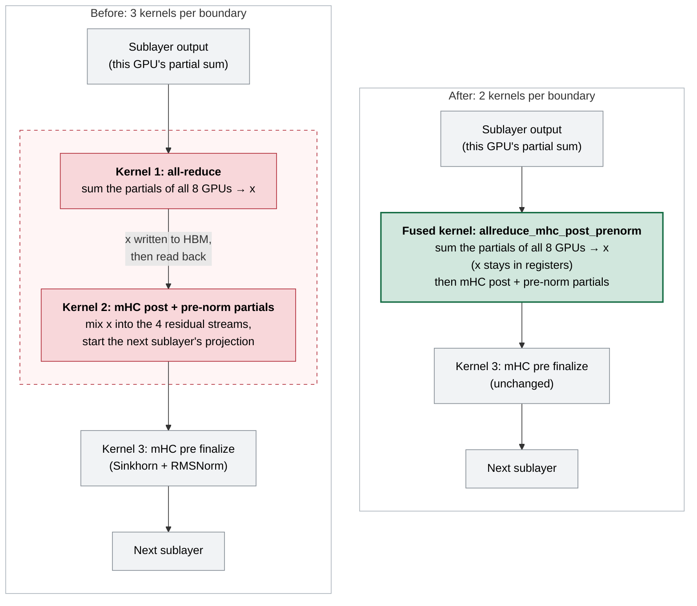
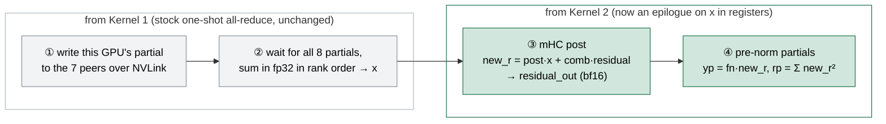

# GitHub Stars 合并报告 - 2026-10-28

**合并日期**: 2026-10-29
**监控日期**: 2026-10-28
**仓库数量**: 12

## 目录

1. [ByteDance-Seed/VeOmni](#ByteDance-Seed-VeOmni)
2. [ModelTC/LightX2V](#ModelTC-LightX2V)
3. [aigc-apps/VideoX-Fun](#aigc-apps-VideoX-Fun)
4. [flashinfer-ai/flashinfer](#flashinfer-ai-flashinfer)
5. [hao-ai-lab/FastVideo](#hao-ai-lab-FastVideo)
6. [huggingface/diffusers](#huggingface-diffusers)
7. [modelscope/DiffSynth-Engine](#modelscope-DiffSynth-Engine)
8. [modelscope/DiffSynth-Studio](#modelscope-DiffSynth-Studio)
9. [sgl-project/sglang](#sgl-project-sglang)
10. [vipshop/cache-dit](#vipshop-cache-dit)
11. [vllm-project/vllm](#vllm-project-vllm)
12. [vllm-project/vllm-omni](#vllm-project-vllm-omni)

---

<a id="ByteDance-Seed-VeOmni"></a>


**报告日期**: 2026-10-29
**监控日期**: 2026-10-28
**仓库地址**: [ByteDance-Seed/VeOmni](https://github.com/ByteDance-Seed/VeOmni)

## 仓库信息

- **描述**: VeOmni: Scaling Any Modality Model Training with Model-Centric Distributed Recipe Zoo
- **语言**: Python
- **星标数**: 2267
- **最后更新**: 2026-10-28T12:01:20Z

## 提交统计

- **昨日提交总数**: 2
- **提交者数量**: 2
- **主要提交者**: Coach257, YLlllllllllll

## AI分析总结

# VeOmni 仓库昨日提交分析（2 条记录）

## 1. 主要更新类型
- **重构**：将 chunk logprobs 的设备端 kernel 从模型相关代码中分离到 `veomni/ops` 独立模块（`a795260`）。
- **Bug 修复**：修复 meta 随机初始化过程中持久缓冲区（persistent buffers）被意外丢弃的问题（`f501938`）。

## 2. 关键变更点及其与项目整体方向的关系

**kernel 分离（a795260）**
- 该提交将 chunk-level logprobs 计算的自定义 device kernel 从模型实现中剥离，统一归入 `veomni/ops` 算子库。
- 这与 VeOmni 的核心理念高度一致：项目主打"以模型为中心的分布式训练配方动物园（Model-Centric Distributed Recipe Zoo）"，需要底层算子与上层模型解耦，使不同模态模型能复用同一套高性能算子。

**持久缓冲区修复（f501938）**
- 修复 meta device 上做随机初始化时，模型中带 `persistent=True` 的 buffer（如位置编码缓存、运行统计量等）未被正确实例化/保留的问题。
- 这直接影响多模态大模型训练的正确性——buffer 丢失可能导致训练数值不一致或加载 checkpoint 时形状/键不匹配。

## 3. 对项目的影响和潜在意义

- **工程质量提升**：kernel 下沉到 ops 层后，`veomni/ops` 成为统一的算子入口，便于后续做算子融合、CUDA/Triton 优化和跨硬件适配（GPU/Ascend 等），降低维护成本。
- **训练可靠性增强**：buffer 修复消除了一个隐蔽的初始化陷阱，对于大规模分布式训练尤其重要——单个 rank 出错会导致整个训练 job 崩溃或静默产出错误模型。
- **间接的性能信号**：虽然提交本身未声称性能提升，但 kernel 独立化是后续做性能优化（如通信-计算重叠、kernel autotune）的前提。

## 4. 值得关注的技术点

- **meta initialization 与 persistent buffer 的交互**：`torch.nn.Module` 在 `to_empty()`/meta 初始化流程中，`persistent` buffer 不走 `__getattr__` 的常规路径，容易在自定义 init 钩子里被遗漏。该修复值得多模态训练框架借鉴。
- **ops 模块化设计模式**：将模型内部算子提升为一级公民模块，是 VeOmni 支撑"任意模态"扩展的关键架构决策；后续可以观察是否有算子文档或 benchmark 随之补充。
- **提交号跨度大（#967 vs #1338）**：说明该仓库 PR 合并活跃，且早期 PR（#967）可能长期 review 后才合入，反映出分布式初始化这类底层变更的谨慎度。

## 5. 对项目发展的影响（结合项目背景）

VeOmni 的目标是让研究者和工程师用统一的分布式 recipe 快速训练视频、音频、图像、文本等多模态模型。这两条提交从两个维度支撑了这一愿景：

- **架构层面**：kernel 与模型解耦后，新模态模型只需组合 `veomni/ops` 中的算子即可完成接入，显著降低新增模态的边际成本，直接服务于"Any Modality"的目标。
- **稳定性层面**：分布式初始化是多机多卡训练中最脆弱的环节之一，修复 buffer 保留问题减少了用户在大规模训练时的调试成本，提升了项目作为生产级训练框架的可信度。

总体而言，这两条提交属于**打地基式**的改进——不引入新功能，但让 VeOmni 的算子体系更清晰、分布式训练更健壮，为后续扩展新模态和更激进的性能优化铺平道路。

## 详细提交记录

### [a795260](https://github.com/ByteDance-Seed/VeOmni/commit/a795260d1b67a75121af44c07210a9e0aad1eb94)

- **作者**: Coach257
- **时间**: 2026-10-28T12:01:13Z
- **提交信息**: [ops, model] refactor: separate chunk logprobs device kernels into veomni/ops (#1338)

### [f501938](https://github.com/ByteDance-Seed/VeOmni/commit/f501938a214896c9efe4a023825637d06fefdc11)

- **作者**: YLlllllllllll
- **时间**: 2026-10-28T08:13:52Z
- **提交信息**: [dist] fix: preserve persistent buffers during meta random initialization (#967)

---

<a id="ModelTC-LightX2V"></a>


**报告日期**: 2026-10-29
**监控日期**: 2026-10-28
**仓库地址**: [ModelTC/LightX2V](https://github.com/ModelTC/LightX2V)

## 仓库信息

- **描述**: Lightweight Image Video Action Generation Inference Framework
- **语言**: Python
- **星标数**: 2966
- **最后更新**: 2026-10-28T16:17:54Z

## 提交统计

- **昨日提交总数**: 2
- **提交者数量**: 1
- **主要提交者**: STwangyingrui

## AI分析总结

# LightX2V 昨日提交分析

## 1. 主要更新类型

昨日提交（共2个）以**功能新增**和**性能优化**为主：
- 新增算子基准测试与模型分析工具（profiling）
- 新增NUMA局部性CPU权重offload优化

## 2. 关键变更点及与项目方向的关系

**提交[9e2f51d]：算子基准测试与模型分析工具**
- 引入了共享计算统计、生产后端基准测试、以及带TensorBoard trace的真实模型模块级分析能力
- 支持TP/SP模块对比、GPU资源监控
- 新增面向任务的agent技能（agent skills），表明项目在探索AI辅助推理调优
- 与项目"轻量视频生成推理框架"的方向高度吻合——视频生成推理对性能敏感，系统化的profiling和benchmark工具能帮助开发者精确定位瓶颈，是框架走向成熟和工程化的必要基础设施

**提交[78d61ee]：NUMA局部CPU权重offload**
- 解决了一个具体的性能问题：CPU block-offloaded权重可能被分配到距离GPU较远的NUMA节点上，导致传输时间增加和推理不确定性
- 通过新增`cpu_offload_numa`选项（默认关闭，opt-in），利用现有arena backend将每个rank的pinned内存权重放置在GPU本地NUMA节点
- 无需修改CPU affinity或launcher，侵入性极低
- 这是视频生成模型常见的显存优化策略（offload到CPU）的精细化改进，直接关系到推理延迟的稳定性和吞吐量

## 3. 对项目的影响和潜在意义

- **可观测性提升**：profiling工具使框架用户和开发者能系统地量化推理性能，为后续优化提供数据支撑，这是框架生态建设的关键一步
- **推理稳定性改善**：NUMA-aware offload减少了因跨节点内存访问带来的性能波动，对于需要长时间批量生成视频的生产场景意义显著
- **降低优化门槛**：agent skills的引入暗示项目可能在尝试将AI代理集成到开发调试流程中，这对复杂推理系统的性能调优具有前瞻性

## 4. 值得关注的技术点

- **NUMA-aware内存管理**：通过arena backend实现，设计上选择了最小侵入路径（opt-in开关），在工程实践中值得借鉴
- **模块级profiling**：支持TP（张量并行）和SP（序列并行）的模块间对比分析，对分布式视频生成推理的调优非常实用
- **TensorBoard集成**：将推理性能分析以可视化方式呈现，降低了性能调优的认知成本
- **Agent skills**：将推理任务抽象为AI agent可调用的技能，是一个值得关注的方向性信号

## 5. 对项目发展的影响

结合README所述，LightX2V定位为轻量级视频生成推理框架，核心竞争力在于高效推理。昨日的两个提交体现了项目从"能跑"向"跑好"的演进方向：一方面通过profiling和benchmark工具建立**系统化的性能度量体系**，使优化工作可量化、可追踪；另一方面通过NUMA局部性offload直接**改善生产环境下的推理延迟和稳定性**。两者相辅相成——度量驱动优化，优化结果可被度量验证。这些工作标志着框架正在从功能搭建阶段进入性能打磨阶段，对于一个面向生产部署的推理框架而言，这是走向成熟的关键路径。

## 详细提交记录

### [9e2f51d](https://github.com/ModelTC/LightX2V/commit/9e2f51daae2433b6de731d57a9d2f31e69643171)

- **作者**: STwangyingrui
- **时间**: 2026-10-28T16:14:46Z
- **提交信息**: Add operator benchmarking and model profiling tools (#1656)

Add shared compute statistics, benchmarks for production backends, and
real model module profiling with TensorBoard traces.
Support TP/SP module comparisons, GPU resource monitoring, and
task-oriented agent skills.

### [78d61ee](https://github.com/ModelTC/LightX2V/commit/78d61eea465e63c6af61d2feb0079e82a3584b6a)

- **作者**: STwangyingrui
- **时间**: 2026-10-28T11:35:14Z
- **提交信息**: Add NUMA-local CPU weight offload (#1654)

CPU block-offloaded weights may be allocated on a NUMA node remote from
their GPU, increasing transfer time and inference variability. Add the
opt-in cpu_offload_numa option to place each rank’s pinned weights on
its GPU-local NUMA node using the existing arena backend, without
CPU-affinity or launcher changes.

---

<a id="aigc-apps-VideoX-Fun"></a>


**报告日期**: 2026-10-29
**监控日期**: 2026-10-28
**仓库地址**: [aigc-apps/VideoX-Fun](https://github.com/aigc-apps/VideoX-Fun)

## 仓库信息

- **描述**: 📹 A more flexible framework that can generate videos at any resolution and creates videos from images. 
- **语言**: Python
- **星标数**: 2318
- **最后更新**: 2026-10-28T11:56:08Z

## 提交统计

- **昨日提交总数**: 0

## AI分析总结

昨日无提交

---

<a id="flashinfer-ai-flashinfer"></a>


**报告日期**: 2026-10-29
**监控日期**: 2026-10-28
**仓库地址**: [flashinfer-ai/flashinfer](https://github.com/flashinfer-ai/flashinfer)

## 仓库信息

- **描述**: FlashInfer: Kernel Library for LLM Serving
- **语言**: Cuda
- **星标数**: 6807
- **最后更新**: 2026-10-29T01:37:48Z

## 提交统计

- **昨日提交总数**: 115
- **提交者数量**: 28
- **主要提交者**: Yanqin Zhai, Matt Murphy, gitbisector

## AI分析总结

# FlashInfer 昨日提交综合分析

## 一、主要更新

昨日 115 个提交以**性能优化为绝对主导**，覆盖 GEMM、注意力（FMHA、MLA、KDA/KCP）、MoE、GDN、采样、RoPE、LM-head 等核心算子的调度与程序选择调优；辅以**功能扩展**与**正确性/稳定性修复**。功能方面包括 Cake 后端新增 packed-varlen HD256 GQA 训练注意力（前向+反向）、原生行布局的 MLA MTP 解码候选、Blackwell MegaMoE 扩展至全部窄数据类型、Prims-TS 融合 MoE 成为 split layer 新计算后端（覆盖 NVFP4/MXFP4/MXFP8/BF16/DeepSeek FP8 并新增 Rubin SM107 支持）。修复方面涵盖 mHC 前反向 workspace 偏移导致的 CUDA 崩溃、KDA 批处理 tape 缺陷、NVFP4 KV prefill 越界污染共享内存、多处 PDL 数据竞态、cake_mhc 反向传播内存泄漏（峰值最高降约 2 GiB）、b12x W4A16 E8M0 偏置错误（7 改为 71）引发的静默精度退化，以及多起缓存设计缺陷。

## 二、关键变更

**调度即性能**是核心主线：在 SM90、SM100a（B200/GB200）、SM103a（GB300）、SM107a（Rubin）上，通过 dispatch 分桶路由、持久化路由、makespan 模型驱动的 CTA 上限放宽、流水线深度自适应（GB300 用 4 级 K/V 环）等纯调度层手段获得 1%–9% 稳定收益，多数零内核代码改动、输出逐位一致。算子级 retune 覆盖 grouped FP8 GEMM、softmax、RMSNorm、causal conv1d、MoE 融合 SiLU-quant 等，量化验证 softmax 约 1.036–1.103×、MoE 融合内核达 1.29–1.55×。

**内存与通信效率**：KDA 将分组逻辑迁至宿主，启动次数从 103 降至 59；DSA indexer 工作区减半（114→57 MiB）；NVLink dispatch 发送端提前量化使传输量降至 BF16 约 1/3.5；NVLinkOneSidedAlltoAll 新增 Lamport 无标志传输路径；SM12x 静态 kernel 改为符号化 token 编译，首调用耗时从 74.5s 降至 9.2s。

**缓存与 CUDA Graph 修复**是重灾区：GDN 解码缓存键不完整导致跨进程磁盘缓存污染、MoE 自动调优缓存键含 rank 引发多卡死锁、cuDNN 图在 stream 捕获期间被 LRU 驱逐造成重放崩溃、workspace 复用跨 bucket 污染的 PTX 级隐蔽 bug，均属线上级严重缺陷。

**前沿模型与多代硬件**：GLM-5.3-Flash 的 TP8 all-reduce 与 mHC 融合为单 kernel；DeepSeek-V4 稀疏 MLA 一次性替换 41 个 program；SM107 适配包括 DeepSeek V4 HCA 使能与线程数上限调整；为 chunk_gated_delta_product 补齐 H100 prefill 内核（2.255×）。训练场景纵深扩展：KDA 训练后端缓存 plan 结果并共享通信缓冲池；GDN 确定性训练路径最高提速 28.9%。

**工程与发布**：CPU-only 测试迁入 `tests/cpu`；SM110 wheel 补齐模块；夜间 wheel 索引利用 PEP 503 属性与测试状态解耦；与 vLLM 联动修复多 EP 热重启挂起。

## 三、技术关注点

零内核改动的调度优化范式；f16x2/f32x2 打包指令与 Blackwell UMMA 深度利用；L2 预取逐架构实测决策；PDL 语义陷阱（需 memory clobber 并在 SASS 级验证）；量化下沉通信路径；Lamport sentinel+epoch 无同步协议；CUDA Graph 与缓存交互的 pin 机制；ABBA 顺序、噪声带、bit-identical 验证等严谨基准方法论。

## 四、项目影响

这批变更从三方面巩固 FlashInfer 的定位：向 GB300/Rubin 等最新硬件快速适配；从单点内核优化走向宿主调度、内存生命周期、测试基础设施的全栈系统化调优；GQA 训练与 MLA 解码增强使项目向训练场景延伸。多项静默错误修复与假阳性消除显著提升生产可靠性，正推动 FlashInfer 巩固其作为 vLLM、SGLang 底层加速库的基础设施地位。

## 详细提交记录

### [cd3ec01](https://github.com/flashinfer-ai/flashinfer/commit/cd3ec0141e8b722addec751d6bfe554d9fdb84f5)

- **作者**: eigen
- **时间**: 2026-10-28T23:46:25Z
- **提交信息**: perf(cake_deepgemm_dense_mqa): serve the full-block qle2048 kvsplit route on sm_103a with the partial-block program up to K = 8192 (#7779)

This PR follows up #7607, #7643 and #7741. FlashInfer's Cake
DeepGEMM-form MQA logits programs for Blackwell back
`flashinfer.dense_mqa` and `flashinfer.paged_mqa`. The variants are
dense FP8 with 32 or 64 heads, dense FP4 with 32 heads (including fused
metadata + logits sequences), and paged FP8. This PR changes dense FP8
with 64 heads, on sm_103a only. On sm_103a, when the call's key count K
is at most 8192, the `fp8:h64:full:qle2048:kvsplit` route now launches
the logits program that the `fp8:h64:partial:qle2048:kvsplit` route
already ships on sm_103a. When K is above 8192, the route keeps the
program it ran before, because that program is faster there. So unlike
the sm_100a change in #7741, this PR does not re-point the whole route.
The route record stores this split in the catalog as a per-architecture
KV-length bucket (`stage_buckets`), and the catalog schema version does
not change. No program is added, removed or changed. sm_100a is
unchanged. Logits and schedule words are bitwise equal on every row of
the table. The baseline is the previous version, FlashInfer main
c2f8204b4589, whose dense MQA files equal current main's. On GB300, 3
rows launch the bucket's program, with speedup 1.0306–1.0427 (median
1.0372). Each of these rows is faster in all 3 sessions. They are
prefill Q 128 and Q 1024 with prefix 4100 (causal), plus prefill Q 128,
prefix 4100, causal, 2 sequences. The other 103 rows run byte-identical
programs in both versions. They read 0.9925–1.0122 with median 1.0000,
which is measurement noise.

**NVIDIA GB300** (sm_103a, 152 SMs), CUDA 13.4 (nvcc V13.4.92,
JIT-compiled), driver 580.159.03, torch 2.14.1+cu130. Previous version =
FlashInfer main c2f8204b4589 (dense MQA paths). The 106 rows are the
#7607/#7643 shape list. Timing is CUPTI GPU time per call with a cold
L2. µs is the median over the 3 sessions of each session's median.
Speedup is the median over the sessions of previous / this (> 1 =
faster). Rows that launch more than one kernel per call report the sum
of kernel times. The notation is the same as in #7643 and #7741. `Q q, K
k` is q queries over k keys. `prefill Q q, prefix p, causal` is q new
queries attending causally over p cached keys plus themselves (K = p +
q). "2 sequences" puts two such sequences in one call. "2048-query
chunks" splits the prefill into calls of 2048 queries and sums the
kernel times over the chunk calls. "updated" means the row's call
launches the bucket's program. "same program" means every program on the
row is byte-identical to the previous version.

| shape | dtype | heads | previous µs | this PR µs | speedup | program |
|---|---|---:|---:|---:|---:|---|
| prefill Q 37, prefix 4100, causal | FP8 | 32 | 5.28 | 5.28 | 1.0000 |
same program |
| prefill Q 1024, prefix 32779, causal | FP8 | 32 | 109.07 | 109.15 |
0.9985 | same program |
| prefill Q 1, prefix 0, causal | FP8 | 64 | 3.90 | 3.90 | 1.0000 | same
program |
| prefill Q 1, prefix 4100, causal | FP8 | 64 | 3.97 | 3.97 | 1.0000 |
same program |
| prefill Q 1, prefix 32779, causal | FP8 | 64 | 4.93 | 4.96 | 1.0000 |
same program |
| prefill Q 1, prefix 131077, causal | FP8 | 64 | 7.74 | 7.74 | 1.0000 |
same program |
| prefill Q 2, prefix 0, causal | FP8 | 64 | 3.94 | 3.94 | 1.0000 | same
program |
| prefill Q 2, prefix 4100, causal | FP8 | 64 | 4.61 | 4.61 | 1.0000 |
same program |
| prefill Q 3, prefix 0, causal | FP8 | 64 | 3.79 | 3.79 | 1.0000 | same
program |
| prefill Q 3, prefix 4100, causal | FP8 | 64 | 4.35 | 4.35 | 1.0000 |
same program |
| prefill Q 7, prefix 0, causal | FP8 | 64 | 3.79 | 3.79 | 1.0000 | same
program |
| prefill Q 7, prefix 4100, causal | FP8 | 64 | 4.35 | 4.35 | 1.0000 |
same program |
| prefill Q 8, prefix 0, causal | FP8 | 64 | 3.71 | 3.71 | 1.0000 | same
program |
| prefill Q 8, prefix 4100, causal | FP8 | 64 | 4.38 | 4.37 | 1.0000 |
same program |
| prefill Q 16, prefix 0, causal | FP8 | 64 | 3.81 | 3.79 | 1.0000 |
same program |
| prefill Q 16, prefix 4100, causal | FP8 | 64 | 4.42 | 4.42 | 1.0000 |
same program |
| prefill Q 37, prefix 0, causal | FP8 | 64 | 3.74 | 3.74 | 1.0000 |
same program |
| prefill Q 37, prefix 4100, causal | FP8 | 64 | 5.38 | 5.38 | 1.0000 |
same program |
| prefill Q 37, prefix 32779, causal | FP8 | 64 | 12.70 | 12.70 | 1.0000
| same program |
| prefill Q 37, prefix 131077, causal | FP8 | 64 | 34.16 | 34.18 |
0.9995 | same program |
| prefill Q 64, prefix 0, causal | FP8 | 64 | 3.81 | 3.81 | 1.0000 |
same program |
| prefill Q 64, prefix 4100, causal | FP8 | 64 | 6.09 | 6.08 | 1.0000 |
same program |
| prefill Q 128, prefix 0, causal | FP8 | 64 | 3.90 | 3.90 | 1.0000 |
same program |
| prefill Q 128, prefix 4100, causal | FP8 | 64 | 8.91 | 8.59 | 1.0372 |
updated |
| prefill Q 128, prefix 4100, causal, 2 sequences | FP8 | 64 | 7.81 |
7.49 | 1.0427 | updated |
| prefill Q 128, prefix 32779, causal | FP8 | 64 | 30.64 | 30.67 |
0.9990 | same program |
| prefill Q 128, prefix 131077, causal | FP8 | 64 | 103.74 | 103.79 |
0.9992 | same program |
| prefill Q 129, prefix 0, causal | FP8 | 64 | 3.81 | 3.81 | 1.0000 |
same program |
| prefill Q 129, prefix 4100, causal | FP8 | 64 | 8.67 | 8.67 | 1.0000 |
same program |
| prefill Q 1023, prefix 0, causal | FP8 | 64 | 9.57 | 9.54 | 1.0000 |
same program |
| prefill Q 1023, prefix 4100, causal | FP8 | 64 | 35.86 | 35.87 |
0.9996 | same program |
| prefill Q 1024, prefix 0, causal | FP8 | 64 | 9.70 | 9.70 | 1.0000 |
same program |
| prefill Q 1024, prefix 4100, causal | FP8 | 64 | 36.90 | 35.85 |
1.0306 | updated |
| prefill Q 1024, prefix 32779, causal | FP8 | 64 | 206.29 | 206.46 |
0.9993 | same program |
| prefill Q 1024, prefix 131077, causal | FP8 | 64 | 843.54 | 841.85 |
1.0020 | same program |
| prefill Q 4096, prefix 0, causal | FP8 | 64 | 62.18 | 62.18 | 1.0000 |
same program |
| prefill Q 4096, prefix 4100, causal | FP8 | 64 | 157.68 | 157.62 |
0.9999 | same program |
| prefill Q 4096, prefix 32779, causal | FP8 | 64 | 888.62 | 888.30 |
1.0015 | same program |
| prefill Q 4096, prefix 32779, causal, 2 sequences | FP8 | 64 | 587.37
| 586.78 | 1.0010 | same program |
| prefill Q 4096, prefix 32779, causal, 2048-query chunks | FP8 | 64 |
887.18 | 890.56 | 0.9961 | same program |
| prefill Q 4096, prefix 131077, causal | FP8 | 64 | 3531.58 | 3529.52 |
1.0003 | same program |
| prefill Q 4096, prefix 131077, causal, 2048-query chunks | FP8 | 64 |
3543.23 | 3537.79 | 1.0002 | same program |
| prefill Q 8192, prefix 0, causal | FP8 | 64 | 210.75 | 210.93 | 0.9992
| same program |
| prefill Q 8192, prefix 4100, causal | FP8 | 64 | 411.53 | 412.58 |
0.9964 | same program |
| prefill Q 8192, prefix 32779, causal | FP8 | 64 | 1902.46 | 1908.61 |
0.9996 | same program |
| prefill Q 8192, prefix 32779, causal, 2048-query chunks | FP8 | 64 |
1938.37 | 1936.74 | 1.0015 | same program |
| prefill Q 8192, prefix 131077, causal | FP8 | 64 | 7202.02 | 7168.44 |
1.0047 | same program |
| prefill Q 8192, prefix 131077, causal, 2048-query chunks | FP8 | 64 |
7269.02 | 7275.21 | 0.9999 | same program |
| prefill Q 16231, prefix 0, causal | FP8 | 64 | 843.87 | 850.28 |
0.9925 | same program |
| prefill Q 16231, prefix 4100, causal | FP8 | 64 | 1270.62 | 1270.62 |
1.0000 | same program |
| prefill Q 16231, prefix 32779, causal | FP8 | 64 | 4326.95 | 4328.47 |
0.9995 | same program |
| prefill Q 16231, prefix 32779, causal, 2048-query chunks | FP8 | 64 |
4375.58 | 4380.31 | 0.9987 | same program |
| prefill Q 16231, prefix 131077, causal | FP8 | 64 | 14809.23 |
14812.37 | 0.9998 | same program |
| prefill Q 16231, prefix 131077, causal, 2048-query chunks | FP8 | 64 |
15004.68 | 15006.46 | 0.9999 | same program |
| Q 1, K 4096 | FP8 | 32 | 3.81 | 3.81 | 1.0000 | same program |
| Q 1, K 32768 | FP8 | 32 | 4.64 | 4.64 | 1.0000 | same program |
| Q 1, K 131072 | FP8 | 32 | 7.44 | 7.42 | 1.0022 | same program |
| Q 1, K 1048576 | FP8 | 32 | 30.19 | 30.18 | 1.0005 | same program |
| Q 1, K 1048832 | FP8 | 32 | 32.50 | 32.59 | 0.9978 | same program |
| Q 3, K 8192 | FP8 | 32 | 4.70 | 4.70 | 1.0000 | same program |
| Q 3, K 1048832 | FP8 | 32 | 33.60 | 33.68 | 1.0000 | same program |
| Q 16, K 2048 | FP8 | 32 | 4.67 | 4.67 | 1.0000 | same program |
| Q 16, K 4096 | FP8 | 32 | 4.77 | 4.77 | 1.0000 | same program |
| Q 16, K 32768 | FP8 | 32 | 7.31 | 7.23 | 1.0122 | same program |
| Q 16, K 131072 | FP8 | 32 | 13.41 | 13.44 | 1.0000 | same program |
| Q 16, K 1048576 | FP8 | 32 | 59.58 | 59.68 | 0.9992 | same program |
| Q 16, K 1048832 | FP8 | 32 | 60.82 | 60.70 | 1.0018 | same program |
| Q 33, K 8192 | FP8 | 32 | 5.41 | 5.41 | 1.0000 | same program |
| Q 33, K 1048832 | FP8 | 32 | 179.30 | 179.55 | 0.9986 | same program |
| Q 37, K 4137 | FP8 | 32 | 5.34 | 5.34 | 1.0000 | same program |
| Q 128, K 2048 | FP8 | 32 | 5.89 | 5.90 | 1.0000 | same program |
| Q 128, K 4096 | FP8 | 32 | 7.04 | 7.04 | 1.0000 | same program |
| Q 128, K 32768 | FP8 | 32 | 18.34 | 18.34 | 0.9974 | same program |
| Q 128, K 131072 | FP8 | 32 | 53.87 | 53.87 | 1.0000 | same program |
| Q 128, K 131328 | FP8 | 32 | 56.77 | 56.72 | 1.0014 | same program |
| Q 130, K 8192 | FP8 | 32 | 9.52 | 9.52 | 1.0000 | same program |
| Q 130, K 8448 | FP8 | 32 | 9.82 | 9.82 | 1.0000 | same program |
| Q 130, K 65792 | FP8 | 32 | 33.63 | 33.66 | 1.0000 | same program |
| Q 132, K 2048 | FP8 | 32 | 6.46 | 6.46 | 1.0000 | same program |
| Q 132, K 8448 | FP8 | 32 | 9.78 | 9.76 | 1.0016 | same program |
| Q 132, K 65792 | FP8 | 32 | 33.41 | 33.31 | 0.9990 | same program |
| Q 1024, K 33803 | FP8 | 32 | 110.74 | 110.91 | 0.9992 | same program |
| Q 2052, K 2048 | FP8 | 32 | 21.01 | 20.99 | 1.0008 | same program |
| Q 2052, K 8448 | FP8 | 32 | 61.42 | 61.38 | 1.0008 | same program |
| Q 2053, K 2048 | FP8 | 32 | 21.49 | 21.47 | 1.0007 | same program |
| Q 2053, K 8448 | FP8 | 32 | 61.89 | 61.86 | 1.0013 | same program |
| Q 1, K 4096 | FP4 | 32 | 3.84 | 3.84 | 1.0000 | same program |
| Q 1, K 32768 | FP4 | 32 | 4.54 | 4.54 | 0.9965 | same program |
| Q 1, K 131072 | FP4 | 32 | 6.38 | 6.42 | 0.9950 | same program |
| Q 1, K 131328 | FP4 | 32 | 14.10 | 13.95 | 1.0098 | same program |
| Q 7, K 2048 | FP4 | 32 | 4.67 | 4.67 | 1.0000 | same program |
| Q 16, K 4096 | FP4 | 32 | 4.86 | 4.86 | 1.0000 | same program |
| Q 16, K 32768 | FP4 | 32 | 6.66 | 6.66 | 1.0000 | same program |
| Q 16, K 131072 | FP4 | 32 | 12.16 | 12.16 | 1.0013 | same program |
| Q 16, K 1048576 | FP4 | 32 | 54.26 | 54.26 | 1.0000 | same program |
| Q 16, K 1048832 | FP4 | 32 | 61.42 | 61.22 | 1.0034 | same program |
| Q 33, K 8192 | FP4 | 32 | 5.54 | 5.54 | 1.0000 | same program |
| Q 33, K 1048832 | FP4 | 32 | 125.73 | 125.76 | 0.9997 | same program |
| Q 128, K 4096 | FP4 | 32 | 6.43 | 6.43 | 1.0000 | same program |
| Q 128, K 32768 | FP4 | 32 | 17.15 | 17.15 | 1.0000 | same program |
| Q 128, K 131072 | FP4 | 32 | 52.85 | 52.85 | 1.0003 | same program |
| Q 130, K 65536 | FP4 | 32 | 30.75 | 30.75 | 1.0000 | same program |
| Q 130, K 65792 | FP4 | 32 | 36.56 | 36.72 | 1.0048 | same program |
| Q 1024, K 2048 | FP4 | 32 | 13.94 | 13.97 | 1.0000 | same program |
| Q 2052, K 2048 | FP4 | 32 | 21.60 | 21.87 | 0.9934 | same program |
| Q 2052, K 65792 | FP4 | 32 | 397.50 | 397.46 | 0.9999 | same program |

The family's other Cake variants (dense FP8 with 32 or 64 heads, dense
FP4 with 32 heads including fused metadata + logits sequences, and paged
FP8) ship on sm_100a and sm_103a only.


<!-- This is an auto-generated comment: release notes by coderabbit.ai
-->

<!-- coderabbit-ai-generated:v1 -->

## Summary by CodeRabbit

- **New Features**
- Added architecture- and KV-length-specific stage selection for
supported routes, with fallback to the route’s default stages when no
bucket matches.
- Updated the 64-head FP8 route to use a corresponding partial-route
program on sm_100a and for KV lengths up to 8192 on sm_103a.
- Expanded program listings to include programs available through stage
buckets.

- **Documentation**
- Documented stage-bucket selection, fallback behavior, and
route-specific program availability.

- **Tests**
- Added coverage for bucket boundaries, fallback behavior, program
listings, and graph replay.

<!-- end of auto-generated comment: release notes by coderabbit.ai -->

---------

Co-authored-by: Avery Huang <averyh@nvidia.com>
Co-authored-by: Claude <noreply@anthropic.com>

### [7a8f324](https://github.com/flashinfer-ai/flashinfer/commit/7a8f324164f7c8d68cd0c7949fd336f1a1dd9d71)

- **作者**: eigen
- **时间**: 2026-10-28T23:43:10Z
- **提交信息**: perf(cake_vsa_sm90): lower the Sage-FP8 grouped-query pin-route threshold from 14 to 8 iterations (#7775)

FlashInfer's Cake backend for variable block-sparse attention on Hopper
(`VariableBlockSparseAttentionWrapper(backend="cake")`, sm_90a) supports
two data types, BF16 and Sage-FP8 (E4M3 inputs with per-head scales,
BF16 output), and each data type has multi-head (MHA) programs and
grouped-query programs (num_qo_heads = g × num_kv_heads, g ∈ {2, 4, 8}).
The grouped-query programs were added in #7167 and retuned in place in
#7185, #7412, #7580, #7634 and #7682, and #7743 added the
position-selected Sage-FP8 grouped-query static program
`attention_fp8_gqa_pin` for static plans whose lightest CTA runs at
least 14 main-loop iterations. This PR, on top of #7743, changes the
planner only: `PIN_MIN_CTA_LOOP_ITERS` in `cake_planner.py` goes from 14
to 8, so static grouped-query Sage-FP8 plans whose lightest CTA runs
8–13 main-loop iterations now also take `attention_fp8_gqa_pin`. Plans
at 7 or fewer iterations keep the static program; their counterparts at
2–3 iterations measured inside the noise band when the program was
added. No kernel source or machine code changes: all 81 generated kernel
units are byte-identical to the #7743 package, every cubin included. The
affected rows are the e4m3 rows of the 5 shapes
`h32-m2048-n2048-k8-ragged0-scale0-g4`,
`h8-m2048-n32768-k48-ragged1-scale0-g4`,
`h8-m2048-n32768-k48-ragged1-scale0-g8`,
`h8-m4096-n4096-k20-ragged1-scale0-g4` and
`h8-m4096-n4096-k20-ragged1-scale0-g8` (10 entries of the 284-row shape
list, since each shape appears in two row sets); every other row keeps
its program byte for byte. The baseline is the previous Cake version of
this backend, the package of #7743, measured on the same node in the
same allocation with the same run form, on an NVIDIA H100 80GB HBM3
(Hopper, sm_90a) with the CUDA 13.4 toolkit (JIT-compiled; PyTorch CUDA
build 13.0) and driver 535.216.03. The run form is two processes, a and
b, each with 9 groups × 256 samples per row, CUPTI kernel-sum timing,
cold L2 (L2 flushed before each sample) and both interleaving orders
(previous→this→this→previous and the reverse); each version is measured
in its own run, interleaved in both orders against the same reference
kernels, and speedup = previous / this. Over the affected rows the
geometric-mean speedup is 1.0289 in process a and 1.0277 in process b,
with per-row ranges of 1.0276–1.0298 (a) and 1.0266–1.0290 (b), and
every affected row is faster in both processes. In process a the largest
gain is `h8-m2048-n32768-k48-ragged1-scale0-g4`, 28.671 → 27.840 µs
(1.0298), and the smallest is `h32-m2048-n2048-k8-ragged0-scale0-g4`,
36.991 → 35.999 µs (1.0276). The BF16 rows of the same 5 shapes run
unchanged code and measured as controls at 0.9987–1.0011, within noise.
Both packages pass every one of the 284 rows against the two reference
baselines.

Sage-FP8 grouped-query variable block-sparse attention forward, NVIDIA
H100 80GB HBM3 (Hopper, sm_90a), CUDA 13.4 toolkit (JIT-compiled;
PyTorch CUDA build 13.0), driver 535.216.03: the previous Cake version
of this backend (the package of #7743) vs this version, each measured in
its own run of the same two-process form (process a shown; 9 groups ×
256 samples per row, CUPTI kernel-sum timing, cold L2, both interleaving
orders against the same reference kernels) on the same node; speedup =
previous / this.

| shape | dtype | previous µs | this µs | speedup |
|---|---|---|---|---|
| h32-m2048-n2048-k8-ragged0-scale0-g4 | e4m3 | 36.991 | 35.999 | 1.0276
|
| h8-m2048-n32768-k48-ragged1-scale0-g4 | e4m3 | 28.671 | 27.840 |
1.0298 |
| h8-m2048-n32768-k48-ragged1-scale0-g8 | e4m3 | 29.376 | 28.544 |
1.0291 |
| h8-m4096-n4096-k20-ragged1-scale0-g4 | e4m3 | 24.607 | 23.935 | 1.0281
|
| h8-m4096-n4096-k20-ragged1-scale0-g8 | e4m3 | 24.448 | 23.744 | 1.0296
|

The other Cake variants (the BF16 and Sage-FP8 multi-head programs and
the other grouped-query programs) are unchanged by this PR, and the
family ships only on sm_90a (Hopper); other architectures have their own
Cake block-sparse attention backends.


<!-- This is an auto-generated comment: release notes by coderabbit.ai
-->
<!-- coderabbit-ai-generated:v1 -->

## Summary by CodeRabbit

* **Performance**
* Updated FP8 grouped-query attention route selection to use an
8-iteration threshold instead of 14. This may change which execution
path is selected for eligible workloads.
* **Tests**
* Updated route-selection checks to validate the pinned and unpinned FP8
grouped-query attention paths.
<!-- end of auto-generated comment: release notes by coderabbit.ai -->

Co-authored-by: Yingyi Huang <averyh@nvidia.com>
Co-authored-by: Claude <noreply@anthropic.com>

### [e371b40](https://github.com/flashinfer-ai/flashinfer/commit/e371b40315603fd089eea9e39baf410ff7e12b41)

- **作者**: eigen
- **时间**: 2026-10-28T23:23:24Z
- **提交信息**: fix(cake_mhc): keep the workspace ticket region at offset 0 for every token count (#7777)

The forward and backward workspaces of the with-grad mHC package placed
the 256-byte `ticket` region last in `cake_jit.WORKSPACE_REGIONS`, after
regions sized by T. Its byte offset therefore depended on T. The
documented contract says that a buffer sized by
`cake_mhc_train_{forward,backward}_workspace_bytes(T_max)` serves every
T <= T_max, including CUDA Graph replays at a smaller T. Separately, the
default workspace (`workspace=None`) shares one buffer per power-of-two
token bucket. In either case, a smaller T reads its ticket words from
bytes that another T's layout used for FP32 `dfn_part` partials or BF16
`dzp` records. Only one kernel reads the ticket: the dynamic-schedule
column-slab form of the backward finish route. It draws work units with
a self-resetting atomic increment and runs on sm_103a for T 385..4096
and on sm_100a (148 and 152 SMs) for T 4097..8192. A start value with
bit 31 set becomes a negative unit index and raises a CUDA
illegal-instruction error, which is sticky and loses the CUDA context. A
small positive start value silently skips units and gives wrong dX /
dfn. This was shown by injection and was not seen in the natural scan.
Larger values give correct results but leave the word non-zero.

On main, the default path crashes at 4096 → 2990 on GB300 and at 8192 →
5980 on B200. On GB200 that default sequence leaves the word at its
limit instead, but 35 of 76 same-bucket larger-to-smaller pairs (for
example 6000 → 4097) leave a negative start word, as do 35 of 70 on B200
and 24 of 68 on GB300. The same sequences crash on caller-owned buffers
sized for 4096 / 8192. The eager warm-up before capturing a graph at
2990 / 5980 on those buffers also crashes. These were checked and are
not affected: the forward (its kernels bind the region but never read
it), sm_107a, the GLM-size rows 14928..16263 and the default buckets 256
/ 512 / 2048. This PR makes `ticket` the first region of both
workspaces, so its offset is 0 for every T. Region sizes, total bytes
and the `workspace_bytes_upto` envelope are unchanged, and there is no
kernel, build or generated-source change. Outputs are bitwise equal to a
fresh workspace, and ticket words stay zero before and after every call.

Each case runs in its own process. "bitwise" means every output (U,
stats, dX, dfn, dscale, dbase) equals the same call on a fresh, zeroed,
exact-size workspace. "ticket zero" means the call's backward ticket
word is 0 before and after the call.

GB300 (sm_103a, 152 SMs), CUDA 13.4, main 949a9f2d vs this PR:

| case | sequence | main | this PR |
|---|---|---|---|
| caller_big_then_small | 16384→2689→2689→16384→2689 (buffer T=16384) |
bitwise; word left at limit 0x2d7, one idle CTA | bitwise, ticket zero |
| caller_bucket | 4096→2990→2130→4096→2990→2130 (buffer T=4096) |
illegal instruction at T=2990 (word 0xc0bcf4aa) | bitwise, ticket zero |
| caller_band_desc | 4096→3158→2219→385 (buffer T=4096) | illegal
instruction at T=3158 (word 0xc0ab31b2) | bitwise, ticket zero |
| caller_4096_1024 | 4096→1024→4096→1024→2048 (buffer T=4096) | illegal
instruction at T=2048 (word 0xc382c630) | bitwise, ticket zero |
| caller_glm | 16263→14928→15566→16263→15288→16164 (buffer T=16263) |
bitwise, ticket zero | bitwise, ticket zero |
| default_bucket | 4096→2990→2130→4096 (`workspace=None`) | illegal
instruction at T=2990 (word 0xc0bcf4aa) | bitwise, ticket zero |
| default_bucket_256 | 200→129→200 (`workspace=None`) | bitwise, ticket
zero | bitwise, ticket zero |
| default_bucket_512 | 512→400→512 (`workspace=None`) | bitwise, ticket
zero | bitwise, ticket zero |
| default_bucket_2048 | 2048→1100→2048 (`workspace=None`) | bitwise,
ticket zero | bitwise, ticket zero |
| default_glm | 16263→14928→16263→15288 (`workspace=None`) | bitwise,
ticket zero | bitwise, ticket zero |
| graph_big_small | capture T=2689 on T=16384 buffers, replays between
eager T=16384 | bitwise; word left at limit 0x2d7, one idle CTA |
bitwise, ticket zero |
| graph_bucket | capture T=2990 on T=4096 buffers, replays between eager
T=4096 | illegal instruction at the eager warm-up (word 0xc0bcf4aa) |
bitwise, ticket zero |
| scan_natural | word under T's ticket offset after one launch at T_prev
| 177 of 646 negative, 185 above limit, 284 zero | 646 of 646 zero |

B200 (sm_100a, 148 SMs), same software:

| case | sequence | main | this PR |
|---|---|---|---|
| caller_big_then_small | 16384→6177→6177→16384→6177 (buffer T=16384) |
bitwise; word left at limit 0x2d3, one idle CTA | bitwise, ticket zero |
| caller_bucket | 8192→5980→4260→8192→5980→4260 (buffer T=8192) |
illegal instruction at T=5980 (word 0xc113bccd) | bitwise, ticket zero |
| caller_band_desc | 8192→6849→5505→4097 (buffer T=8192) | illegal
instruction at T=4097 (word 0xc3c8d82e) | bitwise, ticket zero |
| caller_4096_1024 | 4096→1024→4096→1024→2048 (buffer T=4096) | bitwise,
ticket zero | bitwise, ticket zero |
| caller_glm | 16263→14928→15566→16263→15288→16164 (buffer T=16263) |
bitwise, ticket zero | bitwise, ticket zero |
| default_bucket | 8192→5980→4260→8192 (`workspace=None`) | illegal
instruction at T=5980 (word 0xc113bccd) | bitwise, ticket zero |
| default_bucket_256 | 200→129→200 (`workspace=None`) | bitwise, ticket
zero | bitwise, ticket zero |
| default_bucket_512 | 512→400→512 (`workspace=None`) | bitwise, ticket
zero | bitwise, ticket zero |
| default_bucket_2048 | 2048→1100→2048 (`workspace=None`) | bitwise,
ticket zero | bitwise, ticket zero |
| default_glm | 16263→14928→16263→15288 (`workspace=None`) | bitwise,
ticket zero | bitwise, ticket zero |
| graph_big_small | capture T=6177 on T=16384 buffers, replays between
eager T=16384 | bitwise; word left at limit 0x2d3, one idle CTA |
bitwise, ticket zero |
| graph_bucket | capture T=5980 on T=8192 buffers, replays between eager
T=8192 | illegal instruction at the eager warm-up (word 0xc113bccd) |
bitwise, ticket zero |
| scan_natural | word under T's ticket offset after one launch at T_prev
| 173 of 598 negative, 161 above limit, 264 zero | 598 of 598 zero |

GB200 (sm_100a, 152 SMs), CUDA 13.4, main 449a3573 vs this PR:

| case | sequence | main | this PR |
|---|---|---|---|
| caller_big_then_small | 16384→6145→6145→16384→6145 (buffer T=16384) |
illegal instruction at T=6145 (word 0xc4f4966c) | bitwise, ticket zero |
| caller_bucket | 8192→5980→4260→8192→5980→4260 (buffer T=8192) |
bitwise; word left at limit 0x257, one idle CTA | bitwise, ticket zero |
| caller_band_desc | 8192→6827→5462→4097 (buffer T=8192) | illegal
instruction at T=4097 (word 0xc3c7da4b) | bitwise, ticket zero |
| caller_4096_1024 | 4096→1024→4096→1024→2048 (buffer T=4096) | bitwise,
ticket zero | bitwise, ticket zero |
| caller_glm | 16263→14928→15566→16263→15288→16164 (buffer T=16263) |
bitwise, ticket zero | bitwise, ticket zero |
| default_bucket | 8192→5980→4260→8192 (`workspace=None`) | bitwise;
word left at limit 0x257, one idle CTA | bitwise, ticket zero |
| default_bucket_256 | 200→129→200 (`workspace=None`) | bitwise, ticket
zero | bitwise, ticket zero |
| default_bucket_512 | 512→400→512 (`workspace=None`) | bitwise, ticket
zero | bitwise, ticket zero |
| default_bucket_2048 | 2048→1100→2048 (`workspace=None`) | bitwise,
ticket zero | bitwise, ticket zero |
| default_glm | 16263→14928→16263→15288 (`workspace=None`) | bitwise,
ticket zero | bitwise, ticket zero |
| graph_big_small | capture T=6145 on T=16384 buffers, replays between
eager T=16384 | illegal instruction at the eager warm-up (word
0xc4f4966c) | bitwise, ticket zero |
| graph_bucket | capture T=5980 on T=8192 buffers, replays between eager
T=8192 | bitwise, ticket zero | bitwise, ticket zero |
| scan_natural | word under T's ticket offset after one launch at T_prev
| 173 of 646 negative, 171 above limit, 302 zero | 646 of 646 zero |

Tests:

- New `tests/mhc/test_cake_mhc_train_workspace.py` (8 tests) covers:
  - caller buffers reused across T sequences
  - a graph captured at a smaller T on large buffers
  - the default bucket
  - ticket words zero before and after every call

On main it fails 8 / 8 on GB300 and GB200 and 7 / 8 on B200. On B200 the
4096-bucket case does not reach the ticket reader.
- `tests/cpu/mhc/test_cake_mhc_train_rules.py` checks the region order
and that the ticket offset is 0.
- On GB200 at this PR, `tests/mhc` and `tests/cpu/mhc` give 159 passed,
0 failed, 0 skipped.

Found while working on #7046.


<!-- This is an auto-generated comment: release notes by coderabbit.ai
-->

<!-- coderabbit-ai-generated:v1 -->

## Summary by CodeRabbit

* **Bug Fixes**
* Updated training workspace layouts so ticket storage starts at the
same location in forward and backward operations, while keeping the
remaining workspace regions in their existing order.
* Added coverage for reusing workspaces across token counts and CUDA
Graph replays, checking that results match calls with fresh workspaces.

<!-- end of auto-generated comment: release notes by coderabbit.ai -->

Co-authored-by: Yingyi Huang <averyh@nvidia.com>
Co-authored-by: Claude <noreply@anthropic.com>

### [509d751](https://github.com/flashinfer-ai/flashinfer/commit/509d751bcfb4a3bf0f6248e0856ace7c31d197dc)

- **作者**: eigen
- **时间**: 2026-10-28T23:20:46Z
- **提交信息**: feat(cake_gqa_train): packed-varlen HD256 GQA training attention for SM100 / SM103 / SM107 (#7774)

Cake's HD256 dense GQA training attention covers the forward and
first-order backward passes. It runs on inputs packed by `cu_seqlens`,
with a bottom-right-aligned causal mask per segment so query and key
lengths can differ. The kernel has one data-type variant: BF16 inputs
and outputs with FP32 accumulation. Its backward writes dK/dV in one of
three forms: FP32 window gradients, an FP32 add into caller-owned
destination rows through an int32 row map, or BF16. This PR delivers
that variant, which is the first Cake version of the kernel, as the
experimental `flashinfer.gqa_train` API (`varlen_gqa_attention`,
`varlen_gqa_attention_fwd`, `varlen_gqa_attention_bwd`). The baseline is
FlashAttention-4 (CuTe DSL) HD256 varlen forward and backward
(flash-attn-4 4.0.0b38.dev9 built from FlashAttention PR 2968, head
f4015896), plus the FP32 `index_add_` workaround from #7073 that adds
its BF16 window gradients into the destination rows. Against that
baseline, the geometric-mean speedup over the 9 shapes below is 1.029x.
Total time improves by 1.020x, and every shape is at least 1.003x
faster. `issue1`-`issue3` are the three packed layouts of #7073
(context-parallel zigzag, CP 8 rank 0). `zz_cp{N}_r{R}_{T}` is rank R of
an N-way context-parallel zigzag split of T tokens packed from several
documents of irregular lengths (`zz_cp1` is a plain packed batch).

**NVIDIA GB200 (sm_100a), CUDA 13.4: one training step of one attention
layer under non-reentrant activation checkpointing (2 x forward +
backward, including initialization), median of 10 steps; Cake vs
FlashAttention-4 + FP32 `index_add_` on the same BF16 inputs; H_q = 24,
H_kv = 4, head dim 256.**

| Shape | T_q | T_k | Segments | Cake ms | FlashAttention-4 ms | Speedup
|
|---|---:|---:|---:|---:|---:|---:|
| issue1 | 30,193 | 256,933 | 12 | 60.403 | 62.759 | 1.039x |
| issue2 | 32,737 | 278,362 | 6 | 131.835 | 133.262 | 1.011x |
| issue3 | 32,388 | 275,373 | 4 | 192.519 | 197.685 | 1.027x |
| zz_cp8_r3_120000 | 15,000 | 127,512 | 10 | 23.621 | 24.609 | 1.042x |
| zz_cp4_r1_96000 | 24,000 | 108,003 | 6 | 36.799 | 37.561 | 1.021x |
| zz_cp2_r0_40000 | 20,000 | 50,001 | 4 | 34.511 | 34.908 | 1.011x |
| zz_cp8_r7_300000 | 37,499 | 318,788 | 16 | 149.242 | 149.684 | 1.003x
|
| zz_cp16_r0_420000 | 26,249 | 433,126 | 6 | 237.453 | 242.881 | 1.023x
|
| zz_cp1_r0_16461 | 16,461 | 24,693 | 8 | 4.527 | 4.915 | 1.086x |

Cake ships no other data-type or layout variant of this kernel, and it
is prebuilt for `sm_100a`, `sm_103a` and `sm_107a`.


<!-- This is an auto-generated comment: release notes by coderabbit.ai
-->
<!-- coderabbit-ai-generated:v1 -->

## Summary by CodeRabbit

* **New Features**
* Added an experimental packed variable-length causal GQA attention
training backend for BF16 inputs with head dimension 256 on supported
NVIDIA architectures.
* Added forward, backward, and autograd APIs, with reusable workspace,
optional log-sum-exp output, and flexible gradient accumulation options.
* Added a benchmark comparing training stages with FlashAttention CuTe.
* **Documentation**
* Added guidance on usage, supported hardware, numerical behavior, and
limitations.
* **Tests**
* Added coverage for API behavior, output and gradient accuracy,
workspace reuse, and supported-device constraints.
<!-- end of auto-generated comment: release notes by coderabbit.ai -->

---------

Co-authored-by: Yingyi Huang <averyh@nvidia.com>
Co-authored-by: Claude <noreply@anthropic.com>

### [0d14819](https://github.com/flashinfer-ai/flashinfer/commit/0d14819b76b7aa6bdd699f01dbb7cc569fc1d372)

- **作者**: eigen
- **时间**: 2026-10-28T23:08:42Z
- **提交信息**: perf(cake_fused_qk_rope_fp8_append): use nine-CTA-per-SM stage for B300 single-KV-head decode from 512 CTAs (#7772)

The Cake fused QK RMSNorm + NeoX RoPE + paged KV-cache append kernel has
two data-type variants in FlashInfer: BF16 (`cake_fused_qk_rope_append`)
and FP8 E4M3 (`cake_fused_qk_rope_fp8_append`). This PR changes only the
FP8 variant. On B300 (sm_103a, 148 SMs), it changes stage selection for
single-KV-head (8x1) decode with a page row of at most 48 entries and no
caller-owned K/V. From 512 CTAs (`(num_rows + num_requests) x
num_kv_heads`) up to two waves, these calls now use the existing
nine-CTA-per-SM page-prefetch stage
`fp8_e4m3_min_blocks9_early_rt21_page_prefetch1_clear_tie1` instead of
`fp8_e4m3_early_rt21_page_prefetch1_clear_tie1`. The three early-guess
stages (`early_rt2`) now use a host-side check to refuse a call with no
request (`num_requests == 0`), and the stage selection sends such a call
to the default stage; the kernel device code is unchanged. The baseline
is the FP8 package on FlashInfer main (500833a11d). The changed row,
`X_decode_8x1_B256_q1_n2`, goes from 4.075 to 4.023 µs, a 1.0132x
speedup (1.0061x to 1.0192x per session). The other 43 rows run
identical device code in both packages, so their ratios of 0.9910 to
1.0096 are measurement spread, and the 44-row geomean is 1.0016x. Apart
from that empty-batch case, stage selection on H100 (sm_90a), B200
(sm_100a) and GB300 (sm_103a, 152 SMs) is unchanged.

Speedup = FlashInfer main / this PR, from CUPTI kernel time with a cold
L2. For each side, the value is the mean over 8 sessions of the 10
%-trimmed mean. Both packages are built by FlashInfer's JIT with CUDA
13.4, called through the public API and timed interleaved on the same
GPU in one process. "This PR" is the mean of the PR package and a
second, identical build of it. A `*` after a shape name marks the row
whose stage changes. Row names: `64x8`/`8x1` are query/KV heads
(head_dim 128). `q1`/`q2` mean Q is quantized with a dynamic
per-token/per-head scale (`q1`) or a static scale (`q2`). `n0`/`n1`/`n2`
mean no RMSNorm, RoPE then RMSNorm, or RMSNorm then RoPE. `P_decode` is
32 requests x 1 new token and `P_prefill` is 8 requests x 16 new tokens,
with 2048 cached tokens and page size 64 unless the name says otherwise.
`E_prefill_*_q127/q128/q129` is 4 requests x 127/128/129 new tokens,
which is the 128-row scale-padding boundary. In `X_*` rows,
`B1`/`B128`/`B256` = 1/128/256 requests, `Q1024` = 1024 new tokens,
`page16`/`page128` = page size 16/128, `ctx32768` = 32768 cached tokens,
`outkv` = caller-owned `out_k`/`out_v`, `ragged` = 8 requests with
ragged new-token counts, and `maxseq1024` = 8 requests x 16 new tokens
with max_seqlen 1024.

**NVIDIA B300 SXM6 AC, sm_103a (148 SMs), CUDA 13.4. Speedup =
FlashInfer main / this PR.**

| shape | FlashInfer main (µs) | this PR (µs) | speedup (main / this PR)
|
|---|---:|---:|---:|
| `E_prefill_64x8_q127` | 9.732 | 9.748 | 0.9984 |
| `E_prefill_64x8_q128` | 9.878 | 9.861 | 1.0017 |
| `E_prefill_64x8_q129` | 9.876 | 9.836 | 1.0041 |
| `E_prefill_8x1_q127` | 3.661 | 3.659 | 1.0007 |
| `E_prefill_8x1_q128` | 3.685 | 3.650 | 1.0095 |
| `E_prefill_8x1_q129` | 3.672 | 3.675 | 0.9990 |
| `P_decode_64x8_q1_n0` | 3.598 | 3.619 | 0.9942 |
| `P_decode_64x8_q1_n1` | 3.727 | 3.711 | 1.0042 |
| `P_decode_64x8_q1_n2` | 3.665 | 3.683 | 0.9951 |
| `P_decode_64x8_q2_n0` | 3.581 | 3.559 | 1.0063 |
| `P_decode_64x8_q2_n1` | 3.608 | 3.629 | 0.9943 |
| `P_decode_64x8_q2_n2` | 3.619 | 3.596 | 1.0066 |
| `P_decode_8x1_q1_n0` | 3.057 | 3.055 | 1.0005 |
| `P_decode_8x1_q1_n1` | 3.183 | 3.163 | 1.0063 |
| `P_decode_8x1_q1_n2` | 3.139 | 3.163 | 0.9921 |
| `P_decode_8x1_q2_n0` | 3.019 | 2.990 | 1.0096 |
| `P_decode_8x1_q2_n1` | 3.102 | 3.117 | 0.9951 |
| `P_decode_8x1_q2_n2` | 3.112 | 3.090 | 1.0072 |
| `P_prefill_64x8_q1_n0` | 4.043 | 4.045 | 0.9996 |
| `P_prefill_64x8_q1_n1` | 4.258 | 4.255 | 1.0007 |
| `P_prefill_64x8_q1_n2` | 4.251 | 4.257 | 0.9986 |
| `P_prefill_64x8_q2_n0` | 3.995 | 3.993 | 1.0007 |
| `P_prefill_64x8_q2_n1` | 4.237 | 4.243 | 0.9984 |
| `P_prefill_64x8_q2_n2` | 4.237 | 4.238 | 0.9997 |
| `P_prefill_8x1_q1_n0` | 3.175 | 3.178 | 0.9993 |
| `P_prefill_8x1_q1_n1` | 3.318 | 3.297 | 1.0063 |
| `P_prefill_8x1_q1_n2` | 3.281 | 3.281 | 0.9999 |
| `P_prefill_8x1_q2_n0` | 3.130 | 3.120 | 1.0033 |
| `P_prefill_8x1_q2_n1` | 3.244 | 3.233 | 1.0034 |
| `P_prefill_8x1_q2_n2` | 3.224 | 3.216 | 1.0026 |
| `X_decode_64x8_B128_q1_n2` | 6.985 | 6.996 | 0.9984 |
| `X_decode_64x8_B1_q1_n2` | 3.032 | 3.041 | 0.9972 |
| `X_decode_64x8_B256_q1_n2` | 11.587 | 11.604 | 0.9986 |
| `X_decode_8x1_B128_q1_n2` | 3.477 | 3.457 | 1.0057 |
| `X_decode_8x1_B1_q1_n2` | 3.048 | 3.037 | 1.0038 |
| `X_decode_8x1_B256_q1_n2` * | 4.075 | 4.023 | 1.0132 |
| `X_decode_8x1_q1_n2_ctx32768` | 3.252 | 3.247 | 1.0016 |
| `X_decode_8x1_q1_n2_outkv` | 3.065 | 3.054 | 1.0037 |
| `X_decode_8x1_q1_n2_page128` | 3.244 | 3.247 | 0.9992 |
| `X_decode_8x1_q1_n2_page16` | 3.228 | 3.257 | 0.9910 |
| `X_prefill_64x8_B1_Q1024_q1_n2` | 16.771 | 16.726 | 1.0027 |
| `X_prefill_8x1_B1_Q1024_q1_n2` | 4.441 | 4.413 | 1.0063 |
| `X_prefill_8x1_q1_n2_maxseq1024` | 3.301 | 3.283 | 1.0054 |
| `X_prefill_8x1_ragged_q1_n2` | 3.360 | 3.338 | 1.0066 |

The BF16 variant `cake_fused_qk_rope_append` is unchanged, and the FP8
package ships programs for sm_90a, sm_100a and sm_103a.


<!-- This is an auto-generated comment: release notes by coderabbit.ai
-->

<!-- coderabbit-ai-generated:v1 -->

## Summary by CodeRabbit

* **Bug Fixes**
* Empty-request launches now raise a clear error instead of proceeding,
including when the batch contains QKV rows.
* Zero-request workloads consistently use the default stage policy
across supported architectures and prefill modes.
* **Performance**
* Improved stage selection for certain B300 single-KV-head decode
workloads when prefetch conditions and workload size are suitable.

<!-- end of auto-generated comment: release notes by coderabbit.ai -->

Co-authored-by: Yingyi Huang <averyh@nvidia.com>
Co-authored-by: Claude <noreply@anthropic.com>

### [d9c9d4c](https://github.com/flashinfer-ai/flashinfer/commit/d9c9d4ce43b220057f182514f3eaebb34a3e9f24)

- **作者**: Harrison Zhang
- **时间**: 2026-10-28T22:48:49Z
- **提交信息**: perf(prims_ts): Rubin enablement and optimizations for dense FMHA context (#6568)

<!-- .github/pull_request_template.md -->

## 📌 Description

Tunes the PrimTS context FMHA for Rubin (SM107). Every default below is
gated on compute
capability 10.7 and is enabled per path only where it was measured as a
gain on that path.
Other architectures compile the same kernels as before.

- **(two-CTA UMMA)** on the bf16-QK paths. The CTA pair splits the K/V
operand fetch, which
saturates the shared-memory port on Rubin. The fp8-QK paths keep one CTA
because they are slower
  with the pair.
- **(Two-CTA only where the pairs fill their waves)**. A CTA pair takes
512 query rows and runs on
an SM pair, so with few work tiles it can round the work up to one more
wave than single CTAs do.
The pair is kept only where it fills its waves at least as well; at 4176
queries and 24 heads this
  moves BF16 from 0.156 to 0.127 ms.
- **(Register row max)** on QK-BF16/PV-FP8. The `tcgen05.ld` + FMNMX row
max beats LDTM.STAT on
  this path on Rubin. The fp8-QK paths keep LDTM.STAT.
- **(Packed f16x2 exp2)** on the fp8-V paths. One MUFU `ex2.f16x2` op
per pair of scores instead of
two scalar ops. P stays in f16x2 words, the row sum is one FHADD2 per
pair, and P is packed to
  e4m3 straight from the words.
- **(K=64 fp8 UMMA)** for the fp8 PV of the bf16-QK path. The 2xFP8
instruction form halves the PV
  issue count. The fp8-QK paths keep K=32, which is faster for them.
- **(K/V ring depth)** from the 328 KB shared memory on Rubin. all-FP8
goes from 8 to 6 stages.
- **(VC-Attention off on SM107)**. `plan(vc_config=...)` raises on
compute capability 10.7. The
dense fp8 kernel runs the softmax exp2 natively there, so the VC
preprocessing buys nothing.

Kernel-only time on one VR200 with the SM clock locked at 1700 MHz. B=1,
16 heads, head_dim 128,
dense mask, pre-quantized operands, sequence lengths 61200 / 97200 /
133200, median of 30 runs, two
passes averaged. Reference is trtllm-gen bf16 with its fp16-softmax
variant, 11.18 / 26.97 / 50.73 ms,
measured in the same session.

| path | before ms | after ms | after vs trtllm-gen bf16 |
|---|---|---|---|
| BF16 | 13.79 / 33.78 / 64.03 | 11.12 / 26.83 / 50.52 | 1.01x / 1.01x /
1.00x |
| QK-BF16/PV-FP8 | 9.56 / 23.11 / 43.61 | 8.70 / 20.96 / 39.47 | 1.29x /
1.29x / 1.29x |
| all-FP8 | 8.60 / 20.83 / 39.28 | 6.67 / 16.12 / 30.37 | 1.68x / 1.67x
/ 1.67x |

rel L2 against fp32 attention is unchanged on every path.

End to end on Wan2.2-T2V-A14B at 720x1280 and 40 steps, on the same node
and against trtllm-gen
bf16, all-FP8 reaches 1.26x to 1.47x per step.

## 🔍 Related Issues

None.

## 🚀 Pull Request Checklist

Thank you for contributing to FlashInfer! Before we review your pull
request, please make sure the following items are complete.

### ✅ Pre-commit Checks

- [x] I have installed `pre-commit` by running `pip install pre-commit`
(or used your preferred method).
- [x] I have installed the hooks with `pre-commit install`.
- [x] I have run the hooks manually with `pre-commit run --all-files`
and fixed any reported issues.

> If you are unsure about how to set up `pre-commit`, see [the
pre-commit documentation](https://pre-commit.com/).

## 🧪 Tests

- [x] Tests have been added or updated as needed.
- [x] All tests are passing (`unittest`, etc.).

`tests/attention/test_attention_ts_context.py` non-paged subset 181
passed, 0 failed, 0 skipped on one VR200 with the
Blackwell file gate lifted locally (the paged cases hit a pre-existing
DSL 4.8 lazy-import rejection on Rubin). The
contract test pins the `plan` and `run` parameter lists, a new test pins
the SM107 per-path defaults, and `plan` rejects
`vc_config` on SM107. Kernel time at S=61200, B=1, 16 heads is unchanged
against the previous branch tip: bf16 11.12,
QK-BF16/PV-FP8 8.69, all-FP8 6.67 ms.

## 🔬 Experimental Track

<!-- Only for PRs submitted under the experimental policy
(CONTRIBUTING.md → "Experimental APIs and Backends").
     Leave this section untouched for normal PRs. -->

- [ ] This PR is **experimental**: it adds or changes code under
`flashinfer/experimental/` and/or an `@flashinfer_experimental_api`.
Tracking issue: #
- [ ] The tracking issue names an owner, the reason for the experimental
path, and a graduation plan with a target release.
- [ ] Core changes are limited to a thin entry point (signature, shared
validation, feature-gate check, backend selection, handoff).
- [ ] Tests live in `tests/experimental/` and were validated on the
intended hardware; a runnable example is included.
- [ ] Nothing is registered in `flashinfer/aot.py`, and no experimental
backend is reachable from `backend="auto"` without
`FLASHINFER_ALLOW_EXPERIMENTAL_AUTO_BACKENDS=1`. (Calling an
`@flashinfer_experimental_api` or naming a backend explicitly is itself
the opt-in and needs no environment variable.)
- [ ] **Test scope declared below.** The experimental CI lane runs
exactly these targets, so keep them as narrow as the change allows.

<!-- Required for experimental PRs. Replace the commented lines below
with your targets.
Do not delete the fence or change its `experimental-tests` tag — the
experimental-track
watcher reads it verbatim to decide which targets to ask CI for. -->

```experimental-tests
# One target per line: a directory or a file. (A pytest ::selector is not
# supported -- the sharding runner cannot consume one.) Must be under
# tests/experimental/ and must exist. Delete these comment lines and add yours, e.g.
#
#   tests/experimental/test_my_backend.py
#   tests/experimental/my_backend/
#
# Declaring the whole tree (tests/experimental/) is allowed but means every
# experimental PR pays for every other feature's tests, in every matrix cell.
```

## Reviewer Notes


<!-- This is an auto-generated comment: release notes by coderabbit.ai
-->

<!-- coderabbit-ai-generated:v1 -->

## Summary by CodeRabbit

* **Performance**
* Improved attention execution on supported SM107 hardware with
dtype-aware kernel selection, optimized KV buffering, and FP8 K=64
processing.
  * Added packed FP16 softmax processing for supported workloads.
* **Compatibility**
* Two-CTA execution now accounts for data types and workload efficiency
when selecting a kernel.
* Contiguous plans using unsupported VC configurations on SM107 now
return a clear error.

<!-- end of auto-generated comment: release notes by coderabbit.ai -->

### [b4af846](https://github.com/flashinfer-ai/flashinfer/commit/b4af846126d25a846b672ef631a2c56935a32f15)

- **作者**: Yang Xu
- **时间**: 2026-10-28T22:41:19Z
- **提交信息**: feat(mla): add native-row MTP candidates and bounded reducers (#6527)

<!-- .github/pull_request_template.md -->

## 📌 Description

Build on #6177's preferred/fallback pipeline with internal native-row
MLA decode candidates. H96/Q8 uses three M256 tiles instead of four
padded tiles, while causal coordinates, tail stores and reduction retain
the logical query/head geometry. The native factory covers H96/H128 and
Q2/Q4/Q8 with bounded splits; it is not registered with public
auto/autotune.

Also wire the scalar reducer's prepared split capacity, add opt-in
shared-vector and warp reduction choices, and fix nonzero
softmax-correction skipping in monolithic FP8: decide the running-max
rollback before computing its denominator factor, including the final
tile. The threshold-zero body is preserved.

Thanks to the #6177 authors for the underlying pipeline and to LightSeek
for the native-layout direction in [the MLA 2
write-up](https://lightseek.org/blog/tokenspeed-mla-2). One comparison
detail matters: the article's FI baseline is **new MTP + H96/Q8
adaptation**, not FI's existing monolithic alternative or selection
among all FI kernels. Its separate MLA1 baseline is TS's own previous
implementation. [Comparison
definitions](https://github.com/flashinfer-ai/flashinfer/blob/66bb6994feb3ef0a11c48b70fdbb42f4a5f5ac37/docs/mla_decode_comparisons.md)
explain why these scopes can produce different outcomes.

Target performance measurements remain in internal review material; this
public description makes no performance claim.

## 🔍 Related Issues

Builds on #6177, merged into `main` on October 22, 2026. This PR now
targets `main` and includes main snapshot
`949a9f2d53caaa7f31881cb23c300a5356729433`.

The closeout fixes the scalar reducer compilation cache: all supported
split budgets use capacity 32, matching the generated one-warp reducer.
Changing split counts now reuses a warmed compiled kernel, including
during CUDA Graph capture. Truly cold specializations still require
eager preparation.

## 🚀 Pull Request Checklist

Thank you for contributing to FlashInfer! Before we review your pull
request, please make sure the following items are complete.

### ✅ Pre-commit Checks

- [x] I have installed `pre-commit` by running `pip install pre-commit`
(or used your preferred method).
- [ ] I have installed the hooks with `pre-commit install`.
- [ ] I have run the hooks manually with `pre-commit run --all-files`
and fixed any reported issues.

> If you are unsure about how to set up `pre-commit`, see [the
pre-commit documentation](https://pre-commit.com/).

## 🧪 Tests

- [x] Tests have been added or updated as needed.
- [x] Required checks and targeted SM107 validation are passing.

Closeout validation for `66bb6994feb3ef0a11c48b70fdbb42f4a5f5ac37`:

- Cache regression: both eager reuse and warmed-capture cases fail
before the fix and pass afterward; a cold specialization remains
rejected during capture.
- Scoped pre-commit passed on the complete 13-file follow-up diff,
including mypy and Ruff.
- Corrected an existing CPU-only grid-boundary test to mock
device/compiler metadata; all four boundary cases pass. The original
failure occurred before kernel compilation.
- Correction-threshold bounds: **9 passed**; the six unsafe/non-finite
inputs were accepted before the fix. Finite thresholds through
`log2(448)` are supported; larger values and non-finite values now raise
before compilation, preventing FP8 probability overflow.
- Final-head SM107, CuTe DSL 4.8.0: **1,630 passed, 49 skipped, 0
failed** across all seven requested test files. All **114**
correction/native/reducer cases passed, including numerical reference
checks, changed-input graph replay, and threshold bounds.
- Required GitHub checks passed, including all six AOT build/import
configurations and Test Results Summary.
- Targeted internal SM107 / CUDA 13.4 CI also passed: **1,658 passed, 21
skipped, 0 failed** across the same seven files. Across the internal
matrix, 23 test jobs passed; six supplementary B200 test jobs are still
waiting for GPU resources. No completed internal test job failed.

Earlier SM100 numerical/replay checks remain supporting qualification.
The closeout changes the host cache key and validates correction
thresholds; the generated scalar reducer capacity is unchanged. Target
sanitizer qualification remains open; no new sanitizer or performance
result is claimed.

- [ ] This PR requires **full-scope** CI, not targeted tests (expensive;
justify below).
      Reason: Not requested; validation targets the affected MLA paths.

Suggested CI test targets: `tests/attention/test_mla_fp8_correction.py
tests/attention/test_rubin_mtp_native.py
tests/attention/test_rubin_mtp_reducer.py
tests/attention/test_mla_wrapper_autotune.py
tests/attention/test_mla_auto_backend.py
tests/attention/test_mla_wrapper.py
tests/attention/test_cute_dsl_mla_decode.py`

## 🔬 Experimental Track

<!-- Only for PRs submitted under the experimental policy
(CONTRIBUTING.md → "Experimental APIs and Backends").
     Leave this section untouched for normal PRs. -->

- [ ] This PR is **experimental**: it adds or changes code under
`flashinfer/experimental/` and/or an `@flashinfer_experimental_api`.
Tracking issue: #
- [ ] The tracking issue names an owner, the reason for the experimental
path, and a graduation plan with a target release.
- [ ] Core changes are limited to a thin entry point (signature, shared
validation, feature-gate check, backend selection, handoff).
- [ ] Tests live in `tests/experimental/` and were validated on the
intended hardware; a runnable example is included.
- [ ] Nothing is registered in `flashinfer/aot.py`, and no experimental
backend is reachable from `backend="auto"` without
`FLASHINFER_ALLOW_EXPERIMENTAL_AUTO_BACKENDS=1`. (Calling an
`@flashinfer_experimental_api` or naming a backend explicitly is itself
the opt-in and needs no environment variable.)
- [ ] **Test scope declared below.** The experimental CI lane runs
exactly these targets, so keep them as narrow as the change allows.

<!-- Required for experimental PRs. Replace the commented lines below
with your targets.
Do not delete the fence or change its `experimental-tests` tag — the
experimental-track
watcher reads it verbatim to decide which targets to ask CI for. -->

```experimental-tests
# One target per line: a directory or a file. (A pytest ::selector is not
# supported -- the sharding runner cannot consume one.) Must be under
# tests/experimental/ and must exist. Delete these comment lines and add yours, e.g.
#
#   tests/experimental/test_my_backend.py
#   tests/experimental/my_backend/
#
# Declaring the whole tree (tests/experimental/) is allowed but means every
# experimental PR pays for every other feature's tests, in every matrix cell.
```

## Reviewer Notes

Please focus on logical query rows versus padded workspace, causal
coordinates across H96 token boundaries, split capacity and masked
reductions, and the correction-factor ordering.

The MTP default remains scalar reduction, now with its prepared capacity
correctly wired. The previously unused internal `reducer_d_tiles`
argument now selects scalar (0) or vector (1/2/4); the default is 0 to
retain scalar behavior. Vector/warp choices and the new native factory
remain opt-in. No public backend name, fixed-grid dispatch table or
experimental-track registration is added.

The native factory retains research knobs, including unqualified FP16
softmax. Valid page IDs/live lengths and non-overlapping buffers are
caller contracts; concurrent launches need independent scratch. Narrow
these knobs and complete adjacent/ragged workload, sanitizer and
planned-autotuning coverage before public dispatch admission. Numerical
tolerances were not loosened to admit additional candidates.

TokenSpeed benchmark/reference source is outside this patch. Attribution
for the native packing direction is recorded in the module and
comparison notes. Existing monolithic and #6177 pipeline contributions
should remain distinct from this follow-up's changes.


<!-- This is an auto-generated comment: release notes by coderabbit.ai
-->
<!-- coderabbit-ai-generated:v1 -->

## Summary by CodeRabbit

* **New Features**
* Expanded Rubin MTP decode support for packed query rows and
configurable split-reduction capacity.
* Added options for handling empty attention rows and limiting reducer
prefetching.
* Added support for reusing prepared kernels across different split
budgets.

* **Bug Fixes**
* Improved FP8 MLA correction-threshold handling, including for the
final tile, to avoid applying small maximum-score changes.

* **Documentation**
* Clarified MLA and MTP comparisons, supported configurations, execution
boundaries, and which comparisons establish results against the default
route.
<!-- end of auto-generated comment: release notes by coderabbit.ai -->

### [d95ab21](https://github.com/flashinfer-ai/flashinfer/commit/d95ab212283e1c9fb87576768fd708acd13dd714)

- **作者**: eigen
- **时间**: 2026-10-28T22:35:50Z
- **提交信息**: perf(cake_gated_act_mxfp8): packed-sigmoid band-path programs for five SM103 entries (#7770)

The Cake fused SwiGLU + MXFP8 quantization kernel computes silu(gate) *
up from a BF16 input [M, 2K] and quantizes the result to MXFP8. Each
group of 32 E4M3 values gets one E8M0 scale (RCEIL rounding), and the
scales are stored in the swizzled 128 x 4 layout. The kernel has one
data type and six forms. The forward form is
`flashinfer.silu_and_mul_mxfp8_quantize`, with output [M, K]. The
backward form is `flashinfer.silu_and_mul_mxfp8_quantize_backward`. It
computes the gate and up gradients [M, 2K] from the input [M, 2K] and
grad_output [M, K], and quantizes them to MXFP8 in the same way. Each
one can write rowwise, colwise or both outputs.
`flashinfer.cake_gated_act_mxfp8_backend` runs one program per call and
picks it by M * K for each architecture.

This PR changes program selection on sm_103a (GB300) only. Five dispatch
ranges move to programs that combine the packed f32x2 sigmoid from #7396
with a band-path form from #7492. The ranges are forward rowwise in
[2^20, 2^28), forward colwise in [2^24, 2^25) and from 7 x 2^24, forward
both from 7 x 2^24, and backward rowwise in [2^20, 2^24). The package
goes from 55 to 57 programs, with 4 new and 2 removed. Outputs are
byte-identical to the previous version, and the public API is unchanged.
Nine GB300 rows in the tables change program. On block-scaled inputs,
GB300 ratios range from 0.999x to 1.081x. Nine rows are faster than the
run-to-run (A/A) spread, and none are slower. The largest gains are
1.081x for 4096 x 7168 forward colwise, 1.069x for 4096 x 2048 forward
rowwise and 1.052x for 4096 x 7168 forward rowwise and 131072 x 8192
forward both. On unit-normal inputs, every GB300 ratio stays between
0.999x and 1.008x. Two of those rows are faster than the spread, and
none are slower.

The baseline is the previous Cake version of this kernel, which is the
package from #7702. The method is the same as in #7702. Both versions
run in the same process on the same GPU, in alternating paired runs,
with a cold L2 before every launch. Each table row is one shape and
pass. There are two column groups: unit-normal inputs, and block-scaled
inputs (normals with per-32-block scales spread over a wide exponent
range). Each speedup sits next to both latencies. Speedup is previous
Cake latency divided by this PR's latency. Latency is the mean, over the
paired samples, of each sample's median CUPTI kernel time per call, in
microseconds. A speedup above 1 means this PR is faster. The tables
cover B200 (sm_100a, 148 SMs) and GB300 (sm_103a, 152 SMs) on CUDA 13.4,
with five shapes and six passes each. The measured package has the same
machine code as the package in this PR. There is no R200 table, because
the sm_107a programs have the same machine code as in the previous
version. The B200 programs have the same machine code too, so every B200
ratio is run-to-run variation. B200 ratios range from 0.994x to 1.008x
on unit normals and from 0.989x to 1.006x on block-scaled inputs. One
B200 row falls below the spread: 131072 x 8192 forward rowwise on
block-scaled inputs, at 0.989x. That row runs identical machine code in
both versions. The other GB300 rows also run the same program on both
sides.

### NVIDIA B200 (sm_100a, 148 SMs), CUDA 13.4

| M x K | Pass | Unit normals: previous Cake (µs) | This PR (µs) |
Speedup | Block-scaled: previous Cake (µs) | This PR (µs) | Speedup |
|---|---|---:|---:|---:|---:|---:|---:|
| 128 x 128 | fwd rowwise | 2.20 | 2.19 | 1.001x | 2.43 | 2.43 | 0.999x
|
| 128 x 128 | fwd colwise | 2.25 | 2.25 | 1.001x | 2.46 | 2.46 | 0.999x
|
| 128 x 128 | fwd both | 2.38 | 2.38 | 1.000x | 2.61 | 2.61 | 0.999x |
| 128 x 128 | bwd rowwise | 2.33 | 2.33 | 1.000x | 2.51 | 2.51 | 1.000x
|
| 128 x 128 | bwd colwise | 2.45 | 2.45 | 1.001x | 2.57 | 2.57 | 1.000x
|
| 128 x 128 | bwd both | 2.61 | 2.61 | 1.000x | 2.77 | 2.77 | 1.001x |
| 4096 x 2048 | fwd rowwise | 9.75 | 9.75 | 1.000x | 9.97 | 9.97 |
1.000x |
| 4096 x 2048 | fwd colwise | 10.42 | 10.42 | 1.000x | 12.82 | 12.83 |
0.999x |
| 4096 x 2048 | fwd both | 11.64 | 11.64 | 1.000x | 13.65 | 13.65 |
1.000x |
| 4096 x 2048 | bwd rowwise | 14.08 | 14.08 | 1.000x | 14.53 | 14.53 |
1.000x |
| 4096 x 2048 | bwd colwise | 15.01 | 15.01 | 1.000x | 18.50 | 18.51 |
1.000x |
| 4096 x 2048 | bwd both | 18.02 | 18.02 | 1.000x | 19.62 | 19.62 |
1.000x |
| 4096 x 7168 | fwd rowwise | 25.41 | 25.41 | 1.000x | 25.08 | 25.07 |
1.000x |
| 4096 x 7168 | fwd colwise | 26.50 | 26.50 | 1.000x | 31.95 | 31.94 |
1.000x |
| 4096 x 7168 | fwd both | 31.29 | 31.29 | 1.000x | 35.69 | 35.69 |
1.000x |
| 4096 x 7168 | bwd rowwise | 39.41 | 39.39 | 1.000x | 40.56 | 40.56 |
1.000x |
| 4096 x 7168 | bwd colwise | 41.45 | 41.45 | 1.000x | 46.06 | 46.06 |
1.000x |
| 4096 x 7168 | bwd both | 50.56 | 50.55 | 1.000x | 51.87 | 51.85 |
1.000x |
| 16384 x 7168 | fwd rowwise | 90.28 | 90.31 | 1.000x | 89.28 | 89.29 |
1.000x |
| 16384 x 7168 | fwd colwise | 92.20 | 92.19 | 1.000x | 101.55 | 101.50
| 1.000x |
| 16384 x 7168 | fwd both | 108.87 | 108.88 | 1.000x | 122.92 | 122.92 |
1.000x |
| 16384 x 7168 | bwd rowwise | 140.46 | 140.47 | 1.000x | 144.23 |
144.24 | 1.000x |
| 16384 x 7168 | bwd colwise | 144.80 | 144.80 | 1.000x | 159.87 |
159.86 | 1.000x |
| 16384 x 7168 | bwd both | 186.39 | 186.38 | 1.000x | 185.80 | 185.80 |
1.000x |
| 131072 x 8192 | fwd rowwise | 761.81 | 761.39 | 1.001x | 805.04 |
814.02 | 0.989x |
| 131072 x 8192 | fwd colwise | 782.47 | 787.40 | 0.994x | 926.68 |
924.02 | 1.003x |
| 131072 x 8192 | fwd both | 977.56 | 972.94 | 1.005x | 1154.66 |
1153.80 | 1.001x |
| 131072 x 8192 | bwd rowwise | 1215.35 | 1216.93 | 0.999x | 1396.17 |
1389.22 | 1.005x |
| 131072 x 8192 | bwd colwise | 1386.05 | 1376.21 | 1.007x | 1553.59 |
1544.44 | 1.006x |
| 131072 x 8192 | bwd both | 1738.75 | 1724.97 | 1.008x | 1996.50 |
1994.59 | 1.001x |


### NVIDIA GB300 (sm_103a, 152 SMs), CUDA 13.4

| M x K | Pass | Unit normals: previous Cake (µs) | This PR (µs) |
Speedup | Block-scaled: previous Cake (µs) | This PR (µs) | Speedup |
|---|---|---:|---:|---:|---:|---:|---:|
| 128 x 128 | fwd rowwise | 2.01 | 2.00 | 1.002x | 2.29 | 2.29 | 1.000x
|
| 128 x 128 | fwd colwise | 2.07 | 2.07 | 0.999x | 2.36 | 2.36 | 1.000x
|
| 128 x 128 | fwd both | 2.17 | 2.17 | 1.001x | 2.46 | 2.46 | 1.001x |
| 128 x 128 | bwd rowwise | 2.14 | 2.14 | 1.000x | 2.24 | 2.24 | 1.001x
|
| 128 x 128 | bwd colwise | 2.28 | 2.28 | 1.000x | 2.43 | 2.43 | 1.001x
|
| 128 x 128 | bwd both | 2.41 | 2.41 | 0.999x | 2.56 | 2.56 | 0.999x |
| 4096 x 2048 | fwd rowwise | 9.11 | 9.03 | 1.008x | 10.16 | 9.51 |
1.069x |
| 4096 x 2048 | fwd colwise | 9.70 | 9.70 | 1.000x | 12.35 | 12.34 |
1.000x |
| 4096 x 2048 | fwd both | 10.97 | 10.97 | 1.000x | 13.28 | 13.28 |
1.000x |
| 4096 x 2048 | bwd rowwise | 13.51 | 13.49 | 1.001x | 14.30 | 13.79 |
1.037x |
| 4096 x 2048 | bwd colwise | 14.19 | 14.19 | 1.000x | 17.13 | 17.13 |
1.000x |
| 4096 x 2048 | bwd both | 16.97 | 16.97 | 1.000x | 19.23 | 19.23 |
1.000x |
| 4096 x 7168 | fwd rowwise | 24.06 | 24.03 | 1.001x | 26.33 | 25.04 |
1.052x |
| 4096 x 7168 | fwd colwise | 25.45 | 25.35 | 1.004x | 31.66 | 29.29 |
1.081x |
| 4096 x 7168 | fwd both | 29.94 | 29.95 | 1.000x | 34.63 | 34.62 |
1.000x |
| 4096 x 7168 | bwd rowwise | 37.91 | 37.89 | 1.001x | 39.63 | 39.62 |
1.000x |
| 4096 x 7168 | bwd colwise | 39.65 | 39.64 | 1.000x | 43.25 | 43.23 |
1.000x |
| 4096 x 7168 | bwd both | 47.85 | 47.84 | 1.000x | 50.05 | 50.04 |
1.000x |
| 16384 x 7168 | fwd rowwise | 86.94 | 86.77 | 1.002x | 95.06 | 90.56 |
1.050x |
| 16384 x 7168 | fwd colwise | 89.93 | 89.99 | 0.999x | 98.68 | 95.95 |
1.029x |
| 16384 x 7168 | fwd both | 104.95 | 105.03 | 0.999x | 119.19 | 113.46 |
1.050x |
| 16384 x 7168 | bwd rowwise | 135.36 | 135.41 | 1.000x | 139.09 |
139.09 | 1.000x |
| 16384 x 7168 | bwd colwise | 139.19 | 139.18 | 1.000x | 148.14 |
148.16 | 1.000x |
| 16384 x 7168 | bwd both | 175.45 | 175.48 | 1.000x | 176.79 | 176.77 |
1.000x |
| 131072 x 8192 | fwd rowwise | 738.43 | 738.28 | 1.000x | 755.31 |
755.29 | 1.000x |
| 131072 x 8192 | fwd colwise | 756.14 | 756.61 | 0.999x | 844.02 |
815.91 | 1.034x |
| 131072 x 8192 | fwd both | 906.46 | 906.86 | 1.000x | 1003.72 | 954.16
| 1.052x |
| 131072 x 8192 | bwd rowwise | 1170.76 | 1170.73 | 1.000x | 1203.30 |
1203.31 | 1.000x |
| 131072 x 8192 | bwd colwise | 1220.24 | 1220.21 | 1.000x | 1292.86 |
1292.86 | 1.000x |
| 131072 x 8192 | bwd both | 1564.33 | 1564.41 | 1.000x | 1559.61 |
1559.53 | 1.000x |

Cake has no other variants of this kernel beyond these six BF16-to-MXFP8
forms with the swizzled scale layout, and the family ships on sm_100a
(B200), sm_103a (GB300) and sm_107a (R200).


<!-- This is an auto-generated comment: release notes by coderabbit.ai
-->

<!-- coderabbit-ai-generated:v1 -->

## Summary by CodeRabbit

* **New Features**
* Added and updated MXFP8 gated-activation kernel variants for SM103
GPUs, with routing tuned for different input sizes.
* **Bug Fixes**
* Corrected gated-activation fallback calculations and column-group
scaling, improving output accuracy in edge cases.

<!-- end of auto-generated comment: release notes by coderabbit.ai -->

Co-authored-by: Yingyi Huang <averyh@nvidia.com>
Co-authored-by: Claude <noreply@anthropic.com>

### [4dab11d](https://github.com/flashinfer-ai/flashinfer/commit/4dab11d20c7b9872b8ababb1cc98636cb92efb36)

- **作者**: eigen
- **时间**: 2026-10-28T22:35:22Z
- **提交信息**: test(cake): read launch records through the record-loss-tolerant profiler helper (#7769)

## Summary

Three launch tests read the CUDA kernel names of a single call from a
`torch.profiler` session and assert on them. On GB200/GB300 with the
CUDA 12.9 wheel (torch 2.13.0+cu129, CUPTI 12.9.79, driver 580.173.10),
a profiler session can lose its device records. When that happens, the
tests see an empty kernel list and fail with `assert [] == [...]`, even
though the kernel ran. The same tests pass on the CUDA 13.0 and 13.4
wheels and on other GPUs.

## Change

Each of these tests now gets its kernel names from the existing
`cuda_kernel_names` helper in `tests/test_helpers/cake_profiler.py`.
Previously, each one had its own `torch.profiler.profile` block.

-
`tests/test_minimax_h3_nvfp4.py::test_prepared_operation_launches_the_routed_norm_program`
(its docstring now describes the retry and skip behavior)
-
`tests/moe/test_alphamoe_sm100.py::test_alphamoe_sm100_m8_quad_cluster_capacity`
-
`tests/moe_ep/test_cake_megamoe_topk_reduce.py::TestReduceOnDevice::test_launches_the_cta_shape_of_its_token_tier`
(`_profiled_kernel_names` stays as a thin wrapper)

The other Cake launch tests already use this helper. It places sentinel
kernels before and after the call, retries a session that lost its
records (up to 4 attempts) and drops memcpy/memset records. If records
never arrive, it skips with a reason that starts with
`CUPTI-LOST-RECORDS`. The assertions on kernel names are unchanged.

A session that loses its records for good now skips with a clear reason
instead of failing as if the kernel never launched. A launch that is
really missing still fails, because the sentinel kernels show that the
session was recording.


<!-- This is an auto-generated comment: release notes by coderabbit.ai
-->

<!-- coderabbit-ai-generated:v1 -->

## Summary by CodeRabbit

* **Tests**
* Updated GPU kernel-launch checks to use consistent kernel-name capture
across several test suites.
* Profiling checks now retry when device records are missing and skip
checks when a launch cannot be observed, improving the consistency of
test results.

<!-- end of auto-generated comment: release notes by coderabbit.ai -->

Co-authored-by: Yingyi Huang <averyh@nvidia.com>
Co-authored-by: Claude <noreply@anthropic.com>

### [ee38538](https://github.com/flashinfer-ai/flashinfer/commit/ee3853887bc59c61a32b2308d52c41c93cf5fcb5)

- **作者**: eigen
- **时间**: 2026-10-28T22:35:09Z
- **提交信息**: perf(cake_dsa_indexer): 8192-slot candidate floor below top_k 1024 on sm_100a (pooled top-512 workspace 114 -> 57 MiB) (#7767)

`flashinfer.dsa_indexer.dsa_indexer_topk`, the Cake DSA indexer top-k
scan, has one data-type variant: BF16 queries and keys, with FP32 head
weights and scores. This PR changes only how the sm_100a host dispatch
sizes the candidate buffers. It addresses the pooled top-512 workspace
regression reported in #7549. The per-architecture dispatch record gains
`cand_cap_floor_rule = [min top_k, floor]`. sm_100a sets an 8192-slot
candidate floor with the rule `[1024, 16384]`, so the 16384-slot floor
applies from top_k 1024 on and smaller top_k keep the 8192-slot floor.
Calls with top_k <= 512, including the ratio-4 pooled top-512 selection,
go back to the 8192-slot plan and use half the workspace. On 152 SMs,
workspace drops from 114.0 to 57.0 MiB for the top-512 shapes and from
152.0 to 76.0 MiB for the top-256 shapes. No program changes. Ids and
score bits are identical because the capacity only sizes the candidate
buffers. sm_103a and sm_107a set no rule. On sm_100a, the plan changes
for the 8 of the benchmark script's 35 shapes that have top_k <= 512.
The table measures six of them, plus Z1 and S4 (top_k 2048) as controls
whose plan stays the same. The baseline is the previous Cake version of
this kernel: the package on FlashInfer main at 500833a11d, after PR
#7647. Latency doesn't change: on every row, the ratio this PR /
previous (0.9849 to 1.0172) is within that row's A/A band. V4 (0.50 ms)
depends on arm order and reads 0 to +1 %, which this harness can't
resolve below its 0.0050 band.

GB200 (NVIDIA GB200, sm_100a, 152 SMs, CUDA 13.4, driver 580.126.20);
CUPTI GPU spans from 2 processes covering both arm orders. ms = median
over the processes of each process's median GPU span. this PR / previous
= median of the per-process latency ratios (below 1 is faster). A/A band
= largest |A/A twin / arm - 1| over the arms and both processes. Shape:
T queries x Tkv keys, S segments, key pooling ratio, top_k, with the
scan program in parentheses.

| row | shape (sm_100a, grid 152) | previous Cake ms (main 500833a11d) |
this PR ms | this PR / previous | A/A band | workspace previous / this
PR (MiB) |
|---|---|---|---|---|---|---|
| V4 | T 10624 x Tkv 43824, S 16, ratio 4, top_k 512 (l6) | 0.4964 |
0.4986 | **1.0045** | 0.0050 | 114.0 / 57.0 |
| V5 | T 169984 x Tkv 42496, S 8, ratio 4, top_k 512 (l6) | 7.4426 |
7.5136 | **1.0095** | 0.0143 | 114.0 / 57.0 |
| V6 | T 262144 x Tkv 65536, S 1, ratio 4, top_k 512 (pair_l6) | 57.0131
| 57.4099 | **1.0070** | 0.0097 | 114.0 / 57.0 |
| V7 | T 65536 x Tkv 65536, S 1, ratio 1, top_k 512 (pair_l6) | 14.2316
| 14.4770 | **1.0172** | 0.0251 | 114.0 / 57.0 |
| V2 | T 65536 x Tkv 65536, S 1, ratio 1, top_k 256 (wide) | 13.6694 |
13.6569 | **0.9991** | 0.0110 | 152.0 / 76.0 |
| Z1k256 | T 16384 x Tkv 270336, S 2, ratio 1, top_k 256 (wide) |
12.5649 | 12.6488 | **1.0068** | 0.0307 | 152.0 / 76.0 |
| Z1 | T 16384 x Tkv 270336, S 2, ratio 1, top_k 2048 (wide) | 12.9746 |
12.9769 | **1.0002** | 0.0176 | 152.0 / 152.0 |
| S4 | T 65536 x Tkv 65536, S 1, ratio 1, top_k 2048 (pair_l6) | 15.3533
| 15.1222 | **0.9849** | 0.0249 | 114.0 / 114.0 |

Cake ships no other variant of this kernel; this one data-type variant
ships on sm_100a (B200/GB200), sm_103a (GB300) and sm_107a, and this PR
leaves the sm_103a and sm_107a plans unchanged (on sm_103a, 0 of the 35
benchmark shapes change plan).


<!-- This is an auto-generated comment: release notes by coderabbit.ai
-->

<!-- coderabbit-ai-generated:v1 -->

## Summary by CodeRabbit

* **Improvements**
* Reduced workspace requirements for some selection workloads on
supported hardware. For `sm_100a`, calls with top-k values below 1024
now use an 8,192-slot candidate floor instead of 16,384; larger top-k
values retain the 16,384-slot floor.
* Updated workspace guidance to reflect the change: certain `sm_100a`
calls now require 57 MiB instead of 114 MiB. Corresponding `sm_103a`
calls remain at 114 MiB.
* **Documentation**
* Clarified candidate-capacity behavior and added benchmark coverage for
pooled selection workloads.

<!-- end of auto-generated comment: release notes by coderabbit.ai -->

Co-authored-by: Avery Huang <averyh@nvidia.com>

### [e17b89b](https://github.com/flashinfer-ai/flashinfer/commit/e17b89b73fd0b9c1f187db8cbae11600b3401c1f)

- **作者**: eigen
- **时间**: 2026-10-28T22:34:53Z
- **提交信息**: perf(cake_mega_moe): place dispatch carrier rows directly and widen FC2 early-start windows in the SM90 BF16 push backend (#7766)

This PR speeds up the Cake SM90 BF16 MegaMoE push backend in
`flashinfer.moe_ep` (`Sm90_Bf16_Bf16_Bf16_PushCake_MegaMoeConfig`,
backend `bf16_bf16_bf16_push_cake`). One EP round runs NVLink push
dispatch, expert-major compact, grouped GEMM FC1 with fused SwiGLU,
grouped GEMM FC2, combine publish and a top-k reduce tail. All variants
use one data type (BF16 x BF16 -> BF16 with FP32 accumulation). They
cover FC1 with or without the SwiGLU clamp, per-route and pre-reduced
combine wire forms, and EP 2/4/8. The baseline is the previous Cake
version of this backend on FlashInfer main, in its default
configuration. Against it, this PR makes larger EP 8 and EP 4 rounds
faster and keeps outputs bit-identical. In large grid-dispatch rounds,
dispatch now writes each token's first-route payload row directly into
the destination rank's activation matrix, so the compact no longer
copies it. FC2 also begins inside FC1's tail wave in selected larger
rounds above 128 tokens per rank. All other shapes and rounds run the
previous version's code. Of the 35 rows below, 11 are faster in both
CUDA graph and eager execution (1.017x to 1.044x). The other 24 run the
same code path as before and do not change.

Each latency is one MoE layer forward on NVIDIA H100 80GB HBM3 (sm_90a)
with CUDA 13.3 (V13.3.73). Absolute times are pooled medians over two
sessions of the CUPTI per-iteration max-rank samples. Speedup = 1 /
pooled median of the paired per-segment ratios (this change / previous),
so a speedup above 1 means this change is faster. The 95 % CI is 1 / the
session-stratified paired bootstrap CI of that median. "same code path"
marks a row where this change runs the previous version's code.

**CUDA graph**

| hidden | intermediate | experts | top-k | EP | tokens per rank |
previous (us) | this change (us) | speedup [95% CI] | note |
|---|---|---|---|---|---|---|---|---|---|
| 7168 | 2048 | 256 | 8 | 8 | 8 | 938.6 | 938.6 | 1.000 [1.000, 1.000] |
same code path |
| 7168 | 2048 | 256 | 8 | 8 | 16 | 1002.8 | 1002.8 | 1.000 [1.000,
1.000] | same code path |
| 7168 | 2048 | 256 | 8 | 8 | 32 | 1016.4 | 1016.5 | 1.000 [1.000,
1.000] | same code path |
| 7168 | 2048 | 256 | 8 | 8 | 64 | 1041.6 | 1041.6 | 1.000 [1.000,
1.000] | same code path |
| 7168 | 2048 | 256 | 8 | 8 | 128 | 1094.5 | 1094.5 | 1.000 [1.000,
1.000] | same code path |
| 7168 | 2048 | 256 | 8 | 8 | 512 | 1449.7 | 1405.2 | 1.031 [1.030,
1.032] | |
| 7168 | 2048 | 256 | 8 | 8 | 1024 | 2031.6 | 1953.9 | 1.037 [1.036,
1.038] | |
| 7168 | 2048 | 256 | 8 | 8 | 2048 | 3419.9 | 3317.6 | 1.032 [1.031,
1.033] | |
| 7168 | 2048 | 256 | 8 | 8 | 4096 | 6454.1 | 6186.6 | 1.043 [1.042,
1.045] | |
| 7168 | 3072 | 384 | 6 | 8 | 8 | 1587.9 | 1587.4 | 1.000 [1.000, 1.000]
| same code path |
| 7168 | 3072 | 384 | 6 | 8 | 16 | 1891.8 | 1891.4 | 1.000 [1.000,
1.000] | same code path |
| 7168 | 3072 | 384 | 6 | 8 | 32 | 2152.4 | 2152.3 | 1.000 [1.000,
1.000] | same code path |
| 7168 | 3072 | 384 | 6 | 8 | 64 | 2179.3 | 2179.4 | 1.000 [1.000,
1.000] | same code path |
| 7168 | 3072 | 384 | 6 | 8 | 128 | 2229.3 | 2229.1 | 1.000 [1.000,
1.000] | same code path |
| 7168 | 3072 | 384 | 6 | 8 | 512 | 2511.4 | 2510.6 | 1.000 [0.999,
1.000] | same code path |
| 7168 | 3072 | 384 | 6 | 8 | 1024 | 2849.7 | 2777.6 | 1.027 [1.025,
1.028] | |
| 7168 | 3072 | 384 | 6 | 8 | 2048 | 4060.5 | 3985.3 | 1.019 [1.018,
1.020] | |
| 7168 | 3072 | 384 | 6 | 8 | 4096 | 7035.6 | 6876.5 | 1.024 [1.023,
1.026] | |
| 4096 | 2048 | 256 | 6 | 8 | 8 | 565.3 | 564.6 | 1.000 [0.999, 1.000] |
same code path |
| 4096 | 2048 | 256 | 6 | 8 | 16 | 602.4 | 602.4 | 1.000 [0.999, 1.000]
| same code path |
| 4096 | 2048 | 256 | 6 | 8 | 32 | 612.9 | 612.9 | 1.000 [1.000, 1.000]
| same code path |
| 4096 | 2048 | 256 | 6 | 8 | 64 | 625.2 | 625.4 | 1.000 [1.000, 1.000]
| same code path |
| 4096 | 2048 | 256 | 6 | 8 | 128 | 652.6 | 652.6 | 1.000 [1.000, 1.000]
| same code path |
| 4096 | 2048 | 256 | 6 | 8 | 512 | 806.6 | 806.5 | 1.000 [1.000, 1.000]
| same code path |
| 4096 | 2048 | 256 | 6 | 8 | 1024 | 986.8 | 987.0 | 1.000 [1.000,
1.000] | same code path |
| 4096 | 2048 | 256 | 6 | 8 | 2048 | 1601.8 | 1571.0 | 1.020 [1.018,
1.021] | |
| 4096 | 2048 | 256 | 6 | 8 | 4096 | 2921.8 | 2831.6 | 1.032 [1.031,
1.033] | |
| 7168 | 2048 | 256 | 8 | 4 | 8 | 1358.0 | 1358.3 | 1.000 [1.000, 1.000]
| same code path |
| 7168 | 2048 | 256 | 8 | 4 | 128 | 1980.0 | 1980.0 | 1.000 [1.000,
1.000] | same code path |
| 7168 | 2048 | 256 | 8 | 4 | 1024 | 2474.1 | 2425.2 | 1.020 [1.018,
1.021] | |
| 7168 | 2048 | 256 | 8 | 4 | 4096 | 6082.9 | 5963.4 | 1.020 [1.018,
1.022] | |
| 7168 | 2048 | 256 | 8 | 2 | 8 | 1551.2 | 1551.0 | 1.000 [1.000, 1.001]
| same code path |
| 7168 | 2048 | 256 | 8 | 2 | 128 | 3784.1 | 3783.8 | 1.000 [1.000,
1.000] | same code path |
| 7168 | 2048 | 256 | 8 | 2 | 1024 | 4211.8 | 4213.9 | 0.999 [0.999,
1.000] | same code path |
| 7168 | 2048 | 256 | 8 | 2 | 4096 | 6459.9 | 6447.4 | 1.004 [0.998,
1.009] | same code path |

**eager**

| hidden | intermediate | experts | top-k | EP | tokens per rank |
previous (us) | this change (us) | speedup [95% CI] | note |
|---|---|---|---|---|---|---|---|---|---|
| 7168 | 2048 | 256 | 8 | 8 | 8 | 944.4 | 944.1 | 1.000 [1.000, 1.001] |
same code path |
| 7168 | 2048 | 256 | 8 | 8 | 16 | 1006.5 | 1006.5 | 1.000 [1.000,
1.000] | same code path |
| 7168 | 2048 | 256 | 8 | 8 | 32 | 1019.8 | 1019.9 | 1.000 [1.000,
1.000] | same code path |
| 7168 | 2048 | 256 | 8 | 8 | 64 | 1044.9 | 1044.9 | 1.000 [1.000,
1.000] | same code path |
| 7168 | 2048 | 256 | 8 | 8 | 128 | 1098.0 | 1098.2 | 1.000 [1.000,
1.000] | same code path |
| 7168 | 2048 | 256 | 8 | 8 | 512 | 1453.5 | 1408.3 | 1.032 [1.031,
1.033] | |
| 7168 | 2048 | 256 | 8 | 8 | 1024 | 2032.0 | 1956.9 | 1.038 [1.036,
1.039] | |
| 7168 | 2048 | 256 | 8 | 8 | 2048 | 3427.6 | 3325.0 | 1.031 [1.030,
1.032] | |
| 7168 | 2048 | 256 | 8 | 8 | 4096 | 6454.9 | 6186.3 | 1.044 [1.043,
1.045] | |
| 7168 | 3072 | 384 | 6 | 8 | 8 | 1618.7 | 1592.9 | 1.000 [1.000, 1.000]
| same code path |
| 7168 | 3072 | 384 | 6 | 8 | 16 | 1896.0 | 1896.6 | 1.000 [1.000,
1.000] | same code path |
| 7168 | 3072 | 384 | 6 | 8 | 32 | 2155.9 | 2155.8 | 1.000 [1.000,
1.000] | same code path |
| 7168 | 3072 | 384 | 6 | 8 | 64 | 2182.6 | 2182.8 | 1.000 [1.000,
1.000] | same code path |
| 7168 | 3072 | 384 | 6 | 8 | 128 | 2232.3 | 2232.4 | 1.000 [1.000,
1.000] | same code path |
| 7168 | 3072 | 384 | 6 | 8 | 512 | 2514.4 | 2515.4 | 1.000 [0.999,
1.000] | same code path |
| 7168 | 3072 | 384 | 6 | 8 | 1024 | 2852.8 | 2782.8 | 1.026 [1.025,
1.027] | |
| 7168 | 3072 | 384 | 6 | 8 | 2048 | 4063.7 | 3989.5 | 1.017 [1.016,
1.019] | |
| 7168 | 3072 | 384 | 6 | 8 | 4096 | 7032.2 | 6876.5 | 1.023 [1.021,
1.024] | |
| 4096 | 2048 | 256 | 6 | 8 | 8 | 570.5 | 570.0 | 1.000 [0.999, 1.000] |
same code path |
| 4096 | 2048 | 256 | 6 | 8 | 16 | 610.8 | 610.7 | 1.000 [1.000, 1.000]
| same code path |
| 4096 | 2048 | 256 | 6 | 8 | 32 | 618.5 | 618.5 | 1.000 [1.000, 1.000]
| same code path |
| 4096 | 2048 | 256 | 6 | 8 | 64 | 629.1 | 629.1 | 1.000 [1.000, 1.000]
| same code path |
| 4096 | 2048 | 256 | 6 | 8 | 128 | 656.2 | 656.2 | 1.000 [1.000, 1.000]
| same code path |
| 4096 | 2048 | 256 | 6 | 8 | 512 | 811.2 | 811.4 | 1.000 [0.999, 1.000]
| same code path |
| 4096 | 2048 | 256 | 6 | 8 | 1024 | 991.3 | 991.6 | 1.000 [0.999,
1.000] | same code path |
| 4096 | 2048 | 256 | 6 | 8 | 2048 | 1603.7 | 1572.4 | 1.020 [1.019,
1.020] | |
| 4096 | 2048 | 256 | 6 | 8 | 4096 | 2925.5 | 2833.3 | 1.032 [1.032,
1.033] | |
| 7168 | 2048 | 256 | 8 | 4 | 8 | 1363.3 | 1362.8 | 1.000 [1.000, 1.000]
| same code path |
| 7168 | 2048 | 256 | 8 | 4 | 128 | 1982.5 | 1982.6 | 1.000 [1.000,
1.000] | same code path |
| 7168 | 2048 | 256 | 8 | 4 | 1024 | 2479.2 | 2427.0 | 1.021 [1.021,
1.021] | |
| 7168 | 2048 | 256 | 8 | 4 | 4096 | 6091.6 | 5957.6 | 1.024 [1.017,
1.027] | |
| 7168 | 2048 | 256 | 8 | 2 | 8 | 1514.0 | 1514.9 | 1.000 [1.000, 1.000]
| same code path |
| 7168 | 2048 | 256 | 8 | 2 | 128 | 3786.6 | 3787.0 | 1.000 [1.000,
1.000] | same code path |
| 7168 | 2048 | 256 | 8 | 2 | 1024 | 4216.3 | 4215.4 | 1.000 [0.999,
1.001] | same code path |
| 7168 | 2048 | 256 | 8 | 2 | 4096 | 6458.0 | 6464.7 | 1.001 [0.997,
1.004] | same code path |

The other Cake MegaMoE variants in FlashInfer are BF16 x NVFP4
(sm_103a), MXFP4 x MXFP8 (sm_120a), MXFP8 EP16 (sm_100a / sm_103a) and
W8A8 EP16 (sm_103a), and this backend is the sm_90a member of the
family.


<!-- This is an auto-generated comment: release notes by coderabbit.ai
-->

<!-- coderabbit-ai-generated:v1 -->

## Summary by CodeRabbit

* **New Features**
* Added optional direct placement for eligible BF16 MoE workloads, with
configurable token thresholds and defaults based on expert-parallel
size. Workloads that do not meet the requirements continue to use the
existing dispatch path.
* Added shape-specific FC2 early-start windows for supported workloads,
enabled by default. Existing token-window behavior remains available for
other shapes.
* **Documentation**
* Updated configuration references with option defaults, eligibility
requirements, and validation rules.

<!-- end of auto-generated comment: release notes by coderabbit.ai -->

---------

Co-authored-by: Yingyi Huang <averyh@nvidia.com>
Co-authored-by: Claude <noreply@anthropic.com>

### [80eade6](https://github.com/flashinfer-ai/flashinfer/commit/80eade626f5d1ee2263e2af4e32fcedebac8c4cb)

- **作者**: eigen
- **时间**: 2026-10-28T22:34:37Z
- **提交信息**: perf(cake_rubin_mla_nvfp4_decode): wave-filling plan for one-full-half requests and a 48-slot merge program (#7764)

`flashinfer/experimental/cake_rubin_mla_nvfp4_decode` is the Rubin
(SM107, `sm_107a`) variant of the Cake NVFP4 MLA paged decode (Cake is
NVIDIA's kernel generator). `flashinfer.mla.cake_mla_nvfp4_paged_decode`
routes to it on compute capability 10.7, where it decodes BF16 queries
against the paged NVFP4 MLA KV cache into BF16 output. This PR changes
the host plan and adds one split-KV merge program. Some requests have
rows that make one full tile and one half tile: 257–384 rows, which is
96 heads × 4 query tokens at batch 1. For these, the planner now adds
the pair of split counts that fills the hardware wave (52 items on 208
SMs). It also prices that class's half tile at 0.75 of a cluster's time
per 128-key tile (0.6 elsewhere). The two such configurations in the
table, H96-Q4-B1-KV64K and H96-Q4-B1-KV128K, now plan 52 items, 29 full
splits and 46 partials instead of 50, 31 and 38. Every other
configuration keeps its plan. The merge gains a sixth program,
`merge_w8_b48_pal`. It is the eight-warp probe-after-loads form with a
48-slot long round, and it handles rows of up to 384 at 33–48 partials.
The existing 64-slot program keeps its binary and still handles the rest
of its rows. The package now carries 10 build records (3 decode, 6
merge, 1 quantize). There is no API change and no cache-layout change,
output numerics are unchanged, and the new merge program gives bitwise
the same output as before. Against the previous version, the package as
shipped in FlashInfer `main` by #7596, the two replanned configurations
gain (A, B) H96-Q4-B1-KV64K (1.017, 1.033) and H96-Q4-B1-KV128K (1.041,
1.056). The other 72 configurations range from 0.991 to 1.016 on board A
and from 0.994 to 1.018 on board B.

| Configuration | Previous (µs), board A | Previous (µs), board B | This
PR (µs), board A | This PR (µs), board B | Speedup A | Speedup B |
|---|---:|---:|---:|---:|---:|---:|
| H96-Q4-B1-KV64K | 24.46 | 24.07 | 24.02 | 23.29 | 1.017 | 1.033 |
| H96-Q4-B2-KV64K | 36.02 | 35.06 | 35.46 | 34.43 | 1.016 | 1.018 |
| H96-Q4-B4-KV64K | 53.72 | 52.41 | 53.27 | 52.20 | 1.008 | 1.005 |
| H96-Q4-B8-KV64K | 95.72 | 95.70 | 96.05 | 96.24 | 0.997 | 0.995 |
| H96-Q4-B16-KV64K | 183.13 | 182.17 | 182.62 | 181.98 | 1.002 | 1.001 |
| H96-Q4-B24-KV64K | 268.88 | 264.79 | 266.46 | 264.45 | 1.009 | 1.001 |
| H96-Q4-B32-KV64K | 363.43 | 359.27 | 362.28 | 359.54 | 1.004 | 0.999 |
| H96-Q4-B48-KV64K | 508.51 | 505.02 | 512.43 | 507.66 | 0.993 | 0.994 |
| H96-Q4-B64-KV64K | 675.76 | 672.36 | 676.21 | 671.80 | 0.999 | 1.000 |
| H96-Q4-B96-KV64K | 1009.92 | 1015.60 | 1016.86 | 1015.09 | 0.997 |
1.001 |
| H96-Q4-B128-KV64K | 1330.23 | 1318.11 | 1332.71 | 1311.65 | 0.998 |
0.999 |
| H96-Q4-B1-KV128K | 36.21 | 35.67 | 34.77 | 33.76 | 1.041 | 1.056 |
| H96-Q4-B2-KV128K | 54.18 | 52.71 | 54.11 | 52.85 | 1.001 | 0.997 |
| H96-Q4-B4-KV128K | 92.33 | 91.40 | 91.38 | 91.41 | 1.011 | 1.000 |
| H96-Q4-B8-KV128K | 182.59 | 177.04 | 183.01 | 177.17 | 0.998 | 0.997 |
| H96-Q4-B16-KV128K | 348.86 | 344.28 | 348.90 | 343.50 | 1.000 | 1.002
|
| H96-Q4-B24-KV128K | 508.10 | 506.35 | 506.45 | 505.85 | 1.003 | 1.001
|
| H96-Q4-B32-KV128K | 680.22 | 666.16 | 681.41 | 664.21 | 0.998 | 1.000
|
| H96-Q4-B48-KV128K | 987.13 | 992.16 | 993.63 | 996.92 | 0.993 | 0.995
|
| H96-Q4-B64-KV128K | 1304.32 | 1303.09 | 1305.34 | 1298.76 | 0.999 |
0.999 |
| H96-Q4-B96-KV128K | 2018.16 | 1944.26 | 2018.69 | 1941.81 | 1.000 |
1.002 |
| H96-Q4-B128-KV128K | 2670.95 | 2566.20 | 2683.12 | 2567.02 | 0.999 |
0.999 |
| H96-Q8-B1-KV64K | 29.76 | 29.13 | 29.80 | 29.12 | 0.998 | 1.000 |
| H96-Q8-B2-KV64K | 46.66 | 46.01 | 46.59 | 46.18 | 1.002 | 0.997 |
| H96-Q8-B4-KV64K | 79.63 | 79.75 | 79.65 | 79.83 | 1.000 | 1.000 |
| H96-Q8-B8-KV64K | 149.08 | 151.80 | 149.13 | 151.92 | 1.000 | 0.999 |
| H96-Q8-B16-KV64K | 284.33 | 285.46 | 284.34 | 285.46 | 1.000 | 1.000 |
| H96-Q8-B24-KV64K | 434.80 | 435.60 | 434.71 | 435.69 | 0.999 | 1.000 |
| H96-Q8-B32-KV64K | 556.63 | 558.41 | 558.51 | 561.17 | 0.997 | 1.000 |
| H96-Q8-B64-KV64K | 1168.98 | 1095.13 | 1169.83 | 1095.45 | 0.999 |
1.000 |
| H96-Q8-B1-KV128K | 46.47 | 45.78 | 46.40 | 45.86 | 1.002 | 0.999 |
| H96-Q8-B2-KV128K | 79.10 | 79.19 | 79.10 | 79.16 | 1.001 | 1.000 |
| H96-Q8-B4-KV128K | 147.26 | 149.02 | 147.21 | 148.99 | 1.000 | 1.000 |
| H96-Q8-B8-KV128K | 287.84 | 287.55 | 288.05 | 288.00 | 0.999 | 1.000 |
| H96-Q8-B16-KV128K | 559.15 | 546.70 | 559.20 | 548.00 | 1.000 | 0.999
|
| H96-Q8-B24-KV128K | 846.00 | 843.04 | 846.55 | 842.92 | 1.000 | 1.000
|
| H96-Q8-B32-KV128K | 1111.98 | 1104.27 | 1111.53 | 1104.61 | 1.000 |
1.000 |
| H96-Q8-B64-KV128K | 2207.40 | 2173.52 | 2206.32 | 2176.30 | 1.000 |
1.000 |
| H192-Q1-B1-KV64K | 19.33 | 18.89 | 19.31 | 18.90 | 1.002 | 0.999 |
| H192-Q1-B2-KV64K | 24.21 | 23.46 | 24.18 | 23.53 | 1.001 | 0.997 |
| H192-Q1-B4-KV64K | 36.07 | 35.39 | 36.02 | 35.36 | 1.002 | 1.001 |
| H192-Q1-B8-KV64K | 57.82 | 57.78 | 57.84 | 57.76 | 1.000 | 1.000 |
| H192-Q1-B16-KV64K | 103.73 | 104.65 | 103.60 | 104.61 | 1.001 | 1.000
|
| H192-Q1-B24-KV64K | 155.22 | 154.89 | 155.11 | 154.40 | 1.002 | 1.003
|
| H192-Q1-B32-KV64K | 202.38 | 201.28 | 203.04 | 201.30 | 1.000 | 1.000
|
| H192-Q1-B48-KV64K | 294.00 | 296.16 | 293.92 | 295.81 | 1.000 | 1.001
|
| H192-Q1-B64-KV64K | 402.66 | 375.08 | 403.42 | 374.72 | 0.999 | 1.001
|
| H192-Q1-B96-KV64K | 574.66 | 567.77 | 574.97 | 568.07 | 0.999 | 0.998
|
| H192-Q1-B128-KV64K | 811.49 | 745.97 | 812.45 | 746.18 | 0.999 | 1.000
|
| H192-Q1-B1-KV128K | 25.14 | 24.44 | 24.80 | 24.12 | 1.013 | 1.013 |
| H192-Q1-B2-KV128K | 36.12 | 34.70 | 36.06 | 34.48 | 1.001 | 1.006 |
| H192-Q1-B4-KV128K | 56.58 | 56.29 | 56.36 | 55.75 | 1.006 | 1.010 |
| H192-Q1-B8-KV128K | 102.92 | 104.13 | 103.02 | 104.87 | 1.000 | 1.001
|
| H192-Q1-B16-KV128K | 198.69 | 198.18 | 198.54 | 201.48 | 1.001 | 0.995
|
| H192-Q1-B24-KV128K | 297.91 | 299.92 | 297.82 | 299.59 | 1.000 | 1.001
|
| H192-Q1-B32-KV128K | 392.12 | 385.75 | 392.16 | 385.63 | 1.000 | 1.000
|
| H192-Q1-B48-KV128K | 571.48 | 560.41 | 571.44 | 560.23 | 1.000 | 1.000
|
| H192-Q1-B64-KV128K | 754.01 | 728.63 | 754.18 | 727.50 | 1.000 | 1.000
|
| H192-Q1-B96-KV128K | 1127.88 | 1124.63 | 1129.43 | 1123.84 | 1.000 |
1.000 |
| H192-Q1-B128-KV128K | 1520.82 | 1462.97 | 1520.51 | 1468.65 | 1.000 |
0.996 |
| H448-Q1-B1-KV64K | 24.30 | 23.64 | 24.30 | 23.73 | 1.000 | 0.996 |
| H448-Q1-B2-KV64K | 35.84 | 35.19 | 35.77 | 35.14 | 1.002 | 1.001 |
| H448-Q1-B4-KV64K | 57.88 | 57.14 | 57.71 | 57.04 | 1.003 | 1.002 |
| H448-Q1-B8-KV64K | 103.60 | 104.58 | 103.75 | 104.35 | 1.000 | 0.996 |
| H448-Q1-B16-KV64K | 201.88 | 199.04 | 202.10 | 198.92 | 1.001 | 1.000
|
| H448-Q1-B24-KV64K | 284.26 | 285.36 | 284.27 | 285.18 | 1.000 | 1.000
|
| H448-Q1-B32-KV64K | 378.62 | 369.31 | 378.33 | 367.46 | 1.000 | 1.001
|
| H448-Q1-B1-KV128K | 36.00 | 34.64 | 35.78 | 34.56 | 1.006 | 1.002 |
| H448-Q1-B2-KV128K | 56.21 | 55.93 | 56.00 | 55.54 | 1.004 | 1.007 |
| H448-Q1-B4-KV128K | 102.12 | 103.10 | 102.16 | 103.26 | 0.999 | 0.999
|
| H448-Q1-B8-KV128K | 193.37 | 195.92 | 195.21 | 195.86 | 0.991 | 1.000
|
| H448-Q1-B16-KV128K | 382.52 | 381.71 | 381.83 | 382.97 | 1.002 | 0.999
|
| H448-Q1-B24-KV128K | 559.78 | 547.94 | 559.97 | 548.14 | 0.999 | 0.999
|
| H448-Q1-B32-KV128K | 740.09 | 717.25 | 740.25 | 715.46 | 1.000 | 1.002
|

*Measured on NVIDIA R200 (pre-release board, reported as "NVIDIA
Graphics Device", compute capability 10.7 / `sm_107a`, 208 SMs, 120 MiB
L2) with CUDA 13.4 (runtime 13.4.92) and PyTorch 2.14.1+cu130, on two
boards of the same model, both measured 2026-10-28: board A is
w2u1g-lc-0333 (driver 615.71.10) and board B is w2u1g-lc-0082 (driver
615.71.04); configurations are named H{heads}-Q{query
length}-B{batch}-KV{keys per sequence} with page size 64. Each latency
is one decode call in µs (quantizer + decode + merge), taken as the
median of 15 replays of a 20-launch CUDA graph per ABBA group, then the
median over 3 ABBA groups per process, then the median over 3
independent processes per board, with both versions interleaved in ABBA
groups in one process and each version on its own cold-L2 KV copies;
speedup = previous / this PR, so above 1 means this PR is faster.*

The existing `cake_mla_nvfp4_paged_decode` package ships this Cake
decode on `sm_100a` and `sm_103a`, and the Rubin package ships it on
`sm_107a`, including the decode-context-parallel form.


<!-- This is an auto-generated comment: release notes by coderabbit.ai
-->

<!-- coderabbit-ai-generated:v1 -->

## Summary by CodeRabbit

* **Performance**
* Improved planning for certain single-request workloads by favoring
split counts that better fill available processing waves.
* **Bug Fixes**
* Updated merge selection for 33–48 split workloads at applicable row
counts, including the 40-split case.

<!-- end of auto-generated comment: release notes by coderabbit.ai -->

Co-authored-by: Avery Huang <averyh@nvidia.com>
Co-authored-by: Claude <noreply@anthropic.com>

### [d72945e](https://github.com/flashinfer-ai/flashinfer/commit/d72945e57069dc9edaa18a2eb219b23132d155b2)

- **作者**: eigen
- **时间**: 2026-10-28T22:34:22Z
- **提交信息**: perf(cake_gdn): prefetch next chunk in offset adjoint-walk kernels (#7761)

Cake's context-parallel GDN training kernel has one data-type variant:
BF16 q/k/v/out/dout and FP32 scalar log-decay g and beta per token and
value head, with dq/dk reduced in FP32 over the value heads of each Q/K
head and converted to the output type once. The grouped Q/K head counts
`(H_qk, HV)` are runtime parameters with production shape (16, 48), and
the kernel has three partition layouts: contiguous, whole-buffer zigzag,
and per-document zigzag + ragged. It provides fused forward, backward
from the saved set, checkpoint replay (non-reentrant and reentrant), an
optional causal-conv1d halo exchange, and exact cross-rank state
passing. This PR delivers the same variant with one kernel change: the
backward state-propagation (adjoint-walk) kernels of the "offset" form
now prefetch the next chunk's tiles while the current chunk is
processed. For the 128-wide value-head form, the chunk table moves to a
two-slot shared-memory pipeline, and dynamic shared memory grows from
115712 to 116736 bytes. For the 64-wide value-head form, the next
chunk's tiles are prefetched into L2, and this prefetch is off on
sm_100a (GB200), where it did not pay off. All other kernels are
unchanged. The tables below compare against the previous version of this
package, PR #7725: over 60 rows (5 packs x CP {2, 4, 8, 16} x 3
layouts), the geometric-mean speedup is 1.001x forward and 1.002x
training step on both GB300 and GB200, with per-row values from 0.97x to
1.02x and most rows at 1.00x.

**NVIDIA GB300 (sm_103a, CUDA 13.4)** — context-parallel GDN layer,
`(H_qk, HV) = (16, 48)`, head dim 128, CP = 2, 4, 8, 16; latency per
call of the slowest rank (median over repeats); CP 2: median over 1
back-to-back session(s) on the same nodes; CP 4: median over 1
back-to-back session(s) on the same nodes; CP 8: median over 1
back-to-back session(s) on the same nodes; CP 16: median over 3
back-to-back session(s) on the same nodes. Forward = module forward;
training step = forward + checkpoint recompute + backward, communication
included. Baseline: the previous version of this package (#7725) on the
same layout.
| Pack (tokens / docs) | CP | Layout | Forward: this PR ms | previous ms
| Speedup | Training step: this PR ms | previous ms | Speedup |
|---|---:|---|---:|---:|---:|---:|---:|---:|
| P1 (241,817 tokens / 6 docs) | 2 | contiguous | 8.010 | 8.015 | 1.00x
| 24.097 | 24.168 | 1.00x |
| P1 (241,817 tokens / 6 docs) | 2 | zigzag | 7.989 | 7.994 | 1.00x |
24.195 | 24.267 | 1.00x |
| P1 (241,817 tokens / 6 docs) | 2 | per-document zigzag + ragged |
8.358 | 8.355 | 1.00x | 24.887 | 24.954 | 1.00x |
| P1 (241,817 tokens / 6 docs) | 4 | contiguous | 4.427 | 4.435 | 1.00x
| 13.128 | 13.178 | 1.00x |
| P1 (241,817 tokens / 6 docs) | 4 | zigzag | 4.375 | 4.362 | 1.00x |
12.945 | 12.983 | 1.00x |
| P1 (241,817 tokens / 6 docs) | 4 | per-document zigzag + ragged |
4.521 | 4.521 | 1.00x | 13.396 | 13.443 | 1.00x |
| P1 (241,817 tokens / 6 docs) | 8 | contiguous | 2.561 | 2.568 | 1.00x
| 7.925 | 8.075 | 1.02x |
| P1 (241,817 tokens / 6 docs) | 8 | zigzag | 2.708 | 2.718 | 1.00x |
7.637 | 7.823 | 1.02x |
| P1 (241,817 tokens / 6 docs) | 8 | per-document zigzag + ragged |
2.730 | 2.741 | 1.00x | 7.916 | 7.861 | 0.99x |
| P1 (241,817 tokens / 6 docs) | 16 | contiguous | 2.170 | 2.152 | 0.99x
| 6.858 | 6.823 | 0.99x |
| P1 (241,817 tokens / 6 docs) | 16 | zigzag | 1.772 | 1.775 | 1.00x |
5.713 | 5.681 | 0.99x |
| P1 (241,817 tokens / 6 docs) | 16 | per-document zigzag + ragged |
2.173 | 2.175 | 1.00x | 6.847 | 6.830 | 1.00x |
| P2 (261,987 / 3) | 2 | contiguous | 8.577 | 8.595 | 1.00x | 26.088 |
26.192 | 1.00x |
| P2 (261,987 / 3) | 2 | zigzag | 8.730 | 8.716 | 1.00x | 26.255 |
26.347 | 1.00x |
| P2 (261,987 / 3) | 2 | per-document zigzag + ragged | 8.739 | 8.748 |
1.00x | 26.652 | 26.735 | 1.00x |
| P2 (261,987 / 3) | 4 | contiguous | 4.489 | 4.498 | 1.00x | 13.253 |
13.273 | 1.00x |
| P2 (261,987 / 3) | 4 | zigzag | 4.711 | 4.718 | 1.00x | 14.000 |
14.044 | 1.00x |
| P2 (261,987 / 3) | 4 | per-document zigzag + ragged | 5.054 | 5.076 |
1.00x | 14.904 | 14.975 | 1.00x |
| P2 (261,987 / 3) | 8 | contiguous | 2.640 | 2.644 | 1.00x | 7.956 |
7.877 | 0.99x |
| P2 (261,987 / 3) | 8 | zigzag | 2.912 | 2.917 | 1.00x | 8.160 | 8.193
| 1.00x |
| P2 (261,987 / 3) | 8 | per-document zigzag + ragged | 2.873 | 2.852 |
0.99x | 8.099 | 8.121 | 1.00x |
| P2 (261,987 / 3) | 16 | contiguous | 2.196 | 2.215 | 1.01x | 6.957 |
6.946 | 1.00x |
| P2 (261,987 / 3) | 16 | zigzag | 1.827 | 1.823 | 1.00x | 5.830 | 5.902
| 1.01x |
| P2 (261,987 / 3) | 16 | per-document zigzag + ragged | 1.954 | 1.955 |
1.00x | 6.436 | 6.362 | 0.99x |
| P3 (259,174 / 2) | 2 | contiguous | 7.387 | 7.384 | 1.00x | 25.342 |
25.571 | 1.01x |
| P3 (259,174 / 2) | 2 | zigzag | 9.504 | 9.505 | 1.00x | 28.690 |
28.757 | 1.00x |
| P3 (259,174 / 2) | 2 | per-document zigzag + ragged | 8.421 | 8.423 |
1.00x | 25.662 | 25.759 | 1.00x |
| P3 (259,174 / 2) | 4 | contiguous | 4.441 | 4.430 | 1.00x | 13.368 |
13.411 | 1.00x |
| P3 (259,174 / 2) | 4 | zigzag | 4.439 | 4.449 | 1.00x | 13.374 |
13.410 | 1.00x |
| P3 (259,174 / 2) | 4 | per-document zigzag + ragged | 5.036 | 5.040 |
1.00x | 14.871 | 14.917 | 1.00x |
| P3 (259,174 / 2) | 8 | contiguous | 2.657 | 2.660 | 1.00x | 7.772 |
7.883 | 1.01x |
| P3 (259,174 / 2) | 8 | zigzag | 2.871 | 2.874 | 1.00x | 8.086 | 8.144
| 1.01x |
| P3 (259,174 / 2) | 8 | per-document zigzag + ragged | 2.883 | 2.876 |
1.00x | 8.229 | 8.249 | 1.00x |
| P3 (259,174 / 2) | 16 | contiguous | 2.279 | 2.304 | 1.01x | 7.036 |
6.991 | 0.99x |
| P3 (259,174 / 2) | 16 | zigzag | 1.824 | 1.817 | 1.00x | 5.850 | 5.819
| 0.99x |
| P3 (259,174 / 2) | 16 | per-document zigzag + ragged | 1.892 | 1.887 |
1.00x | 6.114 | 6.087 | 1.00x |
| P4 (254,976 / 1) | 2 | contiguous | 8.411 | 8.431 | 1.00x | 25.475 |
25.550 | 1.00x |
| P4 (254,976 / 1) | 2 | zigzag | 8.642 | 8.648 | 1.00x | 26.100 |
26.176 | 1.00x |
| P4 (254,976 / 1) | 2 | per-document zigzag + ragged | 8.687 | 8.686 |
1.00x | 26.213 | 26.277 | 1.00x |
| P4 (254,976 / 1) | 4 | contiguous | 4.356 | 4.355 | 1.00x | 12.905 |
12.921 | 1.00x |
| P4 (254,976 / 1) | 4 | zigzag | 4.383 | 4.380 | 1.00x | 12.988 |
13.009 | 1.00x |
| P4 (254,976 / 1) | 4 | per-document zigzag + ragged | 4.514 | 4.513 |
1.00x | 13.422 | 13.437 | 1.00x |
| P4 (254,976 / 1) | 8 | contiguous | 2.546 | 2.569 | 1.01x | 7.472 |
7.622 | 1.02x |
| P4 (254,976 / 1) | 8 | zigzag | 2.843 | 2.844 | 1.00x | 8.019 | 8.064
| 1.01x |
| P4 (254,976 / 1) | 8 | per-document zigzag + ragged | 2.906 | 2.952 |
1.02x | 8.286 | 8.321 | 1.00x |
| P4 (254,976 / 1) | 16 | contiguous | 2.155 | 2.156 | 1.00x | 6.863 |
6.871 | 1.00x |
| P4 (254,976 / 1) | 16 | zigzag | 1.845 | 1.845 | 1.00x | 5.933 | 5.927
| 1.00x |
| P4 (254,976 / 1) | 16 | per-document zigzag + ragged | 2.287 | 2.295 |
1.00x | 7.242 | 7.224 | 1.00x |
| P5 (249,856 / 4) | 2 | contiguous | 8.252 | 8.243 | 1.00x | 25.158 |
25.267 | 1.00x |
| P5 (249,856 / 4) | 2 | zigzag | 8.902 | 8.905 | 1.00x | 27.087 |
27.182 | 1.00x |
| P5 (249,856 / 4) | 2 | per-document zigzag + ragged | 8.480 | 8.476 |
1.00x | 25.591 | 25.665 | 1.00x |
| P5 (249,856 / 4) | 4 | contiguous | 4.294 | 4.303 | 1.00x | 12.929 |
12.973 | 1.00x |
| P5 (249,856 / 4) | 4 | zigzag | 4.396 | 4.406 | 1.00x | 13.133 |
13.174 | 1.00x |
| P5 (249,856 / 4) | 4 | per-document zigzag + ragged | 4.563 | 4.566 |
1.00x | 13.648 | 13.706 | 1.00x |
| P5 (249,856 / 4) | 8 | contiguous | 2.591 | 2.602 | 1.00x | 7.863 |
7.970 | 1.01x |
| P5 (249,856 / 4) | 8 | zigzag | 2.790 | 2.791 | 1.00x | 7.826 | 7.865
| 1.01x |
| P5 (249,856 / 4) | 8 | per-document zigzag + ragged | 2.697 | 2.704 |
1.00x | 7.778 | 7.847 | 1.01x |
| P5 (249,856 / 4) | 16 | contiguous | 2.203 | 2.210 | 1.00x | 7.021 |
6.943 | 0.99x |
| P5 (249,856 / 4) | 16 | zigzag | 1.781 | 1.798 | 1.01x | 5.988 | 5.808
| 0.97x |
| P5 (249,856 / 4) | 16 | per-document zigzag + ragged | 2.022 | 2.035 |
1.01x | 6.620 | 6.640 | 1.00x |

**NVIDIA GB200 (sm_100a, CUDA 13.4)** — context-parallel GDN layer,
`(H_qk, HV) = (16, 48)`, head dim 128, CP = 2, 4, 8, 16; latency per
call of the slowest rank (median over repeats); CP 2: median over 1
back-to-back session(s) on the same nodes; CP 4: median over 3
back-to-back session(s) on the same nodes; CP 8: median over 1
back-to-back session(s) on the same nodes; CP 16: median over 3
back-to-back session(s) on the same nodes. Forward = module forward;
training step = forward + checkpoint recompute + backward, communication
included. Baseline: the previous version of this package (#7725) on the
same layout.
| Pack (tokens / docs) | CP | Layout | Forward: this PR ms | previous ms
| Speedup | Training step: this PR ms | previous ms | Speedup |
|---|---:|---|---:|---:|---:|---:|---:|---:|
| P1 (241,817 tokens / 6 docs) | 2 | contiguous | 8.186 | 8.179 | 1.00x
| 24.515 | 24.655 | 1.01x |
| P1 (241,817 tokens / 6 docs) | 2 | zigzag | 8.145 | 8.150 | 1.00x |
24.694 | 24.784 | 1.00x |
| P1 (241,817 tokens / 6 docs) | 2 | per-document zigzag + ragged |
8.528 | 8.530 | 1.00x | 25.397 | 25.507 | 1.00x |
| P1 (241,817 tokens / 6 docs) | 4 | contiguous | 4.535 | 4.532 | 1.00x
| 13.428 | 13.437 | 1.00x |
| P1 (241,817 tokens / 6 docs) | 4 | zigzag | 4.440 | 4.442 | 1.00x |
13.189 | 13.241 | 1.00x |
| P1 (241,817 tokens / 6 docs) | 4 | per-document zigzag + ragged |
4.613 | 4.614 | 1.00x | 13.671 | 13.719 | 1.00x |
| P1 (241,817 tokens / 6 docs) | 8 | contiguous | 2.577 | 2.588 | 1.00x
| 7.920 | 8.077 | 1.02x |
| P1 (241,817 tokens / 6 docs) | 8 | zigzag | 2.739 | 2.748 | 1.00x |
7.795 | 7.804 | 1.00x |
| P1 (241,817 tokens / 6 docs) | 8 | per-document zigzag + ragged |
2.764 | 2.779 | 1.01x | 7.970 | 7.980 | 1.00x |
| P1 (241,817 tokens / 6 docs) | 16 | contiguous | 2.189 | 2.215 | 1.01x
| 6.965 | 6.997 | 1.00x |
| P1 (241,817 tokens / 6 docs) | 16 | zigzag | 1.753 | 1.762 | 1.00x |
5.752 | 5.734 | 1.00x |
| P1 (241,817 tokens / 6 docs) | 16 | per-document zigzag + ragged |
2.126 | 2.129 | 1.00x | 6.895 | 6.854 | 0.99x |
| P2 (261,987 / 3) | 2 | contiguous | 8.746 | 8.743 | 1.00x | 26.597 |
26.691 | 1.00x |
| P2 (261,987 / 3) | 2 | zigzag | 8.895 | 8.901 | 1.00x | 26.784 |
26.892 | 1.00x |
| P2 (261,987 / 3) | 2 | per-document zigzag + ragged | 8.916 | 8.920 |
1.00x | 27.171 | 27.276 | 1.00x |
| P2 (261,987 / 3) | 4 | contiguous | 4.561 | 4.562 | 1.00x | 13.530 |
13.528 | 1.00x |
| P2 (261,987 / 3) | 4 | zigzag | 4.823 | 4.822 | 1.00x | 14.270 |
14.283 | 1.00x |
| P2 (261,987 / 3) | 4 | per-document zigzag + ragged | 5.141 | 5.144 |
1.00x | 15.129 | 15.173 | 1.00x |
| P2 (261,987 / 3) | 8 | contiguous | 2.651 | 2.643 | 1.00x | 7.865 |
7.917 | 1.01x |
| P2 (261,987 / 3) | 8 | zigzag | 2.916 | 2.921 | 1.00x | 8.315 | 8.320
| 1.00x |
| P2 (261,987 / 3) | 8 | per-document zigzag + ragged | 2.892 | 2.887 |
1.00x | 8.282 | 8.279 | 1.00x |
| P2 (261,987 / 3) | 16 | contiguous | 2.140 | 2.153 | 1.01x | 6.857 |
6.939 | 1.01x |
| P2 (261,987 / 3) | 16 | zigzag | 1.841 | 1.831 | 0.99x | 5.812 | 5.884
| 1.01x |
| P2 (261,987 / 3) | 16 | per-document zigzag + ragged | 1.933 | 1.947 |
1.01x | 6.371 | 6.400 | 1.00x |
| P3 (259,174 / 2) | 2 | contiguous | 7.526 | 7.523 | 1.00x | 26.128 |
26.141 | 1.00x |
| P3 (259,174 / 2) | 2 | zigzag | 9.652 | 9.647 | 1.00x | 29.190 |
29.288 | 1.00x |
| P3 (259,174 / 2) | 2 | per-document zigzag + ragged | 8.580 | 8.589 |
1.00x | 26.173 | 26.286 | 1.00x |
| P3 (259,174 / 2) | 4 | contiguous | 4.517 | 4.521 | 1.00x | 13.624 |
13.670 | 1.00x |
| P3 (259,174 / 2) | 4 | zigzag | 4.546 | 4.546 | 1.00x | 13.608 |
13.654 | 1.00x |
| P3 (259,174 / 2) | 4 | per-document zigzag + ragged | 5.131 | 5.134 |
1.00x | 15.143 | 15.196 | 1.00x |
| P3 (259,174 / 2) | 8 | contiguous | 2.697 | 2.695 | 1.00x | 7.875 |
7.832 | 0.99x |
| P3 (259,174 / 2) | 8 | zigzag | 2.918 | 2.936 | 1.01x | 8.292 | 8.291
| 1.00x |
| P3 (259,174 / 2) | 8 | per-document zigzag + ragged | 2.910 | 2.917 |
1.00x | 8.383 | 8.394 | 1.00x |
| P3 (259,174 / 2) | 16 | contiguous | 2.239 | 2.263 | 1.01x | 6.910 |
6.956 | 1.01x |
| P3 (259,174 / 2) | 16 | zigzag | 1.824 | 1.833 | 1.00x | 5.914 | 5.809
| 0.98x |
| P3 (259,174 / 2) | 16 | per-document zigzag + ragged | 1.888 | 1.893 |
1.00x | 6.117 | 6.113 | 1.00x |
| P4 (254,976 / 1) | 2 | contiguous | 8.581 | 8.596 | 1.00x | 26.032 |
26.135 | 1.00x |
| P4 (254,976 / 1) | 2 | zigzag | 8.791 | 8.788 | 1.00x | 26.605 |
26.701 | 1.00x |
| P4 (254,976 / 1) | 2 | per-document zigzag + ragged | 8.856 | 8.847 |
1.00x | 26.694 | 26.774 | 1.00x |
| P4 (254,976 / 1) | 4 | contiguous | 4.421 | 4.426 | 1.00x | 13.154 |
13.159 | 1.00x |
| P4 (254,976 / 1) | 4 | zigzag | 4.470 | 4.468 | 1.00x | 13.259 |
13.253 | 1.00x |
| P4 (254,976 / 1) | 4 | per-document zigzag + ragged | 4.616 | 4.613 |
1.00x | 13.685 | 13.667 | 1.00x |
| P4 (254,976 / 1) | 8 | contiguous | 2.561 | 2.570 | 1.00x | 7.484 |
7.516 | 1.00x |
| P4 (254,976 / 1) | 8 | zigzag | 2.876 | 2.892 | 1.01x | 8.207 | 8.200
| 1.00x |
| P4 (254,976 / 1) | 8 | per-document zigzag + ragged | 2.929 | 2.951 |
1.01x | 8.446 | 8.474 | 1.00x |
| P4 (254,976 / 1) | 16 | contiguous | 2.126 | 2.149 | 1.01x | 6.846 |
6.829 | 1.00x |
| P4 (254,976 / 1) | 16 | zigzag | 1.857 | 1.857 | 1.00x | 5.844 | 5.822
| 1.00x |
| P4 (254,976 / 1) | 16 | per-document zigzag + ragged | 2.277 | 2.276 |
1.00x | 7.232 | 7.239 | 1.00x |
| P5 (249,856 / 4) | 2 | contiguous | 8.399 | 8.398 | 1.00x | 25.661 |
25.765 | 1.00x |
| P5 (249,856 / 4) | 2 | zigzag | 9.043 | 9.040 | 1.00x | 27.621 |
27.686 | 1.00x |
| P5 (249,856 / 4) | 2 | per-document zigzag + ragged | 8.649 | 8.637 |
1.00x | 26.106 | 26.181 | 1.00x |
| P5 (249,856 / 4) | 4 | contiguous | 4.378 | 4.380 | 1.00x | 13.169 |
13.206 | 1.00x |
| P5 (249,856 / 4) | 4 | zigzag | 4.482 | 4.485 | 1.00x | 13.360 |
13.400 | 1.00x |
| P5 (249,856 / 4) | 4 | per-document zigzag + ragged | 4.666 | 4.672 |
1.00x | 13.898 | 13.947 | 1.00x |
| P5 (249,856 / 4) | 8 | contiguous | 2.605 | 2.624 | 1.01x | 7.854 |
7.848 | 1.00x |
| P5 (249,856 / 4) | 8 | zigzag | 2.819 | 2.809 | 1.00x | 7.978 | 7.969
| 1.00x |
| P5 (249,856 / 4) | 8 | per-document zigzag + ragged | 2.732 | 2.720 |
1.00x | 7.873 | 7.894 | 1.00x |
| P5 (249,856 / 4) | 16 | contiguous | 2.197 | 2.165 | 0.99x | 6.983 |
6.949 | 1.00x |
| P5 (249,856 / 4) | 16 | zigzag | 1.791 | 1.791 | 1.00x | 5.789 | 5.860
| 1.01x |
| P5 (249,856 / 4) | 16 | per-document zigzag + ragged | 1.984 | 1.999 |
1.01x | 6.494 | 6.553 | 1.01x |

Cake's GDN inference kernels for chunked prefill and decode ship
separately, the KDA context-parallel training sibling
`flashinfer/experimental/cake_kda_train` covers the per-channel-gate
form, and this kernel ships on sm_100a, sm_103a and sm_107a.


<!-- This is an auto-generated comment: release notes by coderabbit.ai
-->
<!-- coderabbit-ai-generated:v1 -->

## Summary by CodeRabbit

* **Improvements**
* Updated Cake GDN training execution on supported GPU architectures,
including changes to memory handling and processing of training chunks.
  * Adjusted resource allocation for selected training workloads.
* Refreshed generated build metadata for the affected training kernels.
<!-- end of auto-generated comment: release notes by coderabbit.ai -->

Co-authored-by: Yingyi Huang <averyh@nvidia.com>
Co-authored-by: Claude <noreply@anthropic.com>

### [9c15dd3](https://github.com/flashinfer-ai/flashinfer/commit/9c15dd3f5b2447d67ff2aec218628372efbbc04f)

- **作者**: Yanqin Zhai
- **时间**: 2026-10-28T22:32:03Z
- **提交信息**: extend-blackwell-megamoe-to-all-datatypes (#7759)

<!-- .github/pull_request_template.md -->

## 📌 Description

Extend blackwell megamoe to all narrow data types

## 🔍 Related Issues

<!-- Link any related issues here -->

## 🚀 Pull Request Checklist

Thank you for contributing to FlashInfer! Before we review your pull
request, please make sure the following items are complete.

### ✅ Pre-commit Checks

- [x] I have installed `pre-commit` by running `pip install pre-commit`
(or used your preferred method).
- [x] I have installed the hooks with `pre-commit install`.
- [x] I have run the hooks manually with `pre-commit run --all-files`
and fixed any reported issues.

> If you are unsure about how to set up `pre-commit`, see [the
pre-commit documentation](https://pre-commit.com/).

## 🧪 Tests

- [ ] Tests have been added or updated as needed.
- [ ] All tests are passing (`unittest`, etc.).
- [ ] This PR requires **full-scope** CI, not targeted tests (expensive;
justify below).
Reason: <!-- e.g. cross-cutting change to shared infrastructure -->

Suggested CI test targets (optional; paths under `tests/`,
whitespace-separated — a starting
point for `@flashinfer-bot run <targets>` / `/bot run <targets>`,
reviewers may adjust): `tests/...`

## 🔬 Experimental Track

<!-- Only for PRs submitted under the experimental policy
(CONTRIBUTING.md → "Experimental APIs and Backends").
     Leave this section untouched for normal PRs. -->

- [ ] This PR is **experimental**: it adds or changes code under
`flashinfer/experimental/` and/or an `@flashinfer_experimental_api`.
Tracking issue: #
- [ ] The tracking issue names an owner, the reason for the experimental
path, and a graduation plan with a target release.
- [ ] Core changes are limited to a thin entry point (signature, shared
validation, feature-gate check, backend selection, handoff).
- [ ] Tests live in `tests/experimental/` and were validated on the
intended hardware; a runnable example is included.
- [ ] Nothing is registered in `flashinfer/aot.py`, and no experimental
backend is reachable from `backend="auto"` without
`FLASHINFER_ALLOW_EXPERIMENTAL_AUTO_BACKENDS=1`. (Calling an
`@flashinfer_experimental_api` or naming a backend explicitly is itself
the opt-in and needs no environment variable.)
- [ ] **Test scope declared below.** The experimental CI lane runs
exactly these targets, so keep them as narrow as the change allows.

<!-- Required for experimental PRs. Replace the commented lines below
with your targets.
Do not delete the fence or change its `experimental-tests` tag — the
experimental-track
watcher reads it verbatim to decide which targets to ask CI for. -->

```experimental-tests
# One target per line: a directory or a file. (A pytest ::selector is not
# supported -- the sharding runner cannot consume one.) Must be under
# tests/experimental/ and must exist. Delete these comment lines and add yours, e.g.
#
#   tests/experimental/test_my_backend.py
#   tests/experimental/my_backend/
#
# Declaring the whole tree (tests/experimental/) is allowed but means every
# experimental PR pays for every other feature's tests, in every matrix cell.
```

## Reviewer Notes

<!-- Optional: anything you'd like reviewers to focus on, concerns, etc.
-->


<!-- This is an auto-generated comment: release notes by coderabbit.ai
-->

<!-- coderabbit-ai-generated:v1 -->

## Summary by CodeRabbit

* **New Features**
* Expanded Blackwell GenPhase support to NVFP4, MXFP8 E4M3/E5M2, and
mixed MXFP4 weights with MXFP8 activations.
* Added GenPhase decoding options for additional quantized formats,
routing-weight timing, and supported tile configurations.
* Added format-specific guidance and examples for supported inputs and
weights.

* **Bug Fixes**
* Improved configuration selection and validation across supported
formats, including consistent selection across ranks.

<!-- end of auto-generated comment: release notes by coderabbit.ai -->

### [3c48f78](https://github.com/flashinfer-ai/flashinfer/commit/3c48f78272377217042d1c47e352044f95e0c2e2)

- **作者**: eigen
- **时间**: 2026-10-28T22:30:32Z
- **提交信息**: perf(cake_kda): derive the batched groups' state blocks and tail counts on the host (#7771)

This follows #7726 (issue #7546). With `doc_lengths`, the batched arena
option `KdaArena(lean=True, tail_passes=..., batch_tokens=...)` packed
each group on the device: argsort and index glue ranked the chains and
gathered and scattered each group's state blocks, and the lean tail
passes got chunk counts built on the device. This PR derives all of that
on the host from `doc_lengths`. For the batched option on the issue pack
(`batch_tokens=200000`, two document groups):

- **Step time:** 5.366 to 5.138 ms on GB200 (-4.25 %), 5.197 to 4.969 ms
on GB300 (-4.38 %).
- **Launches per step:** 103 to 59 on GB200, 95 to 51 on GB300.
- **Step peak beyond inputs:** 2327414784 to 2267644416 B on both GPUs.

The other arena options are unchanged within noise. Results are
bit-identical to main.

## Changes

- **Host-derived packing.** The host ranks the chains from `doc_lengths`
using the same rule as every `seq_order` writer: chunk count, most
first, ties in document order. Each group's state blocks come from that
ranking.
- If a group's blocks are one run of the whole problem's blocks, its
backward reads views of the saved `hseg` / `transfers` / `seg_m`, and
its saving forward's carry writes the saved `hseg` directly. Other
groups gather and scatter by host-built indices.
  - The lean tail passes take host-built chunk counts.
- The indices and counts ride with the cached pinned `doc_lengths` copy
as a non-blocking upload. Nothing new is copied under CUDA-graph
capture, and no call waits for the device.
  - Results, arena bytes and the saved set are unchanged.
- **Keep the packings a CUDA-graph capture used.** The 8-entry packing
cache could evict a device copy that a captured graph still reads. The
workspace now keeps the packings a capture used for its lifetime, as it
does the arena.
- **Zero the batched tape's `v_new` pad rows after the last group.**
This bug already exists on main. A batched tape forward left the
trailing pad rows of `v_new` as the allocator gave them, although
`KdaChunkSaved` promises zero pad rows. No backward reads those rows:
with NaN-filled sets the gradients are bit-for-bit equal.
- **`memory_report`: `batch_scratch` counts every group.** It now takes
the largest table buffer of any group plus three state blocks per
segment of the group with the most segments. Before, it counted only the
group with the most chunks.
- **Autograd test helper uses `out.backward`.** It no longer uses
`torch.autograd.grad`. `torch.autograd.grad` can return while the
autograd engine's CUDA device thread still holds the call's graph task,
and that task's result references the returned gradients. The default
entry's memory check then saw exactly one gradient set (4989952 B) above
its baseline. Pinned to one CPU, this happened in about a third of
iterations, on main too, and each case cleared within 5 ms without gc or
allocation. With `backward` into the leaves it happened in 0 of 3200
pinned iterations.
- **Deterministic `v_new` poison.** The test now poisons the batched
tape's `v_new` when it is allocated and checks that exactly the saved
`v_new` was poisoned. The old NaN-filled freed block could not reach
`v_new` on small shapes, because the caching allocator serves requests
up to 1 MiB from its small pool.

## Performance

Setup:

- **Pack:** the issue #7546 pack, with four documents of lengths 120001
/ 70707 / 65537 / 5148 (S = 261393), H = 4, head dim 128, BF16.
- **Step:** one forward + backward autograd step through a caller-owned
workspace per arena option.
- **Metrics:** step time is the CUDA-event median per run; launches come
from the torch.profiler kernel table; host issue is the host time to
enqueue the step.
- **Runs:** two runs per arm, alternating arms. The tables show the mean
of the two runs.

**NVIDIA GB200** (sm_100a, 152 SMs), CUDA 13.0, PyTorch 2.14.1. Main arm
bd60c118, PR arm 7dc4f32a1 (head 5f0502484 differs only by formatting).

| arena option | main step | this PR step | change | launches per step
(main / PR) | host issue per step (main / PR) | step peak beyond inputs
(main / PR) |
|---|---:|---:|---:|---:|---:|---:|
| default arena | 4.620 ms | 4.620 ms | -0.5 µs (-0.01 %) | 13 / 13 |
0.94 / 0.93 ms | 2267609088 / 2267609088 B |
| `lean=True` | 4.605 ms | 4.606 ms | +0.4 µs (+0.01 %) | 13 / 13 | 0.91
/ 0.92 ms | 2267609088 / 2267609088 B |
| `lean=True, tail_passes=2` | 4.659 ms | 4.657 ms | -1.1 µs (-0.02 %) |
19 / 19 | 1.23 / 1.22 ms | 2267610112 / 2267610112 B |
| `lean=True, tail_passes=4` | 4.745 ms | 4.745 ms | +0.5 µs (+0.01 %) |
25 / 25 | 1.52 / 1.46 ms | 2267610112 / 2267610112 B |
| `lean=True, tail_passes=4, batch_tokens=200000` (two document groups)
| 5.366 ms | 5.138 ms | -228.2 µs (-4.25 %) | 103 / 59 | 3.92 / 2.95 ms
| 2327414784 / 2267644416 B |

**NVIDIA GB300** (sm_103a, 152 SMs), CUDA 13.0, PyTorch 2.14.1. Main arm
640fc35, PR arm 1c39e57a1. Their step code is identical to main's and
this head's; later commits change only tests and `memory_report`.

| arena option | main step | this PR step | change | launches per step
(main / PR) | host issue per step (main / PR) | step peak beyond inputs
(main / PR) |
|---|---:|---:|---:|---:|---:|---:|
| default arena | 4.469 ms | 4.470 ms | +1.3 µs (+0.03 %) | 12 / 12 |
0.92 / 0.91 ms | 2267609088 / 2267609088 B |
| `lean=True` | 4.468 ms | 4.466 ms | -1.3 µs (-0.03 %) | 12 / 12 | 0.90
/ 0.89 ms | 2267609088 / 2267609088 B |
| `lean=True, tail_passes=2` | 4.507 ms | 4.507 ms | +0.3 µs (+0.01 %) |
17 / 17 | 1.18 / 1.15 ms | 2267610112 / 2267610112 B |
| `lean=True, tail_passes=4` | 4.598 ms | 4.598 ms | -0.3 µs (-0.01 %) |
21 / 21 | 1.40 / 1.39 ms | 2267610112 / 2267610112 B |
| `lean=True, tail_passes=4, batch_tokens=200000` (two document groups)
| 5.197 ms | 4.969 ms | -227.4 µs (-4.38 %) | 95 / 51 | 3.72 / 2.78 ms |
2327414784 / 2267644416 B |

Arena bytes are identical per option on both GPUs (batched option:
2212534272 B). Kernel busy time per step for the batched option goes
from 5357.7 to 5128.3 µs on GB200 and from 5196.0 to 4958.4 µs on GB300.

## Correctness

Bitwise A/B comparison. Each arm ran in separate processes, and the
allocator was poisoned before every config.

- **Arms:** on GB200, the final head vs main bd60c118; on GB300,
1c39e57a1 vs 640fc35.
- **Rows:** 224 (8 packs × 7 arena options × 4 modes: autograd default
entry, autograd caller-owned workspace, direct light, direct tape).
Every output, gradient and saved tensor was compared.
- **Ok:** 212 rows are ok on both arms.
- **Refused:** 12 rows are refused by both arms with the same error: the
one-document pack under the batched options (the segmented route's
proportional block table).
- **Result:** 2332 tensors compared, 0 mismatches.
- **Pad rows:** saved `h` / `v_new` are compared over the real chunks.
Main leaves nonzero `v_new` pad rows in 16 rows (the pre-existing
unwritten rows); this PR leaves none.

Negative controls on GB200:

- With the `v_new` zeroing removed, 7 of the 9 `v_new` pad-row cases
fail, including the small shapes the old poison missed.
- A plugin that keeps every tensor that ran backward alive makes the
memory check fail.
- Pinned to one CPU, the old memory check fails 8 of 8 runs; the new one
passes 8 of 8.

## Tests

- **GB200 (sm_100a), final head:**
- `test_cake_kda_train.py`: 122 passed, 1 skipped (a row that does not
exist on sm_100a)
  - `test_cake_kda_train_kcp.py`: 688 passed
  - `test_cake_kda_train_api.py`: 10 passed
  - `test_cake_kda_train_kcp_build.py`: 25 passed
  - ruff, format, mypy and pre-commit pass
- `test_cake_kda_train_kcp_dist.py`: 10 passed on 4 GPUs at 9d0f76e10
(later commits change only tests and `memory_report`)
- **GB300 (sm_103a), at 9d0f76e10:**
  - `test_cake_kda_train_kcp.py`: 688 passed
  - `test_cake_kda_train_kcp_dist.py`: 10 passed on 4 GPUs
  - `test_cake_kda_train_api.py`: 10 passed
  - `test_cake_kda_train_kcp_build.py`: 25 passed
- `test_cake_kda_train.py`: one run hit the race that the autograd test
helper change removes (1 failed, the memory check; 122 passed). A rerun
passed 123.
- The final head was not rerun on GB300. The commits after 9d0f76e10
change only tests and `memory_report`; `memory_report`'s test computes
the report for sm_100a, sm_103a and sm_107a, and these tests pass at the
final head on GB200.

Follow-up to #7726 (#7546).

<!-- This is an auto-generated comment: release notes by coderabbit.ai
-->

<!-- coderabbit-ai-generated:v1 -->

## Summary by CodeRabbit

* **Improvements**
* Batched training now handles document groups with contiguous or
non-contiguous state layouts while maintaining output, saved-state, and
gradient consistency with standard execution.
* Improved support for CUDA graph capture, including retaining resources
needed by captured calls.
* Refined workspace and scratch-memory accounting, and strengthened
handling of tail segments and state initialization across batched runs.

<!-- end of auto-generated comment: release notes by coderabbit.ai -->

---------

Co-authored-by: Yingyi Huang <averyh@nvidia.com>
Co-authored-by: Claude <noreply@anthropic.com>

### [2452777](https://github.com/flashinfer-ai/flashinfer/commit/245277756f9cd869d2e35d7e69107f4decaccbbe)

- **作者**: eigen
- **时间**: 2026-10-28T22:29:53Z
- **提交信息**: perf(cake_kda_kcp): lower the first training step's peak memory (#7762)

This PR brings the first training step of a process down to the
steady-state peak, within 2.0 MiB, for the context-parallel (KCP)
variant of the Cake packed KDA chunked training backend. That covers
`chunk_kda_kcp`, `chunk_kda_kcp_fwd`, `chunk_kda_kcp_bwd` and the
caller-held `KcpWorkspace` in `flashinfer.kda_train`, implemented in
`flashinfer/experimental/cake_kda_train/cake_kcp.py`. It is part of
#6919, the cold-start vs steady-state peak memory acceptance.

The workspace is retained across calls and layers, so a rank's
training-step peak is the retained workspace plus the per-call peak, and
#7714 shrank that retained workspace. On main, the first step of a
process (empty workspace) peaked above that sum by 10957.4–11037.0 MiB
at CP2 and 5496.5–5576.6 MiB at CP4 (GB300, pack Q1, H = 64). That made
the first step 1.077–1.095x the FLA KCP B3 peak, which every later step
stays below.

## What changed

- **`spec3_probe` now defaults to `"off"` (was `"record"`).** This
change accounts for the whole graph-off excess.
- The SPEC-3 debug probe ran once per process, on the first saved-mode
backward, and activation checkpointing makes the backward a saved-mode
backward.
- Through the backward's prep and WY programs, the probe kept copies of
five token-row planes of the local arena: `gk` FP32 and `kg` / `qg` /
`w` / `u` BF16, about `R * H * 1536` bytes: 1.5 KiB per head for every
row of the rank's chunk-padded token layout.
- Its comparison result is known by construction. The GPU tests check
the property it relates to: the saved-mode backward equals the
checkpoint-replay backward bitwise.
- `"record"`, `"warn"` and `"assert"` remain opt-in values of the same
keyword. The `flashinfer.kda_train` docstring, the README and the module
docstrings are updated.
- **`KcpWorkspace` growth releases superseded storage before allocating
its successor.** This change applies to the opt-in `graph="replay"`.
- Before, a backward that upgraded a forward-only workspace created its
own CUDA-graph cache entry before the workspace was sized. That entry
pinned the forward-only local arena, which stayed allocated through the
first backward and afterwards.
- `ensure()` now drops the graph-cache entries that pin a superseded
local arena and clears their pins, including the upgrading call's own
entry.
- `_grow()` first releases a superseded pool, its local references and
its cached slices.
- A full `ensure()` invalidates the host-trim fast path at its start and
re-arms it only on success. An allocation error therefore cannot leave
the fast path approving a partly released workspace.
  - Pools and arenas carry no contents across calls.

Outputs and gradients are bitwise identical to main, and workspace bytes
and per-call peaks are unchanged (0 B difference in every row of the
table below).

## Measurements

| CP | layout | first step, main | first step, this PR | workspace |
per-call peak | FLA KCP B3 peak | main / FLA | this PR / FLA |
|---:|---|---:|---:|---:|---:|---:|---:|---:|
| 2 | contiguous | 61175.9 | 50218.6 | 34582.1 | 15636.3 | 56815.0 (C) |
1.077 | 0.884 |
| 2 | zigzag | 61392.8 | 50362.6 | 34725.2 | 15636.6 | 56823.2 (Z) |
1.080 | 0.886 |
| 2 | per-document zigzag | 61669.6 | 50633.4 | 34941.6 | 15691.1 |
56815.0 (C) | 1.085 | 0.891 |
| 4 | contiguous | 30657.9 | 25163.3 | 17340.6 | 7820.7 | 28412.4 (C) |
1.079 | 0.886 |
| 4 | zigzag | 30893.2 | 25317.9 | 17495.7 | 7821.6 | 28420.4 (Z) |
1.087 | 0.891 |
| 4 | per-document zigzag | 31110.1 | 25555.5 | 17649.2 | 7905.4 |
28412.4 (C) | 1.095 | 0.899 |

Setup:

- GB300 (sm_103a), PyTorch 2.14.1+cu130. Values are in MiB, rank max.
- Pack Q1 is 249,856 tokens in 4 documents, with H = 64.
- B3 is one training step of the causal-conv1d (8192 channels, with the
context-parallel halo) + KDA module under
`torch.utils.checkpoint(use_reentrant=False)`: forward, checkpoint
replay, backward.
- "First step" is the peak allocated during the first B3 call of a fresh
process, measured above the allocation after building the inputs (empty
workspace).
- "FLA KCP B3 peak" is the per-call peak of the FLA KCP baseline (FLA
commit 9d478fac, `use_tf32x3_affine_chain=True`) for the same step. C =
contiguous, Z = zigzag. Per-document zigzag rows use FLA's better
layout, contiguous.

Results:

- With this PR, the first step exceeds workspace + per-call peak by
0.7–2.0 MiB. On main the excess was 5496.5–11037.0 MiB.
- GB200 (sm_100a) gave the same first-step, workspace and per-call peak
byte counts in all six rows, before and after.

Other measurements (GB300, CP4):

- Control: this PR with `spec3_probe="record"` (contiguous) peaks at
30657.9 MiB on the first step, the same as main. This attributes the
graph-off excess to the probe.
- `graph="replay"`, with `spec3_probe="off"` on both main and this PR
(per-document zigzag), fresh process:
- First step: 35515.5 MiB on main vs 25555.5 MiB with this PR. The FLA
ratio is 1.250 vs 0.899.
- Memory retained after the first call: 27610.2 vs 17650.2 MiB
(workspace 17649.2 MiB).
- With this PR, the replay-mode first step peaks at the same 25555.5 MiB
as the default (eager) first step.

## Validation

Bitwise A/B against main at CP4 covered all three layouts. It included
saved-context and checkpoint-replay backwards, repeat, autograd with and
without activation checkpointing, and the causal-conv halo + conv + KDA
module.

- GB300 (packs Q1 and Q2): 1056 of 1056 KDA tensor digests and 1536 of
1536 module tensor digests are identical.
- GB200: 252 of 252 tensors over 42 cases (packs Q1 and Q2) are
identical.
- On main the probe defaulted to `"record"`, and with this PR it
defaults to `"off"`. The probe does not change any result.

Test results with this PR (all passed, with 0 skipped and 0 failed in
every file that ran):

| test file | GB300 | GB200 | R200 |
|---|---:|---:|---:|
| `tests/experimental/test_cake_kda_train_kcp.py` | 691 | 691 | 691 |
| `tests/experimental/test_cake_kda_train_kcp_dist.py` (2- and 4-rank
rows) | 10 | 10 | not run (1-GPU board) |
| `tests/experimental/test_cake_kda_train_kcp_build.py` | 25 | 25 | 25 |
| `tests/test_cake_causal_conv1d_train_kcp.py` | 21 | 21 | 21 |
| `tests/cpu/test_cake_causal_conv1d_train_kcp_*.py` | 14 | 14 | 14 |

The KDA KCP file has 688 tests on main plus 3 new ones. These counts
include the file's harness-backed cases, which run with its optional
reference harness (`kcp_shapes`, `kcp_inputs`, `reference_kcp`) on
`PYTHONPATH` and are skipped without it. The 3 new tests do not use the
harness:

- `test_gpu_workspace_upgrade_releases_superseded_storage_first`:
- A backward `ensure()` on a forward workspace peaks at its final
growth.
- A pool-only growth of the shared send storage frees the old storage,
including a cached view, and peaks at exactly its final allocation.
- `test_gpu_first_training_step_releases_the_forward_arena[off|replay]`:
- With the shipped defaults, the first training step runs no probe and
peaks within 1 MiB of the second step.
- The forward-only arena is collected after the first step under both
graph settings.

Changes to existing tests:

- `test_spec3_probe_is_a_keyword…` now expects the `"off"` default.
- The single-GPU graph-replay test and the distributed test request
`"record"` on their first saved-mode backward. The probe therefore stays
covered, and later calls without it must match bitwise.

As a negative control on GB200 and R200, the 3 new test cases fail on
main's module and pass with this PR. On main, the peak is above growth +
1 MiB, the default backward ran the probe, and the forward-only arena
outlives the first step under replay.

## Compatibility

To get the old probe behavior, pass `spec3_probe="record"` to
`chunk_kda_kcp_bwd` or `chunk_kda_kcp`, with the same value on every
rank.

Co-authored-by: Yingyi Huang <averyh@nvidia.com>
Co-authored-by: Claude <noreply@anthropic.com>

### [7d342bd](https://github.com/flashinfer-ai/flashinfer/commit/7d342bd39768272ab45539a9259c1ff90d8dc30b)

- **作者**: eigen
- **时间**: 2026-10-28T22:26:30Z
- **提交信息**: perf(cake_muse_spark_norm): retune the gated residual next-RMSNorm routes on GB300 (two-row L2 prefetch and evict_last-load forms) (#7765)

The gated residual next-RMSNorm kernel (bf16 activations, hidden size
8192) ships three Cake variants: alpha as a tensor with a post weight,
alpha as a scalar without a post weight, and alpha as a scalar with a
post weight (a tensor alpha without a post weight uses the first); each
is one plain route per architecture. The speedup baseline is the
previous Cake version of this kernel on FlashInfer main, the package
merged by the previous PR of this family. That package ships 79 records
and 147 libraries; this PR's package ships 80 records and 148 libraries
(the next-RMSNorm kernel adds two GB300 programs and retires one;
nothing else changes). On GB300 (`sm_103a`), this PR re-routes the two
next-RMSNorm routes that gained programs. With a tensor alpha and a post
weight, rows 513-768 and 1152-3584 move to a new persistent four-CTA
program with a two-row L2 prefetch (rows 769-1151 keep the TMA-3
program, rows 3585 and up the persistent program, which previously began
at row 3073); the four-CTA quarter-row ring program that served rows
1537-3072 leaves GB300. With a scalar alpha and no post weight, rows
257-320 and 385-2560 move to a new program with L2 load hints (rows
33-128, 321-384 and 2561 and up keep the previous program). Every other
route of the package, on every architecture, is unchanged, and every
other generated kernel is byte-identical to the previous package.

**GB300 Table 1.** Gated residual next-RMSNorm, NVIDIA GB300
(`sm_103a`), CUDA 13.0, driver 580.167.08, plain routes, kernel-alone
(CUPTI kernel-active median of one launch at a time with a cold L2).
Previous = FlashInfer main package (the previous Cake version of this
kernel), this PR = this branch's package; 3 interleaved sessions,
per-session medians (s1 / s2 / s3), pooled speedups.

| variant | M | previous us (s1 / s2 / s3) | this PR us (s1 / s2 / s3) |
speedup (previous / this PR) |
|---|---|---|---|---|
| alpha tensor + post_weight | 1 | 2.813 / 2.807 / 2.817 | 2.814 / 2.813
/ 2.801 | 0.9997 |
| alpha tensor + post_weight | 8 | 2.858 / 2.860 / 2.860 | 2.862 / 2.863
/ 2.859 | 0.9993 |
| alpha tensor + post_weight | 16 | 2.970 / 2.968 / 2.971 | 2.967 /
2.969 / 2.979 | 1.0000 |
| alpha tensor + post_weight | 32 | 3.191 / 3.192 / 3.196 | 3.197 /
3.200 / 3.198 | 0.9980 |
| alpha tensor + post_weight | 64 | 3.779 / 3.772 / 3.773 | 3.770 /
3.772 / 3.776 | 1.0004 |
| alpha tensor + post_weight | 128 | 4.631 / 4.625 / 4.635 | 4.624 /
4.621 / 4.625 | 1.0014 |
| alpha tensor + post_weight | 256 | 6.998 / 6.994 / 6.998 | 6.984 /
6.988 / 6.981 | 1.0019 |
| alpha tensor + post_weight | 320 | 7.968 / 7.960 / 7.972 | 7.975 /
7.973 / 7.955 | 0.9993 |
| alpha tensor + post_weight | 383 | 9.297 / 9.319 / 9.317 | 9.296 /
9.301 / 9.302 | 1.0017 |
| alpha tensor + post_weight | 384 | 9.295 / 9.299 / 9.298 | 9.307 /
9.294 / 9.295 | 1.0003 |
| alpha tensor + post_weight | 448 | 10.328 / 10.344 / 10.360 | 10.360 /
10.360 / 10.320 | 0.9985 |
| alpha tensor + post_weight | 512 | 11.024 / 11.056 / 11.040 | 11.072 /
11.048 / 11.048 | 0.9993 |
| alpha tensor + post_weight | 513 | 12.080 / 12.040 / 12.072 | 10.816 /
10.840 / 10.840 | 1.1137 |
| alpha tensor + post_weight | 640 | 14.016 / 13.968 / 13.976 | 12.496 /
12.480 / 12.504 | 1.1184 |
| alpha tensor + post_weight | 768 | 15.280 / 15.320 / 15.208 | 14.152 /
14.096 / 14.136 | 1.0809 |
| alpha tensor + post_weight | 1024 | 18.728 / 18.792 / 18.840 | 18.824
/ 18.792 / 18.800 | 0.9996 |
| alpha tensor + post_weight | 1151 | 20.072 / 20.064 / 20.016 | 20.080
/ 20.160 / 20.032 | 0.9992 |
| alpha tensor + post_weight | 1152 | 20.040 / 20.096 / 20.080 | 19.512
/ 19.512 / 19.528 | 1.0291 |
| alpha tensor + post_weight | 1280 | 22.920 / 22.800 / 22.952 | 21.408
/ 21.368 / 21.424 | 1.0706 |
| alpha tensor + post_weight | 1408 | 24.432 / 24.336 / 24.480 | 23.184
/ 23.112 / 23.160 | 1.0549 |
| alpha tensor + post_weight | 1536 | 26.728 / 26.704 / 26.656 | 24.968
/ 25.024 / 25.040 | 1.0671 |
| alpha tensor + post_weight | 1792 | 29.832 / 29.832 / 29.912 | 28.656
/ 28.576 / 28.600 | 1.0431 |
| alpha tensor + post_weight | 2048 | 33.048 / 33.024 / 33.080 | 32.416
/ 32.480 / 32.512 | 1.0175 |
| alpha tensor + post_weight | 2560 | 41.368 / 41.440 / 41.384 | 40.784
/ 40.696 / 40.800 | 1.0147 |
| alpha tensor + post_weight | 3072 | 48.504 / 48.512 / 48.656 | 47.768
/ 47.776 / 47.656 | 1.0156 |
| alpha tensor + post_weight | 3584 | 56.632 / 56.440 / 56.344 | 55.488
/ 55.576 / 55.624 | 1.0155 |
| alpha tensor + post_weight | 4096 | 63.112 / 63.216 / 63.264 | 63.088
/ 63.080 / 63.392 | 1.0020 |
| alpha tensor + post_weight | 4097 | 63.393 / 63.320 / 63.321 | 63.384
/ 63.312 / 63.584 | 0.9990 |
| alpha tensor + post_weight | 8192 | 121.520 / 121.472 / 121.400 |
121.200 / 121.304 / 121.303 | 1.0014 |
| alpha tensor + post_weight | 16384 | 236.656 / 236.623 / 236.640 |
236.591 / 236.679 / 236.815 | 0.9998 |
| alpha scalar, no post_weight | 1 | 2.760 / 2.768 / 2.773 | 2.760 /
2.758 / 2.769 | 1.0027 |
| alpha scalar, no post_weight | 8 | 2.828 / 2.825 / 2.822 | 2.827 /
2.829 / 2.826 | 0.9995 |
| alpha scalar, no post_weight | 16 | 2.903 / 2.903 / 2.905 | 2.906 /
2.902 / 2.908 | 0.9991 |
| alpha scalar, no post_weight | 32 | 3.109 / 3.115 / 3.114 | 3.106 /
3.110 / 3.114 | 1.0010 |
| alpha scalar, no post_weight | 64 | 3.703 / 3.707 / 3.699 | 3.703 /
3.704 / 3.712 | 0.9995 |
| alpha scalar, no post_weight | 128 | 4.747 / 4.752 / 4.748 | 4.753 /
4.749 / 4.747 | 0.9999 |
| alpha scalar, no post_weight | 256 | 6.293 / 6.294 / 6.293 | 6.290 /
6.294 / 6.299 | 0.9998 |
| alpha scalar, no post_weight | 320 | 7.356 / 7.357 / 7.351 | 7.275 /
7.272 / 7.264 | 1.0114 |
| alpha scalar, no post_weight | 383 | 8.206 / 8.212 / 8.204 | 8.215 /
8.207 / 8.224 | 0.9989 |
| alpha scalar, no post_weight | 384 | 8.212 / 8.213 / 8.214 | 8.212 /
8.210 / 8.206 | 1.0005 |
| alpha scalar, no post_weight | 448 | 9.184 / 9.182 / 9.183 | 9.001 /
9.001 / 9.024 | 1.0202 |
| alpha scalar, no post_weight | 512 | 10.320 / 10.264 / 10.240 | 10.040
/ 10.104 / 10.007 | 1.0223 |
| alpha scalar, no post_weight | 513 | 10.179 / 10.032 / 10.064 | 10.040
/ 9.904 / 10.037 | 1.0027 |
| alpha scalar, no post_weight | 640 | 12.192 / 12.159 / 12.224 | 11.888
/ 11.904 / 11.872 | 1.0256 |
| alpha scalar, no post_weight | 768 | 13.864 / 13.904 / 13.848 | 13.544
/ 13.552 / 13.584 | 1.0230 |
| alpha scalar, no post_weight | 1024 | 17.824 / 17.800 / 17.800 |
17.200 / 17.288 / 17.296 | 1.0296 |
| alpha scalar, no post_weight | 1151 | 19.416 / 19.392 / 19.408 |
18.784 / 18.736 / 18.760 | 1.0345 |
| alpha scalar, no post_weight | 1152 | 19.480 / 19.344 / 19.408 |
18.776 / 18.768 / 18.776 | 1.0337 |
| alpha scalar, no post_weight | 1280 | 21.616 / 21.632 / 21.608 |
20.880 / 20.936 / 20.936 | 1.0325 |
| alpha scalar, no post_weight | 1408 | 23.336 / 23.376 / 23.392 |
22.672 / 22.728 / 22.672 | 1.0310 |
| alpha scalar, no post_weight | 1536 | 25.256 / 25.200 / 25.168 |
24.544 / 24.480 / 24.480 | 1.0294 |
| alpha scalar, no post_weight | 1792 | 28.904 / 28.880 / 28.832 |
28.264 / 28.240 / 28.256 | 1.0221 |
| alpha scalar, no post_weight | 2048 | 32.536 / 32.584 / 32.592 |
32.104 / 32.040 / 32.096 | 1.0152 |
| alpha scalar, no post_weight | 2560 | 40.232 / 40.280 / 40.328 |
39.720 / 39.696 / 39.752 | 1.0141 |
| alpha scalar, no post_weight | 3072 | 46.848 / 46.856 / 46.808 |
46.904 / 46.936 / 46.912 | 0.9986 |
| alpha scalar, no post_weight | 3584 | 54.464 / 54.344 / 54.408 |
54.400 / 54.440 / 54.440 | 0.9994 |
| alpha scalar, no post_weight | 4096 | 61.704 / 61.528 / 61.608 |
61.552 / 61.576 / 61.488 | 1.0009 |
| alpha scalar, no post_weight | 4097 | 61.856 / 61.880 / 61.904 |
61.864 / 61.816 / 61.799 | 1.0010 |
| alpha scalar, no post_weight | 8192 | 120.296 / 119.559 / 120.464 |
119.536 / 119.752 / 120.399 | 1.0045 |
| alpha scalar, no post_weight | 16384 | 236.320 / 236.535 / 236.968 |
236.096 / 237.024 / 236.616 | 0.9997 |

These three routes are all of the next-RMSNorm kernel's Cake variants;
the package also ships the gated residual RMSNorm kernel and the RMSNorm
+ sigmoid gate kernel, and both packages cover `sm_100a`, `sm_103a` and
`sm_107a` only.


<!-- This is an auto-generated comment: release notes by coderabbit.ai
-->

<!-- coderabbit-ai-generated:v1 -->

## Summary by CodeRabbit

* **New Features**
* Expanded support for gated residual normalization configurations
across additional row ranges, including scalar- and tensor-based alpha
variants.
* **Performance**
* Updated GPU execution paths to use less shared memory and streamline
data handling. Actual speedups may vary by workload.

<!-- end of auto-generated comment: release notes by coderabbit.ai -->

---------

Co-authored-by: Yingyi Huang <averyh@nvidia.com>
Co-authored-by: Claude <noreply@anthropic.com>

### [1e806e3](https://github.com/flashinfer-ai/flashinfer/commit/1e806e39b5a9e3f7e138b2b4f5988121f1cd7f9c)

- **作者**: Adrian
- **时间**: 2026-10-28T22:26:19Z
- **提交信息**: test: relocate kda CPU-only tests (#7472)

<!-- .github/pull_request_template.md -->

## 📌 Description

Move existing GPU-agnostic kda tests into `tests/cpu` so callers can
select CPU tests separately or exclude them on GPU nodes. Preserve the
existing test coverage and leave test-runner selection to the caller.

**Prerequisite: https://github.com/flashinfer-ai/flashinfer/pull/7465
(merged).** This PR is rebased onto `main` containing the framework and
can merge independently of every other directory relocation PR.

Move the four unchanged reference JSON files for fused-decode bindings,
prefill bindings, M128 folding, and TF32 folding alongside their
consuming tests.

Add `@pytest.mark.cpu_only` to every relocated test function. This
informational marker identifies tests that do not use any GPU and does
not change their behavior.

## 🔍 Related Issues

Framework: https://github.com/flashinfer-ai/flashinfer/pull/7465
(merged; shared CPU test framework).

## 🚀 Pull Request Checklist

Thank you for contributing to FlashInfer! Before we review your pull
request, please make sure the following items are complete.

### ✅ Pre-commit Checks

- [ ] I have installed `pre-commit` by running `pip install pre-commit`
(or used your preferred method).
- [ ] I have installed the hooks with `pre-commit install`.
- [ ] I have run the hooks manually with `pre-commit run --all-files`
and fixed any reported issues.

> If you are unsure about how to set up `pre-commit`, see [the
pre-commit documentation](https://pre-commit.com/).

## 🧪 Tests

- [x] Tests have been added or updated as needed.

Collected this branch independently with GPUs hidden,
`--strict-markers`, and `-m cpu_only`: **2781 CPU cases**. The framework
contributes no test cases. Collection preserves the current upstream CPU
cases after rebasing. An AST comparison verifies that annotation only
adds the marker decorators and necessary `pytest` imports, preserving
test bodies and existing decorators. Forward/reverse merge checks remain
conflict-free and reproduce the expected combined tree.

Pre-commit checks passed for the relocation source changes; the two
additional import fixes passed Ruff checking and formatting
verification. The full repository test suite was not run.
- [ ] All tests are passing (`unittest`, etc.).

## 🔬 Experimental Track

<!-- Only for PRs submitted under the experimental policy
(CONTRIBUTING.md → "Experimental APIs and Backends").
     Leave this section untouched for normal PRs. -->

- [ ] This PR is **experimental**: it adds or changes code under
`flashinfer/experimental/` and/or an `@flashinfer_experimental_api`.
Tracking issue: #
- [ ] The tracking issue names an owner, the reason for the experimental
path, and a graduation plan with a target release.
- [ ] Core changes are limited to a thin entry point (signature, shared
validation, feature-gate check, backend selection, handoff).
- [ ] Tests live in `tests/experimental/` and were validated on the
intended hardware; a runnable example is included.
- [ ] Nothing is registered in `flashinfer/aot.py`, and no experimental
backend is reachable from `backend="auto"` without
`FLASHINFER_ALLOW_EXPERIMENTAL_AUTO_BACKENDS=1`. (Calling an
`@flashinfer_experimental_api` or naming a backend explicitly is itself
the opt-in and needs no environment variable.)
- [ ] **Test scope declared below.** The experimental CI lane runs
exactly these targets, so keep them as narrow as the change allows.

<!-- Required for experimental PRs. Replace the commented lines below
with your targets.
Do not delete the fence or change its `experimental-tests` tag — the
experimental-track
watcher reads it verbatim to decide which targets to ask CI for. -->

```experimental-tests
# One target per line: a directory or a file. (A pytest ::selector is not
# supported -- the sharding runner cannot consume one.) Must be under
# tests/experimental/ and must exist. Delete these comment lines and add yours, e.g.
#
#   tests/experimental/test_my_backend.py
#   tests/experimental/my_backend/
#
# Declaring the whole tree (tests/experimental/) is allowed but means every
# experimental PR pays for every other feature's tests, in every matrix cell.
```

Rebased onto the latest `main` to resolve merge conflicts. Preserved
upstream test changes and CPU-only markers; collection and affected-file
runtime checks pass with GPUs hidden.

## Reviewer Notes

Rebased onto `main` at `62b5ae4e52` after framework PR #7465 merged. The
PR diff contains only this relocation; it does not depend on any
remaining relocation PR. AI-assisted test refactoring.


<!-- This is an auto-generated comment: release notes by coderabbit.ai
-->
<!-- coderabbit-ai-generated:v1 -->

## Summary by CodeRabbit

* **Tests**
* CPU-only KDA checks are now consistently identified across routing,
fallback, dispatch, binding, and cache scenarios.
* Benchmark script discovery has been corrected for the updated test
location.
  * Test reference files are now grouped with the CPU KDA test suite.
<!-- end of auto-generated comment: release notes by coderabbit.ai -->

### [e3e20fd](https://github.com/flashinfer-ai/flashinfer/commit/e3e20fdef3a9286e831184535001ce2d9be6c04d)

- **作者**: eigen
- **时间**: 2026-10-28T22:25:57Z
- **提交信息**: perf(cake_warp_decode): K256 FC2 claims three work items before the grid wait on SM100/SM103 (#7768)

`cake_warp_decode` is Cake's NVFP4 routed fused-MoE decode for 1 to 32
tokens. It is called through
`flashinfer.fused_moe.trtllm_fp4_block_scale_routed_moe(...)` with
`CakeWarpDecodeConfig(backend="cake")`. It has one data type (NVFP4
W4A4, BF16 output), five activation variants and one fused form: FC1
with the activation, FC2 and the top-k finalize.

This PR adds sibling builds of the K256 FC2 programs and launches them
on SwiGLU rows. No SiLU or SiTU row changes.

- **K256 FC2 (sm_100a and sm_103a).** The new builds' scheduler claims
up to three work items from cluster launch control before it waits on
the predecessor grid. The cap is one less than the CTA's share of the
grid. The weight and scale-factor loads of those items begin while FC1
still runs. Each item is computed in the same K order with the same
epilogue, so outputs are unchanged.
- **sm_100a, 74 changed rows.** 72 SwiGLU rows (unfused routes, all
experts local) launch the new FC2 build. Three of them (`e128_i768_k8`
at 5 and 6 tokens, `e512_i1024_k10` at 7 tokens) also use early-load
direct finalizers. These sum in route order and round once, so the
output bits are unchanged. `e256_i2048_k6_clamp10` at 18 tokens gets the
count-rank route head with early dependent launch. At 9 tokens, that
geometry runs the packed chain of the larger rows.
- **sm_103a, 86 changed rows.** 86 SwiGLU rows (unfused routes, all
experts local) launch the new FC2 build. Two of them (`e128_i768_k8` at
6 tokens, `e512_i1024_k10` at 3 tokens) also use the early-load direct
finalizers.
- **Other rows.** Every other row launches the same kernels as before.
Three programs only get new names, and their machine code is unchanged.

The baseline is the current Cake version on FlashInfer main.

- On sm_100a (NVIDIA GB200, CUDA 13.4), 61 of 512 rows in 16 geometries
are faster in both cold-L2 modes, and 72 are faster in at least one. The
largest speedups are 1.074x with the memset flush (`e256_i512_k8`, 6
tokens) and 1.065x with the read flush (`e128_i768_k8`, 6 tokens). No
row is slower.
- On sm_103a (NVIDIA GB300, CUDA 13.4), 73 of 480 rows in 15 geometries
are faster in both cold-L2 modes, and 82 are faster in at least one. The
largest speedups are 1.075x with the memset flush and 1.067x with the
read flush, both on `e256_i512_k8` at 6 tokens. No row is slower.

Every row that is faster in at least one mode is a row this PR changes.
That covers 72 of the 74 changed rows on sm_100a and 82 of the 86 on
sm_103a. Across both modes, the speedup on changed rows ranges from
1.004x to 1.074x (median 1.018x) on sm_100a. On sm_103a it ranges from
0.990x to 1.075x (median 1.022x). On sm_100a, no changed row prints a
ratio above 1.000 (largest 0.996). On sm_103a, one changed row does:
`e256_i1536_k8` at 1 token, read, ratio 1.010 (memset 0.991). It is not
slower by the rule below, because no measurement shows it slower beyond
noise. Every other printed ratio above 1.000 is on an unchanged row.
These reach at most 1.016 on sm_100a (`e192_i1536_k4_silu`, 1 token,
read) and 1.012 on sm_103a (`h4096_e512_i512_k10`, 1 token, read).

The "memset" and "read" column groups are two cold-L2 modes: before
every call, we flush L2 with a memset of a large buffer or a read of
one. Each table value is the mean of four measurements: two GPUs (one on
each of two nodes), each measured in two separate processes, where each
measurement is the median over 6 rounds of the per-round median over 40
calls. A row counts as faster (or slower) in a mode only when all four
measurements show it faster (or slower) by more than run-to-run noise:
every round agrees, and the median beats both a 0.5 % floor and the A/A
noise band. Speedups in the summary tables are previous / new, so higher
is better; the per-row tables give ratio = new / previous, so lower is
better there.

**sm_100a** (NVIDIA GB200, CUDA 13.4)

| Geometry | Rows faster in both modes (of 32) | Best speedup, memset
(tokens) | Best speedup, read (tokens) |
|---|---|---|---|
| `e256_i512_k8` | 11 | 1.074x (6) | 1.058x (6) |
| `e128_i768_k8` | 8 | 1.069x (5) | 1.065x (6) |
| `e512_i512_k10` | 27 | 1.066x (5) | 1.048x (5) |
| `e512_i1024_k10` | 6 | 1.038x (2) | 1.051x (2) |
| `e128_i1536_k8` | 3 | 1.038x (1) | 1.042x (1) |
| `e60_i1536_k4` | 4 | 1.022x (6) | 1.019x (6) |
| `e256_i2048_k6_clamp10` | 2 | 1.009x (9) | 1.016x (9) |
| `e128_i3072_k4_swiglu_oa` | 0 | — | — |
| `e192_i1536_k4_silu` | 0 | — | — |
| `e256_i1536_k8` | 0 | — | — |
| `e384_i768_k4` | 0 | — | — |
| `e896_i3072_k16_situ` | 0 | — | — |
| `h3072_e256_i384_k8` | 0 | — | — |
| `h3072_e256_i768_k8` | 0 | — | — |
| `h4096_e512_i256_k10` | 0 | — | — |
| `h4096_e512_i512_k10` | 0 | — | — |

**sm_103a** (NVIDIA GB300, CUDA 13.4)

| Geometry | Rows faster in both modes (of 32) | Best speedup, memset
(tokens) | Best speedup, read (tokens) |
|---|---|---|---|
| `e256_i512_k8` | 12 | 1.075x (6) | 1.067x (6) |
| `e128_i768_k8` | 6 | 1.068x (6) | 1.065x (6) |
| `e384_i768_k4` | 25 | 1.067x (8) | 1.060x (10) |
| `e512_i512_k10` | 24 | 1.067x (5) | 1.052x (5) |
| `e512_i1024_k10` | 3 | 1.043x (3) | 1.061x (3) |
| `e128_i1536_k8` | 2 | 1.043x (1) | 1.038x (1) |
| `e256_i1536_k8` | 1 | 1.020x (2) | 1.042x (2) |
| `e128_i3072_k4_swiglu_oa` | 0 | — | — |
| `e192_i1536_k4_silu` | 0 | — | — |
| `e60_i1536_k4` | 0 | — | — |
| `e896_i3072_k16_situ` | 0 | — | — |
| `h3072_e256_i384_k8` | 0 | — | — |
| `h3072_e256_i768_k8` | 0 | — | — |
| `h4096_e512_i256_k10` | 0 | — | — |
| `h4096_e512_i512_k10` | 0 | — | — |

**sm_100a** (NVIDIA GB200, CUDA 13.4). Latency in us of one routed-MoE
call (FC1, FC2, finalize), cold L2; previous = the current Cake version
(FlashInfer main), new = this PR; ratio = new / previous. **Bold**
num_tokens: this PR changes the row's launches. Plain: the row launches
the same kernels as the previous version.

`e128_i768_k8`: hidden 2048, intermediate 768, 128 experts, top-8,
swiglu

|num_tokens|memset prev|memset new|ratio|read prev|read new|ratio|
|--:|--:|--:|--:|--:|--:|--:|
|1|14.31|14.24|0.995|12.54|12.60|1.005|
|**2**|18.65|18.11|0.971|16.30|15.73|0.965|
|**3**|22.31|21.72|0.974|18.61|18.37|0.987|
|**4**|25.40|24.02|0.946|20.64|19.67|0.953|
|**5**|30.11|28.17|0.936|24.30|22.93|0.944|
|**6**|33.18|31.06|0.936|26.39|24.77|0.939|
|7|35.95|35.91|0.999|28.05|28.01|0.999|
|8|39.44|39.47|1.001|30.74|30.79|1.002|
|9|42.70|42.69|1.000|33.36|33.29|0.998|
|**10**|45.83|44.87|0.979|35.82|35.22|0.983|
|**11**|48.85|48.04|0.983|38.29|37.64|0.983|
|**12**|51.98|51.30|0.987|40.67|40.21|0.989|
|**13**|55.40|54.57|0.985|43.28|42.58|0.984|
|**14**|58.63|57.96|0.989|45.75|45.33|0.991|
|**15**|61.62|60.86|0.988|48.61|47.82|0.984|
|16|64.62|64.53|0.999|51.08|51.17|1.002|
|17|66.71|66.73|1.000|53.06|53.09|1.001|
|18|69.31|69.27|0.999|55.47|55.45|1.000|
|19|71.49|71.51|1.000|57.12|57.05|0.999|
|20|70.60|70.66|1.001|56.51|56.46|0.999|
|21|70.70|70.64|0.999|56.52|56.57|1.001|
|22|70.62|70.63|1.000|56.55|56.57|1.000|
|23|70.55|70.73|1.003|56.53|56.52|1.000|
|24|70.71|70.56|0.998|56.52|56.61|1.002|
|25|70.88|70.83|0.999|56.71|56.71|1.000|
|26|70.82|70.70|0.998|56.73|56.68|0.999|
|27|70.79|70.86|1.001|56.77|56.70|0.999|
|28|70.75|70.80|1.001|56.71|56.73|1.000|
|29|70.88|70.88|1.000|56.80|56.73|0.999|
|30|70.95|70.89|0.999|56.91|56.82|0.998|
|31|70.83|70.83|1.000|56.80|56.81|1.000|
|32|72.29|72.37|1.001|58.02|57.95|0.999|

`h4096_e512_i512_k10`: hidden 4096, intermediate 512, 512 experts,
top-10, swiglu

|num_tokens|memset prev|memset new|ratio|read prev|read new|ratio|
|--:|--:|--:|--:|--:|--:|--:|
|1|16.77|16.90|1.008|15.70|15.77|1.004|
|2|22.63|22.52|0.995|20.98|20.81|0.992|
|3|25.92|25.96|1.002|23.83|23.81|0.999|
|4|31.64|31.71|1.002|28.74|28.78|1.001|
|5|36.02|36.04|1.001|32.66|32.54|0.996|
|6|41.03|41.03|1.000|37.11|37.13|1.001|
|7|45.75|45.59|0.997|41.13|40.93|0.995|
|8|49.94|50.09|1.003|45.33|45.39|1.001|
|9|55.25|55.24|1.000|49.67|49.72|1.001|
|10|59.55|59.51|0.999|53.82|53.74|0.999|
|11|64.41|64.43|1.000|58.41|58.26|0.997|
|12|68.71|68.62|0.999|62.43|62.22|0.997|
|13|73.46|73.47|1.000|66.48|66.40|0.999|
|14|77.94|77.89|0.999|70.71|70.55|0.998|
|15|82.62|82.61|1.000|74.98|74.97|1.000|
|16|86.77|86.80|1.000|78.80|78.51|0.996|
|17|91.54|91.51|1.000|83.31|83.26|0.999|
|18|96.16|96.09|0.999|87.37|87.03|0.996|
|19|100.59|100.57|1.000|91.39|91.45|1.001|
|20|105.15|105.26|1.001|95.37|95.60|1.002|
|21|109.97|110.00|1.000|99.55|99.64|1.001|
|22|114.35|114.42|1.001|103.81|104.17|1.003|
|23|118.74|118.83|1.001|107.93|108.13|1.002|
|24|123.35|123.32|1.000|112.04|112.15|1.001|
|25|128.00|127.98|1.000|116.71|116.54|0.999|
|26|132.47|132.58|1.001|120.62|120.72|1.001|
|27|137.04|137.06|1.000|124.76|124.79|1.000|
|28|141.46|141.36|0.999|128.72|128.90|1.001|
|29|145.94|146.00|1.000|132.90|133.18|1.002|
|30|150.40|150.45|1.000|136.85|137.18|1.002|
|31|154.65|154.73|1.001|141.17|141.20|1.000|
|32|158.85|158.96|1.001|145.05|144.95|0.999|

`h4096_e512_i256_k10`: hidden 4096, intermediate 256, 512 experts,
top-10, swiglu

|num_tokens|memset prev|memset new|ratio|read prev|read new|ratio|
|--:|--:|--:|--:|--:|--:|--:|
|1|14.43|14.44|1.001|13.55|13.61|1.004|
|2|16.60|16.63|1.002|15.53|15.47|0.996|
|3|19.64|19.54|0.995|18.12|18.00|0.993|
|4|22.81|22.67|0.994|20.96|20.84|0.994|
|5|25.18|25.24|1.002|23.16|23.18|1.001|
|6|27.35|27.27|0.997|25.27|25.13|0.994|
|7|30.03|30.01|0.999|27.53|27.45|0.997|
|8|33.03|32.94|0.997|30.32|30.21|0.996|
|9|35.40|35.50|1.003|32.48|32.53|1.002|
|10|37.90|37.90|1.000|34.71|34.75|1.001|
|11|40.39|40.33|0.999|37.20|37.12|0.998|
|12|42.79|42.88|1.002|39.69|39.73|1.001|
|13|45.30|45.37|1.002|41.94|41.86|0.998|
|14|47.71|47.85|1.003|44.16|44.20|1.001|
|15|50.45|50.60|1.003|46.61|46.54|0.998|
|16|52.70|52.61|0.998|48.71|48.86|1.003|
|17|55.38|55.34|0.999|51.15|51.39|1.005|
|18|57.68|57.73|1.001|53.67|53.51|0.997|
|19|60.39|60.41|1.000|56.12|56.04|0.999|
|20|62.67|62.65|1.000|58.34|58.39|1.001|
|21|65.10|65.10|1.000|60.73|60.46|0.996|
|22|67.62|67.76|1.002|63.02|62.80|0.997|
|23|70.32|70.48|1.002|65.42|65.43|1.000|
|24|72.71|72.55|0.998|67.52|67.55|1.000|
|25|75.36|75.16|0.997|69.95|70.04|1.001|
|26|78.18|77.88|0.996|72.36|72.44|1.001|
|27|80.33|80.20|0.998|74.89|74.94|1.001|
|28|83.00|82.78|0.997|77.24|77.17|0.999|
|29|85.26|85.39|1.002|79.56|79.48|0.999|
|30|87.95|87.71|0.997|82.10|81.93|0.998|
|31|90.17|90.24|1.001|84.31|84.29|1.000|
|32|92.52|92.41|0.999|86.80|86.54|0.997|

`h3072_e256_i768_k8`: hidden 3072, intermediate 768, 256 experts, top-8,
swiglu

|num_tokens|memset prev|memset new|ratio|read prev|read new|ratio|
|--:|--:|--:|--:|--:|--:|--:|
|1|16.17|16.14|0.998|14.70|14.65|0.997|
|2|21.60|21.64|1.002|19.58|19.59|1.001|
|3|24.96|25.02|1.002|22.39|22.52|1.006|
|4|28.84|28.88|1.001|25.78|25.75|0.999|
|5|34.07|34.13|1.002|30.07|30.10|1.001|
|6|38.04|37.86|0.995|33.76|33.47|0.991|
|7|42.22|42.12|0.998|37.60|37.48|0.997|
|8|46.13|46.05|0.998|41.05|40.86|0.995|
|9|50.32|50.41|1.002|44.94|44.87|0.998|
|10|54.72|54.65|0.999|48.54|48.78|1.005|
|11|58.48|58.46|1.000|52.25|52.22|0.999|
|12|62.41|62.52|1.002|55.83|55.86|1.001|
|13|66.57|66.46|0.998|59.60|59.59|1.000|
|14|70.46|70.44|1.000|63.07|63.04|1.000|
|15|74.49|74.52|1.000|66.99|67.09|1.001|
|16|74.35|74.35|1.000|66.79|66.67|0.998|
|17|74.61|74.56|0.999|66.96|66.86|0.999|
|18|74.59|74.60|1.000|67.01|67.00|1.000|
|19|74.65|74.59|0.999|67.10|67.04|0.999|
|20|74.60|74.63|1.000|67.03|66.90|0.998|
|21|74.71|74.70|1.000|66.90|67.06|1.002|
|22|74.71|74.73|1.000|66.96|67.10|1.002|
|23|74.83|74.67|0.998|66.97|66.98|1.000|
|24|74.69|74.72|1.000|66.91|66.99|1.001|
|25|74.87|74.88|1.000|67.22|67.07|0.998|
|26|75.00|74.96|0.999|67.20|67.17|1.000|
|27|74.97|74.89|0.999|67.16|67.09|0.999|
|28|74.89|74.86|1.000|67.12|66.95|0.997|
|29|74.97|75.00|1.000|67.18|67.19|1.000|
|30|74.99|74.96|1.000|67.11|67.30|1.003|
|31|75.10|75.01|0.999|67.23|67.24|1.000|
|32|74.97|75.00|1.000|67.09|67.16|1.001|

`h3072_e256_i384_k8`: hidden 3072, intermediate 384, 256 experts, top-8,
swiglu

|num_tokens|memset prev|memset new|ratio|read prev|read new|ratio|
|--:|--:|--:|--:|--:|--:|--:|
|1|13.90|14.00|1.007|12.98|13.07|1.007|
|2|16.60|16.54|0.996|15.25|15.24|0.999|
|3|19.09|19.16|1.004|17.37|17.32|0.997|
|4|21.38|21.35|0.999|19.30|19.29|0.999|
|5|23.53|23.58|1.002|21.44|21.34|0.995|
|6|25.88|25.79|0.997|23.26|23.21|0.998|
|7|28.64|28.74|1.003|25.78|25.82|1.002|
|8|29.94|30.00|1.002|27.06|27.02|0.999|
|9|32.83|32.68|0.995|29.38|29.44|1.002|
|10|34.49|34.42|0.998|31.12|31.09|0.999|
|11|36.44|36.40|0.999|32.90|32.86|0.999|
|12|38.32|38.27|0.999|34.70|34.77|1.002|
|13|40.49|40.52|1.001|36.73|36.79|1.002|
|14|42.47|42.52|1.001|38.52|38.58|1.002|
|15|44.44|44.43|1.000|40.41|40.46|1.001|
|16|44.39|44.41|1.000|40.40|40.38|1.000|
|17|44.44|44.47|1.001|40.43|40.48|1.001|
|18|44.54|44.57|1.001|40.59|40.51|0.998|
|19|44.52|44.51|1.000|40.52|40.61|1.002|
|20|44.59|44.57|1.000|40.54|40.58|1.001|
|21|44.57|44.61|1.001|40.59|40.60|1.000|
|22|44.59|44.60|1.000|40.60|40.63|1.001|
|23|44.68|44.62|0.999|40.60|40.68|1.002|
|24|44.61|44.65|1.001|40.57|40.58|1.000|
|25|44.75|44.80|1.001|40.82|40.76|0.999|
|26|44.80|44.85|1.001|40.75|40.85|1.002|
|27|44.95|44.86|0.998|40.82|40.86|1.001|
|28|44.91|44.85|0.999|40.85|40.80|0.999|
|29|44.97|44.88|0.998|40.95|40.82|0.997|
|30|45.02|44.92|0.998|40.91|40.86|0.999|
|31|44.87|44.93|1.001|40.85|40.89|1.001|
|32|44.97|44.97|1.000|40.95|40.93|1.000|

`e512_i512_k10`: hidden 2048, intermediate 512, 512 experts, top-10,
swiglu

|num_tokens|memset prev|memset new|ratio|read prev|read new|ratio|
|--:|--:|--:|--:|--:|--:|--:|
|**1**|13.91|13.75|0.988|12.39|12.22|0.986|
|**2**|17.41|17.09|0.982|14.96|14.78|0.988|
|**3**|21.27|20.05|0.943|17.86|17.23|0.965|
|**4**|24.29|23.37|0.962|20.01|19.21|0.960|
|**5**|26.88|25.22|0.938|21.37|20.39|0.954|
|**6**|30.18|28.84|0.956|24.05|23.24|0.966|
|**7**|33.77|32.63|0.966|26.57|25.68|0.967|
|**8**|36.58|35.50|0.970|28.87|27.93|0.967|
|**9**|39.45|38.53|0.977|30.51|30.06|0.985|
|**10**|42.11|41.18|0.978|33.12|32.56|0.983|
|**11**|44.91|44.01|0.980|35.21|34.51|0.980|
|**12**|47.57|46.61|0.980|37.67|36.96|0.981|
|**13**|50.53|49.59|0.981|39.79|39.10|0.983|
|**14**|53.14|52.25|0.983|42.07|41.44|0.985|
|**15**|55.97|55.12|0.985|44.34|43.79|0.988|
|**16**|58.47|57.52|0.984|46.43|45.93|0.989|
|**17**|61.15|60.23|0.985|48.85|48.39|0.991|
|**18**|63.57|62.71|0.986|51.18|50.37|0.984|
|**19**|66.09|65.15|0.986|53.24|52.56|0.987|
|**20**|68.50|67.57|0.986|55.61|54.99|0.989|
|**21**|70.92|69.89|0.985|57.98|57.17|0.986|
|**22**|73.28|72.22|0.986|60.15|59.25|0.985|
|**23**|75.58|74.49|0.986|62.30|61.67|0.990|
|**24**|77.97|76.92|0.987|64.59|63.76|0.987|
|**25**|80.40|79.46|0.988|66.84|66.22|0.991|
|**26**|82.92|81.88|0.987|69.01|68.34|0.990|
|**27**|85.90|84.84|0.988|71.84|71.09|0.990|
|**28**|88.37|87.39|0.989|73.89|73.22|0.991|
|**29**|90.88|89.90|0.989|76.20|75.48|0.991|
|30|93.31|93.52|1.002|78.33|78.61|1.004|
|31|95.89|95.99|1.001|80.64|80.74|1.001|
|**32**|98.51|97.35|0.988|83.04|82.09|0.989|

`e60_i1536_k4`: hidden 2048, intermediate 1536, 60 experts, top-4,
swiglu

|num_tokens|memset prev|memset new|ratio|read prev|read new|ratio|
|--:|--:|--:|--:|--:|--:|--:|
|1|14.08|13.95|0.991|12.29|12.47|1.015|
|2|17.24|17.25|1.001|15.13|15.08|0.997|
|3|20.74|20.77|1.001|17.46|17.57|1.006|
|4|23.52|23.47|0.998|19.85|19.93|1.004|
|5|27.17|27.20|1.001|21.93|21.93|1.000|
|**6**|29.78|29.13|0.978|23.38|22.94|0.981|
|**7**|32.38|31.97|0.987|25.41|25.00|0.984|
|**8**|35.29|34.79|0.986|27.87|27.29|0.979|
|**9**|37.52|37.11|0.989|29.01|28.67|0.988|
|**10**|39.96|39.66|0.992|31.20|30.74|0.985|
|**11**|42.20|41.85|0.992|32.62|32.29|0.990|
|12|42.05|42.09|1.001|33.25|33.23|0.999|
|13|43.86|43.90|1.001|34.70|34.59|0.997|
|14|45.17|45.07|0.998|35.58|35.46|0.997|
|15|47.64|47.57|0.999|37.41|37.40|1.000|
|16|48.79|48.89|1.002|38.19|38.31|1.003|
|17|51.46|51.46|1.000|40.33|40.30|0.999|
|18|53.31|53.40|1.002|41.99|42.00|1.000|
|19|55.13|55.19|1.001|43.32|43.41|1.002|
|20|56.82|56.86|1.001|44.78|44.77|1.000|
|21|58.40|58.47|1.001|46.10|46.10|1.000|
|22|60.24|60.23|1.000|47.60|47.55|0.999|
|23|62.02|62.00|1.000|49.03|49.10|1.001|
|24|63.52|63.55|1.000|50.43|50.50|1.001|
|25|65.55|65.54|1.000|52.00|52.03|1.001|
|26|67.23|67.22|1.000|53.46|53.48|1.000|
|27|67.29|67.25|0.999|53.55|53.52|0.999|
|28|67.32|67.27|0.999|53.58|53.43|0.997|
|29|67.23|67.22|1.000|53.59|53.53|0.999|
|30|67.29|67.29|1.000|53.56|53.60|1.001|
|31|67.25|67.26|1.000|53.59|53.57|1.000|
|32|66.64|66.69|1.001|52.96|53.04|1.002|

`e192_i1536_k4_silu`: hidden 6144, intermediate 1536, 192 experts,
top-4, silu

|num_tokens|memset prev|memset new|ratio|read prev|read new|ratio|
|--:|--:|--:|--:|--:|--:|--:|
|1|19.52|19.57|1.003|17.05|17.33|1.016|
|2|25.40|25.37|0.999|20.61|20.51|0.995|
|3|30.67|30.72|1.002|24.54|24.62|1.003|
|4|38.23|38.27|1.001|29.96|29.85|0.996|
|5|42.86|42.81|0.999|33.16|33.13|0.999|
|6|47.69|47.66|0.999|37.01|37.01|1.000|
|7|54.44|54.38|0.999|42.42|42.29|0.997|
|8|59.13|59.16|1.001|45.98|45.71|0.994|
|9|63.78|63.69|0.999|49.67|49.65|1.000|
|10|68.76|68.86|1.001|54.78|54.96|1.003|
|11|73.10|73.00|0.999|58.65|58.78|1.002|
|12|77.42|77.41|1.000|62.76|62.63|0.998|
|13|82.12|82.19|1.001|67.61|67.67|1.001|
|14|86.74|86.65|0.999|71.99|72.04|1.001|
|15|91.13|90.94|0.998|75.80|76.00|1.003|
|16|95.79|95.60|0.998|80.80|80.53|0.997|
|17|99.93|99.74|0.998|85.02|84.70|0.996|
|18|104.24|104.17|0.999|89.05|89.26|1.002|
|19|109.09|109.23|1.001|93.30|93.72|1.005|
|20|113.19|113.23|1.000|97.91|97.85|0.999|
|21|117.37|117.40|1.000|101.86|102.09|1.002|
|22|122.45|122.51|1.000|106.55|106.44|0.999|
|23|126.76|126.77|1.000|110.91|110.93|1.000|
|24|131.15|131.16|1.000|114.95|115.04|1.001|
|25|135.61|135.61|1.000|119.52|119.35|0.999|
|26|139.99|139.98|1.000|123.61|123.61|1.000|
|27|144.66|144.45|0.999|128.16|127.62|0.996|
|28|148.93|148.87|1.000|132.33|132.47|1.001|
|29|153.17|153.17|1.000|136.87|136.55|0.998|
|30|157.52|157.49|1.000|140.95|140.87|0.999|
|31|161.78|161.90|1.001|145.02|145.04|1.000|
|32|166.09|166.15|1.000|149.07|149.51|1.003|

`e384_i768_k4`: hidden 2560, intermediate 768, 384 experts, top-4,
swiglu

|num_tokens|memset prev|memset new|ratio|read prev|read new|ratio|
|--:|--:|--:|--:|--:|--:|--:|
|1|12.09|12.09|1.000|11.02|11.00|0.998|
|2|14.14|14.18|1.003|12.71|12.74|1.002|
|3|16.40|16.42|1.001|14.57|14.56|0.999|
|4|18.79|18.81|1.001|16.69|16.58|0.993|
|5|20.53|20.47|0.997|17.71|17.60|0.994|
|6|22.55|22.46|0.996|18.85|18.77|0.996|
|7|25.00|24.96|0.998|21.11|21.04|0.997|
|8|26.89|26.78|0.996|22.15|22.06|0.996|
|9|28.33|28.44|1.004|22.91|22.96|1.002|
|10|30.70|30.69|1.000|25.27|25.10|0.993|
|11|32.23|32.42|1.006|26.18|26.18|1.000|
|12|33.95|33.93|0.999|27.09|27.14|1.002|
|13|35.59|35.67|1.002|28.74|28.80|1.002|
|14|37.21|37.23|1.001|29.97|29.95|0.999|
|15|38.95|38.99|1.001|30.87|30.89|1.001|
|16|40.76|40.71|0.999|32.34|32.35|1.000|
|17|42.49|42.35|0.997|33.87|33.88|1.000|
|18|44.04|44.05|1.000|34.90|34.82|0.998|
|19|45.88|45.95|1.002|36.27|36.18|0.998|
|20|47.43|47.49|1.001|37.46|37.58|1.003|
|21|49.24|49.13|0.998|39.06|38.77|0.993|
|22|51.00|50.95|0.999|40.32|40.32|1.000|
|23|52.74|52.71|0.999|41.85|41.71|0.997|
|24|54.39|54.35|0.999|42.84|42.75|0.998|
|25|56.18|56.13|0.999|44.37|44.48|1.002|
|26|57.87|57.85|1.000|45.85|45.79|0.999|
|27|59.52|59.57|1.001|47.18|47.28|1.002|
|28|61.00|61.00|1.000|48.45|48.53|1.002|
|29|62.64|62.59|0.999|50.07|49.97|0.998|
|30|64.04|64.03|1.000|51.17|51.20|1.001|
|31|65.67|65.68|1.000|52.60|52.71|1.002|
|32|67.18|67.10|0.999|53.89|54.05|1.003|

`e128_i1536_k8`: hidden 4096, intermediate 1536, 128 experts, top-8,
swiglu

|num_tokens|memset prev|memset new|ratio|read prev|read new|ratio|
|--:|--:|--:|--:|--:|--:|--:|
|**1**|25.48|24.55|0.964|21.39|20.53|0.960|
|**2**|39.17|38.22|0.976|31.07|29.98|0.965|
|3|52.90|52.89|1.000|41.42|41.50|1.002|
|**4**|64.26|63.43|0.987|50.96|50.39|0.989|
|**5**|76.08|75.33|0.990|61.59|60.95|0.990|
|6|86.15|86.22|1.001|71.08|71.11|1.000|
|**7**|97.47|96.69|0.992|82.12|81.56|0.993|
|8|107.23|107.27|1.000|91.38|91.35|1.000|
|9|118.45|118.34|0.999|102.23|102.31|1.001|
|10|127.61|127.69|1.001|111.55|111.37|0.998|
|11|137.81|137.80|1.000|121.47|121.62|1.001|
|12|147.42|147.36|1.000|130.55|130.50|1.000|
|13|157.20|157.28|1.001|140.23|140.40|1.001|
|14|166.91|166.84|1.000|149.97|149.97|1.000|
|15|176.57|176.74|1.001|159.77|159.95|1.001|
|16|186.39|186.44|1.000|169.43|169.53|1.001|
|17|193.91|193.99|1.000|177.05|177.11|1.000|
|18|200.88|200.82|1.000|184.10|184.05|1.000|
|19|207.86|207.79|1.000|190.95|190.83|0.999|
|20|207.82|207.93|1.001|191.04|191.00|1.000|
|21|207.97|208.03|1.000|191.15|191.15|1.000|
|22|208.05|208.05|1.000|191.17|191.24|1.000|
|23|207.97|208.08|1.001|191.21|191.19|1.000|
|24|208.21|208.14|1.000|191.38|191.30|1.000|
|25|208.80|208.87|1.000|192.29|192.16|0.999|
|26|208.83|208.91|1.000|192.34|192.25|1.000|
|27|208.87|208.94|1.000|192.36|192.34|1.000|
|28|208.93|208.94|1.000|192.26|192.38|1.001|
|29|209.01|209.03|1.000|192.37|192.39|1.000|
|30|209.05|209.12|1.000|192.50|192.44|1.000|
|31|209.29|209.06|0.999|192.63|192.51|0.999|
|32|209.19|209.19|1.000|192.55|192.60|1.000|

`e256_i512_k8`: hidden 2048, intermediate 512, 256 experts, top-8,
swiglu

|num_tokens|memset prev|memset new|ratio|read prev|read new|ratio|
|--:|--:|--:|--:|--:|--:|--:|
|1|12.71|12.81|1.008|11.58|11.64|1.005|
|**2**|15.70|15.48|0.986|13.84|13.79|0.996|
|**3**|19.15|18.38|0.960|16.28|15.88|0.975|
|**4**|20.92|19.65|0.939|17.18|16.50|0.960|
|**5**|24.68|23.68|0.959|20.34|19.52|0.960|
|**6**|26.87|25.02|0.931|21.59|20.40|0.945|
|**7**|29.04|27.79|0.957|22.51|22.30|0.991|
|**8**|30.98|29.62|0.956|24.19|23.31|0.964|
|**9**|33.96|32.70|0.963|26.46|25.40|0.960|
|**10**|35.97|34.87|0.969|28.00|27.29|0.975|
|**11**|38.25|37.17|0.972|29.53|28.82|0.976|
|**12**|40.34|39.29|0.974|31.46|30.84|0.980|
|**13**|42.39|41.33|0.975|32.85|32.21|0.981|
|**14**|44.63|43.53|0.975|34.85|33.92|0.973|
|**15**|46.59|45.57|0.978|36.65|35.81|0.977|
|16|46.62|46.64|1.000|36.56|36.54|0.999|
|17|46.67|46.67|1.000|36.74|36.63|0.997|
|18|46.67|46.72|1.001|36.61|36.79|1.005|
|19|46.75|46.65|0.998|36.68|36.70|1.001|
|20|46.68|46.79|1.002|36.73|36.82|1.002|
|21|46.73|46.81|1.002|36.81|36.93|1.003|
|22|46.76|46.85|1.002|36.72|36.78|1.002|
|23|46.81|46.84|1.001|36.87|36.80|0.998|
|24|46.77|46.83|1.001|36.85|36.77|0.998|
|25|46.98|46.92|0.999|36.97|37.01|1.001|
|26|46.99|46.89|0.998|37.06|36.80|0.993|
|27|47.00|46.93|0.999|36.90|36.85|0.999|
|28|46.90|47.00|1.002|36.92|36.95|1.001|
|29|47.04|47.01|0.999|36.98|36.91|0.998|
|30|46.97|47.05|1.002|37.06|37.02|0.999|
|31|46.96|47.01|1.001|36.89|36.95|1.002|
|32|46.93|46.95|1.000|37.03|37.00|0.999|

`e512_i1024_k10`: hidden 4096, intermediate 1024, 512 experts, top-10,
swiglu

|num_tokens|memset prev|memset new|ratio|read prev|read new|ratio|
|--:|--:|--:|--:|--:|--:|--:|
|1|23.79|23.83|1.002|20.29|20.18|0.995|
|**2**|35.65|34.34|0.963|28.69|27.30|0.952|
|**3**|46.22|45.11|0.976|36.44|35.30|0.969|
|**4**|56.93|55.72|0.979|44.47|43.53|0.979|
|**5**|67.38|65.76|0.976|53.40|52.19|0.977|
|**6**|77.33|75.33|0.974|62.33|61.01|0.979|
|**7**|87.69|84.79|0.967|72.32|69.76|0.965|
|8|95.63|95.74|1.001|80.03|79.96|0.999|
|9|104.70|104.67|1.000|88.51|88.57|1.001|
|10|113.61|113.63|1.000|97.28|97.30|1.000|
|11|122.19|122.16|1.000|105.48|105.53|1.000|
|12|130.70|130.61|0.999|113.99|113.83|0.999|
|13|139.17|139.15|1.000|122.17|122.25|1.001|
|14|147.61|147.59|1.000|130.61|130.64|1.000|
|15|155.99|155.99|1.000|139.04|139.04|1.000|
|16|164.31|164.35|1.000|147.15|147.50|1.002|
|17|173.21|173.16|1.000|156.10|156.10|1.000|
|18|181.50|181.46|1.000|164.54|164.28|0.998|
|19|189.79|189.84|1.000|172.79|172.81|1.000|
|20|198.32|198.21|0.999|181.21|181.19|1.000|
|21|206.73|206.78|1.000|189.68|189.66|1.000|
|22|215.12|214.98|0.999|198.05|197.88|0.999|
|23|223.51|223.37|0.999|206.42|206.22|0.999|
|24|231.89|231.98|1.000|214.62|214.77|1.001|
|25|240.75|240.67|1.000|223.59|223.35|0.999|
|26|249.40|249.49|1.000|232.05|232.34|1.001|
|27|257.90|257.79|1.000|240.48|240.54|1.000|
|28|266.12|266.14|1.000|248.86|248.94|1.000|
|29|274.43|274.49|1.000|257.36|257.45|1.000|
|30|282.92|283.02|1.000|265.46|265.55|1.000|
|31|291.28|291.22|1.000|274.11|273.78|0.999|
|32|299.22|299.29|1.000|281.90|282.13|1.001|

`e256_i1536_k8`: hidden 3072, intermediate 1536, 256 experts, top-8,
swiglu

|num_tokens|memset prev|memset new|ratio|read prev|read new|ratio|
|--:|--:|--:|--:|--:|--:|--:|
|1|21.63|21.64|1.000|18.40|18.51|1.006|
|2|32.78|32.72|0.998|26.15|26.11|0.998|
|3|42.61|42.64|1.001|33.32|33.39|1.002|
|4|52.27|52.30|1.001|40.91|40.80|0.997|
|5|61.71|61.68|1.000|48.28|48.29|1.000|
|6|70.29|70.22|0.999|56.05|55.90|0.997|
|7|78.51|78.45|0.999|63.70|63.62|0.999|
|8|86.65|86.57|0.999|71.27|71.19|0.999|
|9|94.32|94.31|1.000|78.81|78.84|1.000|
|10|102.04|102.03|1.000|86.35|86.37|1.000|
|11|109.80|109.79|1.000|93.68|93.79|1.001|
|12|117.67|117.60|0.999|101.37|101.31|0.999|
|13|125.30|125.29|1.000|108.80|108.80|1.000|
|14|132.78|132.82|1.000|116.17|116.30|1.001|
|15|140.34|140.31|1.000|123.82|123.87|1.000|
|16|140.41|140.40|1.000|123.71|123.62|0.999|
|17|140.88|140.91|1.000|124.05|124.04|1.000|
|18|140.92|140.99|1.000|124.03|124.09|1.000|
|19|140.90|140.97|1.000|124.12|124.19|1.001|
|20|140.97|141.00|1.000|124.24|124.17|0.999|
|21|141.03|141.13|1.001|124.18|124.32|1.001|
|22|141.18|141.11|1.000|124.24|124.19|1.000|
|23|141.14|141.10|1.000|124.27|124.26|1.000|
|24|141.20|141.11|0.999|124.27|124.24|1.000|
|25|141.62|141.57|1.000|124.85|124.84|1.000|
|26|141.73|141.67|1.000|125.06|125.01|1.000|
|27|141.18|141.13|1.000|124.44|124.56|1.001|
|28|141.16|141.12|1.000|124.51|124.44|0.999|
|29|141.74|141.68|1.000|125.10|125.11|1.000|
|30|141.19|141.27|1.001|124.58|124.60|1.000|
|31|141.81|141.86|1.000|125.22|125.16|1.000|
|32|141.24|141.29|1.000|124.67|124.65|1.000|

`e128_i3072_k4_swiglu_oa`: hidden 6144, intermediate 3072, 128 experts,
top-4, swiglu

|num_tokens|memset prev|memset new|ratio|read prev|read new|ratio|
|--:|--:|--:|--:|--:|--:|--:|
|1|35.57|35.65|1.002|28.17|28.21|1.001|
|2|51.73|51.69|0.999|39.63|39.67|1.001|
|3|67.47|67.55|1.001|52.82|52.82|1.000|
|4|80.74|80.85|1.001|65.77|65.85|1.001|
|5|93.99|93.97|1.000|77.61|77.74|1.002|
|6|107.65|107.55|0.999|91.04|90.85|0.998|
|7|120.58|120.56|1.000|104.04|103.26|0.993|
|8|133.10|133.11|1.000|116.22|116.08|0.999|
|9|146.30|146.25|1.000|128.62|128.59|1.000|
|10|159.23|159.20|1.000|141.47|141.50|1.000|
|11|171.80|171.92|1.001|154.20|154.30|1.001|
|12|184.60|184.59|1.000|166.80|166.98|1.001|
|13|196.41|196.52|1.001|178.96|178.96|1.000|
|14|208.91|208.88|1.000|191.49|191.42|1.000|
|15|221.44|221.40|1.000|203.96|203.93|1.000|
|16|234.09|234.10|1.000|216.46|216.35|0.999|
|17|248.24|248.28|1.000|231.08|231.06|1.000|
|18|260.70|260.73|1.000|243.46|243.66|1.001|
|19|273.00|273.10|1.000|255.96|256.01|1.000|
|20|281.34|281.35|1.000|264.33|264.52|1.001|
|21|289.58|289.64|1.000|272.73|272.90|1.001|
|22|297.91|297.85|1.000|281.22|281.18|1.000|
|23|306.40|306.18|0.999|289.62|289.63|1.000|
|24|314.83|314.75|1.000|297.90|297.85|1.000|
|25|323.45|323.67|1.001|306.72|306.75|1.000|
|26|331.96|332.16|1.001|315.21|315.08|1.000|
|27|340.28|340.19|1.000|323.46|323.41|1.000|
|28|348.64|348.48|1.000|331.86|331.64|0.999|
|29|357.06|357.05|1.000|340.31|339.91|0.999|
|30|365.52|365.50|1.000|348.53|348.65|1.000|
|31|373.74|373.96|1.001|356.85|357.04|1.001|
|32|381.96|381.97|1.000|365.04|365.23|1.001|

`e256_i2048_k6_clamp10`: hidden 4096, intermediate 2048, 256 experts,
top-6, swiglu

|num_tokens|memset prev|memset new|ratio|read prev|read new|ratio|
|--:|--:|--:|--:|--:|--:|--:|
|1|24.33|24.43|1.004|19.93|20.06|1.007|
|2|37.87|37.79|0.998|29.37|29.43|1.002|
|3|49.92|49.95|1.001|38.63|38.66|1.001|
|4|61.14|61.19|1.001|48.27|48.27|1.000|
|5|72.39|72.48|1.001|58.28|58.27|1.000|
|6|82.50|82.52|1.000|67.39|67.46|1.001|
|7|92.58|92.59|1.000|77.56|77.57|1.000|
|8|104.61|104.64|1.000|89.29|89.23|0.999|
|**9**|115.57|114.58|0.991|99.89|98.36|0.985|
|10|124.16|124.19|1.000|107.53|107.55|1.000|
|11|133.80|133.86|1.000|117.10|117.21|1.001|
|12|142.93|142.93|1.000|126.29|126.15|0.999|
|13|152.79|152.85|1.000|135.99|135.93|1.000|
|14|161.88|161.78|0.999|144.78|144.71|1.000|
|15|171.43|171.47|1.000|154.20|154.21|1.000|
|16|171.56|171.48|1.000|154.32|154.26|1.000|
|17|172.11|172.05|1.000|154.90|154.99|1.001|
|**18**|173.27|172.26|0.994|156.08|155.16|0.994|
|19|172.28|172.31|1.000|155.08|155.19|1.001|
|20|172.41|172.37|1.000|155.23|155.20|1.000|
|21|172.44|172.46|1.000|155.31|155.29|1.000|
|22|172.50|172.47|1.000|155.38|155.23|0.999|
|23|172.59|172.63|1.000|155.68|155.80|1.001|
|24|172.55|172.43|0.999|155.32|155.38|1.000|
|25|173.51|173.47|1.000|156.29|156.08|0.999|
|26|173.39|173.52|1.001|156.40|156.28|0.999|
|27|173.55|173.50|1.000|156.24|156.31|1.000|
|28|173.56|173.55|1.000|156.30|156.23|1.000|
|29|173.63|173.72|1.001|156.53|156.53|1.000|
|30|173.75|173.73|1.000|156.69|156.78|1.001|
|31|173.59|173.62|1.000|156.75|156.63|0.999|
|32|173.75|173.77|1.000|157.01|157.08|1.000|

`e896_i3072_k16_situ`: hidden 3584, intermediate 3072, 896 experts,
top-16, situ

|num_tokens|memset prev|memset new|ratio|read prev|read new|ratio|
|--:|--:|--:|--:|--:|--:|--:|
|1|70.30|70.39|1.001|59.33|59.49|1.003|
|2|113.15|113.11|1.000|102.57|102.61|1.000|
|3|151.50|151.54|1.000|142.53|142.73|1.001|
|4|193.29|193.27|1.000|185.50|185.34|0.999|
|5|231.82|231.83|1.000|224.50|224.62|1.001|
|6|272.74|272.61|1.000|265.72|265.71|1.000|
|7|313.42|313.56|1.000|306.58|306.80|1.001|
|8|354.02|354.32|1.001|346.93|347.19|1.001|
|9|394.75|394.72|1.000|387.92|387.99|1.000|
|10|435.41|435.70|1.001|428.80|428.61|1.000|
|11|478.72|478.72|1.000|471.90|472.01|1.000|
|12|519.41|519.41|1.000|512.90|512.37|0.999|
|13|560.41|560.34|1.000|553.62|553.78|1.000|
|14|600.86|600.85|1.000|594.11|594.10|1.000|
|15|640.55|640.58|1.000|633.72|633.70|1.000|
|16|682.24|682.10|1.000|675.69|675.44|1.000|
|17|722.66|722.71|1.000|716.05|716.37|1.000|
|18|763.44|763.59|1.000|757.02|757.16|1.000|
|19|804.19|803.87|1.000|797.42|797.04|1.000|
|20|844.72|844.94|1.000|837.57|838.06|1.001|
|21|885.52|885.62|1.000|878.57|878.54|1.000|
|22|926.57|926.47|1.000|919.53|919.34|1.000|
|23|967.06|967.01|1.000|959.98|959.89|1.000|
|24|1008.05|1007.90|1.000|1000.85|1001.20|1.000|
|25|1048.63|1048.61|1.000|1041.40|1041.34|1.000|
|26|1089.12|1088.99|1.000|1082.09|1082.03|1.000|
|27|1129.89|1129.75|1.000|1122.51|1122.54|1.000|
|28|1170.24|1170.54|1.000|1162.53|1163.33|1.001|
|29|1211.05|1211.29|1.000|1203.73|1204.07|1.000|
|30|1251.46|1251.74|1.000|1243.94|1244.48|1.000|
|31|1291.60|1291.69|1.000|1284.34|1284.26|1.000|
|32|1332.57|1332.59|1.000|1324.94|1325.54|1.000|

**sm_103a** (NVIDIA GB300, CUDA 13.4). Latency in us of one routed-MoE
call (FC1, FC2, finalize), cold L2; previous = the current Cake version
(FlashInfer main), new = this PR; ratio = new / previous. **Bold**
num_tokens: this PR changes the row's launches. Plain: the row launches
the same kernels as the previous version.

`e128_i768_k8`: hidden 2048, intermediate 768, 128 experts, top-8,
swiglu

|num_tokens|memset prev|memset new|ratio|read prev|read new|ratio|
|--:|--:|--:|--:|--:|--:|--:|
|1|14.09|13.98|0.992|12.44|12.39|0.996|
|**2**|18.43|17.76|0.964|15.88|15.39|0.969|
|**3**|22.07|21.55|0.976|18.56|18.24|0.983|
|**4**|25.20|23.91|0.949|20.46|19.56|0.956|
|**5**|29.21|28.17|0.964|23.58|22.75|0.965|
|**6**|33.18|31.08|0.937|26.37|24.77|0.939|
|**7**|36.11|34.59|0.958|28.13|27.03|0.961|
|8|34.95|34.98|1.001|30.80|30.87|1.002|
|9|38.62|38.58|0.999|34.06|34.03|0.999|
|10|41.26|41.30|1.001|36.44|36.49|1.001|
|11|44.32|44.38|1.001|39.00|39.06|1.002|
|12|46.80|46.74|0.999|41.35|41.42|1.002|
|13|49.64|49.54|0.998|43.74|43.81|1.002|
|14|52.28|52.34|1.001|46.25|46.37|1.003|
|15|54.84|54.85|1.000|48.77|48.82|1.001|
|16|57.44|57.47|1.001|51.12|51.09|0.999|
|17|59.51|59.45|0.999|53.07|52.98|0.998|
|18|61.45|61.38|0.999|54.74|54.73|1.000|
|19|63.24|63.23|1.000|56.47|56.44|0.999|
|20|63.78|63.78|1.000|56.59|56.51|0.999|
|21|64.03|64.09|1.001|56.93|56.98|1.001|
|22|64.37|64.37|1.000|57.17|57.12|0.999|
|23|63.85|63.84|1.000|56.63|56.60|0.999|
|24|63.77|63.79|1.000|56.57|56.58|1.000|
|25|64.05|63.99|0.999|56.81|56.78|0.999|
|26|64.53|64.52|1.000|57.27|57.27|1.000|
|27|64.52|64.60|1.001|57.19|57.30|1.002|
|28|64.45|64.56|1.002|57.22|57.32|1.002|
|29|64.60|64.67|1.001|57.35|57.30|0.999|
|30|64.60|64.63|1.000|57.37|57.33|0.999|
|31|64.68|64.67|1.000|57.28|57.43|1.003|
|32|64.56|64.72|1.002|57.29|57.37|1.001|

`h4096_e512_i512_k10`: hidden 4096, intermediate 512, 512 experts,
top-10, swiglu

|num_tokens|memset prev|memset new|ratio|read prev|read new|ratio|
|--:|--:|--:|--:|--:|--:|--:|
|1|16.45|16.59|1.009|15.20|15.38|1.012|
|2|22.46|22.41|0.998|20.57|20.78|1.010|
|3|25.74|25.75|1.000|23.70|23.66|0.998|
|4|31.33|31.40|1.002|28.46|28.46|1.000|
|5|35.66|35.65|1.000|32.40|32.33|0.998|
|6|40.74|40.77|1.001|37.13|37.15|1.001|
|7|45.50|45.35|0.997|41.19|41.15|0.999|
|8|50.18|50.19|1.000|45.58|45.67|1.002|
|9|55.02|55.08|1.001|49.89|49.84|0.999|
|10|59.56|59.57|1.000|54.17|54.20|1.001|
|11|64.71|64.60|0.998|59.00|58.73|0.995|
|12|68.90|68.74|0.998|62.86|62.69|0.997|
|13|73.79|73.74|0.999|66.98|67.16|1.003|
|14|78.35|78.29|0.999|71.23|71.28|1.001|
|15|83.23|83.34|1.001|75.85|76.13|1.004|
|16|87.54|87.36|0.998|79.83|79.56|0.997|
|17|92.43|92.54|1.001|84.45|84.55|1.001|
|18|97.04|96.79|0.997|88.56|88.28|0.997|
|19|101.32|101.45|1.001|92.69|92.87|1.002|
|20|106.05|106.15|1.001|96.75|96.95|1.002|
|21|110.86|110.84|1.000|101.15|101.20|1.000|
|22|115.19|115.48|1.003|105.31|105.69|1.004|
|23|119.70|119.86|1.001|109.60|109.75|1.001|
|24|124.16|124.24|1.001|113.84|113.90|1.001|
|25|129.28|129.26|1.000|118.41|118.50|1.001|
|26|133.82|133.90|1.001|122.36|122.46|1.001|
|27|138.49|138.52|1.000|126.76|126.68|0.999|
|28|142.77|142.98|1.001|130.74|130.92|1.001|
|29|147.42|147.45|1.000|135.01|135.21|1.001|
|30|151.88|151.90|1.000|139.34|139.37|1.000|
|31|156.38|156.25|0.999|143.40|143.34|1.000|
|32|160.59|160.49|0.999|147.65|147.19|0.997|

`h4096_e512_i256_k10`: hidden 4096, intermediate 256, 512 experts,
top-10, swiglu

|num_tokens|memset prev|memset new|ratio|read prev|read new|ratio|
|--:|--:|--:|--:|--:|--:|--:|
|1|14.05|14.06|1.001|13.23|13.29|1.005|
|2|16.26|16.28|1.001|15.06|14.94|0.992|
|3|19.35|19.33|0.999|17.82|17.78|0.998|
|4|22.25|22.28|1.001|20.48|20.45|0.999|
|5|24.59|24.60|1.000|22.58|22.61|1.001|
|6|26.73|26.67|0.998|24.72|24.70|0.999|
|7|29.52|29.52|1.000|27.06|27.18|1.004|
|8|32.46|32.49|1.001|29.84|29.88|1.001|
|9|34.82|34.98|1.005|32.15|32.13|0.999|
|10|37.30|37.36|1.002|34.34|34.39|1.001|
|11|39.90|39.92|1.001|36.85|36.75|0.997|
|12|42.54|42.49|0.999|39.37|39.51|1.004|
|13|44.93|44.87|0.999|41.71|41.66|0.999|
|14|47.51|47.42|0.998|43.83|43.83|1.000|
|15|50.18|50.05|0.997|46.40|46.39|1.000|
|16|52.28|52.35|1.001|48.53|48.64|1.002|
|17|54.78|54.96|1.003|50.97|51.12|1.003|
|18|57.43|57.41|1.000|53.37|53.48|1.002|
|19|60.15|59.93|0.996|55.90|55.81|0.998|
|20|62.22|62.36|1.002|58.05|58.14|1.002|
|21|64.91|64.71|0.997|60.52|60.25|0.996|
|22|67.22|67.18|0.999|62.87|62.74|0.998|
|23|69.89|69.92|1.000|65.23|65.25|1.000|
|24|72.27|72.18|0.999|67.47|67.43|0.999|
|25|75.03|74.95|0.999|69.98|69.97|1.000|
|26|77.52|77.42|0.999|72.44|72.47|1.000|
|27|80.01|80.21|1.002|74.92|74.98|1.001|
|28|82.62|82.42|0.998|77.24|77.12|0.998|
|29|85.08|85.11|1.000|79.53|79.52|1.000|
|30|87.56|87.62|1.001|82.05|82.12|1.001|
|31|90.08|89.98|0.999|84.53|84.36|0.998|
|32|92.36|92.37|1.000|86.74|86.79|1.001|

`h3072_e256_i768_k8`: hidden 3072, intermediate 768, 256 experts, top-8,
swiglu

|num_tokens|memset prev|memset new|ratio|read prev|read new|ratio|
|--:|--:|--:|--:|--:|--:|--:|
|1|16.05|16.06|1.001|14.49|14.49|1.000|
|2|21.44|21.46|1.001|19.37|19.44|1.004|
|3|24.97|24.98|1.000|22.44|22.43|1.000|
|4|28.65|28.71|1.002|25.87|25.83|0.998|
|5|33.69|33.75|1.002|30.02|30.06|1.001|
|6|37.54|37.48|0.998|33.53|33.50|0.999|
|7|42.08|42.01|0.998|37.77|37.61|0.996|
|8|45.93|45.95|1.000|41.13|41.17|1.001|
|9|50.40|50.21|0.996|45.27|44.99|0.994|
|10|54.49|54.52|1.001|48.94|49.03|1.002|
|11|58.71|58.61|0.998|52.78|52.70|0.998|
|12|62.61|62.55|0.999|56.43|56.39|0.999|
|13|66.97|66.83|0.998|60.37|60.31|0.999|
|14|70.87|70.83|0.999|63.96|63.91|0.999|
|15|75.05|75.11|1.001|67.78|67.86|1.001|
|16|74.96|74.81|0.998|67.61|67.57|0.999|
|17|75.09|74.96|0.998|67.81|67.72|0.999|
|18|75.02|75.07|1.001|67.79|67.86|1.001|
|19|75.11|75.30|1.003|67.90|68.03|1.002|
|20|75.07|75.00|0.999|67.86|67.80|0.999|
|21|75.13|75.13|1.000|67.79|67.89|1.001|
|22|75.09|75.16|1.001|67.85|67.96|1.002|
|23|75.07|75.11|1.001|67.85|67.77|0.999|
|24|75.06|75.08|1.000|67.82|67.88|1.001|
|25|75.31|75.24|0.999|68.07|68.02|0.999|
|26|75.34|75.23|0.999|68.08|68.03|0.999|
|27|75.36|75.22|0.998|68.09|68.00|0.999|
|28|75.25|75.13|0.998|67.99|67.85|0.998|
|29|75.27|75.40|1.002|68.01|68.07|1.001|
|30|75.24|75.39|1.002|67.94|68.15|1.003|
|31|75.46|75.41|0.999|68.07|68.09|1.000|
|32|75.31|75.37|1.001|67.99|67.97|1.000|

`h3072_e256_i384_k8`: hidden 3072, intermediate 384, 256 experts, top-8,
swiglu

|num_tokens|memset prev|memset new|ratio|read prev|read new|ratio|
|--:|--:|--:|--:|--:|--:|--:|
|1|13.70|13.74|1.003|12.82|12.88|1.005|
|2|16.32|16.33|1.001|14.99|15.02|1.002|
|3|18.78|18.79|1.001|17.03|17.02|0.999|
|4|20.97|20.97|1.000|19.04|19.01|0.998|
|5|23.10|23.12|1.001|21.05|20.96|0.996|
|6|25.39|25.39|1.000|22.94|22.94|1.000|
|7|28.25|28.23|0.999|25.40|25.46|1.002|
|8|29.26|29.31|1.002|26.61|26.64|1.001|
|9|32.24|32.26|1.001|29.10|29.15|1.002|
|10|34.00|33.96|0.999|30.86|30.86|1.000|
|11|36.02|36.02|1.000|32.68|32.67|1.000|
|12|37.92|37.84|0.998|34.42|34.50|1.002|
|13|40.19|40.16|0.999|36.58|36.50|0.998|
|14|42.11|42.15|1.001|38.40|38.44|1.001|
|15|44.08|44.14|1.001|40.22|40.19|0.999|
|16|44.00|44.06|1.001|40.19|40.17|1.000|
|17|44.11|44.15|1.001|40.28|40.30|1.000|
|18|44.15|44.21|1.001|40.30|40.23|0.998|
|19|44.21|44.21|1.000|40.31|40.40|1.002|
|20|44.20|44.17|0.999|40.31|40.32|1.000|
|21|44.21|44.28|1.002|40.41|40.37|0.999|
|22|44.18|44.19|1.000|40.31|40.34|1.001|
|23|44.33|44.36|1.001|40.34|40.43|1.002|
|24|44.20|44.22|1.000|40.33|40.26|0.998|
|25|44.48|44.48|1.000|40.54|40.50|0.999|
|26|44.44|44.55|1.002|40.48|40.59|1.003|
|27|44.65|44.54|0.998|40.59|40.50|0.998|
|28|44.51|44.49|1.000|40.59|40.46|0.997|
|29|44.59|44.59|1.000|40.71|40.57|0.997|
|30|44.51|44.53|1.000|40.63|40.58|0.999|
|31|44.56|44.59|1.001|40.57|40.65|1.002|
|32|44.49|44.65|1.004|40.70|40.72|1.000|

`e512_i512_k10`: hidden 2048, intermediate 512, 512 experts, top-10,
swiglu

|num_tokens|memset prev|memset new|ratio|read prev|read new|ratio|
|--:|--:|--:|--:|--:|--:|--:|
|**1**|13.63|13.51|0.991|12.25|12.07|0.985|
|**2**|17.29|16.85|0.975|14.87|14.61|0.983|
|**3**|20.97|19.76|0.942|17.73|17.05|0.962|
|**4**|24.78|24.01|0.969|20.63|19.96|0.968|
|**5**|26.61|24.95|0.938|21.31|20.25|0.950|
|**6**|29.84|28.63|0.959|23.95|23.15|0.967|
|**7**|33.47|32.28|0.964|26.54|25.66|0.967|
|**8**|36.47|35.34|0.969|28.70|27.98|0.975|
|**9**|39.09|38.34|0.981|30.77|30.15|0.980|
|**10**|41.75|40.99|0.982|33.11|32.65|0.986|
|**11**|44.72|43.83|0.980|35.40|34.62|0.978|
|**12**|47.43|46.43|0.979|37.79|37.00|0.979|
|**13**|50.41|49.31|0.978|39.96|39.21|0.981|
|**14**|52.98|52.01|0.982|42.07|41.47|0.986|
|**15**|55.90|54.95|0.983|44.65|43.97|0.985|
|**16**|58.43|57.58|0.985|46.84|46.23|0.987|
|**17**|61.04|60.17|0.986|49.29|48.74|0.989|
|**18**|63.62|62.69|0.985|51.41|50.66|0.985|
|**19**|66.37|65.27|0.983|53.78|52.86|0.983|
|**20**|68.92|67.82|0.984|56.12|55.57|0.990|
|**21**|71.26|70.30|0.987|58.31|57.61|0.988|
|**22**|73.71|72.49|0.983|60.76|59.90|0.986|
|**23**|76.07|75.09|0.987|62.99|62.30|0.989|
|**24**|78.77|77.67|0.986|65.36|64.56|0.988|
|**25**|81.12|79.92|0.985|67.61|66.91|0.990|
|**26**|83.34|82.31|0.988|69.88|69.12|0.989|
|**27**|86.28|85.20|0.987|72.63|71.84|0.989|
|28|88.75|88.74|1.000|74.78|74.83|1.001|
|**29**|91.28|90.30|0.989|77.14|76.43|0.991|
|30|93.87|94.05|1.002|79.47|79.63|1.002|
|31|96.49|96.56|1.001|81.85|81.98|1.002|
|**32**|98.89|97.71|0.988|84.00|83.18|0.990|

`e60_i1536_k4`: hidden 2048, intermediate 1536, 60 experts, top-4,
swiglu

|num_tokens|memset prev|memset new|ratio|read prev|read new|ratio|
|--:|--:|--:|--:|--:|--:|--:|
|1|13.18|13.25|1.005|11.83|11.95|1.010|
|2|16.44|16.41|0.998|14.52|14.49|0.998|
|3|19.87|19.89|1.001|16.99|17.02|1.002|
|4|22.59|22.49|0.996|19.28|19.25|0.998|
|5|26.44|26.39|0.998|21.33|21.19|0.993|
|6|29.36|29.30|0.998|23.15|23.19|1.002|
|7|32.06|31.99|0.998|25.15|25.18|1.001|
|8|34.73|34.75|1.001|27.11|27.14|1.001|
|9|37.24|37.21|0.999|28.70|28.65|0.998|
|10|39.66|39.65|1.000|30.54|30.57|1.001|
|11|41.14|41.20|1.001|33.07|33.22|1.005|
|12|38.21|38.21|1.000|33.82|33.78|0.999|
|13|39.90|39.84|0.998|35.26|35.22|0.999|
|14|41.47|41.47|1.000|36.69|36.64|0.999|
|15|42.95|42.98|1.001|37.95|38.03|1.002|
|16|44.58|44.51|0.998|39.43|39.39|0.999|
|17|46.40|46.44|1.001|40.91|40.94|1.001|
|18|48.11|48.10|1.000|42.48|42.47|1.000|
|19|49.66|49.62|0.999|43.83|43.81|1.000|
|20|51.12|51.08|0.999|45.06|45.07|1.000|
|21|52.67|52.64|0.999|46.44|46.43|1.000|
|22|54.18|54.15|0.999|47.91|47.80|0.998|
|23|55.80|55.71|0.998|49.20|49.18|1.000|
|24|57.29|57.27|1.000|50.52|50.53|1.000|
|25|59.21|59.23|1.000|52.13|52.19|1.001|
|26|60.78|60.84|1.001|53.53|53.56|1.001|
|27|60.87|60.83|0.999|53.53|53.45|0.999|
|28|60.87|60.87|1.000|53.53|53.50|0.999|
|29|60.93|60.83|0.998|53.48|53.54|1.001|
|30|60.85|60.95|1.002|53.65|53.52|0.998|
|31|60.85|60.95|1.002|53.56|53.51|0.999|
|32|60.82|60.78|0.999|53.54|53.52|1.000|

`e192_i1536_k4_silu`: hidden 6144, intermediate 1536, 192 experts,
top-4, silu

|num_tokens|memset prev|memset new|ratio|read prev|read new|ratio|
|--:|--:|--:|--:|--:|--:|--:|
|1|19.37|19.54|1.009|17.16|17.35|1.011|
|2|25.39|25.34|0.998|20.58|20.47|0.995|
|3|30.78|30.64|0.995|24.60|24.52|0.997|
|4|38.01|38.01|1.000|30.05|30.07|1.001|
|5|42.79|42.74|0.999|33.40|33.46|1.002|
|6|47.61|47.59|1.000|37.49|37.37|0.997|
|7|54.55|54.48|0.999|42.87|42.78|0.998|
|8|59.12|59.12|1.000|46.39|46.15|0.995|
|9|63.59|63.72|1.002|50.26|50.26|1.000|
|10|68.87|68.84|1.000|55.47|55.59|1.002|
|11|73.09|73.06|1.000|59.45|59.52|1.001|
|12|77.43|77.48|1.001|63.70|63.50|0.997|
|13|82.52|82.45|0.999|68.65|68.66|1.000|
|14|87.35|87.12|0.997|73.27|73.07|0.997|
|15|91.51|91.49|1.000|77.09|77.31|1.003|
|16|95.96|95.93|1.000|81.95|81.65|0.996|
|17|100.66|100.29|0.996|86.51|86.07|0.995|
|18|104.88|104.81|0.999|90.48|90.53|1.001|
|19|109.61|109.84|1.002|94.71|94.85|1.001|
|20|114.21|113.99|0.998|99.63|99.42|0.998|
|21|118.23|118.31|1.001|103.52|103.58|1.001|
|22|123.26|123.19|0.999|108.06|107.87|0.998|
|23|127.98|128.22|1.002|112.60|112.68|1.001|
|24|132.30|132.25|1.000|116.92|116.90|1.000|
|25|136.93|137.04|1.001|121.40|121.43|1.000|
|26|141.39|141.31|0.999|125.64|125.54|0.999|
|27|146.13|145.67|0.997|130.23|129.73|0.996|
|28|150.60|150.39|0.999|134.44|134.58|1.001|
|29|154.91|154.86|1.000|138.88|138.86|1.000|
|30|159.22|159.16|1.000|143.20|143.16|1.000|
|31|163.68|163.62|1.000|147.58|147.53|1.000|
|32|167.73|167.93|1.001|151.62|151.94|1.002|

`e384_i768_k4`: hidden 2560, intermediate 768, 384 experts, top-4,
swiglu

|num_tokens|memset prev|memset new|ratio|read prev|read new|ratio|
|--:|--:|--:|--:|--:|--:|--:|
|1|11.99|11.99|1.000|10.95|10.89|0.995|
|2|14.06|14.04|0.999|12.59|12.56|0.998|
|3|16.23|16.21|0.999|14.41|14.39|0.999|
|**4**|18.61|18.20|0.978|16.44|15.96|0.971|
|**5**|20.40|19.71|0.966|17.53|16.92|0.965|
|**6**|22.56|21.64|0.959|18.84|18.47|0.980|
|**7**|24.96|23.61|0.946|21.03|19.94|0.948|
|**8**|27.13|25.43|0.937|22.09|21.15|0.957|
|**9**|28.53|27.28|0.956|23.21|22.50|0.969|
|**10**|30.76|29.21|0.950|25.32|23.88|0.943|
|**11**|32.35|30.78|0.951|26.15|24.74|0.946|
|**12**|34.24|32.92|0.961|27.36|26.40|0.965|
|**13**|36.02|34.77|0.965|29.03|27.78|0.957|
|**14**|37.45|36.40|0.972|30.13|28.92|0.960|
|**15**|39.19|38.29|0.977|31.09|30.27|0.974|
|**16**|41.16|39.99|0.972|32.61|31.90|0.978|
|**17**|42.62|41.72|0.979|34.05|33.15|0.974|
|**18**|44.22|43.47|0.983|35.13|34.44|0.980|
|**19**|46.09|45.23|0.981|36.48|36.01|0.987|
|**20**|47.70|46.96|0.984|37.79|37.29|0.987|
|**21**|49.67|48.78|0.982|39.42|38.60|0.979|
|**22**|51.58|50.68|0.983|40.47|40.17|0.993|
|**23**|53.24|52.23|0.981|42.05|41.51|0.987|
|**24**|54.88|53.94|0.983|43.30|42.76|0.988|
|**25**|56.52|55.83|0.988|44.81|44.30|0.989|
|**26**|58.20|57.35|0.985|46.14|45.71|0.991|
|**27**|59.70|58.93|0.987|47.55|47.18|0.992|
|**28**|61.35|60.30|0.983|48.98|48.54|0.991|
|**29**|62.97|61.96|0.984|50.48|49.82|0.987|
|**30**|64.49|63.55|0.985|51.77|51.27|0.990|
|**31**|66.38|65.09|0.981|53.21|52.81|0.992|
|**32**|67.75|66.61|0.983|54.73|54.11|0.989|

`e128_i1536_k8`: hidden 4096, intermediate 1536, 128 experts, top-8,
swiglu

|num_tokens|memset prev|memset new|ratio|read prev|read new|ratio|
|--:|--:|--:|--:|--:|--:|--:|
|**1**|25.67|24.61|0.959|21.29|20.51|0.963|
|**2**|40.07|38.93|0.972|31.71|30.64|0.966|
|3|52.88|52.89|1.000|41.63|41.69|1.001|
|**4**|65.21|64.48|0.989|51.97|51.48|0.991|
|5|75.94|76.05|1.001|61.69|61.81|1.002|
|6|79.50|79.43|0.999|72.18|72.08|0.999|
|7|89.92|90.01|1.001|81.85|81.84|1.000|
|8|100.49|100.57|1.001|91.79|91.65|0.998|
|9|111.63|111.73|1.001|102.26|102.39|1.001|
|10|122.33|122.22|0.999|112.23|112.12|0.999|
|11|132.84|132.85|1.000|122.00|122.03|1.000|
|12|143.30|143.34|1.000|131.66|131.68|1.000|
|13|153.87|153.86|1.000|141.46|141.43|1.000|
|14|164.37|164.40|1.000|151.39|151.46|1.000|
|15|174.77|174.74|1.000|161.12|161.20|1.000|
|16|185.02|185.13|1.001|171.02|171.06|1.000|
|17|193.24|193.24|1.000|178.59|178.69|1.001|
|18|200.70|200.72|1.000|185.70|185.73|1.000|
|19|208.09|208.04|1.000|192.72|192.64|1.000|
|20|208.14|208.05|1.000|192.67|192.67|1.000|
|21|208.08|208.21|1.001|192.62|192.61|1.000|
|22|208.21|208.20|1.000|192.75|192.70|1.000|
|23|208.16|208.25|1.000|192.64|192.75|1.001|
|24|208.18|208.19|1.000|192.72|192.72|1.000|
|25|208.83|208.87|1.000|193.50|193.58|1.000|
|26|208.82|208.80|1.000|193.56|193.53|1.000|
|27|208.83|208.79|1.000|193.56|193.48|1.000|
|28|208.72|208.82|1.000|193.34|193.46|1.001|
|29|208.76|208.81|1.000|193.55|193.45|0.999|
|30|208.88|208.86|1.000|193.56|193.59|1.000|
|31|208.89|208.84|1.000|193.47|193.48|1.000|
|32|208.76|208.83|1.000|193.50|193.50|1.000|

`e256_i512_k8`: hidden 2048, intermediate 512, 256 experts, top-8,
swiglu

|num_tokens|memset prev|memset new|ratio|read prev|read new|ratio|
|--:|--:|--:|--:|--:|--:|--:|
|1|12.75|12.79|1.003|11.51|11.55|1.003|
|2|15.37|15.24|0.992|13.67|13.52|0.989|
|**3**|18.68|17.93|0.960|16.07|15.64|0.973|
|**4**|20.37|19.30|0.947|17.05|16.26|0.954|
|**5**|24.21|23.37|0.965|20.26|19.42|0.959|
|**6**|26.50|24.66|0.931|21.56|20.21|0.937|
|**7**|28.66|27.58|0.962|22.62|22.17|0.980|
|**8**|30.91|29.43|0.952|24.16|23.19|0.960|
|**9**|33.67|32.36|0.961|26.46|25.34|0.958|
|**10**|35.60|34.58|0.971|28.04|27.32|0.974|
|**11**|37.87|36.90|0.974|29.66|28.89|0.974|
|**12**|40.05|39.00|0.974|31.45|30.74|0.977|
|**13**|42.04|41.12|0.978|32.81|32.19|0.981|
|**14**|44.32|43.24|0.976|34.81|33.95|0.975|
|**15**|46.61|45.51|0.976|36.70|35.87|0.977|
|16|41.90|41.87|0.999|36.75|36.68|0.998|
|17|42.68|42.56|0.997|37.53|37.37|0.996|
|18|46.87|46.99|1.003|36.97|37.05|1.002|
|19|42.67|42.64|0.999|37.49|37.46|0.999|
|20|42.66|42.66|1.000|37.48|37.50|1.001|
|21|42.65|42.65|1.000|37.47|37.40|0.998|
|22|42.72|42.67|0.999|37.60|37.49|0.997|
|23|42.70|42.60|0.998|37.60|37.37|0.994|
|24|42.60|42.70|1.002|37.50|37.57|1.002|
|25|42.97|42.76|0.995|37.71|37.61|0.997|
|26|42.84|42.84|1.000|37.62|37.60|0.999|
|27|42.89|42.82|0.998|37.65|37.60|0.999|
|28|42.79|42.76|0.999|37.56|37.61|1.001|
|29|42.98|42.93|0.999|37.83|37.58|0.993|
|30|47.14|47.18|1.001|37.28|37.36|1.002|
|31|47.14|47.18|1.001|37.27|37.25|0.999|
|32|42.87|42.86|1.000|37.76|37.63|0.997|

`e512_i1024_k10`: hidden 4096, intermediate 1024, 512 experts, top-10,
swiglu

|num_tokens|memset prev|memset new|ratio|read prev|read new|ratio|
|--:|--:|--:|--:|--:|--:|--:|
|**1**|24.68|24.37|0.987|21.03|20.87|0.992|
|**2**|36.81|35.34|0.960|29.57|28.12|0.951|
|**3**|47.50|45.53|0.959|38.10|35.91|0.943|
|**4**|57.69|56.35|0.977|45.92|44.88|0.977|
|5|60.78|60.73|0.999|54.81|54.78|0.999|
|6|70.07|69.94|0.998|63.27|63.30|1.000|
|7|79.36|79.29|0.999|71.77|71.85|1.001|
|8|88.35|88.38|1.000|80.16|80.41|1.003|
|9|97.99|98.14|1.002|89.00|89.10|1.001|
|10|107.41|107.33|0.999|97.47|97.34|0.999|
|11|116.61|116.69|1.001|105.91|105.97|1.001|
|12|125.55|125.59|1.000|114.53|114.48|1.000|
|13|134.82|134.87|1.000|123.01|123.04|1.000|
|14|143.74|143.71|1.000|131.02|131.02|1.000|
|15|152.87|152.88|1.000|139.39|139.58|1.001|
|16|161.67|161.80|1.001|147.75|147.95|1.001|
|17|171.30|171.28|1.000|156.59|156.53|1.000|
|18|180.25|180.24|1.000|165.22|165.13|0.999|
|19|189.30|189.36|1.000|173.51|173.83|1.002|
|20|198.29|198.18|0.999|182.17|182.04|0.999|
|21|207.37|207.38|1.000|190.65|190.64|1.000|
|22|216.18|216.17|1.000|199.04|198.91|0.999|
|23|225.29|225.24|1.000|207.44|207.34|1.000|
|24|234.15|234.14|1.000|215.75|215.87|1.001|
|25|243.60|243.54|1.000|224.85|224.68|0.999|
|26|252.88|252.98|1.000|236.71|236.80|1.000|
|27|261.43|261.51|1.000|245.12|245.27|1.001|
|28|270.29|270.11|0.999|253.88|253.70|0.999|
|29|278.89|278.65|0.999|262.49|262.23|0.999|
|30|287.41|287.24|0.999|270.87|270.87|1.000|
|31|295.69|295.74|1.000|279.25|279.43|1.001|
|32|303.96|304.03|1.000|287.53|287.49|1.000|

`e256_i1536_k8`: hidden 3072, intermediate 1536, 256 experts, top-8,
swiglu

|num_tokens|memset prev|memset new|ratio|read prev|read new|ratio|
|--:|--:|--:|--:|--:|--:|--:|
|**1**|21.56|21.36|0.991|18.11|18.29|1.010|
|**2**|32.92|32.28|0.981|26.10|25.06|0.960|
|3|42.63|42.62|1.000|33.55|33.71|1.005|
|4|52.45|52.38|0.999|41.26|41.09|0.996|
|5|61.87|61.88|1.000|48.93|48.91|1.000|
|6|70.44|70.28|0.998|56.76|56.67|0.998|
|7|78.80|78.74|0.999|64.74|64.76|1.000|
|8|87.02|86.99|1.000|72.49|72.44|0.999|
|9|94.80|94.79|1.000|80.32|80.22|0.999|
|10|102.64|102.56|0.999|87.87|87.82|0.999|
|11|110.60|110.65|1.000|95.46|95.46|1.000|
|12|118.68|118.57|0.999|103.27|103.25|1.000|
|13|126.46|126.41|1.000|110.90|110.82|0.999|
|14|134.06|134.04|1.000|118.49|118.52|1.000|
|15|137.39|137.38|1.000|124.22|124.25|1.000|
|16|137.42|137.40|1.000|124.18|124.24|1.000|
|17|137.92|137.91|1.000|124.53|124.63|1.001|
|18|137.84|137.87|1.000|124.50|124.56|1.000|
|19|137.95|137.98|1.000|124.48|124.71|1.002|
|20|137.85|137.83|1.000|124.44|124.54|1.001|
|21|137.90|137.99|1.001|124.56|124.63|1.001|
|22|137.96|137.92|1.000|124.51|124.64|1.001|
|23|137.96|137.99|1.000|124.55|124.67|1.001|
|24|137.95|137.90|1.000|124.59|124.54|1.000|
|25|138.37|138.42|1.000|125.08|124.97|0.999|
|26|138.39|138.40|1.000|125.12|125.04|0.999|
|27|138.41|138.47|1.000|125.10|125.30|1.002|
|28|138.37|138.33|1.000|124.98|125.01|1.000|
|29|138.48|138.34|0.999|125.17|125.18|1.000|
|30|138.46|138.44|1.000|125.01|125.14|1.001|
|31|138.37|138.44|1.001|125.09|125.17|1.001|
|32|138.47|138.33|0.999|125.07|125.04|1.000|

`e128_i3072_k4_swiglu_oa`: hidden 6144, intermediate 3072, 128 experts,
top-4, swiglu

|num_tokens|memset prev|memset new|ratio|read prev|read new|ratio|
|--:|--:|--:|--:|--:|--:|--:|
|1|31.48|31.56|1.003|28.38|28.42|1.001|
|2|46.00|45.98|1.000|40.84|40.85|1.000|
|3|59.85|59.79|0.999|53.45|53.35|0.998|
|4|73.68|73.70|1.000|66.20|66.10|0.998|
|5|87.63|87.68|1.001|78.80|78.74|0.999|
|6|101.61|101.58|1.000|91.49|91.46|1.000|
|7|115.50|115.49|1.000|104.03|104.07|1.000|
|8|129.32|129.21|0.999|116.57|116.68|1.001|
|9|144.46|144.46|1.000|130.34|130.32|1.000|
|10|158.28|158.36|1.001|142.97|142.94|1.000|
|11|171.87|171.92|1.000|155.64|155.68|1.000|
|12|185.78|185.74|1.000|168.49|168.55|1.000|
|13|199.40|199.40|1.000|181.32|181.30|1.000|
|14|212.85|212.84|1.000|193.97|193.92|1.000|
|15|226.19|226.13|1.000|206.62|206.57|1.000|
|16|237.12|236.91|0.999|220.34|220.25|1.000|
|17|251.52|251.34|0.999|235.16|235.01|0.999|
|18|264.18|264.14|1.000|247.74|247.76|1.000|
|19|276.80|276.67|1.000|260.49|260.53|1.000|
|20|285.18|285.05|1.000|268.88|268.96|1.000|
|21|293.69|293.77|1.000|277.41|277.53|1.000|
|22|301.86|301.97|1.000|285.92|285.98|1.000|
|23|310.43|310.48|1.000|294.36|294.43|1.000|
|24|319.22|319.13|1.000|302.97|302.96|1.000|
|25|329.14|329.22|1.000|313.10|313.01|1.000|
|26|337.86|337.72|1.000|321.66|321.56|1.000|
|27|346.29|346.14|1.000|330.12|330.16|1.000|
|28|354.66|354.69|1.000|338.54|338.57|1.000|
|29|363.15|363.15|1.000|347.08|347.03|1.000|
|30|371.65|371.71|1.000|355.60|355.49|1.000|
|31|380.19|380.21|1.000|364.01|364.04|1.000|
|32|388.66|388.80|1.000|372.53|372.51|1.000|

`e896_i3072_k16_situ`: hidden 3584, intermediate 3072, 896 experts,
top-16, situ

|num_tokens|memset prev|memset new|ratio|read prev|read new|ratio|
|--:|--:|--:|--:|--:|--:|--:|
|1|70.31|70.36|1.001|59.28|59.45|1.003|
|2|114.21|114.32|1.001|104.27|104.17|0.999|
|3|154.83|154.84|1.000|147.71|147.96|1.002|
|4|197.33|197.39|1.000|192.31|192.31|1.000|
|5|240.54|241.32|1.003|235.87|236.32|1.002|
|6|284.93|285.20|1.001|281.09|281.24|1.001|
|7|328.57|328.85|1.001|325.29|325.49|1.001|
|8|372.99|373.28|1.001|370.17|370.25|1.000|
|9|416.72|416.87|1.000|413.91|413.98|1.000|
|10|461.55|461.36|1.000|458.45|458.91|1.001|
|11|505.40|505.63|1.000|502.50|502.63|1.000|
|12|550.02|549.81|1.000|547.68|547.49|1.000|
|13|593.67|594.18|1.001|591.56|591.79|1.000|
|14|637.41|637.49|1.000|636.05|636.09|1.000|
|15|681.76|681.53|1.000|680.19|680.15|1.000|
|16|725.50|725.43|1.000|724.17|724.12|1.000|
|17|770.03|770.39|1.000|768.16|768.28|1.000|
|18|813.96|814.09|1.000|812.26|812.44|1.000|
|19|857.33|857.19|1.000|855.96|855.36|0.999|
|20|901.69|902.01|1.000|899.99|900.30|1.000|
|21|944.76|945.61|1.001|943.56|944.17|1.001|
|22|990.46|990.94|1.000|988.97|988.68|1.000|
|23|1034.19|1034.45|1.000|1032.41|1032.59|1.000|
|24|1078.18|1078.19|1.000|1076.53|1076.43|1.000|
|25|1122.40|1121.62|0.999|1119.97|1120.12|1.000|
|26|1166.43|1165.82|0.999|1164.37|1164.35|1.000|
|27|1209.99|1210.05|1.000|1208.07|1208.37|1.000|
|28|1253.33|1254.07|1.001|1250.93|1251.62|1.001|
|29|1297.22|1297.96|1.001|1295.36|1295.92|1.000|
|30|1341.66|1340.72|0.999|1339.36|1338.91|1.000|
|31|1383.75|1384.51|1.001|1382.28|1382.56|1.000|
|32|1428.53|1429.02|1.000|1426.18|1426.90|1.001|

The kernel's Cake variants are SwiGLU, SwiGLU with alpha/beta/limit,
SiLU and SiTU on sm_100a and sm_103a, plus clamped SwiGLU (limit 10) on
sm_100a only, and this PR does not add or remove a variant.


<!-- This is an auto-generated comment: release notes by coderabbit.ai
-->

<!-- coderabbit-ai-generated:v1 -->

## Summary by CodeRabbit

* **Improvements**
* Updated handling for select mixture-of-experts workloads with specific
token counts. Other supported token-count cases retain their existing
handling.
  * Updated supported kernel configurations for GPU workloads.

* **Tests**
* Refreshed GPU configuration references to match the updated kernel
support.

<!-- end of auto-generated comment: release notes by coderabbit.ai -->

Co-authored-by: Avery Huang <averyh@nvidia.com>
Co-authored-by: Claude <noreply@anthropic.com>

### [599c41e](https://github.com/flashinfer-ai/flashinfer/commit/599c41e6b655b84364b64c85489a8804e881beae)

- **作者**: eigen
- **时间**: 2026-10-28T22:25:29Z
- **提交信息**: perf(cake_moe_grouped_gemm): domain-scheduled wide tiles and half-release weight-gradient waves, selected per launch (#7722)

### [0556347](https://github.com/flashinfer-ai/flashinfer/commit/0556347cba27a9c732be25dbc356402f768dc80f)

- **作者**: eigen
- **时间**: 2026-10-28T22:20:58Z
- **提交信息**: perf(cake_softmax): keep the persistent program for short last tiles on B200 (#7754)

`flashinfer.sampling.softmax` on Blackwell has one data type (FP32) and
one layout (row-major `[rows, vocab]`). It can fuse a scalar or per-row
temperature and can use PDL launches. This PR builds on the previous
Cake version (#7753). It adds no program and changes no kernel code. It
changes one dispatcher rule, on B200 (sm_100a) only. A tile is 2048
elements. The rule covers 16-CTA chunks of 6 or 7 tiles, past 4 rows per
shared-tile cluster. For these chunks, the dispatcher kept the 16-CTA
persistent program only up to 20 persistent trips (6 tiles) or 22 trips
(7 tiles). Beyond that, it used the 16-CTA shared-tile program. The new
rule applies when the last tile of each CTA's chunk holds at most 1536
elements (6 tiles) or 1024 elements (7 tiles) and the temperature is not
per row. In that case the dispatcher keeps the persistent program up to
24 trips, which is the limit of that program's fast path. Chunks whose
last tile is fuller keep the old limits, and so do per-row temperatures.
The chunk per CTA, the cluster size and the tile count do not change.
Only the program changes, from shared-tile to persistent. The 41 listed
shapes keep their launch, so their ratios are measurement noise:
1.000×–1.000×, geometric mean 1.000× (Table A). This PR changes the
program for 87 measured B200 shapes (rows 281–336 × vocab
163848–210000), and all of them are faster: 1.018×–1.095×, geometric
mean 1.040× (Table B). The 54 shapes with 6-tile chunks (12288 elements
per CTA; rows 281–336 × vocab 163848–188000) speed up by 1.018×–1.046×,
geometric mean 1.036×. For example, 281 × 163848 goes from 62.50 to
59.81 µs (1.046×). The 33 shapes with 7-tile chunks (14336 elements per
CTA; rows 309–336 × vocab 196616–210000) speed up by 1.024×–1.095×,
geometric mean 1.048×. For example, 310 × 196616 goes from 79.84 to
72.90 µs (1.095×). Eight of the 7-tile shapes use a scalar temperature,
and four of those use PDL launches.

**Table A.** The 41 listed shapes: latency in µs (median, cold L2) for
the previous Cake version (#7753) and this PR on B200 (sm_100a), CUDA
13.4 (nvcc 13.4.2), PyTorch 2.14.1+cu130; speedup is the median of
paired ratios, so it can differ slightly from the ratio of the medians
shown. GB300 (sm_103a) takes the same launch as before for every shape,
so it has no table.

| rows × vocab | previous (µs) | this PR (µs) | speedup |
|---|---:|---:|---:|
| 1 × 32000 | 2.40 | 2.40 | 1.000× |
| 1 × 64000 | 2.78 | 2.78 | 1.000× |
| 1 × 128000 | 3.30 | 3.30 | 1.000× |
| 1 × 256000 | 4.45 | 4.45 | 1.000× |
| 4 × 32000 | 2.64 | 2.64 | 1.000× |
| 4 × 64000 | 2.94 | 2.94 | 1.000× |
| 4 × 128000 | 3.49 | 3.49 | 1.000× |
| 4 × 256000 | 4.86 | 4.86 | 1.000× |
| 8 × 32000 | 2.72 | 2.72 | 1.000× |
| 8 × 64000 | 3.26 | 3.26 | 1.000× |
| 8 × 128000 | 4.32 | 4.32 | 1.000× |
| 8 × 256000 | 6.69 | 6.69 | 1.000× |
| 16 × 32000 | 3.01 | 3.01 | 1.000× |
| 16 × 64000 | 3.81 | 3.81 | 1.000× |
| 16 × 128000 | 5.71 | 5.71 | 1.000× |
| 16 × 256000 | 9.66 | 9.66 | 1.000× |
| 32 × 32000 | 3.54 | 3.55 | 1.000× |
| 32 × 64000 | 5.15 | 5.15 | 1.000× |
| 32 × 128000 | 7.86 | 7.86 | 1.000× |
| 32 × 256000 | 13.47 | 13.49 | 1.000× |
| 64 × 32000 | 4.74 | 4.74 | 1.000× |
| 64 × 64000 | 7.20 | 7.20 | 1.000× |
| 64 × 128000 | 11.95 | 11.90 | 1.000× |
| 64 × 256000 | 21.04 | 21.02 | 1.000× |
| 128 × 32000 | 7.10 | 7.10 | 1.000× |
| 128 × 64000 | 11.36 | 11.36 | 1.000× |
| 128 × 128000 | 18.64 | 18.61 | 1.000× |
| 128 × 256000 | 36.62 | 36.62 | 1.000× |
| 256 × 32000 | 10.90 | 10.91 | 1.000× |
| 256 × 64000 | 19.01 | 19.01 | 1.000× |
| 256 × 128000 | 35.81 | 35.79 | 1.000× |
| 256 × 256000 | 76.70 | 76.69 | 1.000× |
| 512 × 32000 | 18.24 | 18.24 | 1.000× |
| 512 × 64000 | 36.24 | 36.24 | 1.000× |
| 512 × 128000 | 76.97 | 76.96 | 1.000× |
| 512 × 256000 | 152.70 | 152.70 | 1.000× |
| 1024 × 32000 | 35.14 | 35.14 | 1.000× |
| 1024 × 64000 | 73.06 | 73.06 | 1.000× |
| 1024 × 128000 | 151.81 | 151.87 | 1.000× |
| 1024 × 256000 | 301.95 | 301.89 | 1.000× |
| 64 × 32000 (scalar temperature, PDL) | 4.71 | 4.73 | 1.000× |
| geometric mean | | | 1.000× |

**Table B.** The 87 B200 shapes that change program: latency in µs
(median, cold L2) for the previous Cake version (#7753) and this PR on
B200 (sm_100a), CUDA 13.4 (nvcc 13.4.2), PyTorch 2.14.1+cu130; speedup
is the median of paired ratios, so it can differ slightly from the ratio
of the medians shown. Every shape moves from the 16-CTA shared-tile
program to the 16-CTA persistent program with the same chunk of elements
per CTA.

| rows × vocab | elements per CTA | previous (µs) | this PR (µs) |
speedup |
|---|---:|---:|---:|---:|
| 281 × 163848 | 12288 | 62.50 | 59.81 | 1.046× |
| 288 × 163848 | 12288 | 63.98 | 61.86 | 1.035× |
| 295 × 163848 | 12288 | 65.44 | 62.62 | 1.046× |
| 302 × 163848 | 12288 | 66.88 | 64.64 | 1.036× |
| 308 × 163848 | 12288 | 68.03 | 65.18 | 1.044× |
| 309 × 163848 | 12288 | 68.25 | 65.38 | 1.044× |
| 322 × 163848 | 12288 | 70.94 | 67.93 | 1.044× |
| 323 × 163848 | 12288 | 71.26 | 68.16 | 1.046× |
| 336 × 163848 | 12288 | 73.94 | 70.72 | 1.045× |
| 281 × 166000 | 12288 | 62.30 | 59.71 | 1.044× |
| 288 × 166000 | 12288 | 63.71 | 61.63 | 1.036× |
| 295 × 166000 | 12288 | 65.18 | 62.50 | 1.043× |
| 302 × 166000 | 12288 | 66.60 | 64.42 | 1.034× |
| 308 × 166000 | 12288 | 67.81 | 65.14 | 1.041× |
| 309 × 166000 | 12288 | 68.03 | 65.31 | 1.042× |
| 322 × 166000 | 12288 | 70.69 | 67.94 | 1.041× |
| 323 × 166000 | 12288 | 70.91 | 68.06 | 1.042× |
| 336 × 166000 | 12288 | 73.66 | 70.82 | 1.040× |
| 281 × 174000 | 12288 | 63.05 | 60.32 | 1.045× |
| 288 × 174000 | 12288 | 64.56 | 62.10 | 1.042× |
| 295 × 174000 | 12288 | 66.00 | 63.10 | 1.046× |
| 302 × 174000 | 12288 | 67.33 | 64.83 | 1.039× |
| 308 × 174000 | 12288 | 68.74 | 65.86 | 1.044× |
| 309 × 174000 | 12288 | 68.93 | 65.94 | 1.046× |
| 322 × 174000 | 12288 | 71.64 | 68.65 | 1.044× |
| 323 × 174000 | 12288 | 71.78 | 68.74 | 1.044× |
| 336 × 174000 | 12288 | 74.65 | 71.63 | 1.042× |
| 281 × 180000 | 12288 | 62.80 | 60.51 | 1.038× |
| 288 × 180000 | 12288 | 64.26 | 62.27 | 1.032× |
| 295 × 180000 | 12288 | 65.70 | 63.44 | 1.035× |
| 302 × 180000 | 12288 | 67.12 | 64.91 | 1.034× |
| 308 × 180000 | 12288 | 68.43 | 66.11 | 1.035× |
| 309 × 180000 | 12288 | 68.57 | 66.22 | 1.035× |
| 322 × 180000 | 12288 | 71.26 | 69.22 | 1.031× |
| 323 × 180000 | 12288 | 71.42 | 69.20 | 1.032× |
| 336 × 180000 | 12288 | 74.21 | 71.98 | 1.032× |
| 281 × 184000 | 12288 | 63.41 | 61.02 | 1.039× |
| 288 × 184000 | 12288 | 64.86 | 62.88 | 1.031× |
| 295 × 184000 | 12288 | 66.30 | 64.16 | 1.033× |
| 302 × 184000 | 12288 | 67.74 | 65.76 | 1.030× |
| 308 × 184000 | 12288 | 69.02 | 66.78 | 1.033× |
| 309 × 184000 | 12288 | 69.20 | 67.25 | 1.029× |
| 322 × 184000 | 12288 | 71.97 | 70.02 | 1.027× |
| 323 × 184000 | 12288 | 72.22 | 70.18 | 1.029× |
| 336 × 184000 | 12288 | 74.99 | 73.10 | 1.025× |
| 281 × 188000 | 12288 | 64.00 | 62.06 | 1.031× |
| 288 × 188000 | 12288 | 65.47 | 63.84 | 1.025× |
| 295 × 188000 | 12288 | 67.01 | 65.02 | 1.030× |
| 302 × 188000 | 12288 | 68.58 | 66.91 | 1.025× |
| 308 × 188000 | 12288 | 69.82 | 68.27 | 1.022× |
| 309 × 188000 | 12288 | 69.98 | 68.32 | 1.024× |
| 322 × 188000 | 12288 | 72.71 | 71.26 | 1.021× |
| 323 × 188000 | 12288 | 72.96 | 71.49 | 1.020× |
| 336 × 188000 | 12288 | 75.68 | 74.34 | 1.018× |
| 309 × 196616 | 14336 | 79.62 | 72.93 | 1.091× |
| 310 × 196616 | 14336 | 79.84 | 72.90 | 1.095× |
| 322 × 196616 | 14336 | 82.66 | 76.20 | 1.084× |
| 323 × 196616 | 14336 | 82.85 | 76.51 | 1.083× |
| 336 × 196616 | 14336 | 86.02 | 79.46 | 1.082× |
| 309 × 201088 | 14336 | 77.76 | 73.95 | 1.051× |
| 310 × 201088 | 14336 | 78.05 | 74.14 | 1.052× |
| 322 × 201088 | 14336 | 80.77 | 77.41 | 1.043× |
| 323 × 201088 | 14336 | 81.06 | 77.57 | 1.045× |
| 336 × 201088 | 14336 | 84.10 | 81.09 | 1.037× |
| 309 × 202048 | 14336 | 77.84 | 74.75 | 1.042× |
| 310 × 202048 | 14336 | 78.11 | 74.66 | 1.047× |
| 322 × 202048 | 14336 | 80.98 | 77.54 | 1.045× |
| 323 × 202048 | 14336 | 81.10 | 77.76 | 1.043× |
| 336 × 202048 | 14336 | 84.30 | 81.14 | 1.039× |
| 309 × 204800 | 14336 | 77.94 | 75.49 | 1.032× |
| 310 × 204800 | 14336 | 78.30 | 75.49 | 1.037× |
| 322 × 204800 | 14336 | 81.00 | 78.98 | 1.024× |
| 323 × 204800 | 14336 | 81.28 | 78.79 | 1.033× |
| 336 × 204800 | 14336 | 84.35 | 82.26 | 1.025× |
| 309 × 210000 | 14336 | 80.58 | 76.99 | 1.046× |
| 310 × 210000 | 14336 | 80.86 | 76.96 | 1.051× |
| 322 × 210000 | 14336 | 83.87 | 80.54 | 1.042× |
| 323 × 210000 | 14336 | 84.05 | 80.58 | 1.042× |
| 336 × 210000 | 14336 | 87.37 | 84.07 | 1.038× |
| 310 × 201088 (scalar temperature) | 14336 | 77.95 | 74.05 | 1.052× |
| 310 × 201088 (scalar temperature, PDL) | 14336 | 77.95 | 74.26 |
1.050× |
| 336 × 201088 (scalar temperature) | 14336 | 84.06 | 80.86 | 1.041× |
| 336 × 201088 (scalar temperature, PDL) | 14336 | 83.90 | 80.83 |
1.037× |
| 310 × 202048 (scalar temperature) | 14336 | 78.11 | 74.90 | 1.041× |
| 310 × 202048 (scalar temperature, PDL) | 14336 | 78.18 | 74.57 |
1.048× |
| 336 × 202048 (scalar temperature) | 14336 | 84.35 | 81.34 | 1.036× |
| 336 × 202048 (scalar temperature, PDL) | 14336 | 84.24 | 81.05 |
1.038× |
| geometric mean | | | | 1.040× |

Cake ships no other data type or layout for this kernel; its warp,
rowwise, bootstrap, row-caching cluster, shared-tile and persistent
programs ship on sm_100a and sm_103a.


<!-- This is an auto-generated comment: release notes by coderabbit.ai
-->
<!-- coderabbit-ai-generated:v1 -->

## Summary by CodeRabbit

* **Performance**
* Improved sampling execution on Blackwell GPUs across a broader range
of workload sizes and configurations.
* Updated execution-path selection for partial tiles and temperature
settings, including eligible workloads with six- or seven-tile chunks.
* Added coverage for boundary cases and softmax correctness across
scalar, scalar-with-PDL, and per-row temperature configurations.
<!-- end of auto-generated comment: release notes by coderabbit.ai -->

Co-authored-by: Yingyi Huang <averyh@nvidia.com>
Co-authored-by: Claude <noreply@anthropic.com>

### [3f6ab19](https://github.com/flashinfer-ai/flashinfer/commit/3f6ab196f138e48d370a5f279cd67ca500c6f69b)

- **作者**: nvamyt
- **时间**: 2026-10-28T21:58:24Z
- **提交信息**: fix(prims-ts): preload Sage context paged helper (#7095)

<!-- .github/pull_request_template.md -->

## 📌 Description
PR #6617 added a method-local import inside the `@cute.jit`-decorated
`SmemSageKScalesResource.copy_tile()` method.

The Sage context configuration with `k_block_size=1` selects the RING
transport
and invokes this method from GPU staged control flow. When
`helpers_paged` has
not already been loaded, CUTLASS DSL rejects the first-time import with
`UNSUP_IMPORT_IN_STAGED_CF`.

Loading the helper at module scope after `FmhaConfig` is defined makes
the
helper available before tracing enters the staged region, while avoiding
the
circular import caused by `helpers_paged` referencing `FmhaConfig`.
<!-- What does this PR do? Briefly describe the changes and why they’re
needed. -->
- preload `_resolve_kv_tile_idx_context` before entering CuTe DSL staged
control flow
- remove the first-time import from
`SmemSageKScalesResource.copy_tile()`
- keep the import after `FmhaConfig` is defined to avoid the existing
circular dependency through `helpers_paged`
## 🔍 Related Issues
#7094 
<!-- Link any related issues here -->

## 🚀 Pull Request Checklist

Thank you for contributing to FlashInfer! Before we review your pull
request, please make sure the following items are complete.

### ✅ Pre-commit Checks

- [ ] I have installed `pre-commit` by running `pip install pre-commit`
(or used your preferred method).
- [ ] I have installed the hooks with `pre-commit install`.
- [ ] I have run the hooks manually with `pre-commit run --all-files`
and fixed any reported issues.

> If you are unsure about how to set up `pre-commit`, see [the
pre-commit documentation](https://pre-commit.com/).

## 🧪 Tests

- [ ] Tests have been added or updated as needed.
- [ ] All tests are passing (`unittest`, etc.).

## 🔬 Experimental Track

<!-- Only for PRs submitted under the experimental policy
(CONTRIBUTING.md → "Experimental APIs and Backends").
     Leave this section untouched for normal PRs. -->

- [ ] This PR is **experimental**: it adds or changes code under
`flashinfer/experimental/` and/or an `@flashinfer_experimental_api`.
Tracking issue: #
- [ ] The tracking issue names an owner, the reason for the experimental
path, and a graduation plan with a target release.
- [ ] Core changes are limited to a thin entry point (signature, shared
validation, feature-gate check, backend selection, handoff).
- [ ] Tests live in `tests/experimental/` and were validated on the
intended hardware; a runnable example is included.
- [ ] Nothing is registered in `flashinfer/aot.py`, and no experimental
backend is reachable from `backend="auto"` without
`FLASHINFER_ALLOW_EXPERIMENTAL_AUTO_BACKENDS=1`. (Calling an
`@flashinfer_experimental_api` or naming a backend explicitly is itself
the opt-in and needs no environment variable.)
- [ ] **Test scope declared below.** The experimental CI lane runs
exactly these targets, so keep them as narrow as the change allows.

<!-- Required for experimental PRs. Replace the commented lines below
with your targets.
Do not delete the fence or change its `experimental-tests` tag — the
experimental-track
watcher reads it verbatim to decide which targets to ask CI for. -->

```experimental-tests
# One target per line: a directory or a file. (A pytest ::selector is not
# supported -- the sharding runner cannot consume one.) Must be under
# tests/experimental/ and must exist. Delete these comment lines and add yours, e.g.
#
#   tests/experimental/test_my_backend.py
#   tests/experimental/my_backend/
#
# Declaring the whole tree (tests/experimental/) is allowed but means every
# experimental PR pays for every other feature's tests, in every matrix cell.
```

## Reviewer Notes

<!-- Optional: anything you'd like reviewers to focus on, concerns, etc.
-->

### [cf30968](https://github.com/flashinfer-ai/flashinfer/commit/cf309687a55eb7bd5748bb61d93daec8e3103fbd)

- **作者**: Mingyang Wang
- **时间**: 2026-10-28T21:53:37Z
- **提交信息**: fix: model FP8 probabilities in grouped decode test reference (#7639)

<!-- .github/pull_request_template.md -->

## 📌 Description

The grouped sliding-window decode test used an FP32 attention reference
for FP8 inputs, omitting the kernel's FP8 rounding of the intermediate P
operand. A near-cancellation case consequently failed at one output
element with an absolute difference of 0.017426, exceeding the existing
0.015 tolerance.

Keep the reference inputs in FP8 storage and use the existing FP8-aware
oracle with the planned split/instance/query-group geometry for both
eager execution and graph replay after metadata updates. Production
kernels and numerical tolerances are unchanged; existing parametrized
tests provide coverage.

## 🔍 Related Issues

[IKL-605](https://nvidia.atlassian.net/browse/IKL-605)

## 🚀 Pull Request Checklist

Thank you for contributing to FlashInfer! Before we review your pull
request, please make sure the following items are complete.

### ✅ Pre-commit Checks

- [x] I have installed `pre-commit` by running `pip install pre-commit`
(or used your preferred method).
- [x] I have installed the hooks with `pre-commit install`.
- [ ] I have run the hooks manually with `pre-commit run --all-files`
and fixed any reported issues.

> If you are unsure about how to set up `pre-commit`, see [the
pre-commit documentation](https://pre-commit.com/).

## 🧪 Tests

- [x] Tests have been added or updated as needed.
- [ ] All tests are passing (`unittest`, etc.).
- [ ] This PR requires **full-scope** CI, not targeted tests (expensive;
justify below).
Reason: targeted coverage is sufficient for this test-reference change.

Suggested CI test targets (optional; paths under `tests/`,
whitespace-separated — a starting
point for `@flashinfer-bot run <targets>` / `/bot run <targets>`,
reviewers may adjust): `tests/attention/test_attention_ts_decode.py`

Validation:
- On B100 (SM100), the original test reproduced the exact one-element
mismatch.
- The targeted selector below passed on CUDA 12.9, 13.0, and 13.4. Each
recorded run passed 39 cases, including one temporary standalone
regression test omitted from this PR. The 38 retained cases and their
shared helper are unchanged from those runs; their results are reused
without a GPU rerun.
- Changed-file pre-commit checks and diff hygiene pass. The full
repository hook/test suite was not run.
- Exact B200 validation remains outstanding; current-main dependency
integration should be checked by CI. Runtime results were obtained on
source base `124955a41bf2857a52e7d77687f9b2751c00670c` plus this
reference fix.

```sh
python3 -m pytest tests/attention/test_attention_ts_decode.py -q --tb=short -k 'window_grouped_graph or window_long_context or window_ignores_evicted_pages'
```

## 🔬 Experimental Track

<!-- Only for PRs submitted under the experimental policy
(CONTRIBUTING.md → "Experimental APIs and Backends").
     Leave this section untouched for normal PRs. -->

- [ ] This PR is **experimental**: it adds or changes code under
`flashinfer/experimental/` and/or an `@flashinfer_experimental_api`.
Tracking issue: #
- [ ] The tracking issue names an owner, the reason for the experimental
path, and a graduation plan with a target release.
- [ ] Core changes are limited to a thin entry point (signature, shared
validation, feature-gate check, backend selection, handoff).
- [ ] Tests live in `tests/experimental/` and were validated on the
intended hardware; a runnable example is included.
- [ ] Nothing is registered in `flashinfer/aot.py`, and no experimental
backend is reachable from `backend="auto"` without
`FLASHINFER_ALLOW_EXPERIMENTAL_AUTO_BACKENDS=1`. (Calling an
`@flashinfer_experimental_api` or naming a backend explicitly is itself
the opt-in and needs no environment variable.)
- [ ] **Test scope declared below.** The experimental CI lane runs
exactly these targets, so keep them as narrow as the change allows.

<!-- Required for experimental PRs. Replace the commented lines below
with your targets.
Do not delete the fence or change its `experimental-tests` tag — the
experimental-track
watcher reads it verbatim to decide which targets to ask CI for. -->

```experimental-tests
# One target per line: a directory or a file. (A pytest ::selector is not
# supported -- the sharding runner cannot consume one.) Must be under
# tests/experimental/ and must exist. Delete these comment lines and add yours, e.g.
#
#   tests/experimental/test_my_backend.py
#   tests/experimental/my_backend/
#
# Declaring the whole tree (tests/experimental/) is allowed but means every
# experimental PR pays for every other feature's tests, in every matrix cell.
```

## Reviewer Notes

The existing FP8 oracle models P rounding and the kernel execution
geometry. Both the initial assertion and replay expectation now use it;
BF16 keeps the existing reference path.


<!-- This is an auto-generated comment: release notes by coderabbit.ai
-->

<!-- coderabbit-ai-generated:v1 -->

## Summary by CodeRabbit

* **Tests**
* Updated validation for FP8 windowed decode to check both initial and
replay results against matching reference settings.

<!-- end of auto-generated comment: release notes by coderabbit.ai -->

### [449a357](https://github.com/flashinfer-ai/flashinfer/commit/449a35734465609bd236fc52d6cac1e84ba2dde7)

- **作者**: eigen
- **时间**: 2026-10-28T20:40:56Z
- **提交信息**: perf(cake_mm_fp4): B200 M = 1 chain, GB300 multicast GEMM to M = 8192 and K = 28672 folded quant (#7760)

`cake_mm_fp4` (`flashinfer.experimental.cake_nvfp4_per_token`,
experimental) quantizes activations to NVFP4 per token. Then it runs an
NVFP4 x NVFP4 GEMM. The family has two kernels and one fused form:

- The activation quantizer has three variants: bf16 activations, bf16
with the GEMM output scale folded into the per-token scale
(`out_scale`), and fp16 activations (K = 7168).
- The GEMM uses block-16 scales and a per-token alpha epilogue. It has
two variants: bf16 output and fp16 output.
- The fused form is the quantize -> GEMM chain. Programmatic dependent
launch runs its two kernels back to back.

This PR reroutes programs that already ship and adds one new quantizer
program. It makes three changes:

- **B200 (`sm_100a`, 148 SMs), quantize -> GEMM chain, M = 1, K x N =
7168 x 18432, both GEMM output dtypes:** the chain now runs the
one-CTA-per-row quantizer program and the entry L2 prefetch form of its
GEMM program. Speedup: 1.013 (bf16) and 1.015 (fp16).
- **GB300 (`sm_103a`, 152 SMs), GEMM alone and the chain's GEMM, both
output dtypes:** the cluster-of-8 multicast form of the scale-factor
ring program now covers M = 2049 to 8192 at K x N = 7168 x 18432 and M =
5889 to 8192 at 8192 x 8192 (even tile counts). Speedup: 1.018 to 1.032
(8 rows).
- **GB300 (`sm_103a`, 152 SMs), quantizer alone, folded bf16 variant,
contiguous rows, K = 28672, M = 512 exactly:** one new quantizer
program. Speedup: 1.043.

Every other shape, token count, SM count and device keeps its program.
The baseline is the previous Cake version, which is what FlashInfer
ships today for these rows.

**NVIDIA B200 (sm_100a), 148 SMs, CUDA 13.4**: latency in µs of the
quantize -> GEMM chain (quant+GEMM, CUDA-graph replay of both kernels);
median over interleaved groups, mean of two GPUs; speedup = median of
the paired per-group ratios previous Cake / this PR, mean of two GPUs.
dtype = GEMM output dtype.

|kind|K|N|M|dtype|previous Cake µs|this PR µs|speedup|
|---|--:|--:|--:|---|--:|--:|--:|
|quant+GEMM|7168|18432|1|bf16|17.95|17.73|1.013|
|quant+GEMM|7168|18432|1|fp16|17.94|17.68|1.015|

**NVIDIA GB300 (sm_103a), 152 SMs, CUDA 13.4**: latency in µs of the
GEMM alone (GEMM, kernel time with a cold L2) and of the quantize ->
GEMM chain (quant+GEMM, CUDA-graph replay of both kernels); median over
interleaved groups, mean of two GPUs; speedup = median of the paired
per-group ratios previous Cake / this PR, mean of two GPUs. dtype = GEMM
output dtype.

|kind|K|N|M|dtype|previous Cake µs|this PR µs|speedup|
|---|--:|--:|--:|---|--:|--:|--:|
|GEMM|8192|8192|8192|bf16|132.96|129.78|1.025|
|GEMM|8192|8192|8192|fp16|132.78|129.81|1.023|
|GEMM|7168|18432|8192|bf16|261.05|255.16|1.022|
|GEMM|7168|18432|8192|fp16|261.23|255.85|1.022|
|quant+GEMM|8192|8192|8192|bf16|159.51|154.65|1.032|
|quant+GEMM|8192|8192|8192|fp16|159.46|154.79|1.032|
|quant+GEMM|7168|18432|8192|bf16|287.00|281.96|1.018|
|quant+GEMM|7168|18432|8192|fp16|288.43|283.52|1.018|

**NVIDIA GB300 (sm_103a), 152 SMs, CUDA 13.4**: latency in µs of the
quantizer alone (kernel time with a cold L2) for bf16 activations with
the GEMM output scale folded in; median over interleaved groups, mean of
two GPUs; speedup = median of the paired per-group ratios previous Cake
/ this PR, mean of two GPUs.

|K|M|input|previous Cake µs|this PR µs|speedup|
|--:|--:|---|--:|--:|--:|
|28672|512|bf16 (out_scale folded)|9.61|9.24|1.043|

Cake ships no other data type, layout or fused form of this kernel than
the variants above, and the family ships on `sm_100a` (B200, GB200) and
`sm_103a` (GB300, B300).


<!-- This is an auto-generated comment: release notes by coderabbit.ai
-->

<!-- coderabbit-ai-generated:v1 -->

## Summary by CodeRabbit

* **Performance**
* Improved NVFP4 quantization and GEMM execution for selected BF16
workloads and input shapes.
* Expanded support for scale-factor multicast across multiple
token-count ranges.
* **New Features**
* Added an additional quantization path for compatible inputs, with
output-equivalent results.
* Quantization planning now accounts for GEMM weight dimensions when
selecting execution strategies.

<!-- end of auto-generated comment: release notes by coderabbit.ai -->

Co-authored-by: Yingyi Huang <averyh@nvidia.com>
Co-authored-by: Claude <noreply@anthropic.com>

### [8069dc3](https://github.com/flashinfer-ai/flashinfer/commit/8069dc3adbd553717a9c55bffb4cef123ae5fd3b)

- **作者**: Mingyang Wang
- **时间**: 2026-10-28T20:39:42Z
- **提交信息**: test: fix MiniMax attention eligibility on SM121 (#7648)

<!-- .github/pull_request_template.md -->

## 📌 Description

MiniMax FP8 and NVFP4 attention tests currently treat every compute
capability 12.x GPU as SM120. On compute capability 12.1, numerical
tests consequently call generated programs that explicitly require
compute capability 12.0 and fail with a RuntimeError.

Require exact SM120 eligibility for numerical tests, including the
inherited nodelta marker. Keep input-validation tests active on other
CUDA GPUs and add explicit unsupported-device rejection coverage for
FP8, NVFP4 FP4, NVFP4 FP8-PV, and nodelta. Add eligibility regressions
covering SM120, SM121, SM100, and unavailable CUDA. Kernel
implementations, numerical assertions, and tolerances are unchanged.

## 🔍 Related Issues

Follow-up to the generated-program migrations in #7289 and #7487.

## 🚀 Pull Request Checklist

Thank you for contributing to FlashInfer! Before we review your pull
request, please make sure the following items are complete.

### ✅ Pre-commit Checks

- [x] I have installed `pre-commit` by running `pip install pre-commit`
(or used your preferred method).
- [x] I have installed the hooks with `pre-commit install`.
- [ ] I have run the hooks manually with `pre-commit run --all-files`
and fixed any reported issues.

Changed-file pre-commit checks passed, including the commit hook.
`--all-files` was not run.

> If you are unsure about how to set up `pre-commit`, see [the
pre-commit documentation](https://pre-commit.com/).

## 🧪 Tests

- [x] Tests have been added or updated as needed.
- [ ] All tests are passing (`unittest`, etc.).
- [ ] This PR requires **full-scope** CI, not targeted tests (expensive;
justify below).
      Reason: Not required; the change is limited to three test files.

Suggested CI test targets (optional; paths under `tests/`,
whitespace-separated — a starting
point for `@flashinfer-bot run <targets>` / `/bot run <targets>`,
reviewers may adjust):
`tests/diffusion_ops/test_minimax_h3_sm120_quant_varlen_attention.py
tests/diffusion_ops/test_minimax_h3_sm120_nvfp4_varlen_attention.py
tests/diffusion_ops/test_minimax_h3_sm120_nvfp4_varlen_attention_nodelta.py`

Validation:

- Before the fix, the new eligibility checks failed for SM121 in both
modules: 2 failed, 6 passed.
- Compute capability 12.1: all three changed files, **21 passed, 99
explicitly skipped** numerical/concurrency cases requiring SM120.
- Compute capability 12.0: the same files with `-k 'supported or rejects
or (matches_fp32_oracle and cu_seqlens2)'`, **22 passed, 4 expected
skips, 94 deselected**. All eight selected numerical cases passed: FP8,
NVFP4 FP4/FP8-PV, and nodelta, with 129 tokens and 3/56 heads, including
repeatability.
- Full repository and full SM120 concurrency sweeps were not run. CI has
not been explicitly triggered.

## 🔬 Experimental Track

<!-- Only for PRs submitted under the experimental policy
(CONTRIBUTING.md → "Experimental APIs and Backends").
     Leave this section untouched for normal PRs. -->

- [ ] This PR is **experimental**: it adds or changes code under
`flashinfer/experimental/` and/or an `@flashinfer_experimental_api`.
Tracking issue: #
- [ ] The tracking issue names an owner, the reason for the experimental
path, and a graduation plan with a target release.
- [ ] Core changes are limited to a thin entry point (signature, shared
validation, feature-gate check, backend selection, handoff).
- [ ] Tests live in `tests/experimental/` and were validated on the
intended hardware; a runnable example is included.
- [ ] Nothing is registered in `flashinfer/aot.py`, and no experimental
backend is reachable from `backend="auto"` without
`FLASHINFER_ALLOW_EXPERIMENTAL_AUTO_BACKENDS=1`. (Calling an
`@flashinfer_experimental_api` or naming a backend explicitly is itself
the opt-in and needs no environment variable.)
- [ ] **Test scope declared below.** The experimental CI lane runs
exactly these targets, so keep them as narrow as the change allows.

<!-- Required for experimental PRs. Replace the commented lines below
with your targets.
Do not delete the fence or change its `experimental-tests` tag — the
experimental-track
watcher reads it verbatim to decide which targets to ask CI for. -->

```experimental-tests
# One target per line: a directory or a file. (A pytest ::selector is not
# supported -- the sharding runner cannot consume one.) Must be under
# tests/experimental/ and must exist. Delete these comment lines and add yours, e.g.
#
#   tests/experimental/test_my_backend.py
#   tests/experimental/my_backend/
#
# Declaring the whole tree (tests/experimental/) is allowed but means every
# experimental PR pays for every other feature's tests, in every matrix cell.
```

## Reviewer Notes

The architecture restriction is intentional: the current generated
programs ship only `sm_120a`, and the APIs already reject non-12.0
devices. The new unsupported-device rejection tests keep that behavior
exercised instead of simply skipping both modules.


<!-- This is an auto-generated comment: release notes by coderabbit.ai
-->

<!-- coderabbit-ai-generated:v1 -->

## Summary by CodeRabbit

* **Tests**
* Expanded coverage for attention operations across supported and
unsupported CUDA devices.
* Numerical tests now run only on GPUs with compute capability 12.0;
validation and unsupported-device checks remain available on other CUDA
GPUs.
* Added checks that unsupported devices receive a clear runtime error,
including coverage for NVFP4 modes and devices with nearby or older
compute capabilities.

<!-- end of auto-generated comment: release notes by coderabbit.ai -->

### [5af7e4f](https://github.com/flashinfer-ai/flashinfer/commit/5af7e4f87fa8540e6620f49b942aac978f6387ba)

- **作者**: eigen
- **时间**: 2026-10-28T20:26:32Z
- **提交信息**: refactor(cake_kda): open the KCP test hooks in process; read no environment variable (#7757)

Issue #7546 item 4 asks for "the switch as a keyword argument, so the
package reads no environment variable." PR #7726 replaced the
`CAKE_KCP_SPEC3` environment variable with the `spec3_probe` keyword.
After that PR, `flashinfer/experimental/cake_kda_train` still read one
environment variable: `CAKE_KCP_TEST_KNOBS=1`. This variable gated the
private `_kcp_test_knobs` hook of the KCP entry points. It also gated
the loading of `build.test.json`, which is the record set for test-only
programs. The shipped route never uses these programs. This PR replaces
the environment variable with a process-level flag. The package now
reads no environment variable.

**Changes**

- Add `cake_kcp_plan.enable_test_knobs(enabled=True)`. A process calls
this function to opt in. The function returns the previous value of the
flag. `cake_kcp_plan.test_knobs_enabled()` reports the current value.
- Make these gates read the flag: `cake_kcp_plan.validate_test_knobs`,
`cake_kcp._options` (the `transfer_walk` knob and the earlier knobs),
`cake_kcp_jit.test_manifest()`, `cake_kcp_jit.load_test()` and
`cake_kcp_jit.test_knobs_enabled()`. `test_manifest()` and `load_test()`
check the flag on every call, outside their caches, so turning the flag
off after a load closes them again.
- Remove the `TEST_KNOBS_ENV` constants and the `os` import from
`cake_kcp.py`, `cake_kcp_plan.py` and `cake_kcp_jit.py`. Setting
`CAKE_KCP_TEST_KNOBS=1` now opens nothing.
- The public options still never reach a test-only program. Without the
flag, `_kcp_test_knobs` raises `ValueError`. The package does not load
`build.test.json` and raises `RuntimeError`.
- The public API does not change. A user of the private test hook must
call `enable_test_knobs()` in each process. A spawned child process no
longer inherits the opt-in through the environment.
- Update the tests. The tests that set or cleared the environment
variable now set the flag with `monkeypatch.setattr` on
`cake_kcp_plan._TEST_KNOBS_ENABLED`. The GDN KCP plan-parity test uses
the private hook of the KDA module, so it also sets the flag. A static
test checks that no module of the package reads `os.environ` or
`getenv`. It also checks that `CAKE_KCP_TEST_KNOBS=1` opens nothing. The
opt-in test of `test_manifest()` also checks that turning the flag off
after a load closes `test_manifest()` and `load_test()` again.
- Update the README.

**Validation**

- GB200 (`sm_100a`), at ff5816f2b (this PR before the review fix), on
main with #7714 and #7726:
  - `test_cake_kda_train_kcp.py`: 688 passed
  - `test_cake_kda_train_kcp_dist.py`: 10 passed on 4 GPUs
- `test_cake_kda_train_kcp_build.py`: 25 passed;
`test_cake_kda_train_api.py`: 10 passed
- `test_cake_kda_train.py`: 117 passed, 1 skipped (a row that does not
exist on `sm_100a`)
- `test_cake_gdn_train_kcp.py`: 62 passed, 6 skipped (three need the GDN
step-0 row files, three the FP64 reference harness)
  - Ruff, mypy and pre-commit pass.
- GB200, with the GDN step-0 row files:
`test_plan_parity_with_kda_on_rows`, the GDN test that opens the KDA
test hook, passes on all 107 of its rows, here and on main.
`test_row_cost_rule_on_rows_of_record` fails on the same 34 rows here
and on main (a GDN row-cost expectation, not touched by this change).
- GB300 (`sm_103a`), at this head (25fd14f87):
`test_cake_kda_train_kcp.py` 688 passed,
`test_cake_kda_train_kcp_dist.py` 10 passed on 4 GPUs,
`test_cake_kda_train_kcp_build.py` 25 passed (including the new opt-out
check) and `test_cake_kda_train_api.py` 10 passed,
`test_cake_gdn_train_kcp.py` 62 passed, 6 skipped. The same suites
passed at ff5816f2b.

Related: #7546


<!-- This is an auto-generated comment: release notes by coderabbit.ai
-->
<!-- coderabbit-ai-generated:v1 -->

## Summary by CodeRabbit

* **New Features**
* Added an explicit API for enabling and disabling experimental KCP test
knobs, checking their status, and retrieving the previous setting.
* **Bug Fixes**
* Test-only options and test-program loading now require the explicit
opt-in. Setting the former environment variable no longer enables
access, including after test data has been loaded.
* **Documentation**
* Updated experimental training documentation to describe the opt-in and
clarify that test-entry loading does not read an environment variable.
<!-- end of auto-generated comment: release notes by coderabbit.ai -->

---------

Co-authored-by: Yingyi Huang <averyh@nvidia.com>
Co-authored-by: Claude <noreply@anthropic.com>

### [1af7b11](https://github.com/flashinfer-ai/flashinfer/commit/1af7b1146a8d30ac6e082923b7bd4b37bc486bbd)

- **作者**: eigen
- **时间**: 2026-10-28T19:59:35Z
- **提交信息**: perf(cake_dense_projection_gemm): eight-warp CTA programs for the SM103a 4096 -> 512, 5120 -> 512 and 6144 -> 576 input-gradient rows (#7758)

The Cake `dense_projection_gemm` kernel has 126 programs built from 123
templates. Its 119 dense templates take BF16 operands and write BF16
output (81) or FP32 output (38) in four operand layouts (`kk`, `kn`,
`nk`, `nn`). The FP32 router GEMM runs through BF16x3 emulation. This PR
adds the eight-warp CTA form as two new `sm_103a` programs. Every other
program of the kernel uses a ten-warp pipeline. Both new programs
compute the BF16-output input gradient in the `kn` layout.
`dense_proj_gemm_kn_n256_tma1_w8rs` serves 4096→512 and kv_a (6144→576),
and `dense_proj_gemm_kn_n256_tma1_w8r` serves 5120→512. The baseline is
the previous Cake program of each of these rows. On 4096→512, latency
drops from 42.8 to 41.2 µs at T = 16231 token rows (1.040) and from 42.6
to 41.1 µs at T = 16384 (1.037). On 5120→512 it drops from 52.2 to 49.7
µs at T = 16231 (1.050) and from 52.1 to 49.9 µs at T = 16384 (1.044).
On kv_a (6144→576) it drops from 66.5 to 64.1 µs at T = 16172 (1.038)
and from 67.1 to 64.0 µs at T = 16231 (1.048). The other 288 rows keep
their previous programs.

Every variant listed above ships in this package, which has programs for
`sm_100a` (GB200), `sm_103a` (GB300) and `sm_107a`: 253 build entries
(80 / 86 / 87) and 126 registry records, up from 251 (80 / 84 / 87) and
124 in the previous version; the two added entries are the two new
`sm_103a` programs, and the eight-warp CTA form ships on `sm_103a` only.
(BF16 and FP32 outputs, K-major and MN-major operand layouts, row-major
and transposed outputs, 64 / 128 / 256-row tiles, batched
head-projection, split-tail and stream-K forms, the whole-tile tile
resolve, the paced output stores, and the FP32 router GEMM through
BF16x3 emulation are the other variants, 124 further programs.)

**NVIDIA GB300 (sm_103a), driver 580.159.03, CUDA 13.4 (nvcc 13.4.92);
node nvl72d407-T15. Cold-L2 CUPTI GPU time per iteration, median of 5
alternating groups × 20 iterations, both sides in the same session.
Latency in µs; speedup = previous version / this PR.**

| shape (K→N) | op | out | T | baseline | baseline µs | this PR µs |
speedup |
|---|---|---|---:|---|---:|---:|---:|
| indexer_q (2048→4096) | dgrad | bf16 | 16172 | previous version |
140.0 | 140.1 | 0.999 |
| indexer_q (2048→4096) | dgrad | bf16 | 16231 | previous version |
139.9 | 140.1 | 0.999 |
| indexer_q (2048→4096) | fwd | bf16 | 16172 | previous version | 135.2
| 135.5 | 0.998 |
| indexer_q (2048→4096) | fwd | bf16 | 16231 | previous version | 136.0
| 136.1 | 0.999 |
| indexer_q (2048→4096) | wgrad | bf16 | 16172 | previous version |
145.3 | 145.5 | 0.999 |
| indexer_q (2048→4096) | wgrad | bf16 | 16231 | previous version |
145.4 | 145.7 | 0.998 |
| indexer_q (2048→4096) | wgrad | f32 | 16172 | previous version | 143.2
| 143.3 | 0.999 |
| indexer_q (2048→4096) | wgrad | f32 | 16231 | previous version | 144.0
| 143.5 | 1.003 |
| shared_down (2048→6144) | dgrad | bf16 | 16172 | previous version |
212.7 | 212.2 | 1.002 |
| shared_down (2048→6144) | dgrad | bf16 | 16231 | previous version |
212.8 | 211.6 | 1.006 |
| shared_down (2048→6144) | dgrad | f32 | 16172 | previous version |
216.8 | 216.8 | 1.000 |
| shared_down (2048→6144) | dgrad | f32 | 16231 | previous version |
215.4 | 215.3 | 1.000 |
| shared_down (2048→6144) | fwd | bf16 | 16172 | previous version |
209.4 | 210.7 | 0.994 |
| shared_down (2048→6144) | fwd | bf16 | 16231 | previous version |
209.3 | 209.4 | 1.000 |
| shared_down (2048→6144) | wgrad | bf16 | 16172 | previous version |
217.8 | 217.2 | 1.003 |
| shared_down (2048→6144) | wgrad | bf16 | 16231 | previous version |
217.5 | 216.8 | 1.003 |
| shared_down (2048→6144) | wgrad | f32 | 16172 | previous version |
218.6 | 218.3 | 1.002 |
| shared_down (2048→6144) | wgrad | f32 | 16231 | previous version |
218.7 | 218.7 | 1.000 |
| q_b (2048→16384) | dgrad | bf16 | 16172 | previous version | 571.8 |
571.9 | 1.000 |
| q_b (2048→16384) | dgrad | bf16 | 16231 | previous version | 571.7 |
571.5 | 1.000 |
| q_b (2048→16384) | dgrad | f32 | 16172 | previous version | 574.5 |
571.4 | 1.005 |
| q_b (2048→16384) | dgrad | f32 | 16231 | previous version | 572.3 |
580.6 | 0.986 |
| q_b (2048→16384) | fwd | bf16 | 16172 | previous version | 542.2 |
542.2 | 1.000 |
| q_b (2048→16384) | fwd | bf16 | 16231 | previous version | 544.5 |
543.6 | 1.002 |
| q_b (2048→16384) | wgrad | bf16 | 16172 | previous version | 561.9 |
562.5 | 0.999 |
| q_b (2048→16384) | wgrad | bf16 | 16231 | previous version | 563.7 |
563.2 | 1.001 |
| q_b (2048→16384) | wgrad | f32 | 16172 | previous version | 566.8 |
566.6 | 1.000 |
| q_b (2048→16384) | wgrad | f32 | 16231 | previous version | 569.1 |
567.5 | 1.003 |
| 4096→32 | dgrad | bf16 | 16231 | previous version | 23.1 | 23.2 |
0.998 |
| 4096→32 | dgrad | bf16 | 16384 | previous version | 23.4 | 23.5 |
0.995 |
| 4096→32 | dgrad | f32 | 16231 | previous version | 42.9 | 42.8 | 1.003
|
| 4096→32 | dgrad | f32 | 16384 | previous version | 43.3 | 43.2 | 1.002
|
| 4096→32 | fwd | bf16 | 16231 | previous version | 26.9 | 27.1 | 0.995
|
| 4096→32 | fwd | bf16 | 16384 | previous version | 26.5 | 26.6 | 0.998
|
| 4096→32 | wgrad | bf16 | 16231 | previous version | 28.3 | 28.3 |
1.002 |
| 4096→32 | wgrad | bf16 | 16384 | previous version | 28.4 | 28.3 |
1.006 |
| 4096→32 | wgrad | f32 | 16231 | previous version | 28.4 | 28.3 | 1.003
|
| 4096→32 | wgrad | f32 | 16384 | previous version | 28.4 | 28.4 | 0.999
|
| 4096→48 | dgrad | bf16 | 16231 | previous version | 23.6 | 23.6 |
0.997 |
| 4096→48 | dgrad | bf16 | 16384 | previous version | 23.6 | 23.7 |
0.996 |
| 4096→48 | dgrad | f32 | 16231 | previous version | 43.3 | 43.2 | 1.002
|
| 4096→48 | dgrad | f32 | 16384 | previous version | 43.7 | 43.6 | 1.002
|
| 4096→48 | fwd | bf16 | 16231 | previous version | 26.9 | 26.9 | 1.002
|
| 4096→48 | fwd | bf16 | 16384 | previous version | 26.7 | 26.6 | 1.003
|
| 4096→48 | wgrad | bf16 | 16231 | previous version | 28.6 | 28.5 |
1.004 |
| 4096→48 | wgrad | bf16 | 16384 | previous version | 28.6 | 28.6 |
1.001 |
| 4096→48 | wgrad | f32 | 16231 | previous version | 28.6 | 28.5 | 1.002
|
| 4096→48 | wgrad | f32 | 16384 | previous version | 28.5 | 28.6 | 0.997
|
| 4096→64 | dgrad | bf16 | 16231 | previous version | 23.5 | 23.4 |
1.003 |
| 4096→64 | dgrad | bf16 | 16384 | previous version | 23.6 | 23.7 |
0.998 |
| 4096→64 | dgrad | f32 | 16231 | previous version | 43.4 | 43.5 | 0.997
|
| 4096→64 | dgrad | f32 | 16384 | previous version | 43.5 | 43.6 | 0.997
|
| 4096→64 | fwd | bf16 | 16231 | previous version | 27.3 | 27.2 | 1.002
|
| 4096→64 | fwd | bf16 | 16384 | previous version | 27.0 | 27.0 | 0.998
|
| 4096→64 | wgrad | bf16 | 16231 | previous version | 28.8 | 28.9 |
0.994 |
| 4096→64 | wgrad | bf16 | 16384 | previous version | 28.7 | 28.6 |
1.003 |
| 4096→64 | wgrad | f32 | 16231 | previous version | 28.7 | 28.9 | 0.993
|
| 4096→64 | wgrad | f32 | 16384 | previous version | 28.7 | 28.6 | 1.001
|
| 4096→128 | dgrad | bf16 | 16231 | previous version | 24.3 | 24.3 |
0.999 |
| 4096→128 | dgrad | bf16 | 16384 | previous version | 24.4 | 24.4 |
1.001 |
| 4096→128 | dgrad | f32 | 16231 | previous version | 44.7 | 44.9 |
0.995 |
| 4096→128 | dgrad | f32 | 16384 | previous version | 45.0 | 45.1 |
0.998 |
| 4096→128 | fwd | bf16 | 16231 | previous version | 28.0 | 28.0 | 0.998
|
| 4096→128 | fwd | bf16 | 16384 | previous version | 27.5 | 27.5 | 1.001
|
| 4096→128 | wgrad | bf16 | 16231 | previous version | 29.5 | 29.5 |
1.000 |
| 4096→128 | wgrad | bf16 | 16384 | previous version | 29.4 | 29.4 |
1.000 |
| 4096→128 | wgrad | f32 | 16231 | previous version | 29.4 | 29.5 |
0.997 |
| 4096→128 | wgrad | f32 | 16384 | previous version | 29.3 | 29.6 |
0.991 |
| 4096→512 | dgrad | bf16 | 16231 | previous version | 42.8 | 41.2 |
1.040 |
| 4096→512 | dgrad | bf16 | 16384 | previous version | 42.6 | 41.1 |
1.037 |
| 4096→512 | dgrad | f32 | 16231 | previous version | 60.4 | 60.5 |
0.999 |
| 4096→512 | dgrad | f32 | 16384 | previous version | 60.3 | 60.4 |
0.999 |
| 4096→512 | fwd | bf16 | 16231 | previous version | 48.2 | 48.3 | 1.000
|
| 4096→512 | fwd | bf16 | 16384 | previous version | 48.2 | 48.3 | 0.999
|
| 4096→512 | wgrad | bf16 | 16231 | previous version | 43.1 | 43.2 |
0.998 |
| 4096→512 | wgrad | bf16 | 16384 | previous version | 43.3 | 43.4 |
0.998 |
| 4096→512 | wgrad | f32 | 16231 | previous version | 43.0 | 43.0 |
1.000 |
| 4096→512 | wgrad | f32 | 16384 | previous version | 43.2 | 43.2 |
1.001 |
| 4096→1024 | dgrad | bf16 | 16231 | previous version | 74.0 | 74.5 |
0.993 |
| 4096→1024 | dgrad | bf16 | 16384 | previous version | 74.6 | 74.8 |
0.998 |
| 4096→1024 | fwd | bf16 | 16231 | previous version | 74.4 | 74.3 |
1.002 |
| 4096→1024 | fwd | bf16 | 16384 | previous version | 73.8 | 74.4 |
0.992 |
| 4096→1024 | wgrad | bf16 | 16231 | previous version | 72.0 | 72.0 |
1.000 |
| 4096→1024 | wgrad | bf16 | 16384 | previous version | 72.4 | 72.5 |
0.999 |
| 4096→1024 | wgrad | f32 | 16231 | previous version | 74.0 | 74.3 |
0.995 |
| 4096→1024 | wgrad | f32 | 16384 | previous version | 75.1 | 74.9 |
1.002 |
| 4096→4096 | dgrad | bf16 | 16231 | previous version | 265.1 | 265.0 |
1.000 |
| 4096→4096 | dgrad | bf16 | 16384 | previous version | 263.9 | 263.9 |
1.000 |
| 4096→4096 | fwd | bf16 | 16231 | previous version | 264.2 | 264.6 |
0.998 |
| 4096→4096 | fwd | bf16 | 16384 | previous version | 265.2 | 264.9 |
1.001 |
| 4096→4096 | wgrad | bf16 | 16231 | previous version | 275.1 | 275.2 |
1.000 |
| 4096→4096 | wgrad | bf16 | 16384 | previous version | 276.8 | 277.7 |
0.997 |
| 4096→4096 | wgrad | f32 | 16231 | previous version | 280.3 | 280.1 |
1.001 |
| 4096→4096 | wgrad | f32 | 16384 | previous version | 282.8 | 282.8 |
1.000 |
| 4096→12288 | dgrad | bf16 | 16231 | previous version | 822.7 | 825.0 |
0.997 |
| 4096→12288 | dgrad | bf16 | 16384 | previous version | 823.5 | 825.8 |
0.997 |
| 4096→12288 | fwd | bf16 | 16231 | previous version | 800.3 | 801.3 |
0.999 |
| 4096→12288 | fwd | bf16 | 16384 | previous version | 802.4 | 802.6 |
1.000 |
| 4096→12288 | wgrad | bf16 | 16231 | previous version | 823.0 | 831.2 |
0.990 |
| 4096→12288 | wgrad | bf16 | 16384 | previous version | 832.9 | 828.1 |
1.006 |
| 4096→12288 | wgrad | f32 | 16231 | previous version | 837.3 | 851.3 |
0.984 |
| 4096→12288 | wgrad | f32 | 16384 | previous version | 835.3 | 831.5 |
1.005 |
| 5120→32 | dgrad | bf16 | 16231 | previous version | 27.7 | 27.6 |
1.003 |
| 5120→32 | dgrad | bf16 | 16384 | previous version | 27.6 | 27.6 |
0.998 |
| 5120→32 | dgrad | f32 | 16231 | previous version | 51.7 | 51.4 | 1.007
|
| 5120→32 | dgrad | f32 | 16384 | previous version | 51.9 | 51.8 | 1.000
|
| 5120→32 | fwd | bf16 | 16231 | previous version | 31.6 | 31.6 | 1.002
|
| 5120→32 | fwd | bf16 | 16384 | previous version | 32.7 | 32.7 | 1.002
|
| 5120→32 | wgrad | bf16 | 16231 | previous version | 34.3 | 34.3 |
1.000 |
| 5120→32 | wgrad | bf16 | 16384 | previous version | 34.4 | 34.5 |
0.997 |
| 5120→32 | wgrad | f32 | 16231 | previous version | 34.2 | 34.3 | 0.999
|
| 5120→32 | wgrad | f32 | 16384 | previous version | 34.5 | 34.6 | 0.997
|
| 5120→48 | dgrad | bf16 | 16231 | previous version | 27.8 | 27.8 |
1.000 |
| 5120→48 | dgrad | bf16 | 16384 | previous version | 28.0 | 27.9 |
1.001 |
| 5120→48 | dgrad | f32 | 16231 | previous version | 52.2 | 51.9 | 1.006
|
| 5120→48 | dgrad | f32 | 16384 | previous version | 52.4 | 52.7 | 0.996
|
| 5120→48 | fwd | bf16 | 16231 | previous version | 31.7 | 31.6 | 1.001
|
| 5120→48 | fwd | bf16 | 16384 | previous version | 32.8 | 32.6 | 1.005
|
| 5120→48 | wgrad | bf16 | 16231 | previous version | 34.6 | 34.5 |
1.004 |
| 5120→48 | wgrad | bf16 | 16384 | previous version | 34.9 | 34.8 |
1.004 |
| 5120→48 | wgrad | f32 | 16231 | previous version | 34.7 | 34.7 | 1.000
|
| 5120→48 | wgrad | f32 | 16384 | previous version | 34.8 | 35.0 | 0.995
|
| 5120→64 | dgrad | bf16 | 16231 | previous version | 27.9 | 28.0 |
0.999 |
| 5120→64 | dgrad | bf16 | 16384 | previous version | 28.1 | 28.1 |
0.998 |
| 5120→64 | dgrad | f32 | 16231 | previous version | 52.4 | 52.2 | 1.004
|
| 5120→64 | dgrad | f32 | 16384 | previous version | 52.4 | 52.7 | 0.995
|
| 5120→64 | fwd | bf16 | 16231 | previous version | 32.2 | 32.3 | 0.998
|
| 5120→64 | fwd | bf16 | 16384 | previous version | 33.1 | 33.0 | 1.004
|
| 5120→64 | wgrad | bf16 | 16231 | previous version | 34.7 | 34.6 |
1.002 |
| 5120→64 | wgrad | bf16 | 16384 | previous version | 34.8 | 34.8 |
1.001 |
| 5120→64 | wgrad | f32 | 16231 | previous version | 34.6 | 34.6 | 1.000
|
| 5120→64 | wgrad | f32 | 16384 | previous version | 34.9 | 34.8 | 1.003
|
| 5120→128 | dgrad | bf16 | 16231 | previous version | 29.1 | 29.2 |
0.998 |
| 5120→128 | dgrad | bf16 | 16384 | previous version | 29.2 | 29.3 |
0.997 |
| 5120→128 | dgrad | f32 | 16231 | previous version | 54.4 | 54.2 |
1.004 |
| 5120→128 | dgrad | f32 | 16384 | previous version | 54.3 | 54.5 |
0.998 |
| 5120→128 | fwd | bf16 | 16231 | previous version | 33.5 | 33.5 | 1.001
|
| 5120→128 | fwd | bf16 | 16384 | previous version | 33.4 | 33.3 | 1.001
|
| 5120→128 | wgrad | bf16 | 16231 | previous version | 35.8 | 35.8 |
1.001 |
| 5120→128 | wgrad | bf16 | 16384 | previous version | 36.4 | 36.3 |
1.001 |
| 5120→128 | wgrad | f32 | 16231 | previous version | 35.8 | 35.7 |
1.002 |
| 5120→128 | wgrad | f32 | 16384 | previous version | 36.2 | 36.2 |
1.000 |
| 5120→512 | dgrad | bf16 | 16231 | previous version | 52.2 | 49.7 |
1.050 |
| 5120→512 | dgrad | bf16 | 16384 | previous version | 52.1 | 49.9 |
1.044 |
| 5120→512 | dgrad | f32 | 16231 | previous version | 74.2 | 73.9 |
1.004 |
| 5120→512 | dgrad | f32 | 16384 | previous version | 74.6 | 74.2 |
1.005 |
| 5120→512 | fwd | bf16 | 16231 | previous version | 58.4 | 58.3 | 1.002
|
| 5120→512 | fwd | bf16 | 16384 | previous version | 58.1 | 58.4 | 0.996
|
| 5120→512 | wgrad | bf16 | 16231 | previous version | 52.7 | 52.8 |
0.997 |
| 5120→512 | wgrad | bf16 | 16384 | previous version | 53.2 | 53.0 |
1.004 |
| 5120→512 | wgrad | f32 | 16231 | previous version | 54.5 | 54.6 |
0.998 |
| 5120→512 | wgrad | f32 | 16384 | previous version | 54.5 | 54.4 |
1.003 |
| 5120→1024 | dgrad | bf16 | 16231 | previous version | 91.7 | 92.0 |
0.997 |
| 5120→1024 | dgrad | bf16 | 16384 | previous version | 91.7 | 91.9 |
0.998 |
| 5120→1024 | fwd | bf16 | 16231 | previous version | 92.2 | 92.3 |
0.998 |
| 5120→1024 | fwd | bf16 | 16384 | previous version | 92.4 | 92.5 |
0.999 |
| 5120→1024 | wgrad | bf16 | 16231 | previous version | 96.8 | 96.7 |
1.002 |
| 5120→1024 | wgrad | bf16 | 16384 | previous version | 97.2 | 97.2 |
1.001 |
| 5120→1024 | wgrad | f32 | 16231 | previous version | 97.9 | 98.3 |
0.997 |
| 5120→1024 | wgrad | f32 | 16384 | previous version | 98.8 | 98.5 |
1.003 |
| 5120→5120 | dgrad | bf16 | 16231 | previous version | 420.9 | 420.2 |
1.002 |
| 5120→5120 | dgrad | bf16 | 16384 | previous version | 420.8 | 420.0 |
1.002 |
| 5120→5120 | fwd | bf16 | 16231 | previous version | 420.0 | 420.5 |
0.999 |
| 5120→5120 | fwd | bf16 | 16384 | previous version | 423.2 | 421.4 |
1.004 |
| 5120→5120 | wgrad | bf16 | 16231 | previous version | 433.2 | 428.2 |
1.012 |
| 5120→5120 | wgrad | bf16 | 16384 | previous version | 430.6 | 431.4 |
0.998 |
| 5120→5120 | wgrad | f32 | 16231 | previous version | 428.8 | 428.5 |
1.000 |
| 5120→5120 | wgrad | f32 | 16384 | previous version | 434.2 | 432.4 |
1.004 |
| 5120→17408 | dgrad | bf16 | 16231 | previous version | 1441.0 | 1440.9
| 1.000 |
| 5120→17408 | dgrad | bf16 | 16384 | previous version | 1457.6 | 1452.6
| 1.003 |
| 5120→17408 | fwd | bf16 | 16231 | previous version | 1430.6 | 1427.2 |
1.002 |
| 5120→17408 | fwd | bf16 | 16384 | previous version | 1465.4 | 1437.6 |
1.019 |
| 5120→17408 | wgrad | bf16 | 16231 | previous version | 1417.4 | 1426.3
| 0.994 |
| 5120→17408 | wgrad | bf16 | 16384 | previous version | 1432.4 | 1432.8
| 1.000 |
| 5120→17408 | wgrad | f32 | 16231 | previous version | 1435.2 | 1461.9
| 0.982 |
| 5120→17408 | wgrad | f32 | 16384 | previous version | 1459.9 | 1459.4
| 1.000 |
| indexer_hw (6144→32) | dgrad | bf16 | 16172 | previous version | 32.6
| 32.7 | 0.998 |
| indexer_hw (6144→32) | dgrad | bf16 | 16231 | previous version | 32.7
| 32.7 | 0.998 |
| indexer_hw (6144→32) | dgrad | f32 | 16172 | previous version | 58.3 |
58.3 | 0.999 |
| indexer_hw (6144→32) | dgrad | f32 | 16231 | previous version | 58.5 |
58.6 | 0.998 |
| indexer_hw (6144→32) | fwd | bf16 | 16172 | previous version | 37.6 |
37.6 | 1.001 |
| indexer_hw (6144→32) | fwd | bf16 | 16231 | previous version | 37.4 |
37.4 | 1.000 |
| indexer_hw (6144→32) | wgrad | bf16 | 16172 | previous version | 39.4
| 39.4 | 1.000 |
| indexer_hw (6144→32) | wgrad | bf16 | 16231 | previous version | 39.3
| 39.3 | 1.000 |
| indexer_hw (6144→32) | wgrad | f32 | 16172 | previous version | 39.3 |
39.5 | 0.995 |
| indexer_hw (6144→32) | wgrad | f32 | 16231 | previous version | 39.3 |
39.3 | 1.001 |
| indexer_k (6144→128) | dgrad | bf16 | 16172 | previous version | 34.2
| 34.3 | 0.996 |
| indexer_k (6144→128) | dgrad | bf16 | 16231 | previous version | 34.2
| 34.2 | 1.000 |
| indexer_k (6144→128) | dgrad | f32 | 16172 | previous version | 62.0 |
62.0 | 1.000 |
| indexer_k (6144→128) | dgrad | f32 | 16231 | previous version | 62.0 |
62.1 | 0.998 |
| indexer_k (6144→128) | fwd | bf16 | 16172 | previous version | 38.9 |
38.9 | 1.000 |
| indexer_k (6144→128) | fwd | bf16 | 16231 | previous version | 38.8 |
38.7 | 1.002 |
| indexer_k (6144→128) | wgrad | bf16 | 16172 | previous version | 40.6
| 40.6 | 1.001 |
| indexer_k (6144→128) | wgrad | bf16 | 16231 | previous version | 41.1
| 41.1 | 1.000 |
| indexer_k (6144→128) | wgrad | f32 | 16172 | previous version | 40.4 |
40.6 | 0.996 |
| indexer_k (6144→128) | wgrad | f32 | 16231 | previous version | 41.2 |
41.1 | 1.002 |
| kv_a (6144→576) | dgrad | bf16 | 16172 | previous version | 66.5 |
64.1 | 1.038 |
| kv_a (6144→576) | dgrad | bf16 | 16231 | previous version | 67.1 |
64.0 | 1.048 |
| kv_a (6144→576) | dgrad | f32 | 16172 | previous version | 92.0 | 92.2
| 0.998 |
| kv_a (6144→576) | dgrad | f32 | 16231 | previous version | 93.1 | 92.6
| 1.006 |
| kv_a (6144→576) | fwd | bf16 | 16172 | previous version | 72.5 | 72.2
| 1.004 |
| kv_a (6144→576) | fwd | bf16 | 16231 | previous version | 72.0 | 72.3
| 0.996 |
| kv_a (6144→576) | wgrad | bf16 | 16172 | previous version | 64.2 |
64.3 | 0.999 |
| kv_a (6144→576) | wgrad | bf16 | 16231 | previous version | 64.7 |
64.8 | 0.998 |
| kv_a (6144→576) | wgrad | f32 | 16172 | previous version | 65.3 | 65.4
| 0.999 |
| kv_a (6144→576) | wgrad | f32 | 16231 | previous version | 65.6 | 65.4
| 1.003 |
| q_a (6144→2048) | dgrad | bf16 | 16172 | previous version | 210.0 |
209.6 | 1.002 |
| q_a (6144→2048) | dgrad | bf16 | 16231 | previous version | 208.7 |
208.8 | 0.999 |
| q_a (6144→2048) | dgrad | f32 | 16172 | previous version | 220.8 |
220.5 | 1.001 |
| q_a (6144→2048) | dgrad | f32 | 16231 | previous version | 220.8 |
220.8 | 1.000 |
| q_a (6144→2048) | fwd | bf16 | 16172 | previous version | 207.5 |
207.5 | 1.000 |
| q_a (6144→2048) | fwd | bf16 | 16231 | previous version | 207.2 |
207.2 | 1.000 |
| q_a (6144→2048) | wgrad | bf16 | 16172 | previous version | 216.4 |
216.1 | 1.001 |
| q_a (6144→2048) | wgrad | bf16 | 16231 | previous version | 216.4 |
217.0 | 0.997 |
| q_a (6144→2048) | wgrad | f32 | 16172 | previous version | 217.9 |
217.9 | 1.000 |
| q_a (6144→2048) | wgrad | f32 | 16231 | previous version | 217.8 |
217.7 | 1.000 |
| shared_gate_up (6144→2048) | dgrad | bf16 | 16172 | previous version |
208.9 | 208.5 | 1.002 |
| shared_gate_up (6144→2048) | dgrad | bf16 | 16231 | previous version |
208.9 | 208.9 | 1.000 |
| shared_gate_up (6144→2048) | dgrad | f32 | 16172 | previous version |
221.1 | 220.9 | 1.001 |
| shared_gate_up (6144→2048) | dgrad | f32 | 16231 | previous version |
221.6 | 220.8 | 1.004 |
| shared_gate_up (6144→2048) | fwd | bf16 | 16172 | previous version |
207.9 | 207.4 | 1.003 |
| shared_gate_up (6144→2048) | fwd | bf16 | 16231 | previous version |
207.5 | 207.4 | 1.001 |
| shared_gate_up (6144→2048) | wgrad | bf16 | 16172 | previous version |
216.0 | 216.7 | 0.996 |
| shared_gate_up (6144→2048) | wgrad | bf16 | 16231 | previous version |
217.2 | 217.2 | 1.000 |
| shared_gate_up (6144→2048) | wgrad | f32 | 16172 | previous version |
217.6 | 217.3 | 1.001 |
| shared_gate_up (6144→2048) | wgrad | f32 | 16231 | previous version |
218.7 | 218.2 | 1.002 |
| dense_gate_up (6144→12288) | wgrad | bf16 | 16172 | previous version |
1202.0 | 1202.6 | 1.000 |
| dense_gate_up (6144→12288) | wgrad | bf16 | 16231 | previous version |
1208.6 | 1210.9 | 0.998 |
| dense_gate_up (6144→12288) | wgrad | f32 | 16172 | previous version |
1211.0 | 1207.5 | 1.003 |
| dense_gate_up (6144→12288) | wgrad | f32 | 16231 | previous version |
1220.9 | 1220.1 | 1.001 |
| 8192→128 | dgrad | bf16 | 16231 | previous version | 45.2 | 45.0 |
1.005 |
| 8192→128 | dgrad | bf16 | 16384 | previous version | 44.0 | 44.0 |
1.000 |
| 8192→128 | dgrad | f32 | 16231 | previous version | 85.2 | 85.5 |
0.997 |
| 8192→128 | dgrad | f32 | 16384 | previous version | 84.7 | 84.9 |
0.997 |
| 8192→128 | fwd | bf16 | 16231 | previous version | 48.7 | 48.6 | 1.001
|
| 8192→128 | fwd | bf16 | 16384 | previous version | 49.2 | 49.1 | 1.001
|
| 8192→128 | wgrad | bf16 | 16231 | previous version | 45.7 | 45.5 |
1.004 |
| 8192→128 | wgrad | bf16 | 16384 | previous version | 46.2 | 46.2 |
0.999 |
| 8192→128 | wgrad | f32 | 16231 | previous version | 45.6 | 45.6 |
1.001 |
| 8192→128 | wgrad | f32 | 16384 | previous version | 45.8 | 45.8 |
1.000 |
| 12288→4096 | dgrad | bf16 | 16231 | previous version | 809.0 | 804.7 |
1.005 |
| 12288→4096 | dgrad | bf16 | 16384 | previous version | 807.0 | 806.2 |
1.001 |
| 12288→4096 | fwd | bf16 | 16231 | previous version | 827.4 | 821.1 |
1.008 |
| 12288→4096 | fwd | bf16 | 16384 | previous version | 825.6 | 828.5 |
0.996 |
| 12288→4096 | wgrad | bf16 | 16231 | previous version | 808.5 | 812.3 |
0.995 |
| 12288→4096 | wgrad | bf16 | 16384 | previous version | 824.1 | 814.5 |
1.012 |
| 12288→4096 | wgrad | f32 | 16231 | previous version | 825.6 | 836.9 |
0.986 |
| 12288→4096 | wgrad | f32 | 16384 | previous version | 830.0 | 837.3 |
0.991 |
| dense_down (12288→6144) | wgrad | bf16 | 16172 | previous version |
1204.9 | 1205.0 | 1.000 |
| dense_down (12288→6144) | wgrad | bf16 | 16231 | previous version |
1200.4 | 1202.3 | 0.998 |
| dense_down (12288→6144) | wgrad | f32 | 16172 | previous version |
1216.8 | 1232.8 | 0.987 |
| dense_down (12288→6144) | wgrad | f32 | 16231 | previous version |
1210.8 | 1212.1 | 0.999 |
| o_proj (16384→6144) | dgrad | bf16 | 16172 | previous version | 1633.2
| 1621.4 | 1.007 |
| o_proj (16384→6144) | dgrad | bf16 | 16231 | previous version | 1618.7
| 1625.0 | 0.996 |
| o_proj (16384→6144) | dgrad | f32 | 16172 | previous version | 1662.1
| 1660.1 | 1.001 |
| o_proj (16384→6144) | dgrad | f32 | 16231 | previous version | 1658.4
| 1661.3 | 0.998 |
| o_proj (16384→6144) | fwd | bf16 | 16172 | previous version | 1643.3 |
1646.8 | 0.998 |
| o_proj (16384→6144) | fwd | bf16 | 16231 | previous version | 1639.8 |
1655.7 | 0.990 |
| o_proj (16384→6144) | wgrad | bf16 | 16172 | previous version | 1625.2
| 1613.7 | 1.007 |
| o_proj (16384→6144) | wgrad | bf16 | 16231 | previous version | 1618.9
| 1620.3 | 0.999 |
| o_proj (16384→6144) | wgrad | f32 | 16172 | previous version | 1623.1
| 1622.8 | 1.000 |
| o_proj (16384→6144) | wgrad | f32 | 16231 | previous version | 1630.2
| 1628.1 | 1.001 |
| 17408→5120 | dgrad | bf16 | 16231 | previous version | 1436.4 | 1430.6
| 1.004 |
| 17408→5120 | dgrad | bf16 | 16384 | previous version | 1448.0 | 1442.0
| 1.004 |
| 17408→5120 | fwd | bf16 | 16231 | previous version | 1436.4 | 1433.6 |
1.002 |
| 17408→5120 | fwd | bf16 | 16384 | previous version | 1452.4 | 1453.0 |
1.000 |
| 17408→5120 | wgrad | bf16 | 16231 | previous version | 1425.5 | 1433.7
| 0.994 |
| 17408→5120 | wgrad | bf16 | 16384 | previous version | 1449.1 | 1442.5
| 1.005 |
| 17408→5120 | wgrad | f32 | 16231 | previous version | 1428.7 | 1442.4
| 0.991 |
| 17408→5120 | wgrad | f32 | 16384 | previous version | 1435.7 | 1445.5
| 0.993 |
| qabs | dgrad | bf16 | 16172 | previous version | 232.4 | 232.3 | 1.000
|
| qabs | dgrad | bf16 | 16231 | previous version | 230.7 | 230.8 | 0.999
|
| qabs | fwd | bf16 | 16172 | previous version | 241.5 | 241.4 | 1.000 |
| qabs | fwd | bf16 | 16231 | previous version | 245.9 | 246.0 | 0.999 |
| qabs | wgrad | bf16 | 16172 | previous version | 218.8 | 218.8 | 1.000
|
| qabs | wgrad | bf16 | 16231 | previous version | 220.2 | 220.0 | 1.001
|
| vproj | dgrad | bf16 | 16172 | previous version | 265.2 | 265.4 |
0.999 |
| vproj | dgrad | bf16 | 16231 | previous version | 264.5 | 264.3 |
1.001 |
| vproj | fwd | bf16 | 16172 | previous version | 252.8 | 252.8 | 1.000
|
| vproj | fwd | bf16 | 16231 | previous version | 256.9 | 256.9 | 1.000
|
| vproj | wgrad | bf16 | 16172 | previous version | 236.9 | 236.6 |
1.001 |
| vproj | wgrad | bf16 | 16231 | previous version | 237.2 | 237.6 |
0.999 |
| router 4096→256 | dgrad | f32 | 16231 | previous version | 173.7 |
173.9 | 0.999 |
| router 4096→256 | fwd | f32 | 16231 | previous version | 164.5 | 165.6
| 0.994 |
| router 4096→256 | wgrad | f32 | 16231 | previous version | 162.3 |
161.6 | 1.004 |
| router 5120→256 | dgrad | f32 | 16231 | previous version | 225.7 |
225.8 | 1.000 |
| router 5120→256 | fwd | f32 | 16231 | previous version | 194.7 | 194.3
| 1.002 |
| router 5120→256 | wgrad | f32 | 16231 | previous version | 208.1 |
208.4 | 0.999 |
| router 6144→256 | dgrad | f32 | 16172 | previous version | 261.4 |
261.2 | 1.000 |
| router 6144→256 | dgrad | f32 | 16231 | previous version | 263.8 |
264.2 | 0.999 |
| router 6144→256 | fwd | f32 | 16172 | previous version | 225.9 | 226.5
| 0.997 |
| router 6144→256 | fwd | f32 | 16231 | previous version | 224.2 | 224.7
| 0.998 |
| router 6144→256 | wgrad | f32 | 16172 | previous version | 214.1 |
214.0 | 1.001 |
| router 6144→256 | wgrad | f32 | 16231 | previous version | 213.8 |
214.0 | 0.999 |

<!-- This is an auto-generated comment: release notes by coderabbit.ai
-->

<!-- coderabbit-ai-generated:v1 -->

## Summary by CodeRabbit

* **New Features**
* Added optimized dense-projection GEMM programs for select SM103
input-gradient workloads, with planner support for choosing between
eight- and ten-warp forms.
* **Bug Fixes**
* Improved validation for tensor transfer boxes, allowing supported tail
tiles while reporting clearer errors for invalid dimensions.
  * Corrected BF16 residual conversion for affected workloads.
* **Tests**
* Expanded coverage for form selection, launch constraints, and
numerical results against a high-precision reference.
* **Documentation**
* Updated dense-projection GEMM guidance for SM103 support and form
selection.

<!-- end of auto-generated comment: release notes by coderabbit.ai -->

---------

Co-authored-by: Yingyi Huang <averyh@nvidia.com>
Co-authored-by: Claude <noreply@anthropic.com>

### [cb91a3e](https://github.com/flashinfer-ai/flashinfer/commit/cb91a3e96269d10efbc7d7c12bfe00384556f154)

- **作者**: eigen
- **时间**: 2026-10-28T19:53:18Z
- **提交信息**: perf(cake_fmha): 4-stage FP8 K/V ring on GB300, smaller-pack split-KV plans (#7752)

FlashInfer main ships Cake paged context (prefill) attention in
`flashinfer.cake_fmha`, reached through
`flashinfer.prefill.trtllm_batch_context_with_kv_cache(...,
backend="cake")`. Its 28 programs per target cover BF16 KV, FP8 (Q, KV
and output) and NVFP4 KV (FP8 Q). The FP8 programs include two exact
programs for launches with heads 32/4, page 64 and one query tile per
request, at any batch size. One takes host scales. The other reads the
attention scales from device tensors. The FP8 programs also include
runtime-size programs `RUNTIME_PACK<g>[_PAGE64]` and split-KV
runtime-size programs `RUNTIME_SK_PACK<g>[_PAGE64]` (g = 1, 2, 4, 8
query heads per KV head). A host planner with a fitted cost model per
target chooses among the runtime-size programs.

This PR makes two changes and keeps 28 programs per target. Speedups are
against the Cake version on FlashInfer main. On GB300 (sm_103a), the two
FP8 exact programs now use a 4-stage K/V ring instead of 3 stages, with
identical outputs. They are 1.081x faster with host scales and 1.078x
faster with device scales. B200 (sm_100a) keeps the 3-stage programs, so
these rows read 1.000x on B200. The FP8 split-KV planner may now serve a
launch with the program and split plan of a smaller pack (fewer query
heads per KV head per CTA) when its cost model predicts that is faster.
Seven split shapes change plan, all with q=32 and page 64: kv 2048,
4096, 8192 and 12000 at B=1 with heads 32/4; kv=16384 at B=2 with heads
32/4; and kv=16384 at B=1 with heads 64/8 or 16/2. They are 1.013x to
1.077x faster on B200 and 1.021x to 1.102x faster on GB300. Every other
shape keeps the same program and plan and measures 0.999x to 1.004x.
That is noise.

| Shape (paged KV, head dim 128) | KV split B200 / GB300 | B200 previous
(µs) | B200 this PR (µs) | B200 speedup | B200 trtllm-gen (µs) | GB300
previous (µs) | GB300 this PR (µs) | GB300 speedup | GB300 trtllm-gen
(µs) |
|---|---|---:|---:|---|---:|---:|---:|---|---:|
| BF16, B=1, q=8192, kv=8192, heads 64/8, page 16 | no / no | 887.57 |
888.58 | 1.001x (min 0.997x) | 1059.22 | 612.50 | 610.16 | 1.004x (min
0.998x) | 671.38 |
| BF16, B=4, q=511, kv=2047, heads 10/2, page 32 | no / no | 34.30 |
34.30 | 1.000x (min 0.997x) | 37.54 | 26.88 | 26.88 | 1.000x (min
1.000x) | 30.18 |
| BF16, B=128, q=64, kv=2048, heads 32/4, page 16 | no / no | 240.18 |
240.34 | 0.999x (min 0.995x) | 1008.52 | 175.55 | 175.06 | 1.001x (min
0.998x) | 716.74 |
| FP8, B=256, q=32, kv=1024, heads 32/4, page 64 | no / no | 109.47 |
109.34 | 1.000x (min 0.999x) | 770.65 | 92.16 | 85.25 | 1.081x (min
1.076x) | 512.61 |
| FP8 Q / NVFP4 KV, B=4, q=511, kv=2047, heads 32/4, page 16 | no / no |
57.87 | 57.82 | 1.000x (min 0.999x) | 61.92 | 51.23 | 51.23 | 1.000x
(min 0.997x) | 52.27 |
| BF16, B=4, q=257, kv=1024, heads 10/2, page 1024 | no / no | 20.51 |
20.51 | 1.000x (min 0.995x) | 22.98 | 16.88 | 16.86 | 1.000x (min
1.000x) | 18.50 |
| FP8, B=256, q=64, kv=1024, heads 32/4, page 64 | no / no | 203.02 |
203.02 | 1.000x (min 1.000x) | 787.52 | 162.90 | 162.99 | 1.000x (min
0.999x) | 526.36 |
| FP8, B=128, q=128, kv=1024, heads 32/8, page 64 | no / no | 203.07 |
203.20 | 1.000x (min 0.999x) | 405.74 | 162.43 | 162.43 | 1.000x (min
1.000x) | 282.93 |
| FP8, B=256, q=32, kv=1024, heads 128/1, page 64 | no / no | 391.23 |
391.28 | 1.000x (min 1.000x) | 3062.30 | 300.42 | 300.50 | 1.000x (min
1.000x) | 1986.66 |
| FP8, B=16, q=256, kv=2048, heads 32/32, page 64 | yes / no | 115.15 |
115.10 | 1.000x (min 0.999x) | 115.98 | 97.82 | 97.84 | 1.000x (min
1.000x) | 93.12 |
| FP8, B=256, q=32, kv=1024, heads 32/4, page 16 | no / no | 110.51 |
110.54 | 1.000x (min 0.999x) | 780.91 | 94.26 | 94.24 | 1.000x (min
1.000x) | 532.99 |
| FP8, B=256, q=32, kv=1024, heads 32/4, page 16, device scales | no /
no | 110.85 | 110.72 | 1.000x (min 0.999x) | 788.51 | 94.11 | 94.14 |
1.000x (min 0.999x) | 574.14 |
| FP8, B=2, q=300, kv=1500, heads 32/4, page 16 | yes / no | 25.44 |
25.44 | 1.000x (min 0.998x) | 26.34 | 21.74 | 21.76 | 1.000x (min
0.999x) | 19.84 |
| FP8, B=256, q=32, kv=1024, heads 32/4, page 64, device scales | no /
no | 109.36 | 109.31 | 1.000x (min 0.998x) | 782.32 | 91.76 | 85.20 |
1.078x (min 1.075x) | 554.35 |
| FP8 Q / NVFP4 KV, B=4, q=511, kv=2047, heads 32/4, page 16, device
scales | no / no | 57.95 | 57.97 | 1.000x (min 0.997x) | 77.44 | 51.23 |
51.23 | 1.000x (min 1.000x) | 91.41 |
| BF16, B=1, q=64, kv=16384, heads 32/4, page 16 | no / no | 195.36 |
195.36 | 1.000x (min 1.000x) | 214.88 | 157.71 | 157.71 | 1.000x (min
1.000x) | 191.15 |
| BF16, B=one wave of CTAs (18 on B200, 19 on GB300), q=64, kv=2048,
heads 32/4, page 16 | no / no | 36.85 | 36.86 | 1.000x (min 0.999x) |
134.31 | 32.83 | 32.83 | 1.000x (min 1.000x) | 108.78 |
| FP8, B=1, q=300, kv=1500, heads 32/4, page 16 | yes / no | 24.51 |
24.50 | 1.000x (min 0.999x) | 25.28 | 21.44 | 21.44 | 1.000x (min
1.000x) | 19.04 |
| FP8, B=2, q=300, kv=3000, heads 32/4, page 16 | yes / yes | 41.97 |
41.95 | 1.000x (min 0.999x) | 44.99 | 34.18 | 34.18 | 1.000x (min
1.000x) | 33.25 |
| FP8, B=2, q=300, kv=6000, heads 32/4, page 16 | yes / yes | 72.00 |
72.00 | 1.000x (min 1.000x) | 80.85 | 59.79 | 59.78 | 1.000x (min
1.000x) | 58.53 |
| FP8, B=2, q=128, kv=1500, heads 32/4, page 16 | yes / no | 24.67 |
24.67 | 1.000x (min 1.000x) | 24.45 | 21.66 | 21.66 | 1.000x (min
0.999x) | 18.78 |
| FP8, B=16, q=256, kv=4096, heads 32/32, page 64 | yes / yes | 203.84 |
203.68 | 1.000x (min 1.000x) | 218.91 | 172.72 | 172.70 | 1.000x (min
1.000x) | 169.60 |
| FP8, B=1, q=32, kv=16384, heads 32/4, page 64 | yes / yes | 44.58 |
44.58 | 1.000x (min 0.999x) | 187.22 | 39.42 | 39.42 | 1.000x (min
1.000x) | 137.63 |
| FP8, B=1, q=32, kv=4096, heads 32/4, page 64 | yes / yes | 27.65 |
26.99 | 1.024x (min 1.018x) | 51.33 | 24.45 | 23.68 | 1.036x (min
1.032x) | 38.03 |
| FP8, B=1, q=32, kv=8192, heads 32/4, page 64 | yes / yes | 33.76 |
33.22 | 1.013x (min 1.011x) | 96.90 | 30.27 | 29.57 | 1.022x (min
1.020x) | 71.55 |
| FP8, B=1, q=32, kv=32768, heads 32/4, page 64 | yes / yes | 58.88 |
58.88 | 1.000x (min 0.999x) | 366.30 | 52.70 | 52.70 | 1.000x (min
1.000x) | 271.23 |
| FP8, B=2, q=32, kv=16384, heads 32/4, page 64 | yes / yes | 51.22 |
48.03 | 1.066x (min 1.065x) | 188.85 | 45.78 | 41.60 | 1.099x (min
1.097x) | 139.54 |
| FP8, B=4, q=32, kv=16384, heads 32/4, page 64 | yes / yes | 54.40 |
54.40 | 1.000x (min 0.999x) | 191.62 | 48.96 | 48.96 | 0.999x (min
0.999x) | 142.50 |
| FP8, B=8, q=32, kv=8192, heads 32/4, page 64 | yes / yes | 47.42 |
47.42 | 1.000x (min 0.999x) | 197.82 | 42.24 | 42.24 | 1.000x (min
1.000x) | 146.69 |
| FP8, B=1, q=128, kv=16384, heads 32/4, page 64 | yes / yes | 52.32 |
52.32 | 1.000x (min 0.999x) | 188.21 | 45.57 | 45.57 | 1.000x (min
0.999x) | 138.02 |
| FP8, B=1, q=512, kv=16384, heads 32/4, page 64 | yes / yes | 115.78 |
115.90 | 1.000x (min 0.999x) | 195.17 | 93.41 | 93.38 | 1.000x (min
1.000x) | 140.64 |
| FP8, B=2, q=300, kv=2000, heads 32/4, page 16 | yes / yes | 29.89 |
29.92 | 1.000x (min 0.999x) | 32.70 | 25.95 | 25.95 | 1.000x (min
0.999x) | 24.42 |
| FP8, B=1, q=300, kv=3000, heads 32/4, page 16 | yes / yes | 30.94 |
30.94 | 1.000x (min 0.999x) | 43.55 | 27.20 | 27.20 | 1.000x (min
0.999x) | 32.03 |
| FP8, B=16, q=256, kv=3072, heads 32/32, page 64 | yes / yes | 159.54 |
159.41 | 1.000x (min 1.000x) | 165.62 | 135.52 | 135.52 | 1.000x (min
1.000x) | 131.31 |
| FP8, B=1, q=32, kv=2048, heads 32/4, page 64 | yes / yes | 21.70 |
20.86 | 1.040x (min 1.038x) | 28.26 | 19.62 | 18.66 | 1.050x (min
1.045x) | 21.12 |
| FP8, B=1, q=32, kv=12000, heads 32/4, page 64 | yes / yes | 40.21 |
39.52 | 1.015x (min 1.012x) | 139.68 | 35.36 | 34.64 | 1.021x (min
1.021x) | 102.08 |
| FP8, B=3, q=32, kv=16384, heads 32/4, page 64 | yes / yes | 52.48 |
52.48 | 1.000x (min 1.000x) | 190.10 | 47.52 | 47.52 | 1.000x (min
1.000x) | 141.06 |
| FP8, B=16, q=32, kv=16384, heads 32/4, page 64 | yes / yes | 120.16 |
119.94 | 1.001x (min 1.000x) | 762.18 | 102.00 | 102.02 | 1.000x (min
1.000x) | 541.66 |
| FP8, B=1, q=256, kv=16384, heads 32/4, page 64 | yes / yes | 70.14 |
70.11 | 1.000x (min 1.000x) | 193.47 | 58.62 | 58.59 | 1.000x (min
1.000x) | 139.26 |
| FP8, B=1, q=32, kv=16384, heads 32/8, page 64 | yes / yes | 45.02 |
45.02 | 1.000x (min 1.000x) | 188.64 | 40.32 | 40.32 | 1.000x (min
1.000x) | 146.72 |
| FP8, B=1, q=32, kv=16384, heads 64/8, page 64 | yes / yes | 51.14 |
47.52 | 1.077x (min 1.074x) | 188.67 | 45.79 | 41.54 | 1.102x (min
1.102x) | 139.39 |
| FP8, B=1, q=32, kv=16384, heads 16/2, page 64 | yes / yes | 43.79 |
43.07 | 1.016x (min 1.015x) | 186.82 | 38.98 | 38.02 | 1.024x (min
1.023x) | 137.02 |
| FP8, B=1, q=32, kv=16384, heads 32/4, page 16 | yes / yes | 44.86 |
44.90 | 1.000x (min 0.999x) | 189.84 | 39.87 | 39.87 | 1.000x (min
0.999x) | 143.90 |
| FP8, B=1, q=256, kv=8192, heads 32/32, page 64 | yes / yes | 47.23 |
47.25 | 1.000x (min 1.000x) | 103.58 | 41.86 | 41.89 | 1.000x (min
0.999x) | 81.10 |

*NVIDIA B200 (sm_100a) and NVIDIA GB300 (sm_103a), CUDA 13.4. Previous:
the Cake version on FlashInfer main. Latency: median over 5 memory
layouts (each with different buffer addresses) of the per-layout
medians. Speedup: median of the 5 per-layout ratios, with the minimum in
parentheses. "KV split B200 / GB300": whether the planner splits that
shape on each GPU. trtllm-gen: the trtllm-gen backend's latency for the
same shape. Ratios within about 1 % are noise.*

The same `cake_fmha` module also ships Cake paged decode attention
programs (BF16, FP8 and NVFP4 KV, plus a BF16 head-dim-256 small-M
speculative decode route), DCP speculative decode programs and aligned
head-dim-128 single-query decode programs, and the whole family ships on
sm_100a and sm_103a.


<!-- This is an auto-generated comment: release notes by coderabbit.ai
-->

<!-- coderabbit-ai-generated:v1 -->

## Summary by CodeRabbit

* **New Features**
* Added FP8 attention program variants for SM103a, including options
optimized for processing four K/V tiles.
* Improved split-KV scheduling to account for query tile size and
compare plans across supported configurations.
  * Added handling for attention requests with no query tokens.

* **Bug Fixes**
* Updated FP8 program selection for SM103a to use the matching variants
and schedules.

<!-- end of auto-generated comment: release notes by coderabbit.ai -->

---------

Co-authored-by: Yingyi Huang <averyh@nvidia.com>
Co-authored-by: Claude <noreply@anthropic.com>

### [4c5d951](https://github.com/flashinfer-ai/flashinfer/commit/4c5d95117adb8cc8348dda9c66abe82066dfe071)

- **作者**: eigen
- **时间**: 2026-10-28T19:52:26Z
- **提交信息**: perf(cake_minimax_h3): plan-dependent overlap width for SM120 FP8 varlen attention (#7756)

The MiniMax-H3 non-causal packed-varlen attention kernel takes THD
tensors ([tokens, 56 heads, 128 head dim]) with int32 `cu_seqlens`.
FlashInfer has four Cake variants of it, all on sm_120a: three NVFP4-QK
forms and one FP8 form. This PR delivers a new version of the FP8 form,
`minimax_h3_sm120_varlen_attention_fp8`. It takes FP8 E4M3 Q, K and V
(K-centered, with per-head scales from a fused pre-processing step) and
returns BF16 output.

On 170-SM RTX 5090 and 188-SM RTX PRO 6000 devices, the overlapped form
now picks its overlap width P per plan. Before this PR, P was always 32.
In the overlapped form, the pre-processing producers run alongside the
attention. P is the number of tail attention CTAs, and the producers get
2P CTAs. Let L be the plan's attention-weighted mean segment length: the
sum of squared segment lengths divided by the token count. P is 64 when
L is at most 1792 tokens (170 SMs) or 2304 tokens (188 SMs). P is 64
(170 SMs) or 48 (188 SMs) when the plan has more than 16384 padded
tokens and L is at least 4096 tokens. Otherwise P stays 32. Only the
host-side launch configuration changes. The kernels and the sequential
plans are unchanged. Among the shapes below, only seg4 changes its
launch. It goes from P = 32 to 64 on the RTX 5090 and from 32 to 48 on
the RTX PRO 6000. Every other shape runs the same launches as FlashInfer
main. Outputs are bitwise equal to FlashInfer main on every shape.

The baseline is the previous Cake version of the same op, which is
FlashInfer main. On seg4 the speedup is 1.011x on the RTX 5090 and
1.002x on the RTX PRO 6000. The other 17 shapes are not claimed as
speedups. Their ratios are 0.991x–1.011x on the RTX 5090 and
0.986x–1.005x on the RTX PRO 6000. Latency is the GPU time per call with
cold L2. Speedup = FlashInfer main / this PR.

**NVIDIA GeForce RTX 5090 (sm_120a, 170 SMs), CUDA 13.4.92**

| shape | segment lengths | form | FlashInfer main (µs) | this PR (µs) |
speedup |
|---|---|---|---:|---:|---:|
| center_4s | 33472 | sequential | 51979.9 | 51971.8 | 1.000x |
| center_5s | 38592 | sequential | 69169.4 | 69197.0 | 1.000x |
| center_6s | 48768 | sequential | 109888.1 | 109836.5 | 1.000x |
| center_8s | 58944 | sequential | 161833.9 | 161786.2 | 1.000x |
| center_10s | 74240 | sequential | 259110.2 | 258232.0 | 1.003x |
| center_15s | 109952 | sequential | 571836.3 | 571423.2 | 1.001x |
| tail_5s_a | 38531 | sequential | 68995.6 | 68889.3 | 1.002x |
| tail_5s_b | 38629 | sequential | 69289.5 | 69297.7 | 1.000x |
| pad_15s | 109901, 51 | sequential | 569652.3 | 568948.3 | 1.001x |
| seg4 | 8368, 8368, 8368, 8368 | overlapped, P 32 → 64 | 14058.1 |
13903.9 | 1.011x |
| seg3_ragged | 257, 4310, 257 | overlapped, P 32 | 1014.5 | 1017.0 |
0.998x |
| seg_empty | 0, 129, 0, 371 | sequential | 44.19 | 44.06 | 1.003x |
| m1 | 1 | sequential | 14.80 | 14.91 | 0.993x |
| m128 | 128 | sequential | 22.05 | 21.94 | 1.005x |
| m129 | 129 | sequential | 25.50 | 25.22 | 1.011x |
| seg_133_300_900 | 133, 167, 600 | sequential | 87.23 | 88.05 | 0.991x
|
| single_4096 | 4096 | overlapped, P 32 | 866.95 | 867.41 | 0.999x |
| s6144 | 6144 | overlapped, P 32 | 1795.1 | 1797.2 | 0.999x |

**NVIDIA RTX PRO 6000 Blackwell Server Edition (sm_120a, 188 SMs), CUDA
13.4.92**

| shape | segment lengths | form | FlashInfer main (µs) | this PR (µs) |
speedup |
|---|---|---|---:|---:|---:|
| center_4s | 33472 | sequential | 47876.8 | 47878.4 | 1.000x |
| center_5s | 38592 | sequential | 63645.1 | 63313.4 | 1.005x |
| center_6s | 48768 | sequential | 100388.9 | 100431.2 | 1.000x |
| center_8s | 58944 | sequential | 146102.8 | 146135.5 | 1.000x |
| center_10s | 74240 | sequential | 230168.1 | 230134.9 | 1.000x |
| center_15s | 109952 | sequential | 501082.8 | 501117.9 | 1.000x |
| tail_5s_a | 38531 | sequential | 63594.4 | 63247.6 | 1.005x |
| tail_5s_b | 38629 | sequential | 63594.2 | 63389.8 | 1.003x |
| pad_15s | 109901, 51 | sequential | 501305.7 | 501148.6 | 1.000x |
| seg4 | 8368, 8368, 8368, 8368 | overlapped, P 32 → 48 | 12605.4 |
12574.3 | 1.002x |
| seg3_ragged | 257, 4310, 257 | overlapped, P 32 | 989.92 | 990.58 |
0.999x |
| seg_empty | 0, 129, 0, 371 | sequential | 58.66 | 58.75 | 0.998x |
| m1 | 1 | sequential | 15.84 | 16.06 | 0.986x |
| m128 | 128 | sequential | 26.32 | 26.34 | 0.999x |
| m129 | 129 | sequential | 30.03 | 30.29 | 0.991x |
| seg_133_300_900 | 133, 167, 600 | sequential | 102.05 | 101.76 |
1.003x |
| single_4096 | 4096 | overlapped, P 32 | 852.79 | 850.18 | 1.003x |
| s6144 | 6144 | overlapped, P 32 | 1701.3 | 1700.2 | 1.001x |

This SM120 family ships for sm_120a only, and its other Cake variants
are `minimax_h3_sm120_varlen_attention_nvfp4` (SageAttention3 FP4
recipe, compensated), `minimax_h3_sm120_varlen_attention_nvfp4_nodelta`
(uncompensated), and the NVFP4-QK / FP8-PV form selected by
`pv_mode="fp8"` on the NVFP4 entry. The same MiniMax-H3 packed-varlen
attention op also ships for sm_100a (B200) and sm_103a (GB300) as
`minimax_h3_varlen_attention`, in BF16 and two NVFP4 forms
(`pv_mode="fp4"` and `pv_mode="fp8"`).


<!-- This is an auto-generated comment: release notes by coderabbit.ai
-->

<!-- coderabbit-ai-generated:v1 -->

## Summary by CodeRabbit

* **Performance**
* Attention workloads now use overlap settings adjusted to the workload
size on supported 170- and 188-SM devices, with existing settings
retained for other cases.
* Larger overlap configurations are supported for relevant workloads,
with output consistency maintained compared with sequential execution.

<!-- end of auto-generated comment: release notes by coderabbit.ai -->

Co-authored-by: Yingyi Huang <averyh@nvidia.com>
Co-authored-by: Claude <noreply@anthropic.com>

### [f2e673f](https://github.com/flashinfer-ai/flashinfer/commit/f2e673fe606fb12f9aa8efbc6e080e895ccc8af3)

- **作者**: Adrian
- **时间**: 2026-10-28T19:51:01Z
- **提交信息**: test: relocate mhc CPU-only tests (#7474)

<!-- .github/pull_request_template.md -->

## 📌 Description

Move existing GPU-agnostic mhc tests into `tests/cpu` so callers can
select CPU tests separately or exclude them on GPU nodes. Preserve the
existing test coverage and leave test-runner selection to the caller.

**Prerequisite: https://github.com/flashinfer-ai/flashinfer/pull/7465
(merged).** This PR is rebased onto `main` containing the framework and
can merge independently of every other directory relocation PR.

Add `@pytest.mark.cpu_only` to every relocated test function. This
informational marker identifies tests that do not use any GPU and does
not change their behavior.

## 🔍 Related Issues

Framework: https://github.com/flashinfer-ai/flashinfer/pull/7465
(merged; shared CPU test framework).

## 🚀 Pull Request Checklist

Thank you for contributing to FlashInfer! Before we review your pull
request, please make sure the following items are complete.

### ✅ Pre-commit Checks

- [ ] I have installed `pre-commit` by running `pip install pre-commit`
(or used your preferred method).
- [ ] I have installed the hooks with `pre-commit install`.
- [ ] I have run the hooks manually with `pre-commit run --all-files`
and fixed any reported issues.

> If you are unsure about how to set up `pre-commit`, see [the
pre-commit documentation](https://pre-commit.com/).

## 🧪 Tests

- [x] Tests have been added or updated as needed.

Collected this branch independently with GPUs hidden,
`--strict-markers`, and `-m cpu_only`: **22 CPU cases**. The framework
contributes no test cases. The combined relocation preserves 6,010
distinct CPU cases after preserving the latest upstream tests. An AST
comparison verifies that annotation only adds the marker decorators and
necessary `pytest` imports, preserving test bodies and existing
decorators. Forward/reverse merge checks remain conflict-free and
reproduce the expected combined tree.

Pre-commit checks passed for the relocation source changes; the two
additional import fixes passed Ruff checking and formatting
verification. The full repository test suite was not run.
- [ ] All tests are passing (`unittest`, etc.).

## 🔬 Experimental Track

<!-- Only for PRs submitted under the experimental policy
(CONTRIBUTING.md → "Experimental APIs and Backends").
     Leave this section untouched for normal PRs. -->

- [ ] This PR is **experimental**: it adds or changes code under
`flashinfer/experimental/` and/or an `@flashinfer_experimental_api`.
Tracking issue: #
- [ ] The tracking issue names an owner, the reason for the experimental
path, and a graduation plan with a target release.
- [ ] Core changes are limited to a thin entry point (signature, shared
validation, feature-gate check, backend selection, handoff).
- [ ] Tests live in `tests/experimental/` and were validated on the
intended hardware; a runnable example is included.
- [ ] Nothing is registered in `flashinfer/aot.py`, and no experimental
backend is reachable from `backend="auto"` without
`FLASHINFER_ALLOW_EXPERIMENTAL_AUTO_BACKENDS=1`. (Calling an
`@flashinfer_experimental_api` or naming a backend explicitly is itself
the opt-in and needs no environment variable.)
- [ ] **Test scope declared below.** The experimental CI lane runs
exactly these targets, so keep them as narrow as the change allows.

<!-- Required for experimental PRs. Replace the commented lines below
with your targets.
Do not delete the fence or change its `experimental-tests` tag — the
experimental-track
watcher reads it verbatim to decide which targets to ask CI for. -->

```experimental-tests
# One target per line: a directory or a file. (A pytest ::selector is not
# supported -- the sharding runner cannot consume one.) Must be under
# tests/experimental/ and must exist. Delete these comment lines and add yours, e.g.
#
#   tests/experimental/test_my_backend.py
#   tests/experimental/my_backend/
#
# Declaring the whole tree (tests/experimental/) is allowed but means every
# experimental PR pays for every other feature's tests, in every matrix cell.
```

## Reviewer Notes

Rebased onto `main` at `46d67ef62f` after framework PR #7465 merged. The
PR diff contains only this relocation; it does not depend on any
remaining relocation PR. AI-assisted test refactoring.


<!-- This is an auto-generated comment: release notes by coderabbit.ai
-->
<!-- coderabbit-ai-generated:v1 -->

## Summary by CodeRabbit

* **Tests**
* Marked 14 training-rule tests as CPU-only; test logic remains
unchanged.
<!-- end of auto-generated comment: release notes by coderabbit.ai -->

### [d715f71](https://github.com/flashinfer-ai/flashinfer/commit/d715f71f6cdd510a88c7dd2397015e1f729da1cf)

- **作者**: Adrian
- **时间**: 2026-10-28T19:18:24Z
- **提交信息**: test: relocate attention CPU-only tests (#7466)

<!-- .github/pull_request_template.md -->

## 📌 Description

Move existing GPU-agnostic attention tests into `tests/cpu` so callers
can select CPU tests separately or exclude them on GPU nodes. Preserve
the existing test coverage and leave test-runner selection to the
caller.

**Prerequisite: https://github.com/flashinfer-ai/flashinfer/pull/7465
(merged).** This PR is rebased onto `main` containing the framework and
can merge independently of every other directory relocation PR.

Move `tests/test_helpers/hca_dsv4.py` into this PR alongside its
attention-test consumers. The shared input builders are unchanged.

Add `@pytest.mark.cpu_only` to every relocated test function. This
informational marker identifies tests that do not use any GPU and does
not change their behavior.

Also fix the existing cuDNN decline-cache retry test that failed the
H100 merge CI run: choose a frontend version different from the current
one, preserving the same retry/cache coverage regardless of the version
installed in CI.

## 🔍 Related Issues

Framework: https://github.com/flashinfer-ai/flashinfer/pull/7465
(merged; shared CPU test framework).

## 🚀 Pull Request Checklist

Thank you for contributing to FlashInfer! Before we review your pull
request, please make sure the following items are complete.

### ✅ Pre-commit Checks

- [ ] I have installed `pre-commit` by running `pip install pre-commit`
(or used your preferred method).
- [ ] I have installed the hooks with `pre-commit install`.
- [ ] I have run the hooks manually with `pre-commit run --all-files`
and fixed any reported issues.

> If you are unsure about how to set up `pre-commit`, see [the
pre-commit documentation](https://pre-commit.com/).

## 🧪 Tests

- [x] Tests have been added or updated as needed.

Collected this branch independently with GPUs hidden,
`--strict-markers`, and `-m cpu_only`: **140 CPU cases**. The framework
contributes no test cases. The combined relocation preserves 6,010
distinct CPU cases after preserving the latest upstream tests. An AST
comparison verifies that annotation only adds the marker decorators and
necessary `pytest` imports, preserving test bodies and existing
decorators. All 26 HCA CPU test cases pass with GPUs hidden.
Forward/reverse merge checks remain conflict-free and reproduce the
expected combined tree.

Pre-commit checks passed for the relocation source changes; the two
additional import fixes passed Ruff checking and formatting
verification. The full repository test suite was not run.
- [ ] All tests are passing (`unittest`, etc.).

## 🔬 Experimental Track

<!-- Only for PRs submitted under the experimental policy
(CONTRIBUTING.md → "Experimental APIs and Backends").
     Leave this section untouched for normal PRs. -->

- [ ] This PR is **experimental**: it adds or changes code under
`flashinfer/experimental/` and/or an `@flashinfer_experimental_api`.
Tracking issue: #
- [ ] The tracking issue names an owner, the reason for the experimental
path, and a graduation plan with a target release.
- [ ] Core changes are limited to a thin entry point (signature, shared
validation, feature-gate check, backend selection, handoff).
- [ ] Tests live in `tests/experimental/` and were validated on the
intended hardware; a runnable example is included.
- [ ] Nothing is registered in `flashinfer/aot.py`, and no experimental
backend is reachable from `backend="auto"` without
`FLASHINFER_ALLOW_EXPERIMENTAL_AUTO_BACKENDS=1`. (Calling an
`@flashinfer_experimental_api` or naming a backend explicitly is itself
the opt-in and needs no environment variable.)
- [ ] **Test scope declared below.** The experimental CI lane runs
exactly these targets, so keep them as narrow as the change allows.

<!-- Required for experimental PRs. Replace the commented lines below
with your targets.
Do not delete the fence or change its `experimental-tests` tag — the
experimental-track
watcher reads it verbatim to decide which targets to ask CI for. -->

```experimental-tests
# One target per line: a directory or a file. (A pytest ::selector is not
# supported -- the sharding runner cannot consume one.) Must be under
# tests/experimental/ and must exist. Delete these comment lines and add yours, e.g.
#
#   tests/experimental/test_my_backend.py
#   tests/experimental/my_backend/
#
# Declaring the whole tree (tests/experimental/) is allowed but means every
# experimental PR pays for every other feature's tests, in every matrix cell.
```

Regression validation: reproduced the original failure with frontend
version metadata 1.32.0; after the fix, the full test file passes all 22
cases with starting versions 1.31.0 and 1.32.0 (GPUs hidden). Pre-commit
checks pass.

## Reviewer Notes

Rebased onto `main` at `f56fecc7eb` after framework PR #7465 merged. The
PR diff contains only this relocation; it does not depend on any
remaining relocation PR. AI-assisted test refactoring.


<!-- This is an auto-generated comment: release notes by coderabbit.ai
-->
<!-- coderabbit-ai-generated:v1 -->

## Summary by CodeRabbit

- **Tests**
- Expanded CPU-side coverage for attention backend selection, input
validation, metadata conversion, and kernel constraints.
- Marked additional tests as CPU-only and added coverage for sparse
attention and prefill API behavior.
- Consolidated reusable test inputs and added configurable
compressed-page conversion cases.
- Updated test scenarios for cuDNN version changes and corrected a
static test’s source-path resolution.
<!-- end of auto-generated comment: release notes by coderabbit.ai -->

### [4d8ecd7](https://github.com/flashinfer-ai/flashinfer/commit/4d8ecd729cce0862cbe1d6b8afc5f5c3abcb80dd)

- **作者**: Adrian
- **时间**: 2026-10-28T19:17:57Z
- **提交信息**: test: relocate jit CPU-only tests (#7471)

<!-- .github/pull_request_template.md -->

## 📌 Description

Move existing GPU-agnostic jit tests into `tests/cpu` so callers can
select CPU tests separately or exclude them on GPU nodes. Preserve the
existing test coverage and leave test-runner selection to the caller.

**Prerequisite: https://github.com/flashinfer-ai/flashinfer/pull/7465
(merged).** This PR is rebased onto `main` containing the framework and
can merge independently of every other directory relocation PR.

Related root-level CPU test files included here:

- `tests/cpu/test_build_flashinfer_jit_cache_artifact.py`
- `tests/cpu/test_build_jit_cache_wheel.py`
- `tests/cpu/test_collect_ninja_diagnostics.py`
- `tests/cpu/test_run_with_output_watchdog.py`

Add `@pytest.mark.cpu_only` to every relocated test function. This
informational marker identifies tests that do not use any GPU and does
not change their behavior.

The rebase preserves new upstream tests in the JIT-cache provider and
wheel-builder files, marks the 10 additional CPU cases, and adjusts
repository-relative paths for the new file locations. Both affected test
files pass after rebasing.

## 🔍 Related Issues

Framework: https://github.com/flashinfer-ai/flashinfer/pull/7465
(merged; shared CPU test framework).

## 🚀 Pull Request Checklist

Thank you for contributing to FlashInfer! Before we review your pull
request, please make sure the following items are complete.

### ✅ Pre-commit Checks

- [ ] I have installed `pre-commit` by running `pip install pre-commit`
(or used your preferred method).
- [ ] I have installed the hooks with `pre-commit install`.
- [ ] I have run the hooks manually with `pre-commit run --all-files`
and fixed any reported issues.

> If you are unsure about how to set up `pre-commit`, see [the
pre-commit documentation](https://pre-commit.com/).

## 🧪 Tests

- [x] Tests have been added or updated as needed.

Collected this branch independently with GPUs hidden,
`--strict-markers`, and `-m cpu_only`: **970 CPU cases**. The framework
contributes no test cases. Collection preserves the current upstream CPU
cases after rebasing. An AST comparison verifies that annotation only
adds the marker decorators and necessary `pytest` imports, preserving
test bodies and existing decorators. Forward/reverse merge checks remain
conflict-free and reproduce the expected combined tree.

Pre-commit checks passed for the relocation source changes; the two
additional import fixes passed Ruff checking and formatting
verification. The full repository test suite was not run.
- [ ] All tests are passing (`unittest`, etc.).

## 🔬 Experimental Track

<!-- Only for PRs submitted under the experimental policy
(CONTRIBUTING.md → "Experimental APIs and Backends").
     Leave this section untouched for normal PRs. -->

- [ ] This PR is **experimental**: it adds or changes code under
`flashinfer/experimental/` and/or an `@flashinfer_experimental_api`.
Tracking issue: #
- [ ] The tracking issue names an owner, the reason for the experimental
path, and a graduation plan with a target release.
- [ ] Core changes are limited to a thin entry point (signature, shared
validation, feature-gate check, backend selection, handoff).
- [ ] Tests live in `tests/experimental/` and were validated on the
intended hardware; a runnable example is included.
- [ ] Nothing is registered in `flashinfer/aot.py`, and no experimental
backend is reachable from `backend="auto"` without
`FLASHINFER_ALLOW_EXPERIMENTAL_AUTO_BACKENDS=1`. (Calling an
`@flashinfer_experimental_api` or naming a backend explicitly is itself
the opt-in and needs no environment variable.)
- [ ] **Test scope declared below.** The experimental CI lane runs
exactly these targets, so keep them as narrow as the change allows.

<!-- Required for experimental PRs. Replace the commented lines below
with your targets.
Do not delete the fence or change its `experimental-tests` tag — the
experimental-track
watcher reads it verbatim to decide which targets to ask CI for. -->

```experimental-tests
# One target per line: a directory or a file. (A pytest ::selector is not
# supported -- the sharding runner cannot consume one.) Must be under
# tests/experimental/ and must exist. Delete these comment lines and add yours, e.g.
#
#   tests/experimental/test_my_backend.py
#   tests/experimental/my_backend/
#
# Declaring the whole tree (tests/experimental/) is allowed but means every
# experimental PR pays for every other feature's tests, in every matrix cell.
```

Rebased onto the latest `main` to resolve merge conflicts. Preserved
upstream test changes and CPU-only markers; collection and affected-file
runtime checks pass with GPUs hidden. JIT spec checks use explicit
`FLASHINFER_CUDA_ARCH_LIST` metadata.

## Reviewer Notes

Rebased onto `main` at `62b5ae4e52` after framework PR #7465 merged. The
PR diff contains only this relocation; it does not depend on any
remaining relocation PR. AI-assisted test refactoring.


<!-- This is an auto-generated comment: release notes by coderabbit.ai
-->
<!-- coderabbit-ai-generated:v1 -->

## Summary by CodeRabbit

* **Tests**
* Marked CPU-focused JIT, attention, cache, build-tool, and
code-generation tests as CPU-only for clearer test-suite categorization.
* Corrected repository path resolution used by test fixtures and script
lookups.
* Existing test logic and expectations remain unchanged; these updates
improve how the relevant tests are classified and located.
<!-- end of auto-generated comment: release notes by coderabbit.ai -->

### [949a9f2](https://github.com/flashinfer-ai/flashinfer/commit/949a9f2d53caaa7f31881cb23c300a5356729433)

- **作者**: eigen
- **时间**: 2026-10-28T19:08:29Z
- **提交信息**: perf(cake_nvfp4_mla_decode): setup-time first-item load for short-unit decodes on SM100 / SM103 (#7751)

### [3812cdd](https://github.com/flashinfer-ai/flashinfer/commit/3812cddafdb71a8f6b8f9977cedc9170fe6ece25)

- **作者**: eigen
- **时间**: 2026-10-28T19:08:05Z
- **提交信息**: perf(cake_sampling): round 17 -- one-launch whole-CTA tails for large top-k, compact-list streams on RTX PRO 6000 (#7750)

### [279f9a0](https://github.com/flashinfer-ai/flashinfer/commit/279f9a082fb2971515bc6d3f0c47d30889e52eda)

- **作者**: eigen
- **时间**: 2026-10-28T19:07:24Z
- **提交信息**: feat(cake_vsa_sm90): position-selected Sage-FP8 grouped-query static program for long static plans (#7743)

### [d0ac3f0](https://github.com/flashinfer-ai/flashinfer/commit/d0ac3f0b164916185036386a7ad32aafc1ab00a1)

- **作者**: eigen
- **时间**: 2026-10-28T19:07:01Z
- **提交信息**: perf(cake_kimi_k3_attn_res): parked-accumulator pair programs for M = 192, K = 6 to 8 on SM100 and SM103 (#7737)

### [657d78e](https://github.com/flashinfer-ai/flashinfer/commit/657d78e10a1e0f9add9140245d77fda0efcc860a)

- **作者**: Zhang Bowen
- **时间**: 2026-10-28T19:05:33Z
- **提交信息**: test(gdn): preserve metadata cast checks when profiling is skipped (#6773)

<!-- .github/pull_request_template.md -->

## 📌 Description

Keep the mixed-width GDN prefill test's metadata-cast assertions active
when CUDA profiling is unavailable. Previously, `_device_kernel_names`
could skip the test before those independent assertions ran, masking a
cast-path regression on the affected lane.

Move both cast assertions immediately after the unprofiled launch and
numerical comparison, before the profiled call. Healthy profiler
sessions still check kernel counts and numerical outputs.

The profiler record-loss handling is now provided by the sentinel-based
retry/skip helpers merged in #7522. This branch preserves that upstream
implementation, including the CP backend coverage, instead of retaining
a redundant cached probe that could skip on a transient capture failure.
The remaining diff is limited to this assertion ordering in one test.

## 🔍 Related Issues

Related to #6772 (the profiler record-loss fix is now on `main` via
#7522).

## 🚀 Pull Request Checklist

Thank you for contributing to FlashInfer! Before we review your pull
request, please make sure the following items are complete.

### ✅ Pre-commit Checks

- [x] I have installed `pre-commit` by running `pip install pre-commit`
(or used your preferred method).
- [x] I have installed the hooks with `pre-commit install`.
- [ ] I have run the hooks manually with `pre-commit run --all-files`
and fixed any reported issues.

> If you are unsure about how to set up `pre-commit`, see [the
pre-commit documentation](https://pre-commit.com/).

Changed-file hooks passed on this revision. Full-tree pre-commit is not
claimed for this sparse checkout.

## 🧪 Tests

- [x] Tests have been added or updated as needed.
- [ ] All tests are passing (`unittest`, etc.).
- [ ] This PR requires **full-scope** CI, not targeted tests (expensive;
justify below).
Reason: <!-- e.g. cross-cutting change to shared infrastructure -->

Suggested CI test targets (optional; paths under `tests/`,
whitespace-separated — a starting
point for `@flashinfer-bot run <targets>` / `/bot run <targets>`,
reviewers may adjust): `tests/gdn/test_cake_gdn_prefill_gpu.py`

Validation of the current revision:

- `python -m py_compile tests/gdn/test_cake_gdn_prefill_gpu.py`: passed.
- `pre-commit run --files tests/gdn/test_cake_gdn_prefill_gpu.py`:
passed.
- `git diff --check`: passed.
- Isolated execution of the actual mixed-width test function with mocked
GPU/launch/profiler boundaries and real `pytest.skip`: **40/40 checks
passed**. Covers all four width combinations, zero-copy and cast paths,
unavailable/healthy profiling, invalid casts, and invalid kernel counts.
The same checks against upstream's original assertion ordering fail in
**8 cases**, because invalid casts are masked by the profiler skip. This
is control-flow validation, not GPU numerical validation.
- `python -m pytest tests/gdn/test_cake_gdn_prefill_gpu.py -q`:
collection blocked by `ModuleNotFoundError: No module named
'flashinfer'` in the local environment. The available GPU is RTX 3060 Ti
(SM86), which does not support the Cake GDN paths. A supported-GPU CI
rerun on this head remains pending; earlier CI results do not validate
this revision.

## 🔬 Experimental Track

<!-- Only for PRs submitted under the experimental policy
(CONTRIBUTING.md → "Experimental APIs and Backends").
     Leave this section untouched for normal PRs. -->

- [ ] This PR is **experimental**: it adds or changes code under
`flashinfer/experimental/` and/or an `@flashinfer_experimental_api`.
Tracking issue: #
- [ ] The tracking issue names an owner, the reason for the experimental
path, and a graduation plan with a target release.
- [ ] Core changes are limited to a thin entry point (signature, shared
validation, feature-gate check, backend selection, handoff).
- [ ] Tests live in `tests/experimental/` and were validated on the
intended hardware; a runnable example is included.
- [ ] Nothing is registered in `flashinfer/aot.py`, and no experimental
backend is reachable from `backend="auto"` without
`FLASHINFER_ALLOW_EXPERIMENTAL_AUTO_BACKENDS=1`. (Calling an
`@flashinfer_experimental_api` or naming a backend explicitly is itself
the opt-in and needs no environment variable.)
- [ ] **Test scope declared below.** The experimental CI lane runs
exactly these targets, so keep them as narrow as the change allows.

<!-- Required for experimental PRs. Replace the commented lines below
with your targets.
Do not delete the fence or change its `experimental-tests` tag — the
experimental-track
watcher reads it verbatim to decide which targets to ask CI for. -->

```experimental-tests
# One target per line: a directory or a file. (A pytest ::selector is not
# supported -- the sharding runner cannot consume one.) Must be under
# tests/experimental/ and must exist. Delete these comment lines and add yours, e.g.
#
#   tests/experimental/test_my_backend.py
#   tests/experimental/my_backend/
#
# Declaring the whole tree (tests/experimental/) is allowed but means every
# experimental PR pays for every other feature's tests, in every matrix cell.
```

## Reviewer Notes

AI assistance: OpenAI Codex resolved the merge conflict and validated
the assertion-order change. Self-review found no blocking issues. The
upstream profiler helpers, architecture guards, and production code are
unchanged relative to current `main`.


<!-- This is an auto-generated comment: release notes by coderabbit.ai
-->

<!-- coderabbit-ai-generated:v1 -->

## Summary by CodeRabbit

* **Tests**
* Improved GPU profiling test reliability by skipping checks when the
environment provides no usable CUDA activity data.
* Updated the synchronization check’s positive control to explicitly
synchronize the GPU while continuing to verify that forbidden
synchronization is detected.
* Expanded mixed-width metadata checks to verify expected casts and
kernel counts across GPU routes.

<!-- end of auto-generated comment: release notes by coderabbit.ai -->

### [ced7df9](https://github.com/flashinfer-ai/flashinfer/commit/ced7df90b96804a8729935382bfb3d9959097ec9)

- **作者**: eigen
- **时间**: 2026-10-28T19:05:08Z
- **提交信息**: test(cake_gdp): cover the write-only pool on the split prefill route (#7733)

### [a2b1515](https://github.com/flashinfer-ai/flashinfer/commit/a2b15151fe5951d307195870495af2a1a6f2beb0)

- **作者**: eigen
- **时间**: 2026-10-28T19:04:05Z
- **提交信息**: fix(fused_moe): require CUDA 13.0 for the Cake W4A16 programs (#7727)

### [025f5ac](https://github.com/flashinfer-ai/flashinfer/commit/025f5acf562f19555431427811d507aaf3187dd9)

- **作者**: eigen
- **时间**: 2026-10-28T19:02:57Z
- **提交信息**: fix(cake_gdn): no-sync prepare, tape reuse, version gate, workspace size (#7725)

### [b6089e6](https://github.com/flashinfer-ai/flashinfer/commit/b6089e61ae3f9e4b98c90e94a47211b3890e8166)

- **作者**: eigen
- **时间**: 2026-10-28T19:02:17Z
- **提交信息**: perf(cake_gdn): prefetch offset adjoint walk, default LPT segment plan (#7723)

### [21e02ad](https://github.com/flashinfer-ai/flashinfer/commit/21e02addf9f63c4514ca4c760d7c779f02907bcd)

- **作者**: eigen
- **时间**: 2026-10-28T19:01:12Z
- **提交信息**: perf(cake_kimi_k3_fp8_projection): 2-stage 4-slot GEMM twin, two more SM103a twin routes, SM103a 352-wide q_proj (#7715)

### [e1712aa](https://github.com/flashinfer-ai/flashinfer/commit/e1712aa46bdd222a5404df5c1def0d781a8989e1)

- **作者**: eigen
- **时间**: 2026-10-28T19:00:36Z
- **提交信息**: fix(moe_ep): pass runtime_max_tokens_per_rank in the multi-rank dispatch test (#7703)

### [9eb51e6](https://github.com/flashinfer-ai/flashinfer/commit/9eb51e64a87284e91312e97ebc6dbcf43eb91100)

- **作者**: Bo Li
- **时间**: 2026-10-28T18:29:39Z
- **提交信息**: feat(moe_ep): Prims-TS fused MoE in the split layer; DeepSeek FP8 dispatch (#7435)

## 📌 Description

> Stacked on #7426: this PR's base is `lbo/moe-ep-bench-integration`, a
copy of #7426's branch in this repository, so the diff shows this PR's
commit only. It retargets to `main` once #7426 is merged.

Lets `MoEEpSplitLayer` use the Prims-TS fused MoE (`PrimsTsConfig`) as
its expert compute, and dispatches DeepSeek FP8 activations already
quantized.

### Prims-TS as a split-layer compute backend

`materialize_fused_moe_weights` prepares the `prims_ts` weight view when
`PrimsTsConfig` is among the `MoEConfig` backend candidates, for NVFP4,
MXFP4 x MXFP8, MXFP4 x BF16, BF16, MXFP8 and DeepSeek FP8. FP8
per-tensor is left out: it needs calibrated global scales, which
`MoEWeightPack` does not carry.

Prims-TS reuses the routing and finalize kernels of the other fused MoE
runners and takes precomputed top-k ids with a local expert offset, so
the existing rank-major bridge feeds it unchanged.

### DeepSeek FP8 quantized before dispatch

The communication layer already sizes a `DeepSeekFp8` dispatch (FP8
values plus one FP32 scale per 128 elements); only the fused-MoE bridge
rejected it.

- `dispatch_quant_format` returns `DeepSeekFp8` for DeepSeek FP8
activations, so the layer quantizes on the sending rank.
- `quantize_for_dispatch` emits row-major scales `[M, hidden // 128]`,
so each token row carries its own scales.
- The receiving rank reinterprets the bytes and transposes the scales to
the `[hidden // 128, M]` layout the runners take.
- Receiver-side quantization (EXPERT_MAJOR, or BF16 dispatch) also
handles DeepSeek FP8 now.

The DeepSeek FP8 activation quantizer is the PyTorch implementation
`fused_moe` already uses (`_deepseek_fp8_quantize_activations`), not a
fused kernel: on DeepSeek-V3 at EP8 it takes 15 µs at 1 token per rank
and 79 µs at 1024.

### Benchmarks

- `bench_moe_ep.py` gains `--compute prims_ts`.
- The `deepseek_v3` profile of the MoE EP benchmarks now runs DeepSeek
FP8 activations and weights. `bench_moe_ep_comm.py --profile
deepseek_v3` therefore dispatches FP8 with one FP32 scale per 128
channels by default instead of BF16 (`--quant bf16` restores the old
payload).

### Known Prims-TS issue

Autotuning Prims-TS for 8192 expert rows (DeepSeek-V4.1-Flash shape, EP8
at 1024 tokens per rank) aborts the process: one of its tactics fails a
CUDA assertion (`cudaErrorInvalidValue`) while it is profiled, which the
autotuner cannot catch. Smaller row counts tune and run.

## 🧪 Tests

On B300 (SM103):

- `torchrun --nproc_per_node=4 -m pytest
tests/moe_ep/test_moe_ep_communication_multirank.py
tests/moe_ep/test_split_layer_cudagraph_multirank.py` on the top of the
stack (#7459 @ c07c516cd, which contains this PR): 34 passed, 11 skipped
on every rank. Among them, `-k quantizes_tokens_before_dispatch` covers
the new Prims-TS cases (NVFP4, MXFP4 x MXFP8, MXFP8, DeepSeek FP8) and
the existing ones, each over the one-sided, two-sided and Cake
communications: quantizing before dispatch matches dispatching BF16 and
quantizing on the receiver bitwise.
- CPU check: the DeepSeek FP8 dispatch round trip (row-major quantize,
receive, transpose) reproduces receiver-side quantization bitwise, for
2-D and 3-D received tensors.
- `bench_moe_ep.py --comm nvlink_one_sided --cft off --compute prims_ts
--perfect_router` at EP8 (8x B300), autotuned, T = 1 ... 512, 4 runs
each: DeepSeek-V4.1-Flash (MXFP4 x MXFP8) reports every point;
DeepSeek-V4-Pro, Kimi-K3 and DeepSeek-V3 (DeepSeek FP8) are running. The
dispatch span inside the layer matches the all-to-all alone
(`bench_moe_ep_comm.py`, fence).
- `pytest tests/moe_ep --ignore-glob='*multirank*'` on the top of the
stack (#7459 @ c07c516cd, which contains this PR): 1671 passed, 772
skipped, 36 failed, all in the MegaMoE layer and CuTe DSL NVFP4 kernel
tests (`test_mega_cuda_graph.py`, `test_mega_workspace_knobs.py`,
`test_nvfp4_cutedsl_kernel_vs_reference.py`,
`test_mxfp8_cutedsl_preprocess_vs_reference.py`,
`test_workspace_pool.py`; `TokenCommArgs.__init__() got an unexpected
keyword argument`). The same tests fail on the pre-rebase heads of this
stack, and those files pass when run on their own, so the failures
depend on test order.
- `pre-commit` passes.

Pending:
- [ ] An EP-vs-single-GPU correctness test for Prims-TS. The test above
checks the dispatch path, not the expert output itself; kernel accuracy
is covered by `tests/moe/` and `tests/prims_ts/`.

🤖 Generated with [Claude Code](https://claude.com/claude-code)

Signed-off-by: Bo Li <22713281+bobboli@users.noreply.github.com>

### [80a8b2a](https://github.com/flashinfer-ai/flashinfer/commit/80a8b2a8d67da9268a69efa1fb27558ee5aa84d9)

- **作者**: eigen
- **时间**: 2026-10-28T18:26:15Z
- **提交信息**: perf(cake_softmax): balanced chunks and a GB300 persistent route in the Cake dispatcher (#7753)

`flashinfer.sampling.softmax` on Blackwell has one data type (FP32) and
one layout (row-major `[rows, vocab]`). It can fuse a scalar or per-row
temperature and can use PDL launches. Since #7503, 20 Cake programs
serve it. This PR adds no program and changes no kernel code. It changes
three dispatcher rules. First, on GB300 (sm_103a), a 6-tile 8-CTA chunk
below 2.5 rows per persistent cluster now takes the persistent program
instead of the shared-tile program from 20/9 rows per persistent cluster
on. That is 80 to 89 rows on GB300. Kernel, cluster size and chunk do
not change. Second, on GB300, the 4-tile 16-CTA row-caching program and
the 16-CTA shared-tile and persistent programs now take the balanced
per-CTA chunk: ceil(vocab / CTAs), rounded up to 32 elements. They
already take it on B200, and GB300 now uses the same rule in
resident-cluster terms. The 8-CTA shared-tile and persistent programs
keep whole tiles on GB300. Third, on B200 (sm_100a), the 16-CTA
shared-tile and persistent programs now take the balanced chunk past one
wave also when its cut is under 1/10 of the whole-tile chunk (the cut is
then more than 1/16 of it, and the rows fit five waves). One-wave
launches with such a small cut keep whole tiles. No other route changes,
and no kernel or tile count changes. The baseline is the previous Cake
version (#7672). None of the 41 listed shapes changes launch on either
GPU, so their ratios are measurement noise: 1.000×–1.000× on B200 and
1.000×–1.001× on GB300, with a geometric mean of 1.000× on both (Table
A). On B200, 39 measured shapes (rows 24–128 × vocab 151936–212992)
change their per-CTA chunk, and all are faster: 1.012×–1.038×, geometric
mean 1.022×. Of these, 32 run the 16-CTA shared-tile program:
1.016×–1.029×, geometric mean 1.022×. For example, 96 × 151936 goes from
10240 to 9504 elements per CTA and from 20.54 to 20.00 µs, 1.029×. The
other 7 run the 16-CTA persistent program: 1.012×–1.038×, geometric mean
1.024×. For example, 64 × 180000 goes from 12288 to 11264 and from 17.42
to 16.80 µs, 1.038×. On GB300, 95 measured shapes (rows 8–89 × vocab
48000–201088) change their launch, and all are faster: 1.015×–1.132×,
geometric mean 1.066× (Table B). Of these, 52 move from the 8-CTA
shared-tile program to the persistent program under the first rule:
1.023×–1.132×, geometric mean 1.088×. For example, 87 × 98304 keeps
12288 elements per CTA and goes from 13.41 to 11.84 µs, 1.132×. 24 run
the 4-tile 16-CTA row-caching program: 1.015×–1.099×, geometric mean
1.041×. For example, 32 × 100000 goes from 8192 to 6272 and from 6.72 to
6.11 µs, 1.099×. 14 run the 16-CTA shared-tile program: 1.025×–1.070×,
geometric mean 1.040×. For example, 30 × 140000 goes from 10240 to 8768
and from 8.32 to 7.78 µs, 1.070×. 5 run the 16-CTA persistent program:
1.034×–1.043×, geometric mean 1.038×. For example, 40 × 140000 goes from
10240 to 8768 and from 10.82 to 10.37 µs, 1.043×.

**Table A, B200.** The 41 listed shapes: latency in µs (median, cold L2)
for the previous Cake version (#7672) and this PR on B200 (sm_100a),
CUDA 13.4 (nvcc 13.4.2), PyTorch 2.14.1+cu130; speedup is the median of
paired ratios, so it can differ slightly from the ratio of the medians
shown.

| rows × vocab | previous (µs) | this PR (µs) | speedup |
|---|---:|---:|---:|
| 1 × 32000 | 2.40 | 2.40 | 1.000× |
| 1 × 64000 | 2.78 | 2.78 | 1.000× |
| 1 × 128000 | 3.26 | 3.26 | 1.000× |
| 1 × 256000 | 4.42 | 4.42 | 1.000× |
| 4 × 32000 | 2.53 | 2.53 | 1.000× |
| 4 × 64000 | 2.91 | 2.91 | 1.000× |
| 4 × 128000 | 3.49 | 3.49 | 1.000× |
| 4 × 256000 | 4.80 | 4.80 | 1.000× |
| 8 × 32000 | 2.72 | 2.72 | 1.000× |
| 8 × 64000 | 3.23 | 3.23 | 1.000× |
| 8 × 128000 | 4.32 | 4.32 | 1.000× |
| 8 × 256000 | 6.69 | 6.69 | 1.000× |
| 16 × 32000 | 3.01 | 3.01 | 1.000× |
| 16 × 64000 | 3.79 | 3.79 | 1.000× |
| 16 × 128000 | 5.70 | 5.70 | 1.000× |
| 16 × 256000 | 9.63 | 9.63 | 1.000× |
| 32 × 32000 | 3.52 | 3.52 | 1.000× |
| 32 × 64000 | 5.09 | 5.09 | 1.000× |
| 32 × 128000 | 7.81 | 7.81 | 1.000× |
| 32 × 256000 | 13.44 | 13.46 | 1.000× |
| 64 × 32000 | 4.67 | 4.67 | 1.000× |
| 64 × 64000 | 7.23 | 7.23 | 1.000× |
| 64 × 128000 | 12.02 | 12.05 | 1.000× |
| 64 × 256000 | 20.96 | 20.96 | 1.000× |
| 128 × 32000 | 7.09 | 7.09 | 1.000× |
| 128 × 64000 | 11.30 | 11.30 | 1.000× |
| 128 × 128000 | 18.66 | 18.64 | 1.000× |
| 128 × 256000 | 36.66 | 36.67 | 1.000× |
| 256 × 32000 | 10.91 | 10.91 | 1.000× |
| 256 × 64000 | 18.94 | 18.94 | 1.000× |
| 256 × 128000 | 36.80 | 36.86 | 1.000× |
| 256 × 256000 | 76.77 | 76.75 | 1.000× |
| 512 × 32000 | 18.11 | 18.11 | 1.000× |
| 512 × 64000 | 36.22 | 36.22 | 1.000× |
| 512 × 128000 | 76.67 | 76.66 | 1.000× |
| 512 × 256000 | 152.18 | 152.21 | 1.000× |
| 1024 × 32000 | 35.52 | 35.52 | 1.000× |
| 1024 × 64000 | 72.93 | 72.93 | 1.000× |
| 1024 × 128000 | 151.30 | 151.29 | 1.000× |
| 1024 × 256000 | 300.25 | 300.29 | 1.000× |
| 64 × 32000 (scalar temperature, PDL) | 4.70 | 4.70 | 1.000× |
| geometric mean | | | 1.000× |

**Table A, GB300.** The 41 listed shapes: latency in µs (median, cold
L2) for the previous Cake version (#7672) and this PR on GB300
(sm_103a), CUDA 13.4 (nvcc 13.4.2), PyTorch 2.14.1+cu130; speedup is the
median of paired ratios, so it can differ slightly from the ratio of the
medians shown.

| rows × vocab | previous (µs) | this PR (µs) | speedup |
|---|---:|---:|---:|
| 1 × 32000 | 2.27 | 2.27 | 1.000× |
| 1 × 64000 | 2.66 | 2.66 | 1.000× |
| 1 × 128000 | 3.10 | 3.10 | 1.000× |
| 1 × 256000 | 4.10 | 4.10 | 1.000× |
| 4 × 32000 | 2.56 | 2.56 | 1.000× |
| 4 × 64000 | 2.75 | 2.75 | 1.000× |
| 4 × 128000 | 3.26 | 3.26 | 1.000× |
| 4 × 256000 | 4.45 | 4.45 | 1.000× |
| 8 × 32000 | 2.62 | 2.62 | 1.000× |
| 8 × 64000 | 3.04 | 3.04 | 1.000× |
| 8 × 128000 | 4.03 | 4.03 | 1.000× |
| 8 × 256000 | 5.79 | 5.79 | 1.000× |
| 16 × 32000 | 2.85 | 2.85 | 1.000× |
| 16 × 64000 | 3.55 | 3.55 | 1.000× |
| 16 × 128000 | 5.22 | 5.22 | 1.000× |
| 16 × 256000 | 9.23 | 9.23 | 1.000× |
| 32 × 32000 | 3.39 | 3.39 | 1.000× |
| 32 × 64000 | 4.67 | 4.67 | 1.000× |
| 32 × 128000 | 7.36 | 7.36 | 1.000× |
| 32 × 256000 | 12.98 | 12.99 | 1.000× |
| 64 × 32000 | 4.51 | 4.51 | 1.000× |
| 64 × 64000 | 6.98 | 6.98 | 1.000× |
| 64 × 128000 | 11.42 | 11.42 | 1.000× |
| 64 × 256000 | 20.46 | 20.45 | 1.000× |
| 128 × 32000 | 6.85 | 6.85 | 1.000× |
| 128 × 64000 | 11.04 | 11.04 | 1.000× |
| 128 × 128000 | 17.92 | 17.92 | 1.000× |
| 128 × 256000 | 35.87 | 35.87 | 1.000× |
| 256 × 32000 | 10.75 | 10.75 | 1.000× |
| 256 × 64000 | 18.62 | 18.62 | 1.000× |
| 256 × 128000 | 33.54 | 33.54 | 1.000× |
| 256 × 256000 | 74.82 | 74.78 | 1.001× |
| 512 × 32000 | 17.76 | 17.76 | 1.000× |
| 512 × 64000 | 35.65 | 35.63 | 1.000× |
| 512 × 128000 | 72.99 | 72.96 | 1.000× |
| 512 × 256000 | 149.50 | 149.56 | 1.000× |
| 1024 × 32000 | 34.11 | 34.14 | 1.000× |
| 1024 × 64000 | 71.52 | 71.54 | 1.000× |
| 1024 × 128000 | 147.39 | 147.39 | 1.000× |
| 1024 × 256000 | 295.24 | 295.10 | 1.000× |
| 64 × 32000 (scalar temperature, PDL) | 4.51 | 4.51 | 1.000× |
| geometric mean | | | 1.000× |

**Table B, B200.** The 39 measured shapes whose per-CTA chunk changes:
program, elements per CTA before → after, and latency in µs (median,
cold L2) for the previous Cake version (#7672) and this PR on B200
(sm_100a), CUDA 13.4 (nvcc 13.4.2), PyTorch 2.14.1+cu130; speedup is the
median of paired ratios, so it can differ slightly from the ratio of the
medians shown.

| rows × vocab | program | elements per CTA before → after | previous
(µs) | this PR (µs) | speedup |
|---|---|---|---:|---:|---:|
| 32 × 151936 | 16-CTA shared-tile | 10240 → 9504 | 9.68 | 9.52 | 1.017×
|
| 34 × 151936 | 16-CTA shared-tile | 10240 → 9504 | 10.27 | 10.10 |
1.016× |
| 36 × 151936 | 16-CTA shared-tile | 10240 → 9504 | 10.75 | 10.56 |
1.021× |
| 38 × 151936 | 16-CTA persistent | 10240 → 9504 | 10.96 | 10.83 |
1.012× |
| 40 × 151936 | 16-CTA persistent | 10240 → 9504 | 11.10 | 10.94 |
1.015× |
| 42 × 151936 | 16-CTA persistent | 10240 → 9504 | 11.17 | 10.98 |
1.015× |
| 43 × 151936 | 16-CTA shared-tile | 10240 → 9504 | 11.84 | 11.62 |
1.019× |
| 44 × 151936 | 16-CTA shared-tile | 10240 → 9504 | 11.94 | 11.76 |
1.016× |
| 46 × 151936 | 16-CTA shared-tile | 10240 → 9504 | 12.43 | 12.11 |
1.024× |
| 48 × 151936 | 16-CTA shared-tile | 10240 → 9504 | 12.75 | 12.43 |
1.026× |
| 50 × 151936 | 16-CTA shared-tile | 10240 → 9504 | 13.02 | 12.72 |
1.024× |
| 52 × 151936 | 16-CTA shared-tile | 10240 → 9504 | 13.28 | 13.01 |
1.021× |
| 54 × 151936 | 16-CTA shared-tile | 10240 → 9504 | 13.55 | 13.26 |
1.019× |
| 56 × 151936 | 16-CTA shared-tile | 10240 → 9504 | 13.87 | 13.57 |
1.024× |
| 58 × 151936 | 16-CTA shared-tile | 10240 → 9504 | 14.16 | 13.89 |
1.020× |
| 60 × 151936 | 16-CTA shared-tile | 10240 → 9504 | 14.66 | 14.27 |
1.025× |
| 62 × 151936 | 16-CTA shared-tile | 10240 → 9504 | 14.91 | 14.56 |
1.025× |
| 64 × 151936 | 16-CTA shared-tile | 10240 → 9504 | 15.30 | 14.88 |
1.024× |
| 66 × 151936 | 16-CTA shared-tile | 10240 → 9504 | 15.55 | 15.23 |
1.019× |
| 96 × 151936 | 16-CTA shared-tile | 10240 → 9504 | 20.54 | 20.00 |
1.029× |
| 128 × 151936 | 16-CTA shared-tile | 10240 → 9504 | 26.14 | 25.60 |
1.022× |
| 128 × 151936 (scalar temperature, PDL) | 16-CTA shared-tile | 10240 →
9504 | 26.11 | 25.47 | 1.026× |
| 64 × 180000 | 16-CTA persistent | 12288 → 11264 | 17.42 | 16.80 |
1.038× |
| 24 × 212992 | 16-CTA persistent | 14336 → 13312 | 10.18 | 9.95 |
1.022× |
| 34 × 212992 | 16-CTA persistent | 14336 → 13312 | 12.40 | 12.05 |
1.027× |
| 48 × 212992 | 16-CTA persistent | 14336 → 13312 | 15.42 | 14.90 |
1.037× |
| 33 × 151936 | 16-CTA shared-tile | 10240 → 9504 | 9.97 | 9.76 | 1.016×
|
| 35 × 151936 | 16-CTA shared-tile | 10240 → 9504 | 10.69 | 10.40 |
1.023× |
| 47 × 151936 | 16-CTA shared-tile | 10240 → 9504 | 12.64 | 12.37 |
1.021× |
| 48 × 151936 (scalar temperature) | 16-CTA shared-tile | 10240 → 9504 |
12.80 | 12.46 | 1.026× |
| 49 × 151936 | 16-CTA shared-tile | 10240 → 9504 | 12.83 | 12.58 |
1.022× |
| 53 × 151936 | 16-CTA shared-tile | 10240 → 9504 | 13.42 | 13.09 |
1.025× |
| 54 × 151936 (scalar temperature) | 16-CTA shared-tile | 10240 → 9504 |
13.49 | 13.25 | 1.017× |
| 55 × 151936 | 16-CTA shared-tile | 10240 → 9504 | 13.70 | 13.38 |
1.024× |
| 57 × 151936 | 16-CTA shared-tile | 10240 → 9504 | 13.98 | 13.70 |
1.022× |
| 59 × 151936 | 16-CTA shared-tile | 10240 → 9504 | 14.37 | 14.06 |
1.021× |
| 61 × 151936 | 16-CTA shared-tile | 10240 → 9504 | 14.78 | 14.37 |
1.029× |
| 63 × 151936 | 16-CTA shared-tile | 10240 → 9504 | 15.04 | 14.70 |
1.024× |
| 74 × 151936 | 16-CTA shared-tile | 10240 → 9504 | 16.99 | 16.58 |
1.023× |
| geometric mean | | | | | 1.022× |

**Table B, GB300.** The 95 measured shapes whose launch changes:
program, elements per CTA before → after, and latency in µs (median,
cold L2) for the previous Cake version (#7672) and this PR on GB300
(sm_103a), CUDA 13.4 (nvcc 13.4.2), PyTorch 2.14.1+cu130. The program
column reads "8-CTA shared-tile → persistent" for the 52 shapes that
change program. Speedup is the median of paired ratios, so it can differ
slightly from the ratio of the medians shown.

| rows × vocab | program | elements per CTA before → after | previous
(µs) | this PR (µs) | speedup |
|---|---|---|---:|---:|---:|
| 28 × 48000 | 16-CTA row-caching | 4096 → 3008 | 4.10 | 3.84 | 1.067× |
| 31 × 48000 | 16-CTA row-caching | 4096 → 3008 | 4.16 | 3.97 | 1.048× |
| 32 × 48000 | 16-CTA row-caching | 4096 → 3008 | 4.21 | 4.03 | 1.048× |
| 33 × 48000 | 16-CTA row-caching | 4096 → 3008 | 4.26 | 4.06 | 1.047× |
| 57 × 81928 | 16-CTA row-caching | 6144 → 5152 | 9.01 | 8.67 | 1.041× |
| 80 × 81928 | 8-CTA shared-tile → persistent | 12288 → 12288 | 11.58 |
11.33 | 1.023× |
| 56 × 84000 | 16-CTA row-caching | 6144 → 5280 | 8.93 | 8.66 | 1.033× |
| 57 × 84000 | 16-CTA row-caching | 6144 → 5280 | 9.06 | 8.74 | 1.037× |
| 80 × 84000 | 8-CTA shared-tile → persistent | 12288 → 12288 | 11.74 |
11.36 | 1.037× |
| 84 × 84000 | 8-CTA shared-tile → persistent | 12288 → 12288 | 12.35 |
11.39 | 1.082× |
| 88 × 84000 | 8-CTA shared-tile → persistent | 12288 → 12288 | 12.67 |
11.73 | 1.080× |
| 8 × 100000 | 16-CTA row-caching | 8192 → 6272 | 3.94 | 3.65 | 1.079× |
| 8 × 100000 (scalar temperature) | 16-CTA row-caching | 8192 → 6272 |
3.94 | 3.65 | 1.079× |
| 32 × 100000 | 16-CTA row-caching | 8192 → 6272 | 6.72 | 6.11 | 1.099×
|
| 34 × 100000 | 16-CTA row-caching | 8192 → 6272 | 7.68 | 7.26 | 1.062×
|
| 36 × 100000 | 16-CTA row-caching | 8192 → 6272 | 7.97 | 7.55 | 1.055×
|
| 37 × 100000 | 16-CTA row-caching | 8192 → 6272 | 8.00 | 7.71 | 1.033×
|
| 53 × 114696 | 16-CTA row-caching | 8192 → 7200 | 10.34 | 10.05 |
1.032× |
| 55 × 114696 | 16-CTA row-caching | 8192 → 7200 | 10.59 | 10.24 |
1.034× |
| 40 × 120000 | 16-CTA row-caching | 8192 → 7520 | 8.83 | 8.69 | 1.015×
|
| 44 × 120000 | 16-CTA row-caching | 8192 → 7520 | 9.25 | 9.06 | 1.021×
|
| 48 × 120000 | 16-CTA row-caching | 8192 → 7520 | 9.78 | 9.57 | 1.020×
|
| 52 × 120000 | 16-CTA row-caching | 8192 → 7520 | 10.24 | 10.02 |
1.023× |
| 54 × 120000 | 16-CTA row-caching | 8192 → 7520 | 10.46 | 10.24 |
1.022× |
| 55 × 120000 | 16-CTA row-caching | 8192 → 7520 | 10.59 | 10.40 |
1.021× |
| 30 × 140000 | 16-CTA shared-tile | 10240 → 8768 | 8.32 | 7.78 | 1.070×
|
| 34 × 140000 | 16-CTA shared-tile | 10240 → 8768 | 9.02 | 8.59 | 1.052×
|
| 38 × 140000 | 16-CTA persistent | 10240 → 8768 | 10.66 | 10.27 |
1.037× |
| 40 × 140000 | 16-CTA persistent | 10240 → 8768 | 10.82 | 10.37 |
1.043× |
| 42 × 140000 | 16-CTA persistent | 10240 → 8768 | 10.85 | 10.40 |
1.040× |
| 44 × 140000 | 16-CTA shared-tile | 10240 → 8768 | 11.36 | 10.91 |
1.041× |
| 46 × 140000 | 16-CTA shared-tile | 10240 → 8768 | 11.62 | 11.18 |
1.037× |
| 48 × 140000 | 16-CTA shared-tile | 10240 → 8768 | 11.89 | 11.52 |
1.033× |
| 50 × 140000 | 16-CTA shared-tile | 10240 → 8768 | 12.19 | 11.78 |
1.038× |
| 52 × 140000 | 16-CTA shared-tile | 10240 → 8768 | 12.45 | 12.00 |
1.037× |
| 54 × 140000 | 16-CTA shared-tile | 10240 → 8768 | 12.70 | 12.29 |
1.034× |
| 56 × 140000 | 16-CTA shared-tile | 10240 → 8768 | 13.07 | 12.54 |
1.041× |
| 58 × 140000 | 16-CTA shared-tile | 10240 → 8768 | 13.47 | 12.96 |
1.040× |
| 60 × 140000 | 16-CTA shared-tile | 10240 → 8768 | 13.50 | 13.07 |
1.034× |
| 62 × 140000 | 16-CTA shared-tile | 10240 → 8768 | 13.90 | 13.50 |
1.031× |
| 66 × 140000 | 16-CTA shared-tile | 10240 → 8768 | 14.46 | 14.11 |
1.025× |
| 23 × 201088 | 16-CTA shared-tile | 14336 → 12576 | 9.94 | 9.42 |
1.054× |
| 64 × 201088 | 16-CTA persistent | 14336 → 12576 | 18.50 | 17.92 |
1.034× |
| 70 × 201088 | 16-CTA persistent | 14336 → 12576 | 19.07 | 18.43 |
1.035× |
| 80 × 90000 | 8-CTA shared-tile → persistent | 12288 → 12288 | 12.13 |
11.55 | 1.050× |
| 80 × 92000 | 8-CTA shared-tile → persistent | 12288 → 12288 | 12.22 |
11.55 | 1.058× |
| 80 × 98304 | 8-CTA shared-tile → persistent | 12288 → 12288 | 12.52 |
11.74 | 1.066× |
| 81 × 81928 | 8-CTA shared-tile → persistent | 12288 → 12288 | 11.84 |
11.30 | 1.048× |
| 81 × 84000 | 8-CTA shared-tile → persistent | 12288 → 12288 | 12.06 |
11.39 | 1.061× |
| 81 × 90000 | 8-CTA shared-tile → persistent | 12288 → 12288 | 12.38 |
11.62 | 1.069× |
| 81 × 92000 | 8-CTA shared-tile → persistent | 12288 → 12288 | 12.45 |
11.49 | 1.084× |
| 81 × 98304 | 8-CTA shared-tile → persistent | 12288 → 12288 | 12.67 |
11.74 | 1.076× |
| 82 × 81928 | 8-CTA shared-tile → persistent | 12288 → 12288 | 11.90 |
11.33 | 1.048× |
| 82 × 84000 | 8-CTA shared-tile → persistent | 12288 → 12288 | 12.19 |
11.39 | 1.070× |
| 82 × 90000 | 8-CTA shared-tile → persistent | 12288 → 12288 | 12.54 |
11.71 | 1.074× |
| 82 × 92000 | 8-CTA shared-tile → persistent | 12288 → 12288 | 12.67 |
11.78 | 1.082× |
| 82 × 98304 | 8-CTA shared-tile → persistent | 12288 → 12288 | 12.74 |
11.78 | 1.082× |
| 83 × 81928 | 8-CTA shared-tile → persistent | 12288 → 12288 | 12.00 |
11.46 | 1.047× |
| 83 × 84000 | 8-CTA shared-tile → persistent | 12288 → 12288 | 12.26 |
11.33 | 1.082× |
| 83 × 90000 | 8-CTA shared-tile → persistent | 12288 → 12288 | 12.70 |
11.62 | 1.097× |
| 83 × 92000 | 8-CTA shared-tile → persistent | 12288 → 12288 | 12.77 |
11.58 | 1.102× |
| 83 × 98304 | 8-CTA shared-tile → persistent | 12288 → 12288 | 12.77 |
11.74 | 1.090× |
| 84 × 81928 | 8-CTA shared-tile → persistent | 12288 → 12288 | 12.19 |
11.36 | 1.073× |
| 84 × 90000 | 8-CTA shared-tile → persistent | 12288 → 12288 | 12.90 |
11.55 | 1.114× |
| 84 × 92000 | 8-CTA shared-tile → persistent | 12288 → 12288 | 12.90 |
11.58 | 1.114× |
| 84 × 98304 | 8-CTA shared-tile → persistent | 12288 → 12288 | 13.02 |
11.81 | 1.109× |
| 85 × 81928 | 8-CTA shared-tile → persistent | 12288 → 12288 | 12.22 |
11.36 | 1.076× |
| 85 × 84000 | 8-CTA shared-tile → persistent | 12288 → 12288 | 12.45 |
11.46 | 1.087× |
| 85 × 90000 | 8-CTA shared-tile → persistent | 12288 → 12288 | 12.93 |
11.52 | 1.122× |
| 85 × 92000 | 8-CTA shared-tile → persistent | 12288 → 12288 | 13.02 |
11.55 | 1.128× |
| 85 × 98304 | 8-CTA shared-tile → persistent | 12288 → 12288 | 13.12 |
11.74 | 1.117× |
| 86 × 81928 | 8-CTA shared-tile → persistent | 12288 → 12288 | 12.29 |
11.39 | 1.079× |
| 86 × 84000 | 8-CTA shared-tile → persistent | 12288 → 12288 | 12.58 |
11.46 | 1.097× |
| 86 × 90000 | 8-CTA shared-tile → persistent | 12288 → 12288 | 13.02 |
11.58 | 1.125× |
| 86 × 92000 | 8-CTA shared-tile → persistent | 12288 → 12288 | 13.09 |
11.71 | 1.120× |
| 86 × 98304 | 8-CTA shared-tile → persistent | 12288 → 12288 | 13.25 |
11.74 | 1.131× |
| 87 × 81928 | 8-CTA shared-tile → persistent | 12288 → 12288 | 12.38 |
11.46 | 1.081× |
| 87 × 84000 | 8-CTA shared-tile → persistent | 12288 → 12288 | 12.61 |
11.46 | 1.101× |
| 87 × 90000 | 8-CTA shared-tile → persistent | 12288 → 12288 | 13.06 |
11.71 | 1.112× |
| 87 × 92000 | 8-CTA shared-tile → persistent | 12288 → 12288 | 13.15 |
11.65 | 1.126× |
| 87 × 98304 | 8-CTA shared-tile → persistent | 12288 → 12288 | 13.41 |
11.84 | 1.132× |
| 88 × 81928 | 8-CTA shared-tile → persistent | 12288 → 12288 | 12.45 |
11.70 | 1.066× |
| 88 × 90000 | 8-CTA shared-tile → persistent | 12288 → 12288 | 13.22 |
11.90 | 1.109× |
| 88 × 92000 | 8-CTA shared-tile → persistent | 12288 → 12288 | 13.25 |
11.86 | 1.116× |
| 88 × 98304 | 8-CTA shared-tile → persistent | 12288 → 12288 | 13.44 |
12.06 | 1.115× |
| 89 × 81928 | 8-CTA shared-tile → persistent | 12288 → 12288 | 12.51 |
11.68 | 1.068× |
| 89 × 84000 | 8-CTA shared-tile → persistent | 12288 → 12288 | 12.72 |
11.84 | 1.073× |
| 89 × 90000 | 8-CTA shared-tile → persistent | 12288 → 12288 | 13.22 |
12.00 | 1.101× |
| 89 × 92000 | 8-CTA shared-tile → persistent | 12288 → 12288 | 13.31 |
11.94 | 1.115× |
| 89 × 98304 | 8-CTA shared-tile → persistent | 12288 → 12288 | 13.54 |
12.26 | 1.104× |
| 80 × 92000 (scalar temperature, PDL) | 8-CTA shared-tile → persistent
| 12288 → 12288 | 12.29 | 11.87 | 1.039× |
| 88 × 92000 (scalar temperature, PDL) | 8-CTA shared-tile → persistent
| 12288 → 12288 | 13.25 | 11.90 | 1.113× |
| 56 × 81928 | 16-CTA row-caching | 6144 → 5152 | 8.91 | 8.54 | 1.041× |
| 56 × 90000 | 16-CTA row-caching | 6144 → 5632 | 9.09 | 8.93 | 1.022× |
| 57 × 90000 | 16-CTA row-caching | 6144 → 5632 | 9.22 | 9.06 | 1.021× |
| geometric mean | | | | | 1.066× |

Cake ships no other data type or layout for this kernel; its warp,
rowwise, bootstrap, row-caching cluster, shared-tile and persistent
programs ship on sm_100a and sm_103a.


<!-- This is an auto-generated comment: release notes by coderabbit.ai
-->

<!-- coderabbit-ai-generated:v1 -->

## Summary by CodeRabbit

* **Improvements**
* Updated softmax processing on Blackwell GPUs to select routes based on
workload size, including additional handling for SM103.
* Balanced workloads can now use additional processing routes on SM103
when chunk size and row count meet the applicable thresholds. The
existing 8-CTA balanced-workload route remains limited to SM100.
* Route selection for 6-tile workloads now varies by architecture and
workload size.

<!-- end of auto-generated comment: release notes by coderabbit.ai -->

---------

Co-authored-by: Yingyi Huang <averyh@nvidia.com>
Co-authored-by: Claude <noreply@anthropic.com>

### [2c6a3ea](https://github.com/flashinfer-ai/flashinfer/commit/2c6a3ea6157b8005acc70d9e2aa46843994d7de2)

- **作者**: eigen
- **时间**: 2026-10-28T18:18:50Z
- **提交信息**: perf(cake_kimi_k3_fused_router): up to 1.22x faster routing on GB300 and B200 (#7748)

`flashinfer.fused_moe.kimi_k3_fused_router` is FlashInfer's experimental
Kimi-K3 fused MoE router. It takes FP32 gate logits and an FP32 bias for
the Kimi-K3 MoE layer (896 experts, top-16) and, in one launch, selects
the top-16 experts per token and builds the expert-aligned route plan
(the `moe_align_block_size` layout) that grouped MoE GEMMs consume. The
router has one variant: one data type and layout (FP32 logits and bias)
with two route block alignments (`block_m` 8 and 16). Each architecture
dispatches over 28 measured cells (`num_tokens` 1, 2, 4, ..., 8192 x
`block_m` 8 / 16), and this PR covers that variant on both
architectures. This PR changes some router programs and the dispatch,
the API is unchanged, and the outputs are exact on every measured cell.
One token at `block_m` 16 now runs a new one-CTA program, `LC1_NC`, on
both architectures, and on sm_100a the 32-token cell at `block_m` 16
runs `LCG_LW` from 29 tokens. From 257 to 512 tokens, sm_100a runs
`Q4S_E16`, the `Q4S` program whose plan emit gives each lane 16 tokens
instead of 32, while sm_103a runs it from 384 tokens and keeps `Q4S` for
257 to 383. Above device capacity, `Q4SP_LR` (owner CTAs rank the route
pairs in their own shared memory) runs on sm_100a up to 832 tokens and
from 1056 tokens and on sm_103a from 1040 tokens, and on sm_100a at
`block_m` 8, `Q4SP_PG` runs up to 1024 tokens. The wide-batch arm (about
2048 tokens) is now `Q4SPW_LR` on both architectures, with 16-byte
candidate ranks and ballot-plane rank scans, and `Q4SPW` no longer
ships; this PR also regenerates the programs of the 1-, 32-, 64-, 128-
and 256-token cells on sm_100a, the 1-, 32-, 64- and 128-token cells on
sm_103a, and the sm_100a 4096- and 8192-token CTA-pair program.
"FlashInfer main" in the tables is the previous Cake version of this
kernel, which means the router programs FlashInfer main ships today
(from #7567). At 1 token with `block_m` 16, latency drops from 3.232 us
to 2.656 us on GB300 (1.22x) and from 3.552 us to 2.943 us on B200
(1.21x), and the geomean speedup over the 28 cells is 1.03x on each GPU.

NVIDIA GB300 (sm_103a, 152 SMs), CUDA 13.4, median kernel latency per
cell (28 cells); speedup = FlashInfer main / this PR; `new` marks the 12
cells whose device program this PR changes, and ratios on `same` cells
are measurement noise, not speedups.

| tokens | block_m | FlashInfer main (us) | this PR (us) | speedup |
kernel |
|---:|---:|---:|---:|---:|---|
| 1 | 8 | 3.168 | 2.752 | 1.15x | new |
| 1 | 16 | 3.232 | 2.656 | 1.22x | new |
| 2 | 8 | 3.056 | 3.072 | 0.99x | same |
| 2 | 16 | 3.024 | 3.024 | 1.00x | same |
| 4 | 8 | 2.896 | 2.912 | 0.99x | same |
| 4 | 16 | 2.880 | 2.880 | 1.00x | same |
| 8 | 8 | 2.992 | 2.976 | 1.01x | same |
| 8 | 16 | 3.120 | 2.944 | 1.06x | same |
| 16 | 8 | 3.264 | 3.264 | 1.00x | same |
| 16 | 16 | 3.168 | 3.168 | 1.00x | same |
| 32 | 8 | 3.904 | 3.392 | 1.15x | new |
| 32 | 16 | 3.744 | 3.408 | 1.10x | new |
| 64 | 8 | 5.248 | 4.992 | 1.05x | new |
| 64 | 16 | 5.168 | 5.024 | 1.03x | new |
| 128 | 8 | 5.568 | 5.328 | 1.04x | new |
| 128 | 16 | 5.520 | 5.472 | 1.01x | new |
| 256 | 8 | 5.760 | 5.712 | 1.01x | same |
| 256 | 16 | 5.776 | 5.792 | 1.00x | same |
| 512 | 8 | 7.552 | 7.520 | 1.00x | new |
| 512 | 16 | 7.664 | 7.456 | 1.03x | new |
| 1024 | 8 | 9.408 | 9.504 | 0.99x | same |
| 1024 | 16 | 9.520 | 9.696 | 0.98x | same |
| 2048 | 8 | 12.144 | 11.952 | 1.02x | new |
| 2048 | 16 | 12.128 | 11.744 | 1.03x | new |
| 4096 | 8 | 16.768 | 16.784 | 1.00x | same |
| 4096 | 16 | 16.640 | 16.880 | 0.99x | same |
| 8192 | 8 | 22.336 | 22.336 | 1.00x | same |
| 8192 | 16 | 22.144 | 22.337 | 0.99x | same |

NVIDIA B200 (sm_100a, 148 SMs), CUDA 13.4, median kernel latency per
cell (28 cells); speedup = FlashInfer main / this PR; `new` marks the 19
cells whose device program this PR changes, and ratios on `same` cells
are measurement noise, not speedups.

| tokens | block_m | FlashInfer main (us) | this PR (us) | speedup |
kernel |
|---:|---:|---:|---:|---:|---|
| 1 | 8 | 3.456 | 3.008 | 1.15x | new |
| 1 | 16 | 3.552 | 2.943 | 1.21x | new |
| 2 | 8 | 2.976 | 3.152 | 0.94x | same |
| 2 | 16 | 3.280 | 3.280 | 1.00x | same |
| 4 | 8 | 3.216 | 3.232 | 0.99x | same |
| 4 | 16 | 3.136 | 3.136 | 1.00x | same |
| 8 | 8 | 3.280 | 3.296 | 1.00x | same |
| 8 | 16 | 3.072 | 3.088 | 0.99x | same |
| 16 | 8 | 3.200 | 3.360 | 0.95x | same |
| 16 | 16 | 3.280 | 3.168 | 1.04x | same |
| 32 | 8 | 3.920 | 3.520 | 1.11x | new |
| 32 | 16 | 4.064 | 3.520 | 1.15x | new |
| 64 | 8 | 5.312 | 5.056 | 1.05x | new |
| 64 | 16 | 5.296 | 5.104 | 1.04x | new |
| 128 | 8 | 5.760 | 5.536 | 1.04x | new |
| 128 | 16 | 5.696 | 5.488 | 1.04x | new |
| 256 | 8 | 5.920 | 5.728 | 1.03x | new |
| 256 | 16 | 6.000 | 5.824 | 1.03x | new |
| 512 | 8 | 7.937 | 7.776 | 1.02x | new |
| 512 | 16 | 7.904 | 7.744 | 1.02x | new |
| 1024 | 8 | 10.304 | 10.256 | 1.00x | new |
| 1024 | 16 | 10.240 | 10.256 | 1.00x | same |
| 2048 | 8 | 12.864 | 12.512 | 1.03x | new |
| 2048 | 16 | 12.832 | 12.576 | 1.02x | new |
| 4096 | 8 | 17.599 | 17.568 | 1.00x | new |
| 4096 | 16 | 17.663 | 17.504 | 1.01x | new |
| 8192 | 8 | 23.488 | 23.216 | 1.01x | new |
| 8192 | 16 | 23.344 | 23.168 | 1.01x | new |

Cake ships no other data type, layout or fused form of this router, and
the family ships on sm_100a and sm_103a only, so these two tables cover
all of its variants and architectures.


<!-- This is an auto-generated comment: release notes by coderabbit.ai
-->
<!-- coderabbit-ai-generated:v1 -->

## Summary by CodeRabbit

* **New Features**
* Expanded Kimi K3 fused-router dispatch across token-count ranges and
supported hardware configurations.
* Benchmark rows now support arbitrary positive token counts when the
selected block size is supported.
* **Bug Fixes**
* Preparation now checks 16-byte alignment for inputs and route-plan
tensors that require it.
* **Documentation**
* Updated guidance on routing choices, hardware differences, and
alignment requirements.
* **Tests**
* Expanded routing and dispatch coverage, including token-count
boundaries, capacity thresholds, and alignment checks.
<!-- end of auto-generated comment: release notes by coderabbit.ai -->

---------

Co-authored-by: Yingyi Huang <averyh@nvidia.com>
Co-authored-by: Claude <noreply@anthropic.com>

### [4e1b0a7](https://github.com/flashinfer-ai/flashinfer/commit/4e1b0a75058abee792d2fa061408bba83abb308c)

- **作者**: eigen
- **时间**: 2026-10-28T17:26:13Z
- **提交信息**: perf(cake_grouped_fp8_gemm): 128 x 64-tile KG1 program for FP32-scale launches that fit in one wave (#7745)

The Cake contiguous grouped FP8 GEMM (`cake_grouped_fp8_gemm`, used
through `flashinfer.gemm.prepare_group_gemm_fp8_nt_groupwise_contiguous`
and its launch) takes FP8 E4M3 inputs and produces BF16 output, with
rows grouped by `m_indices`. It supports two scale formats: FP32 per-128
block scales and packed UE8M0 block scales. After this PR there are 15
FP32-scale routes and 14 UE8M0 routes. This PR adds one FP32-scale
program: the scale-group-1 vector-output program with 128 x 64 output
tiles. A launch of more than 32 rows on the 128 x 128 scale-group-1
route moves to it when its ceil(M / 128) x ceil(N / 64) tiles fit in one
wave (at most the SM count), unless a validated launch selects the
expert-aligned program. The baseline is FlashInfer main's shipped Cake
programs, which are the previous Cake version of this kernel. For the
rows the new rule moves, that is the 128 x 128 scale-group-1 program;
two rows keep their programs and are marked "unchanged".

Latency per call is in microseconds, the median over all paired samples.
Speedup = FlashInfer main / this PR, taken as the median of the 3
per-seed ratios, so it can differ slightly from the ratio of the two
medians. The verdict is FASTER, TIE or SLOWER against the row's noise
band, shown in brackets.

**NVIDIA B200, sm_100a (148 SMs), driver 580.82.07, nvcc 13.4, torch
2.14.1+cu130 (CUDA 13.0 runtime); b152_k640 (152 tiles) keeps its
program at 148 SMs and is not listed**

| # | shape | M | N | K | groups | this PR's program | FlashInfer main
(us) | this PR (us) | speedup (main / this PR) | verdict [noise] |
|---:|---|---:|---:|---:|---:|---|---:|---:|---:|---|
| 1 | correctness_tail_1 | 1 | 128 | 128 | 1 | unchanged | 4.360 | 4.352
| 1.000x | TIE [0.0108] |
| 2 | correctness_exact_m128 | 128 | 128 | 512 | 1 | unchanged | 5.376 |
5.376 | 1.003x | TIE [0.0180] |
| 3 | correctness_128_64 | 192 | 128 | 128 | 2 | 128 x 64 tiles | 4.896
| 4.384 | 1.117x | FASTER [0.0097] |
| 4 | correctness_tail_127_k256 | 127 | 128 | 256 | 1 | 128 x 64 tiles |
5.280 | 4.544 | 1.169x | FASTER [0.0090] |
| 5 | correctness_tail_255_k640 | 255 | 640 | 640 | 1 | 128 x 64 tiles |
5.600 | 4.960 | 1.129x | FASTER [0.0065] |
| 6 | correctness_exact_m256_k768 | 256 | 512 | 768 | 1 | 128 x 64 tiles
| 5.729 | 5.152 | 1.118x | FASTER [0.0060] |
| 7 | correctness_cross_m256_k896 | 257 | 128 | 896 | 1 | 128 x 64 tiles
| 6.144 | 5.472 | 1.123x | FASTER [0.0130] |
| 8 | correctness_final_127_k1152 | 255 | 256 | 1152 | 2 | 128 x 64
tiles | 6.584 | 5.856 | 1.126x | FASTER [0.0055] |
| 9 | correctness_two_full_k1280 | 256 | 384 | 1280 | 2 | 128 x 64 tiles
| 6.849 | 6.016 | 1.144x | FASTER [0.0047] |
| 10 | correctness_final_129_k1408 | 257 | 512 | 1408 | 2 | 128 x 64
tiles | 7.072 | 6.400 | 1.105x | FASTER [0.0050] |
| 11 | correctness_stream_k128 | 768 | 256 | 128 | 4 | 128 x 64 tiles |
4.832 | 4.448 | 1.086x | FASTER [0.0072] |
| 12 | correctness_leading_empty | 129 | 256 | 384 | 3 | 128 x 64 tiles
| 5.248 | 4.736 | 1.108x | FASTER [0.0061] |
| 13 | correctness_internal_empty | 129 | 256 | 384 | 3 | 128 x 64 tiles
| 5.216 | 4.736 | 1.101x | FASTER [0.0035] |
| 14 | correctness_tail_64 | 64 | 256 | 384 | 1 | 128 x 64 tiles | 5.055
| 4.608 | 1.094x | FASTER [0.0063] |
| 15 | smallm_m48_n2048_k640 | 48 | 2048 | 640 | 1 | 128 x 64 tiles |
5.504 | 5.024 | 1.096x | FASTER [0.0032] |
| 16 | smallm_m64_n1536_k128 | 64 | 1536 | 128 | 1 | 128 x 64 tiles |
4.640 | 4.320 | 1.074x | FASTER [0.0000] |
| 17 | smallk_m48_n1536_k128 | 48 | 1536 | 128 | 1 | 128 x 64 tiles |
4.608 | 4.320 | 1.067x | FASTER [0.0002] |
| 18 | smallk_m64_n1536_k128 | 64 | 1536 | 128 | 1 | 128 x 64 tiles |
4.640 | 4.320 | 1.074x | FASTER [0.0000] |
| 19 | smallk_m48_n1536_k256 | 48 | 1536 | 256 | 1 | 128 x 64 tiles |
4.800 | 4.448 | 1.079x | FASTER [0.0066] |
| 20 | smallk_m64_n1536_k256 | 64 | 1536 | 256 | 1 | 128 x 64 tiles |
4.864 | 4.480 | 1.086x | FASTER [0.0065] |
| 21 | smallk_m64_n256_k128 | 64 | 256 | 128 | 1 | 128 x 64 tiles |
4.576 | 4.288 | 1.063x | FASTER [0.0103] |
| 22 | attr_m128_n128_k128 | 128 | 128 | 128 | 1 | 128 x 64 tiles |
5.088 | 4.416 | 1.152x | FASTER [0.0127] |
| 23 | attr_m128_n128_k256 | 128 | 128 | 256 | 1 | 128 x 64 tiles |
5.089 | 4.496 | 1.132x | FASTER [0.0095] |
| 24 | attr_m128_n128_k384 | 128 | 128 | 384 | 1 | 128 x 64 tiles |
5.552 | 4.736 | 1.166x | FASTER [0.0086] |
| 25 | attr_m128_n128_k640 | 128 | 128 | 640 | 1 | 128 x 64 tiles |
5.729 | 4.960 | 1.155x | FASTER [0.0065] |
| 26 | attr_m128_n128_k896 | 128 | 128 | 896 | 1 | 128 x 64 tiles |
6.432 | 5.504 | 1.162x | FASTER [0.0099] |
| 27 | attr_m128_n128_k1152 | 128 | 128 | 1152 | 1 | 128 x 64 tiles |
6.848 | 5.857 | 1.169x | FASTER [0.0116] |
| 28 | attr_m128_n128_k1408 | 128 | 128 | 1408 | 1 | 128 x 64 tiles |
7.328 | 6.368 | 1.151x | FASTER [0.0066] |
| 29 | attr_m64_n128_k640 | 64 | 128 | 640 | 1 | 128 x 64 tiles | 5.840
| 4.960 | 1.177x | FASTER [0.0137] |
| 30 | attr_m128_n512_k640 | 128 | 512 | 640 | 1 | 128 x 64 tiles |
5.664 | 5.024 | 1.127x | FASTER [0.0062] |
| 31 | attr_m128_n1536_k640 | 128 | 1536 | 640 | 1 | 128 x 64 tiles |
5.664 | 5.024 | 1.127x | FASTER [0.0064] |
| 32 | eanear_m257_n512_k1408_g2_b1 | 257 | 512 | 1408 | 2 | 128 x 64
tiles | 9.536 | 8.112 | 1.172x | FASTER [0.0078] |
| 33 | eanear_m768_n256_k128_g4_b1 | 768 | 256 | 128 | 4 | 128 x 64
tiles | 5.472 | 4.640 | 1.179x | FASTER [0.0058] |
| 34 | eanear_m256_n384_k1280_g2_b1 | 256 | 384 | 1280 | 2 | 128 x 64
tiles | 9.872 | 8.320 | 1.188x | FASTER [0.0038] |
| 35 | n64e_m129_n128_k256 | 129 | 128 | 256 | 2 | 128 x 64 tiles |
5.328 | 4.576 | 1.161x | FASTER [0.0061] |
| 36 | n64e_m4096_n128_k128 | 4096 | 128 | 128 | 8 | 128 x 64 tiles |
5.088 | 4.624 | 1.104x | FASTER [0.0069] |
| 37 | b72_k640 | 1152 | 512 | 640 | 1 | 128 x 64 tiles | 5.727 | 5.248
| 1.092x | FASTER [0.0061] |
| 38 | b144_k640 | 2304 | 512 | 640 | 1 | 128 x 64 tiles | 5.792 | 5.265
| 1.097x | FASTER [0.0061] |
| 39 | b144t_k640 | 2303 | 512 | 640 | 1 | 128 x 64 tiles | 5.792 |
5.280 | 1.101x | FASTER [0.0060] |
| 40 | b144_k1408 | 2304 | 512 | 1408 | 1 | 128 x 64 tiles | 7.296 |
6.656 | 1.091x | FASTER [0.0044] |
| 41 | b144_k128 | 1152 | 1024 | 128 | 1 | 128 x 64 tiles | 4.800 |
4.480 | 1.071x | FASTER [0.0072] |
| 42 | b144_g4_k896 | 2303 | 512 | 896 | 4 | 128 x 64 tiles | 13.408 |
12.032 | 1.116x | FASTER [0.0048] |

**NVIDIA GB300, sm_103a (152 SMs), faster board class, driver
580.159.03, nvcc 13.4, torch 2.14.1+cu130 (CUDA 13.0 runtime)**

| # | shape | M | N | K | groups | this PR's program | FlashInfer main
(us) | this PR (us) | speedup (main / this PR) | verdict [noise] |
|---:|---|---:|---:|---:|---:|---|---:|---:|---:|---|
| 1 | correctness_tail_1 | 1 | 128 | 128 | 1 | unchanged | 4.240 | 4.248
| 1.000x | TIE [0.0150] |
| 2 | correctness_exact_m128 | 128 | 128 | 512 | 1 | unchanged | 5.248 |
5.256 | 0.997x | TIE [0.0121] |
| 3 | correctness_128_64 | 192 | 128 | 128 | 2 | 128 x 64 tiles | 4.816
| 4.248 | 1.120x | FASTER [0.0163] |
| 4 | correctness_tail_127_k256 | 127 | 128 | 256 | 1 | 128 x 64 tiles |
5.136 | 4.416 | 1.167x | FASTER [0.0125] |
| 5 | correctness_tail_255_k640 | 255 | 640 | 640 | 1 | 128 x 64 tiles |
5.440 | 4.768 | 1.133x | FASTER [0.0067] |
| 6 | correctness_exact_m256_k768 | 256 | 512 | 768 | 1 | 128 x 64 tiles
| 5.632 | 5.120 | 1.106x | FASTER [0.0063] |
| 7 | correctness_cross_m256_k896 | 257 | 128 | 896 | 1 | 128 x 64 tiles
| 5.920 | 5.088 | 1.160x | FASTER [0.0124] |
| 8 | correctness_final_127_k1152 | 255 | 256 | 1152 | 2 | 128 x 64
tiles | 6.464 | 5.760 | 1.122x | FASTER [0.0082] |
| 9 | correctness_two_full_k1280 | 256 | 384 | 1280 | 2 | 128 x 64 tiles
| 6.528 | 5.760 | 1.128x | FASTER [0.0074] |
| 10 | correctness_final_129_k1408 | 257 | 512 | 1408 | 2 | 128 x 64
tiles | 6.880 | 6.272 | 1.091x | FASTER [0.0047] |
| 11 | correctness_stream_k128 | 768 | 256 | 128 | 4 | 128 x 64 tiles |
4.672 | 4.288 | 1.090x | FASTER [0.0068] |
| 12 | correctness_leading_empty | 129 | 256 | 384 | 3 | 128 x 64 tiles
| 5.088 | 4.576 | 1.112x | FASTER [0.0035] |
| 13 | correctness_internal_empty | 129 | 256 | 384 | 3 | 128 x 64 tiles
| 5.088 | 4.576 | 1.112x | FASTER [0.0063] |
| 14 | correctness_tail_64 | 64 | 256 | 384 | 1 | 128 x 64 tiles | 4.928
| 4.448 | 1.104x | FASTER [0.0065] |
| 15 | smallm_m48_n2048_k640 | 48 | 2048 | 640 | 1 | 128 x 64 tiles |
5.312 | 4.864 | 1.092x | FASTER [0.0066] |
| 16 | smallm_m64_n1536_k128 | 64 | 1536 | 128 | 1 | 128 x 64 tiles |
4.512 | 4.192 | 1.080x | FASTER [0.0076] |
| 17 | smallk_m48_n1536_k128 | 48 | 1536 | 128 | 1 | 128 x 64 tiles |
4.480 | 4.192 | 1.069x | FASTER [0.0038] |
| 18 | smallk_m64_n1536_k128 | 64 | 1536 | 128 | 1 | 128 x 64 tiles |
4.528 | 4.192 | 1.076x | FASTER [0.0076] |
| 19 | smallk_m48_n1536_k256 | 48 | 1536 | 256 | 1 | 128 x 64 tiles |
4.704 | 4.351 | 1.081x | FASTER [0.0074] |
| 20 | smallk_m64_n1536_k256 | 64 | 1536 | 256 | 1 | 128 x 64 tiles |
4.736 | 4.352 | 1.088x | FASTER [0.0000] |
| 21 | smallk_m64_n256_k128 | 64 | 256 | 128 | 1 | 128 x 64 tiles |
4.496 | 4.160 | 1.088x | FASTER [0.0193] |
| 22 | attr_m128_n128_k128 | 128 | 128 | 128 | 1 | 128 x 64 tiles |
4.976 | 4.288 | 1.157x | FASTER [0.0127] |
| 23 | attr_m128_n128_k256 | 128 | 128 | 256 | 1 | 128 x 64 tiles |
4.960 | 4.352 | 1.143x | FASTER [0.0145] |
| 24 | attr_m128_n128_k384 | 128 | 128 | 384 | 1 | 128 x 64 tiles |
5.408 | 4.608 | 1.167x | FASTER [0.0118] |
| 25 | attr_m128_n128_k640 | 128 | 128 | 640 | 1 | 128 x 64 tiles |
5.600 | 4.832 | 1.159x | FASTER [0.0066] |
| 26 | attr_m128_n128_k896 | 128 | 128 | 896 | 1 | 128 x 64 tiles |
6.192 | 5.344 | 1.150x | FASTER [0.0103] |
| 27 | attr_m128_n128_k1152 | 128 | 128 | 1152 | 1 | 128 x 64 tiles |
6.560 | 5.664 | 1.155x | FASTER [0.0141] |
| 28 | attr_m128_n128_k1408 | 128 | 128 | 1408 | 1 | 128 x 64 tiles |
7.008 | 6.144 | 1.138x | FASTER [0.0132] |
| 29 | attr_m64_n128_k640 | 64 | 128 | 640 | 1 | 128 x 64 tiles | 5.648
| 4.832 | 1.166x | FASTER [0.0142] |
| 30 | attr_m128_n512_k640 | 128 | 512 | 640 | 1 | 128 x 64 tiles |
5.536 | 4.896 | 1.135x | FASTER [0.0115] |
| 31 | attr_m128_n1536_k640 | 128 | 1536 | 640 | 1 | 128 x 64 tiles |
5.472 | 4.896 | 1.118x | FASTER [0.0099] |
| 32 | eanear_m257_n512_k1408_g2_b1 | 257 | 512 | 1408 | 2 | 128 x 64
tiles | 9.152 | 7.616 | 1.197x | FASTER [0.0070] |
| 33 | eanear_m768_n256_k128_g4_b1 | 768 | 256 | 128 | 4 | 128 x 64
tiles | 5.536 | 4.704 | 1.177x | FASTER [0.0000] |
| 34 | eanear_m256_n384_k1280_g2_b1 | 256 | 384 | 1280 | 2 | 128 x 64
tiles | 9.760 | 7.968 | 1.229x | FASTER [0.0080] |
| 35 | n64e_m129_n128_k256 | 129 | 128 | 256 | 2 | 128 x 64 tiles |
5.152 | 4.416 | 1.163x | FASTER [0.0123] |
| 36 | n64e_m4096_n128_k128 | 4096 | 128 | 128 | 8 | 128 x 64 tiles |
4.928 | 4.384 | 1.131x | FASTER [0.0073] |
| 37 | b72_k640 | 1152 | 512 | 640 | 1 | 128 x 64 tiles | 5.536 | 4.976
| 1.109x | FASTER [0.0066] |
| 38 | b144_k640 | 2304 | 512 | 640 | 1 | 128 x 64 tiles | 5.568 | 5.024
| 1.108x | FASTER [0.0064] |
| 39 | b144t_k640 | 2303 | 512 | 640 | 1 | 128 x 64 tiles | 5.568 |
5.024 | 1.108x | FASTER [0.0086] |
| 40 | b144_k1408 | 2304 | 512 | 1408 | 1 | 128 x 64 tiles | 6.848 |
6.304 | 1.081x | FASTER [0.0051] |
| 41 | b144_k128 | 1152 | 1024 | 128 | 1 | 128 x 64 tiles | 4.640 |
4.288 | 1.082x | FASTER [0.0069] |
| 42 | b144_g4_k896 | 2303 | 512 | 896 | 4 | 128 x 64 tiles | 12.448 |
10.592 | 1.177x | FASTER [0.0051] |
| 43 | b152_k640 | 2432 | 512 | 640 | 1 | 128 x 64 tiles | 5.632 | 5.056
| 1.108x | FASTER [0.0057] |

**NVIDIA GB300, sm_103a (152 SMs), slower board class, driver
580.159.03, nvcc 13.4, torch 2.14.1+cu130 (CUDA 13.0 runtime)**

| # | shape | M | N | K | groups | this PR's program | FlashInfer main
(us) | this PR (us) | speedup (main / this PR) | verdict [noise] |
|---:|---|---:|---:|---:|---:|---|---:|---:|---:|---|
| 1 | correctness_tail_1 | 1 | 128 | 128 | 1 | unchanged | 4.192 | 4.176
| 0.996x | TIE [0.0076] |
| 2 | correctness_exact_m128 | 128 | 128 | 512 | 1 | unchanged | 5.184 |
5.168 | 1.003x | TIE [0.0063] |
| 3 | correctness_128_64 | 192 | 128 | 128 | 2 | 128 x 64 tiles | 4.712
| 4.032 | 1.175x | FASTER [0.0101] |
| 4 | correctness_tail_127_k256 | 127 | 128 | 256 | 1 | 128 x 64 tiles |
4.688 | 4.112 | 1.144x | FASTER [0.0103] |
| 5 | correctness_tail_255_k640 | 255 | 640 | 640 | 1 | 128 x 64 tiles |
5.120 | 4.616 | 1.111x | FASTER [0.0069] |
| 6 | correctness_exact_m256_k768 | 256 | 512 | 768 | 1 | 128 x 64 tiles
| 5.344 | 4.928 | 1.084x | FASTER [0.0065] |
| 7 | correctness_cross_m256_k896 | 257 | 128 | 896 | 1 | 128 x 64 tiles
| 5.856 | 5.024 | 1.166x | FASTER [0.0081] |
| 8 | correctness_final_127_k1152 | 255 | 256 | 1152 | 2 | 128 x 64
tiles | 6.056 | 5.344 | 1.135x | FASTER [0.0106] |
| 9 | correctness_two_full_k1280 | 256 | 384 | 1280 | 2 | 128 x 64 tiles
| 6.400 | 5.640 | 1.136x | FASTER [0.0084] |
| 10 | correctness_final_129_k1408 | 257 | 512 | 1408 | 2 | 128 x 64
tiles | 6.496 | 6.024 | 1.079x | FASTER [0.0099] |
| 11 | correctness_stream_k128 | 768 | 256 | 128 | 4 | 128 x 64 tiles |
4.384 | 4.192 | 1.053x | FASTER [0.0111] |
| 12 | correctness_leading_empty | 129 | 256 | 384 | 3 | 128 x 64 tiles
| 4.784 | 4.272 | 1.120x | FASTER [0.0134] |
| 13 | correctness_internal_empty | 129 | 256 | 384 | 3 | 128 x 64 tiles
| 4.800 | 4.288 | 1.124x | FASTER [0.0101] |
| 14 | correctness_tail_64 | 64 | 256 | 384 | 1 | 128 x 64 tiles | 4.704
| 4.256 | 1.105x | FASTER [0.0076] |
| 15 | smallm_m48_n2048_k640 | 48 | 2048 | 640 | 1 | 128 x 64 tiles |
5.216 | 4.800 | 1.087x | FASTER [0.0061] |
| 16 | smallm_m64_n1536_k128 | 64 | 1536 | 128 | 1 | 128 x 64 tiles |
4.320 | 4.064 | 1.063x | FASTER [0.0075] |
| 17 | smallk_m48_n1536_k128 | 48 | 1536 | 128 | 1 | 128 x 64 tiles |
4.288 | 4.064 | 1.055x | FASTER [0.0075] |
| 18 | smallk_m64_n1536_k128 | 64 | 1536 | 128 | 1 | 128 x 64 tiles |
4.320 | 4.064 | 1.063x | FASTER [0.0000] |
| 19 | smallk_m48_n1536_k256 | 48 | 1536 | 256 | 1 | 128 x 64 tiles |
4.512 | 4.192 | 1.076x | FASTER [0.0071] |
| 20 | smallk_m64_n1536_k256 | 64 | 1536 | 256 | 1 | 128 x 64 tiles |
4.448 | 4.288 | 1.026x | FASTER [0.0178] |
| 21 | smallk_m64_n256_k128 | 64 | 256 | 128 | 1 | 128 x 64 tiles |
4.288 | 3.968 | 1.081x | FASTER [0.0074] |
| 22 | attr_m128_n128_k128 | 128 | 128 | 128 | 1 | 128 x 64 tiles |
4.512 | 3.984 | 1.136x | FASTER [0.0158] |
| 23 | attr_m128_n128_k256 | 128 | 128 | 256 | 1 | 128 x 64 tiles |
4.880 | 4.160 | 1.177x | FASTER [0.0098] |
| 24 | attr_m128_n128_k384 | 128 | 128 | 384 | 1 | 128 x 64 tiles |
4.912 | 4.256 | 1.158x | FASTER [0.0113] |
| 25 | attr_m128_n128_k640 | 128 | 128 | 640 | 1 | 128 x 64 tiles |
5.520 | 4.640 | 1.190x | FASTER [0.0058] |
| 26 | attr_m128_n128_k896 | 128 | 128 | 896 | 1 | 128 x 64 tiles |
5.712 | 4.992 | 1.144x | FASTER [0.0112] |
| 27 | attr_m128_n128_k1152 | 128 | 128 | 1152 | 1 | 128 x 64 tiles |
6.080 | 5.248 | 1.156x | FASTER [0.0213] |
| 28 | attr_m128_n128_k1408 | 128 | 128 | 1408 | 1 | 128 x 64 tiles |
6.560 | 5.776 | 1.136x | FASTER [0.0083] |
| 29 | attr_m64_n128_k640 | 64 | 128 | 640 | 1 | 128 x 64 tiles | 5.248
| 4.528 | 1.155x | FASTER [0.0069] |
| 30 | attr_m128_n512_k640 | 128 | 512 | 640 | 1 | 128 x 64 tiles |
5.216 | 4.576 | 1.140x | FASTER [0.0061] |
| 31 | attr_m128_n1536_k640 | 128 | 1536 | 640 | 1 | 128 x 64 tiles |
5.360 | 4.736 | 1.132x | FASTER [0.0060] |
| 32 | eanear_m257_n512_k1408_g2_b1 | 257 | 512 | 1408 | 2 | 128 x 64
tiles | 9.216 | 7.872 | 1.171x | FASTER [0.0082] |
| 33 | eanear_m768_n256_k128_g4_b1 | 768 | 256 | 128 | 4 | 128 x 64
tiles | 5.120 | 4.416 | 1.159x | FASTER [0.0072] |
| 34 | eanear_m256_n384_k1280_g2_b1 | 256 | 384 | 1280 | 2 | 128 x 64
tiles | 9.312 | 7.744 | 1.203x | FASTER [0.0041] |
| 35 | n64e_m129_n128_k256 | 129 | 128 | 256 | 2 | 128 x 64 tiles |
4.720 | 4.128 | 1.152x | FASTER [0.0102] |
| 36 | n64e_m4096_n128_k128 | 4096 | 128 | 128 | 8 | 128 x 64 tiles |
4.736 | 4.352 | 1.085x | FASTER [0.0102] |
| 37 | b72_k640 | 1152 | 512 | 640 | 1 | 128 x 64 tiles | 5.472 | 4.928
| 1.118x | FASTER [0.0065] |
| 38 | b144_k640 | 2304 | 512 | 640 | 1 | 128 x 64 tiles | 5.504 | 5.024
| 1.096x | FASTER [0.0116] |
| 39 | b144t_k640 | 2303 | 512 | 640 | 1 | 128 x 64 tiles | 5.504 |
5.024 | 1.092x | FASTER [0.0115] |
| 40 | b144_k1408 | 2304 | 512 | 1408 | 1 | 128 x 64 tiles | 6.848 |
6.336 | 1.081x | FASTER [0.0047] |
| 41 | b144_k128 | 1152 | 1024 | 128 | 1 | 128 x 64 tiles | 4.593 |
4.288 | 1.075x | FASTER [0.0070] |
| 42 | b144_g4_k896 | 2303 | 512 | 896 | 4 | 128 x 64 tiles | 12.528 |
11.392 | 1.101x | FASTER [0.0051] |
| 43 | b152_k640 | 2432 | 512 | 640 | 1 | 128 x 64 tiles | 5.472 | 4.992
| 1.096x | FASTER [0.0059] |

Cake also ships the UE8M0 block-scaled programs of this kernel and three
sibling kernels: the masked batched FP8 GEMM
(`flashinfer.gemm.batch_deepgemm_fp8_nt_groupwise(...,
backend="cake")`), the fused grouped FP8 GEMM + SwiGLU + FP8
quantization (`cake_grouped_fp8_fused_silu_quant`) and the grouped MXFP8
quantizer (`cake_grouped_mxfp8_quantize`); the whole family ships for
sm_100a (B200) and sm_103a (GB300), and every program of this kernel is
built for both.


<!-- This is an auto-generated comment: release notes by coderabbit.ai
-->

<!-- coderabbit-ai-generated:v1 -->

## Summary by CodeRabbit

* **New Features**
* Added an optimized execution path for grouped FP8 matrix
multiplication in supported workloads. It can improve execution
efficiency when the workload fits the device’s available processing
capacity.
* Existing execution paths remain available when the optimized path’s
conditions are not met.
* **Tests**
* Added coverage for route selection and output correctness across
supported workload conditions.

<!-- end of auto-generated comment: release notes by coderabbit.ai -->

Co-authored-by: Avery Huang <averyh@nvidia.com>
Co-authored-by: Claude <noreply@anthropic.com>

### [c2f8204](https://github.com/flashinfer-ai/flashinfer/commit/c2f8204b458f9a94a328cbebacc537b62b55839a)

- **作者**: S.J. Lee
- **时间**: 2026-10-28T17:05:26Z
- **提交信息**: perf(attention): skip merge when CUDA-graph decode cannot split (#7020)

<!-- .github/pull_request_template.md -->

## 📌 Description

Under CUDA graphs, `PrefillBinarySearchKVChunkSize` reports `split_kv`
whenever `enable_cuda_graph` is set, because a later plan of the same
graph may need to split. So tensor-core decode under CUDA graphs always
writes FP32 partial outputs and launches the merge kernel, even at batch
sizes where no request is ever split.

Tensor-core decode builds `qo_indptr` itself, so every plan of its graph
has the same `uniform_q_len` and the same number of query tiles. Once
those tiles exceed `max_batch_size_if_split`, the chunk search returns
the whole KV for every request in every replay. This PR passes that
guarantee to the planner as a new `fixed_uniform_q_len` argument and, in
that case, clears `split_kv` and keeps the searched chunk size. The
decode wrapper and `fast_decode_plan` now pass `q_len_per_req` as
`uniform_q_len` when it is 1 too (they passed 0), so single-token decode
takes the same path. Prefill, POD and the sparse wrappers pass `False`
and plan as before.

Past the split budget, a decode plan goes from `split_kv=True` with a
padded batch to `split_kv=False` with one work item per request. No
request was split before either, so the output does not change.

## 🔍 Related Issues

#3871 added `uniform_q_len` for multi-token tensor-core decode and left
single-token decode at 0. This extends the hint to single-token decode.
vLLM's FlashInfer backend runs tensor-core decode under CUDA graphs. The
SM120 timings in #6574 were measured with this change applied.

## 🚀 Pull Request Checklist

Thank you for contributing to FlashInfer! Before we review your pull
request, please make sure the following items are complete.

### ✅ Pre-commit Checks

- [x] I have installed `pre-commit` by running `pip install pre-commit`
(or used your preferred method).
- [x] I have installed the hooks with `pre-commit install`.
- [x] I have run the hooks on the changed files with `pre-commit run
--files <changed files>` and fixed any reported issues.

> If you are unsure about how to set up `pre-commit`, see the pre-commit
documentation.

## 🧪 Tests

- [x] Tests have been added or updated as needed.
- [x] All tests are passing (`unittest`, etc.).

`test_cuda_graph_uniform_multi_token_decode_with_paged_kv_cache` now
also covers `q_len_per_req=1` and batch 64. With 8 KV heads, batch 64 is
past the split budget, so those cases run the new path. On SM80:

- `pytest tests/attention/test_batch_decode_kernels.py -k
"test_cuda_graph_uniform_multi_token_decode_with_paged_kv_cache or
test_tensor_core_decode_cuda_graph_padding_without_split_kv or
test_tensor_core_decode_rejects_mismatched_q_len"`: 38 passed.
- Callers that pass `False`: `tests/attention/test_workspace_size.py`,
`tests/trace/test_batch_pod_run_reference_correctness.py`, one case each
of `test_block_sparse_attention` and
`test_variable_block_sparse_attention_wrapper`, and
`test_ragged_prefill_one_valid_key`: 16 passed.

Speed of tensor-core decode under CUDA graphs with single-token
requests, 16 query heads, 8 KV heads, head_dim 256, a 1024-token sliding
window over 1704-token KV, an FP8 KV cache and page size 64. Each row
alternates the old and new plan arguments in one process on one build;
the old arguments plan byte-identically to `main` (checked on the host).

| Arch | Batch sizes | Graph time per call, new / old (median per batch)
|
|---|---|---|
| SM80 | 27 sizes from 24 to 128 | 0.979–0.991 |
| SM120 | 47, 71, 88, 91 | 0.992–0.995 |

The merge kernel (3.1–6.1 µs on SM80) no longer runs. Outputs are
bitwise identical to the old plan, also after re-planning the same graph
with different KV lengths. Timings were measured on `main` as of Oct 15;
the rebase onto current `main` did not change this diff. Not measured:
multi-token decode speed (correctness is covered by the tests above),
SM90 and SM100.

## 🔬 Experimental Track

<!-- Only for PRs submitted under the experimental policy
(CONTRIBUTING.md → "Experimental APIs and Backends").
     Leave this section untouched for normal PRs. -->

- [ ] This PR is **experimental**: it adds or changes code under
`flashinfer/experimental/` and/or an `@flashinfer_experimental_api`.
Tracking issue: #
- [ ] The tracking issue names an owner, the reason for the experimental
path, and a graduation plan with a target release.
- [ ] Core changes are limited to a thin entry point (signature, shared
validation, feature-gate check, backend selection, handoff).
- [ ] Tests live in `tests/experimental/` and were validated on the
intended hardware; a runnable example is included.
- [ ] Nothing is registered in `flashinfer/aot.py`, and no experimental
backend is reachable from `backend="auto"` without
`FLASHINFER_ALLOW_EXPERIMENTAL_AUTO_BACKENDS=1`. (Calling an
`@flashinfer_experimental_api` or naming a backend explicitly is itself
the opt-in and needs no environment variable.)
- [ ] **Test scope declared below.** The experimental CI lane runs
exactly these targets, so keep them as narrow as the change allows.

<!-- Required for experimental PRs. Replace the commented lines below
with your targets.
Do not delete the fence or change its `experimental-tests` tag — the
experimental-track
watcher reads it verbatim to decide which targets to ask CI for. -->

```experimental-tests
# One target per line: a directory or a file. (A pytest ::selector is not
# supported -- the sharding runner cannot consume one.) Must be under
# tests/experimental/ and must exist. Delete these comment lines and add yours, e.g.
#
#   tests/experimental/test_my_backend.py
#   tests/experimental/my_backend/
#
# Declaring the whole tree (tests/experimental/) is allowed but means every
# experimental PR pays for every other feature's tests, in every matrix cell.
```

## Reviewer Notes

<!-- Optional: anything you'd like reviewers to focus on, concerns, etc.
-->


<!-- This is an auto-generated comment: release notes by coderabbit.ai
-->
<!-- coderabbit-ai-generated:v1 -->

## Summary by CodeRabbit

* **New Features**
* Added an option to specify a fixed, positive query length when
planning batch prefill operations.
* **Improvements**
* CUDA-graph decode planning now consistently uses the per-request query
length, including for single-token queries. With a fixed query length
specified, planning validates the length and adjusts query tiling and KV
splitting.
* **Tests**
* Expanded CUDA-graph decode coverage to include additional batch sizes
and single-token queries.
<!-- end of auto-generated comment: release notes by coderabbit.ai -->

Signed-off-by: lesj0610 <lesj0610@gmail.com>
Co-authored-by: Brian K. Ryu <bryu@nvidia.com>

### [ac38c60](https://github.com/flashinfer-ai/flashinfer/commit/ac38c600b31afbb36e1e5862cba2947d15b3558b)

- **作者**: S.J. Lee
- **时间**: 2026-10-28T17:04:37Z
- **提交信息**: fix(attention): keep the NVFP4 scale-factor loads inside their tile (#6024)

<!-- .github/pull_request_template.md -->

## 📌 Description

NVFP4 KV prefill on fa2 returns wrong results whenever a CTA's
scale-factor tile is smaller than a whole number of CTA-wide 32-bit
loads. On SM80 that happens at head_dim 64 once the query tile is 128
rows, which selects a 64-row KV tile: query rows 0 and 1 of every CTA
come out wrong, 6 to 17% relative error over the output in our runs.

`page_produce_kv_sf` and `produce_kv_sf` round `NUM_SF_ITERS` up, so the
last iteration has lanes past `SF_TOTAL_BYTES`. Their predicate is
false, but the V loader uses `kFillZero`, and a zero-filling `cp.async`
still writes 4 zero bytes. At head_dim 64 with a 64-row tile the V
scales take 256 bytes while 128 threads cover 512, so the other 256 zero
bytes land on the start of `q_smem`: the first two 128-byte query rows.
The K loader uses `kNoFill` and writes nothing, and FP8 has no scale
tiles, which is why only NVFP4 shows it.

This stops those lanes before they issue a load, in both loaders. The
check is compiled only for tiles that can overrun, so every other
instantiation keeps its code; the de-swizzle branch already guarded its
unconditional store the same way. Head_dim 128 instantiations with a
32-row KV tile have the same overrun; SM80 does not select them, but
they get the check too.

## 🔍 Related Issues

Fixes #5965 (also reported earlier as #4748).

## 🚀 Pull Request Checklist

Thank you for contributing to FlashInfer! Before we review your pull
request, please make sure the following items are complete.

### ✅ Pre-commit Checks

- [x] I have installed `pre-commit` by running `pip install pre-commit`
(or used your preferred method).
- [x] I have installed the hooks with `pre-commit install`.
- [x] I have run the hooks manually with `pre-commit run --all-files`
and fixed any reported issues.

> If you are unsure about how to set up `pre-commit`, see [the
pre-commit documentation](https://pre-commit.com/).

## 🧪 Tests

- [x] Tests have been added or updated as needed.
- [x] All tests are passing (`unittest`, etc.).

The NVFP4 paged and ragged prefill tests ran only head_dim 128; they now
also run 64. On SM80 without the fix, the new cases fail exactly where
`qo_len` is 128 (16 of 32 paged, 8 of 16 ragged); with it all pass. The
reproduction from #5965 gives a relative error of 0.0 in every case,
against 0.097 to 0.145 before.

Also on SM80, `-k nvfp4` over `test_batch_prefill_kernels.py`: 109
passed, 8 skipped; over `test_batch_decode_kernels.py`: 289 passed, 1
skipped. Those runs used a revision that checked every instantiation. In
the bf16 head_dim 64 and 128 modules, the kernels that get the check
here are SASS-identical to that revision, and all other kernels compared
are SASS-identical to `main`. Timing NVFP4 prefill at head_dim 128 and
decode on SM80 showed no meaningful difference from `main`.

## 🔬 Experimental Track

<!-- Only for PRs submitted under the experimental policy
(CONTRIBUTING.md → "Experimental APIs and Backends").
     Leave this section untouched for normal PRs. -->

- [ ] This PR is **experimental**: it adds or changes code under
`flashinfer/experimental/` and/or an `@flashinfer_experimental_api`.
Tracking issue: #
- [ ] The tracking issue names an owner, the reason for the experimental
path, and a graduation plan with a target release.
- [ ] Core changes are limited to a thin entry point (signature, shared
validation, feature-gate check, backend selection, handoff).
- [ ] Tests live in `tests/experimental/` and were validated on the
intended hardware; a runnable example is included.
- [ ] Nothing is registered in `flashinfer/aot.py`, and no experimental
backend is reachable from `backend="auto"` without
`FLASHINFER_ALLOW_EXPERIMENTAL_AUTO_BACKENDS=1`. (Calling an
`@flashinfer_experimental_api` or naming a backend explicitly is itself
the opt-in and needs no environment variable.)
- [ ] **Test scope declared below.** The experimental CI lane runs
exactly these targets, so keep them as narrow as the change allows.

<!-- Required for experimental PRs. Replace the commented lines below
with your targets.
Do not delete the fence or change its `experimental-tests` tag — the
experimental-track
watcher reads it verbatim to decide which targets to ask CI for. -->

```experimental-tests
# One target per line: a directory or a file. (A pytest ::selector is not
# supported -- the sharding runner cannot consume one.) Must be under
# tests/experimental/ and must exist. Delete these comment lines and add yours, e.g.
#
#   tests/experimental/test_my_backend.py
#   tests/experimental/my_backend/
#
# Declaring the whole tree (tests/experimental/) is allowed but means every
# experimental PR pays for every other feature's tests, in every matrix cell.
```


<!-- This is an auto-generated comment: release notes by coderabbit.ai
-->
<!-- coderabbit-ai-generated:v1 -->

## Summary by CodeRabbit

* **Bug Fixes**
* Fixed NVFP4 prefill handling for scale-factor tiles that are not
evenly divisible by the 4-byte load capacity, preventing writes beyond
the shared-memory tile.

* **Tests**
* Expanded paged and ragged NVFP4 prefill test coverage to include head
dimensions of 64 and 128.
<!-- end of auto-generated comment: release notes by coderabbit.ai -->

Signed-off-by: lesj0610 <lesj0610@users.noreply.github.com>
Co-authored-by: Brian K. Ryu <bryu@nvidia.com>

### [512db9b](https://github.com/flashinfer-ai/flashinfer/commit/512db9b35193e567c21f545b19027ab68376f8d2)

- **作者**: eigen
- **时间**: 2026-10-28T17:01:15Z
- **提交信息**: perf(cake_deepgemm_dense_mqa): serve the full-block qle2048 kvsplit route on sm_100a with the partial-block program (#7741)

This PR follows up #7607 and #7643. FlashInfer's Cake DeepGEMM-form MQA
logits programs for Blackwell back `flashinfer.dense_mqa` and
`flashinfer.paged_mqa`. The variants are dense FP8 with 32 or 64 heads,
dense FP4 with 32 heads (including fused metadata + logits sequences),
and paged FP8. This PR changes dense FP8 with 64 heads, on sm_100a only.
On sm_100a, the logits stage of the `fp8:h64:full:qle2048:kvsplit` route
now launches the logits program that the
`fp8:h64:partial:qle2048:kvsplit` route already ships. The program this
route ran before is removed, because no other route used it. No program
is added and no program changes. sm_103a is unchanged. Logits and
schedule words are bitwise equal on every row of the table. The baseline
is the previous version, FlashInfer main e99087620fbc, whose dense MQA
files equal current main's. On B200, 7 rows run the updated route, with
speedup 1.0368–1.0616 (median 1.0448). Each of these rows is faster in
all 3 sessions. They are prefill Q 128 and Q 1024 with prefix 4100,
32779 and 131077 (causal), plus prefill Q 128, prefix 4100, causal, 2
sequences. The other 99 rows run byte-identical programs in both
versions. They read 0.9890–1.0042 with median 1.0000, which is
measurement noise.

**NVIDIA B200** (sm_100a, 148 SMs), CUDA 13.4 (nvcc V13.4.92,
JIT-compiled), driver 580.82.07, torch 2.14.1+cu130. Previous version =
FlashInfer main e99087620fbc. The 106 rows are the #7607/#7643 shape
list. Timing is CUPTI GPU time per call with a cold L2. µs is the median
over the 3 sessions of each session's median. Speedup is the median over
the sessions of previous / this (> 1 = faster). Rows that launch more
than one kernel per call report the sum of kernel times. The notation is
the same as in #7643. `Q q, K k` is q queries over k keys. `prefill Q q,
prefix p, causal` is q new queries attending causally over p cached keys
plus themselves (K = p + q). "2 sequences" puts two such sequences in
one call. "2048-query chunks" splits the prefill into calls of 2048
queries and sums the kernel times over the chunk calls. "updated" means
the row runs the re-pointed route. "same program" means every program on
the row is byte-identical to the previous version.

| shape | dtype | heads | previous µs | this PR µs | speedup | program |
|---|---|---:|---:|---:|---:|---|
| prefill Q 37, prefix 4100, causal | FP8 | 32 | 5.18 | 5.18 | 0.9999 |
same program |
| prefill Q 1024, prefix 32779, causal | FP8 | 32 | 135.92 | 136.14 |
0.9984 | same program |
| prefill Q 1, prefix 0, causal | FP8 | 64 | 3.62 | 3.60 | 1.0000 | same
program |
| prefill Q 1, prefix 4100, causal | FP8 | 64 | 3.87 | 3.87 | 1.0000 |
same program |
| prefill Q 1, prefix 32779, causal | FP8 | 64 | 5.09 | 5.09 | 1.0000 |
same program |
| prefill Q 1, prefix 131077, causal | FP8 | 64 | 7.94 | 7.94 | 1.0000 |
same program |
| prefill Q 2, prefix 0, causal | FP8 | 64 | 3.78 | 3.79 | 0.9997 | same
program |
| prefill Q 2, prefix 4100, causal | FP8 | 64 | 4.58 | 4.58 | 1.0000 |
same program |
| prefill Q 3, prefix 0, causal | FP8 | 64 | 3.62 | 3.60 | 1.0042 | same
program |
| prefill Q 3, prefix 4100, causal | FP8 | 64 | 4.83 | 4.83 | 1.0000 |
same program |
| prefill Q 7, prefix 0, causal | FP8 | 64 | 3.73 | 3.71 | 1.0042 | same
program |
| prefill Q 7, prefix 4100, causal | FP8 | 64 | 4.86 | 4.86 | 1.0000 |
same program |
| prefill Q 8, prefix 0, causal | FP8 | 64 | 3.66 | 3.65 | 1.0042 | same
program |
| prefill Q 8, prefix 4100, causal | FP8 | 64 | 4.50 | 4.50 | 1.0000 |
same program |
| prefill Q 16, prefix 0, causal | FP8 | 64 | 3.68 | 3.68 | 1.0001 |
same program |
| prefill Q 16, prefix 4100, causal | FP8 | 64 | 4.61 | 4.61 | 1.0000 |
same program |
| prefill Q 37, prefix 0, causal | FP8 | 64 | 3.76 | 3.76 | 1.0000 |
same program |
| prefill Q 37, prefix 4100, causal | FP8 | 64 | 5.98 | 5.98 | 1.0000 |
same program |
| prefill Q 37, prefix 32779, causal | FP8 | 64 | 14.24 | 14.26 | 0.9989
| same program |
| prefill Q 37, prefix 131077, causal | FP8 | 64 | 40.11 | 40.08 |
1.0004 | same program |
| prefill Q 64, prefix 0, causal | FP8 | 64 | 3.74 | 3.74 | 1.0000 |
same program |
| prefill Q 64, prefix 4100, causal | FP8 | 64 | 6.56 | 6.54 | 1.0001 |
same program |
| prefill Q 128, prefix 0, causal | FP8 | 64 | 4.06 | 4.06 | 1.0000 |
same program |
| prefill Q 128, prefix 4100, causal | FP8 | 64 | 9.76 | 9.25 | 1.0593 |
updated |
| prefill Q 128, prefix 4100, causal, 2 sequences | FP8 | 64 | 8.38 |
8.03 | 1.0438 | updated |
| prefill Q 128, prefix 32779, causal | FP8 | 64 | 35.95 | 34.21 |
1.0505 | updated |
| prefill Q 128, prefix 131077, causal | FP8 | 64 | 128.72 | 123.20 |
1.0448 | updated |
| prefill Q 129, prefix 0, causal | FP8 | 64 | 4.00 | 4.00 | 1.0000 |
same program |
| prefill Q 129, prefix 4100, causal | FP8 | 64 | 9.28 | 9.28 | 1.0000 |
same program |
| prefill Q 1023, prefix 0, causal | FP8 | 64 | 10.19 | 10.16 | 1.0000 |
same program |
| prefill Q 1023, prefix 4100, causal | FP8 | 64 | 40.38 | 40.40 |
0.9996 | same program |
| prefill Q 1024, prefix 0, causal | FP8 | 64 | 10.32 | 10.32 | 1.0000 |
same program |
| prefill Q 1024, prefix 4100, causal | FP8 | 64 | 42.74 | 40.26 |
1.0616 | updated |
| prefill Q 1024, prefix 32779, causal | FP8 | 64 | 271.65 | 261.30 |
1.0396 | updated |
| prefill Q 1024, prefix 131077, causal | FP8 | 64 | 1094.53 | 1058.61 |
1.0368 | updated |
| prefill Q 4096, prefix 0, causal | FP8 | 64 | 70.19 | 70.18 | 0.9986 |
same program |
| prefill Q 4096, prefix 4100, causal | FP8 | 64 | 197.74 | 198.70 |
0.9969 | same program |
| prefill Q 4096, prefix 32779, causal | FP8 | 64 | 1129.06 | 1127.42 |
0.9971 | same program |
| prefill Q 4096, prefix 32779, causal, 2 sequences | FP8 | 64 | 771.49
| 770.44 | 0.9998 | same program |
| prefill Q 4096, prefix 32779, causal, 2048-query chunks | FP8 | 64 |
1127.53 | 1138.69 | 0.9891 | same program |
| prefill Q 4096, prefix 131077, causal | FP8 | 64 | 4377.55 | 4365.95 |
1.0027 | same program |
| prefill Q 4096, prefix 131077, causal, 2048-query chunks | FP8 | 64 |
4370.85 | 4371.76 | 0.9997 | same program |
| prefill Q 8192, prefix 0, causal | FP8 | 64 | 276.86 | 277.12 | 1.0015
| same program |
| prefill Q 8192, prefix 4100, causal | FP8 | 64 | 542.10 | 542.25 |
0.9985 | same program |
| prefill Q 8192, prefix 32779, causal | FP8 | 64 | 2428.70 | 2420.67 |
1.0023 | same program |
| prefill Q 8192, prefix 32779, causal, 2048-query chunks | FP8 | 64 |
2427.66 | 2424.46 | 1.0013 | same program |
| prefill Q 8192, prefix 131077, causal | FP8 | 64 | 8980.39 | 8977.85 |
1.0000 | same program |
| prefill Q 8192, prefix 131077, causal, 2048-query chunks | FP8 | 64 |
8942.32 | 8941.18 | 1.0001 | same program |
| prefill Q 16231, prefix 0, causal | FP8 | 64 | 1075.00 | 1084.80 |
0.9890 | same program |
| prefill Q 16231, prefix 4100, causal | FP8 | 64 | 1617.46 | 1617.94 |
0.9997 | same program |
| prefill Q 16231, prefix 32779, causal | FP8 | 64 | 5336.54 | 5337.73 |
0.9999 | same program |
| prefill Q 16231, prefix 32779, causal, 2048-query chunks | FP8 | 64 |
5403.20 | 5407.91 | 0.9994 | same program |
| prefill Q 16231, prefix 131077, causal | FP8 | 64 | 18367.27 |
18366.15 | 1.0001 | same program |
| prefill Q 16231, prefix 131077, causal, 2048-query chunks | FP8 | 64 |
18415.61 | 18419.70 | 0.9997 | same program |
| Q 1, K 4096 | FP8 | 32 | 3.71 | 3.71 | 1.0000 | same program |
| Q 1, K 32768 | FP8 | 32 | 4.80 | 4.82 | 0.9999 | same program |
| Q 1, K 131072 | FP8 | 32 | 7.71 | 7.71 | 1.0000 | same program |
| Q 1, K 1048576 | FP8 | 32 | 31.31 | 31.36 | 0.9990 | same program |
| Q 1, K 1048832 | FP8 | 32 | 33.50 | 33.50 | 0.9991 | same program |
| Q 3, K 8192 | FP8 | 32 | 4.78 | 4.80 | 1.0000 | same program |
| Q 3, K 1048832 | FP8 | 32 | 34.51 | 34.45 | 1.0014 | same program |
| Q 16, K 2048 | FP8 | 32 | 4.58 | 4.58 | 1.0000 | same program |
| Q 16, K 4096 | FP8 | 32 | 4.67 | 4.67 | 1.0001 | same program |
| Q 16, K 32768 | FP8 | 32 | 7.81 | 7.78 | 1.0041 | same program |
| Q 16, K 131072 | FP8 | 32 | 14.83 | 14.85 | 1.0000 | same program |
| Q 16, K 1048576 | FP8 | 32 | 71.58 | 71.65 | 0.9984 | same program |
| Q 16, K 1048832 | FP8 | 32 | 71.74 | 71.68 | 1.0009 | same program |
| Q 33, K 8192 | FP8 | 32 | 5.49 | 5.49 | 1.0000 | same program |
| Q 33, K 1048832 | FP8 | 32 | 193.44 | 193.78 | 0.9989 | same program |
| Q 37, K 4137 | FP8 | 32 | 5.18 | 5.18 | 0.9970 | same program |
| Q 128, K 2048 | FP8 | 32 | 6.11 | 6.13 | 0.9973 | same program |
| Q 128, K 4096 | FP8 | 32 | 7.38 | 7.36 | 1.0022 | same program |
| Q 128, K 32768 | FP8 | 32 | 21.09 | 21.07 | 1.0004 | same program |
| Q 128, K 131072 | FP8 | 32 | 63.95 | 63.92 | 1.0005 | same program |
| Q 128, K 131328 | FP8 | 32 | 65.38 | 65.48 | 0.9983 | same program |
| Q 130, K 8192 | FP8 | 32 | 10.43 | 10.43 | 1.0000 | same program |
| Q 130, K 8448 | FP8 | 32 | 10.56 | 10.56 | 1.0000 | same program |
| Q 130, K 65792 | FP8 | 32 | 38.40 | 38.50 | 0.9975 | same program |
| Q 132, K 2048 | FP8 | 32 | 6.75 | 6.75 | 0.9976 | same program |
| Q 132, K 8448 | FP8 | 32 | 10.46 | 10.50 | 0.9985 | same program |
| Q 132, K 65792 | FP8 | 32 | 38.62 | 38.61 | 1.0004 | same program |
| Q 1024, K 33803 | FP8 | 32 | 138.42 | 138.42 | 0.9993 | same program |
| Q 2052, K 2048 | FP8 | 32 | 23.68 | 23.66 | 1.0007 | same program |
| Q 2052, K 8448 | FP8 | 32 | 69.44 | 69.36 | 1.0012 | same program |
| Q 2053, K 2048 | FP8 | 32 | 24.06 | 24.06 | 1.0000 | same program |
| Q 2053, K 8448 | FP8 | 32 | 70.11 | 70.16 | 0.9993 | same program |
| Q 1, K 4096 | FP4 | 32 | 3.97 | 3.97 | 1.0000 | same program |
| Q 1, K 32768 | FP4 | 32 | 4.67 | 4.67 | 1.0000 | same program |
| Q 1, K 131072 | FP4 | 32 | 6.35 | 6.34 | 1.0025 | same program |
| Q 1, K 131328 | FP4 | 32 | 11.78 | 11.78 | 1.0000 | same program |
| Q 7, K 2048 | FP4 | 32 | 4.74 | 4.75 | 1.0000 | same program |
| Q 16, K 4096 | FP4 | 32 | 5.31 | 5.28 | 1.0029 | same program |
| Q 16, K 32768 | FP4 | 32 | 7.34 | 7.36 | 0.9978 | same program |
| Q 16, K 131072 | FP4 | 32 | 13.60 | 13.62 | 0.9988 | same program |
| Q 16, K 1048576 | FP4 | 32 | 62.80 | 62.88 | 0.9995 | same program |
| Q 16, K 1048832 | FP4 | 32 | 66.40 | 66.37 | 1.0000 | same program |
| Q 33, K 8192 | FP4 | 32 | 5.95 | 5.95 | 1.0000 | same program |
| Q 33, K 1048832 | FP4 | 32 | 137.71 | 137.82 | 1.0019 | same program |
| Q 128, K 4096 | FP4 | 32 | 6.85 | 6.85 | 1.0000 | same program |
| Q 128, K 32768 | FP4 | 32 | 19.60 | 19.62 | 1.0000 | same program |
| Q 128, K 131072 | FP4 | 32 | 61.18 | 61.17 | 1.0003 | same program |
| Q 130, K 65536 | FP4 | 32 | 35.73 | 35.74 | 0.9996 | same program |
| Q 130, K 65792 | FP4 | 32 | 38.26 | 38.18 | 1.0017 | same program |
| Q 1024, K 2048 | FP4 | 32 | 14.16 | 14.22 | 0.9933 | same program |
| Q 2052, K 2048 | FP4 | 32 | 24.03 | 24.03 | 1.0000 | same program |
| Q 2052, K 65792 | FP4 | 32 | 468.43 | 467.73 | 0.9996 | same program |

The family's other Cake variants (dense FP8 with 32 or 64 heads, dense
FP4 with 32 heads including fused metadata + logits sequences, and paged
FP8) ship on sm_100a and sm_103a only.


<!-- This is an auto-generated comment: release notes by coderabbit.ai
-->

<!-- coderabbit-ai-generated:v1 -->

## Summary by CodeRabbit

* **Updates**
* Updated the implementation used for the FP8 dense MQA route on SM100a.
This changes which implementation serves that route; no other
user-visible behavior changes are specified.
  * Removed an unused implementation entry from the catalog.

<!-- end of auto-generated comment: release notes by coderabbit.ai -->

Co-authored-by: Avery Huang <averyh@nvidia.com>
Co-authored-by: Claude <noreply@anthropic.com>

### [4158fdd](https://github.com/flashinfer-ai/flashinfer/commit/4158fddf0cda7c46b2da19eb0d03736d90307b11)

- **作者**: eigen
- **时间**: 2026-10-28T16:46:15Z
- **提交信息**: perf(cake_kimi_k3_latent_moe): faster Kimi-K3 LatentMoE decode tails via L2 prefetch (#7742)

This PR updates the Cake programs for the Kimi-K3 Stable LatentMoE front
and tail projections of one rank in
`flashinfer.experimental.kimi_k3_latent_moe` (BF16, `sm_100a` and
`sm_103a`). The package has four variants: the front and the tail
projection, each for TP1 and TP8. For T <= 128 tokens each variant runs
a decode instance, and the tail fuses the RMSNorm and the reduction of P
routed partials into it. For T > 128 each variant runs a prefill GEMM.
The baseline is the Cake programs currently on FlashInfer main, which
shipped in #7673 ("previous"), and speedup = previous / this PR. This PR
changes only the few-token decode tails that reduce several routed
partials. Before the reduction, these tails now prefetch the routed
partial rows into L2 with one `cp.async.bulk.prefetch.L2` for each
partial row after the first. Three decode tail programs carry the
prefetch, and each is an existing instance plus the prefetch: the TP1
resident-B, the TP1 global-y and the TP8 global-y instance. They change
the same 67 rows on each of the four GPUs, and these rows gain
1.010-1.165x. In the TP1 tail at 1-4 tokens, P = 5-6 run the resident-B
prefetch instance (1.027-1.108x) and P = 7-16 run the global-y prefetch
instance (1.044-1.119x). In the TP1 tail at 5-8 tokens, P = 3 runs the
resident-B prefetch instance (1.041-1.076x), P = 5-16 run the global-y
prefetch instance (1.010-1.107x), and P = 4 keeps the global-y instance
without prefetch. The TP8 tail at 1 token with P = 5-16 and at 2-4
tokens with P = 4-16 runs the TP8 global-y prefetch instance
(1.047-1.165x). Before this PR all of these rows ran the global-y
instance without prefetch, except the TP8 tail at 2 tokens with 4
partials, which ran the TP8 resident-B instance. All other rows run the
same machine code as on main, so both of their columns show one
measurement, taken from the table of #7673.

| Projection | TP | Tokens | B200 previous (µs) | B200 this PR (µs) |
B200 speedup | B300 previous (µs) | B300 this PR (µs) | B300 speedup |
GB200 previous (µs) | GB200 this PR (µs) | GB200 speedup | GB300
previous (µs) | GB300 this PR (µs) | GB300 speedup |
|:--|--:|--:|--:|--:|--:|--:|--:|--:|--:|--:|--:|--:|--:|--:|
| front | 1 | 1 | 42.88 | 42.88 | 1.000x | 42.90 | 42.90 | 1.000x |
41.50 | 41.50 | 1.000x | 41.49 | 41.49 | 1.000x |
| front | 1 | 2 | 42.13 | 42.13 | 1.000x | 43.02 | 43.02 | 1.000x |
41.50 | 41.50 | 1.000x | 41.60 | 41.60 | 1.000x |
| front | 1 | 4 | 42.05 | 42.05 | 1.000x | 42.93 | 42.93 | 1.000x |
41.41 | 41.41 | 1.000x | 41.70 | 41.70 | 1.000x |
| front | 1 | 5 | 42.05 | 42.05 | 1.000x | 43.12 | 43.12 | 1.000x |
41.39 | 41.39 | 1.000x | 41.71 | 41.71 | 1.000x |
| front | 1 | 8 | 41.86 | 41.86 | 1.000x | 42.85 | 42.85 | 1.000x |
41.31 | 41.31 | 1.000x | 41.79 | 41.79 | 1.000x |
| front | 1 | 9 | 42.06 | 42.06 | 1.000x | 42.91 | 42.91 | 1.000x |
41.49 | 41.49 | 1.000x | 41.97 | 41.97 | 1.000x |
| front | 1 | 16 | 42.34 | 42.34 | 1.000x | 43.34 | 43.34 | 1.000x |
41.94 | 41.94 | 1.000x | 42.53 | 42.53 | 1.000x |
| front | 1 | 32 | 42.66 | 42.66 | 1.000x | 43.49 | 43.49 | 1.000x |
41.92 | 41.92 | 1.000x | 42.42 | 42.42 | 1.000x |
| front | 1 | 64 | 44.08 | 44.08 | 1.000x | 45.12 | 45.12 | 1.000x |
43.31 | 43.31 | 1.000x | 43.84 | 43.84 | 1.000x |
| front | 1 | 128 | 49.25 | 49.25 | 1.000x | 50.02 | 50.02 | 1.000x |
49.50 | 49.50 | 1.000x | 48.85 | 48.85 | 1.000x |
| front | 1 | 200 | 50.78 | 50.78 | 1.000x | 52.29 | 52.29 | 1.000x |
51.15 | 51.15 | 1.000x | 48.53 | 48.53 | 1.000x |
| front | 1 | 256 | 51.04 | 51.04 | 1.000x | 52.48 | 52.48 | 1.000x |
52.03 | 52.03 | 1.000x | 48.83 | 48.83 | 1.000x |
| front | 1 | 512 | 85.44 | 85.44 | 1.000x | 79.71 | 79.71 | 1.000x |
92.45 | 92.45 | 1.000x | 68.21 | 68.21 | 1.000x |
| front | 1 | 768 | 126.77 | 126.77 | 1.000x | 128.29 | 128.29 | 1.000x
| 141.66 | 141.66 | 1.000x | 108.75 | 108.75 | 1.000x |
| front | 1 | 1024 | 167.33 | 167.33 | 1.000x | 165.51 | 165.51 | 1.000x
| 170.29 | 170.29 | 1.000x | 131.97 | 131.97 | 1.000x |
| front | 1 | 2048 | 324.30 | 324.30 | 1.000x | 314.63 | 314.63 | 1.000x
| 312.98 | 312.98 | 1.000x | 250.75 | 250.75 | 1.000x |
| front | 1 | 4096 | 614.83 | 614.83 | 1.000x | 547.78 | 547.78 | 1.000x
| 640.60 | 640.60 | 1.000x | 528.51 | 528.51 | 1.000x |
| front | 1 | 8192 | 1220.26 | 1220.26 | 1.000x | 1080.59 | 1080.59 |
1.000x | 1317.63 | 1317.63 | 1.000x | 1092.76 | 1092.76 | 1.000x |
| front | 1 | 16384 | 2404.14 | 2404.14 | 1.000x | 2213.30 | 2213.30 |
1.000x | 2668.08 | 2668.08 | 1.000x | 2193.13 | 2193.13 | 1.000x |
| front | 8 | 1 | 18.99 | 18.99 | 1.000x | 18.88 | 18.88 | 1.000x |
18.32 | 18.32 | 1.000x | 18.40 | 18.40 | 1.000x |
| front | 8 | 2 | 18.93 | 18.93 | 1.000x | 19.02 | 19.02 | 1.000x |
18.32 | 18.32 | 1.000x | 18.43 | 18.43 | 1.000x |
| front | 8 | 4 | 18.94 | 18.94 | 1.000x | 19.02 | 19.02 | 1.000x |
18.32 | 18.32 | 1.000x | 18.46 | 18.46 | 1.000x |
| front | 8 | 5 | 19.12 | 19.12 | 1.000x | 18.93 | 18.93 | 1.000x |
18.38 | 18.38 | 1.000x | 18.38 | 18.38 | 1.000x |
| front | 8 | 8 | 19.10 | 19.10 | 1.000x | 18.99 | 18.99 | 1.000x |
18.37 | 18.37 | 1.000x | 18.37 | 18.37 | 1.000x |
| front | 8 | 9 | 19.18 | 19.18 | 1.000x | 19.10 | 19.10 | 1.000x |
18.46 | 18.46 | 1.000x | 18.43 | 18.43 | 1.000x |
| front | 8 | 16 | 19.14 | 19.14 | 1.000x | 19.20 | 19.20 | 1.000x |
18.54 | 18.54 | 1.000x | 18.51 | 18.51 | 1.000x |
| front | 8 | 32 | 19.65 | 19.65 | 1.000x | 19.70 | 19.70 | 1.000x |
18.88 | 18.88 | 1.000x | 18.94 | 18.94 | 1.000x |
| front | 8 | 64 | 20.64 | 20.64 | 1.000x | 21.04 | 21.04 | 1.000x |
20.10 | 20.10 | 1.000x | 20.16 | 20.16 | 1.000x |
| front | 8 | 128 | 25.74 | 25.74 | 1.000x | 25.68 | 25.68 | 1.000x |
25.30 | 25.30 | 1.000x | 24.62 | 24.62 | 1.000x |
| front | 8 | 200 | 29.92 | 29.92 | 1.000x | 29.12 | 29.12 | 1.000x |
29.47 | 29.47 | 1.000x | 28.03 | 28.03 | 1.000x |
| front | 8 | 256 | 29.95 | 29.95 | 1.000x | 29.38 | 29.38 | 1.000x |
29.82 | 29.82 | 1.000x | 27.97 | 27.97 | 1.000x |
| front | 8 | 512 | 45.14 | 45.14 | 1.000x | 42.37 | 42.37 | 1.000x |
45.07 | 45.07 | 1.000x | 40.13 | 40.13 | 1.000x |
| front | 8 | 640 | 46.96 | 46.96 | 1.000x | 44.06 | 44.06 | 1.000x |
46.80 | 46.80 | 1.000x | 41.84 | 41.84 | 1.000x |
| front | 8 | 768 | 47.28 | 47.28 | 1.000x | 46.26 | 46.26 | 1.000x |
47.71 | 47.71 | 1.000x | 42.27 | 42.27 | 1.000x |
| front | 8 | 769 | — | — | — | — | — | — | 74.35 | 74.35 | 1.000x |
58.66 | 58.66 | 1.000x |
| front | 8 | 800 | — | — | — | — | — | — | 74.94 | 74.94 | 1.000x |
58.83 | 58.83 | 1.000x |
| front | 8 | 897 | — | — | — | — | — | — | 71.38 | 71.38 | 1.000x |
57.98 | 57.98 | 1.000x |
| front | 8 | 960 | — | — | — | — | — | — | 71.76 | 71.76 | 1.000x |
58.08 | 58.08 | 1.000x |
| front | 8 | 1000 | — | — | — | — | — | — | 74.50 | 74.50 | 1.000x |
58.85 | 58.85 | 1.000x |
| front | 8 | 1024 | 67.18 | 67.18 | 1.000x | 65.47 | 65.47 | 1.000x |
74.88 | 74.88 | 1.000x | 58.34 | 58.34 | 1.000x |
| front | 8 | 1793 | 114.55 | 114.55 | 1.000x | — | — | — | — | — | — |
— | — | — |
| front | 8 | 1800 | 114.91 | 114.91 | 1.000x | 110.59 | 110.59 | 1.000x
| 123.63 | 123.63 | 1.000x | 95.81 | 95.81 | 1.000x |
| front | 8 | 1900 | 116.06 | 116.06 | 1.000x | — | — | — | — | — | — |
— | — | — |
| front | 8 | 2000 | 114.52 | 114.52 | 1.000x | 112.45 | 112.45 | 1.000x
| 127.89 | 127.89 | 1.000x | 98.13 | 98.13 | 1.000x |
| front | 8 | 2048 | 119.73 | 119.73 | 1.000x | 114.37 | 114.37 | 1.000x
| 129.41 | 129.41 | 1.000x | 98.50 | 98.50 | 1.000x |
| front | 8 | 4096 | 235.01 | 235.01 | 1.000x | 230.29 | 230.29 | 1.000x
| 240.68 | 240.68 | 1.000x | 190.99 | 190.99 | 1.000x |
| front | 8 | 8192 | 492.32 | 492.32 | 1.000x | 480.21 | 480.21 | 1.000x
| 471.60 | 471.60 | 1.000x | 383.97 | 383.97 | 1.000x |
| front | 8 | 16384 | 909.49 | 909.49 | 1.000x | 800.25 | 800.25 |
1.000x | 959.91 | 959.91 | 1.000x | 804.95 | 804.95 | 1.000x |
| tail | 1 | 1 | 26.42 | 26.42 | 1.000x | 26.64 | 26.64 | 1.000x | 25.71
| 25.71 | 1.000x | 25.76 | 25.76 | 1.000x |
| tail | 1 | 2 | 26.42 | 26.42 | 1.000x | 26.72 | 26.72 | 1.000x | 25.70
| 25.70 | 1.000x | 25.86 | 25.86 | 1.000x |
| tail | 1 | 4 | 26.54 | 26.54 | 1.000x | 26.82 | 26.82 | 1.000x | 25.74
| 25.74 | 1.000x | 25.92 | 25.92 | 1.000x |
| tail | 1 | 5 | 26.48 | 26.48 | 1.000x | 26.88 | 26.88 | 1.000x | 25.74
| 25.74 | 1.000x | 26.03 | 26.03 | 1.000x |
| tail | 1 | 8 | 26.50 | 26.50 | 1.000x | 26.78 | 26.78 | 1.000x | 25.78
| 25.78 | 1.000x | 26.03 | 26.03 | 1.000x |
| tail | 1 | 9 | 28.26 | 28.26 | 1.000x | 28.38 | 28.38 | 1.000x | 27.49
| 27.49 | 1.000x | 27.36 | 27.36 | 1.000x |
| tail | 1 | 16 | 28.34 | 28.34 | 1.000x | 28.43 | 28.43 | 1.000x |
27.54 | 27.54 | 1.000x | 27.38 | 27.38 | 1.000x |
| tail | 1 | 32 | 28.08 | 28.08 | 1.000x | 27.95 | 27.95 | 1.000x |
27.09 | 27.09 | 1.000x | 27.01 | 27.01 | 1.000x |
| tail | 1 | 64 | 27.58 | 27.58 | 1.000x | 27.89 | 27.89 | 1.000x |
27.06 | 27.06 | 1.000x | 26.83 | 26.83 | 1.000x |
| tail | 1 | 128 | 29.60 | 29.60 | 1.000x | 30.02 | 30.02 | 1.000x |
28.80 | 28.80 | 1.000x | 28.62 | 28.62 | 1.000x |
| tail | 1 | 129 | 41.36 | 41.36 | 1.000x | 40.80 | 40.80 | 1.000x |
38.77 | 38.77 | 1.000x | 37.54 | 37.54 | 1.000x |
| tail | 1 | 256 | 42.45 | 42.45 | 1.000x | 42.14 | 42.14 | 1.000x |
40.93 | 40.93 | 1.000x | 38.51 | 38.51 | 1.000x |
| tail | 1 | 300 | 54.00 | 54.00 | 1.000x | 52.64 | 52.64 | 1.000x |
47.55 | 47.55 | 1.000x | 41.17 | 41.17 | 1.000x |
| tail | 1 | 384 | 54.62 | 54.62 | 1.000x | 52.67 | 52.67 | 1.000x |
50.54 | 50.54 | 1.000x | 41.47 | 41.47 | 1.000x |
| tail | 1 | 512 | 55.70 | 55.70 | 1.000x | 53.33 | 53.33 | 1.000x |
53.17 | 53.17 | 1.000x | 42.21 | 42.21 | 1.000x |
| tail | 1 | 1024 | 98.61 | 98.61 | 1.000x | 95.79 | 95.79 | 1.000x |
105.65 | 105.65 | 1.000x | 83.09 | 83.09 | 1.000x |
| tail | 1 | 2048 | 192.64 | 192.64 | 1.000x | 188.91 | 188.91 | 1.000x
| 189.74 | 189.74 | 1.000x | 147.74 | 147.74 | 1.000x |
| tail | 1 | 4096 | 387.46 | 387.46 | 1.000x | 385.22 | 385.22 | 1.000x
| 368.18 | 368.18 | 1.000x | 293.95 | 293.95 | 1.000x |
| tail | 1 | 8192 | 718.12 | 718.12 | 1.000x | 651.83 | 651.83 | 1.000x
| 743.41 | 743.41 | 1.000x | 625.10 | 625.10 | 1.000x |
| tail | 1 | 16384 | 1446.74 | 1446.74 | 1.000x | 1291.42 | 1291.42 |
1.000x | 1521.33 | 1521.33 | 1.000x | 1284.41 | 1284.41 | 1.000x |
| tail | 8 | 1 | 7.87 | 7.87 | 1.000x | 7.86 | 7.86 | 1.000x | 7.74 |
7.74 | 1.000x | 7.58 | 7.58 | 1.000x |
| tail | 8 | 2 | 7.90 | 7.90 | 1.000x | 7.84 | 7.84 | 1.000x | 7.65 |
7.65 | 1.000x | 7.58 | 7.58 | 1.000x |
| tail | 8 | 4 | 7.92 | 7.92 | 1.000x | 7.86 | 7.86 | 1.000x | 7.70 |
7.70 | 1.000x | 7.65 | 7.65 | 1.000x |
| tail | 8 | 5 | 7.95 | 7.95 | 1.000x | 7.79 | 7.79 | 1.000x | 7.70 |
7.70 | 1.000x | 7.65 | 7.65 | 1.000x |
| tail | 8 | 8 | 8.00 | 8.00 | 1.000x | 7.97 | 7.97 | 1.000x | 7.76 |
7.76 | 1.000x | 7.68 | 7.68 | 1.000x |
| tail | 8 | 9 | 8.70 | 8.70 | 1.000x | 8.59 | 8.59 | 1.000x | 8.45 |
8.45 | 1.000x | 8.40 | 8.40 | 1.000x |
| tail | 8 | 16 | 9.34 | 9.34 | 1.000x | 8.94 | 8.94 | 1.000x | 9.16 |
9.16 | 1.000x | 8.94 | 8.94 | 1.000x |
| tail | 8 | 32 | 10.26 | 10.26 | 1.000x | 10.32 | 10.32 | 1.000x | 9.87
| 9.87 | 1.000x | 9.95 | 9.95 | 1.000x |
| tail | 8 | 64 | 10.85 | 10.85 | 1.000x | 10.67 | 10.67 | 1.000x |
10.45 | 10.45 | 1.000x | 10.45 | 10.45 | 1.000x |
| tail | 8 | 128 | 12.58 | 12.58 | 1.000x | 12.24 | 12.24 | 1.000x |
12.19 | 12.19 | 1.000x | 12.05 | 12.05 | 1.000x |
| tail | 8 | 256 | 14.94 | 14.94 | 1.000x | 14.05 | 14.05 | 1.000x |
14.51 | 14.51 | 1.000x | 14.03 | 14.03 | 1.000x |
| tail | 8 | 300 | 18.88 | 18.88 | 1.000x | 17.62 | 17.62 | 1.000x |
18.78 | 18.78 | 1.000x | 17.90 | 17.90 | 1.000x |
| tail | 8 | 512 | 18.69 | 18.69 | 1.000x | 17.66 | 17.66 | 1.000x |
18.66 | 18.66 | 1.000x | 17.68 | 17.68 | 1.000x |
| tail | 8 | 1024 | 26.00 | 26.00 | 1.000x | 23.97 | 23.97 | 1.000x |
23.81 | 23.81 | 1.000x | 22.67 | 22.67 | 1.000x |
| tail | 8 | 2048 | 39.12 | 39.12 | 1.000x | 36.48 | 36.48 | 1.000x |
32.83 | 32.83 | 1.000x | 30.80 | 30.80 | 1.000x |
| tail | 8 | 4096 | 62.72 | 62.72 | 1.000x | 58.86 | 58.86 | 1.000x |
57.54 | 57.54 | 1.000x | 51.84 | 51.84 | 1.000x |
| tail | 8 | 8192 | 111.60 | 111.60 | 1.000x | 102.42 | 102.42 | 1.000x
| 112.70 | 112.70 | 1.000x | 93.39 | 93.39 | 1.000x |
| tail | 8 | 16384 | 219.62 | 219.62 | 1.000x | 213.55 | 213.55 | 1.000x
| 222.29 | 222.29 | 1.000x | 182.40 | 182.40 | 1.000x |

*Times are µs per call on one rank from `bench_gpu_time_with_cupti` with
cold L2 and CUDA graph replay, taken from the table of #7673; every row
runs the same machine code as on main, so both columns show that one
measurement; speedup = previous / this PR; tail rows reduce one routed
partial; B200 and GB200 NVL72 (`sm_100a`), B300 and GB300 NVL72
(`sm_103a`); B200 and B300 have 148 SMs, GB200 and GB300 152; CUDA 13.4;
"—" = the row is not on that part's shape list.*

| Projection | TP | Tokens | Partials | B200 previous (µs) | B200 this
PR (µs) | B200 speedup | B300 previous (µs) | B300 this PR (µs) | B300
speedup | GB200 previous (µs) | GB200 this PR (µs) | GB200 speedup |
GB300 previous (µs) | GB300 this PR (µs) | GB300 speedup |
|:--|--:|--:|--:|--:|--:|--:|--:|--:|--:|--:|--:|--:|--:|--:|--:|
| tail | 1 | 1 | 2 | 26.45 | 26.45 | 1.000x | 26.67 | 26.67 | 1.000x |
25.68 | 25.68 | 1.000x | 25.66 | 25.66 | 1.000x |
| tail | 1 | 1 | 5 | 29.58 | 26.70 | 1.108x | 29.50 | 26.77 | 1.102x |
28.18 | 25.78 | 1.093x | 28.37 | 25.97 | 1.092x |
| tail | 1 | 1 | 6 | 30.16 | 28.32 | 1.065x | 29.87 | 27.42 | 1.089x |
29.14 | 27.47 | 1.061x | 28.99 | 27.02 | 1.073x |
| tail | 1 | 1 | 7 | 31.02 | 29.36 | 1.057x | 30.94 | 29.31 | 1.056x |
30.34 | 28.18 | 1.077x | 30.34 | 28.27 | 1.073x |
| tail | 1 | 1 | 8 | 32.14 | 29.90 | 1.075x | 31.76 | 29.62 | 1.072x |
31.23 | 28.75 | 1.086x | 31.30 | 28.56 | 1.096x |
| tail | 1 | 1 | 16 | 37.52 | 34.21 | 1.097x | 37.95 | 34.74 | 1.093x |
36.27 | 32.86 | 1.104x | 36.75 | 32.83 | 1.119x |
| tail | 1 | 2 | 5 | 29.50 | 27.01 | 1.092x | 29.28 | 26.88 | 1.089x |
28.40 | 26.51 | 1.071x | 28.37 | 26.06 | 1.088x |
| tail | 1 | 2 | 6 | 30.38 | 28.90 | 1.051x | 30.05 | 28.32 | 1.061x |
28.74 | 27.26 | 1.054x | 29.28 | 26.58 | 1.102x |
| tail | 1 | 2 | 7 | 31.01 | 29.34 | 1.057x | 30.75 | 29.46 | 1.044x |
30.08 | 28.32 | 1.062x | 30.51 | 28.34 | 1.077x |
| tail | 1 | 2 | 8 | 31.73 | 29.71 | 1.068x | 31.65 | 29.62 | 1.069x |
30.82 | 28.54 | 1.080x | 31.01 | 28.58 | 1.085x |
| tail | 1 | 2 | 16 | 37.76 | 34.88 | 1.083x | 37.76 | 34.10 | 1.107x |
36.51 | 33.36 | 1.094x | 36.58 | 33.23 | 1.101x |
| tail | 1 | 3 | 5 | 29.39 | 27.07 | 1.086x | 29.42 | 26.85 | 1.096x |
28.22 | 26.75 | 1.055x | 28.40 | 26.16 | 1.086x |
| tail | 1 | 3 | 6 | 30.24 | 29.39 | 1.029x | 30.18 | 28.62 | 1.054x |
29.10 | 28.34 | 1.027x | 29.34 | 27.71 | 1.059x |
| tail | 1 | 3 | 7 | 31.31 | 29.39 | 1.065x | 30.83 | 29.52 | 1.044x |
30.10 | 28.18 | 1.068x | 30.35 | 28.38 | 1.069x |
| tail | 1 | 3 | 8 | 32.05 | 29.87 | 1.073x | 31.41 | 29.63 | 1.060x |
30.75 | 28.43 | 1.082x | 30.91 | 28.56 | 1.082x |
| tail | 1 | 3 | 16 | 37.73 | 34.66 | 1.089x | 37.50 | 34.35 | 1.092x |
36.67 | 33.39 | 1.098x | 36.69 | 33.34 | 1.100x |
| tail | 1 | 4 | 5 | 29.18 | 26.91 | 1.084x | 29.17 | 26.88 | 1.085x |
28.30 | 26.05 | 1.087x | 28.59 | 25.95 | 1.102x |
| tail | 1 | 4 | 6 | 30.02 | 28.59 | 1.050x | 30.13 | 27.87 | 1.081x |
29.33 | 28.08 | 1.044x | 29.52 | 27.42 | 1.076x |
| tail | 1 | 4 | 7 | 31.26 | 29.70 | 1.053x | 30.98 | 29.41 | 1.053x |
30.14 | 28.34 | 1.064x | 30.29 | 28.43 | 1.065x |
| tail | 1 | 4 | 8 | 31.92 | 29.68 | 1.075x | 31.60 | 29.73 | 1.063x |
30.77 | 28.59 | 1.076x | 30.86 | 28.67 | 1.076x |
| tail | 1 | 4 | 16 | 37.87 | 34.93 | 1.084x | 37.57 | 34.21 | 1.098x |
36.48 | 33.46 | 1.090x | 36.88 | 33.18 | 1.111x |
| tail | 1 | 5 | 2 | 26.56 | 26.56 | 1.000x | 26.86 | 26.86 | 1.000x |
25.76 | 25.76 | 1.000x | 25.78 | 25.78 | 1.000x |
| tail | 1 | 5 | 3 | 28.88 | 26.85 | 1.076x | 28.90 | 26.93 | 1.073x |
27.81 | 26.26 | 1.059x | 27.92 | 26.06 | 1.071x |
| tail | 1 | 5 | 4 | 28.66 | 28.66 | 1.000x | 28.94 | 28.94 | 1.000x |
27.94 | 27.94 | 1.000x | 28.02 | 28.02 | 1.000x |
| tail | 1 | 5 | 5 | 29.39 | 28.96 | 1.015x | 29.28 | 28.90 | 1.013x |
28.38 | 27.89 | 1.018x | 28.40 | 27.95 | 1.016x |
| tail | 1 | 5 | 6 | 30.24 | 29.33 | 1.031x | 29.81 | 29.01 | 1.028x |
29.36 | 28.05 | 1.047x | 29.55 | 28.08 | 1.052x |
| tail | 1 | 5 | 7 | 30.93 | 29.23 | 1.058x | 30.86 | 29.30 | 1.054x |
30.11 | 28.38 | 1.061x | 30.42 | 28.46 | 1.069x |
| tail | 1 | 5 | 8 | 31.71 | 29.76 | 1.066x | 31.50 | 29.66 | 1.062x |
30.82 | 28.51 | 1.081x | 31.02 | 28.75 | 1.079x |
| tail | 1 | 5 | 16 | 37.68 | 34.96 | 1.078x | 37.31 | 34.14 | 1.093x |
36.72 | 33.39 | 1.100x | 36.83 | 33.31 | 1.106x |
| tail | 1 | 6 | 3 | 28.77 | 27.07 | 1.063x | 28.82 | 27.12 | 1.063x |
27.82 | 26.32 | 1.057x | 27.97 | 26.19 | 1.068x |
| tail | 1 | 6 | 4 | 28.74 | 28.74 | 1.000x | 28.98 | 28.98 | 1.000x |
28.02 | 28.02 | 1.000x | 27.98 | 27.98 | 1.000x |
| tail | 1 | 6 | 5 | 29.79 | 28.98 | 1.028x | 29.42 | 28.85 | 1.020x |
28.34 | 27.90 | 1.015x | 28.35 | 27.95 | 1.014x |
| tail | 1 | 6 | 6 | 29.95 | 29.01 | 1.033x | 30.10 | 29.12 | 1.034x |
29.44 | 28.05 | 1.050x | 29.52 | 28.19 | 1.047x |
| tail | 1 | 6 | 7 | 31.22 | 29.46 | 1.060x | 30.91 | 29.25 | 1.057x |
30.10 | 28.38 | 1.060x | 30.30 | 28.45 | 1.065x |
| tail | 1 | 6 | 8 | 32.08 | 29.90 | 1.073x | 31.68 | 29.78 | 1.064x |
30.85 | 28.61 | 1.078x | 31.06 | 28.72 | 1.081x |
| tail | 1 | 6 | 16 | 37.57 | 34.37 | 1.093x | 37.62 | 34.26 | 1.098x |
36.59 | 33.76 | 1.084x | 36.58 | 33.10 | 1.105x |
| tail | 1 | 7 | 3 | 28.83 | 27.06 | 1.066x | 28.86 | 26.91 | 1.073x |
27.79 | 26.69 | 1.041x | 27.90 | 26.37 | 1.058x |
| tail | 1 | 7 | 4 | 28.78 | 28.78 | 1.000x | 28.96 | 28.96 | 1.000x |
27.92 | 27.92 | 1.000x | 27.98 | 27.98 | 1.000x |
| tail | 1 | 7 | 5 | 29.62 | 29.12 | 1.017x | 29.39 | 29.06 | 1.012x |
28.27 | 27.89 | 1.014x | 28.43 | 27.95 | 1.017x |
| tail | 1 | 7 | 6 | 29.98 | 28.96 | 1.035x | 30.24 | 29.06 | 1.041x |
29.26 | 28.00 | 1.045x | 29.57 | 28.03 | 1.055x |
| tail | 1 | 7 | 7 | 31.25 | 29.76 | 1.050x | 30.90 | 29.30 | 1.055x |
30.22 | 28.27 | 1.069x | 30.21 | 28.40 | 1.064x |
| tail | 1 | 7 | 8 | 31.70 | 29.55 | 1.073x | 31.92 | 29.78 | 1.072x |
30.88 | 28.54 | 1.082x | 31.09 | 28.72 | 1.082x |
| tail | 1 | 7 | 16 | 37.71 | 34.64 | 1.089x | 37.50 | 34.18 | 1.097x |
36.83 | 33.65 | 1.095x | 36.80 | 33.54 | 1.097x |
| tail | 1 | 8 | 2 | 26.82 | 26.82 | 1.000x | 27.07 | 27.07 | 1.000x |
25.82 | 25.82 | 1.000x | 25.84 | 25.84 | 1.000x |
| tail | 1 | 8 | 3 | 28.93 | 27.74 | 1.043x | 28.88 | 27.22 | 1.061x |
27.87 | 26.69 | 1.044x | 27.92 | 26.35 | 1.060x |
| tail | 1 | 8 | 4 | 28.69 | 28.69 | 1.000x | 28.91 | 28.91 | 1.000x |
28.00 | 28.00 | 1.000x | 28.03 | 28.03 | 1.000x |
| tail | 1 | 8 | 5 | 29.22 | 28.88 | 1.012x | 29.23 | 28.94 | 1.010x |
28.51 | 28.02 | 1.018x | 28.38 | 27.92 | 1.017x |
| tail | 1 | 8 | 6 | 30.05 | 29.02 | 1.035x | 30.10 | 28.99 | 1.038x |
29.34 | 28.03 | 1.047x | 29.42 | 28.13 | 1.046x |
| tail | 1 | 8 | 7 | 31.17 | 29.74 | 1.048x | 31.01 | 29.39 | 1.055x |
30.19 | 28.40 | 1.063x | 30.30 | 28.43 | 1.066x |
| tail | 1 | 8 | 8 | 31.94 | 29.73 | 1.074x | 31.71 | 29.65 | 1.070x |
30.80 | 28.58 | 1.078x | 31.06 | 28.61 | 1.086x |
| tail | 1 | 8 | 16 | 37.73 | 35.01 | 1.078x | 37.42 | 34.35 | 1.089x |
36.78 | 33.70 | 1.092x | 36.83 | 33.26 | 1.107x |
| tail | 1 | 9 | 2 | 28.38 | 28.38 | 1.000x | 28.40 | 28.40 | 1.000x |
27.49 | 27.49 | 1.000x | 27.25 | 27.25 | 1.000x |
| tail | 1 | 9 | 8 | 31.02 | 31.02 | 1.000x | 30.90 | 30.90 | 1.000x |
30.21 | 30.21 | 1.000x | 30.11 | 30.11 | 1.000x |
| tail | 1 | 16 | 2 | 28.35 | 28.35 | 1.000x | 28.56 | 28.56 | 1.000x |
27.60 | 27.60 | 1.000x | 27.33 | 27.33 | 1.000x |
| tail | 1 | 16 | 8 | 31.20 | 31.20 | 1.000x | 31.25 | 31.25 | 1.000x |
30.18 | 30.18 | 1.000x | 30.08 | 30.08 | 1.000x |
| tail | 1 | 32 | 2 | 28.88 | 28.88 | 1.000x | 28.88 | 28.88 | 1.000x |
27.92 | 27.92 | 1.000x | 27.71 | 27.71 | 1.000x |
| tail | 1 | 32 | 8 | 30.88 | 30.88 | 1.000x | 30.66 | 30.66 | 1.000x |
29.89 | 29.89 | 1.000x | 29.74 | 29.74 | 1.000x |
| tail | 1 | 64 | 2 | 29.82 | 29.82 | 1.000x | 30.32 | 30.32 | 1.000x |
29.17 | 29.17 | 1.000x | 28.75 | 28.75 | 1.000x |
| tail | 1 | 64 | 8 | 30.99 | 30.99 | 1.000x | 31.22 | 31.22 | 1.000x |
29.90 | 29.90 | 1.000x | 29.68 | 29.68 | 1.000x |
| tail | 1 | 128 | 2 | 32.74 | 32.74 | 1.000x | 33.27 | 33.27 | 1.000x |
31.82 | 31.82 | 1.000x | 31.49 | 31.49 | 1.000x |
| tail | 1 | 128 | 8 | 33.90 | 33.90 | 1.000x | 34.34 | 34.34 | 1.000x |
33.10 | 33.10 | 1.000x | 32.50 | 32.50 | 1.000x |
| tail | 8 | 1 | 2 | 10.86 | 10.86 | 1.000x | 10.40 | 10.40 | 1.000x |
10.53 | 10.53 | 1.000x | 10.35 | 10.35 | 1.000x |
| tail | 8 | 1 | 5 | 14.64 | 13.62 | 1.075x | 14.82 | 14.00 | 1.058x |
14.42 | 13.73 | 1.050x | 14.32 | 13.52 | 1.059x |
| tail | 8 | 1 | 6 | 15.66 | 14.70 | 1.065x | 15.10 | 13.89 | 1.088x |
15.18 | 14.29 | 1.063x | 14.94 | 14.00 | 1.067x |
| tail | 8 | 1 | 7 | 16.38 | 15.04 | 1.089x | 16.11 | 14.86 | 1.084x |
15.90 | 14.93 | 1.065x | 15.68 | 14.58 | 1.076x |
| tail | 8 | 1 | 8 | 16.66 | 15.06 | 1.106x | 16.51 | 15.06 | 1.097x |
16.74 | 15.50 | 1.079x | 16.34 | 14.77 | 1.106x |
| tail | 8 | 1 | 16 | 22.02 | 19.42 | 1.133x | 22.05 | 19.47 | 1.132x |
22.22 | 19.42 | 1.144x | 22.00 | 19.20 | 1.146x |
| tail | 8 | 2 | 4 | 14.19 | 13.42 | 1.057x | 14.05 | 13.20 | 1.064x |
14.02 | 12.98 | 1.080x | 13.82 | 12.72 | 1.087x |
| tail | 8 | 2 | 5 | 14.32 | 13.07 | 1.095x | 14.59 | 13.76 | 1.060x |
14.18 | 13.44 | 1.055x | 14.05 | 13.28 | 1.058x |
| tail | 8 | 2 | 6 | 15.58 | 14.50 | 1.075x | 14.94 | 13.94 | 1.072x |
15.20 | 14.24 | 1.067x | 14.82 | 13.50 | 1.097x |
| tail | 8 | 2 | 7 | 15.95 | 14.53 | 1.098x | 16.22 | 14.99 | 1.082x |
15.58 | 14.46 | 1.077x | 15.58 | 14.45 | 1.079x |
| tail | 8 | 2 | 8 | 17.02 | 15.60 | 1.091x | 16.51 | 14.86 | 1.111x |
16.37 | 14.98 | 1.093x | 16.19 | 14.86 | 1.089x |
| tail | 8 | 2 | 16 | 22.88 | 19.79 | 1.156x | 22.43 | 19.39 | 1.157x |
21.90 | 19.15 | 1.144x | 21.63 | 18.83 | 1.149x |
| tail | 8 | 3 | 4 | 13.55 | 12.70 | 1.067x | 13.52 | 12.66 | 1.068x |
13.57 | 12.96 | 1.047x | 13.28 | 12.34 | 1.077x |
| tail | 8 | 3 | 5 | 14.34 | 13.07 | 1.097x | 14.27 | 13.12 | 1.088x |
14.08 | 13.25 | 1.063x | 14.11 | 13.36 | 1.056x |
| tail | 8 | 3 | 6 | 15.52 | 14.34 | 1.083x | 15.04 | 13.98 | 1.076x |
14.72 | 13.82 | 1.065x | 14.62 | 13.74 | 1.064x |
| tail | 8 | 3 | 7 | 15.65 | 14.00 | 1.118x | 15.78 | 14.45 | 1.092x |
15.49 | 14.34 | 1.080x | 15.34 | 14.16 | 1.084x |
| tail | 8 | 3 | 8 | 16.93 | 15.49 | 1.093x | 16.37 | 14.91 | 1.098x |
16.40 | 14.93 | 1.099x | 16.13 | 14.62 | 1.103x |
| tail | 8 | 3 | 16 | 22.30 | 19.15 | 1.165x | 22.43 | 19.52 | 1.149x |
21.79 | 19.25 | 1.132x | 21.78 | 18.94 | 1.149x |
| tail | 8 | 4 | 2 | 11.33 | 11.33 | 1.000x | 11.01 | 11.01 | 1.000x |
10.96 | 10.96 | 1.000x | 10.82 | 10.82 | 1.000x |
| tail | 8 | 4 | 4 | 13.89 | 13.12 | 1.059x | 13.50 | 12.67 | 1.066x |
13.33 | 12.72 | 1.048x | 13.20 | 12.59 | 1.048x |
| tail | 8 | 4 | 5 | 14.74 | 13.79 | 1.068x | 14.42 | 13.54 | 1.065x |
14.02 | 13.25 | 1.058x | 13.89 | 13.07 | 1.062x |
| tail | 8 | 4 | 6 | 14.93 | 13.62 | 1.096x | 14.88 | 13.66 | 1.089x |
14.91 | 13.86 | 1.076x | 14.70 | 13.50 | 1.089x |
| tail | 8 | 4 | 7 | 15.73 | 14.18 | 1.109x | 15.62 | 14.24 | 1.097x |
15.55 | 14.40 | 1.080x | 15.49 | 14.18 | 1.093x |
| tail | 8 | 4 | 8 | 16.91 | 15.36 | 1.101x | 16.61 | 15.23 | 1.090x |
16.27 | 14.83 | 1.097x | 16.03 | 14.70 | 1.090x |
| tail | 8 | 4 | 16 | 22.21 | 19.07 | 1.164x | 22.32 | 19.28 | 1.158x |
21.78 | 19.17 | 1.136x | 21.47 | 18.86 | 1.138x |
| tail | 8 | 5 | 2 | 11.12 | 11.12 | 1.000x | 11.06 | 11.06 | 1.000x |
10.77 | 10.77 | 1.000x | 10.80 | 10.80 | 1.000x |
| tail | 8 | 5 | 8 | 15.55 | 15.55 | 1.000x | 15.30 | 15.30 | 1.000x |
15.18 | 15.18 | 1.000x | 15.12 | 15.12 | 1.000x |
| tail | 8 | 8 | 2 | 11.12 | 11.12 | 1.000x | 10.94 | 10.94 | 1.000x |
10.82 | 10.82 | 1.000x | 10.69 | 10.69 | 1.000x |
| tail | 8 | 8 | 8 | 15.57 | 15.57 | 1.000x | 15.49 | 15.49 | 1.000x |
15.36 | 15.36 | 1.000x | 15.17 | 15.17 | 1.000x |
| tail | 8 | 9 | 2 | 11.23 | 11.23 | 1.000x | 11.01 | 11.01 | 1.000x |
10.91 | 10.91 | 1.000x | 10.82 | 10.82 | 1.000x |
| tail | 8 | 9 | 8 | 15.89 | 15.89 | 1.000x | 15.62 | 15.62 | 1.000x |
15.42 | 15.42 | 1.000x | 15.14 | 15.14 | 1.000x |
| tail | 8 | 16 | 2 | 11.25 | 11.25 | 1.000x | 11.26 | 11.26 | 1.000x |
10.98 | 10.98 | 1.000x | 10.85 | 10.85 | 1.000x |
| tail | 8 | 16 | 8 | 15.97 | 15.97 | 1.000x | 15.66 | 15.66 | 1.000x |
15.46 | 15.46 | 1.000x | 15.34 | 15.34 | 1.000x |
| tail | 8 | 32 | 2 | 11.74 | 11.74 | 1.000x | 11.62 | 11.62 | 1.000x |
11.52 | 11.52 | 1.000x | 11.46 | 11.46 | 1.000x |
| tail | 8 | 32 | 8 | 16.40 | 16.40 | 1.000x | 16.10 | 16.10 | 1.000x |
15.92 | 15.92 | 1.000x | 15.94 | 15.94 | 1.000x |
| tail | 8 | 64 | 2 | 12.64 | 12.64 | 1.000x | 12.45 | 12.45 | 1.000x |
12.27 | 12.27 | 1.000x | 12.32 | 12.32 | 1.000x |
| tail | 8 | 64 | 8 | 17.52 | 17.52 | 1.000x | 17.07 | 17.07 | 1.000x |
16.90 | 16.90 | 1.000x | 17.01 | 17.01 | 1.000x |
| tail | 8 | 128 | 2 | 14.69 | 14.69 | 1.000x | 14.37 | 14.37 | 1.000x |
14.21 | 14.21 | 1.000x | 14.13 | 14.13 | 1.000x |
| tail | 8 | 128 | 8 | 19.65 | 19.65 | 1.000x | 19.18 | 19.18 | 1.000x |
19.04 | 19.04 | 1.000x | 18.96 | 18.96 | 1.000x |

*Times are µs per call on one rank from `bench_gpu_time_with_cupti` with
cold L2 and CUDA graph replay; both sides interleave in groups over two
passes, the second in reversed order; each value is the mean of the two
per-pass medians on one GPU; rows this PR does not change show the
measurement from #7673 in both columns; speedup = previous / this PR;
decode tail rows reduce P routed partials; B200 and GB200 NVL72
(`sm_100a`), B300 and GB300 NVL72 (`sm_103a`); B200 and B300 have 148
SMs, GB200 and GB300 152; CUDA 13.4.*

Cake also ships a TP12 fused tail of this block for GB200/GB300 NVL72 in
`kimi_k3_tp12_tail`; both packages are BF16 only and target `sm_100a`
and `sm_103a`.


<!-- This is an auto-generated comment: release notes by coderabbit.ai
-->

<!-- coderabbit-ai-generated:v1 -->

## Summary by CodeRabbit

* **New Features**
* Added decode-tail support for routed partial-prefetch configurations,
including additional Kimi K3 latent MoE kernel variants.
* **Bug Fixes**
* Corrected output indexing in a latent MoE kernel and improved handling
of routed partials across supported decode configurations.

<!-- end of auto-generated comment: release notes by coderabbit.ai -->

---------

Co-authored-by: Yingyi Huang <averyh@nvidia.com>
Co-authored-by: Claude <noreply@anthropic.com>

### [bd60c11](https://github.com/flashinfer-ai/flashinfer/commit/bd60c118092e66514e1fbd3299dddc06e44440e8)

- **作者**: eigen
- **时间**: 2026-10-28T15:57:37Z
- **提交信息**: perf(cake_kda): plan a repeated problem once, no host sync under the arena options, plan() for the current device, SPEC-3 probe as a keyword (#7726)

This PR reduces host overhead in
`flashinfer/experimental/cake_kda_train`, with docs updated in
`flashinfer/kda_train.py`. On main, `plan()` reran record selection for
a repeated problem on every call. Through the default entry, the lean
arena and batched-document options also synchronized the host, so each
step waited behind work already queued on the GPU. With this PR a
repeated problem is planned once, and the default entry's host cost per
call is close to that of a caller-owned workspace. The lean arena and
batched-document options no longer sync the host, `plan()` targets the
current device, and the KCP SPEC-3 probe is now a keyword.

- **Plan once and reuse the host side of the workspace.**
`cake_backend.plan()` is cached on `(S, num_docs, H, sm_count, arch)`,
so a repeated problem skips record selection (63 `select_record` calls
before, 0 now). The default entry is `chunk_kda` / `chunk_kda_fwd` /
`chunk_kda_bwd` called without a `workspace`. It now keeps the host side
of its workspace (plan, layout views) per device, stream, problem and
arena option. The arena storage, the small eye buffer and the
`doc_lengths` device copy are still allocated when each call begins and
freed on return. No device memory outlives a call (no resident arena).
- **No host sync under the arena options.** With `KdaArena(lean=True,
tail_passes=4)` and with `batch_tokens` + `doc_lengths`, the tail-split
range counts come from a device `arange` instead of a host-built tensor.
`doc_lengths` is copied from pinned memory with `non_blocking=True`.
Under CUDA-graph capture, a batched call now raises a clear error unless
the `doc_lengths` copy was made before the capture (a caller-owned
workspace run once outside it).
- **`plan()` uses the current device's architecture.** `plan(...,
arch=None)` selects the current CUDA device's architecture. It used to
always pick `sm_100a`, so `KdaWorkspace` refused that plan on `sm_103a`.
Without an exported device it falls back to the first exported
architecture.
- **SPEC-3 probe as a keyword.** The KCP SPEC-3 debug probe is now the
`spec3_probe` keyword of the KCP entry points: `"record"` (default),
`"off"`, `"warn"` or `"assert"`. The `CAKE_KCP_SPEC3` environment
variable is no longer read. Pass the same value on every rank, to the
backward call. Under `graph="replay"`, a rank without tokens no longer
keeps its backward eager while the other ranks capture theirs.

**Results** on GB200 (`sm_100a`, 152 SMs), CUDA 13.0, PyTorch 2.14.1.
The problem is four packed documents of 120001, 70707, 65537 and 5148
tokens (S = 261393), H = 4, head dim 128, BF16. *Enqueue* is the host
time of a call while the GPU is busy with a queued spin. *Host wait* is
the host time of one forward+backward step issued behind a ~98 ms GPU
spin; a host sync makes it wait for the spin. *Device step cost* is the
GPU time of a forward+backward step relative to the default arena on the
default entry.

| | main | this PR, default entry | this PR, caller-owned workspace |
|---|---:|---:|---:|
| `plan()` of a repeated problem | 1.044 ms (63 record selections) |
0.0016 ms (0) | n/a |
| Forward enqueue | 1.651 ms | 0.428 ms | 0.350 ms |
| Backward enqueue | 1.775 ms | 0.454 ms | 0.415 ms |
| Forward+backward step enqueue | 3.707 ms | 1.173 ms | 0.969 ms |
| Checkpointed step enqueue (two forwards + backward) | 5.871 ms | 2.042
ms | 1.761 ms |
| Host syncs per step, `KdaArena(lean=True, tail_passes=4)` | 2 | 0 | 0
|
| Host syncs per step, same + `batch_tokens=200000` with `doc_lengths`
(two document groups) | 6 | 0 | 0 |
| Host wait behind a 98 ms GPU spin, lean + 4 tail passes | 101.45 ms |
1.73 ms | 1.57 ms |
| Host wait behind a 98 ms GPU spin, lean + 4 tail passes + two document
groups | 105.88 ms | 4.33 ms | 4.01 ms |
| Device step cost vs default arena, lean + 4 tail passes | +11.1 % |
+2.7 % | +2.5 % |
| Device step cost vs default arena, lean + 4 tail passes + two document
groups | +89.5 % | +15.9 % | +15.8 % |

The first call of a problem through the default entry also syncs 0
times. Peak device memory of a step is unchanged (6.97 GB), and on both
main and this PR nothing stays allocated after the step.

**Validation.** On GB200 (`sm_100a`) the package suites pass at this
head:
- `tests/experimental/test_cake_kda_train.py`: 117 passed, 1 skipped (an
`sm_100a`-specific row)
- KCP suite `test_cake_kda_train_kcp.py`: 687 passed
- `test_cake_kda_train_kcp_dist.py`: 10 passed on 4 GPUs
- `test_cake_kda_train_api.py` and `test_cake_kda_train_kcp_build.py`:
passed

New tests cover the plan cache, workspace reuse with no retained memory,
zero host syncs under PyTorch's sync debug mode for the arena options,
`plan()` on the current device, the capture refusal, the `spec3_probe`
keyword, and the same graph capture and replay on every rank of the
multi-GPU tests. Ruff, mypy and pre-commit pass.

**GB300** (`sm_103a`, 152 SMs), same problem, CUDA 13.0, PyTorch 2.14.1,
mean of two runs. On main, `plan()` without `arch` selects `sm_100a` and
`KdaWorkspace` refuses that plan on this device; with this PR it selects
`sm_103a`.

| | main | this PR, default entry | this PR, caller-owned workspace |
|---|---:|---:|---:|
| `plan()` of a repeated problem | 1.047 ms (63 record selections) |
0.0016 ms (0) | n/a |
| Forward enqueue | 1.806 ms | 0.520 ms | 0.388 ms |
| Backward enqueue | 1.856 ms | 0.547 ms | 0.416 ms |
| Forward+backward step enqueue | 3.750 ms | 1.275 ms | 1.031 ms |
| Checkpointed step enqueue (two forwards + backward) | 5.816 ms | 2.117
ms | 1.851 ms |
| Host syncs per step, `KdaArena(lean=True, tail_passes=4)` | 2 | 0 | 0
|
| Host syncs per step, same + `batch_tokens=200000` with `doc_lengths`
(two document groups) | 6 | 0 | 0 |
| Host wait behind a 98 ms GPU spin, lean + 4 tail passes | 101.31 ms |
1.68 ms | 1.49 ms |
| Host wait behind a 98 ms GPU spin, lean + 4 tail passes + two document
groups | 105.62 ms | 4.17 ms | 3.83 ms |
| Device step cost vs default arena, lean + 4 tail passes | +13.8 % |
+3.0 % | +2.8 % |
| Device step cost vs default arena, lean + 4 tail passes + two document
groups | +92.7 % | +16.1 % | +16.2 % |

Peak device memory of a step is 6.97 GB on main and on this PR, with
nothing allocated after the step. With this PR's package code the same
suites pass on GB300: `test_cake_kda_train.py` 118 passed (0 skipped),
the KCP suite 687 passed, `test_cake_kda_train_kcp_dist.py` 10 passed on
4 GPUs, and `test_cake_kda_train_api.py` and
`test_cake_kda_train_kcp_build.py` passed.

Related: #7546


<!-- This is an auto-generated comment: release notes by coderabbit.ai
-->
<!-- coderabbit-ai-generated:v1 -->

## Summary by CodeRabbit

* **New Features**
* Plans now select a default architecture based on the current CUDA
device when supported, with a fallback otherwise. Plans are cached by
problem dimensions, SM count, and architecture.
* Workspace resources are reused across eligible calls and isolated
across CUDA streams. Calls without a supplied workspace release
temporary arena storage after execution; calls during graph capture
create a workspace for that call.
* Probe behavior is selected with `spec3_probe`, which defaults to
`"record"` and also supports `"off"`, `"warn"`, and `"assert"`. Its
value must match across ranks.
* Probe-enabled backward calls run eagerly during graph replay when
applicable.
* **Documentation**
* Clarified workspace allocation, plan caching, architecture selection,
and probe behavior.
<!-- end of auto-generated comment: release notes by coderabbit.ai -->

---------

Co-authored-by: Yingyi Huang <averyh@nvidia.com>
Co-authored-by: Claude <noreply@anthropic.com>

### [ecd4d71](https://github.com/flashinfer-ai/flashinfer/commit/ecd4d71d893e948a68c09ae6b175a8a931cac525)

- **作者**: eigen
- **时间**: 2026-10-28T15:53:23Z
- **提交信息**: perf(cake_ssd_combined): sm_107a one-CTA-cluster launches, one-CTA tail pairs and a faster f32 claim program (#7740)

`cake_ssd_combined` holds FlashInfer's Mamba2 SSD combined chunk-scan
prefill kernels, with 56 programs in seven families: retained exact scan
(11), fused exact scan `exactfused` (11, ring and no-ring schedules),
two-kernel exact scan `exactpre` (12, including the tail-wave pair
programs), metadata-stage fused varlen `exactmeta` (5), one-launch fused
varlen `exactone` (5), chunk-parallel `chunkpar` (6) and three-phase
chunk-parallel `chunkpar3` (6). On sm_107a (Rubin), this PR launches 20
programs as one-CTA clusters, using a static 1x1x1 cluster attribute on
the kernel. These are the 11 `exactfused` programs, the 2 `exactfused`
bulk initial-state programs (`exactfused_{bf16,f16}_varlen_ibulk`), the
bf16 one-launch `exactone_bf16_varlen_tableroles` program and the 6
`chunkpar3` programs. Their device code is unchanged; only the placement
of CTAs on SMs changes. The f32 claim program
(`exactpre_f32_varlen_claim`) now hands each drawn item's sequence-table
values to the other warp roles together with the item id, instead of
each role loading them at the item's start. The PR also adds 3
sm_107a-only programs, `exactpre_{bf16,f16,f32}_varlen_tailone`. These
are the varlen tail-pair programs launched as one-CTA clusters. The two
CTAs of a pair take their ranks from a ticket at run time and hand the
split item over through a flag word instead of the 2-CTA cluster
barrier. sm_107a routes packed varlen calls with short items (fewer
chunks per item than the full-grid tail admission's limit, with or
without z) to them; long-item calls keep the 2-CTA cluster program.
Outputs and final states are bitwise those of the programs these calls
ran before. The baseline is the previous Cake sm_107a round (#7662),
which is on FlashInfer main. Of the 93 shapes, 45 run a program or route
that this PR changes: 2 on the f32 claim program, 40 on the
one-CTA-cluster programs and 3 routed to the new one-CTA tail pairs.
Their pooled speedup is 1.004 to 1.084 (the largest on
`nem_v96p160_bfloat16`), with a geometric mean of 1.022. Of these, 41
are faster in both runs. The other 4 (`correctness_initial_bf16`,
`short_batched_1x1`, `perf_batched_1x16` and `perf_batched_1x64`, pooled
1.004 to 1.010) are within measurement noise in at least one run. The
other 48 shapes run byte-identical device code and launches and measure
0.996 to 1.003 (geometric mean 1.000). The geometric-mean speedup over
all 93 shapes is 1.0106.

**NVIDIA R200 (sm_107a, Rubin), CUDA 13.4.** Latency of one whole
`cake_ssd_combined` call, including the preprocess and the main kernel
where the route uses two kernels. L2 is cold, and each value is the mean
over 16 rounds of 4 input copies, from two runs on two different
GPUs/nodes. Both sides were measured on the same GPU in each run.
Speedup = previous / this PR.

| Shape | Previous (µs) | This PR (µs) | Speedup |
|---|---:|---:|---:|
| perf_varlen_1x1 | 7.29 | 7.16 | 1.019 |
| perf_varlen_4x1 | 7.55 | 7.36 | 1.026 |
| perf_varlen_8x1 | 7.86 | 7.64 | 1.029 |
| perf_varlen_32x1 | 12.32 | 11.86 | 1.039 |
| perf_varlen_64x1 | 16.69 | 16.02 | 1.042 |
| perf_varlen_128x1 | 24.27 | 24.27 | 1.000 |
| perf_varlen_256x1 | 41.59 | 41.60 | 1.000 |
| perf_varlen_4x8 | 20.86 | 20.69 | 1.008 |
| perf_varlen_8x8 | 21.28 | 21.02 | 1.013 |
| perf_varlen_16x8 | 24.25 | 24.25 | 1.000 |
| perf_varlen_32x8 | 39.76 | 38.88 | 1.023 |
| perf_varlen_64x8 | 60.34 | 60.35 | 1.000 |
| perf_varlen_32x32 | 112.32 | 112.33 | 1.000 |
| perf_varlen_64x32 | 179.72 | 179.75 | 1.000 |
| perf_varlen_128x32 | 347.19 | 347.18 | 1.000 |
| perf_batched_1x1 | 5.92 | 5.77 | 1.026 |
| perf_batched_1x4 | 10.76 | 10.66 | 1.009 |
| perf_batched_4x1 | 6.14 | 5.95 | 1.033 |
| perf_batched_4x4 | 11.03 | 10.86 | 1.016 |
| perf_batched_16x1 | 7.09 | 6.85 | 1.035 |
| perf_batched_16x4 | 12.53 | 12.26 | 1.022 |
| perf_batched_16x16 | 33.79 | 33.50 | 1.009 |
| perf_batched_64x1 | 12.91 | 12.43 | 1.039 |
| perf_batched_64x4 | 30.48 | 29.76 | 1.024 |
| perf_batched_64x16 | 87.87 | 87.85 | 1.000 |
| perf_batched_128x1 | 19.05 | 18.46 | 1.032 |
| perf_batched_128x4 | 48.49 | 48.47 | 1.000 |
| perf_batched_128x16 | 160.95 | 160.92 | 1.000 |
| perf_batched_256x1 | 32.83 | 32.30 | 1.016 |
| perf_batched_256x4 | 88.75 | 88.75 | 1.000 |
| perf_batched_256x16 | 314.02 | 314.00 | 1.000 |
| perf_batched_512x2 | 92.48 | 92.48 | 1.000 |
| correctness_base_b2_n1 | 6.01 | 5.86 | 1.025 |
| correctness_D_head_dim | 5.94 | 5.80 | 1.025 |
| correctness_no_D | 5.92 | 5.77 | 1.026 |
| correctness_initial_bf16 | 5.95 | 5.89 | 1.009 |
| correctness_varlen_single_256 | 9.44 | 9.44 | 1.000 |
| correctness_varlen_nonaligned_z | 10.41 | 10.41 | 1.000 |
| correctness_preallocated_output | 5.92 | 5.77 | 1.027 |
| correctness_no_final_states | 5.93 | 5.78 | 1.027 |
| correctness_seq_idx_int64 | 9.48 | 9.47 | 1.001 |
| correctness_fp16_state | 6.01 | 5.93 | 1.012 |
| correctness_z_b1_n1 | 6.61 | 6.52 | 1.013 |
| perf_nemotron_h_8b_c128_projection_batched_b1x1 | 8.06 | 7.90 | 1.020
|
| perf_nemotron_h_8b_c128_projection_varlen_4x1 | 19.08 | 19.09 | 1.000
|
| nem_v1x128_bfloat16 | 9.89 | 9.72 | 1.018 |
| nem_v4x128_bfloat16 | 19.18 | 19.16 | 1.001 |
| nem_v16x128_bfloat16 | 49.81 | 49.78 | 1.001 |
| nem_v64x128_bfloat16 | 173.86 | 173.85 | 1.000 |
| nem_v160x128_bfloat16 | 421.21 | 421.23 | 1.000 |
| nem_v64_64_bfloat16 | 14.46 | 14.46 | 1.000 |
| nem_v8x64_bfloat16 | 28.63 | 28.63 | 1.000 |
| nem_v1024_bfloat16 | 28.46 | 28.47 | 1.000 |
| nem_v1024x2_bfloat16 | 47.76 | 45.29 | 1.055 |
| nem_v2048_bfloat16 | 48.41 | 48.43 | 1.000 |
| nem_v128p896_bfloat16 | 30.50 | 30.44 | 1.002 |
| nem_v96p160_bfloat16 | 17.91 | 16.51 | 1.084 |
| nem_v1000_bfloat16 | 28.46 | 28.38 | 1.003 |
| nem_v1024p100_bfloat16 | 34.00 | 34.00 | 1.000 |
| nem_b1x1024_bfloat16 | 25.80 | 25.57 | 1.009 |
| nem_b1x2048_bfloat16 | 45.26 | 44.97 | 1.007 |
| nem_b1x1000_bfloat16 | 25.71 | 25.49 | 1.009 |
| nem_v1x128_float32 | 9.98 | 9.98 | 1.000 |
| nem_v4x128_float32 | 19.46 | 19.54 | 0.996 |
| nem_v16x128_float32 | 50.80 | 50.81 | 1.000 |
| nem_v64x128_float32 | 166.15 | 162.19 | 1.024 |
| nem_v160x128_float32 | 401.15 | 390.47 | 1.027 |
| nem_v64_64_float32 | 13.78 | 13.78 | 0.999 |
| nem_v8x64_float32 | 28.36 | 28.36 | 1.000 |
| nem_v1024_float32 | 28.95 | 28.93 | 1.000 |
| nem_v1024x2_float32 | 47.75 | 46.18 | 1.034 |
| nem_v2048_float32 | 49.24 | 49.24 | 1.000 |
| nem_v128p896_float32 | 31.00 | 30.93 | 1.002 |
| nem_v96p160_float32 | 18.05 | 18.04 | 1.000 |
| nem_v1000_float32 | 28.65 | 28.65 | 1.000 |
| nem_v1024p100_float32 | 34.24 | 34.16 | 1.002 |
| nem_b1x1024_float32 | 25.82 | 25.56 | 1.010 |
| nem_b1x2048_float32 | 45.94 | 45.64 | 1.007 |
| nem_b1x1000_float32 | 25.59 | 25.34 | 1.010 |
| short_varlen_1 | 7.02 | 7.02 | 1.000 |
| short_varlen_8 | 7.03 | 7.03 | 1.000 |
| short_varlen_8_f32 | 7.51 | 7.51 | 1.000 |
| short_varlen_127 | 8.64 | 8.66 | 0.998 |
| short_varlen_64_60 | 7.33 | 7.23 | 1.014 |
| short_batched_2x50 | 10.30 | 10.09 | 1.021 |
| short_batched_1x1 | 6.03 | 5.97 | 1.010 |
| perf_batched_1x16 | 20.34 | 20.26 | 1.004 |
| perf_batched_1x64 | 34.20 | 34.06 | 1.004 |
| perf_batched_1x256 | 68.81 | 68.82 | 1.000 |
| perf_batched_4x16 | 32.43 | 32.43 | 1.000 |
| perf_batched_4x64 | 65.86 | 65.86 | 1.000 |
| cp_b1h32c16 | 31.83 | 31.84 | 1.000 |
| cp_b4h8c16 | 32.73 | 32.73 | 1.000 |

The same 56 programs also ship for sm_100a and sm_103a (Blackwell B200 /
B300) in all three state dtypes and both layouts, and this PR leaves
them unchanged, while on sm_107a 55 programs build their own sm_107a
module, 15 of them sm_107a-only programs, 3 of which this PR adds.


<!-- This is an auto-generated comment: release notes by coderabbit.ai
-->

<!-- coderabbit-ai-generated:v1 -->

## Summary by CodeRabbit

* **Performance**
* Optimized packed variable-length processing on supported SM107
hardware for workloads with shorter chunks per item. Other workloads
continue to use the existing processing path.
* **Compatibility**
* The optimization is available for three supported state data types;
other hardware and batch configurations retain their existing behavior.

<!-- end of auto-generated comment: release notes by coderabbit.ai -->

---------

Co-authored-by: Yingyi Huang <averyh@nvidia.com>
Co-authored-by: Claude Opus 5.5 <noreply@anthropic.com>

### [d944770](https://github.com/flashinfer-ai/flashinfer/commit/d9447704cb55a40a1df31d917feb6e28a175dda6)

- **作者**: eigen
- **时间**: 2026-10-28T15:51:23Z
- **提交信息**: perf(cake_muse_spark_norm): retune the gated residual RMSNorm routes on GB300 and B200 and the gated residual next-RMSNorm routes on B200 (PDL-regime, late-store and L2-prefetch forms) (#7734)

The gated residual RMSNorm kernel (bf16 activations, hidden size 8192)
has four Cake variants: mode 0 (no weight) and mode 1 (weight), each
plain and PDL. The speedup baseline is the previous Cake version of this
kernel on FlashInfer main, the package merged by the previous PR of this
family. That package ships 78 records and 143 libraries; this PR's
package ships 79 records and 147 libraries (the RMSNorm kernel retires
one PDL-only form on B200, gains five GB300 libraries of newly routed
forms and drops two no longer routed; the next-RMSNorm kernel adds two
B200 programs). On GB300 (`sm_103a`), this PR re-routes the PDL variants
of both modes (mode 0 at M = 129-255, 257-384, 385-512, 513-768 and
2049-4096, the last a former gap; mode 1 at M = 129-256, 257-512,
513-768 and 1025-2048) and the plain variants of both modes (mode 0 at M
= 129-224 and 225-256; mode 1 at M = 129-2048); rows M = 256 and
769-1024 of the mode-0 PDL route keep their previous forms. On B200
(`sm_100a`), it re-routes the PDL variants (mode 0 at M = 4096; mode 1
over M = 1025-8192) and the plain mode-1 variant over M = 2049-4096. The
gated residual next-RMSNorm kernel (bf16 activations, hidden size 8192)
ships three Cake variants: alpha as a tensor with a post weight, alpha
as a scalar without a post weight, and alpha as a scalar with a post
weight (a tensor alpha without a post weight uses the first); each is
one plain route per architecture. This PR re-routes its two B200
(`sm_100a`) routes that gained programs: with a tensor alpha and a post
weight, rows 1152-4096 move to a new persistent four-CTA program with a
two-row L2 prefetch (rows 513-1151 keep the TMA-3 program, rows 4097 and
up the persistent program); with a scalar alpha and no post weight, rows
384-4096 move to a new program with L2 load hints (rows 257-383 and 4097
and up keep the previous program). Nineteen records of this kernel
change identity because their build gained the prefetch keyword; their
generated code is unchanged. Its GB300 and other routes are unchanged.

**GB300 Table 1.** Gated residual RMSNorm, NVIDIA GB300 (`sm_103a`),
CUDA 13.0, driver 580.159.03, PDL on, two timing regimes. Kernel-alone =
CUPTI kernel-active median of one launch at a time with a cold L2;
graph-replay = the same call captured 32 times into one CUDA graph and
replayed 20 times, per-launch average, median of 5 groups, the regime in
which a PDL launch can overlap its predecessor. Previous = FlashInfer
main package, this PR = this branch's package; 3 interleaved sessions,
per-session medians (s1 / s2 / s3), pooled speedups.

| variant | M | kernel-alone previous us (s1 / s2 / s3) | kernel-alone
this PR us (s1 / s2 / s3) | kernel-alone speedup (previous / this PR) |
graph-replay previous us (s1 / s2 / s3) | graph-replay this PR us (s1 /
s2 / s3) | graph-replay speedup (previous / this PR) |
|---|---|---|---|---|---|---|---|
| mode 0 (no weight) | 1† | 2.130 / 2.124 / 2.125 | 2.126 / 2.127 /
2.124 | 0.9998 | 1.096 / 1.093 / 1.213 | 1.222 / 1.094 / 1.095 | 1.0006
|
| mode 0 (no weight) | 64† | 3.044 / 3.043 / 3.046 | 3.047 / 3.046 /
3.045 | 0.9993 | 1.723 / 1.732 / 1.798 | 1.799 / 1.726 / 1.723 | 1.0036
|
| mode 0 (no weight) | 128 | 4.324 / 4.325 / 4.316 | 4.324 / 4.318 /
4.320 | 1.0009 | 2.182 / 2.181 / 2.180 | 2.181 / 2.181 / 2.182 | 1.0000
|
| mode 0 (no weight) | 192 | 4.848 / 4.852 / 4.845 | 5.576 / 5.575 /
5.574 | 0.8695 | 3.438 / 3.439 / 3.442 | 3.025 / 3.039 / 3.027 | 1.1360
|
| mode 0 (no weight) | 224 | 5.374 / 5.360 / 5.361 | 5.873 / 5.874 /
5.872 | 0.9129 | 3.340 / 3.338 / 3.340 | 3.091 / 3.101 / 3.102 | 1.0772
|
| mode 0 (no weight) | 256 | 6.079 / 6.088 / 6.079 | 6.081 / 6.078 /
6.072 | 1.0002 | 3.214 / 3.213 / 3.210 | 3.211 / 3.224 / 3.211 | 1.0004
|
| mode 0 (no weight) | 384 | 8.582 / 8.577 / 8.575 | 8.272 / 8.255 /
8.260 | 1.0383 | 4.961 / 4.961 / 4.972 | 4.806 / 4.807 / 4.809 | 1.0319
|
| mode 0 (no weight) | 512 | 9.845 / 9.877 / 9.847 | 8.712 / 8.724 /
8.722 | 1.1289 | 6.019 / 6.009 / 6.017 | 5.576 / 5.575 / 5.576 | 1.0791
|
| mode 0 (no weight) | 768 | 12.536 / 12.536 / 12.536 | 12.792 / 12.808
/ 12.800 | 0.9794 | 7.820 / 7.843 / 7.819 | 7.797 / 7.815 / 7.807 |
1.0017 |
| mode 0 (no weight) | 1024 | 15.216 / 15.200 / 15.224 | 15.216 / 15.224
/ 15.232 | 0.9994 | 11.802 / 11.784 / 11.797 | 11.787 / 11.792 / 11.794
| 1.0004 |
| mode 0 (no weight) | 2048 | not measured: both packages use the
FlashInfer kernel at this row | | | | | |
| mode 0 (no weight) | 4096 | not measured: the previous package uses
the FlashInfer kernel at this row | 51.224 / 51.224 / 51.264 | — | not
measured: the previous package uses the FlashInfer kernel at this row |
50.216 / 50.214 / 50.229 | — |
| mode 0 (no weight) | 8192 | 98.704 / 98.704 / 98.719 | 98.671 / 98.640
/ 98.696 | 1.0003 | 97.975 / 97.978 / 97.970 | 97.782 / 97.786 / 97.774
| 1.0020 |
| mode 0 (no weight) | 16384† | 193.752 / 193.815 / 193.832 | 193.632 /
193.623 / 196.392 | 1.0009 | 193.168 / 193.167 / 193.160 | 193.021 /
193.015 / 192.999 | 1.0008 |
| mode 1 (weight) | 1 | 2.498 / 2.512 / 2.505 | 2.543 / 2.541 / 2.541 |
0.9858 | 1.278 / 1.284 / 1.284 | 1.285 / 1.275 / 1.283 | 1.0002 |
| mode 1 (weight) | 64 | 3.500 / 3.510 / 3.512 | 3.466 / 3.463 / 3.472 |
1.0126 | 1.973 / 1.983 / 1.988 | 1.988 / 1.989 / 1.971 | 0.9975 |
| mode 1 (weight) | 128† | 4.220 / 4.204 / 4.213 | 4.179 / 4.185 / 4.192
| 1.0066 | 2.261 / 2.252 / 2.252 | 2.252 / 2.269 / 2.252 | 1.0000 |
| mode 1 (weight) | 192 | 5.003 / 5.009 / 5.008 | 5.651 / 5.644 / 5.646
| 0.8871 | 3.466 / 3.466 / 3.471 | 3.138 / 3.135 / 3.132 | 1.1057 |
| mode 1 (weight) | 224 | 5.288 / 5.292 / 5.294 | 5.769 / 5.778 / 5.770
| 0.9172 | 3.470 / 3.477 / 3.476 | 3.193 / 3.204 / 3.219 | 1.0850 |
| mode 1 (weight) | 256 | 6.056 / 6.051 / 6.048 | 6.303 / 6.288 / 6.287
| 0.9623 | 3.335 / 3.334 / 3.333 | 3.266 / 3.258 / 3.258 | 1.0231 |
| mode 1 (weight) | 384 | 8.679 / 8.639 / 8.634 | 8.292 / 8.297 / 8.297
| 1.0412 | 5.071 / 5.067 / 5.082 | 4.946 / 4.960 / 4.946 | 1.0252 |
| mode 1 (weight) | 512 | 9.960 / 9.945 / 9.951 | 8.966 / 8.936 / 8.932
| 1.1135 | 6.157 / 6.161 / 6.153 | 5.894 / 5.884 / 5.887 | 1.0458 |
| mode 1 (weight) | 768 | 13.760 / 13.744 / 13.728 | 12.800 / 12.784 /
12.760 | 1.0751 | 8.970 / 8.964 / 8.976 | 8.254 / 8.242 / 8.233 | 1.0883
|
| mode 1 (weight) | 1024 | 15.552 / 15.560 / 15.624 | 15.480 / 15.456 /
15.472 | 1.0057 | 12.031 / 12.047 / 12.043 | 12.050 / 12.027 / 12.029 |
1.0011 |
| mode 1 (weight) | 2048 | 27.832 / 27.792 / 27.920 | 27.592 / 27.592 /
27.576 | 1.0087 | 24.511 / 24.506 / 24.504 | 24.183 / 24.182 / 24.186 |
1.0133 |
| mode 1 (weight) | 4096 | 52.040 / 51.984 / 52.024 | 51.904 / 51.936 /
51.816 | 1.0023 | 50.802 / 50.795 / 50.800 | 50.801 / 50.798 / 50.794 |
1.0000 |
| mode 1 (weight) | 8192† | 99.968 / 99.984 / 99.968 | 99.840 / 101.824
/ 99.960 | 1.0001 | 98.408 / 98.424 / 98.434 | 98.422 / 98.426 / 98.422
| 1.0000 |
| mode 1 (weight) | 16384† | 195.920 / 195.944 / 199.448 | 195.847 /
195.808 / 195.704 | 1.0007 | 194.278 / 194.282 / 194.270 | 194.275 /
194.264 / 194.277 | 1.0000 |

† In the sessions named here, the cross-process control (the unchanged
kernel timed in both packages' processes) fell outside the acceptance
band, so that regime's ratio is reported but not claimed. Graph replay:
mode 0 M = 1 and M = 64 (s1, s3). Kernel-alone: mode 0 M = 16384 (s3);
mode 1 M = 128 (s1, s2, s3), M = 8192 (s2) and M = 16384 (s3).

**GB300 Table 2.** Gated residual RMSNorm, NVIDIA GB300 (`sm_103a`),
CUDA 13.0, driver 580.159.03, PDL off, kernel-alone. Previous =
FlashInfer main package, this PR = this branch's package; 3 interleaved
sessions, per-session medians (s1 / s2 / s3), pooled speedups.

| variant | M | previous us (s1 / s2 / s3) | this PR us (s1 / s2 / s3) |
speedup (previous / this PR) |
|---|---|---|---|---|
| mode 0 (no weight) | 1 | 2.127 / 2.121 / 2.125 | 2.125 / 2.123 / 2.121
| 1.0007 |
| mode 0 (no weight) | 64 | 3.047 / 3.044 / 3.051 | 3.051 / 3.050 /
3.046 | 0.9992 |
| mode 0 (no weight) | 128 | 4.320 / 4.321 / 4.323 | 4.324 / 4.325 /
4.326 | 0.9991 |
| mode 0 (no weight) | 192 | 4.845 / 4.845 / 4.847 | 4.760 / 4.763 /
4.761 | 1.0176 |
| mode 0 (no weight) | 224 | 5.363 / 5.365 / 5.367 | 5.225 / 5.213 /
5.221 | 1.0277 |
| mode 0 (no weight) | 256 | 5.258 / 5.247 / 5.236 | 5.206 / 5.209 /
5.198 | 1.0079 |
| mode 0 (no weight) | 384 | 7.840 / 7.844 / 7.827 | 7.837 / 7.838 /
7.835 | 1.0005 |
| mode 0 (no weight) | 512 | 8.457 / 8.512 / 8.457 | 8.461 / 8.476 /
8.456 | 0.9995 |
| mode 0 (no weight) | 768 | 12.392 / 12.376 / 12.352 | 12.368 / 12.400
/ 12.360 | 1.0006 |
| mode 0 (no weight) | 1024 | 14.960 / 14.984 / 14.968 | 14.992 / 14.952
/ 14.992 | 0.9984 |
| mode 0 (no weight) | 2048 | 27.312 / 27.280 / 27.272 | 27.280 / 27.240
/ 27.264 | 1.0006 |
| mode 0 (no weight) | 4096 | 51.272 / 51.312 / 51.296 | 51.320 / 51.288
/ 51.312 | 0.9997 |
| mode 0 (no weight) | 8192 | 99.263 / 99.225 / 99.200 | 99.232 / 99.240
/ 99.199 | 0.9999 |
| mode 0 (no weight) | 16384 | 194.032 / 194.056 / 193.984 | 193.959 /
194.007 / 194.008 | 1.0001 |
| mode 1 (weight) | 1 | 2.884 / 2.883 / 2.899 | 2.888 / 2.888 / 2.893 |
0.9988 |
| mode 1 (weight) | 64 | 3.534 / 3.535 / 3.534 | 3.538 / 3.540 / 3.539 |
0.9986 |
| mode 1 (weight) | 128 | 4.369 / 4.364 / 4.366 | 4.367 / 4.370 / 4.365
| 0.9998 |
| mode 1 (weight) | 192 | 5.018 / 5.018 / 5.020 | 4.846 / 4.846 / 4.842
| 1.0354 |
| mode 1 (weight) | 224 | 5.277 / 5.282 / 5.280 | 5.230 / 5.225 / 5.232
| 1.0097 |
| mode 1 (weight) | 256 | 5.530 / 5.528 / 5.529 | 5.489 / 5.489 / 5.492
| 1.0073 |
| mode 1 (weight) | 384 | 8.217 / 8.218 / 8.233 | 7.963 / 7.974 / 7.965
| 1.0318 |
| mode 1 (weight) | 512 | 8.855 / 8.894 / 8.860 | 8.610 / 8.622 / 8.609
| 1.0289 |
| mode 1 (weight) | 768 | 12.744 / 12.808 / 12.728 | 12.488 / 12.440 /
12.512 | 1.0205 |
| mode 1 (weight) | 1024 | 15.400 / 15.424 / 15.416 | 15.160 / 15.144 /
15.128 | 1.0180 |
| mode 1 (weight) | 2048 | 27.808 / 27.840 / 27.832 | 27.456 / 27.520 /
27.488 | 1.0125 |
| mode 1 (weight) | 4096 | 52.168 / 52.096 / 52.120 | 52.007 / 52.056 /
52.000 | 1.0022 |
| mode 1 (weight) | 8192 | 100.528 / 100.464 / 100.496 | 100.513 /
100.512 / 100.520 | 0.9998 |
| mode 1 (weight) | 16384 | 196.137 / 196.176 / 196.176 | 196.256 /
196.224 / 196.184 | 0.9998 |

**B200 Table 1.** Gated residual RMSNorm, NVIDIA B200 (`sm_100a`), CUDA
13.0, driver 580.82.07, PDL on, the two timing regimes of GB300 Table 1.
Previous = FlashInfer main package, this PR = this branch's package; 3
interleaved sessions, per-session medians (s1 / s2 / s3), pooled
speedups.

| variant | M | kernel-alone previous us (s1 / s2 / s3) | kernel-alone
this PR us (s1 / s2 / s3) | kernel-alone speedup (previous / this PR) |
graph-replay previous us (s1 / s2 / s3) | graph-replay this PR us (s1 /
s2 / s3) | graph-replay speedup (previous / this PR) |
|---|---|---|---|---|---|---|---|
| mode 0 (no weight) | 1† | 2.355 / 2.358 / 2.349 | 2.359 / 2.347 /
2.348 | 1.0032 | 1.113 / 1.109 / 1.109 | 1.116 / 1.107 / 1.031 | 1.0022
|
| mode 0 (no weight) | 64† | 3.147 / 3.143 / 3.147 | 3.147 / 3.145 /
3.149 | 0.9998 | 1.871 / 1.874 / 1.875 | 1.868 / 1.874 / 1.806 | 1.0034
|
| mode 0 (no weight) | 256 | 6.251 / 6.250 / 6.251 | 6.248 / 6.260 /
6.252 | 0.9998 | 3.396 / 3.394 / 3.397 | 3.398 / 3.395 / 3.396 | 1.0000
|
| mode 0 (no weight) | 1024 | not measured: both packages use the
FlashInfer kernel at this row | | | | | |
| mode 0 (no weight) | 1025 | not measured: both packages use the
FlashInfer kernel at this row | | | | | |
| mode 0 (no weight) | 1536 | not measured: both packages use the
FlashInfer kernel at this row | | | | | |
| mode 0 (no weight) | 2048 | not measured: both packages use the
FlashInfer kernel at this row | | | | | |
| mode 0 (no weight) | 2049 | not measured: both packages use the
FlashInfer kernel at this row | | | | | |
| mode 0 (no weight) | 3072 | not measured: both packages use the
FlashInfer kernel at this row | | | | | |
| mode 0 (no weight) | 4095 | not measured: both packages use the
FlashInfer kernel at this row | | | | | |
| mode 0 (no weight) | 4096 | 53.440 / 53.441 / 53.472 | 53.040 / 53.072
/ 53.056 | 1.0072 | 52.244 / 52.245 / 52.252 | 51.171 / 51.176 / 51.172
| 1.0210 |
| mode 0 (no weight) | 4097 | 52.896 / 52.920 / 52.968 | 52.944 / 52.928
/ 52.960 | 0.9995 | 51.805 / 51.810 / 51.818 | 51.816 / 51.818 / 51.795
| 0.9999 |
| mode 0 (no weight) | 8192 | 100.888 / 100.952 / 100.912 | 100.944 /
100.928 / 100.896 | 0.9998 | 99.435 / 99.432 / 99.446 | 99.432 / 99.415
/ 99.427 | 1.0001 |
| mode 0 (no weight) | 8193 | 102.016 / 101.968 / 101.952 | 101.952 /
101.912 / 101.912 | 1.0005 | 101.126 / 101.127 / 101.126 | 101.108 /
101.132 / 101.111 | 1.0001 |
| mode 0 (no weight) | 16384 | 200.816 / 200.720 / 200.760 | 200.704 /
200.752 / 200.760 | 1.0000 | 198.006 / 198.013 / 198.014 | 198.018 /
198.022 / 198.011 | 1.0000 |
| mode 1 (weight) | 1 | 2.502 / 2.497 / 2.498 | 2.503 / 2.504 / 2.500 |
0.9979 | 1.157 / 1.156 / 1.157 | 1.157 / 1.157 / 1.157 | 0.9998 |
| mode 1 (weight) | 64 | 3.667 / 3.668 / 3.670 | 3.673 / 3.667 / 3.678 |
0.9985 | 2.174 / 2.180 / 2.180 | 2.180 / 2.179 / 2.181 | 0.9998 |
| mode 1 (weight) | 256 | 6.305 / 6.310 / 6.317 | 6.312 / 6.311 / 6.314
| 0.9998 | 3.444 / 3.451 / 3.453 | 3.450 / 3.444 / 3.451 | 1.0002 |
| mode 1 (weight) | 1024 | 16.392 / 16.368 / 16.400 | 16.384 / 16.400 /
16.376 | 1.0005 | 12.635 / 12.627 / 12.643 | 12.634 / 12.641 / 12.630 |
1.0000 |
| mode 1 (weight) | 1025 | 16.368 / 16.384 / 16.376 | 16.104 / 16.104 /
16.112 | 1.0169 | 12.660 / 12.654 / 12.654 | 12.253 / 12.264 / 12.260 |
1.0321 |
| mode 1 (weight) | 1536 | 23.248 / 23.304 / 23.296 | 23.008 / 23.032 /
23.008 | 1.0125 | 19.011 / 19.008 / 19.021 | 18.583 / 18.595 / 18.577 |
1.0231 |
| mode 1 (weight) | 2048 | 29.176 / 29.168 / 29.216 | 28.864 / 28.928 /
28.920 | 1.0088 | 26.588 / 26.578 / 26.572 | 26.136 / 26.125 / 26.126 |
1.0173 |
| mode 1 (weight) | 2049 | 29.000 / 28.944 / 28.976 | 28.728 / 28.688 /
28.688 | 1.0100 | 25.985 / 25.991 / 25.986 | 25.639 / 25.631 / 25.622 |
1.0139 |
| mode 1 (weight) | 3072 | 41.729 / 41.728 / 41.752 | 41.368 / 41.424 /
41.416 | 1.0075 | 40.203 / 40.195 / 40.200 | 39.787 / 39.785 / 39.794 |
1.0104 |
| mode 1 (weight) | 4095 | 54.416 / 54.352 / 54.288 | 53.960 / 53.880 /
53.928 | 1.0079 | 52.657 / 52.664 / 52.660 | 52.307 / 52.322 / 52.318 |
1.0065 |
| mode 1 (weight) | 4096 | 54.392 / 54.328 / 54.408 | 53.889 / 53.968 /
53.944 | 1.0083 | 52.662 / 52.670 / 52.662 | 52.319 / 52.322 / 52.328 |
1.0065 |
| mode 1 (weight) | 4097 | 54.208 / 54.208 / 54.152 | 53.800 / 53.816 /
53.824 | 1.0073 | 52.881 / 52.885 / 52.881 | 52.558 / 52.572 / 52.571 |
1.0059 |
| mode 1 (weight) | 8192 | 103.665 / 103.696 / 103.744 | 103.192 /
103.192 / 103.184 | 1.0049 | 101.976 / 101.999 / 101.985 | 101.502 /
101.502 / 101.507 | 1.0048 |
| mode 1 (weight) | 8193 | 103.752 / 103.744 / 103.744 | 103.776 /
103.776 / 103.768 | 0.9997 | 102.237 / 102.249 / 102.257 | 102.255 /
102.242 / 102.257 | 0.9999 |
| mode 1 (weight) | 16384 | 203.760 / 203.712 / 203.728 | 203.808 /
203.800 / 203.705 | 0.9996 | 200.949 / 201.052 / 201.070 | 201.134 /
201.087 / 201.099 | 0.9998 |

† In s3 of the graph-replay regime, the cross-process control fell
outside the acceptance band, so the graph-replay ratio is reported but
not claimed.

**B200 Table 2.** Gated residual RMSNorm, NVIDIA B200 (`sm_100a`), CUDA
13.0, driver 580.82.07, PDL off, kernel-alone. Previous = FlashInfer
main package, this PR = this branch's package; 3 interleaved sessions,
per-session medians (s1 / s2 / s3), pooled speedups.

| variant | M | previous us (s1 / s2 / s3) | this PR us (s1 / s2 / s3) |
speedup (previous / this PR) |
|---|---|---|---|---|
| mode 0 (no weight) | 1 | 2.368 / 2.361 / 2.360 | 2.361 / 2.367 / 2.363
| 0.9993 |
| mode 0 (no weight) | 64 | 3.147 / 3.152 / 3.148 | 3.147 / 3.150 /
3.145 | 1.0003 |
| mode 0 (no weight) | 256 | 5.302 / 5.296 / 5.305 | 5.305 / 5.305 /
5.308 | 0.9994 |
| mode 0 (no weight) | 1024 | 15.736 / 15.696 / 15.720 | 15.736 / 15.712
/ 15.696 | 1.0005 |
| mode 0 (no weight) | 1025 | 15.585 / 15.584 / 15.576 | 15.576 / 15.616
/ 15.616 | 0.9980 |
| mode 0 (no weight) | 1536 | 22.200 / 22.224 / 22.240 | 22.208 / 22.232
/ 22.208 | 1.0007 |
| mode 0 (no weight) | 2048 | 28.544 / 28.560 / 28.584 | 28.584 / 28.544
/ 28.528 | 1.0006 |
| mode 0 (no weight) | 2049 | 28.632 / 28.640 / 28.583 | 28.640 / 28.592
/ 28.656 | 0.9997 |
| mode 0 (no weight) | 3072 | 41.344 / 41.264 / 41.248 | 41.320 / 41.200
/ 41.304 | 0.9990 |
| mode 0 (no weight) | 4095 | 53.544 / 53.496 / 53.464 | 53.504 / 53.535
/ 53.480 | 0.9999 |
| mode 0 (no weight) | 4096 | 53.480 / 53.560 / 53.544 | 53.536 / 53.536
/ 53.504 | 1.0001 |
| mode 0 (no weight) | 4097 | 53.152 / 53.105 / 53.128 | 53.112 / 53.104
/ 53.056 | 1.0005 |
| mode 0 (no weight) | 8192 | 102.608 / 102.528 / 102.528 | 102.601 /
102.544 / 102.568 | 0.9996 |
| mode 0 (no weight) | 8193 | 101.984 / 101.920 / 101.904 | 101.960 /
101.912 / 102.032 | 0.9996 |
| mode 0 (no weight) | 16384 | 200.864 / 200.792 / 200.808 | 200.809 /
200.737 / 200.816 | 1.0000 |
| mode 1 (weight) | 1 | 3.315 / 3.316 / 3.318 | 3.305 / 3.320 / 3.315 |
1.0003 |
| mode 1 (weight) | 64 | 4.164 / 4.171 / 4.168 | 4.172 / 4.161 / 4.169 |
0.9996 |
| mode 1 (weight) | 256 | 5.497 / 5.498 / 5.490 | 5.500 / 5.502 / 5.495
| 0.9995 |
| mode 1 (weight) | 1024 | 15.832 / 15.808 / 15.808 | 15.808 / 15.808 /
15.825 | 1.0000 |
| mode 1 (weight) | 1025 | 16.000 / 16.016 / 16.016 | 15.992 / 16.024 /
16.008 | 1.0005 |
| mode 1 (weight) | 1536 | 22.576 / 22.640 / 22.584 | 22.584 / 22.584 /
22.575 | 1.0000 |
| mode 1 (weight) | 2048 | 28.945 / 28.856 / 28.936 | 28.992 / 28.888 /
28.864 | 1.0017 |
| mode 1 (weight) | 2049 | 29.136 / 29.112 / 29.104 | 28.720 / 28.776 /
28.712 | 1.0136 |
| mode 1 (weight) | 3072 | 41.984 / 41.952 / 41.992 | 41.384 / 41.440 /
41.464 | 1.0131 |
| mode 1 (weight) | 4095 | 54.560 / 54.560 / 54.592 | 54.352 / 54.440 /
54.408 | 1.0028 |
| mode 1 (weight) | 4096 | 54.528 / 54.560 / 54.576 | 54.384 / 54.376 /
54.424 | 1.0032 |
| mode 1 (weight) | 4097 | 53.952 / 53.977 / 53.928 | 53.976 / 53.960 /
53.984 | 0.9996 |
| mode 1 (weight) | 8192 | 104.392 / 104.288 / 104.336 | 104.345 /
104.408 / 104.352 | 0.9998 |
| mode 1 (weight) | 8193 | 103.568 / 103.512 / 103.552 | 103.512 /
103.528 / 103.600 | 1.0002 |
| mode 1 (weight) | 16384 | 203.985 / 204.040 / 204.024 | 204.016 /
204.032 / 204.032 | 1.0000 |

**B200 Table 3.** Gated residual next-RMSNorm, NVIDIA B200 (`sm_100a`),
CUDA 13.0, driver 580.82.07, plain routes, kernel-alone. Previous =
FlashInfer main package (the previous Cake version of this kernel), this
PR = this branch's package; 3 interleaved sessions, per-session medians
(s1 / s2 / s3), pooled speedups.

| variant | M | previous us (s1 / s2 / s3) | this PR us (s1 / s2 / s3) |
speedup (previous / this PR) |
|---|---|---|---|---|
| alpha tensor + post_weight | 1 | 2.863 / 2.859 / 2.857 | 2.863 / 2.865
/ 2.854 | 0.9983 |
| alpha tensor + post_weight | 8 | 3.074 / 3.072 / 3.076 | 3.075 / 3.078
/ 3.077 | 0.9990 |
| alpha tensor + post_weight | 16 | 3.167 / 3.166 / 3.168 | 3.165 /
3.168 / 3.168 | 0.9998 |
| alpha tensor + post_weight | 32 | 3.380 / 3.383 / 3.382 | 3.385 /
3.381 / 3.376 | 1.0003 |
| alpha tensor + post_weight | 64 | 4.024 / 4.023 / 4.027 | 4.028 /
4.027 / 4.016 | 0.9992 |
| alpha tensor + post_weight | 128 | 4.946 / 4.959 / 4.954 | 4.967 /
4.952 / 4.946 | 1.0004 |
| alpha tensor + post_weight | 256 | 7.358 / 7.363 / 7.360 | 7.361 /
7.364 / 7.358 | 0.9999 |
| alpha tensor + post_weight | 383 | 9.421 / 9.419 / 9.423 | 9.421 /
9.425 / 9.421 | 1.0000 |
| alpha tensor + post_weight | 384 | 9.484 / 9.492 / 9.491 | 9.497 /
9.491 / 9.494 | 0.9996 |
| alpha tensor + post_weight | 512 | 11.600 / 11.608 / 11.616 | 11.584 /
11.632 / 11.608 | 1.0000 |
| alpha tensor + post_weight | 1024 | 20.048 / 20.040 / 19.880 | 20.000
/ 20.032 / 20.056 | 1.0004 |
| alpha tensor + post_weight | 1151 | 21.408 / 21.416 / 21.432 | 21.448
/ 21.448 / 21.496 | 0.9985 |
| alpha tensor + post_weight | 1152 | 21.440 / 21.400 / 21.480 | 21.072
/ 21.016 / 21.048 | 1.0186 |
| alpha tensor + post_weight | 1536 | 28.232 / 28.168 / 28.224 | 27.072
/ 26.896 / 26.936 | 1.0478 |
| alpha tensor + post_weight | 2048 | 35.176 / 35.160 / 35.152 | 34.032
/ 33.984 / 33.920 | 1.0346 |
| alpha tensor + post_weight | 3072 | 49.889 / 50.008 / 49.960 | 48.776
/ 48.736 / 48.736 | 1.0251 |
| alpha tensor + post_weight | 4096 | 65.144 / 65.040 / 65.024 | 63.928
/ 63.968 / 64.008 | 1.0168 |
| alpha tensor + post_weight | 4097 | 65.144 / 65.120 / 65.184 | 65.312
/ 65.168 / 65.176 | 0.9995 |
| alpha tensor + post_weight | 8192 | 124.520 / 124.321 / 124.336 |
124.208 / 124.288 / 124.264 | 1.0006 |
| alpha tensor + post_weight | 16384 | 241.329 / 241.720 / 241.746 |
241.449 / 241.393 / 241.689 | 1.0011 |
| alpha scalar, no post_weight | 1 | 2.786 / 2.782 / 2.774 | 2.783 /
2.779 / 2.781 | 1.0002 |
| alpha scalar, no post_weight | 8 | 3.003 / 2.999 / 3.008 | 3.012 /
3.003 / 3.002 | 0.9998 |
| alpha scalar, no post_weight | 16 | 3.070 / 3.072 / 3.069 | 3.067 /
3.074 / 3.074 | 0.9986 |
| alpha scalar, no post_weight | 32 | 3.311 / 3.306 / 3.313 | 3.306 /
3.310 / 3.305 | 1.0013 |
| alpha scalar, no post_weight | 64 | 3.878 / 3.879 / 3.873 | 3.879 /
3.880 / 3.877 | 0.9997 |
| alpha scalar, no post_weight | 128 | 4.927 / 4.926 / 4.922 | 4.926 /
4.932 / 4.926 | 1.0000 |
| alpha scalar, no post_weight | 256 | 6.920 / 6.908 / 6.934 | 6.924 /
6.920 / 6.923 | 0.9995 |
| alpha scalar, no post_weight | 383 | 8.669 / 8.659 / 8.659 | 8.667 /
8.666 / 8.670 | 0.9991 |
| alpha scalar, no post_weight | 384 | 8.670 / 8.670 / 8.665 | 8.560 /
8.564 / 8.556 | 1.0128 |
| alpha scalar, no post_weight | 512 | 10.904 / 10.880 / 10.919 | 10.616
/ 10.616 / 10.592 | 1.0271 |
| alpha scalar, no post_weight | 1024 | 18.656 / 18.656 / 18.608 |
18.016 / 18.056 / 18.016 | 1.0355 |
| alpha scalar, no post_weight | 1151 | 20.560 / 20.568 / 20.576 |
20.056 / 20.032 / 20.000 | 1.0268 |
| alpha scalar, no post_weight | 1152 | 20.592 / 20.576 / 20.624 |
19.984 / 19.960 / 20.000 | 1.0304 |
| alpha scalar, no post_weight | 1536 | 26.480 / 26.472 / 26.496 |
25.704 / 25.744 / 25.696 | 1.0302 |
| alpha scalar, no post_weight | 2048 | 33.760 / 33.704 / 33.680 |
32.752 / 32.736 / 32.720 | 1.0295 |
| alpha scalar, no post_weight | 3072 | 48.488 / 48.584 / 48.488 |
47.424 / 47.392 / 47.552 | 1.0224 |
| alpha scalar, no post_weight | 4096 | 63.448 / 63.664 / 63.600 |
62.657 / 62.648 / 62.728 | 1.0151 |
| alpha scalar, no post_weight | 4097 | 63.785 / 63.824 / 63.792 |
63.840 / 63.880 / 63.744 | 0.9992 |
| alpha scalar, no post_weight | 8192 | 122.753 / 122.624 / 122.776 |
122.849 / 122.808 / 122.728 | 0.9995 |
| alpha scalar, no post_weight | 16384 | 241.937 / 242.320 / 242.073 |
241.880 / 242.040 / 242.065 | 1.0001 |

These four forms are all of the RMSNorm kernel's Cake variants and the
three routes above all of the next-RMSNorm kernel's; the package also
ships the RMSNorm + sigmoid gate kernel, and both packages cover
`sm_100a`, `sm_103a` and `sm_107a` only.


<!-- This is an auto-generated comment: release notes by coderabbit.ai
-->

<!-- coderabbit-ai-generated:v1 -->

## Summary by CodeRabbit

* **New Features**
* Added normalization kernel variants for additional GPU architectures,
including `sm_103a` and `sm_107a`.
* **Updates**
* Revised kernel selection and supported row-count ranges across GPU
architectures and execution modes.
  * Updated scalar-alpha and post-weight routing ranges for `sm_107a`.
  * Removed support for one previously available kernel configuration.

<!-- end of auto-generated comment: release notes by coderabbit.ai -->

---------

Co-authored-by: Yingyi Huang <averyh@nvidia.com>
Co-authored-by: Claude <noreply@anthropic.com>

### [c9fc6ca](https://github.com/flashinfer-ai/flashinfer/commit/c9fc6cab4066ee4473df640b7ba50e540794340b)

- **作者**: eigen
- **时间**: 2026-10-28T15:43:34Z
- **提交信息**: perf(cake_mm_fp4): GB300 cluster-of-8 multicast GEMM for M = 1793 to 2048 (#7739)

`cake_mm_fp4` (`flashinfer.experimental.cake_nvfp4_per_token`,
experimental) quantizes activations to NVFP4 per token. Then it runs an
NVFP4 x NVFP4 GEMM. The family has two kernels and one fused form:

- The activation quantizer has three variants: bf16 activations, bf16
with the GEMM output scale folded into the per-token scale, and fp16
activations (K = 7168).
- The GEMM uses block-16 scales and a per-token alpha epilogue. It has
two variants: bf16 output and fp16 output.
- The fused form is the quantize -> GEMM chain. Programmatic dependent
launch runs its two kernels back to back.

This PR changes GB300 (`sm_103a`, 152 SMs) for both GEMM variants (bf16
and fp16 output), alone and in the chain. At M = 1793 to 2048, K x N =
8192 x 8192, 7168 x 18432 and 8192 x 28672 now run a cluster-of-8
multicast form of the 2-CTA scale-factor ring program. This PR adds 2
new programs (bf16 output and fp16 output). Every other GPU (B200,
GB200, B300), shape and token count keeps its program.

The baseline is the previous Cake version in `main` (`backend="cake"`).
The speedup is 1.038 to 1.066 on GB300 (12 rows). These are the only
shape-list rows this PR changes: M = 2048 for each of the three K x N,
with one row per output dtype.

**NVIDIA GB300 (sm_103a), 152 SMs, CUDA 13.4**: latency in µs of the
GEMM alone (GEMM, kernel time); median over interleaved groups, mean of
two GPUs; speedup = median of the paired per-group ratios previous Cake
/ this PR, mean of two GPUs. dtype = GEMM output dtype.

|kind|K|N|M|dtype|previous Cake µs|this PR µs|speedup|
|---|--:|--:|--:|---|--:|--:|--:|
|GEMM|8192|8192|2048|bf16|39.90|37.44|1.066|
|GEMM|8192|8192|2048|fp16|39.87|37.50|1.063|
|GEMM|7168|18432|2048|bf16|67.94|64.14|1.060|
|GEMM|7168|18432|2048|fp16|68.01|64.19|1.060|
|GEMM|8192|28672|2048|bf16|115.10|110.32|1.044|
|GEMM|8192|28672|2048|fp16|114.99|109.74|1.046|

**NVIDIA GB300 (sm_103a), 152 SMs, CUDA 13.4**: latency in µs of the
quantize -> GEMM chain (quant+GEMM, CUDA-graph replay of both kernels);
median over interleaved groups, mean of two GPUs; speedup = median of
the paired per-group ratios previous Cake / this PR, mean of two GPUs.
dtype = GEMM output dtype.

|kind|K|N|M|dtype|previous Cake µs|this PR µs|speedup|
|---|--:|--:|--:|---|--:|--:|--:|
|quant+GEMM|8192|8192|2048|bf16|47.78|45.20|1.058|
|quant+GEMM|8192|8192|2048|fp16|47.74|44.99|1.061|
|quant+GEMM|7168|18432|2048|bf16|74.86|71.01|1.053|
|quant+GEMM|7168|18432|2048|fp16|74.93|70.86|1.058|
|quant+GEMM|8192|28672|2048|bf16|124.13|119.45|1.040|
|quant+GEMM|8192|28672|2048|fp16|124.22|119.65|1.038|

Cake ships no other data type, layout or fused form of this kernel than
the variants above, and the family ships only on `sm_100a` (B200, GB200)
and `sm_103a` (GB300, B300).

Co-authored-by: Yingyi Huang <averyh@nvidia.com>
Co-authored-by: Claude <noreply@anthropic.com>

### [a0384ef](https://github.com/flashinfer-ai/flashinfer/commit/a0384efcba47887cee9a9dfba8b34a56001199f4)

- **作者**: eigen
- **时间**: 2026-10-28T15:09:09Z
- **提交信息**: perf(cake_grouped_fp8_fused_silu_quant): CTA-cap rule for the mixed-schedule route on SM100 / SM103 (#7736)

`cake_grouped_fp8_fused_silu_quant` (API
`flashinfer.gemm.prepare_group_gemm_fp8_nt_groupwise_contiguous_silu_quant`)
fuses three MoE steps into one: the grouped FP8 gate_up GEMM, SwiGLU and
FP8 group quantization. It supports one data type and layout: FP8 E4M3
inputs with FP32 block scales (128 groups), and FP8 E4M3 output with
FP32 per-128 group scales. Each call picks one of three routes from the
routing:

- pair + tail (two kernels)
- mixed schedule (one kernel)
- GEMM + act (a grouped FP8 GEMM, then a SiLU-mul-quant kernel)

This PR changes only the host code. No kernel changes. A new host rule,
`select_route_and_cap`, lets the mixed-schedule route launch more than
128 CTAs (144, 148 or 152, at most the SM count) when all of these hold:

- the device has a fitted makespan model: B200 (sm_100a, 148 SMs) or
GB300 (sm_103a, 152 SMs);
- the shape is the model's calibration geometry (2H = 2048, K = 4096);
- the routing is known;
- the model predicts that the route the host would otherwise pick is
slower by more than the model's margin.

The pair + tail route keeps its 128-CTA cap. Every other device,
geometry and call keeps its current route and grid. Of the 15 shapes
below, only row 15 changes (M = 8192, 16 experts, 640 x 8 then 384 x 8
rows per expert). On all three GPUs it moves from GEMM + act to the
mixed schedule at 148 CTAs. The baseline is FlashInfer main at
d66d7bbf6, which includes #7674 and is the previous Cake version of this
kernel.

Latency is per-call time in microseconds (us). It is CUPTI kernel time
with a cold L2, measured both as CUDA-graph replay and as eager launch.
Speedup is FlashInfer main / this PR, taken as the median of 7
position-cancelled paired ratios (n7 on every GPU). It can differ
slightly from the ratio of the two latency columns. A row is FASTER when
its speedup is above the row's noise band (in brackets) and TIE when it
is inside the band. The tables were measured against #7674's final head,
whose Cake programs and host for this kernel are identical to those in
main at d66d7bbf6. M is the number of routed rows, 2H is the gate_up
width, and the route column shows the route this PR takes for each
shape. On each of the three GPUs, graph replay gives 1 FASTER and 14
TIE, and eager launch gives 1 FASTER and 14 TIE. No row is SLOWER on any
GPU in either mode. Row 15 speedups are 1.064x in graph replay and
1.073x in eager launch on B200, 1.032x and 1.043x on the faster GB300
board class, and 1.025x and 1.035x on the slower GB300 board class.

**NVIDIA B200 (sm_100a, 148 SMs), driver 580.82.07, CUDA 13.0 (torch
2.14.1+cu130)**

| # | M | K | 2H | experts | rows per expert | route (info) | graph main
us | graph PR us | graph speedup | graph verdict [band] | eager main us
| eager PR us | eager speedup | eager verdict [band] |
|---:|---:|---:|---:|---:|---|---|---:|---:|---:|---|---:|---:|---:|---|
| 1 | 4096 | 4096 | 2048 | 16 | 256 x 16 | pair + tail | 34.13 | 34.18 |
0.999x | TIE [0.0056] n7 | 34.24 | 34.23 | 1.000x | TIE [0.0047] n7 |
| 2 | 4096 | 4096 | 2048 | 16 |
256/0/512/0/384/640/128/384/256/0/128/128/384/384/512/0 | mixed schedule
| 39.66 | 39.69 | 0.999x | TIE [0.0040] n7 | 39.42 | 39.38 | 1.000x |
TIE [0.0036] n7 |
| 3 | 4096 | 4096 | 2048 | 16 |
384/384/384/384/384/384/384/384/128/128/128/128/128/128/128/128 | mixed
schedule | 43.34 | 43.35 | 1.001x | TIE [0.0044] n7 | 43.07 | 43.09 |
1.000x | TIE [0.0048] n7 |
| 4 | 2048 | 4096 | 2048 | 16 | 128 x 16 | mixed schedule | 29.23 |
29.21 | 1.001x | TIE [0.0049] n7 | 28.93 | 28.93 | 0.999x | TIE [0.0061]
n7 |
| 5 | 4096 | 4096 | 2048 | 16 |
640/128/384/0/896/128/384/256/128/0/384/128/256/128/128/128 | mixed
schedule | 41.12 | 41.12 | 1.000x | TIE [0.0055] n7 | 40.81 | 40.83 |
1.000x | TIE [0.0059] n7 |
| 6 | 4096 | 4096 | 2048 | 16 |
128/384/256/256/256/256/256/256/256/256/256/256/256/256/256/256 | pair +
tail | 34.29 | 34.34 | 0.999x | TIE [0.0046] n7 | 35.54 | 35.47 | 1.001x
| TIE [0.0077] n7 |
| 7 | 8192 | 4096 | 2048 | 16 | 512 x 16 | pair + tail | 59.90 | 59.94 |
0.999x | TIE [0.0022] n7 | 59.86 | 59.82 | 1.000x | TIE [0.0016] n7 |
| 8 | 128 | 512 | 256 | 1 | 128 x 1 | mixed schedule | 6.70 | 6.67 |
1.005x | TIE [0.0120] n7 | 6.54 | 6.54 | 1.000x | TIE [0.0375] n7 |
| 9 | 256 | 512 | 256 | 2 | 128 x 2 | mixed schedule | 6.62 | 6.62 |
1.001x | TIE [0.0142] n7 | 6.36 | 6.45 | 1.000x | TIE [0.0439] n7 |
| 10 | 256 | 1024 | 512 | 1 | 256 x 1 | GEMM + act | 7.81 | 7.83 |
0.999x | TIE [0.0124] n7 | 22.46 | 22.34 | 1.002x | TIE [0.0143] n7 |
| 11 | 1152 | 512 | 512 | 4 | 384/128/0/640 | GEMM + act | 7.71 | 7.72 |
0.997x | TIE [0.0083] n7 | 23.62 | 23.58 | 0.999x | TIE [0.0106] n7 |
| 12 | 484 | 1024 | 256 | 6 | 0/256/0/0/128/100 | GEMM + act | 7.93 |
7.87 | 1.004x | TIE [0.0178] n7 | 14.78 | 14.76 | 1.002x | TIE [0.0078]
n7 |
| 13 | 416 | 2048 | 768 | 5 | 128/0/0/256/32 | GEMM + act | 9.66 | 9.70
| 0.998x | TIE [0.0167] n7 | 15.53 | 15.55 | 0.999x | TIE [0.0083] n7 |
| 14 | 96 | 512 | 256 | 17 | 0/0/0/0/0/0/0/0/0/0/0/0/0/0/0/0/96 | mixed
schedule | 6.91 | 6.90 | 1.005x | TIE [0.0186] n7 | 6.74 | 6.84 | 0.998x
| TIE [0.0350] n7 |
| 15 | 8192 | 4096 | 2048 | 16 |
640/640/640/640/640/640/640/640/384/384/384/384/384/384/384/384 | mixed
schedule at 148 CTAs, was GEMM + act | 70.86 | 66.54 | 1.064x | FASTER
[0.0026] n7 | 71.66 | 66.78 | 1.073x | FASTER [0.0024] n7 |

**NVIDIA GB300 (sm_103a, 152 SMs), faster board class, driver
580.159.03, CUDA 13.0 (torch 2.14.1+cu130)**

| # | M | K | 2H | experts | rows per expert | route (info) | graph main
us | graph PR us | graph speedup | graph verdict [band] | eager main us
| eager PR us | eager speedup | eager verdict [band] |
|---:|---:|---:|---:|---:|---|---|---:|---:|---:|---|---:|---:|---:|---|
| 1 | 4096 | 4096 | 2048 | 16 | 256 x 16 | pair + tail | 32.50 | 32.40 |
1.002x | TIE [0.0079] n7 | 32.61 | 32.55 | 1.001x | TIE [0.0083] n7 |
| 2 | 4096 | 4096 | 2048 | 16 |
256/0/512/0/384/640/128/384/256/0/128/128/384/384/512/0 | mixed schedule
| 36.29 | 36.29 | 1.001x | TIE [0.0057] n7 | 36.05 | 36.04 | 1.000x |
TIE [0.0049] n7 |
| 3 | 4096 | 4096 | 2048 | 16 |
384/384/384/384/384/384/384/384/128/128/128/128/128/128/128/128 | mixed
schedule | 41.48 | 41.47 | 1.000x | TIE [0.0050] n7 | 41.22 | 41.22 |
1.000x | TIE [0.0046] n7 |
| 4 | 2048 | 4096 | 2048 | 16 | 128 x 16 | mixed schedule | 29.01 |
29.02 | 0.999x | TIE [0.0039] n7 | 28.74 | 28.78 | 0.998x | TIE [0.0056]
n7 |
| 5 | 4096 | 4096 | 2048 | 16 |
640/128/384/0/896/128/384/256/128/0/384/128/256/128/128/128 | mixed
schedule | 38.14 | 38.14 | 1.000x | TIE [0.0051] n7 | 37.91 | 37.92 |
1.000x | TIE [0.0038] n7 |
| 6 | 4096 | 4096 | 2048 | 16 |
128/384/256/256/256/256/256/256/256/256/256/256/256/256/256/256 | pair +
tail | 32.85 | 32.89 | 1.000x | TIE [0.0093] n7 | 39.78 | 39.78 | 1.005x
| TIE [0.0138] n7 |
| 7 | 8192 | 4096 | 2048 | 16 | 512 x 16 | pair + tail | 52.14 | 52.22 |
0.998x | TIE [0.0076] n7 | 52.26 | 52.27 | 1.000x | TIE [0.0100] n7 |
| 8 | 128 | 512 | 256 | 1 | 128 x 1 | mixed schedule | 6.86 | 6.87 |
1.002x | TIE [0.0116] n7 | 6.77 | 6.78 | 1.000x | TIE [0.0461] n7 |
| 9 | 256 | 512 | 256 | 2 | 128 x 2 | mixed schedule | 6.70 | 6.71 |
0.999x | TIE [0.0144] n7 | 6.50 | 6.46 | 0.996x | TIE [0.0249] n7 |
| 10 | 256 | 1024 | 512 | 1 | 256 x 1 | GEMM + act | 7.71 | 7.71 |
0.999x | TIE [0.0126] n7 | 47.25 | 47.15 | 1.001x | TIE [0.0213] n7 |
| 11 | 1152 | 512 | 512 | 4 | 384/128/0/640 | GEMM + act | 7.39 | 7.39 |
1.003x | TIE [0.0087] n7 | 48.51 | 49.02 | 0.997x | TIE [0.0176] n7 |
| 12 | 484 | 1024 | 256 | 6 | 0/256/0/0/128/100 | GEMM + act | 7.94 |
7.90 | 1.004x | TIE [0.0122] n7 | 20.38 | 20.30 | 0.997x | TIE [0.0445]
n7 |
| 13 | 416 | 2048 | 768 | 5 | 128/0/0/256/32 | GEMM + act | 9.57 | 9.57
| 1.001x | TIE [0.0118] n7 | 21.48 | 21.32 | 1.010x | TIE [0.0386] n7 |
| 14 | 96 | 512 | 256 | 17 | 0/0/0/0/0/0/0/0/0/0/0/0/0/0/0/0/96 | mixed
schedule | 6.68 | 6.70 | 0.998x | TIE [0.0096] n7 | 6.66 | 6.53 | 1.004x
| TIE [0.0406] n7 |
| 15 | 8192 | 4096 | 2048 | 16 |
640/640/640/640/640/640/640/640/384/384/384/384/384/384/384/384 | mixed
schedule at 148 CTAs, was GEMM + act | 64.71 | 62.70 | 1.032x | FASTER
[0.0056] n7 | 65.14 | 62.48 | 1.043x | FASTER [0.0096] n7 |

**NVIDIA GB300 (sm_103a, 152 SMs), slower board class, driver
580.159.03, CUDA 13.0 (torch 2.14.1+cu130)**

| # | M | K | 2H | experts | rows per expert | route (info) | graph main
us | graph PR us | graph speedup | graph verdict [band] | eager main us
| eager PR us | eager speedup | eager verdict [band] |
|---:|---:|---:|---:|---:|---|---|---:|---:|---:|---|---:|---:|---:|---|
| 1 | 4096 | 4096 | 2048 | 16 | 256 x 16 | pair + tail | 32.34 | 32.30 |
1.001x | TIE [0.0089] n7 | 32.38 | 32.38 | 1.001x | TIE [0.0093] n7 |
| 2 | 4096 | 4096 | 2048 | 16 |
256/0/512/0/384/640/128/384/256/0/128/128/384/384/512/0 | mixed schedule
| 36.34 | 36.32 | 1.000x | TIE [0.0048] n7 | 36.06 | 36.09 | 1.001x |
TIE [0.0040] n7 |
| 3 | 4096 | 4096 | 2048 | 16 |
384/384/384/384/384/384/384/384/128/128/128/128/128/128/128/128 | mixed
schedule | 41.42 | 41.41 | 1.001x | TIE [0.0062] n7 | 41.12 | 41.14 |
1.000x | TIE [0.0059] n7 |
| 4 | 2048 | 4096 | 2048 | 16 | 128 x 16 | mixed schedule | 28.98 |
28.98 | 1.000x | TIE [0.0038] n7 | 28.68 | 28.74 | 0.998x | TIE [0.0033]
n7 |
| 5 | 4096 | 4096 | 2048 | 16 |
640/128/384/0/896/128/384/256/128/0/384/128/256/128/128/128 | mixed
schedule | 38.20 | 38.21 | 1.000x | TIE [0.0055] n7 | 37.95 | 37.94 |
1.000x | TIE [0.0064] n7 |
| 6 | 4096 | 4096 | 2048 | 16 |
128/384/256/256/256/256/256/256/256/256/256/256/256/256/256/256 | pair +
tail | 32.83 | 32.86 | 1.000x | TIE [0.0078] n7 | 39.69 | 40.02 | 0.997x
| TIE [0.0186] n7 |
| 7 | 8192 | 4096 | 2048 | 16 | 512 x 16 | pair + tail | 52.06 | 52.19 |
0.997x | TIE [0.0071] n7 | 52.19 | 52.22 | 1.000x | TIE [0.0082] n7 |
| 8 | 128 | 512 | 256 | 1 | 128 x 1 | mixed schedule | 6.43 | 6.41 |
1.004x | TIE [0.0202] n7 | 6.29 | 6.31 | 0.997x | TIE [0.0365] n7 |
| 9 | 256 | 512 | 256 | 2 | 128 x 2 | mixed schedule | 6.30 | 6.32 |
0.997x | TIE [0.0179] n7 | 6.12 | 6.18 | 1.001x | TIE [0.0387] n7 |
| 10 | 256 | 1024 | 512 | 1 | 256 x 1 | GEMM + act | 7.60 | 7.58 |
1.002x | TIE [0.0128] n7 | 46.30 | 46.48 | 0.995x | TIE [0.0250] n7 |
| 11 | 1152 | 512 | 512 | 4 | 384/128/0/640 | GEMM + act | 7.30 | 7.30 |
1.000x | TIE [0.0088] n7 | 47.61 | 47.30 | 0.998x | TIE [0.0359] n7 |
| 12 | 484 | 1024 | 256 | 6 | 0/256/0/0/128/100 | GEMM + act | 7.58 |
7.55 | 1.001x | TIE [0.0170] n7 | 20.22 | 20.33 | 0.994x | TIE [0.0517]
n7 |
| 13 | 416 | 2048 | 768 | 5 | 128/0/0/256/32 | GEMM + act | 9.26 | 9.28
| 0.997x | TIE [0.0121] n7 | 21.22 | 21.32 | 0.997x | TIE [0.0365] n7 |
| 14 | 96 | 512 | 256 | 17 | 0/0/0/0/0/0/0/0/0/0/0/0/0/0/0/0/96 | mixed
schedule | 6.64 | 6.62 | 1.004x | TIE [0.0119] n7 | 6.46 | 6.56 | 1.000x
| TIE [0.0400] n7 |
| 15 | 8192 | 4096 | 2048 | 16 |
640/640/640/640/640/640/640/640/384/384/384/384/384/384/384/384 | mixed
schedule at 148 CTAs, was GEMM + act | 64.39 | 62.82 | 1.025x | FASTER
[0.0080] n7 | 64.83 | 62.63 | 1.035x | FASTER [0.0076] n7 |

This kernel has no other Cake variants beyond these three routes of its
one data type and layout, and it covers sm_100a and sm_103a, with every
program built for both.


<!-- This is an auto-generated comment: release notes by coderabbit.ai
-->

<!-- coderabbit-ai-generated:v1 -->

## Summary by CodeRabbit

* **New Features**
* Mixed-route GPU workloads can now use configurable CTA caps, with
route and cap selection informed by supported device architectures and
workload dimensions.

* **Performance**
* Eligible workloads may use a mixed route above the default 128-CTA cap
when the device model predicts a sufficient advantage; other workloads
retain the default cap.

* **Tests**
* Added coverage for route and cap selection across modeled devices and
workload conditions.

<!-- end of auto-generated comment: release notes by coderabbit.ai -->

Co-authored-by: Avery Huang <averyh@nvidia.com>

### [464ca3c](https://github.com/flashinfer-ai/flashinfer/commit/464ca3c8139cc2de83197d1630356e1b0d4bcb19)

- **作者**: eigen
- **时间**: 2026-10-28T15:06:08Z
- **提交信息**: fix(cake_blackwell_bf16_fp4): small-M cuDNN-layout PDL programs read alpha after griddepcontrol.wait (#7738)

FlashInfer `mm_bf16_fp4` multiplies BF16 activations by FP4 (E2M1)
weights with E4M3 block scales and FP32 accumulation, and Cake ships it
as 97 programs in two backend variants: `blackwell-native` (cuDNN-ABI
layouts, BF16 or FP16 output) and `blackwell-tiled` (CuTe-ABI
prepared-tile layouts, BF16 output). This PR regenerates 2 of the 97,
the split-1 small-M `blackwell-native` programs with alpha and
programmatic dependent launch (PDL), one with FP16 output and one with
BF16 output, which serve the 16/1024/1024 `blackwell-native` rows. These
programs now read alpha with a coherent load after griddepcontrol.wait,
replacing a non-coherent read-only load that the compiler could place
before the wait, so under PDL the previous programs could read alpha
before the preceding kernel had written it. The baseline is the previous
Cake programs, measured before #7732 (which changes only the
768/2112/2048 `blackwell-tiled` program of this kernel, a program this
PR does not touch), and speedup is previous time / this PR's time. On
GB300 the two rows measure 1.007x (2.824 -> 2.804 us, FP16 output) and
1.011x (2.840 -> 2.808 us, caller-provided `out`), and on B200 they
measure 1.010x (3.039 -> 3.008 us) and 1.018x (2.984 -> 2.930 us). All
other rows run unchanged programs and measure 1.000x on GB300 and
0.999x-1.001x on B200.

**NVIDIA GB300 (sm_103a), CUDA 13.4:** mean over separate processes of
the per-process median CUPTI kernel time in us (two processes per side;
four for the 16/1024/1024 row (blackwell-native, FP16 output); four for
the 16/1024/1024 row (blackwell-native, caller-provided out)), cold L2,
PDL on; alpha passed and BF16 output unless the variant column notes
otherwise.

| Shape M/N/K | Variant | Previous Cake (us) | This PR (us) | Speedup |
|---|---|---:|---:|---:|
| 1/4096/4096 | blackwell-native | 6.763 | 6.760 | 1.000x |
| 1/4096/4096 | blackwell-tiled | 6.208 | 6.208 | 1.000x |
| 768/2112/2048 | blackwell-native | 8.341 | 8.340 | 1.000x |
| 768/2112/2048 | blackwell-tiled | 9.280 | 9.280 | 1.000x |
| 7/4160/192 | blackwell-tiled | 2.672 | 2.672 | 1.000x |
| 13/11008/128 | blackwell-tiled | 2.928 | 2.928 | 1.000x |
| 17/3072/3072 | blackwell-tiled | 7.272 | 7.272 | 1.000x |
| 16/1024/1024 | blackwell-tiled, alpha=None | 2.872 | 2.872 | 1.000x |
| 16/1024/1024 | blackwell-native, FP16 output | 2.824 | 2.804 | 1.007x
|
| 16/1024/1024 | blackwell-native, caller-provided `out` | 2.840 | 2.808
| 1.011x |
| 16/1024/1024 | blackwell-tiled, caller-provided `out` | 2.872 | 2.872
| 1.000x |

**NVIDIA B200 (sm_100a), CUDA 13.4:** mean over separate processes of
the per-process median CUPTI kernel time in us (two processes per side;
four for the 16/1024/1024 row (blackwell-native, FP16 output); four for
the 16/1024/1024 row (blackwell-native, caller-provided out)), cold L2,
PDL on; alpha passed and BF16 output unless the variant column notes
otherwise.

| Shape M/N/K | Variant | Previous Cake (us) | This PR (us) | Speedup |
|---|---|---:|---:|---:|
| 1/4096/4096 | blackwell-native | 7.072 | 7.070 | 1.000x |
| 1/4096/4096 | blackwell-tiled | 6.404 | 6.406 | 1.000x |
| 768/2112/2048 | blackwell-native | 8.968 | 8.968 | 1.000x |
| 768/2112/2048 | blackwell-tiled | 10.104 | 10.098 | 1.001x |
| 7/4160/192 | blackwell-tiled | 2.744 | 2.744 | 1.000x |
| 13/11008/128 | blackwell-tiled | 3.028 | 3.024 | 1.001x |
| 17/3072/3072 | blackwell-tiled | 7.618 | 7.622 | 1.000x |
| 16/1024/1024 | blackwell-tiled, alpha=None | 2.984 | 2.986 | 0.999x |
| 16/1024/1024 | blackwell-native, FP16 output | 3.039 | 3.008 | 1.010x
|
| 16/1024/1024 | blackwell-native, caller-provided `out` | 2.984 | 2.930
| 1.018x |
| 16/1024/1024 | blackwell-tiled, caller-provided `out` | 2.908 | 2.912
| 0.999x |

Cake has no other variants of this kernel: FP16 output is only on
`blackwell-native`, there are no fused forms, and every program ships
for sm_100a (B200) and sm_103a (GB300).


<!-- This is an auto-generated comment: release notes by coderabbit.ai
-->

<!-- coderabbit-ai-generated:v1 -->

## Summary by CodeRabbit

* **Refactor**
* Updated internal processing for Blackwell BF16-to-FP4 operations.
Scale conversion and subsequent calculations remain unchanged, so
results and available functionality are unaffected. This update includes
no new user-facing capabilities or behavior changes.

<!-- end of auto-generated comment: release notes by coderabbit.ai -->

Co-authored-by: Avery Yingyi Huang <averyh@nvidia.com>
Co-authored-by: Claude <noreply@anthropic.com>

### [1d622fd](https://github.com/flashinfer-ai/flashinfer/commit/1d622fdb1b053fc532069914bc9a6b498bd5f722)

- **作者**: eigen
- **时间**: 2026-10-28T14:44:21Z
- **提交信息**: perf(cake_tinygemm2_tcgen05): sm_107a M=64 8-row tile and wider windows for 8-row unbiased GEMMs (#7735)

`cake_tinygemm2_tcgen05` is the Cake backend of
`flashinfer.gemm.tinygemm_bf16`, which computes BF16 `out = input @
weight.T (+ bias)` for small batches. It supports only BF16. After this
PR it contains 36 generated tcgen05 programs: nine tiles, each built
with and without bias and with and without PDL. #7302 added the backend,
and #7370 unrolled its narrow tile and retuned its windows. #7519 added
the swap-AB per-chain-accumulator tile, early tensor-memory free, two
M=64 packed tiles and retuned windows. #7588 promoted the sm_107a narrow
tile's tensor maps to L2 256 B and sent 17-23-row unbiased GEMMs with
small activations to the packed tile on sm_107a. #7656 added
PACKED_BOX8, which is the packed tile built with an 8-row activation box
and 8 batch rows per CTA, for 8-row unbiased GEMMs on sm_107a. This PR
adds a ninth tile, PACKED_M64_N8, built for sm_107a only. It is an M=64
tile that computes 16 output features and 8 batch rows per CTA with an
exact 8-row activation box. Routing changes only on sm_107a and only for
unbiased GEMMs with exactly 8 rows. PACKED_M64_N8 now runs these GEMMs
for 3584-8192 outputs at K = 2048. It also runs them for 7168-8192
outputs at K 2048-8192, 6144-8192 outputs at K 3072-8192 and 3584-4608
outputs at K 4096-8192, but in these three windows only when K is a
multiple of 64. PACKED_BOX8 now also serves 4096-5120 outputs at K
2112-2560. When K is not a multiple of 64, those shapes keep their
current route, because there the new tile is slower than PACKED_BOX8. A
new optional window field sets the required K multiple and defaults to
1, so existing windows are unchanged. Other shapes keep their current
kernel. The existing programs are regenerated with unchanged machine
code, and sm_100a and sm_103a behave as before. Outputs stay bit-for-bit
equal to FlashInfer's `csrc/tinygemm2.cu`. The baseline is what
`tinygemm_bf16` runs on FlashInfer main today. Shapes that main does not
route to Cake run `tinygemm2_sm100` (with bias) or the reference
`tinygemm2` kernel (without bias). On R200 with PDL off, the only row in
the table that changes kernel is 8 x 4096 x 4096 without bias. It moves
from PACKED_BOX8 to PACKED_M64_N8 and goes from 6.24 to 5.98 µs (1.04x).
This PR reroutes 53 measured 8-row unbiased cases: 42 shapes, 11 of them
also measured with PDL on. On these cases the new routing is 1.01-1.44x
faster than main, which runs the reference `tinygemm2` kernel, the
packed tile or PACKED_BOX8 there.

The table shows CUPTI kernel times in µs for 16 shapes (batch x out x
K), with and without bias. Each time is the median over 3 runs on 3 R200
GPUs, with cold L2 and PDL off. Only R200 is shown because B200 and
GB300 run unchanged code. A † marks rows that neither side routes to a
Cake program, so both columns time the same FlashInfer kernel. A ‡ marks
rows where both sides run the same Cake program, and this PR does not
change that program's machine code.

**NVIDIA R200 (sm_107a, 212 SMs), CUDA 13.4, PyTorch 2.14.1+cu130**

| batch x out x K | with bias: baseline / Cake (µs) | speedup | without
bias: baseline / Cake (µs) | speedup |
| --- | --- | --- | --- | --- |
| 1 x 128 x 720 | 2.56 / 2.56 | 1.00x † | 2.66 / 2.66 | 1.00x † |
| 1 x 128 x 14336 | 5.25 / 5.22 | 1.01x ‡ | 5.22 / 5.22 | 1.00x ‡ |
| 2 x 16 x 256 | 2.21 / 2.21 | 1.00x † | 2.30 / 2.30 | 1.00x † |
| 4 x 2880 x 2880 | 4.54 / 4.54 | 1.00x ‡ | 4.54 / 4.51 | 1.01x ‡ |
| 7 x 128 x 4096 | 3.42 / 3.39 | 1.01x ‡ | 3.39 / 3.39 | 1.00x ‡ |
| 8 x 128 x 7168 | 3.97 / 3.97 | 1.00x ‡ | 3.97 / 3.97 | 1.00x ‡ |
| 8 x 1024 x 1024 | 2.69 / 2.69 | 1.00x † | 2.85 / 2.82 | 1.01x † |
| 13 x 1024 x 2048 | 3.20 / 3.20 | 1.00x † | 3.30 / 3.30 | 1.00x † |
| 16 x 2880 x 2880 | 4.74 / 4.74 | 1.00x ‡ | 4.74 / 4.74 | 1.00x ‡ |
| 64 x 4096 x 3072 | 6.62 / 6.59 | 1.01x ‡ | 6.59 / 6.59 | 1.00x ‡ |
| 16 x 1024 x 1024 | 2.66 / 2.66 | 1.00x † | 2.75 / 2.75 | 1.00x † |
| 8 x 2048 x 2048 | 3.47 / 3.46 | 1.00x † | 3.65 / 3.65 | 1.00x † |
| 8 x 4096 x 4096 | 5.86 / 5.82 | 1.01x † | 6.24 / 5.98 | 1.04x |
| 16 x 4096 x 3072 | 5.63 / 5.63 | 1.00x ‡ | 5.63 / 5.60 | 1.01x ‡ |
| 64 x 4096 x 4096 | 7.58 / 7.55 | 1.00x ‡ | 7.52 / 7.52 | 1.00x ‡ |
| 4 x 128 x 256 | 2.43 / 2.43 | 1.00x † | 2.59 / 2.59 | 1.00x † |

Cake has no other data type, layout or fused form of this kernel,
`tinygemm2_sm100` remains the with-bias path outside the windows, and
the family covers sm_100a, sm_103a and sm_107a (B200, GB300 and R200
class GPUs), with PACKED_M64_N8 built for sm_107a only.

<!-- This is an auto-generated comment: release notes by coderabbit.ai
-->

<!-- coderabbit-ai-generated:v1 -->

## Summary by CodeRabbit

* **New Features**
* Added an additional tiny-GEMM tile option for supported SM107
workloads, expanding coverage for selected batch-8 shapes.
* Added support for running the new tile through the available execution
variants.

* **Bug Fixes**
* Improved route selection at tile-size boundaries for supported
workloads.

* **Tests**
* Expanded bit-for-bit output checks and added shape coverage for the
new tile. Tests now skip variants not available on the detected target.

<!-- end of auto-generated comment: release notes by coderabbit.ai -->

---------

Co-authored-by: Yingyi Huang <averyh@nvidia.com>
Co-authored-by: Claude <noreply@anthropic.com>

### [e4c7e4a](https://github.com/flashinfer-ai/flashinfer/commit/e4c7e4a6dcad639e89ad915509ea60b075b928f0)

- **作者**: eigen
- **时间**: 2026-10-28T14:40:21Z
- **提交信息**: perf(cake_kda_kcp): share the backward send pools with the forward's, allocate the ring pools on first use, exact workspace bytes (#7714)

This PR shrinks the per-rank workspace of the context-parallel (KCP)
variant of the Cake packed KDA chunked training backend
(`chunk_kda_kcp`, `chunk_kda_kcp_fwd`, `chunk_kda_kcp_bwd` and
`kcp_workspace_bytes` in `flashinfer.kda_train`). KCP splits a packed
sequence over the ranks of a `torch.distributed` group. It passes the
recurrent state across ranks through FP32 affine summaries and supports
contiguous, zigzag and per-document zigzag (ragged) partitions. Each
rank keeps a caller-held `KcpWorkspace` that is reused across calls and
layers. It holds the local KDA arena and the boundary pools of the
cross-rank collectives. Part of #6919 (memory qualification).

The change is host-only Python. Kernels, launches, arguments and values
do not change. The backward's `b1`/`b2` send pools now use the storage
of the forward's `c1`/`c2` send pools, with one tensor per pair sized to
the larger need. This is safe because every call waits for its `c1`/`c2`
all-to-all before it returns, a backward writes `b1_send`/`b2_send` only
after that, and no backward stage reads `c1_send` or `c2_send`.

The ring hop pools (`ring_out`/`ring_in`) were allocated for every
workspace, but the default all-to-all exchange never reads them. They
are now allocated by the first call with `exchange="ring"`. Ring calls
are never CUDA-graph captured, so the graph cache key skips these two
pools.

All pool sizes now come from one function,
`cake_kcp_plan.kcp_pool_numel`. As a result, `kcp_arena_layout` and
`kcp_workspace_bytes` report exactly what the workspace allocates. The
previous transient-lifetime model under-predicted the allocated bytes by
up to about 8 %. `KcpWorkspace.bytes` counts a shared storage once.

`test_byte_queries_and_knobs` is updated. The new CPU test
`test_workspace_pools_shared_lazy_and_predicted` covers contiguous,
zigzag and per-document zigzag partitions at 2/4/8/16 ranks with 4/64
heads. It checks that forward and backward workspaces allocate exactly
the predicted bytes, that each pair is one tensor, and that the ring
pools appear only on first use. The README and the `kcp_workspace_bytes`
docstring describe the workspace.

Because the workspace is retained across calls, a rank's training-step
peak is the retained workspace plus the per-call peak of forward +
checkpoint replay + backward (B3). Before this PR, that sum exceeded the
B3 peak of the qualified FLA KCP baseline on 2 of 72 configurations per
architecture: packs Q3 and Q5 at CP16 with per-document zigzag (1.0147
and 1.0004 on GB300). With this PR, the per-rank workspace shrinks by
10.0 to 238.5 MiB depending on configuration. Over all 72 configurations
of each architecture (6 packs x CP 2/4/8/16 x 3 layouts, H = 64), the
sum is now at most 0.9828 (GB300), 0.9827 (GB200) and 0.9831 (R200) of
the FLA KCP B3 peak. This PR does not change the per-call peaks.

| pack | workspace before | workspace after | Cake B3 per-call peak |
FLA KCP B3 peak | step peak / FLA before | step peak / FLA after |
|---|---:|---:|---:|---:|---:|---:|
| Q1 (249,856 tok / 4 docs) | 4933.0 | 4774.0 | 2008 | 7116 | 0.9754 |
0.9531 |
| Q2 (226,336 tok / 2 docs) | 4378.0 | 4298.5 | 1880 | 6454 | 0.9696 |
0.9573 |
| Q3 (262,048 tok / 6 docs) | 5454.0 | 5215.5 | 2120 | 7464 | 1.0147 |
0.9828 |
| Q4 (240,160 tok / 3 docs) | 4690.0 | 4570.8 | 1948 | 6843 | 0.9700 |
0.9526 |
| Q5 (255,008 tok / 5 docs) | 5211.0 | 5012.2 | 2062 | 7270 | 1.0004 |
0.9731 |
| Q6 (249,856 tok / 2 docs) | 4798.0 | 4718.5 | 2059 | 7116 | 0.9636 |
0.9524 |

GB300 (sm_103a), CP16, per-document zigzag + ragged, H = 64, MiB, rank
max; "workspace before" is the measured `KcpWorkspace` bytes of the
previous version and "workspace after" subtracts the exact reduction
computed from the pool sizes (the reduction and the after-value were
confirmed by measurement on R200, below); per-call peaks are
`torch.cuda.max_memory_allocated` above the pre-call allocation (maximum
of 3 steady iterations; maximum over two sessions for Cake, minimum over
two sessions for FLA), measured with the previous version and unchanged
by this PR; step peak = workspace + Cake B3 per-call peak; FLA KCP is
FLA commit 9d478fac with `use_tf32x3_affine_chain=True`, using the
better of its contiguous and zigzag layouts for these per-document
zigzag rows.

Measurements with this PR's tree (FlashInfer main 500833a11 plus this
change), pack Q1, H = 64, on GB300 (sm_103a; CUDA 13.0 runtime, PyTorch
2.14.1+cu130, NCCL 2.30.7), GB200 (sm_100a) and R200 (sm_107a; CUDA 13.4
container, PyTorch 2.14.1+cu130, driver 620.62):

- On every rank, the workspace allocated equals
`kcp_workspace_bytes(ctx, H=64)`: CP4 contiguous, zigzag and
per-document zigzag on all three GPUs (4/4 ranks each), and on R200 also
CP8 per-document zigzag (8/8) and CP16 per-document zigzag (16/16).
- R200 rank-max workspace before → after (MiB): CP4 contiguous 17383.6 →
17364.6, CP4 zigzag 17678.7 → 17639.7, CP4 per-document zigzag 17741.2 →
17649.2, CP8 per-document zigzag 9345.0 → 9187.0, CP16 per-document
zigzag 4933.1 → 4774.1.
- At CP4 the per-call steady peaks of both boundaries stay within 1 MiB
of the previous version on all three GPUs, and on GB300 the first-call
(cold) peak and the workspace are lower in all 6 cells.

Outputs and all gradients (dq, dk, dv, dg, dbeta, and the causal-conv y,
dx and dweight of the halo module) are bitwise identical to the previous
version:

- GB300: 2592 of 2592 compared tensor digests at CP4 (contiguous, zigzag
and per-document zigzag; saved-context and checkpoint-replay backward,
repeat, autograd, activation checkpointing, `save_transfer=False`, ring
exchange; and the conv halo + conv + KDA module).
- GB200: 252 of 252 tensors at CP4 (packs Q1 and Q2, three layouts) and
at CP8 per-document zigzag over 2 nodes, including the module with the
conv halo.
- R200: 4800 of 4800 tensor digests over the same kinds of cases at CP4
and at CP8 per-document zigzag.

Test results with this PR (passed, with 0 skipped and 0 failed in every
file on every GPU):

| test file | GB300 | GB200 | R200 |
|---|---:|---:|---:|
| `tests/experimental/test_cake_kda_train_kcp.py` | 687 | 687 | 687 |
| `tests/experimental/test_cake_kda_train_kcp_dist.py` (2- and 4-rank
rows) | 10 | 10 | 10 |
| `tests/test_cake_causal_conv1d_train_kcp.py` | 21 | 21 | 21 |
| `tests/cpu/test_cake_causal_conv1d_train_kcp_*.py` | 14 | 14 | 14 |

The KDA KCP file has 686 tests before this PR plus the new one.
`tests/experimental/test_cake_kda_train_kcp_build.py`, which this PR
does not change, passed 25 of 25 on R200 with this PR.

🤖 Generated with [Claude Code](https://claude.com/claude-code)


<!-- This is an auto-generated comment: release notes by coderabbit.ai
-->

<!-- coderabbit-ai-generated:v1 -->

## Summary by CodeRabbit

* **Documentation**
* Clarified what the reported workspace size includes and which
temporary allocations are excluded.
* Explained how reusable workspace storage is shared and when additional
ring-exchange storage is allocated.
* **Improvements**
* Workspace size reporting now reflects shared storage accurately and
distinguishes it from separately allocated ring-exchange buffers.
* Expanded validation across different configurations and allocation
sequences.

<!-- end of auto-generated comment: release notes by coderabbit.ai -->

Co-authored-by: Yingyi Huang <averyh@nvidia.com>
Co-authored-by: Claude Opus 5.5 <noreply@anthropic.com>

### [4d0f564](https://github.com/flashinfer-ai/flashinfer/commit/4d0f564ed4e6b136c7f36025b35cfb80175b7ce2)

- **作者**: John Calderon
- **时间**: 2026-10-28T14:38:22Z
- **提交信息**: fix(precompiled-cache-rubin): Include missing MoE and FP8 dependencies in the SM107 precompiled cache (#6795)

<!-- .github/pull_request_template.md -->

## 📌 Description

<!-- What does this PR do? Briefly describe the changes and why they’re
needed. -->

The SM107 precompiled-cache provider omits fused_moe_100,
fp8_gemm_cutlass, and trtllm_utils, although their existing generators
support SM107. Consequently, FlashInfer compiles these modules at
runtime even when flashinfer-jit-cache-sm107a is installed.

This affected vLLM’s DeepSeek FP8 GSM8K evaluation on Rubin: compiling
fused_moe_100 took approximately 789 seconds, and subsequent
initialization exceeded the test’s unchanged 1,200-second startup
deadline.

This change adds the missing AOT registrations. It does not change
kernel implementations, runtime dispatch, or compiler-target generation.

  Why each condition changes

  • fused_moe_100: use has_sm100 or has_sm107 or has_sm110.
The existing generator supports SM107 by emitting compatible SM100f
code. Moving its registration into one shared condition adds SM107,
preserves SM100 and SM110 support, and avoids duplicate registration
when multiple targets are enabled. SM103 retains its separate fused MoE
module.

  • Keep the original if has_sm100: block restricted to SM100.
Simply adding or has_sm107 to that block would also register
gen_fp4_quantization_sm100_module(), which explicitly builds SM100a
code. SM107 already has its own quantization generator and registration.
Broadening the block would additionally enable the FP4 GEMM module,
which supports SM107 targeting but is
    outside this FP8 failure’s requirements and validation.

  • fp8_gemm_cutlass: use has_sm100 or has_sm103 or has_sm107.
Moving this registration out of the larger SM100/SM103 block adds the
missing FP8 dependency without enabling every other module in that
block. Existing SM100/SM103 coverage is preserved, and the generator
already maps SM107 to SM100f.

  • trtllm_utils: add has_sm107 to its existing condition.
This module is another dependency required by the same evaluation. Its
omission otherwise causes an additional runtime compilation.

## Validation

- 44 AOT registration tests passed, covering SM107, existing
architectures, mixed targets, disabled build categories, and duplicate
prevention.

- Confirmed modules load with JIT disabled and are loaded from the
provider by the actual evaluation engine.

- The original vLLM case passed on Rubin:


tests/evals/gsm8k/test_gsm8k_correctness.py::test_gsm8k_correctness[DeepSeek-V2-Lite-Instruct-FP8]
Accuracy was 78.47% across 1,319 questions. Engine initialization took
433.32 seconds, with the original accuracy tolerance and startup
deadline unchanged.


## 🚀 Pull Request Checklist

Thank you for contributing to FlashInfer! Before we review your pull
request, please make sure the following items are complete.

### ✅ Pre-commit Checks

- [x] I have installed `pre-commit` by running `pip install pre-commit`
(or used your preferred method).
- [x] I have installed the hooks with `pre-commit install`.
- [x] I have run the hooks manually with `pre-commit run --all-files`
and fixed any reported issues.

> If you are unsure about how to set up `pre-commit`, see [the
pre-commit documentation](https://pre-commit.com/).

## 🧪 Tests

- [x] Tests have been added or updated as needed.
- [x] All tests are passing (`unittest`, etc.).

<!-- This is an auto-generated comment: release notes by coderabbit.ai
-->
<!-- coderabbit-ai-generated:v1 -->

## Summary by CodeRabbit

* **New Features**
* Expanded build support for fused mixture-of-experts modules across
SM100, SM107, and SM110 targets.
* Added SM100 support for CUTLASS FP4 GEMM modules, and SM107 support
for CUTLASS FP8 GEMM modules and TensorRT-LLM utilities.
* Updated module selection for SM100 and SM103 builds to match their
supported capabilities.
<!-- end of auto-generated comment: release notes by coderabbit.ai -->

Signed-off-by: John Calderon <jcalderon@nvidia.com>
Co-authored-by: Alex Yang <aleyang@nvidia.com>
Co-authored-by: Claude Fable 5.1 <noreply@anthropic.com>

### [4249462](https://github.com/flashinfer-ai/flashinfer/commit/424946237f07097f9ac9a5d17dc1ee2806aff564)

- **作者**: Yang Xu
- **时间**: 2026-10-28T14:05:47Z
- **提交信息**: perf: reuse recent cuDNN prefill preparations (#7720)

<!-- .github/pull_request_template.md -->

## 📌 Description

When paged or ragged cuDNN wrappers alternate between recently used
input shapes, they currently retain only the latest graph preparation
and repeat preparation on each switch. Retain up to four compatible
graph preparations after the existing latest-preparation fast path
misses. Execution still binds the current plan metadata and current
operand/output storage; resetting workspace clears the history.

B200 (148 SMs, 1000 W), AMD EPYC 9124, Python 3.12, Torch 2.14.1+cu130,
FE 1.32.0 and cuDNN 9.28.0.38; same eight-CPU affinity and
`OMP_NUM_THREADS=1` for all arms. BF16, Hq/Hkv=32/8, D=128, causal HND
paged KV, page size 16, declared Q/KV bounds 128/16384, 36 distinct
layer tensor sets. Profile 0: B1, Q=[128], KV=[8320]. Profile 1: B3,
Q=[64,64,128], KV=[4160,4160,8320]. Graphs are warmed before timing.
Default cuDNN FROST SM100 route and knobs are identical between baseline
and candidate (M/N=128, CGA=1, PACK=0, SCHED=1, split=4/3); no placement
override is set.

Median host time for the first layer invocation after switching between
the two profiles:

| Profile | Baseline then candidate (us) | Candidate then baseline (us;
shown before → after) |
|---|---:|---:|
| B1 | 121.69 → 74.89 | 121.03 → 76.55 |
| B3 | 117.31 → 69.64 | 115.25 → 71.61 |

The first-call saving is 43.64–47.67 µs. Fixed-profile later-layer
changes range from -0.59 to +0.61 µs, with no consistent increase across
both orders. Separate 36-layer CUDA Graph replay changes stay within
0.31%; this change targets host preparation and does not establish a GPU
or serving speedup.

Reproduce with `benchmarks/bench_cudnn_prefill_preparation_history.py`:
run its four documented arms using baseline and candidate environments
sharing one results directory. The measured baseline was
`56b361f6ccd9ed464bdef5e77e0aa89545791f84`, with the cache-only
candidate on that same base. The PR has since been isolated onto main:
both wrapper execution methods, preparation/matching logic, GPU test
files and this benchmark are unchanged, and 3,240 CPU metadata
comparisons confirm identical B200 admission. These are the original
measured numbers, not a new GPU run on the rebased head. For a fresh
comparison, use this PR's main base and candidate. The script records
loaded source hashes, actual routes, raw host samples, separate replay
timings and correctness checks. Its complete workload/timing/reference
body is AST-identical to the executed qualification harness; only
CLI/source/result-path adapters differ. Keep Torch and FE on the same
cuDNN installation and inspect `loaded_cudnn` in the result. All 192
measured steps are retained.

## 🔍 Related Issues

Related work: #7559. This cache optimization is independent and targets
`main`; it contains no changes to dispatch admission or
calibration-scale semantics. #7559 retains its separate serving
qualification hold.

## 🚀 Pull Request Checklist

Thank you for contributing to FlashInfer! Before we review your pull
request, please make sure the following items are complete.

### ✅ Pre-commit Checks

- [x] I have installed `pre-commit` by running `pip install pre-commit`
(or used your preferred method).
- [x] I have installed the hooks with `pre-commit install`.
- [ ] I have run the hooks manually with `pre-commit run --all-files`
and fixed any reported issues.

Scoped hooks passed for all six changed files, including the commit
hook. The all-files checkbox is intentionally unticked.

## 🧪 Tests

- [x] Tests have been added or updated as needed.
- [ ] All tests are passing (`unittest`, etc.).

Current main-base validation: 81 host contracts pass with CUDA
uninitialized; scoped hooks pass. The earlier stacked suite had 103
cases, including 22 calibration-scale cases belonging only to #7559;
those are absent from main rather than skipped here. Cache logic,
wrapper execution methods, GPU test files and benchmark are unchanged
from prior qualification: 10 backend GPU lifecycle cases and the B200
four-arm comparison with 24 sampled FP64 O/LSE references, all 36 layer
outputs across arms, and changed-input/poisoned-output retained replay.
These benchmark results are prior-source evidence. Independent review
approved the main-based head `cad72f304a1c`. Final-head [PR Test run
40683765859](https://github.com/flashinfer-ai/flashinfer/actions/runs/40683765859)
passed all six AOT build/import lanes and Test Results Summary; actual
traces verify every built provider, with all six changed files matching
the tested merge source. This workflow did not execute native GPU tests.
A separate [exact-head native
follow-up](https://github.com/flashinfer-ai/flashinfer/pull/7720#issuecomment-6469406914)
reports four paged/ragged × LSE lifecycle cases passing with zero skips,
fresh bindings and changed-input retained replay. That is lifecycle
evidence, not a new B200 performance measurement. Required pre-commit
passes; all review threads are resolved. Existing nanobind teardown
warnings occurred in baseline and candidate; all four benchmark
processes exited successfully.

- [ ] This PR requires **full-scope** CI, not targeted tests (expensive;
justify below).
Reason: <!-- e.g. cross-cutting change to shared infrastructure -->

Suggested CI test targets (optional; paths under `tests/`,
whitespace-separated — a starting
point for `@flashinfer-bot run <targets>` / `/bot run <targets>`,
reviewers may adjust): `tests/attention/test_cudnn_prepared_contract.py
tests/attention/test_cudnn_prepared_graph.py
tests/attention/test_cudnn_ragged_shape_override.py`

## 🔬 Experimental Track

<!-- Only for PRs submitted under the experimental policy
(CONTRIBUTING.md → "Experimental APIs and Backends").
     Leave this section untouched for normal PRs. -->

- [ ] This PR is **experimental**: it adds or changes code under
`flashinfer/experimental/` and/or an `@flashinfer_experimental_api`.
Tracking issue: #
- [ ] The tracking issue names an owner, the reason for the experimental
path, and a graduation plan with a target release.
- [ ] Core changes are limited to a thin entry point (signature, shared
validation, feature-gate check, backend selection, handoff).
- [ ] Tests live in `tests/experimental/` and were validated on the
intended hardware; a runnable example is included.
- [ ] Nothing is registered in `flashinfer/aot.py`, and no experimental
backend is reachable from `backend="auto"` without
`FLASHINFER_ALLOW_EXPERIMENTAL_AUTO_BACKENDS=1`. (Calling an
`@flashinfer_experimental_api` or naming a backend explicitly is itself
the opt-in and needs no environment variable.)
- [ ] **Test scope declared below.** The experimental CI lane runs
exactly these targets, so keep them as narrow as the change allows.

<!-- Required for experimental PRs. Replace the commented lines below
with your targets.
Do not delete the fence or change its `experimental-tests` tag — the
experimental-track
watcher reads it verbatim to decide which targets to ask CI for. -->

```experimental-tests
# One target per line: a directory or a file. (A pytest ::selector is not
# supported -- the sharding runner cannot consume one.) Must be under
# tests/experimental/ and must exist. Delete these comment lines and add yours, e.g.
#
#   tests/experimental/test_my_backend.py
#   tests/experimental/my_backend/
#
# Declaring the whole tree (tests/experimental/) is allowed but means every
# experimental PR pays for every other feature's tests, in every matrix cell.
```

## Reviewer Notes

The history stores at most four graph preparations and never caches
invocation plans or tensor bindings. Review the compatibility check,
eviction/capture lifetime and workspace-reset behavior. The new tests
revisit shapes with fresh metadata and operands, exercise exact and
overridden declarations, and replay a retained capture after the
corresponding preparations are evicted.

This change adds no public API or backend-specific calling convention.
It is separate from #7559's serving qualification; that PR's serving
hold remains.


<!-- This is an auto-generated comment: release notes by coderabbit.ai
-->

<!-- coderabbit-ai-generated:v1 -->

## Summary by CodeRabbit

* **Performance**
* Repeated cuDNN paged and ragged prefill runs can reuse prepared
graphs, reducing repeated setup work across batch shapes.
* Prepared graphs continue to use the current inputs and metadata,
including when shapes or scaling options change.
* Preparation history is limited to four entries and is cleared when the
prefill workspace is reset.

<!-- end of auto-generated comment: release notes by coderabbit.ai -->

### [e990876](https://github.com/flashinfer-ai/flashinfer/commit/e99087620fbc273b63920dd75e005096c2fac218)

- **作者**: eigen
- **时间**: 2026-10-28T13:56:57Z
- **提交信息**: perf(cake_blackwell_bf16_fp4): weight and scale loads start before the pair rendezvous in the CuTe-layout M128 pair-tile programs (#7732)

FlashInfer `mm_bf16_fp4` multiplies BF16 activations by FP4 (E2M1)
weights with E4M3 block scales, with FP32 accumulation. Cake ships it as
97 programs in two backend variants that differ in operand layout:
`blackwell-native` (cuDNN-ABI layouts, BF16 or FP16 output) and
`blackwell-tiled` (CuTe-ABI prepared-tile layouts, BF16 output). This PR
regenerates 1 of the 97 programs. It is the `blackwell-tiled` tcgen05
program that runs a 2-CTA pair tile with M=128 per CTA (with alpha) and
serves the 768/2112/2048 `blackwell-tiled` row. It now issues the weight
and scale loads before the pair rendezvous, and its outputs are
bit-identical to the previous program. Against the previous Cake
programs on current `main` (speedup = previous time / this PR's time),
that row is 1.013x on GB300 (9.264 -> 9.149 us) and 1.011x on B200
(10.101 -> 9.992 us), while all other rows run unchanged programs and
measure 1.000x-1.001x on GB300 and 0.998x-1.003x on B200.

**NVIDIA GB300 (sm_103a), CUDA 13.4:** mean over separate processes of
the per-process median CUPTI kernel time in us (two processes per side;
four for the 768/2112/2048 `blackwell-native` row; four for the
768/2112/2048 `blackwell-tiled` row), cold L2, PDL on; alpha passed and
BF16 output unless the variant column notes otherwise.

| Shape M/N/K | Variant | Previous Cake (us) | This PR (us) | Speedup |
|---|---|---:|---:|---:|
| 1/4096/4096 | blackwell-native | 6.768 | 6.770 | 1.000x |
| 1/4096/4096 | blackwell-tiled | 6.216 | 6.214 | 1.000x |
| 768/2112/2048 | blackwell-native | 8.396 | 8.393 | 1.000x |
| 768/2112/2048 | blackwell-tiled | 9.264 | 9.149 | 1.013x |
| 7/4160/192 | blackwell-tiled | 2.676 | 2.672 | 1.001x |
| 13/11008/128 | blackwell-tiled | 2.928 | 2.928 | 1.000x |
| 17/3072/3072 | blackwell-tiled | 7.256 | 7.258 | 1.000x |
| 16/1024/1024 | blackwell-tiled, alpha=None | 2.872 | 2.872 | 1.000x |
| 16/1024/1024 | blackwell-native, FP16 output | 2.827 | 2.824 | 1.001x
|
| 16/1024/1024 | blackwell-native, caller-provided `out` | 2.840 | 2.838
| 1.001x |
| 16/1024/1024 | blackwell-tiled, caller-provided `out` | 2.872 | 2.872
| 1.000x |

**NVIDIA B200 (sm_100a), CUDA 13.4:** mean over separate processes of
the per-process median CUPTI kernel time in us (two processes per side;
four for the 768/2112/2048 `blackwell-native` row; four for the
768/2112/2048 `blackwell-tiled` row), cold L2, PDL on; alpha passed and
BF16 output unless the variant column notes otherwise.

| Shape M/N/K | Variant | Previous Cake (us) | This PR (us) | Speedup |
|---|---|---:|---:|---:|
| 1/4096/4096 | blackwell-native | 7.070 | 7.068 | 1.000x |
| 1/4096/4096 | blackwell-tiled | 6.408 | 6.408 | 1.000x |
| 768/2112/2048 | blackwell-native | 8.968 | 8.969 | 1.000x |
| 768/2112/2048 | blackwell-tiled | 10.101 | 9.992 | 1.011x |
| 7/4160/192 | blackwell-tiled | 2.744 | 2.744 | 1.000x |
| 13/11008/128 | blackwell-tiled | 3.025 | 3.030 | 0.998x |
| 17/3072/3072 | blackwell-tiled | 7.616 | 7.616 | 1.000x |
| 16/1024/1024 | blackwell-tiled, alpha=None | 2.986 | 2.984 | 1.001x |
| 16/1024/1024 | blackwell-native, FP16 output | 2.968 | 2.958 | 1.003x
|
| 16/1024/1024 | blackwell-native, caller-provided `out` | 2.984 | 2.984
| 1.000x |
| 16/1024/1024 | blackwell-tiled, caller-provided `out` | 2.908 | 2.912
| 0.999x |

Cake has no other variants of this kernel: FP16 output is only on
`blackwell-native`, there are no fused forms, and every program ships
for sm_100a (B200) and sm_103a (GB300).


<!-- This is an auto-generated comment: release notes by coderabbit.ai
-->

<!-- coderabbit-ai-generated:v1 -->

## Summary by CodeRabbit

* **Refactor**
* Updated coordination of low-precision GPU operations. This is an
internal change; no user-facing features or behavior changes were
specified.

<!-- end of auto-generated comment: release notes by coderabbit.ai -->

Co-authored-by: Avery Yingyi Huang <averyh@nvidia.com>
Co-authored-by: Claude <noreply@anthropic.com>

### [6bac985](https://github.com/flashinfer-ai/flashinfer/commit/6bac9852a9cc8a227b129ad55816c26d37f02855)

- **作者**: eigen
- **时间**: 2026-10-28T13:35:18Z
- **提交信息**: perf(cake_selective_state_update): the z-gated one-token ring at its measured batch on sm_100a (#7724)

`flashinfer.mamba.selective_state_update(..., backend="cake")` runs the
Mamba2 selective-state-update decode step under both the SGLang and the
canonical calling conventions. The kernel's variants are defined by
these dimensions: SSM state dtype (BF16 or FP32), input convention
(canonical FP32 dt / D / dt_bias with an int64 state-slot index, or raw
SGLang BF16 dt / D / dt_bias with an int32 slot index and padded
fused-projection rows), head dim 64 or 128 (state dim 128), single-token
decode or multi-token (speculative) decode with an intermediate-state
cache or a destination-slot table, and an optional fused z gate and dt
softplus. The baseline is the previous Cake version, which is FlashInfer
main after #7638. This PR makes one routing change, and it applies only
on sm_100a (B200). It covers single-token calls with the fused z gate,
64 heads in 8 groups, head dim 128, state dim 128, BF16 state and
canonical FP32 dt/D with an int64 slot index, at batch 64. These calls
now run a new one-token ring program with the z gate. Main already runs
this one-token ring for the same calls without z, but it runs the
z-gated calls on its z-gated balanced lean two-head program.

This PR adds one new program, for sm_100a. The ring build gained a
z-gate keyword, so the 7 programs of that build family move to new
names, but only the program names change in their code. On GB300
(sm_103a), no route changes. Outputs and states are bitwise identical to
main's on all 122 shapes on each GPU.

On B200, 2 of the 122 shapes change program, and both run faster than
main:
- sample_stp_z: 1.054x (main 40.440 us, this PR 38.368 us)
- sample_stp_z_softplus: 1.052x (main 40.480 us, this PR 38.472 us)

The other 120 shapes keep main's program, and their speedups (0.995x to
1.010x) are run-to-run variation. A small table shows the two z-gated
shapes on 8 B200 GPUs across two nodes, where this PR is 1.013x to
1.049x faster on every GPU. On GB300, all 122 shapes keep main's
program, and their speedups (0.991x to 1.009x) are run-to-run variation.

*NVIDIA B200 (sm_100a, 148 SMs), driver 580.82.07, CUDA 13.4; PyTorch
2.14.1+cu130; programs compiled with nvcc 13.4. Timer: CUPTI kernel time
with a cold L2; times are medians over 2 runs x 9 interleaved rounds
(us); speedup = main / this PR; the program column says whether this PR
routes the shape to a new build (`new`) or keeps main's program
(`same`).*

| case | batch | tokens | heads | groups | head dim | state dim | state
| inputs | options | main (us) | this PR (us) | speedup | program |
|---|---:|---:|---:|---:|---:|---:|---|---|---|---:|---:|---:|---|
| sample_stp_bf16 | 64 | 1 | 64 | 8 | 128 | 128 | BF16 | FP32 dt/D,
int64 index | - | 37.816 | 37.808 | 1.000x | same |
| sample_stp_state_fp32 | 64 | 1 | 64 | 8 | 128 | 128 | FP32 | FP32
dt/D, int64 index | - | 76.104 | 76.112 | 1.000x | same |
| sample_stp_z | 64 | 1 | 64 | 8 | 128 | 128 | BF16 | FP32 dt/D, int64
index | z gate | 40.440 | 38.368 | 1.054x | new |
| sample_stp_softplus | 64 | 1 | 64 | 8 | 128 | 128 | BF16 | FP32 dt/D,
int64 index | softplus | 37.792 | 37.784 | 1.000x | same |
| sample_stp_z_softplus | 64 | 1 | 64 | 8 | 128 | 128 | BF16 | FP32
dt/D, int64 index | z gate, softplus | 40.480 | 38.472 | 1.052x | new |
| sample_stp_ratio1 | 32 | 1 | 16 | 16 | 128 | 128 | BF16 | FP32 dt/D,
int64 index | - | 7.848 | 7.824 | 1.003x | same |
| sample_stp_ratio16 | 32 | 1 | 128 | 8 | 128 | 128 | BF16 | FP32 dt/D,
int64 index | - | 38.872 | 38.880 | 1.000x | same |
| sample_stp_b256 | 256 | 1 | 64 | 8 | 128 | 128 | BF16 | FP32 dt/D,
int64 index | - | 156.040 | 156.024 | 1.000x | same |
| sample_stp_b128 | 128 | 1 | 64 | 8 | 128 | 128 | BF16 | FP32 dt/D,
int64 index | - | 78.560 | 78.528 | 1.000x | same |
| sample_mtp1 | 64 | 1 | 64 | 8 | 128 | 128 | BF16 | FP32 dt/D, int64
index | - | 37.720 | 37.696 | 1.001x | same |
| sample_mtp2 | 64 | 2 | 64 | 8 | 128 | 128 | BF16 | FP32 dt/D, int64
index | - | 39.352 | 39.352 | 1.000x | same |
| sweep_bfloat16_vertical_b1 | 1 | 6 | 64 | 8 | 64 | 128 | BF16 | FP32
dt/D, int64 index | softplus, state cache, no state write,
algorithm=vertical | 3.776 | 3.776 | 1.000x | same |
| sweep_bfloat16_horizontal_b1024 | 1024 | 6 | 64 | 8 | 64 | 128 | BF16
| FP32 dt/D, int64 index | softplus, state cache, no state write,
algorithm=horizontal | 1172.129 | 1171.633 | 1.000x | same |
| dynamic_dump_b1_t1_prev0 | 1 | 1 | 16 | 1 | 64 | 128 | FP32 | FP32
dt/D, int64 index | softplus, dst slots, algorithm=simple | 2.816 |
2.792 | 1.009x | same |
| dynamic_dump_b1_t2_prev1 | 1 | 2 | 16 | 1 | 64 | 128 | FP32 | FP32
dt/D, int64 index | softplus, dst slots, algorithm=simple | 2.992 |
2.992 | 1.000x | same |
| dynamic_dump_b1_t4_prev2 | 1 | 4 | 16 | 1 | 64 | 128 | FP32 | FP32
dt/D, int64 index | softplus, dst slots, algorithm=simple | 3.152 |
3.152 | 1.000x | same |
| dynamic_dump_b1_t8_prev4 | 1 | 8 | 16 | 1 | 64 | 128 | FP32 | FP32
dt/D, int64 index | softplus, dst slots, algorithm=simple | 3.568 |
3.568 | 1.000x | same |
| dynamic_dump_b1_t8_prev8 | 1 | 8 | 16 | 1 | 64 | 128 | FP32 | FP32
dt/D, int64 index | softplus, dst slots, algorithm=simple | 3.568 |
3.568 | 1.000x | same |
| granite_ngram_t6_c4_legacy_adapted_graph_b1 | 1 | 6 | 64 | 1 | 64 |
128 | BF16 | FP32 dt/D, int64 index | softplus, state cache, no state
write, algorithm=vertical | 3.768 | 3.784 | 0.996x | same |
| granite_ngram_t6_c4_legacy_adapted_graph_b2 | 2 | 6 | 64 | 1 | 64 |
128 | BF16 | FP32 dt/D, int64 index | softplus, state cache, no state
write, algorithm=vertical | 4.784 | 4.784 | 1.000x | same |
| granite_ngram_t6_c4_legacy_adapted_graph_b3 | 3 | 6 | 64 | 1 | 64 |
128 | BF16 | FP32 dt/D, int64 index | softplus, state cache, no state
write, algorithm=vertical | 6.032 | 6.024 | 1.001x | same |
| granite_ngram_t6_c4_legacy_adapted_graph_b4 | 4 | 6 | 64 | 1 | 64 |
128 | BF16 | FP32 dt/D, int64 index | softplus, state cache, no state
write, algorithm=vertical | 6.720 | 6.712 | 1.001x | same |
| granite_ngram_t6_c4_sglang_raw_b1 | 1 | 6 | 64 | 1 | 64 | 128 | BF16 |
BF16 dt/D, int32 index | softplus, state cache, no state write | 3.968 |
3.968 | 1.000x | same |
| granite_ngram_t6_c4_sglang_raw_b2 | 2 | 6 | 64 | 1 | 64 | 128 | BF16 |
BF16 dt/D, int32 index | softplus, state cache, no state write | 5.008 |
5.008 | 1.000x | same |
| granite_ngram_t6_c4_sglang_raw_b3 | 3 | 6 | 64 | 1 | 64 | 128 | BF16 |
BF16 dt/D, int32 index | softplus, state cache, no state write | 6.160 |
6.176 | 0.997x | same |
| granite_ngram_t6_c4_sglang_raw_b4 | 4 | 6 | 64 | 1 | 64 | 128 | BF16 |
BF16 dt/D, int32 index | softplus, state cache, no state write | 6.992 |
6.992 | 1.000x | same |
| fitest_stp_ratio1 | 32 | 1 | 16 | 16 | 128 | 128 | BF16 | FP32 dt/D,
int64 index | - | 7.825 | 7.840 | 0.998x | same |
| fitest_stp_ratio8 | 64 | 1 | 64 | 8 | 128 | 128 | BF16 | FP32 dt/D,
int64 index | - | 37.584 | 37.608 | 0.999x | same |
| fitest_stp_ratio8_sat | 128 | 1 | 64 | 8 | 128 | 128 | BF16 | FP32
dt/D, int64 index | - | 78.528 | 78.560 | 1.000x | same |
| fitest_stp_ratio16 | 32 | 1 | 128 | 8 | 128 | 128 | BF16 | FP32 dt/D,
int64 index | - | 38.840 | 38.848 | 1.000x | same |
| fitest_stp_persistent | 257 | 1 | 128 | 8 | 128 | 128 | BF16 | FP32
dt/D, int64 index | - | 313.296 | 313.280 | 1.000x | same |
| fitest_stp_fp32 | 64 | 1 | 64 | 8 | 128 | 128 | FP32 | FP32 dt/D,
int64 index | - | 76.032 | 75.992 | 1.001x | same |
| fitest_mtp_short1 | 64 | 1 | 64 | 8 | 128 | 128 | BF16 | FP32 dt/D,
int64 index | - | 37.672 | 37.680 | 1.000x | same |
| fitest_mtp_short2 | 64 | 2 | 64 | 8 | 128 | 128 | BF16 | FP32 dt/D,
int64 index | - | 39.360 | 39.344 | 1.000x | same |
| fitest_mtp_cache | 1 | 6 | 64 | 8 | 64 | 128 | BF16 | FP32 dt/D, int64
index | softplus, state cache, no state write, algorithm=vertical |
3.760 | 3.760 | 1.000x | same |
| fitest_mtp_horizontal | 32 | 6 | 64 | 8 | 64 | 128 | BF16 | FP32 dt/D,
int64 index | softplus, state cache, no state write,
algorithm=horizontal | 39.952 | 39.968 | 1.000x | same |
| fitest_dynamic0 | 1 | 1 | 16 | 1 | 64 | 128 | FP32 | FP32 dt/D, int64
index | softplus, dst slots, algorithm=simple | 2.800 | 2.808 | 0.997x |
same |
| fitest_dynamic0_b8 | 8 | 2 | 16 | 1 | 64 | 128 | FP32 | FP32 dt/D,
int64 index | softplus, dst slots, algorithm=simple | 4.191 | 4.208 |
0.996x | same |
| fitest_dynamic1 | 1 | 4 | 16 | 1 | 64 | 128 | FP32 | FP32 dt/D, int64
index | softplus, dst slots, algorithm=simple | 3.152 | 3.152 | 1.000x |
same |
| fitest_dynamic3 | 1 | 8 | 16 | 1 | 64 | 128 | FP32 | FP32 dt/D, int64
index | softplus, dst slots, algorithm=simple | 3.552 | 3.568 | 0.996x |
same |
| fitest_dynamic7 | 1 | 8 | 16 | 1 | 64 | 128 | FP32 | FP32 dt/D, int64
index | softplus, dst slots, algorithm=simple | 3.568 | 3.568 | 1.000x |
same |
| sweep_bfloat16_auto_b1 | 1 | 6 | 64 | 8 | 64 | 128 | BF16 | FP32 dt/D,
int64 index | softplus, state cache, no state write | 3.760 | 3.760 |
1.000x | same |
| dynamic_dump_b8_t2_prev1 | 8 | 2 | 16 | 1 | 64 | 128 | FP32 | FP32
dt/D, int64 index | softplus, dst slots, algorithm=simple | 4.192 |
4.208 | 0.996x | same |
| nemotron_h_tp1_hd64_sglang_raw_b1 | 1 | 1 | 128 | 8 | 64 | 128 | BF16
| BF16 dt/D, int32 index | softplus | 3.136 | 3.136 | 1.000x | same |
| nemotron_h_tp1_hd64_canonical_b1 | 1 | 1 | 128 | 8 | 64 | 128 | BF16 |
FP32 dt/D, int64 index | softplus | 3.120 | 3.120 | 1.000x | same |
| nemotron_h_tp1_hd64_sglang_raw_b2 | 2 | 1 | 128 | 8 | 64 | 128 | BF16
| BF16 dt/D, int32 index | softplus | 3.696 | 3.680 | 1.004x | same |
| nemotron_h_tp1_hd64_canonical_b2 | 2 | 1 | 128 | 8 | 64 | 128 | BF16 |
FP32 dt/D, int64 index | softplus | 3.696 | 3.696 | 1.000x | same |
| nemotron_h_tp1_hd64_sglang_raw_b4 | 4 | 1 | 128 | 8 | 64 | 128 | BF16
| BF16 dt/D, int32 index | softplus | 4.896 | 4.896 | 1.000x | same |
| nemotron_h_tp1_hd64_canonical_b4 | 4 | 1 | 128 | 8 | 64 | 128 | BF16 |
FP32 dt/D, int64 index | softplus | 4.944 | 4.944 | 1.000x | same |
| nemotron_h_tp1_hd64_sglang_raw_b8 | 8 | 1 | 128 | 8 | 64 | 128 | BF16
| BF16 dt/D, int32 index | softplus | 7.088 | 7.088 | 1.000x | same |
| nemotron_h_tp1_hd64_canonical_b8 | 8 | 1 | 128 | 8 | 64 | 128 | BF16 |
FP32 dt/D, int64 index | softplus | 7.008 | 7.008 | 1.000x | same |
| nemotron_h_tp1_hd64_sglang_raw_b16 | 16 | 1 | 128 | 8 | 64 | 128 |
BF16 | BF16 dt/D, int32 index | softplus | 10.320 | 10.320 | 1.000x |
same |
| nemotron_h_tp1_hd64_canonical_b16 | 16 | 1 | 128 | 8 | 64 | 128 | BF16
| FP32 dt/D, int64 index | softplus | 10.528 | 10.528 | 1.000x | same |
| nemotron_h_tp1_hd64_sglang_raw_b32 | 32 | 1 | 128 | 8 | 64 | 128 |
BF16 | BF16 dt/D, int32 index | softplus | 19.072 | 19.080 | 1.000x |
same |
| nemotron_h_tp1_hd64_canonical_b32 | 32 | 1 | 128 | 8 | 64 | 128 | BF16
| FP32 dt/D, int64 index | softplus | 19.072 | 19.088 | 0.999x | same |
| nemotron_h_tp1_hd64_sglang_raw_b64 | 64 | 1 | 128 | 8 | 64 | 128 |
BF16 | BF16 dt/D, int32 index | softplus | 39.136 | 39.152 | 1.000x |
same |
| nemotron_h_tp1_hd64_canonical_b64 | 64 | 1 | 128 | 8 | 64 | 128 | BF16
| FP32 dt/D, int64 index | softplus | 39.248 | 39.233 | 1.000x | same |
| nemotron_h_tp1_hd64_sglang_raw_b128 | 128 | 1 | 128 | 8 | 64 | 128 |
BF16 | BF16 dt/D, int32 index | softplus | 78.512 | 78.560 | 0.999x |
same |
| nemotron_h_tp1_hd64_canonical_b128 | 128 | 1 | 128 | 8 | 64 | 128 |
BF16 | FP32 dt/D, int64 index | softplus | 78.624 | 78.608 | 1.000x |
same |
| nemotron_h_tp1_hd64_sglang_raw_b256 | 256 | 1 | 128 | 8 | 64 | 128 |
BF16 | BF16 dt/D, int32 index | softplus | 156.280 | 156.280 | 1.000x |
same |
| nemotron_h_tp1_hd64_canonical_b256 | 256 | 1 | 128 | 8 | 64 | 128 |
BF16 | FP32 dt/D, int64 index | softplus | 156.536 | 156.520 | 1.000x |
same |
| nemotron_h_tp1_hd64_sglang_raw_b6 | 6 | 1 | 128 | 8 | 64 | 128 | BF16
| BF16 dt/D, int32 index | softplus | 6.064 | 6.064 | 1.000x | same |
| nemotron_h_tp1_hd64_sglang_raw_b12 | 12 | 1 | 128 | 8 | 64 | 128 |
BF16 | BF16 dt/D, int32 index | softplus | 8.831 | 8.832 | 1.000x | same
|
| nemotron_h_tp1_hd64_sglang_raw_b20 | 20 | 1 | 128 | 8 | 64 | 128 |
BF16 | BF16 dt/D, int32 index | softplus | 12.640 | 12.640 | 1.000x |
same |
| nemotron_h_tp1_hd64_sglang_raw_b24 | 24 | 1 | 128 | 8 | 64 | 128 |
BF16 | BF16 dt/D, int32 index | softplus | 14.784 | 14.784 | 1.000x |
same |
| nemotron_h_tp1_hd64_sglang_raw_b48 | 48 | 1 | 128 | 8 | 64 | 128 |
BF16 | BF16 dt/D, int32 index | softplus | 29.112 | 29.136 | 0.999x |
same |
| nemotron_h_tp1_hd64_fp32_sglang_raw_b1 | 1 | 1 | 128 | 8 | 64 | 128 |
FP32 | BF16 dt/D, int32 index | softplus | 3.680 | 3.696 | 0.996x | same
|
| nemotron_h_tp1_hd64_fp32_canonical_b1 | 1 | 1 | 128 | 8 | 64 | 128 |
FP32 | FP32 dt/D, int64 index | softplus | 3.472 | 3.464 | 1.002x | same
|
| nemotron_h_tp1_hd64_fp32_sglang_raw_b8 | 8 | 1 | 128 | 8 | 64 | 128 |
FP32 | BF16 dt/D, int32 index | softplus | 10.896 | 10.896 | 1.000x |
same |
| nemotron_h_tp1_hd64_fp32_canonical_b8 | 8 | 1 | 128 | 8 | 64 | 128 |
FP32 | FP32 dt/D, int64 index | softplus | 10.912 | 10.912 | 1.000x |
same |
| nemotron_h_tp1_hd64_fp32_sglang_raw_b64 | 64 | 1 | 128 | 8 | 64 | 128
| FP32 | BF16 dt/D, int32 index | softplus | 75.728 | 75.704 | 1.000x |
same |
| nemotron_h_tp1_hd64_fp32_canonical_b64 | 64 | 1 | 128 | 8 | 64 | 128 |
FP32 | FP32 dt/D, int64 index | softplus | 76.176 | 76.184 | 1.000x |
same |
| nemotron_h_tp1_hd64_fp32_sglang_raw_b256 | 256 | 1 | 128 | 8 | 64 |
128 | FP32 | BF16 dt/D, int32 index | softplus | 308.568 | 308.640 |
1.000x | same |
| nemotron_h_tp1_hd64_fp32_canonical_b256 | 256 | 1 | 128 | 8 | 64 | 128
| FP32 | FP32 dt/D, int64 index | softplus | 308.008 | 308.064 | 1.000x
| same |
| nemotron_h_tp1_hd64_fp32_sglang_raw_b2 | 2 | 1 | 128 | 8 | 64 | 128 |
FP32 | BF16 dt/D, int32 index | softplus | 4.728 | 4.720 | 1.002x | same
|
| nemotron_h_tp1_hd64_fp32_sglang_raw_b4 | 4 | 1 | 128 | 8 | 64 | 128 |
FP32 | BF16 dt/D, int32 index | softplus | 6.936 | 6.928 | 1.001x | same
|
| nemotron_h_tp1_hd64_fp32_sglang_raw_b16 | 16 | 1 | 128 | 8 | 64 | 128
| FP32 | BF16 dt/D, int32 index | softplus | 18.240 | 18.256 | 0.999x |
same |
| nemotron_h_tp1_hd64_fp32_sglang_raw_b32 | 32 | 1 | 128 | 8 | 64 | 128
| FP32 | BF16 dt/D, int32 index | softplus | 37.552 | 37.536 | 1.000x |
same |
| nemotron_h_tp2_hd64_sglang_raw_b1 | 1 | 1 | 64 | 4 | 64 | 128 | BF16 |
BF16 dt/D, int32 index | softplus | 2.944 | 2.944 | 1.000x | same |
| nemotron_h_tp2_hd64_canonical_b1 | 1 | 1 | 64 | 4 | 64 | 128 | BF16 |
FP32 dt/D, int64 index | softplus | 2.912 | 2.912 | 1.000x | same |
| nemotron_h_tp2_hd64_sglang_raw_b64 | 64 | 1 | 64 | 4 | 64 | 128 | BF16
| BF16 dt/D, int32 index | softplus | 19.096 | 19.104 | 1.000x | same |
| nemotron_h_tp2_hd64_canonical_b64 | 64 | 1 | 64 | 4 | 64 | 128 | BF16
| FP32 dt/D, int64 index | softplus | 19.072 | 19.056 | 1.001x | same |
| nemotron_h_tp2_hd64_sglang_raw_b256 | 256 | 1 | 64 | 4 | 64 | 128 |
BF16 | BF16 dt/D, int32 index | softplus | 78.472 | 78.472 | 1.000x |
same |
| nemotron_h_tp2_hd64_canonical_b256 | 256 | 1 | 64 | 4 | 64 | 128 |
BF16 | FP32 dt/D, int64 index | softplus | 78.296 | 78.296 | 1.000x |
same |
| nemotron_h_tp2_hd64_sglang_raw_b2 | 2 | 1 | 64 | 4 | 64 | 128 | BF16 |
BF16 dt/D, int32 index | softplus | 3.152 | 3.136 | 1.005x | same |
| nemotron_h_tp2_hd64_sglang_raw_b4 | 4 | 1 | 64 | 4 | 64 | 128 | BF16 |
BF16 dt/D, int32 index | softplus | 3.648 | 3.648 | 1.000x | same |
| nemotron_h_tp2_hd64_sglang_raw_b8 | 8 | 1 | 64 | 4 | 64 | 128 | BF16 |
BF16 dt/D, int32 index | softplus | 4.912 | 4.912 | 1.000x | same |
| nemotron_h_tp2_hd64_sglang_raw_b16 | 16 | 1 | 64 | 4 | 64 | 128 | BF16
| BF16 dt/D, int32 index | softplus | 7.024 | 7.024 | 1.000x | same |
| nemotron_h_tp2_hd64_sglang_raw_b32 | 32 | 1 | 64 | 4 | 64 | 128 | BF16
| BF16 dt/D, int32 index | softplus | 10.384 | 10.392 | 0.999x | same |
| nemotron_h_tp2_hd64_sglang_raw_b128 | 128 | 1 | 64 | 4 | 64 | 128 |
BF16 | BF16 dt/D, int32 index | softplus | 39.152 | 39.152 | 1.000x |
same |
| nemotron_h_tp4_hd64_sglang_raw_b1 | 1 | 1 | 32 | 2 | 64 | 128 | BF16 |
BF16 dt/D, int32 index | softplus | 2.688 | 2.680 | 1.003x | same |
| nemotron_h_tp4_hd64_canonical_b1 | 1 | 1 | 32 | 2 | 64 | 128 | BF16 |
FP32 dt/D, int64 index | softplus | 2.832 | 2.848 | 0.995x | same |
| nemotron_h_tp4_hd64_sglang_raw_b64 | 64 | 1 | 32 | 2 | 64 | 128 | BF16
| BF16 dt/D, int32 index | softplus | 10.408 | 10.416 | 0.999x | same |
| nemotron_h_tp4_hd64_canonical_b64 | 64 | 1 | 32 | 2 | 64 | 128 | BF16
| FP32 dt/D, int64 index | softplus | 10.464 | 10.464 | 1.000x | same |
| nemotron_h_tp4_hd64_sglang_raw_b256 | 256 | 1 | 32 | 2 | 64 | 128 |
BF16 | BF16 dt/D, int32 index | softplus | 39.112 | 39.104 | 1.000x |
same |
| nemotron_h_tp4_hd64_canonical_b256 | 256 | 1 | 32 | 2 | 64 | 128 |
BF16 | FP32 dt/D, int64 index | softplus | 39.280 | 39.281 | 1.000x |
same |
| nemotron_h_tp4_hd64_sglang_raw_b4 | 4 | 1 | 32 | 2 | 64 | 128 | BF16 |
BF16 dt/D, int32 index | softplus | 3.167 | 3.136 | 1.010x | same |
| nemotron_h_tp4_hd64_sglang_raw_b8 | 8 | 1 | 32 | 2 | 64 | 128 | BF16 |
BF16 dt/D, int32 index | softplus | 3.648 | 3.648 | 1.000x | same |
| nemotron_h_tp4_hd64_sglang_raw_b16 | 16 | 1 | 32 | 2 | 64 | 128 | BF16
| BF16 dt/D, int32 index | softplus | 4.896 | 4.896 | 1.000x | same |
| nemotron_h_tp4_hd64_sglang_raw_b32 | 32 | 1 | 32 | 2 | 64 | 128 | BF16
| BF16 dt/D, int32 index | softplus | 7.056 | 7.040 | 1.002x | same |
| nemotron_h_tp4_hd64_sglang_raw_b128 | 128 | 1 | 32 | 2 | 64 | 128 |
BF16 | BF16 dt/D, int32 index | softplus | 19.088 | 19.088 | 1.000x |
same |
| granite_h_small_hd64_sglang_raw_b1 | 1 | 1 | 128 | 1 | 64 | 128 | BF16
| BF16 dt/D, int32 index | softplus | 3.072 | 3.056 | 1.005x | same |
| granite_h_small_hd64_canonical_b1 | 1 | 1 | 128 | 1 | 64 | 128 | BF16
| FP32 dt/D, int64 index | softplus | 3.200 | 3.200 | 1.000x | same |
| granite_h_small_hd64_sglang_raw_b8 | 8 | 1 | 128 | 1 | 64 | 128 | BF16
| BF16 dt/D, int32 index | softplus | 6.968 | 6.968 | 1.000x | same |
| granite_h_small_hd64_canonical_b8 | 8 | 1 | 128 | 1 | 64 | 128 | BF16
| FP32 dt/D, int64 index | softplus | 6.992 | 6.976 | 1.002x | same |
| granite_h_small_hd64_sglang_raw_b64 | 64 | 1 | 128 | 1 | 64 | 128 |
BF16 | BF16 dt/D, int32 index | softplus | 39.104 | 39.104 | 1.000x |
same |
| granite_h_small_hd64_canonical_b64 | 64 | 1 | 128 | 1 | 64 | 128 |
BF16 | FP32 dt/D, int64 index | softplus | 39.216 | 39.224 | 1.000x |
same |
| granite_h_small_hd64_sglang_raw_b256 | 256 | 1 | 128 | 1 | 64 | 128 |
BF16 | BF16 dt/D, int32 index | softplus | 156.144 | 156.104 | 1.000x |
same |
| granite_h_small_hd64_canonical_b256 | 256 | 1 | 128 | 1 | 64 | 128 |
BF16 | FP32 dt/D, int64 index | softplus | 156.128 | 156.128 | 1.000x |
same |
| granite_h_tiny_hd64_sglang_raw_b1 | 1 | 1 | 48 | 1 | 64 | 128 | BF16 |
BF16 dt/D, int32 index | softplus | 2.792 | 2.800 | 0.997x | same |
| granite_h_tiny_hd64_canonical_b1 | 1 | 1 | 48 | 1 | 64 | 128 | BF16 |
FP32 dt/D, int64 index | softplus | 2.856 | 2.856 | 1.000x | same |
| granite_h_tiny_hd64_sglang_raw_b64 | 64 | 1 | 48 | 1 | 64 | 128 | BF16
| BF16 dt/D, int32 index | softplus | 14.784 | 14.784 | 1.000x | same |
| granite_h_tiny_hd64_canonical_b64 | 64 | 1 | 48 | 1 | 64 | 128 | BF16
| FP32 dt/D, int64 index | softplus | 14.760 | 14.768 | 0.999x | same |
| fitest_stp_hd64_rows_bf16 | 4 | 1 | 128 | 8 | 64 | 128 | BF16 | FP32
dt/D, int64 index | - | 4.944 | 4.944 | 1.000x | same |
| fitest_stp_hd64_paired_rows | 64 | 1 | 128 | 8 | 64 | 128 | BF16 |
FP32 dt/D, int64 index | - | 39.168 | 39.152 | 1.000x | same |
| fitest_stp_hd64_paired_rows_b320 | 320 | 1 | 128 | 8 | 64 | 128 | BF16
| FP32 dt/D, int64 index | - | 195.281 | 195.296 | 1.000x | same |
| fitest_stp_hd64_fp32 | 64 | 1 | 128 | 8 | 64 | 128 | FP32 | FP32 dt/D,
int64 index | - | 75.984 | 76.016 | 1.000x | same |
| fitest_stp_hd64_odd_pairs | 8 | 1 | 24 | 8 | 64 | 128 | BF16 | FP32
dt/D, int64 index | - | 3.480 | 3.488 | 0.998x | same |
| fitest_stp_hd64_raw_rows | 2 | 1 | 128 | 8 | 64 | 128 | BF16 | BF16
dt/D, int32 index | softplus | 3.680 | 3.680 | 1.000x | same |
| fitest_stp_hd64_raw_paired | 64 | 1 | 128 | 8 | 64 | 128 | BF16 | BF16
dt/D, int32 index | softplus | 39.145 | 39.152 | 1.000x | same |
| fitest_stp_hd64_raw_fp32 | 8 | 1 | 128 | 8 | 64 | 128 | FP32 | BF16
dt/D, int32 index | softplus | 10.936 | 10.928 | 1.001x | same |
| fitest_stp_hd64_raw_paired_four_cta | 16 | 1 | 128 | 8 | 64 | 128 |
BF16 | BF16 dt/D, int32 index | softplus | 10.336 | 10.320 | 1.002x |
same |

*NVIDIA GB300 (sm_103a, 152 SMs), driver 580.159.03, CUDA 13.4; PyTorch
2.14.1+cu130; programs compiled with nvcc 13.4. Timer: CUPTI kernel time
with a cold L2; times are medians over 2 runs x 9 interleaved rounds
(us); speedup = main / this PR; the program column says whether this PR
routes the shape to a new build (`new`) or keeps main's program
(`same`).*

| case | batch | tokens | heads | groups | head dim | state dim | state
| inputs | options | main (us) | this PR (us) | speedup | program |
|---|---:|---:|---:|---:|---:|---:|---|---|---|---:|---:|---:|---|
| sample_stp_bf16 | 64 | 1 | 64 | 8 | 128 | 128 | BF16 | FP32 dt/D,
int64 index | - | 37.296 | 37.288 | 1.000x | same |
| sample_stp_state_fp32 | 64 | 1 | 64 | 8 | 128 | 128 | FP32 | FP32
dt/D, int64 index | - | 73.727 | 73.720 | 1.000x | same |
| sample_stp_z | 64 | 1 | 64 | 8 | 128 | 128 | BF16 | FP32 dt/D, int64
index | z gate | 38.944 | 38.984 | 0.999x | same |
| sample_stp_softplus | 64 | 1 | 64 | 8 | 128 | 128 | BF16 | FP32 dt/D,
int64 index | softplus | 37.408 | 37.440 | 0.999x | same |
| sample_stp_z_softplus | 64 | 1 | 64 | 8 | 128 | 128 | BF16 | FP32
dt/D, int64 index | z gate, softplus | 39.080 | 39.104 | 0.999x | same |
| sample_stp_ratio1 | 32 | 1 | 16 | 16 | 128 | 128 | BF16 | FP32 dt/D,
int64 index | - | 7.624 | 7.616 | 1.001x | same |
| sample_stp_ratio16 | 32 | 1 | 128 | 8 | 128 | 128 | BF16 | FP32 dt/D,
int64 index | - | 37.320 | 37.312 | 1.000x | same |
| sample_stp_b256 | 256 | 1 | 64 | 8 | 128 | 128 | BF16 | FP32 dt/D,
int64 index | - | 151.072 | 151.096 | 1.000x | same |
| sample_stp_b128 | 128 | 1 | 64 | 8 | 128 | 128 | BF16 | FP32 dt/D,
int64 index | - | 75.592 | 75.592 | 1.000x | same |
| sample_mtp1 | 64 | 1 | 64 | 8 | 128 | 128 | BF16 | FP32 dt/D, int64
index | - | 36.416 | 36.416 | 1.000x | same |
| sample_mtp2 | 64 | 2 | 64 | 8 | 128 | 128 | BF16 | FP32 dt/D, int64
index | - | 38.040 | 38.048 | 1.000x | same |
| sweep_bfloat16_vertical_b1 | 1 | 6 | 64 | 8 | 64 | 128 | BF16 | FP32
dt/D, int64 index | softplus, state cache, no state write,
algorithm=vertical | 3.592 | 3.608 | 0.996x | same |
| sweep_bfloat16_horizontal_b1024 | 1024 | 6 | 64 | 8 | 64 | 128 | BF16
| FP32 dt/D, int64 index | softplus, state cache, no state write,
algorithm=horizontal | 1100.977 | 1100.930 | 1.000x | same |
| dynamic_dump_b1_t1_prev0 | 1 | 1 | 16 | 1 | 64 | 128 | FP32 | FP32
dt/D, int64 index | softplus, dst slots, algorithm=simple | 2.672 |
2.688 | 0.994x | same |
| dynamic_dump_b1_t2_prev1 | 1 | 2 | 16 | 1 | 64 | 128 | FP32 | FP32
dt/D, int64 index | softplus, dst slots, algorithm=simple | 2.880 |
2.872 | 1.003x | same |
| dynamic_dump_b1_t4_prev2 | 1 | 4 | 16 | 1 | 64 | 128 | FP32 | FP32
dt/D, int64 index | softplus, dst slots, algorithm=simple | 3.056 |
3.056 | 1.000x | same |
| dynamic_dump_b1_t8_prev4 | 1 | 8 | 16 | 1 | 64 | 128 | FP32 | FP32
dt/D, int64 index | softplus, dst slots, algorithm=simple | 3.424 |
3.424 | 1.000x | same |
| dynamic_dump_b1_t8_prev8 | 1 | 8 | 16 | 1 | 64 | 128 | FP32 | FP32
dt/D, int64 index | softplus, dst slots, algorithm=simple | 3.456 |
3.424 | 1.009x | same |
| granite_ngram_t6_c4_legacy_adapted_graph_b1 | 1 | 6 | 64 | 1 | 64 |
128 | BF16 | FP32 dt/D, int64 index | softplus, state cache, no state
write, algorithm=vertical | 3.616 | 3.616 | 1.000x | same |
| granite_ngram_t6_c4_legacy_adapted_graph_b2 | 2 | 6 | 64 | 1 | 64 |
128 | BF16 | FP32 dt/D, int64 index | softplus, state cache, no state
write, algorithm=vertical | 4.560 | 4.560 | 1.000x | same |
| granite_ngram_t6_c4_legacy_adapted_graph_b3 | 3 | 6 | 64 | 1 | 64 |
128 | BF16 | FP32 dt/D, int64 index | softplus, state cache, no state
write, algorithm=vertical | 5.584 | 5.584 | 1.000x | same |
| granite_ngram_t6_c4_legacy_adapted_graph_b4 | 4 | 6 | 64 | 1 | 64 |
128 | BF16 | FP32 dt/D, int64 index | softplus, state cache, no state
write, algorithm=vertical | 6.608 | 6.608 | 1.000x | same |
| granite_ngram_t6_c4_sglang_raw_b1 | 1 | 6 | 64 | 1 | 64 | 128 | BF16 |
BF16 dt/D, int32 index | softplus, state cache, no state write | 3.808 |
3.808 | 1.000x | same |
| granite_ngram_t6_c4_sglang_raw_b2 | 2 | 6 | 64 | 1 | 64 | 128 | BF16 |
BF16 dt/D, int32 index | softplus, state cache, no state write | 4.864 |
4.864 | 1.000x | same |
| granite_ngram_t6_c4_sglang_raw_b3 | 3 | 6 | 64 | 1 | 64 | 128 | BF16 |
BF16 dt/D, int32 index | softplus, state cache, no state write | 5.824 |
5.824 | 1.000x | same |
| granite_ngram_t6_c4_sglang_raw_b4 | 4 | 6 | 64 | 1 | 64 | 128 | BF16 |
BF16 dt/D, int32 index | softplus, state cache, no state write | 6.720 |
6.720 | 1.000x | same |
| fitest_stp_ratio1 | 32 | 1 | 16 | 16 | 128 | 128 | BF16 | FP32 dt/D,
int64 index | - | 7.616 | 7.616 | 1.000x | same |
| fitest_stp_ratio8 | 64 | 1 | 64 | 8 | 128 | 128 | BF16 | FP32 dt/D,
int64 index | - | 37.240 | 37.232 | 1.000x | same |
| fitest_stp_ratio8_sat | 128 | 1 | 64 | 8 | 128 | 128 | BF16 | FP32
dt/D, int64 index | - | 75.592 | 75.600 | 1.000x | same |
| fitest_stp_ratio16 | 32 | 1 | 128 | 8 | 128 | 128 | BF16 | FP32 dt/D,
int64 index | - | 37.320 | 37.336 | 1.000x | same |
| fitest_stp_persistent | 257 | 1 | 128 | 8 | 128 | 128 | BF16 | FP32
dt/D, int64 index | - | 303.560 | 303.536 | 1.000x | same |
| fitest_stp_fp32 | 64 | 1 | 64 | 8 | 128 | 128 | FP32 | FP32 dt/D,
int64 index | - | 73.696 | 73.688 | 1.000x | same |
| fitest_mtp_short1 | 64 | 1 | 64 | 8 | 128 | 128 | BF16 | FP32 dt/D,
int64 index | - | 36.432 | 36.416 | 1.000x | same |
| fitest_mtp_short2 | 64 | 2 | 64 | 8 | 128 | 128 | BF16 | FP32 dt/D,
int64 index | - | 38.088 | 38.056 | 1.001x | same |
| fitest_mtp_cache | 1 | 6 | 64 | 8 | 64 | 128 | BF16 | FP32 dt/D, int64
index | softplus, state cache, no state write, algorithm=vertical |
3.616 | 3.616 | 1.000x | same |
| fitest_mtp_horizontal | 32 | 6 | 64 | 8 | 64 | 128 | BF16 | FP32 dt/D,
int64 index | softplus, state cache, no state write,
algorithm=horizontal | 36.952 | 36.968 | 1.000x | same |
| fitest_dynamic0 | 1 | 1 | 16 | 1 | 64 | 128 | FP32 | FP32 dt/D, int64
index | softplus, dst slots, algorithm=simple | 2.688 | 2.712 | 0.991x |
same |
| fitest_dynamic0_b8 | 8 | 2 | 16 | 1 | 64 | 128 | FP32 | FP32 dt/D,
int64 index | softplus, dst slots, algorithm=simple | 3.880 | 3.872 |
1.002x | same |
| fitest_dynamic1 | 1 | 4 | 16 | 1 | 64 | 128 | FP32 | FP32 dt/D, int64
index | softplus, dst slots, algorithm=simple | 3.040 | 3.048 | 0.997x |
same |
| fitest_dynamic3 | 1 | 8 | 16 | 1 | 64 | 128 | FP32 | FP32 dt/D, int64
index | softplus, dst slots, algorithm=simple | 3.424 | 3.424 | 1.000x |
same |
| fitest_dynamic7 | 1 | 8 | 16 | 1 | 64 | 128 | FP32 | FP32 dt/D, int64
index | softplus, dst slots, algorithm=simple | 3.424 | 3.440 | 0.995x |
same |
| sweep_bfloat16_auto_b1 | 1 | 6 | 64 | 8 | 64 | 128 | BF16 | FP32 dt/D,
int64 index | softplus, state cache, no state write | 3.616 | 3.616 |
1.000x | same |
| dynamic_dump_b8_t2_prev1 | 8 | 2 | 16 | 1 | 64 | 128 | FP32 | FP32
dt/D, int64 index | softplus, dst slots, algorithm=simple | 3.880 |
3.888 | 0.998x | same |
| nemotron_h_tp1_hd64_sglang_raw_b1 | 1 | 1 | 128 | 8 | 64 | 128 | BF16
| BF16 dt/D, int32 index | softplus | 3.008 | 3.008 | 1.000x | same |
| nemotron_h_tp1_hd64_canonical_b1 | 1 | 1 | 128 | 8 | 64 | 128 | BF16 |
FP32 dt/D, int64 index | softplus | 3.104 | 3.104 | 1.000x | same |
| nemotron_h_tp1_hd64_sglang_raw_b2 | 2 | 1 | 128 | 8 | 64 | 128 | BF16
| BF16 dt/D, int32 index | softplus | 3.568 | 3.568 | 1.000x | same |
| nemotron_h_tp1_hd64_canonical_b2 | 2 | 1 | 128 | 8 | 64 | 128 | BF16 |
FP32 dt/D, int64 index | softplus | 3.560 | 3.552 | 1.002x | same |
| nemotron_h_tp1_hd64_sglang_raw_b4 | 4 | 1 | 128 | 8 | 64 | 128 | BF16
| BF16 dt/D, int32 index | softplus | 4.768 | 4.768 | 1.000x | same |
| nemotron_h_tp1_hd64_canonical_b4 | 4 | 1 | 128 | 8 | 64 | 128 | BF16 |
FP32 dt/D, int64 index | softplus | 4.824 | 4.816 | 1.002x | same |
| nemotron_h_tp1_hd64_sglang_raw_b8 | 8 | 1 | 128 | 8 | 64 | 128 | BF16
| BF16 dt/D, int32 index | softplus | 6.800 | 6.784 | 1.002x | same |
| nemotron_h_tp1_hd64_canonical_b8 | 8 | 1 | 128 | 8 | 64 | 128 | BF16 |
FP32 dt/D, int64 index | softplus | 6.736 | 6.736 | 1.000x | same |
| nemotron_h_tp1_hd64_sglang_raw_b16 | 16 | 1 | 128 | 8 | 64 | 128 |
BF16 | BF16 dt/D, int32 index | softplus | 10.128 | 10.128 | 1.000x |
same |
| nemotron_h_tp1_hd64_canonical_b16 | 16 | 1 | 128 | 8 | 64 | 128 | BF16
| FP32 dt/D, int64 index | softplus | 10.192 | 10.192 | 1.000x | same |
| nemotron_h_tp1_hd64_sglang_raw_b32 | 32 | 1 | 128 | 8 | 64 | 128 |
BF16 | BF16 dt/D, int32 index | softplus | 18.528 | 18.528 | 1.000x |
same |
| nemotron_h_tp1_hd64_canonical_b32 | 32 | 1 | 128 | 8 | 64 | 128 | BF16
| FP32 dt/D, int64 index | softplus | 18.256 | 18.272 | 0.999x | same |
| nemotron_h_tp1_hd64_sglang_raw_b64 | 64 | 1 | 128 | 8 | 64 | 128 |
BF16 | BF16 dt/D, int32 index | softplus | 37.456 | 37.480 | 0.999x |
same |
| nemotron_h_tp1_hd64_canonical_b64 | 64 | 1 | 128 | 8 | 64 | 128 | BF16
| FP32 dt/D, int64 index | softplus | 37.544 | 37.560 | 1.000x | same |
| nemotron_h_tp1_hd64_sglang_raw_b128 | 128 | 1 | 128 | 8 | 64 | 128 |
BF16 | BF16 dt/D, int32 index | softplus | 75.704 | 75.688 | 1.000x |
same |
| nemotron_h_tp1_hd64_canonical_b128 | 128 | 1 | 128 | 8 | 64 | 128 |
BF16 | FP32 dt/D, int64 index | softplus | 75.968 | 75.960 | 1.000x |
same |
| nemotron_h_tp1_hd64_sglang_raw_b256 | 256 | 1 | 128 | 8 | 64 | 128 |
BF16 | BF16 dt/D, int32 index | softplus | 151.216 | 151.208 | 1.000x |
same |
| nemotron_h_tp1_hd64_canonical_b256 | 256 | 1 | 128 | 8 | 64 | 128 |
BF16 | FP32 dt/D, int64 index | softplus | 151.096 | 151.081 | 1.000x |
same |
| nemotron_h_tp1_hd64_sglang_raw_b6 | 6 | 1 | 128 | 8 | 64 | 128 | BF16
| BF16 dt/D, int32 index | softplus | 5.904 | 5.904 | 1.000x | same |
| nemotron_h_tp1_hd64_sglang_raw_b12 | 12 | 1 | 128 | 8 | 64 | 128 |
BF16 | BF16 dt/D, int32 index | softplus | 8.576 | 8.568 | 1.001x | same
|
| nemotron_h_tp1_hd64_sglang_raw_b20 | 20 | 1 | 128 | 8 | 64 | 128 |
BF16 | BF16 dt/D, int32 index | softplus | 12.464 | 12.448 | 1.001x |
same |
| nemotron_h_tp1_hd64_sglang_raw_b24 | 24 | 1 | 128 | 8 | 64 | 128 |
BF16 | BF16 dt/D, int32 index | softplus | 14.368 | 14.368 | 1.000x |
same |
| nemotron_h_tp1_hd64_sglang_raw_b48 | 48 | 1 | 128 | 8 | 64 | 128 |
BF16 | BF16 dt/D, int32 index | softplus | 27.648 | 27.656 | 1.000x |
same |
| nemotron_h_tp1_hd64_fp32_sglang_raw_b1 | 1 | 1 | 128 | 8 | 64 | 128 |
FP32 | BF16 dt/D, int32 index | softplus | 3.552 | 3.552 | 1.000x | same
|
| nemotron_h_tp1_hd64_fp32_canonical_b1 | 1 | 1 | 128 | 8 | 64 | 128 |
FP32 | FP32 dt/D, int64 index | softplus | 3.328 | 3.328 | 1.000x | same
|
| nemotron_h_tp1_hd64_fp32_sglang_raw_b8 | 8 | 1 | 128 | 8 | 64 | 128 |
FP32 | BF16 dt/D, int32 index | softplus | 10.512 | 10.512 | 1.000x |
same |
| nemotron_h_tp1_hd64_fp32_canonical_b8 | 8 | 1 | 128 | 8 | 64 | 128 |
FP32 | FP32 dt/D, int64 index | softplus | 10.408 | 10.408 | 1.000x |
same |
| nemotron_h_tp1_hd64_fp32_sglang_raw_b64 | 64 | 1 | 128 | 8 | 64 | 128
| FP32 | BF16 dt/D, int32 index | softplus | 73.192 | 73.176 | 1.000x |
same |
| nemotron_h_tp1_hd64_fp32_canonical_b64 | 64 | 1 | 128 | 8 | 64 | 128 |
FP32 | FP32 dt/D, int64 index | softplus | 73.696 | 73.768 | 0.999x |
same |
| nemotron_h_tp1_hd64_fp32_sglang_raw_b256 | 256 | 1 | 128 | 8 | 64 |
128 | FP32 | BF16 dt/D, int32 index | softplus | 299.192 | 299.136 |
1.000x | same |
| nemotron_h_tp1_hd64_fp32_canonical_b256 | 256 | 1 | 128 | 8 | 64 | 128
| FP32 | FP32 dt/D, int64 index | softplus | 299.193 | 299.200 | 1.000x
| same |
| nemotron_h_tp1_hd64_fp32_sglang_raw_b2 | 2 | 1 | 128 | 8 | 64 | 128 |
FP32 | BF16 dt/D, int32 index | softplus | 4.528 | 4.528 | 1.000x | same
|
| nemotron_h_tp1_hd64_fp32_sglang_raw_b4 | 4 | 1 | 128 | 8 | 64 | 128 |
FP32 | BF16 dt/D, int32 index | softplus | 6.648 | 6.640 | 1.001x | same
|
| nemotron_h_tp1_hd64_fp32_sglang_raw_b16 | 16 | 1 | 128 | 8 | 64 | 128
| FP32 | BF16 dt/D, int32 index | softplus | 17.360 | 17.360 | 1.000x |
same |
| nemotron_h_tp1_hd64_fp32_sglang_raw_b32 | 32 | 1 | 128 | 8 | 64 | 128
| FP32 | BF16 dt/D, int32 index | softplus | 35.688 | 35.688 | 1.000x |
same |
| nemotron_h_tp2_hd64_sglang_raw_b1 | 1 | 1 | 64 | 4 | 64 | 128 | BF16 |
BF16 dt/D, int32 index | softplus | 2.784 | 2.784 | 1.000x | same |
| nemotron_h_tp2_hd64_canonical_b1 | 1 | 1 | 64 | 4 | 64 | 128 | BF16 |
FP32 dt/D, int64 index | softplus | 2.720 | 2.720 | 1.000x | same |
| nemotron_h_tp2_hd64_sglang_raw_b64 | 64 | 1 | 64 | 4 | 64 | 128 | BF16
| BF16 dt/D, int32 index | softplus | 18.584 | 18.600 | 0.999x | same |
| nemotron_h_tp2_hd64_canonical_b64 | 64 | 1 | 64 | 4 | 64 | 128 | BF16
| FP32 dt/D, int64 index | softplus | 18.192 | 18.200 | 1.000x | same |
| nemotron_h_tp2_hd64_sglang_raw_b256 | 256 | 1 | 64 | 4 | 64 | 128 |
BF16 | BF16 dt/D, int32 index | softplus | 75.704 | 75.712 | 1.000x |
same |
| nemotron_h_tp2_hd64_canonical_b256 | 256 | 1 | 64 | 4 | 64 | 128 |
BF16 | FP32 dt/D, int64 index | softplus | 75.720 | 75.688 | 1.000x |
same |
| nemotron_h_tp2_hd64_sglang_raw_b2 | 2 | 1 | 64 | 4 | 64 | 128 | BF16 |
BF16 dt/D, int32 index | softplus | 3.072 | 3.080 | 0.997x | same |
| nemotron_h_tp2_hd64_sglang_raw_b4 | 4 | 1 | 64 | 4 | 64 | 128 | BF16 |
BF16 dt/D, int32 index | softplus | 3.536 | 3.536 | 1.000x | same |
| nemotron_h_tp2_hd64_sglang_raw_b8 | 8 | 1 | 64 | 4 | 64 | 128 | BF16 |
BF16 dt/D, int32 index | softplus | 4.800 | 4.800 | 1.000x | same |
| nemotron_h_tp2_hd64_sglang_raw_b16 | 16 | 1 | 64 | 4 | 64 | 128 | BF16
| BF16 dt/D, int32 index | softplus | 6.832 | 6.832 | 1.000x | same |
| nemotron_h_tp2_hd64_sglang_raw_b32 | 32 | 1 | 64 | 4 | 64 | 128 | BF16
| BF16 dt/D, int32 index | softplus | 10.160 | 10.160 | 1.000x | same |
| nemotron_h_tp2_hd64_sglang_raw_b128 | 128 | 1 | 64 | 4 | 64 | 128 |
BF16 | BF16 dt/D, int32 index | softplus | 37.616 | 37.648 | 0.999x |
same |
| nemotron_h_tp4_hd64_sglang_raw_b1 | 1 | 1 | 32 | 2 | 64 | 128 | BF16 |
BF16 dt/D, int32 index | softplus | 2.528 | 2.528 | 1.000x | same |
| nemotron_h_tp4_hd64_canonical_b1 | 1 | 1 | 32 | 2 | 64 | 128 | BF16 |
FP32 dt/D, int64 index | softplus | 2.528 | 2.544 | 0.994x | same |
| nemotron_h_tp4_hd64_sglang_raw_b64 | 64 | 1 | 32 | 2 | 64 | 128 | BF16
| BF16 dt/D, int32 index | softplus | 10.168 | 10.200 | 0.997x | same |
| nemotron_h_tp4_hd64_canonical_b64 | 64 | 1 | 32 | 2 | 64 | 128 | BF16
| FP32 dt/D, int64 index | softplus | 10.176 | 10.176 | 1.000x | same |
| nemotron_h_tp4_hd64_sglang_raw_b256 | 256 | 1 | 32 | 2 | 64 | 128 |
BF16 | BF16 dt/D, int32 index | softplus | 37.440 | 37.472 | 0.999x |
same |
| nemotron_h_tp4_hd64_canonical_b256 | 256 | 1 | 32 | 2 | 64 | 128 |
BF16 | FP32 dt/D, int64 index | softplus | 37.872 | 37.888 | 1.000x |
same |
| nemotron_h_tp4_hd64_sglang_raw_b4 | 4 | 1 | 32 | 2 | 64 | 128 | BF16 |
BF16 dt/D, int32 index | softplus | 3.040 | 3.040 | 1.000x | same |
| nemotron_h_tp4_hd64_sglang_raw_b8 | 8 | 1 | 32 | 2 | 64 | 128 | BF16 |
BF16 dt/D, int32 index | softplus | 3.536 | 3.536 | 1.000x | same |
| nemotron_h_tp4_hd64_sglang_raw_b16 | 16 | 1 | 32 | 2 | 64 | 128 | BF16
| BF16 dt/D, int32 index | softplus | 4.784 | 4.784 | 1.000x | same |
| nemotron_h_tp4_hd64_sglang_raw_b32 | 32 | 1 | 32 | 2 | 64 | 128 | BF16
| BF16 dt/D, int32 index | softplus | 6.832 | 6.832 | 1.000x | same |
| nemotron_h_tp4_hd64_sglang_raw_b128 | 128 | 1 | 32 | 2 | 64 | 128 |
BF16 | BF16 dt/D, int32 index | softplus | 18.520 | 18.496 | 1.001x |
same |
| granite_h_small_hd64_sglang_raw_b1 | 1 | 1 | 128 | 1 | 64 | 128 | BF16
| BF16 dt/D, int32 index | softplus | 2.992 | 2.992 | 1.000x | same |
| granite_h_small_hd64_canonical_b1 | 1 | 1 | 128 | 1 | 64 | 128 | BF16
| FP32 dt/D, int64 index | softplus | 3.136 | 3.112 | 1.008x | same |
| granite_h_small_hd64_sglang_raw_b8 | 8 | 1 | 128 | 1 | 64 | 128 | BF16
| BF16 dt/D, int32 index | softplus | 6.600 | 6.592 | 1.001x | same |
| granite_h_small_hd64_canonical_b8 | 8 | 1 | 128 | 1 | 64 | 128 | BF16
| FP32 dt/D, int64 index | softplus | 6.608 | 6.608 | 1.000x | same |
| granite_h_small_hd64_sglang_raw_b64 | 64 | 1 | 128 | 1 | 64 | 128 |
BF16 | BF16 dt/D, int32 index | softplus | 37.480 | 37.472 | 1.000x |
same |
| granite_h_small_hd64_canonical_b64 | 64 | 1 | 128 | 1 | 64 | 128 |
BF16 | FP32 dt/D, int64 index | softplus | 37.456 | 37.448 | 1.000x |
same |
| granite_h_small_hd64_sglang_raw_b256 | 256 | 1 | 128 | 1 | 64 | 128 |
BF16 | BF16 dt/D, int32 index | softplus | 151.112 | 151.160 | 1.000x |
same |
| granite_h_small_hd64_canonical_b256 | 256 | 1 | 128 | 1 | 64 | 128 |
BF16 | FP32 dt/D, int64 index | softplus | 151.040 | 151.032 | 1.000x |
same |
| granite_h_tiny_hd64_sglang_raw_b1 | 1 | 1 | 48 | 1 | 64 | 128 | BF16 |
BF16 dt/D, int32 index | softplus | 2.656 | 2.656 | 1.000x | same |
| granite_h_tiny_hd64_canonical_b1 | 1 | 1 | 48 | 1 | 64 | 128 | BF16 |
FP32 dt/D, int64 index | softplus | 2.728 | 2.720 | 1.003x | same |
| granite_h_tiny_hd64_sglang_raw_b64 | 64 | 1 | 48 | 1 | 64 | 128 | BF16
| BF16 dt/D, int32 index | softplus | 14.464 | 14.464 | 1.000x | same |
| granite_h_tiny_hd64_canonical_b64 | 64 | 1 | 48 | 1 | 64 | 128 | BF16
| FP32 dt/D, int64 index | softplus | 14.416 | 14.432 | 0.999x | same |
| fitest_stp_hd64_rows_bf16 | 4 | 1 | 128 | 8 | 64 | 128 | BF16 | FP32
dt/D, int64 index | - | 4.800 | 4.800 | 1.000x | same |
| fitest_stp_hd64_paired_rows | 64 | 1 | 128 | 8 | 64 | 128 | BF16 |
FP32 dt/D, int64 index | - | 37.408 | 37.432 | 0.999x | same |
| fitest_stp_hd64_paired_rows_b320 | 320 | 1 | 128 | 8 | 64 | 128 | BF16
| FP32 dt/D, int64 index | - | 188.864 | 188.912 | 1.000x | same |
| fitest_stp_hd64_fp32 | 64 | 1 | 128 | 8 | 64 | 128 | FP32 | FP32 dt/D,
int64 index | - | 73.280 | 73.232 | 1.001x | same |
| fitest_stp_hd64_odd_pairs | 8 | 1 | 24 | 8 | 64 | 128 | BF16 | FP32
dt/D, int64 index | - | 3.384 | 3.392 | 0.998x | same |
| fitest_stp_hd64_raw_rows | 2 | 1 | 128 | 8 | 64 | 128 | BF16 | BF16
dt/D, int32 index | softplus | 3.552 | 3.552 | 1.000x | same |
| fitest_stp_hd64_raw_paired | 64 | 1 | 128 | 8 | 64 | 128 | BF16 | BF16
dt/D, int32 index | softplus | 37.664 | 37.664 | 1.000x | same |
| fitest_stp_hd64_raw_fp32 | 8 | 1 | 128 | 8 | 64 | 128 | FP32 | BF16
dt/D, int32 index | softplus | 10.432 | 10.448 | 0.998x | same |
| fitest_stp_hd64_raw_paired_four_cta | 16 | 1 | 128 | 8 | 64 | 128 |
BF16 | BF16 dt/D, int32 index | softplus | 10.112 | 10.104 | 1.001x |
same |

*NVIDIA B200 (sm_100a, 148 SMs), CUDA 13.4, driver 580.82.07: the two
z-gated shapes on 8 B200 GPUs of two nodes (4 per node), one 9-round
interleaved session per GPU. Times are medians over 9 rounds (us).
Speedup = main / this PR. Outputs and states are bitwise identical to
main's on every GPU.*

| GPU | sample_stp_z main (us) | this PR (us) | speedup |
sample_stp_z_softplus main (us) | this PR (us) | speedup |
|---|---:|---:|---:|---:|---:|---:|
| node A GPU 0 | 40.352 | 38.640 | 1.044x | 40.384 | 38.688 | 1.044x |
| node A GPU 1 | 40.320 | 38.848 | 1.038x | 40.368 | 38.848 | 1.039x |
| node A GPU 2 | 40.240 | 38.991 | 1.032x | 40.351 | 39.087 | 1.032x |
| node A GPU 3 | 40.096 | 39.584 | 1.013x | 40.192 | 39.360 | 1.021x |
| node B GPU 0 | 40.193 | 39.200 | 1.025x | 40.352 | 39.216 | 1.029x |
| node B GPU 1 | 40.416 | 38.513 | 1.049x | 40.416 | 38.560 | 1.048x |
| node B GPU 2 | 40.224 | 38.656 | 1.041x | 40.352 | 38.544 | 1.047x |
| node B GPU 3 | 40.272 | 38.847 | 1.037x | 40.384 | 38.896 | 1.038x |

Cake has no other variants of this kernel beyond the dimensions above,
and it ships the kernel only on sm_100a and sm_103a; this PR changes
routes only on sm_100a.


<!-- This is an auto-generated comment: release notes by coderabbit.ai
-->

<!-- coderabbit-ai-generated:v1 -->

## Summary by CodeRabbit

* **New Features**
* Added a z-gated, single-token ring route for supported batch sizes and
GPU architectures.
* Expanded available state-update kernel routes, including short-token
and prefetch options.
* **Bug Fixes**
* Improved route selection for z-gated workloads while preserving
fallback behavior for unsupported configurations.
* Added coverage for output and state equivalence, padded inputs, and
unsupported routing cases.

<!-- end of auto-generated comment: release notes by coderabbit.ai -->

---------

Co-authored-by: Yingyi Huang <averyh@nvidia.com>
Co-authored-by: Claude <noreply@anthropic.com>

### [4b948ed](https://github.com/flashinfer-ai/flashinfer/commit/4b948ed898e295dd1b9c49f35921b65defc842b3)

- **作者**: eigen
- **时间**: 2026-10-28T13:32:45Z
- **提交信息**: perf(cake_minimax_h3): warp-specialised overlap for uncompensated SM120 NVFP4 varlen attention (#7730)

This PR adds a new version of
`minimax_h3_sm120_varlen_attention_nvfp4_nodelta` (uncompensated), the
MiniMax-H3 non-causal packed-varlen attention kernel, on the 188-SM RTX
PRO 6000. On that GPU, uncompensated plans that use the overlapped form
now run a warp-specialised attention (separate QK/softmax and PV warps)
beside the pre-processing. This applies to plans whose attention work
(the sum of squared segment lengths) is in [2^23, 24576^2] and whose
mean segment length, weighted by attention work, is at most 40960. Seven
of the shapes below fall in that range: center_4s, center_5s, tail_5s_a,
tail_5s_b, seg4, seg3_ragged and single_4096. They run 1.002x–1.041x
faster. Every other shape keeps the program and route of FlashInfer main
and is marked "(unchanged)". On the RTX 5090, this PR changes no program
and no route. The default form `minimax_h3_sm120_varlen_attention_nvfp4`
compiles to the same machine code and keeps the same routing as
FlashInfer main. Its columns are included for reference and marked
"(unchanged)". Outputs are bitwise equal to FlashInfer main on every
shape and in both forms.

The baseline is the previous Cake version of the same op, which is
FlashInfer main. Latency is the GPU time per call with cold L2. Speedup
= FlashInfer main / this PR.

**NVIDIA RTX PRO 6000 Blackwell Server Edition (sm_120a, 188 SMs), CUDA
13.4.92**

| shape | cu_seqlens | default: main (µs) | default: this PR (µs) |
default: speedup | nodelta: main (µs) | nodelta: this PR (µs) | nodelta:
speedup |
|---|---|---:|---:|---:|---:|---:|---:|
| center_4s | `[0, 33472]` | 32766.4 | 32754.2 | 1.000x (unchanged) |
30257.5 | 30074.8 | 1.006x |
| center_5s | `[0, 38592]` | 43750.5 | 43758.3 | 1.000x (unchanged) |
40358.7 | 40278.4 | 1.002x |
| center_6s | `[0, 48768]` | 69493.9 | 69485.9 | 1.000x (unchanged) |
63724.6 | 63682.9 | 1.001x (unchanged) |
| center_8s | `[0, 58944]` | 101187.6 | 101184.8 | 1.000x (unchanged) |
92615.2 | 92586.2 | 1.000x (unchanged) |
| center_10s | `[0, 74240]` | 159010.5 | 158997.7 | 1.000x (unchanged) |
145174.9 | 145195.0 | 1.000x (unchanged) |
| center_15s | `[0, 109952]` | 346372.3 | 346361.0 | 1.000x (unchanged)
| 315229.6 | 315244.8 | 1.000x (unchanged) |
| tail_5s_a | `[0, 38531]` | 43724.0 | 43727.3 | 1.000x (unchanged) |
40445.6 | 40329.1 | 1.003x |
| tail_5s_b | `[0, 38629]` | 43949.0 | 43950.7 | 1.000x (unchanged) |
40614.6 | 40449.7 | 1.004x |
| pad_15s | `[0, 109901, 109952]` | 346429.5 | 346403.1 | 1.000x
(unchanged) | 315212.9 | 315325.1 | 1.000x (unchanged) |
| seg4 | `[0, 8368, 16736, 25104, 33472]` | 9301.7 | 9303.6 | 1.000x
(unchanged) | 8741.5 | 8586.3 | 1.018x |
| seg3_ragged | `[0, 257, 4567, 4824]` | 727.86 | 727.94 | 1.000x
(unchanged) | 688.10 | 671.70 | 1.024x |
| seg_empty | `[0, 0, 129, 129, 500]` | 49.58 | 49.54 | 1.001x
(unchanged) | 48.18 | 48.34 | 0.997x (unchanged) |
| single_4096 | `[0, 4096]` | 634.11 | 633.87 | 1.000x (unchanged) |
603.01 | 579.25 | 1.041x |

The kernel's other Cake variants are unchanged here: the default
NVFP4-QK form, the NVFP4-QK / FP8-PV form selected by `pv_mode="fp8"` on
`minimax_h3_sm120_varlen_attention_nvfp4`, and the FP8 form
`minimax_h3_sm120_varlen_attention_fp8`; this SM120 family ships for
sm_120a only, and the same MiniMax-H3 packed-varlen attention op also
ships for sm_100a (B200) and sm_103a (GB300) as
`minimax_h3_varlen_attention`, in BF16 and two NVFP4 forms.

<!-- This is an auto-generated comment: release notes by coderabbit.ai
-->

<!-- coderabbit-ai-generated:v1 -->

## Summary by CodeRabbit

* **New Features**
* NVFP4 variable-length attention now selects warp-specialized lead and
tail kernels for uncompensated overlap on 188-SM devices. Other device
configurations continue to use the existing kernels, and the selection
is supported across fused, long-plan, and separate-launch paths.

<!-- end of auto-generated comment: release notes by coderabbit.ai -->

---------

Co-authored-by: Yingyi Huang <averyh@nvidia.com>
Co-authored-by: Claude <noreply@anthropic.com>

### [1531ff9](https://github.com/flashinfer-ai/flashinfer/commit/1531ff913edece38f993b5df6e72f243d10afc16)

- **作者**: eigen
- **时间**: 2026-10-28T13:31:01Z
- **提交信息**: perf(cake_dsv4): faster BF16 / FP8 sparse-MLA follow-up on SM100 / SM103 (#7729)

`cake_dsv4` is the Cake sparse-MLA backend in FlashInfer. It has BF16,
FP8, NVFP4 and mixed FP8/FP4 KV-cache variants, plus fused cache
writers. This PR follows up on #7685 and updates the BF16 and FP8
KV-cache programs on SM100 (sm_100a) and SM103 (sm_103a). It is compared
against FlashInfer main, which ships the previous Cake version of these
programs from #7685. Of 197 shapes per architecture, SM103 has 89
faster, 7 tie, 96 same code, 5 noisy and 0 slower; SM100 has 36 faster,
14 tie, 147 same code, 0 noisy and 0 slower.

Latencies are in microseconds; speedup = FlashInfer main latency / this
PR latency.

Verdicts: **faster** means every counted reading shows this PR faster
than main by more than the measured run-to-run noise band, with readings
in both run orders; **tie** means the readings are not all faster (or
all slower) beyond the noise band; **same code** means this PR does not
change the machine code that this shape runs, so the row is a tie
whatever it reads; **noisy** means main's own run-to-run noise exceeded
the band on every reading of at least one run order, so the row has no
verdict.

**NVIDIA GB300 (SM103, sm_103a), CUDA 13.4, 197 shapes**

| case | shape (KV dtype, heads, batch, query tokens, sparse pattern) |
program | FlashInfer main (us) | this PR (us) | speedup | verdict |
|---|---|---|---|---|---|---|
| h021 | BF16, 128 heads, batch 32, q 2 ragged, SWA 128 + topk4x top-k
512, pad 32, len+128, split tables | `bf16_h128_prefill_v42` | 17.89 |
17.76 | 1.007x | faster |
| h023 | BF16, 128 heads, batch 64, q 2 ragged, SWA 128, pad 32 |
`bf16_h128_prefill_v42` | 15.14 | 15.14 | 1.000x | tie |
| h027 | BF16, 128 heads, batch 32, q 4 ragged, SWA 128 + topk4x top-k
512, pad 4, len+128, split tables | `bf16_h128_prefill_v42` | 22.62 |
22.61 | 1.001x | same code |
| h029 | BF16, 128 heads, batch 64, q 4 ragged, SWA 128, pad 4 |
`bf16_h128_prefill_v42` | 22.42 | 22.40 | 1.001x | tie |
| h033 | BF16, 128 heads, batch 32, q 8 ragged, SWA 128 + topk4x top-k
512, len+128, split tables | `bf16_h128_prefill_v42` | 32.74 | 31.82 |
1.029x | faster |
| h035 | BF16, 128 heads, batch 64, q 8 ragged, SWA 128 |
`bf16_h128_prefill_v42` | 33.06 | 32.99 | 1.002x | tie |
| h037 | BF16, 128 heads, batch 64, q 8 ragged, SWA 128 + topk4x top-k
512, pad 32, len+128, split tables | `bf16_h128_prefill_v42` | 53.89 |
53.87 | 1.000x | same code |
| h068 | BF16, 128 heads, batch 2, q <= 257 ragged, SWA 128 + topk4x
top-k 1024 | `bf16_h128_prefill_v42` | 72.29 | 72.00 | 1.004x | faster |
| c088 | BF16, 128 heads, batch 2, q <= 257 ragged, SWA 128 + topk4x
top-k 1024 | `bf16_h128_prefill_v42` | 72.43 | 72.02 | 1.006x | faster |
| c092 | BF16, 128 heads, batch 2, q <= 257 ragged, SWA 128 + topk4x
top-k 1024 | `bf16_h128_prefill_v42` | 76.16 | 75.26 | 1.012x | faster |
| c024 | BF16, 128 heads, batch 3, q <= 5 ragged, SWA 128 |
`bf16_h128_swa128` | 5.95 | 5.98 | 0.995x | same code |
| c027 | BF16, 128 heads, batch 3, q <= 5 ragged, SWA 128, NHD |
`bf16_h128_swa128` | 5.95 | 5.98 | 0.995x | same code |
| c036 | BF16, 128 heads, batch 3, q <= 5 ragged, SWA 128 |
`bf16_h128_swa128` | 5.95 | 5.98 | 0.995x | same code |
| c039 | BF16, 128 heads, batch 3, q <= 5 ragged, SWA 128, NHD |
`bf16_h128_swa128` | 5.92 | 5.95 | 0.995x | same code |
| c026 | BF16, 128 heads, batch 3, q <= 5 ragged, SWA 128 + topk128x
top-k 132 | `bf16_h128_topk128x` | 10.59 | 10.50 | 1.009x | faster |
| c029 | BF16, 128 heads, batch 3, q <= 5 ragged, SWA 128 + topk128x
top-k 132, NHD | `bf16_h128_topk128x` | 10.38 | 10.27 | 1.011x | faster
|
| c038 | BF16, 128 heads, batch 3, q <= 5 ragged, SWA 128 + topk128x
top-k 260 | `bf16_h128_topk128x` | 10.66 | 10.56 | 1.009x | faster |
| c041 | BF16, 128 heads, batch 3, q <= 5 ragged, SWA 128 + topk128x
top-k 260, NHD | `bf16_h128_topk128x` | 10.53 | 10.43 | 1.009x | faster
|
| h019 | BF16, 128 heads, batch 8, q 2 ragged, SWA 128 + topk128x top-k
132, pad 4, len+128, split tables | `bf16_h128_topk128x` | 11.30 | 11.30
| 1.000x | tie |
| h025 | BF16, 128 heads, batch 8, q 4 ragged, SWA 128 + topk128x top-k
132, len+128, split tables | `bf16_h128_topk128x` | 12.16 | 12.13 |
1.003x | same code |
| h031 | BF16, 128 heads, batch 8, q 8 ragged, SWA 128 + topk128x top-k
132, pad 32, len+128, split tables | `bf16_h128_topk128x` | 14.24 |
14.24 | 1.000x | same code |
| h048 | BF16, 128 heads, batch 3, q <= 5 ragged, SWA 128 + topk128x
top-k 132 | `bf16_h128_topk128x` | 10.53 | 10.46 | 1.006x | faster |
| h049 | BF16, 128 heads, batch 8, q 2 ragged, SWA 128 + topk128x top-k
260 | `bf16_h128_topk128x` | 11.46 | 11.30 | 1.014x | faster |
| h085 | BF16, 128 heads, batch 3, q <= 5 ragged, SWA 128 + topk128x
top-k 260 | `bf16_h128_topk128x` | 10.69 | 10.61 | 1.008x | tie |
| h086 | BF16, 128 heads, batch 3, q <= 5 ragged, SWA 128 + topk128x
top-k 260 | `bf16_h128_topk128x` | 10.88 | 10.78 | 1.009x | faster |
| c025 | BF16, 128 heads, batch 3, q <= 5 ragged, SWA 128 + topk4x top-k
1024 | `bf16_h128_topk4x_v52` | 12.99 | 12.70 | 1.023x | faster |
| c028 | BF16, 128 heads, batch 3, q <= 5 ragged, SWA 128 + topk4x top-k
1024, NHD | `bf16_h128_topk4x_v52` | 13.06 | 12.77 | 1.023x | faster |
| c037 | BF16, 128 heads, batch 3, q <= 5 ragged, SWA 128 + topk4x top-k
1024 | `bf16_h128_topk4x_v52` | 13.09 | 12.83 | 1.020x | faster |
| c040 | BF16, 128 heads, batch 3, q <= 5 ragged, SWA 128 + topk4x top-k
1024, NHD | `bf16_h128_topk4x_v52` | 13.06 | 12.77 | 1.023x | faster |
| h047 | BF16, 128 heads, batch 8, q 4, SWA 128 + topk4x top-k 1024 |
`bf16_h128_topk4x_v52` | 30.59 | 29.98 | 1.020x | faster |
| h087 | BF16, 128 heads, batch 3, q <= 5 ragged, SWA 128 + topk4x top-k
1024 | `bf16_h128_topk4x_v52` | 13.09 | 12.80 | 1.022x | faster |
| h088 | BF16, 128 heads, batch 3, q <= 5 ragged, SWA 128 + topk4x top-k
1024 | `bf16_h128_topk4x_v52` | 13.02 | 12.74 | 1.023x | faster |
| c060 | BF16, 16 heads, batch 3, q <= 5 ragged, SWA 128 |
`bf16_h16_h32_swa128_v44` | 5.38 | 5.38 | 1.000x | same code |
| c063 | BF16, 16 heads, batch 3, q <= 5 ragged, SWA 128, NHD |
`bf16_h16_h32_swa128_v44` | 5.41 | 5.44 | 0.994x | same code |
| c072 | BF16, 32 heads, batch 3, q <= 5 ragged, SWA 128 |
`bf16_h16_h32_swa128_v44` | 5.57 | 5.55 | 1.003x | same code |
| c075 | BF16, 32 heads, batch 3, q <= 5 ragged, SWA 128, NHD |
`bf16_h16_h32_swa128_v44` | 5.54 | 5.57 | 0.994x | same code |
| h061 | BF16, 16 heads, batch 3, q <= 5 ragged, SWA 128 |
`bf16_h16_h32_swa128_v44` | 5.44 | 5.47 | 0.994x | same code |
| c073 | BF16, 32 heads, batch 3, q <= 5 ragged, SWA 128 + topk4x top-k
256 | `bf16_h32_topk128x_early_v47` | 9.60 | 9.57 | 1.003x | same code |
| c074 | BF16, 32 heads, batch 3, q <= 5 ragged, SWA 128 + topk128x
top-k 132 | `bf16_h32_topk128x_early_v47` | 9.15 | 9.18 | 0.997x | same
code |
| c076 | BF16, 32 heads, batch 3, q <= 5 ragged, SWA 128 + topk4x top-k
256, NHD | `bf16_h32_topk128x_early_v47` | 9.63 | 9.60 | 1.003x | same
code |
| c077 | BF16, 32 heads, batch 3, q <= 5 ragged, SWA 128 + topk128x
top-k 132, NHD | `bf16_h32_topk128x_early_v47` | 9.09 | 9.06 | 1.004x |
same code |
| h062 | BF16, 32 heads, batch 3, q <= 5 ragged, SWA 128 + topk4x top-k
256 | `bf16_h32_topk128x_early_v47` | 9.65 | 9.63 | 1.002x | same code |
| h063 | BF16, 32 heads, batch 3, q <= 5 ragged, SWA 128 + topk128x
top-k 132 | `bf16_h32_topk128x_early_v47` | 9.09 | 9.06 | 1.004x | same
code |
| h093 | BF16, 32 heads, batch 3, q <= 5 ragged, SWA 128 + topk4x top-k
256 | `bf16_h32_topk128x_early_v47` | 9.47 | 9.47 | 1.000x | same code |
| h094 | BF16, 32 heads, batch 3, q <= 5 ragged, SWA 128 + topk4x top-k
256 | `bf16_h32_topk128x_early_v47` | 9.50 | 9.50 | 1.000x | same code |
| c001 | BF16, 64 heads, batch 3, q <= 5 ragged, SWA 128 + topk4x top-k
512 | `bf16_h64_compressed_q8_v38` | 9.38 | 9.41 | 0.997x | same code |
| c002 | BF16, 64 heads, batch 3, q <= 5 ragged, SWA 128 + topk128x
top-k 132 | `bf16_h64_compressed_q8_v38` | 9.09 | 9.02 | 1.007x | same
code |
| c004 | BF16, 64 heads, batch 3, q <= 5 ragged, SWA 128 + topk4x top-k
512, NHD | `bf16_h64_compressed_q8_v38` | 9.54 | 9.54 | 1.000x | same
code |
| c005 | BF16, 64 heads, batch 3, q <= 5 ragged, SWA 128 + topk128x
top-k 132, NHD | `bf16_h64_compressed_q8_v38` | 8.90 | 8.90 | 1.000x |
same code |
| c013 | BF16, 64 heads, batch 3, q <= 5 ragged, SWA 128 + topk4x top-k
512 | `bf16_h64_compressed_q8_v38` | 9.74 | 9.76 | 0.998x | same code |
| c014 | BF16, 64 heads, batch 3, q <= 5 ragged, SWA 128 + topk128x
top-k 260 | `bf16_h64_compressed_q8_v38` | 9.12 | 9.06 | 1.007x | same
code |
| c016 | BF16, 64 heads, batch 3, q <= 5 ragged, SWA 128 + topk4x top-k
512, NHD | `bf16_h64_compressed_q8_v38` | 9.87 | 9.86 | 1.002x | same
code |
| c017 | BF16, 64 heads, batch 3, q <= 5 ragged, SWA 128 + topk128x
top-k 260, NHD | `bf16_h64_compressed_q8_v38` | 8.93 | 8.93 | 1.000x |
same code |
| c085 | BF16, 64 heads, batch 2, q 5, SWA 128 + topk4x top-k 512 |
`bf16_h64_compressed_q8_v38` | 9.09 | 9.09 | 1.000x | same code |
| h046 | BF16, 64 heads, batch 3, q <= 5 ragged, SWA 128 + topk128x
top-k 132 | `bf16_h64_compressed_q8_v38` | 8.93 | 8.91 | 1.002x | same
code |
| h077 | BF16, 64 heads, batch 3, q <= 5 ragged, SWA 128 + topk4x top-k
512 | `bf16_h64_compressed_q8_v38` | 10.21 | 10.21 | 1.000x | same code
|
| h078 | BF16, 64 heads, batch 3, q <= 5 ragged, SWA 128 + topk4x top-k
512 | `bf16_h64_compressed_q8_v38` | 10.38 | 10.40 | 0.998x | same code
|
| h104 | BF16, 64 heads, batch 8, q 1, SWA 128 + topk4x top-k 512 |
`bf16_h64_compressed_q8_v38` | 9.60 | 9.60 | 1.000x | same code |
| h105 | BF16, 64 heads, batch 3, q 4, SWA 128 + topk128x top-k 132 |
`bf16_h64_compressed_q8_v38` | 8.93 | 8.93 | 1.000x | same code |
| h012 | BF16, 64 heads, batch 8, q 8 ragged, SWA 128 |
`bf16_h64_guard_q_tma_batch_r25` | 7.62 | 7.52 | 1.013x | faster |
| h044 | BF16, 64 heads, batch 4, q <= 8 ragged, SWA 128 |
`bf16_h64_guard_q_tma_batch_r25` | 6.86 | 6.78 | 1.012x | faster |
| h074 | BF16, 64 heads, batch 4, q <= 8 ragged, SWA 128 |
`bf16_h64_guard_q_tma_batch_r25` | 8.67 | 8.54 | 1.015x | faster |
| c084 | BF16, 64 heads, batch 1, q <= 128 ragged, SWA 128 |
`bf16_h64_guard_q_tma_batch_r25` | 8.54 | 8.42 | 1.015x | faster |
| h002 | BF16, 64 heads, batch 32, q 2 ragged, SWA 128 + topk128x top-k
132, pad 4 | `bf16_h64_prefill` | 14.18 | 13.79 | 1.028x | faster |
| h004 | BF16, 64 heads, batch 64, q 2 ragged, SWA 128 + topk4x top-k
512, pad 32 | `bf16_h64_prefill` | 21.54 | 20.93 | 1.029x | faster |
| h008 | BF16, 64 heads, batch 32, q 4 ragged, SWA 128 + topk128x top-k
132, pad 4 | `bf16_h64_prefill` | 15.54 | 15.10 | 1.029x | faster |
| h010 | BF16, 64 heads, batch 64, q 4 ragged, SWA 128 + topk4x top-k
512, pad 32 | `bf16_h64_prefill` | 23.28 | 23.01 | 1.012x | noisy |
| h014 | BF16, 64 heads, batch 32, q 8 ragged, SWA 128 + topk128x top-k
132, pad 4 | `bf16_h64_prefill` | 25.92 | 25.95 | 0.999x | noisy |
| h016 | BF16, 64 heads, batch 64, q 8 ragged, SWA 128 + topk4x top-k
512, pad 32 | `bf16_h64_prefill` | 35.86 | 35.60 | 1.007x | faster |
| h036 | BF16, 64 heads, batch 64, q 8 ragged, SWA 128 + topk4x top-k
512, pad 32, len+128, split tables | `bf16_h64_prefill` | 35.81 | 35.55
| 1.007x | faster |
| h042 | BF16, 64 heads, batch 8, q 4, SWA 128 + topk4x top-k 512 |
`bf16_h64_prefill` | 18.21 | 17.86 | 1.020x | faster |
| h066 | BF16, 64 heads, batch 2, q <= 257 ragged, SWA 128 + topk4x
top-k 512 | `bf16_h64_prefill` | 44.98 | 44.16 | 1.018x | noisy |
| h089 | BF16, 64 heads, batch 8, q 4 ragged, SWA 128 + topk4x top-k 512
| `bf16_h64_prefill` | 18.11 | 17.74 | 1.021x | faster |
| h090 | BF16, 64 heads, batch 8, q 4 ragged, SWA 128 + topk4x top-k 512
| `bf16_h64_prefill` | 18.37 | 17.78 | 1.033x | noisy |
| c086 | BF16, 64 heads, batch 2, q <= 257 ragged, SWA 128 + topk4x
top-k 512 | `bf16_h64_prefill` | 44.94 | 44.05 | 1.020x | noisy |
| c090 | BF16, 64 heads, batch 2, q <= 257 ragged, SWA 128 + topk4x
top-k 512 | `bf16_h64_prefill` | 46.86 | 46.40 | 1.010x | faster |
| c049 | BF16, 8 heads, batch 3, q <= 5 ragged, SWA 128 + topk4x top-k
64 | `bf16_h8_h16_source_exact` | 6.59 | 6.59 | 1.000x | same code |
| c050 | BF16, 8 heads, batch 3, q <= 5 ragged, SWA 128 + topk128x top-k
132 | `bf16_h8_h16_source_exact` | 7.52 | 7.52 | 1.000x | same code |
| c052 | BF16, 8 heads, batch 3, q <= 5 ragged, SWA 128 + topk4x top-k
64, NHD | `bf16_h8_h16_source_exact` | 6.53 | 6.54 | 0.998x | same code
|
| c053 | BF16, 8 heads, batch 3, q <= 5 ragged, SWA 128 + topk128x top-k
132, NHD | `bf16_h8_h16_source_exact` | 7.46 | 7.46 | 1.000x | same code
|
| c061 | BF16, 16 heads, batch 3, q <= 5 ragged, SWA 128 + topk4x top-k
128 | `bf16_h8_h16_source_exact` | 6.70 | 6.69 | 1.002x | same code |
| c062 | BF16, 16 heads, batch 3, q <= 5 ragged, SWA 128 + topk128x
top-k 132 | `bf16_h8_h16_source_exact` | 7.65 | 7.65 | 1.000x | same
code |
| c064 | BF16, 16 heads, batch 3, q <= 5 ragged, SWA 128 + topk4x top-k
128, NHD | `bf16_h8_h16_source_exact` | 6.82 | 6.82 | 1.000x | same code
|
| c065 | BF16, 16 heads, batch 3, q <= 5 ragged, SWA 128 + topk128x
top-k 132, NHD | `bf16_h8_h16_source_exact` | 7.49 | 7.49 | 1.000x |
same code |
| h059 | BF16, 16 heads, batch 3, q <= 5 ragged, SWA 128 + topk128x
top-k 132 | `bf16_h8_h16_source_exact` | 7.52 | 7.52 | 1.000x | same
code |
| h095 | BF16, 16 heads, batch 3, q <= 5 ragged, SWA 128 + topk128x
top-k 132 | `bf16_h8_h16_source_exact` | 7.76 | 7.77 | 0.999x | same
code |
| h096 | BF16, 16 heads, batch 3, q <= 5 ragged, SWA 128 + topk128x
top-k 132 | `bf16_h8_h16_source_exact` | 8.44 | 8.42 | 1.003x | same
code |
| c048 | BF16, 8 heads, batch 3, q <= 5 ragged, SWA 128 |
`bf16_h8_swa128_v43` | 5.34 | 5.34 | 1.000x | same code |
| c051 | BF16, 8 heads, batch 3, q <= 5 ragged, SWA 128, NHD |
`bf16_h8_swa128_v43` | 5.41 | 5.41 | 1.000x | same code |
| h060 | BF16, 8 heads, batch 3, q <= 5 ragged, SWA 128 |
`bf16_h8_swa128_v43` | 5.41 | 5.42 | 0.997x | same code |
| c000 | BF16, 64 heads, batch 3, q <= 5 ragged, SWA 128 |
`bf16_swa128_single_cta` | 5.63 | 5.60 | 1.006x | same code |
| c003 | BF16, 64 heads, batch 3, q <= 5 ragged, SWA 128, NHD |
`bf16_swa128_single_cta` | 5.60 | 5.60 | 1.000x | same code |
| c012 | BF16, 64 heads, batch 3, q <= 5 ragged, SWA 128 |
`bf16_swa128_single_cta` | 5.57 | 5.54 | 1.006x | same code |
| c015 | BF16, 64 heads, batch 3, q <= 5 ragged, SWA 128, NHD |
`bf16_swa128_single_cta` | 5.57 | 5.57 | 1.000x | same code |
| h000 | BF16, 64 heads, batch 8, q 2 ragged, SWA 128 |
`bf16_swa128_single_cta` | 5.98 | 5.95 | 1.005x | same code |
| h006 | BF16, 64 heads, batch 8, q 4 ragged, SWA 128 |
`bf16_swa128_single_cta` | 6.26 | 6.22 | 1.005x | same code |
| h040 | BF16, 64 heads, batch 8, q 1, SWA 128 |
`bf16_swa128_single_cta` | 5.86 | 5.82 | 1.005x | same code |
| h071 | BF16, 64 heads, batch 8, q 1, SWA 128 |
`bf16_swa128_single_cta` | 8.35 | 8.35 | 1.000x | same code |
| h005 | FP8, 128 heads, batch 64, q 2 ragged, SWA 128 + topk128x top-k
132, pad 32 | `fp8_h128_prefill_source_persistent` | 14.94 | 14.94 |
1.000x | same code |
| h009 | FP8, 128 heads, batch 32, q 4 ragged, SWA 128, pad 4 |
`fp8_h128_prefill_source_persistent` | 10.75 | 10.75 | 1.000x | same
code |
| h011 | FP8, 128 heads, batch 64, q 4 ragged, SWA 128 + topk128x top-k
132, pad 32 | `fp8_h128_prefill_source_persistent` | 22.30 | 22.30 |
1.000x | same code |
| h015 | FP8, 128 heads, batch 32, q 8 ragged, SWA 128, pad 4 |
`fp8_h128_prefill_source_persistent` | 16.00 | 16.00 | 1.000x | same
code |
| h017 | FP8, 128 heads, batch 64, q 8 ragged, SWA 128 + topk128x top-k
132, pad 32 | `fp8_h128_prefill_source_persistent` | 33.98 | 34.00 |
1.000x | same code |
| h039 | FP8, 128 heads, batch 64, q 8 ragged, SWA 128 + topk4x top-k
512, pad 32, len+128, split tables |
`fp8_h128_prefill_source_persistent` | 32.38 | 32.42 | 0.999x | same
code |
| h069 | FP8, 128 heads, batch 2, q <= 257 ragged, SWA 128 + topk4x
top-k 1024 | `fp8_h128_prefill_source_persistent` | 48.70 | 48.64 |
1.001x | same code |
| h100 | FP8, 128 heads, batch 32, q 4, SWA 128 + topk4x top-k 1024 |
`fp8_h128_prefill_source_persistent` | 17.57 | 17.57 | 1.000x | same
code |
| c089 | FP8, 128 heads, batch 2, q <= 257 ragged, SWA 128 + topk4x
top-k 1024 | `fp8_h128_prefill_source_persistent` | 48.74 | 48.64 |
1.002x | same code |
| c093 | FP8, 128 heads, batch 2, q <= 257 ragged, SWA 128 + topk4x
top-k 1024 | `fp8_h128_prefill_source_persistent` | 49.70 | 49.63 |
1.001x | same code |
| c007 | FP8, 64 heads, batch 3, q <= 5 ragged, SWA 128 + topk4x top-k
512 | `fp8_h128_prefill_source_persistent_uniform` | 10.75 | 10.30 |
1.043x | faster |
| c010 | FP8, 64 heads, batch 3, q <= 5 ragged, SWA 128 + topk4x top-k
512, NHD | `fp8_h128_prefill_source_persistent_uniform` | 10.91 | 10.48
| 1.041x | faster |
| c019 | FP8, 64 heads, batch 3, q <= 5 ragged, SWA 128 + topk4x top-k
512 | `fp8_h128_prefill_source_persistent_uniform` | 10.91 | 10.46 |
1.043x | faster |
| c020 | FP8, 64 heads, batch 3, q <= 5 ragged, SWA 128 + topk128x top-k
260 | `fp8_h128_prefill_source_persistent_uniform` | 9.54 | 9.18 |
1.038x | faster |
| c022 | FP8, 64 heads, batch 3, q <= 5 ragged, SWA 128 + topk4x top-k
512, NHD | `fp8_h128_prefill_source_persistent_uniform` | 11.01 | 10.56
| 1.042x | faster |
| c023 | FP8, 64 heads, batch 3, q <= 5 ragged, SWA 128 + topk128x top-k
260, NHD | `fp8_h128_prefill_source_persistent_uniform` | 9.52 | 9.18 |
1.037x | faster |
| c030 | FP8, 128 heads, batch 3, q <= 5 ragged, SWA 128 |
`fp8_h128_prefill_source_persistent_uniform` | 7.39 | 7.04 | 1.050x |
faster |
| c031 | FP8, 128 heads, batch 3, q <= 5 ragged, SWA 128 + topk4x top-k
1024 | `fp8_h128_prefill_source_persistent_uniform` | 14.02 | 13.58 |
1.032x | faster |
| c032 | FP8, 128 heads, batch 3, q <= 5 ragged, SWA 128 + topk128x
top-k 132 | `fp8_h128_prefill_source_persistent_uniform` | 8.74 | 8.42 |
1.038x | faster |
| c033 | FP8, 128 heads, batch 3, q <= 5 ragged, SWA 128, NHD |
`fp8_h128_prefill_source_persistent_uniform` | 7.36 | 7.04 | 1.045x |
faster |
| c034 | FP8, 128 heads, batch 3, q <= 5 ragged, SWA 128 + topk4x top-k
1024, NHD | `fp8_h128_prefill_source_persistent_uniform` | 14.22 | 13.82
| 1.029x | faster |
| c035 | FP8, 128 heads, batch 3, q <= 5 ragged, SWA 128 + topk128x
top-k 132, NHD | `fp8_h128_prefill_source_persistent_uniform` | 8.83 |
8.54 | 1.035x | faster |
| c042 | FP8, 128 heads, batch 3, q <= 5 ragged, SWA 128 |
`fp8_h128_prefill_source_persistent_uniform` | 7.42 | 7.07 | 1.050x |
faster |
| c043 | FP8, 128 heads, batch 3, q <= 5 ragged, SWA 128 + topk4x top-k
1024 | `fp8_h128_prefill_source_persistent_uniform` | 14.30 | 13.92 |
1.028x | faster |
| c044 | FP8, 128 heads, batch 3, q <= 5 ragged, SWA 128 + topk128x
top-k 260 | `fp8_h128_prefill_source_persistent_uniform` | 9.57 | 9.15 |
1.045x | faster |
| c045 | FP8, 128 heads, batch 3, q <= 5 ragged, SWA 128, NHD |
`fp8_h128_prefill_source_persistent_uniform` | 7.36 | 7.04 | 1.045x |
faster |
| c046 | FP8, 128 heads, batch 3, q <= 5 ragged, SWA 128 + topk4x top-k
1024, NHD | `fp8_h128_prefill_source_persistent_uniform` | 14.59 | 14.14
| 1.032x | faster |
| c047 | FP8, 128 heads, batch 3, q <= 5 ragged, SWA 128 + topk128x
top-k 260, NHD | `fp8_h128_prefill_source_persistent_uniform` | 9.66 |
9.34 | 1.034x | faster |
| h001 | FP8, 128 heads, batch 8, q 2 ragged, SWA 128 + topk4x top-k 512
| `fp8_h128_prefill_source_persistent_uniform` | 11.23 | 10.86 | 1.034x
| faster |
| h003 | FP8, 128 heads, batch 32, q 2 ragged, SWA 128, pad 4 |
`fp8_h128_prefill_source_persistent_uniform` | 8.51 | 8.29 | 1.027x |
faster |
| h007 | FP8, 128 heads, batch 8, q 4 ragged, SWA 128 + topk4x top-k 512
| `fp8_h128_prefill_source_persistent_uniform` | 11.39 | 10.88 | 1.047x
| faster |
| h013 | FP8, 128 heads, batch 8, q 8 ragged, SWA 128 + topk4x top-k 512
| `fp8_h128_prefill_source_persistent_uniform` | 12.16 | 11.54 | 1.054x
| faster |
| h018 | FP8, 64 heads, batch 8, q 2 ragged, SWA 128 + topk4x top-k 512,
pad 4, len+128, split tables |
`fp8_h128_prefill_source_persistent_uniform` | 10.98 | 10.59 | 1.036x |
faster |
| h024 | FP8, 64 heads, batch 8, q 4 ragged, SWA 128 + topk4x top-k 512,
len+128, split tables | `fp8_h128_prefill_source_persistent_uniform` |
11.30 | 10.85 | 1.041x | faster |
| h030 | FP8, 64 heads, batch 8, q 8 ragged, SWA 128 + topk4x top-k 512,
pad 32, len+128, split tables |
`fp8_h128_prefill_source_persistent_uniform` | 11.63 | 11.30 | 1.030x |
faster |
| h045 | FP8, 64 heads, batch 4, q <= 8 ragged, SWA 128 + topk128x top-k
132 | `fp8_h128_prefill_source_persistent_uniform` | 8.90 | 8.48 |
1.049x | faster |
| h050 | FP8, 128 heads, batch 8, q 1, SWA 128 |
`fp8_h128_prefill_source_persistent_uniform` | 7.65 | 7.30 | 1.048x |
faster |
| h051 | FP8, 128 heads, batch 3, q <= 5 ragged, SWA 128 + topk4x top-k
1024 | `fp8_h128_prefill_source_persistent_uniform` | 13.98 | 13.63 |
1.026x | faster |
| h055 | FP8, 64 heads, batch 3, q <= 5 ragged, SWA 128 + topk4x top-k
512 | `fp8_h128_prefill_source_persistent_uniform` | 10.75 | 10.40 |
1.034x | faster |
| h075 | FP8, 128 heads, batch 8, q 1, SWA 128 |
`fp8_h128_prefill_source_persistent_uniform` | 7.49 | 7.01 | 1.068x |
faster |
| h081 | FP8, 64 heads, batch 3, q <= 5 ragged, SWA 128 + topk4x top-k
512 | `fp8_h128_prefill_source_persistent_uniform` | 11.39 | 11.04 |
1.032x | faster |
| h082 | FP8, 64 heads, batch 3, q <= 5 ragged, SWA 128 + topk4x top-k
512 | `fp8_h128_prefill_source_persistent_uniform` | 11.41 | 11.12 |
1.026x | faster |
| h083 | FP8, 128 heads, batch 8, q 2 ragged, SWA 128 + topk4x top-k 512
| `fp8_h128_prefill_source_persistent_uniform` | 11.30 | 10.88 | 1.038x
| faster |
| h084 | FP8, 128 heads, batch 8, q 2 ragged, SWA 128 + topk4x top-k 512
| `fp8_h128_prefill_source_persistent_uniform` | 11.26 | 10.94 | 1.029x
| faster |
| h101 | FP8, 128 heads, batch 8, q 4, SWA 128 |
`fp8_h128_prefill_source_persistent_uniform` | 7.62 | 7.42 | 1.026x |
faster |
| h026 | FP8, 64 heads, batch 32, q 4 ragged, SWA 128 |
`fp8_h64_prefill_source_persistent_m64` | 7.84 | 7.62 | 1.029x | faster
|
| h032 | FP8, 64 heads, batch 32, q 8 ragged, SWA 128, pad 32 |
`fp8_h64_prefill_source_persistent_m64` | 10.05 | 9.74 | 1.031x | faster
|
| h052 | FP8, 64 heads, batch 128, q 1, SWA 128 |
`fp8_h64_prefill_source_persistent_m64` | 9.02 | 8.74 | 1.033x | faster
|
| h053 | FP8, 64 heads, batch 32, q 4 ragged, SWA 128 |
`fp8_h64_prefill_source_persistent_m64` | 7.97 | 7.57 | 1.053x | faster
|
| h070 | FP8, 64 heads, batch 2, q <= 257 ragged, SWA 128 |
`fp8_h64_prefill_source_persistent_m64` | 12.77 | 12.50 | 1.021x |
faster |
| h076 | FP8, 64 heads, batch 32, q 4 ragged, SWA 128 |
`fp8_h64_prefill_source_persistent_m64` | 9.09 | 8.77 | 1.036x | faster
|
| h022 | FP8, 64 heads, batch 64, q 2 ragged, SWA 128 + topk128x top-k
132, pad 32, len+128, split tables |
`fp8_h64_prefill_source_persistent_m64_multi_tile` | 11.97 | 11.81 |
1.014x | faster |
| h028 | FP8, 64 heads, batch 64, q 4 ragged, SWA 128 + topk128x top-k
132, pad 4, len+128, split tables |
`fp8_h64_prefill_source_persistent_m64_multi_tile` | 17.28 | 17.17 |
1.007x | faster |
| h034 | FP8, 64 heads, batch 64, q 8 ragged, SWA 128 + topk128x top-k
132, len+128, split tables |
`fp8_h64_prefill_source_persistent_m64_multi_tile` | 27.55 | 27.42 |
1.005x | faster |
| h038 | FP8, 64 heads, batch 64, q 8 ragged, SWA 128 + topk4x top-k
512, pad 32, len+128, split tables |
`fp8_h64_prefill_source_persistent_m64_multi_tile` | 24.78 | 24.70 |
1.003x | faster |
| h054 | FP8, 64 heads, batch 32, q 4 ragged, SWA 128 + topk128x top-k
132 | `fp8_h64_prefill_source_persistent_m64_multi_tile` | 11.33 | 11.22
| 1.010x | faster |
| h091 | FP8, 64 heads, batch 32, q 4 ragged, SWA 128 + topk128x top-k
132 | `fp8_h64_prefill_source_persistent_m64_multi_tile` | 10.82 | 10.69
| 1.012x | faster |
| h092 | FP8, 64 heads, batch 32, q 4 ragged, SWA 128 + topk128x top-k
132 | `fp8_h64_prefill_source_persistent_m64_multi_tile` | 11.52 | 11.36
| 1.014x | faster |
| h099 | FP8, 64 heads, batch 32, q 4, SWA 128 + topk4x top-k 512 |
`fp8_h64_prefill_source_persistent_m64_multi_tile` | 14.93 | 14.82 |
1.008x | faster |
| h067 | FP8, 64 heads, batch 2, q <= 257 ragged, SWA 128 + topk4x top-k
512 | `fp8_h64_source_exact` | 25.02 | 24.96 | 1.003x | tie |
| c087 | FP8, 64 heads, batch 2, q <= 257 ragged, SWA 128 + topk4x top-k
512 | `fp8_h64_source_exact` | 25.04 | 24.98 | 1.003x | tie |
| c091 | FP8, 64 heads, batch 2, q <= 257 ragged, SWA 128 + topk4x top-k
512 | `fp8_h64_source_exact` | 26.37 | 26.30 | 1.002x | faster |
| c055 | FP8, 8 heads, batch 3, q <= 5 ragged, SWA 128 + topk4x top-k 64
| `fp8_h8_h16_source_exact` | 5.60 | 5.60 | 1.000x | same code |
| c056 | FP8, 8 heads, batch 3, q <= 5 ragged, SWA 128 + topk128x top-k
132 | `fp8_h8_h16_source_exact` | 6.05 | 6.05 | 1.000x | same code |
| c058 | FP8, 8 heads, batch 3, q <= 5 ragged, SWA 128 + topk4x top-k
64, NHD | `fp8_h8_h16_source_exact` | 5.60 | 5.60 | 1.000x | same code |
| c059 | FP8, 8 heads, batch 3, q <= 5 ragged, SWA 128 + topk128x top-k
132, NHD | `fp8_h8_h16_source_exact` | 6.05 | 6.05 | 1.000x | same code
|
| c067 | FP8, 16 heads, batch 3, q <= 5 ragged, SWA 128 + topk4x top-k
128 | `fp8_h8_h16_source_exact` | 5.76 | 5.76 | 1.000x | same code |
| c068 | FP8, 16 heads, batch 3, q <= 5 ragged, SWA 128 + topk128x top-k
132 | `fp8_h8_h16_source_exact` | 6.14 | 6.14 | 1.000x | same code |
| c070 | FP8, 16 heads, batch 3, q <= 5 ragged, SWA 128 + topk4x top-k
128, NHD | `fp8_h8_h16_source_exact` | 5.82 | 5.81 | 1.003x | same code
|
| c071 | FP8, 16 heads, batch 3, q <= 5 ragged, SWA 128 + topk128x top-k
132, NHD | `fp8_h8_h16_source_exact` | 6.11 | 6.11 | 1.000x | same code
|
| h058 | FP8, 16 heads, batch 3, q <= 5 ragged, SWA 128 + topk4x top-k
128 | `fp8_h8_h16_source_exact` | 5.79 | 5.79 | 1.000x | same code |
| h097 | FP8, 16 heads, batch 3, q <= 5 ragged, SWA 128 + topk128x top-k
132 | `fp8_h8_h16_source_exact` | 6.14 | 6.14 | 1.000x | same code |
| h098 | FP8, 16 heads, batch 3, q <= 5 ragged, SWA 128 + topk128x top-k
132 | `fp8_h8_h16_source_exact` | 6.70 | 6.72 | 0.998x | same code |
| c008 | FP8, 64 heads, batch 3, q <= 5 ragged, SWA 128 + topk128x top-k
132 | `fp8_lowhead_h64` | 9.31 | 9.31 | 1.000x | same code |
| c011 | FP8, 64 heads, batch 3, q <= 5 ragged, SWA 128 + topk128x top-k
132, NHD | `fp8_lowhead_h64` | 9.38 | 9.38 | 1.000x | same code |
| h056 | FP8, 64 heads, batch 3, q <= 5 ragged, SWA 128 + topk128x top-k
132 | `fp8_lowhead_h64` | 9.38 | 9.38 | 1.000x | same code |
| c079 | FP8, 32 heads, batch 3, q <= 5 ragged, SWA 128 + topk4x top-k
256 | `fp8_lowhead_one_partition` | 9.95 | 9.60 | 1.037x | faster |
| c080 | FP8, 32 heads, batch 3, q <= 5 ragged, SWA 128 + topk128x top-k
132 | `fp8_lowhead_one_partition` | 10.05 | 9.60 | 1.047x | faster |
| c082 | FP8, 32 heads, batch 3, q <= 5 ragged, SWA 128 + topk4x top-k
256, NHD | `fp8_lowhead_one_partition` | 10.06 | 9.86 | 1.021x | faster
|
| c083 | FP8, 32 heads, batch 3, q <= 5 ragged, SWA 128 + topk128x top-k
132, NHD | `fp8_lowhead_one_partition` | 10.14 | 9.57 | 1.060x | faster
|
| h057 | FP8, 32 heads, batch 3, q <= 5 ragged, SWA 128 + topk4x top-k
256 | `fp8_lowhead_one_partition` | 9.95 | 9.63 | 1.033x | faster |
| h079 | FP8, 32 heads, batch 3, q <= 5 ragged, SWA 128 + topk4x top-k
256 | `fp8_lowhead_one_partition` | 10.11 | 9.76 | 1.036x | faster |
| h080 | FP8, 32 heads, batch 3, q <= 5 ragged, SWA 128 + topk4x top-k
256 | `fp8_lowhead_one_partition` | 9.95 | 9.50 | 1.047x | faster |
| h103 | FP8, 32 heads, batch 4, q 4, SWA 128 + topk4x top-k 256 |
`fp8_lowhead_one_partition` | 9.98 | 9.66 | 1.033x | faster |
| c006 | FP8, 64 heads, batch 3, q <= 5 ragged, SWA 128 |
`fp8_lowhead_prefill` | 6.10 | 6.10 | 1.000x | same code |
| c009 | FP8, 64 heads, batch 3, q <= 5 ragged, SWA 128, NHD |
`fp8_lowhead_prefill` | 6.02 | 6.02 | 1.000x | same code |
| c018 | FP8, 64 heads, batch 3, q <= 5 ragged, SWA 128 |
`fp8_lowhead_prefill` | 6.05 | 6.05 | 1.000x | same code |
| c021 | FP8, 64 heads, batch 3, q <= 5 ragged, SWA 128, NHD |
`fp8_lowhead_prefill` | 5.98 | 5.98 | 1.000x | same code |
| c054 | FP8, 8 heads, batch 3, q <= 5 ragged, SWA 128 |
`fp8_lowhead_prefill` | 5.82 | 5.82 | 1.000x | same code |
| c057 | FP8, 8 heads, batch 3, q <= 5 ragged, SWA 128, NHD |
`fp8_lowhead_prefill` | 5.70 | 5.70 | 1.000x | same code |
| c066 | FP8, 16 heads, batch 3, q <= 5 ragged, SWA 128 |
`fp8_lowhead_prefill` | 5.82 | 5.82 | 1.000x | same code |
| c069 | FP8, 16 heads, batch 3, q <= 5 ragged, SWA 128, NHD |
`fp8_lowhead_prefill` | 5.76 | 5.76 | 1.000x | same code |
| c078 | FP8, 32 heads, batch 3, q <= 5 ragged, SWA 128 |
`fp8_lowhead_prefill` | 5.92 | 5.89 | 1.005x | same code |
| c081 | FP8, 32 heads, batch 3, q <= 5 ragged, SWA 128, NHD |
`fp8_lowhead_prefill` | 5.82 | 5.79 | 1.006x | same code |
| h020 | FP8, 64 heads, batch 32, q 2 ragged, SWA 128, pad 4 |
`fp8_lowhead_prefill` | 6.69 | 6.69 | 1.000x | same code |
| h041 | FP8, 64 heads, batch 8, q 1, SWA 128 | `fp8_lowhead_prefill` |
6.54 | 6.51 | 1.005x | same code |
| h043 | FP8, 64 heads, batch 8, q 4, SWA 128 | `fp8_lowhead_prefill` |
6.72 | 6.70 | 1.002x | same code |
| h072 | FP8, 64 heads, batch 8, q 1, SWA 128 | `fp8_lowhead_prefill` |
6.24 | 6.24 | 1.000x | same code |
| h073 | FP8, 64 heads, batch 8, q 4, SWA 128 | `fp8_lowhead_prefill` |
6.53 | 6.53 | 1.000x | same code |

**NVIDIA B200 (SM100, sm_100a), CUDA 13.4, 197 shapes**

| case | shape (KV dtype, heads, batch, query tokens, sparse pattern) |
program | FlashInfer main (us) | this PR (us) | speedup | verdict |
|---|---|---|---|---|---|---|
| h021 | BF16, 128 heads, batch 32, q 2 ragged, SWA 128 + topk4x top-k
512, pad 32, len+128, split tables | `bf16_h128_prefill_v42` | 19.38 |
19.38 | 1.000x | same code |
| h023 | BF16, 128 heads, batch 64, q 2 ragged, SWA 128, pad 32 |
`bf16_h128_prefill_v42` | 16.18 | 16.22 | 0.997x | same code |
| h027 | BF16, 128 heads, batch 32, q 4 ragged, SWA 128 + topk4x top-k
512, pad 4, len+128, split tables | `bf16_h128_prefill_v42` | 24.10 |
24.10 | 1.000x | same code |
| h029 | BF16, 128 heads, batch 64, q 4 ragged, SWA 128, pad 4 |
`bf16_h128_prefill_v42` | 23.62 | 23.68 | 0.997x | same code |
| h033 | BF16, 128 heads, batch 32, q 8 ragged, SWA 128 + topk4x top-k
512, len+128, split tables | `bf16_h128_prefill_v42` | 36.21 | 36.24 |
0.999x | same code |
| h035 | BF16, 128 heads, batch 64, q 8 ragged, SWA 128 |
`bf16_h128_prefill_v42` | 35.54 | 35.57 | 0.999x | same code |
| h037 | BF16, 128 heads, batch 64, q 8 ragged, SWA 128 + topk4x top-k
512, pad 32, len+128, split tables | `bf16_h128_prefill_v42` | 57.41 |
57.38 | 1.001x | same code |
| h068 | BF16, 128 heads, batch 2, q <= 257 ragged, SWA 128 + topk4x
top-k 1024 | `bf16_h128_prefill_v42` | 85.39 | 85.41 | 1.000x | same
code |
| c088 | BF16, 128 heads, batch 2, q <= 257 ragged, SWA 128 + topk4x
top-k 1024 | `bf16_h128_prefill_v42` | 85.33 | 85.34 | 1.000x | same
code |
| c092 | BF16, 128 heads, batch 2, q <= 257 ragged, SWA 128 + topk4x
top-k 1024 | `bf16_h128_prefill_v42` | 88.86 | 88.85 | 1.000x | same
code |
| c024 | BF16, 128 heads, batch 3, q <= 5 ragged, SWA 128 |
`bf16_h128_swa128` | 6.11 | 6.14 | 0.995x | same code |
| c027 | BF16, 128 heads, batch 3, q <= 5 ragged, SWA 128, NHD |
`bf16_h128_swa128` | 6.02 | 6.02 | 1.000x | same code |
| c036 | BF16, 128 heads, batch 3, q <= 5 ragged, SWA 128 |
`bf16_h128_swa128` | 6.08 | 6.11 | 0.995x | same code |
| c039 | BF16, 128 heads, batch 3, q <= 5 ragged, SWA 128, NHD |
`bf16_h128_swa128` | 6.02 | 5.98 | 1.005x | same code |
| c026 | BF16, 128 heads, batch 3, q <= 5 ragged, SWA 128 + topk128x
top-k 132 | `bf16_h128_topk128x` | 11.58 | 11.41 | 1.015x | faster |
| c029 | BF16, 128 heads, batch 3, q <= 5 ragged, SWA 128 + topk128x
top-k 132, NHD | `bf16_h128_topk128x` | 11.57 | 11.51 | 1.005x | tie |
| c038 | BF16, 128 heads, batch 3, q <= 5 ragged, SWA 128 + topk128x
top-k 260 | `bf16_h128_topk128x` | 11.58 | 11.46 | 1.011x | faster |
| c041 | BF16, 128 heads, batch 3, q <= 5 ragged, SWA 128 + topk128x
top-k 260, NHD | `bf16_h128_topk128x` | 11.55 | 11.52 | 1.003x | tie |
| h019 | BF16, 128 heads, batch 8, q 2 ragged, SWA 128 + topk128x top-k
132, pad 4, len+128, split tables | `bf16_h128_topk128x` | 12.35 | 12.40
| 0.996x | tie |
| h025 | BF16, 128 heads, batch 8, q 4 ragged, SWA 128 + topk128x top-k
132, len+128, split tables | `bf16_h128_topk128x` | 12.67 | 12.64 |
1.003x | same code |
| h031 | BF16, 128 heads, batch 8, q 8 ragged, SWA 128 + topk128x top-k
132, pad 32, len+128, split tables | `bf16_h128_topk128x` | 14.78 |
14.78 | 1.000x | same code |
| h048 | BF16, 128 heads, batch 3, q <= 5 ragged, SWA 128 + topk128x
top-k 132 | `bf16_h128_topk128x` | 11.65 | 11.60 | 1.004x | tie |
| h049 | BF16, 128 heads, batch 8, q 2 ragged, SWA 128 + topk128x top-k
260 | `bf16_h128_topk128x` | 12.57 | 12.43 | 1.012x | faster |
| h085 | BF16, 128 heads, batch 3, q <= 5 ragged, SWA 128 + topk128x
top-k 260 | `bf16_h128_topk128x` | 11.56 | 11.51 | 1.005x | tie |
| h086 | BF16, 128 heads, batch 3, q <= 5 ragged, SWA 128 + topk128x
top-k 260 | `bf16_h128_topk128x` | 11.84 | 11.73 | 1.010x | faster |
| c025 | BF16, 128 heads, batch 3, q <= 5 ragged, SWA 128 + topk4x top-k
1024 | `bf16_h128_topk4x_v52` | 13.82 | 13.60 | 1.016x | faster |
| c028 | BF16, 128 heads, batch 3, q <= 5 ragged, SWA 128 + topk4x top-k
1024, NHD | `bf16_h128_topk4x_v52` | 13.73 | 13.47 | 1.019x | faster |
| c037 | BF16, 128 heads, batch 3, q <= 5 ragged, SWA 128 + topk4x top-k
1024 | `bf16_h128_topk4x_v52` | 14.10 | 13.82 | 1.020x | faster |
| c040 | BF16, 128 heads, batch 3, q <= 5 ragged, SWA 128 + topk4x top-k
1024, NHD | `bf16_h128_topk4x_v52` | 14.05 | 13.77 | 1.020x | faster |
| h047 | BF16, 128 heads, batch 8, q 4, SWA 128 + topk4x top-k 1024 |
`bf16_h128_topk4x_v52` | 33.76 | 33.22 | 1.016x | faster |
| h087 | BF16, 128 heads, batch 3, q <= 5 ragged, SWA 128 + topk4x top-k
1024 | `bf16_h128_topk4x_v52` | 13.76 | 13.57 | 1.014x | faster |
| h088 | BF16, 128 heads, batch 3, q <= 5 ragged, SWA 128 + topk4x top-k
1024 | `bf16_h128_topk4x_v52` | 13.79 | 13.54 | 1.019x | faster |
| c060 | BF16, 16 heads, batch 3, q <= 5 ragged, SWA 128 |
`bf16_h16_h32_swa128_v44` | 5.44 | 5.47 | 0.994x | same code |
| c063 | BF16, 16 heads, batch 3, q <= 5 ragged, SWA 128, NHD |
`bf16_h16_h32_swa128_v44` | 5.47 | 5.47 | 1.000x | same code |
| c072 | BF16, 32 heads, batch 3, q <= 5 ragged, SWA 128 |
`bf16_h16_h32_swa128_v44` | 5.70 | 5.73 | 0.994x | same code |
| c075 | BF16, 32 heads, batch 3, q <= 5 ragged, SWA 128, NHD |
`bf16_h16_h32_swa128_v44` | 5.73 | 5.73 | 1.000x | same code |
| h061 | BF16, 16 heads, batch 3, q <= 5 ragged, SWA 128 |
`bf16_h16_h32_swa128_v44` | 5.62 | 5.60 | 1.003x | same code |
| c073 | BF16, 32 heads, batch 3, q <= 5 ragged, SWA 128 + topk4x top-k
256 | `bf16_h32_topk128x_early_v47` | 10.18 | 10.14 | 1.003x | tie |
| c074 | BF16, 32 heads, batch 3, q <= 5 ragged, SWA 128 + topk128x
top-k 132 | `bf16_h32_topk128x_early_v47` | 9.60 | 9.57 | 1.003x | tie |
| c076 | BF16, 32 heads, batch 3, q <= 5 ragged, SWA 128 + topk4x top-k
256, NHD | `bf16_h32_topk128x_early_v47` | 10.03 | 9.98 | 1.005x |
faster |
| c077 | BF16, 32 heads, batch 3, q <= 5 ragged, SWA 128 + topk128x
top-k 132, NHD | `bf16_h32_topk128x_early_v47` | 9.60 | 9.60 | 1.000x |
tie |
| h062 | BF16, 32 heads, batch 3, q <= 5 ragged, SWA 128 + topk4x top-k
256 | `bf16_h32_topk128x_early_v47` | 10.05 | 10.02 | 1.003x | faster |
| h063 | BF16, 32 heads, batch 3, q <= 5 ragged, SWA 128 + topk128x
top-k 132 | `bf16_h32_topk128x_early_v47` | 9.63 | 9.60 | 1.003x | tie |
| h093 | BF16, 32 heads, batch 3, q <= 5 ragged, SWA 128 + topk4x top-k
256 | `bf16_h32_topk128x_early_v47` | 9.98 | 9.95 | 1.003x | tie |
| h094 | BF16, 32 heads, batch 3, q <= 5 ragged, SWA 128 + topk4x top-k
256 | `bf16_h32_topk128x_early_v47` | 9.92 | 9.89 | 1.003x | faster |
| c001 | BF16, 64 heads, batch 3, q <= 5 ragged, SWA 128 + topk4x top-k
512 | `bf16_h64_compressed_q8_v38` | 10.08 | 10.05 | 1.003x | same code
|
| c002 | BF16, 64 heads, batch 3, q <= 5 ragged, SWA 128 + topk128x
top-k 132 | `bf16_h64_compressed_q8_v38` | 9.39 | 9.44 | 0.995x | same
code |
| c004 | BF16, 64 heads, batch 3, q <= 5 ragged, SWA 128 + topk4x top-k
512, NHD | `bf16_h64_compressed_q8_v38` | 10.02 | 10.05 | 0.997x | same
code |
| c005 | BF16, 64 heads, batch 3, q <= 5 ragged, SWA 128 + topk128x
top-k 132, NHD | `bf16_h64_compressed_q8_v38` | 9.41 | 9.39 | 1.002x |
same code |
| c013 | BF16, 64 heads, batch 3, q <= 5 ragged, SWA 128 + topk4x top-k
512 | `bf16_h64_compressed_q8_v38` | 10.46 | 10.46 | 1.000x | same code
|
| c014 | BF16, 64 heads, batch 3, q <= 5 ragged, SWA 128 + topk128x
top-k 260 | `bf16_h64_compressed_q8_v38` | 9.44 | 9.50 | 0.993x | same
code |
| c016 | BF16, 64 heads, batch 3, q <= 5 ragged, SWA 128 + topk4x top-k
512, NHD | `bf16_h64_compressed_q8_v38` | 10.43 | 10.43 | 1.000x | same
code |
| c017 | BF16, 64 heads, batch 3, q <= 5 ragged, SWA 128 + topk128x
top-k 260, NHD | `bf16_h64_compressed_q8_v38` | 9.50 | 9.47 | 1.003x |
same code |
| c085 | BF16, 64 heads, batch 2, q 5, SWA 128 + topk4x top-k 512 |
`bf16_h64_compressed_q8_v38` | 9.71 | 9.70 | 1.002x | same code |
| h046 | BF16, 64 heads, batch 3, q <= 5 ragged, SWA 128 + topk128x
top-k 132 | `bf16_h64_compressed_q8_v38` | 9.28 | 9.28 | 1.000x | same
code |
| h077 | BF16, 64 heads, batch 3, q <= 5 ragged, SWA 128 + topk4x top-k
512 | `bf16_h64_compressed_q8_v38` | 10.91 | 10.93 | 0.999x | same code
|
| h078 | BF16, 64 heads, batch 3, q <= 5 ragged, SWA 128 + topk4x top-k
512 | `bf16_h64_compressed_q8_v38` | 10.98 | 10.98 | 1.000x | same code
|
| h104 | BF16, 64 heads, batch 8, q 1, SWA 128 + topk4x top-k 512 |
`bf16_h64_compressed_q8_v38` | 10.30 | 10.32 | 0.998x | same code |
| h105 | BF16, 64 heads, batch 3, q 4, SWA 128 + topk128x top-k 132 |
`bf16_h64_compressed_q8_v38` | 9.28 | 9.28 | 1.000x | same code |
| h012 | BF16, 64 heads, batch 8, q 8 ragged, SWA 128 |
`bf16_h64_guard_q_tma_batch_r25` | 8.10 | 8.03 | 1.008x | faster |
| h044 | BF16, 64 heads, batch 4, q <= 8 ragged, SWA 128 |
`bf16_h64_guard_q_tma_batch_r25` | 7.26 | 7.20 | 1.009x | faster |
| h074 | BF16, 64 heads, batch 4, q <= 8 ragged, SWA 128 |
`bf16_h64_guard_q_tma_batch_r25` | 9.42 | 9.41 | 1.001x | tie |
| c084 | BF16, 64 heads, batch 1, q <= 128 ragged, SWA 128 |
`bf16_h64_guard_q_tma_batch_r25` | 9.28 | 9.25 | 1.003x | tie |
| h002 | BF16, 64 heads, batch 32, q 2 ragged, SWA 128 + topk128x top-k
132, pad 4 | `bf16_h64_prefill` | 14.53 | 14.53 | 1.000x | same code |
| h004 | BF16, 64 heads, batch 64, q 2 ragged, SWA 128 + topk4x top-k
512, pad 32 | `bf16_h64_prefill` | 21.79 | 21.82 | 0.999x | same code |
| h008 | BF16, 64 heads, batch 32, q 4 ragged, SWA 128 + topk128x top-k
132, pad 4 | `bf16_h64_prefill` | 15.92 | 15.94 | 0.999x | same code |
| h010 | BF16, 64 heads, batch 64, q 4 ragged, SWA 128 + topk4x top-k
512, pad 32 | `bf16_h64_prefill` | 24.00 | 23.78 | 1.009x | same code |
| h014 | BF16, 64 heads, batch 32, q 8 ragged, SWA 128 + topk128x top-k
132, pad 4 | `bf16_h64_prefill` | 27.84 | 28.19 | 0.988x | same code |
| h016 | BF16, 64 heads, batch 64, q 8 ragged, SWA 128 + topk4x top-k
512, pad 32 | `bf16_h64_prefill` | 38.69 | 38.72 | 0.999x | same code |
| h036 | BF16, 64 heads, batch 64, q 8 ragged, SWA 128 + topk4x top-k
512, pad 32, len+128, split tables | `bf16_h64_prefill` | 38.34 | 38.42
| 0.998x | same code |
| h042 | BF16, 64 heads, batch 8, q 4, SWA 128 + topk4x top-k 512 |
`bf16_h64_prefill` | 18.77 | 18.77 | 1.000x | same code |
| h066 | BF16, 64 heads, batch 2, q <= 257 ragged, SWA 128 + topk4x
top-k 512 | `bf16_h64_prefill` | 48.35 | 48.35 | 1.000x | same code |
| h089 | BF16, 64 heads, batch 8, q 4 ragged, SWA 128 + topk4x top-k 512
| `bf16_h64_prefill` | 18.64 | 18.62 | 1.001x | same code |
| h090 | BF16, 64 heads, batch 8, q 4 ragged, SWA 128 + topk4x top-k 512
| `bf16_h64_prefill` | 18.66 | 18.69 | 0.998x | same code |
| c086 | BF16, 64 heads, batch 2, q <= 257 ragged, SWA 128 + topk4x
top-k 512 | `bf16_h64_prefill` | 48.22 | 48.27 | 0.999x | same code |
| c090 | BF16, 64 heads, batch 2, q <= 257 ragged, SWA 128 + topk4x
top-k 512 | `bf16_h64_prefill` | 50.10 | 50.21 | 0.998x | same code |
| c049 | BF16, 8 heads, batch 3, q <= 5 ragged, SWA 128 + topk4x top-k
64 | `bf16_h8_h16_source_exact` | 6.85 | 6.85 | 1.000x | same code |
| c050 | BF16, 8 heads, batch 3, q <= 5 ragged, SWA 128 + topk128x top-k
132 | `bf16_h8_h16_source_exact` | 7.97 | 7.97 | 1.000x | same code |
| c052 | BF16, 8 heads, batch 3, q <= 5 ragged, SWA 128 + topk4x top-k
64, NHD | `bf16_h8_h16_source_exact` | 6.80 | 6.79 | 1.002x | same code
|
| c053 | BF16, 8 heads, batch 3, q <= 5 ragged, SWA 128 + topk128x top-k
132, NHD | `bf16_h8_h16_source_exact` | 7.94 | 7.94 | 1.000x | same code
|
| c061 | BF16, 16 heads, batch 3, q <= 5 ragged, SWA 128 + topk4x top-k
128 | `bf16_h8_h16_source_exact` | 7.01 | 7.01 | 1.000x | same code |
| c062 | BF16, 16 heads, batch 3, q <= 5 ragged, SWA 128 + topk128x
top-k 132 | `bf16_h8_h16_source_exact` | 7.90 | 7.90 | 1.000x | same
code |
| c064 | BF16, 16 heads, batch 3, q <= 5 ragged, SWA 128 + topk4x top-k
128, NHD | `bf16_h8_h16_source_exact` | 7.14 | 7.14 | 1.000x | same code
|
| c065 | BF16, 16 heads, batch 3, q <= 5 ragged, SWA 128 + topk128x
top-k 132, NHD | `bf16_h8_h16_source_exact` | 7.92 | 7.92 | 1.000x |
same code |
| h059 | BF16, 16 heads, batch 3, q <= 5 ragged, SWA 128 + topk128x
top-k 132 | `bf16_h8_h16_source_exact` | 7.90 | 7.90 | 1.000x | same
code |
| h095 | BF16, 16 heads, batch 3, q <= 5 ragged, SWA 128 + topk128x
top-k 132 | `bf16_h8_h16_source_exact` | 7.90 | 7.91 | 1.000x | same
code |
| h096 | BF16, 16 heads, batch 3, q <= 5 ragged, SWA 128 + topk128x
top-k 132 | `bf16_h8_h16_source_exact` | 8.40 | 8.41 | 0.998x | same
code |
| c048 | BF16, 8 heads, batch 3, q <= 5 ragged, SWA 128 |
`bf16_h8_swa128_v43` | 5.38 | 5.38 | 1.000x | same code |
| c051 | BF16, 8 heads, batch 3, q <= 5 ragged, SWA 128, NHD |
`bf16_h8_swa128_v43` | 5.57 | 5.60 | 0.994x | same code |
| h060 | BF16, 8 heads, batch 3, q <= 5 ragged, SWA 128 |
`bf16_h8_swa128_v43` | 5.57 | 5.57 | 1.000x | same code |
| c000 | BF16, 64 heads, batch 3, q <= 5 ragged, SWA 128 |
`bf16_swa128_single_cta` | 5.79 | 5.76 | 1.006x | same code |
| c003 | BF16, 64 heads, batch 3, q <= 5 ragged, SWA 128, NHD |
`bf16_swa128_single_cta` | 5.95 | 5.95 | 1.000x | same code |
| c012 | BF16, 64 heads, batch 3, q <= 5 ragged, SWA 128 |
`bf16_swa128_single_cta` | 5.79 | 5.79 | 1.000x | same code |
| c015 | BF16, 64 heads, batch 3, q <= 5 ragged, SWA 128, NHD |
`bf16_swa128_single_cta` | 5.92 | 5.92 | 1.000x | same code |
| h000 | BF16, 64 heads, batch 8, q 2 ragged, SWA 128 |
`bf16_swa128_single_cta` | 6.11 | 6.08 | 1.005x | same code |
| h006 | BF16, 64 heads, batch 8, q 4 ragged, SWA 128 |
`bf16_swa128_single_cta` | 6.46 | 6.46 | 1.000x | same code |
| h040 | BF16, 64 heads, batch 8, q 1, SWA 128 |
`bf16_swa128_single_cta` | 6.11 | 6.08 | 1.005x | same code |
| h071 | BF16, 64 heads, batch 8, q 1, SWA 128 |
`bf16_swa128_single_cta` | 8.45 | 8.43 | 1.002x | same code |
| h005 | FP8, 128 heads, batch 64, q 2 ragged, SWA 128 + topk128x top-k
132, pad 32 | `fp8_h128_prefill_source_persistent` | 16.16 | 16.16 |
1.000x | same code |
| h009 | FP8, 128 heads, batch 32, q 4 ragged, SWA 128, pad 4 |
`fp8_h128_prefill_source_persistent` | 11.20 | 11.20 | 1.000x | same
code |
| h011 | FP8, 128 heads, batch 64, q 4 ragged, SWA 128 + topk128x top-k
132, pad 32 | `fp8_h128_prefill_source_persistent` | 24.38 | 24.38 |
1.000x | same code |
| h015 | FP8, 128 heads, batch 32, q 8 ragged, SWA 128, pad 4 |
`fp8_h128_prefill_source_persistent` | 17.28 | 17.26 | 1.001x | same
code |
| h017 | FP8, 128 heads, batch 64, q 8 ragged, SWA 128 + topk128x top-k
132, pad 32 | `fp8_h128_prefill_source_persistent` | 38.51 | 38.54 |
0.999x | same code |
| h039 | FP8, 128 heads, batch 64, q 8 ragged, SWA 128 + topk4x top-k
512, pad 32, len+128, split tables |
`fp8_h128_prefill_source_persistent` | 35.33 | 35.33 | 1.000x | same
code |
| h069 | FP8, 128 heads, batch 2, q <= 257 ragged, SWA 128 + topk4x
top-k 1024 | `fp8_h128_prefill_source_persistent` | 60.16 | 60.16 |
1.000x | same code |
| h100 | FP8, 128 heads, batch 32, q 4, SWA 128 + topk4x top-k 1024 |
`fp8_h128_prefill_source_persistent` | 19.55 | 19.55 | 1.000x | same
code |
| c089 | FP8, 128 heads, batch 2, q <= 257 ragged, SWA 128 + topk4x
top-k 1024 | `fp8_h128_prefill_source_persistent` | 60.22 | 60.22 |
1.000x | same code |
| c093 | FP8, 128 heads, batch 2, q <= 257 ragged, SWA 128 + topk4x
top-k 1024 | `fp8_h128_prefill_source_persistent` | 60.14 | 60.16 |
1.000x | same code |
| c007 | FP8, 64 heads, batch 3, q <= 5 ragged, SWA 128 + topk4x top-k
512 | `fp8_h128_prefill_source_persistent_uniform` | 11.47 | 11.49 |
0.999x | same code |
| c010 | FP8, 64 heads, batch 3, q <= 5 ragged, SWA 128 + topk4x top-k
512, NHD | `fp8_h128_prefill_source_persistent_uniform` | 11.39 | 11.41
| 0.999x | same code |
| c019 | FP8, 64 heads, batch 3, q <= 5 ragged, SWA 128 + topk4x top-k
512 | `fp8_h128_prefill_source_persistent_uniform` | 11.58 | 11.58 |
1.000x | same code |
| c020 | FP8, 64 heads, batch 3, q <= 5 ragged, SWA 128 + topk128x top-k
260 | `fp8_h128_prefill_source_persistent_uniform` | 10.46 | 10.46 |
1.000x | same code |
| c022 | FP8, 64 heads, batch 3, q <= 5 ragged, SWA 128 + topk4x top-k
512, NHD | `fp8_h128_prefill_source_persistent_uniform` | 11.49 | 11.49
| 1.000x | same code |
| c023 | FP8, 64 heads, batch 3, q <= 5 ragged, SWA 128 + topk128x top-k
260, NHD | `fp8_h128_prefill_source_persistent_uniform` | 10.59 | 10.59
| 1.000x | same code |
| c030 | FP8, 128 heads, batch 3, q <= 5 ragged, SWA 128 |
`fp8_h128_prefill_source_persistent_uniform` | 7.93 | 7.90 | 1.004x |
same code |
| c031 | FP8, 128 heads, batch 3, q <= 5 ragged, SWA 128 + topk4x top-k
1024 | `fp8_h128_prefill_source_persistent_uniform` | 14.91 | 14.93 |
0.999x | same code |
| c032 | FP8, 128 heads, batch 3, q <= 5 ragged, SWA 128 + topk128x
top-k 132 | `fp8_h128_prefill_source_persistent_uniform` | 9.60 | 9.63 |
0.997x | same code |
| c033 | FP8, 128 heads, batch 3, q <= 5 ragged, SWA 128, NHD |
`fp8_h128_prefill_source_persistent_uniform` | 7.95 | 7.95 | 1.000x |
same code |
| c034 | FP8, 128 heads, batch 3, q <= 5 ragged, SWA 128 + topk4x top-k
1024, NHD | `fp8_h128_prefill_source_persistent_uniform` | 15.01 | 15.01
| 1.000x | same code |
| c035 | FP8, 128 heads, batch 3, q <= 5 ragged, SWA 128 + topk128x
top-k 132, NHD | `fp8_h128_prefill_source_persistent_uniform` | 9.76 |
9.76 | 1.000x | same code |
| c042 | FP8, 128 heads, batch 3, q <= 5 ragged, SWA 128 |
`fp8_h128_prefill_source_persistent_uniform` | 7.94 | 7.93 | 1.000x |
same code |
| c043 | FP8, 128 heads, batch 3, q <= 5 ragged, SWA 128 + topk4x top-k
1024 | `fp8_h128_prefill_source_persistent_uniform` | 15.01 | 15.04 |
0.998x | same code |
| c044 | FP8, 128 heads, batch 3, q <= 5 ragged, SWA 128 + topk128x
top-k 260 | `fp8_h128_prefill_source_persistent_uniform` | 10.56 | 10.57
| 0.999x | same code |
| c045 | FP8, 128 heads, batch 3, q <= 5 ragged, SWA 128, NHD |
`fp8_h128_prefill_source_persistent_uniform` | 7.89 | 7.90 | 0.998x |
same code |
| c046 | FP8, 128 heads, batch 3, q <= 5 ragged, SWA 128 + topk4x top-k
1024, NHD | `fp8_h128_prefill_source_persistent_uniform` | 15.10 | 15.09
| 1.001x | same code |
| c047 | FP8, 128 heads, batch 3, q <= 5 ragged, SWA 128 + topk128x
top-k 260, NHD | `fp8_h128_prefill_source_persistent_uniform` | 10.66 |
10.69 | 0.997x | same code |
| h001 | FP8, 128 heads, batch 8, q 2 ragged, SWA 128 + topk4x top-k 512
| `fp8_h128_prefill_source_persistent_uniform` | 11.62 | 11.65 | 0.997x
| same code |
| h003 | FP8, 128 heads, batch 32, q 2 ragged, SWA 128, pad 4 |
`fp8_h128_prefill_source_persistent_uniform` | 9.07 | 9.06 | 1.002x |
same code |
| h007 | FP8, 128 heads, batch 8, q 4 ragged, SWA 128 + topk4x top-k 512
| `fp8_h128_prefill_source_persistent_uniform` | 12.19 | 12.19 | 1.000x
| same code |
| h013 | FP8, 128 heads, batch 8, q 8 ragged, SWA 128 + topk4x top-k 512
| `fp8_h128_prefill_source_persistent_uniform` | 13.09 | 13.11 | 0.998x
| same code |
| h018 | FP8, 64 heads, batch 8, q 2 ragged, SWA 128 + topk4x top-k 512,
pad 4, len+128, split tables |
`fp8_h128_prefill_source_persistent_uniform` | 11.55 | 11.58 | 0.997x |
same code |
| h024 | FP8, 64 heads, batch 8, q 4 ragged, SWA 128 + topk4x top-k 512,
len+128, split tables | `fp8_h128_prefill_source_persistent_uniform` |
12.13 | 12.11 | 1.001x | same code |
| h030 | FP8, 64 heads, batch 8, q 8 ragged, SWA 128 + topk4x top-k 512,
pad 32, len+128, split tables |
`fp8_h128_prefill_source_persistent_uniform` | 12.69 | 12.70 | 0.999x |
same code |
| h045 | FP8, 64 heads, batch 4, q <= 8 ragged, SWA 128 + topk128x top-k
132 | `fp8_h128_prefill_source_persistent_uniform` | 9.98 | 9.98 |
1.000x | same code |
| h050 | FP8, 128 heads, batch 8, q 1, SWA 128 |
`fp8_h128_prefill_source_persistent_uniform` | 8.16 | 8.16 | 1.000x |
same code |
| h051 | FP8, 128 heads, batch 3, q <= 5 ragged, SWA 128 + topk4x top-k
1024 | `fp8_h128_prefill_source_persistent_uniform` | 15.01 | 15.01 |
1.000x | same code |
| h055 | FP8, 64 heads, batch 3, q <= 5 ragged, SWA 128 + topk4x top-k
512 | `fp8_h128_prefill_source_persistent_uniform` | 11.44 | 11.44 |
1.000x | same code |
| h075 | FP8, 128 heads, batch 8, q 1, SWA 128 |
`fp8_h128_prefill_source_persistent_uniform` | 8.42 | 8.42 | 1.000x |
same code |
| h081 | FP8, 64 heads, batch 3, q <= 5 ragged, SWA 128 + topk4x top-k
512 | `fp8_h128_prefill_source_persistent_uniform` | 12.46 | 12.45 |
1.001x | same code |
| h082 | FP8, 64 heads, batch 3, q <= 5 ragged, SWA 128 + topk4x top-k
512 | `fp8_h128_prefill_source_persistent_uniform` | 12.42 | 12.45 |
0.997x | same code |
| h083 | FP8, 128 heads, batch 8, q 2 ragged, SWA 128 + topk4x top-k 512
| `fp8_h128_prefill_source_persistent_uniform` | 12.57 | 12.58 | 1.000x
| same code |
| h084 | FP8, 128 heads, batch 8, q 2 ragged, SWA 128 + topk4x top-k 512
| `fp8_h128_prefill_source_persistent_uniform` | 12.43 | 12.42 | 1.001x
| same code |
| h101 | FP8, 128 heads, batch 8, q 4, SWA 128 |
`fp8_h128_prefill_source_persistent_uniform` | 8.38 | 8.37 | 1.002x |
same code |
| h026 | FP8, 64 heads, batch 32, q 4 ragged, SWA 128 |
`fp8_h64_prefill_source_persistent_m64` | 8.35 | 7.90 | 1.057x | faster
|
| h032 | FP8, 64 heads, batch 32, q 8 ragged, SWA 128, pad 32 |
`fp8_h64_prefill_source_persistent_m64` | 10.62 | 10.34 | 1.028x |
faster |
| h052 | FP8, 64 heads, batch 128, q 1, SWA 128 |
`fp8_h64_prefill_source_persistent_m64` | 9.41 | 9.22 | 1.021x | faster
|
| h053 | FP8, 64 heads, batch 32, q 4 ragged, SWA 128 |
`fp8_h64_prefill_source_persistent_m64` | 8.42 | 8.03 | 1.048x | faster
|
| h070 | FP8, 64 heads, batch 2, q <= 257 ragged, SWA 128 |
`fp8_h64_prefill_source_persistent_m64` | 13.41 | 13.44 | 0.998x | tie |
| h076 | FP8, 64 heads, batch 32, q 4 ragged, SWA 128 |
`fp8_h64_prefill_source_persistent_m64` | 9.58 | 9.28 | 1.033x | faster
|
| h022 | FP8, 64 heads, batch 64, q 2 ragged, SWA 128 + topk128x top-k
132, pad 32, len+128, split tables |
`fp8_h64_prefill_source_persistent_m64_multi_tile` | 12.83 | 12.67 |
1.013x | faster |
| h028 | FP8, 64 heads, batch 64, q 4 ragged, SWA 128 + topk128x top-k
132, pad 4, len+128, split tables |
`fp8_h64_prefill_source_persistent_m64_multi_tile` | 18.59 | 18.56 |
1.002x | tie |
| h034 | FP8, 64 heads, batch 64, q 8 ragged, SWA 128 + topk128x top-k
132, len+128, split tables |
`fp8_h64_prefill_source_persistent_m64_multi_tile` | 30.66 | 30.58 |
1.003x | faster |
| h038 | FP8, 64 heads, batch 64, q 8 ragged, SWA 128 + topk4x top-k
512, pad 32, len+128, split tables |
`fp8_h64_prefill_source_persistent_m64_multi_tile` | 27.38 | 27.28 |
1.004x | faster |
| h054 | FP8, 64 heads, batch 32, q 4 ragged, SWA 128 + topk128x top-k
132 | `fp8_h64_prefill_source_persistent_m64_multi_tile` | 12.16 | 12.03
| 1.011x | faster |
| h091 | FP8, 64 heads, batch 32, q 4 ragged, SWA 128 + topk128x top-k
132 | `fp8_h64_prefill_source_persistent_m64_multi_tile` | 11.90 | 11.82
| 1.007x | faster |
| h092 | FP8, 64 heads, batch 32, q 4 ragged, SWA 128 + topk128x top-k
132 | `fp8_h64_prefill_source_persistent_m64_multi_tile` | 12.10 | 12.00
| 1.008x | faster |
| h099 | FP8, 64 heads, batch 32, q 4, SWA 128 + topk4x top-k 512 |
`fp8_h64_prefill_source_persistent_m64_multi_tile` | 16.74 | 16.59 |
1.009x | faster |
| h067 | FP8, 64 heads, batch 2, q <= 257 ragged, SWA 128 + topk4x top-k
512 | `fp8_h64_source_exact` | 27.66 | 27.62 | 1.002x | same code |
| c087 | FP8, 64 heads, batch 2, q <= 257 ragged, SWA 128 + topk4x top-k
512 | `fp8_h64_source_exact` | 27.65 | 27.62 | 1.001x | same code |
| c091 | FP8, 64 heads, batch 2, q <= 257 ragged, SWA 128 + topk4x top-k
512 | `fp8_h64_source_exact` | 28.70 | 28.70 | 1.000x | same code |
| c055 | FP8, 8 heads, batch 3, q <= 5 ragged, SWA 128 + topk4x top-k 64
| `fp8_h8_h16_source_exact` | 5.89 | 5.89 | 1.000x | same code |
| c056 | FP8, 8 heads, batch 3, q <= 5 ragged, SWA 128 + topk128x top-k
132 | `fp8_h8_h16_source_exact` | 6.37 | 6.37 | 1.000x | same code |
| c058 | FP8, 8 heads, batch 3, q <= 5 ragged, SWA 128 + topk4x top-k
64, NHD | `fp8_h8_h16_source_exact` | 5.89 | 5.89 | 1.000x | same code |
| c059 | FP8, 8 heads, batch 3, q <= 5 ragged, SWA 128 + topk128x top-k
132, NHD | `fp8_h8_h16_source_exact` | 6.35 | 6.35 | 1.000x | same code
|
| c067 | FP8, 16 heads, batch 3, q <= 5 ragged, SWA 128 + topk4x top-k
128 | `fp8_h8_h16_source_exact` | 5.98 | 5.98 | 1.000x | same code |
| c068 | FP8, 16 heads, batch 3, q <= 5 ragged, SWA 128 + topk128x top-k
132 | `fp8_h8_h16_source_exact` | 6.53 | 6.50 | 1.005x | same code |
| c070 | FP8, 16 heads, batch 3, q <= 5 ragged, SWA 128 + topk4x top-k
128, NHD | `fp8_h8_h16_source_exact` | 6.00 | 6.02 | 0.997x | same code
|
| c071 | FP8, 16 heads, batch 3, q <= 5 ragged, SWA 128 + topk128x top-k
132, NHD | `fp8_h8_h16_source_exact` | 6.38 | 6.37 | 1.002x | same code
|
| h058 | FP8, 16 heads, batch 3, q <= 5 ragged, SWA 128 + topk4x top-k
128 | `fp8_h8_h16_source_exact` | 6.08 | 6.08 | 1.000x | same code |
| h097 | FP8, 16 heads, batch 3, q <= 5 ragged, SWA 128 + topk128x top-k
132 | `fp8_h8_h16_source_exact` | 6.24 | 6.24 | 1.000x | same code |
| h098 | FP8, 16 heads, batch 3, q <= 5 ragged, SWA 128 + topk128x top-k
132 | `fp8_h8_h16_source_exact` | 6.96 | 7.01 | 0.993x | same code |
| c008 | FP8, 64 heads, batch 3, q <= 5 ragged, SWA 128 + topk128x top-k
132 | `fp8_lowhead_h64` | 9.92 | 9.92 | 1.000x | same code |
| c011 | FP8, 64 heads, batch 3, q <= 5 ragged, SWA 128 + topk128x top-k
132, NHD | `fp8_lowhead_h64` | 9.92 | 9.92 | 1.000x | same code |
| h056 | FP8, 64 heads, batch 3, q <= 5 ragged, SWA 128 + topk128x top-k
132 | `fp8_lowhead_h64` | 10.05 | 10.05 | 1.000x | same code |
| c079 | FP8, 32 heads, batch 3, q <= 5 ragged, SWA 128 + topk4x top-k
256 | `fp8_lowhead_one_partition` | 10.64 | 10.08 | 1.056x | faster |
| c080 | FP8, 32 heads, batch 3, q <= 5 ragged, SWA 128 + topk128x top-k
132 | `fp8_lowhead_one_partition` | 10.75 | 9.98 | 1.077x | faster |
| c082 | FP8, 32 heads, batch 3, q <= 5 ragged, SWA 128 + topk4x top-k
256, NHD | `fp8_lowhead_one_partition` | 10.82 | 10.21 | 1.060x | faster
|
| c083 | FP8, 32 heads, batch 3, q <= 5 ragged, SWA 128 + topk128x top-k
132, NHD | `fp8_lowhead_one_partition` | 10.88 | 10.21 | 1.066x | faster
|
| h057 | FP8, 32 heads, batch 3, q <= 5 ragged, SWA 128 + topk4x top-k
256 | `fp8_lowhead_one_partition` | 10.62 | 9.98 | 1.064x | faster |
| h079 | FP8, 32 heads, batch 3, q <= 5 ragged, SWA 128 + topk4x top-k
256 | `fp8_lowhead_one_partition` | 10.72 | 10.11 | 1.060x | faster |
| h080 | FP8, 32 heads, batch 3, q <= 5 ragged, SWA 128 + topk4x top-k
256 | `fp8_lowhead_one_partition` | 10.82 | 10.27 | 1.053x | faster |
| h103 | FP8, 32 heads, batch 4, q 4, SWA 128 + topk4x top-k 256 |
`fp8_lowhead_one_partition` | 10.82 | 10.24 | 1.056x | faster |
| c006 | FP8, 64 heads, batch 3, q <= 5 ragged, SWA 128 |
`fp8_lowhead_prefill` | 6.59 | 6.59 | 1.000x | same code |
| c009 | FP8, 64 heads, batch 3, q <= 5 ragged, SWA 128, NHD |
`fp8_lowhead_prefill` | 6.53 | 6.53 | 1.000x | same code |
| c018 | FP8, 64 heads, batch 3, q <= 5 ragged, SWA 128 |
`fp8_lowhead_prefill` | 6.56 | 6.56 | 1.000x | same code |
| c021 | FP8, 64 heads, batch 3, q <= 5 ragged, SWA 128, NHD |
`fp8_lowhead_prefill` | 6.50 | 6.50 | 1.000x | same code |
| c054 | FP8, 8 heads, batch 3, q <= 5 ragged, SWA 128 |
`fp8_lowhead_prefill` | 6.30 | 6.30 | 1.000x | same code |
| c057 | FP8, 8 heads, batch 3, q <= 5 ragged, SWA 128, NHD |
`fp8_lowhead_prefill` | 6.21 | 6.21 | 1.000x | same code |
| c066 | FP8, 16 heads, batch 3, q <= 5 ragged, SWA 128 |
`fp8_lowhead_prefill` | 6.34 | 6.36 | 0.996x | same code |
| c069 | FP8, 16 heads, batch 3, q <= 5 ragged, SWA 128, NHD |
`fp8_lowhead_prefill` | 6.24 | 6.24 | 1.000x | same code |
| c078 | FP8, 32 heads, batch 3, q <= 5 ragged, SWA 128 |
`fp8_lowhead_prefill` | 6.42 | 6.40 | 1.002x | same code |
| c081 | FP8, 32 heads, batch 3, q <= 5 ragged, SWA 128, NHD |
`fp8_lowhead_prefill` | 6.21 | 6.18 | 1.005x | same code |
| h020 | FP8, 64 heads, batch 32, q 2 ragged, SWA 128, pad 4 |
`fp8_lowhead_prefill` | 7.26 | 7.26 | 1.000x | same code |
| h041 | FP8, 64 heads, batch 8, q 1, SWA 128 | `fp8_lowhead_prefill` |
7.10 | 7.14 | 0.996x | same code |
| h043 | FP8, 64 heads, batch 8, q 4, SWA 128 | `fp8_lowhead_prefill` |
7.23 | 7.20 | 1.004x | same code |
| h072 | FP8, 64 heads, batch 8, q 1, SWA 128 | `fp8_lowhead_prefill` |
6.75 | 6.75 | 1.000x | same code |
| h073 | FP8, 64 heads, batch 8, q 4, SWA 128 | `fp8_lowhead_prefill` |
7.14 | 7.14 | 1.000x | same code |

Other `cake_dsv4` variants in main cover NVFP4 decode on sm_100a and
sm_103a. On sm_120a they cover NVFP4 decode, prefill, fused
RoPE/quantize/paged-insert writers and mixed FP8/FP4-cache decode.
Together, the family ships on sm_100a, sm_103a and sm_120a.


<!-- This is an auto-generated comment: release notes by coderabbit.ai
-->

<!-- coderabbit-ai-generated:v1 -->

## Summary by CodeRabbit

* **Performance**
* Updated Cake DSv4 processing across supported GPU architectures,
including changes to sparse-index handling and data loading for selected
workloads.
* Adjusted synchronization during output processing and memory
transfers.

* **Compatibility**
* Refreshed Cake DSv4 BF16 and FP8 program registrations for supported
GPU architectures.

<!-- end of auto-generated comment: release notes by coderabbit.ai -->

Co-authored-by: Yingyi Huang <averyh@nvidia.com>
Co-authored-by: Claude <noreply@anthropic.com>

### [1e7a60d](https://github.com/flashinfer-ai/flashinfer/commit/1e7a60d2320d565b8b37f741127848228b54a6e5)

- **作者**: Yang Xu
- **时间**: 2026-10-28T12:22:04Z
- **提交信息**: perf: overlap FP8 weight loads with activation gathering on SM120 (#7520)

<!-- .github/pull_request_template.md -->

## 📌 Description

Add optional weight-first schedules to the existing SM120 per-tensor FP8
grouped Tensor Core path. Weight TMA can overlap the software activation
gather; both FC1 and FC2 retain the original numerical boundaries and
synchronization. Keep the original scheduling and all FFMA candidates
because shared warm weights can prefer the original schedule.

The additional choices are bounded to H2048/I512/top-k10, BF16 output
and finalization: default SwiGLU/SiTU at T4/T8 and ReLU2 at T8.
Four-element tactics remain valid, the new scheduling flag has a
separate compile-cache identity, and the FP8 persistent tuning key is
versioned to invalidate old winners.

**Current integration:** `9aa089d454a4` merges main after #7502 landed
as `55bf742f430c9a676fb5269320d85969b0553815`. This PR now targets main.
The FP8 tuning key remains `fp8-grouped-tc-w8-weight-first-v6`; existing
candidates remain available. The validation below is attributed to its
original commits. Current-head review and required CI are pending;
auto-merge remains disabled.

**Historical performance evidence:** Both tables below describe
`c040b1ff0eb7` against its original parent `975570afecfd`. The current
integration includes newer shared-kernel scheduling from main, so these
ratios are not measurements of `9aa089d454a4` or speedups against
current main. Fresh integrated-head numerical/graph, sanitizer and
performance results are not claimed.

Measured on **RTX PRO6000 Blackwell96GB / SM120**,
H2048/I512/E512/top-k10, per-tensor E4M3 with BF16 output. The table
uses the best-tested previous path among original TC,16FFMA choices and
native CUTLASS, selected before independent validation. Each row reports
its corresponding paired ABBA times.

| Activation | T | Cache, shared experts | Previous path | Previous GPU
us | Added/retained TC pool GPU us | Speedup |
|---|---:|---|---|---:|---:|---:|
| swiglu | 4 | cold | FFMA | 36.3757 | 31.9440 | 1.1387x |
| swiglu | 4 | warm | original TC | 14.5512 | 14.5600 | 0.9994x |
| situ | 4 | cold | FFMA | 36.4877 | 31.9360 | 1.1425x |
| situ | 4 | warm | original TC | 14.5600 | 14.5918 | 0.9978x |
| swiglu | 8 | cold | original TC | 38.9917 | 37.0720 | 1.0518x |
| swiglu | 8 | warm | original TC | 19.4880 | 19.4240 | 1.0033x |
| situ | 8 | cold | original TC | 39.4475 | 37.0160 | 1.0657x |
| situ | 8 | warm | original TC | 19.4880 | 19.4798 | 1.0004x |
| relu2 | 8 | cold | original TC | 36.0637 | 34.3997 | 1.0484x |
| relu2 | 8 | warm | original TC | 17.9117 | 17.8957 | 1.0009x |

T4 shared-cold gains against the best-tested previous path are **1.139x
SwiGLU /1.143x SiTU**. Against only the previous TC pool they
are1.189x/1.181x; those larger ratios are not the overall prior-path
comparison. T8 shared-cold gains are1.048–1.066x. Shared-warm results
are within0.33%, usually selecting the original schedule.
The10disjoint-route controls remain covered: FFMA is often slightly
faster than the TC candidate and remains available. This does not claim
a universal speedup or a new architecture/dtype/template family.

The full20-condition comparison searches2originalTC/4combinedTC
choices,16FFMA choices, and362successful native CUTLASS compound choices
(80resource-ineligible combinations recorded). CuTeDSL4.8.0, loaded CUDA
compiler13.4, PyTorch2.14.1+cu130, tvm-ffi0.1.14.post1. Same-process
comparisons use the original parent runtime with a separate
compiled-cache namespace; imported/executed source hashes were audited.

Reproduce candidate selection with the existing public benchmark on
historical head `c040b1ff0eb7817bc4a2a2bbc57aa5fdb46be1e4` and parent
`975570afecfd19d62b97c7f9b3c89476a26d0d06`, in separate checkouts after
verifying `flashinfer.__file__`:

```bash
PYTHONPATH=. python benchmarks/bench_frost_low_latency_fp8.py \
  --activation swiglu --tokens 4 --hidden 2048 --intermediate 512 \
  --experts 512 --top-k 10 --expert-reuse shared --cache-mode cold \
  --route-seed 20261085 --timer cupti --validation-rounds 4 --output result.json
```

Repeat warm/cold and shared/disjoint controls; replace activation/token
with `situ`4/8 and `relu2`8. The public harness searches all admitted
Frost choices and native CUTLASS configurations. The same-process paired
experiment additionally measures original versus combined TC candidate
pools separately, freezes winners before four-round ABBA validation, and
includes128-call warm controls. Identical FP8 scales, BF16 FC1 rounding,
fixed E4M3 intermediates, BF16 FC2 and ordered FP32 combine; no
tolerance changes. GPU routed-expert pipeline time only, excluding
routing-network, shared experts, communication, host enqueue and model
throughput.


## 🔍 Related Issues

#7502 merged into main as `55bf742f430c9a676fb5269320d85969b0553815`.
This PR now targets main. Keep auto-merge disabled pending current-head
review and required CI.

## 🚀 Pull Request Checklist

Thank you for contributing to FlashInfer! Before we review your pull
request, please make sure the following items are complete.

### ✅ Pre-commit Checks

- [ ] I have installed `pre-commit` by running `pip install pre-commit`
(or used your preferred method).
- [ ] I have installed the hooks with `pre-commit install`.
- [ ] I have run the hooks manually with `pre-commit run --all-files`
and fixed any reported issues.

> If you are unsure about how to set up `pre-commit`, see [the
pre-commit documentation](https://pre-commit.com/).

## 🧪 Tests

- [x] Tests have been added or updated as needed.
- [ ] Current integrated-head GPU qualification and required CI are
complete.

Previous integration `d2959f5b78a1` (validation attributed to that
commit):

- 110 host tests passed, zero skips: retained W8A16 rejection and dense
bounds, FP8 architecture/shape/activation admission, tuning-key
invalidation, and live-buffer/cache binding through the actual executor
with mocked CUDA/compiler/DLPack. Removing the preserved W8A16 guard
makes all 24 rejection cases fail; the guard was restored before the
final passing run.
- 23 actual offline production compilations passed using CuTe DSL 4.8.0
/ CUDA compiler 13.4: all 10 added FP8 combinations, their 10
original-schedule controls, plus native Hopper FP8, Hopper W8A16 K256
and SM103 W8A16 controls. No GPU kernels were executed by these checks.
- Shared warp kernel is byte-identical to parent `7089168d27b1`. Scoped
pre-commit and diff checks passed. The original supplied worktree was
preserved; integration used a separate worktree and normal merge.
- Existing native CI belongs to historical `c040b1ff0eb7`; its skipped
GPU cases are not execution coverage for this integration. No completed
CI was restarted. Main-targeted CI can now be requested for the current
head; the results above remain attributed to their original commits.

Historical runtime evidence on `c040b1ff0eb7` (not the current
integrated head):

- SM120: 270 passed, 13 expected skips across grouped dense/per-tensor
FP8/block-FP8 suites, including 18 new FP8 contracts. All 27 dense+FP8
weight-first contracts executed.
- memcheck/racecheck/synccheck: zero errors and zero race warnings, each
covering 10 old/new scheduling live-graph cases plus 4 existing FP8 and
8 block-FP8 controls.
- The then-current runner key check verified that a persisted FP8 v3
winner misses v4.
- A100 regression control: 195 passed, 88 expected architecture/function
skips; all 42 route-membership and 13 SM80-specific contracts executed.
This is not SM80 FP8 support.
- The independent H100 supplement reported 24 passed / 25 skipped on the
historical head. Neither those skips nor the CPU/offline checks above
qualify the new SM120 integration.

## 🔬 Experimental Track

<!-- Only for PRs submitted under the experimental policy
(CONTRIBUTING.md → "Experimental APIs and Backends").
     Leave this section untouched for normal PRs. -->

- [ ] This PR is **experimental**: it adds or changes code under
`flashinfer/experimental/` and/or an `@flashinfer_experimental_api`.
Tracking issue: #
- [ ] The tracking issue names an owner, the reason for the experimental
path, and a graduation plan with a target release.
- [ ] Core changes are limited to a thin entry point (signature, shared
validation, feature-gate check, backend selection, handoff).
- [ ] Tests live in `tests/experimental/` and were validated on the
intended hardware; a runnable example is included.
- [ ] Nothing is registered in `flashinfer/aot.py`, and no experimental
backend is reachable from `backend="auto"` without
`FLASHINFER_ALLOW_EXPERIMENTAL_AUTO_BACKENDS=1`. (Calling an
`@flashinfer_experimental_api` or naming a backend explicitly is itself
the opt-in and needs no environment variable.)
- [ ] **Test scope declared below.** The experimental CI lane runs
exactly these targets, so keep them as narrow as the change allows.

<!-- Required for experimental PRs. Replace the commented lines below
with your targets.
Do not delete the fence or change its `experimental-tests` tag — the
experimental-track
watcher reads it verbatim to decide which targets to ask CI for. -->

```experimental-tests
# One target per line: a directory or a file. (A pytest ::selector is not
# supported -- the sharding runner cannot consume one.) Must be under
# tests/experimental/ and must exist. Delete these comment lines and add yours, e.g.
#
#   tests/experimental/test_my_backend.py
#   tests/experimental/my_backend/
#
# Declaring the whole tree (tests/experimental/) is allowed but means every
# experimental PR pays for every other feature's tests, in every matrix cell.
```

## Reviewer Notes

Review the bounded FP8/dense tactic separation, cache invalidation and
live CUDA Graph bindings. The Hopper weight-first prototype did not
provide stable improvement and is excluded. ReLU2T4 remains on its
existing choices because the prototype still loses to FFMA. The first
SwiGLUT4 disjoint-warm benefit did not reproduce; no general speedup is
claimed for that condition. Scoped pre-commit passed; the all-files
checkbox is intentionally unclaimed. The original candidate pool passed
the historical validation and performance checks above; the new
integration requires fresh GPU qualification. Normal auto-merge remains
disabled pending current-head review and required CI.


### Intermediate expert-reuse follow-up

On historical head `c040b1ff0eb7`, a separate, completed 16-condition
cohort with route seed `20261086` keeps the same frozen source, shape,
numeric reference, software and four-round paired ABBA method. It gives
each expert two or four token rows. The old winner, selected before
validation from the original TC pool, 16 FFMA choices and native
CUTLASS, is the original TC implementation in all 16 conditions.

T4 with two rows per expert improves about **6% warm / 4% cold** for
SwiGLU and SiTU. T8 ReLU2 with two rows per expert improves about **8%
warm / 2% cold**. T8 SwiGLU/SiTU paired cold stays near parity. Complete
paired results:

| Activation | T | Rows / expert | Cache | Previous winner | Previous µs
| New TC µs | vs previous winner | vs original TC |
|---|---:|---:|---|---|---:|---:|---:|---:|
| relu2 | 8 | 2 | cold | Original TC | 64.328 | 63.287 | 1.016× | 1.016×
|
| relu2 | 8 | 2 | warm | Original TC | 21.880 | 20.328 | 1.076× | 1.076×
|
| relu2 | 8 | 4 | cold | Original TC | 45.048 | 42.360 | 1.063× | 1.063×
|
| relu2 | 8 | 4 | warm | Original TC | 17.984 | 17.984 | 1.000× | 1.000×
|
| situ | 4 | 2 | cold | Original TC | 49.272 | 47.256 | 1.043× | 1.043×
|
| situ | 4 | 2 | warm | Original TC | 16.648 | 15.712 | 1.060× | 1.060×
|
| situ | 8 | 2 | cold | Original TC | 89.567 | 89.599 | 1.000× | 1.000×
|
| situ | 8 | 2 | warm | Original TC | 40.575 | 39.759 | 1.021× | 1.021×
|
| situ | 8 | 4 | cold | Original TC | 51.432 | 50.912 | 1.010× | 1.010×
|
| situ | 8 | 4 | warm | Original TC | 19.551 | 19.456 | 1.005× | 1.005×
|
| swiglu | 4 | 2 | cold | Original TC | 49.231 | 47.248 | 1.042× |
1.042× |
| swiglu | 4 | 2 | warm | Original TC | 16.640 | 15.712 | 1.059× |
1.059× |
| swiglu | 8 | 2 | cold | Original TC | 89.575 | 89.591 | 1.000× |
1.000× |
| swiglu | 8 | 2 | warm | Original TC | 40.536 | 39.664 | 1.022× |
1.022× |
| swiglu | 8 | 4 | cold | Original TC | 51.335 | 50.840 | 1.010× |
1.010× |
| swiglu | 8 | 4 | warm | Original TC | 19.568 | 19.471 | 1.005× |
1.005× |

The follow-up reproducer extends the routing generator only: before
applying the seeded expert/slot permutations, use `ids[t, slot] = (t //
rows_per_expert) * top_k + slot`, with `rows_per_expert` equal to 2 or
4. The published benchmark's current CLI exposes shared/disjoint
routing; these additional patterns were measured with that explicit
generator extension, not an existing paired/quartet CLI flag. Reference
and timing helpers are unchanged. This is synthetic routing evidence,
not model-trace or serving-throughput evidence.


<!-- This is an auto-generated comment: release notes by coderabbit.ai
-->
<!-- coderabbit-ai-generated:v1 -->

## Summary by CodeRabbit

* **Performance**
* Added weight-first tuning options for eligible dense BF16/FP16 and FP8
inference workloads. FP8 options are available on supported GPUs for
SwiGLU and SiTU, with ReLU2 supported for select workloads.
* Existing tactic choices remain available; the new options apply only
to supported configurations.
* **Bug Fixes**
* Improved reliability when reusing compiled kernels and replaying
captured inference graphs with updated inputs and scales.
<!-- end of auto-generated comment: release notes by coderabbit.ai -->

### [4cc027c](https://github.com/flashinfer-ai/flashinfer/commit/4cc027c249427ee1a4b59a4bd05eb2387ab38eec)

- **作者**: eigen
- **时间**: 2026-10-28T12:16:10Z
- **提交信息**: perf(cake_gdn_det_train): longest-first dispatch, two-stream tail fill and a lighter host path (#7721)

This PR changes only the host side of
`flashinfer.experimental.cake_gdn_det_train`. That package, added in
#7592, is the deterministic Cake backend for chunked Gated DeltaNet
(GDN, scalar gate) training. The kernels and every output and gradient
bit stay the same. The PR makes four changes. It checks inputs once at
the API boundary with cheaper checks. It dispatches the sequences of a
packed batch longest first. It fills the last round of the forward and
backward scans from a second CUDA stream. It launches each stage from a
cached entry. The baseline ("before") is the previous Cake version: the
package as merged in #7592. The tables time the forward pass alone and
the forward + backward pass of one training step. They use packed
variable-length batches with BF16 q/k/v, d_k = d_v = 128 and HV = 2 x H
(fused backward tail). On B200 the speedup is 1.000 to 1.109 for the
forward pass and 1.000 to 1.289 for forward + backward. On GB300 the
speedup is 1.000 to 1.279 for the forward pass and 1.000 to 1.147 for
forward + backward. The change applies to every variant of the package:

- **Data types:** BF16 q/k/v with FP32 or BF16 beta. An FP32 initial
state and a final state output are optional.
- **Layouts:** fixed-length batches, and packed variable-length batches
whose chunk tables are built on the host or on the device.
- **Backward forms:** one fused kernel for the backward tail when HV = 2
x H, and separate kernels for other head groupings.

**B200 (sm_100a), CUDA 13.4.2.** Latency in ms (CUDA-event medians, L2
flushed), with both versions measured in the same processes on the same
GPU. Speedup = before / after with a 95 % paired bootstrap CI.

| Shape (H / HV) | Fwd before ms | Fwd after ms | Fwd speedup [95 % CI]
| Fwd + bwd before ms | Fwd + bwd after ms | Fwd + bwd speedup [95 % CI]
|
|---|---|---|---|---|---|---|
| 4 x 4096, H8 / HV16 | 0.2315 | 0.2315 | 1.000 [1.000, 1.000] | 0.8435
| 0.6544 | 1.289 [1.276, 1.298] |
| 3 seqs (5406, 3448, 3896) = 12,750 tok, H8 / HV16 | 0.2006 | 0.1997 |
1.004 [1.002, 1.007] | 0.9129 | 0.7752 | 1.178 [1.173, 1.190] |
| 8 x 4096, H8 / HV16 | 0.4086 | 0.4086 | 1.000 [1.000, 1.000] | 1.0783
| 1.0783 | 1.000 [1.000, 1.000] |
| 7 seqs = 30,100 tok, H8 / HV16 | 0.4523 | 0.4342 | 1.042 [1.041,
1.042] | 1.3281 | 1.3077 | 1.016 [1.016, 1.016] |
| 16 x 4096, H8 / HV16 | 0.8110 | 0.7866 | 1.031 [1.031, 1.032] | 2.1489
| 2.1155 | 1.016 [1.014, 1.019] |
| 15 seqs = 64,500 tok, H8 / HV16 | 0.8714 | 0.7856 | 1.109 [1.108,
1.109] | 2.2606 | 2.1274 | 1.063 [1.062, 1.065] |
| 1 x 16384, H8 / HV16 | 0.2367 | 0.2366 | 1.000 [0.999, 1.002] | 0.8953
| 0.7138 | 1.254 [1.246, 1.265] |
| 4 x 4096, H16 / HV32 | 0.4131 | 0.4131 | 1.000 [0.998, 1.002] | 1.0885
| 1.0882 | 1.000 [0.999, 1.001] |
| 16 x 4096, H16 / HV32 | 1.5954 | 1.5475 | 1.031 [1.027, 1.033] |
4.3413 | 4.2542 | 1.020 [1.012, 1.025] |
| 1 x 16384, H16 / HV32 | 0.4291 | 0.4291 | 1.000 [1.000, 1.000] |
1.3425 | 1.3425 | 1.000 [1.000, 1.000] |

**GB300 (sm_103a), CUDA 13.4.2.** Latency in ms (CUDA-event medians, L2
flushed), with both versions measured in the same processes on the same
GPU. Speedup = before / after with a 95 % paired bootstrap CI.

| Shape (H / HV) | Fwd before ms | Fwd after ms | Fwd speedup [95 % CI]
| Fwd + bwd before ms | Fwd + bwd after ms | Fwd + bwd speedup [95 % CI]
|
|---|---|---|---|---|---|---|
| 4 x 4096, H8 / HV16 | 0.2543 | 0.2171 | 1.171 [1.124, 1.223] | 0.6094
| 0.6088 | 1.001 [0.996, 1.004] |
| 3 seqs (5406, 3448, 3896) = 12,750 tok, H8 / HV16 | 0.2407 | 0.1882 |
1.279 [1.252, 1.299] | 0.6482 | 0.5649 | 1.147 [1.115, 1.155] |
| 8 x 4096, H8 / HV16 | 0.3861 | 0.3861 | 1.000 [1.000, 1.000] | 1.0073
| 1.0071 | 1.000 [1.000, 1.000] |
| 7 seqs = 30,100 tok, H8 / HV16 | 0.3902 | 0.3876 | 1.007 [1.005,
1.008] | 1.2175 | 1.2025 | 1.012 [1.012, 1.013] |
| 16 x 4096, H8 / HV16 | 0.7532 | 0.7283 | 1.034 [1.033, 1.035] | 1.9712
| 1.9405 | 1.016 [1.015, 1.017] |
| 15 seqs = 64,500 tok, H8 / HV16 | 0.8147 | 0.7335 | 1.111 [1.111,
1.111] | 2.0925 | 1.9682 | 1.063 [1.063, 1.063] |
| 1 x 16384, H8 / HV16 | 0.2304 | 0.2207 | 1.044 [1.023, 1.062] | 0.6646
| 0.6645 | 1.000 [0.999, 1.000] |
| 4 x 4096, H16 / HV32 | 0.3894 | 0.3896 | 1.000 [0.999, 1.001] | 1.0153
| 1.0151 | 1.000 [0.997, 1.002] |
| 16 x 4096, H16 / HV32 | 1.4825 | 1.4285 | 1.038 [1.038, 1.038] |
3.9150 | 3.8075 | 1.028 [1.028, 1.028] |
| 1 x 16384, H16 / HV32 | 0.4014 | 0.4014 | 1.000 [1.000, 1.000] |
1.2466 | 1.2460 | 1.000 [0.998, 1.003] |

The other Cake GDN backend in FlashInfer is `cake_gdn_train`, a separate
training backend with context parallelism; `cake_gdn_det_train` ships
for sm_100a (B200 / GB200) and sm_103a (B300 / GB300).


<!-- This is an auto-generated comment: release notes by coderabbit.ai
-->

<!-- coderabbit-ai-generated:v1 -->

## Summary by CodeRabbit

* **New Features**
* Added optional two-stream execution for selected workloads, with
results matching single-stream execution.
* Added longest-sequence-first scheduling and sequence grouping, with
outputs kept in caller order.
* Added options to configure scheduling and stream count, and exposed
additional planning utilities.
* **Bug Fixes**
* Added early validation for input shapes, devices, and host-provided
sequence offsets.
  * Improved handling of empty sequences and state carry-through.
* **Documentation**
* Expanded guidance on execution routes, scheduling options, validation,
and stream behavior.

<!-- end of auto-generated comment: release notes by coderabbit.ai -->

---------

Co-authored-by: Yingyi Huang <averyh@nvidia.com>
Co-authored-by: Claude <noreply@anthropic.com>

### [f4be6e9](https://github.com/flashinfer-ai/flashinfer/commit/f4be6e9df5003ed3f8bd5a74790ad64409cf3d68)

- **作者**: eigen
- **时间**: 2026-10-28T11:46:55Z
- **提交信息**: perf(cake_softmax): balanced per-CTA chunks on sm_100 (#7672)

`flashinfer.sampling.softmax` on Blackwell has one data type (FP32) and
one layout (row-major `[rows, vocab]`). It can fuse a scalar or per-row
temperature and can use PDL launches. Since #7503, 20 Cake programs
serve it. This PR adds no program and changes no kernel code. It changes
only how the dispatcher on B200 (sm_100a) splits a row among the CTAs of
a cluster. Before, every CTA covered whole 2048-element tiles. Now a CTA
can cover ceil(vocab / CTAs) rounded up to 32 elements. The dispatcher
uses this shorter chunk when it is more than 1/32 shorter than the
whole-tile chunk and the rows fit one wave of the program's resident
clusters. It also uses it when the chunk is more than 1/16 shorter and
the rows fit five waves. The rule applies to the 8-CTA shared-tile and
persistent programs. It applies to the 4-tile 16-CTA row-caching program
only when the chunk is more than 1/16 shorter. It applies to the 16-CTA
shared-tile and persistent programs when the chunk is at least 1/10
shorter. The program, cluster size and tile count stay the same. Only
the per-CTA chunk passed as a kernel argument is shorter, so the busiest
CTA covers fewer elements. On GB300 (sm_103a), every shape takes the
same launch as before. Against the previous Cake version (#7671), none
of the 41 listed shapes changes on B200, so their ratios are measurement
noise (0.999×–1.003×, geometric mean 1.000×). Every measured shape whose
per-CTA chunk changes is faster. All 219 measured B200 shapes whose
per-CTA chunk changes span rows 8–320 × vocab 48000–201088, and they
gain 1.010×–1.094× (geometric mean 1.045×). The 8-CTA shared-tile
program's 63 shapes gain 1.010×–1.094× (geometric mean 1.051×), for
example 67 × 81928: 12288 → 10272 elements per CTA, 10.37 → 9.50 µs,
1.094×. The 8-CTA persistent program's 93 shapes gain 1.015×–1.057×
(geometric mean 1.037×), for example 66 × 81928: 12288 → 10272, 10.00 →
9.47 µs, 1.057×. The 4-tile 16-CTA row-caching program's 23 shapes gain
1.021×–1.093× (geometric mean 1.047×), for example 28 × 48000: 4096 →
3008, 4.38 → 4.00 µs, 1.093×. The 16-CTA shared-tile program's 34 shapes
gain 1.032×–1.078× (geometric mean 1.055×), for example 30 × 140000:
10240 → 8768, 9.10 → 8.45 µs, 1.078×. The 16-CTA persistent program's 6
shapes gain 1.026×–1.051× (geometric mean 1.039×), for example 70 ×
201088: 14336 → 12576, 19.62 → 18.69 µs, 1.051×.

**Table A.** The 41 listed shapes: latency in µs (median, cold L2) for
the previous Cake version (#7671) and this PR on B200 (sm_100a), CUDA
13.4 (nvcc 13.4.2), PyTorch 2.14.1+cu130; speedup is the median of
paired ratios, so it can differ slightly from the ratio of the medians
shown. GB300 (sm_103a) takes the same launch as before for every shape,
so it has no table.

| rows × vocab | previous (µs) | this PR (µs) | speedup |
|---|---:|---:|---:|
| 1 × 32000 | 2.40 | 2.40 | 1.000× |
| 1 × 64000 | 2.78 | 2.78 | 1.000× |
| 1 × 128000 | 3.30 | 3.30 | 1.000× |
| 1 × 256000 | 4.45 | 4.45 | 1.000× |
| 4 × 32000 | 2.67 | 2.67 | 1.000× |
| 4 × 64000 | 2.94 | 2.94 | 1.000× |
| 4 × 128000 | 3.49 | 3.49 | 1.000× |
| 4 × 256000 | 4.85 | 4.85 | 1.000× |
| 8 × 32000 | 2.72 | 2.72 | 1.000× |
| 8 × 64000 | 3.26 | 3.26 | 1.000× |
| 8 × 128000 | 4.32 | 4.32 | 1.000× |
| 8 × 256000 | 6.69 | 6.69 | 1.000× |
| 16 × 32000 | 3.01 | 3.01 | 1.000× |
| 16 × 64000 | 3.78 | 3.78 | 1.000× |
| 16 × 128000 | 5.71 | 5.71 | 1.000× |
| 16 × 256000 | 9.66 | 9.66 | 1.000× |
| 32 × 32000 | 3.52 | 3.52 | 1.000× |
| 32 × 64000 | 5.09 | 5.10 | 1.000× |
| 32 × 128000 | 7.78 | 7.76 | 1.000× |
| 32 × 256000 | 13.42 | 13.42 | 1.000× |
| 64 × 32000 | 4.70 | 4.70 | 1.000× |
| 64 × 64000 | 7.23 | 7.23 | 1.000× |
| 64 × 128000 | 11.84 | 11.82 | 1.003× |
| 64 × 256000 | 21.02 | 21.04 | 1.000× |
| 128 × 32000 | 7.07 | 7.07 | 1.000× |
| 128 × 64000 | 11.33 | 11.33 | 1.000× |
| 128 × 128000 | 18.64 | 18.62 | 1.000× |
| 128 × 256000 | 36.38 | 36.42 | 1.000× |
| 256 × 32000 | 10.88 | 10.88 | 1.000× |
| 256 × 64000 | 18.88 | 18.88 | 1.000× |
| 256 × 128000 | 35.71 | 35.78 | 0.999× |
| 256 × 256000 | 77.06 | 77.04 | 1.000× |
| 512 × 32000 | 18.19 | 18.19 | 1.000× |
| 512 × 64000 | 36.34 | 36.34 | 1.000× |
| 512 × 128000 | 76.80 | 76.81 | 1.000× |
| 512 × 256000 | 152.34 | 152.26 | 1.000× |
| 1024 × 32000 | 34.96 | 34.96 | 1.000× |
| 1024 × 64000 | 73.15 | 73.17 | 1.000× |
| 1024 × 128000 | 151.71 | 151.71 | 1.000× |
| 1024 × 256000 | 301.31 | 301.20 | 1.000× |
| 64 × 32000 (scalar temperature, PDL) | 4.70 | 4.70 | 1.000× |
| geometric mean | | | 1.000× |

**Table B.** The 219 measured B200 shapes whose per-CTA chunk this PR
changes: program, elements per CTA before → after, and latency in µs
(median, cold L2) for the previous Cake version (#7671) and this PR on
B200 (sm_100a), CUDA 13.4 (nvcc 13.4.2), PyTorch 2.14.1+cu130; speedup
is the median of paired ratios, so it can differ slightly from the ratio
of the medians shown.

| rows × vocab | program | elements per CTA before → after | previous
(µs) | this PR (µs) | speedup |
|---|---|---|---:|---:|---:|
| 28 × 48000 | 4-tile 16-CTA row-caching | 4096 → 3008 | 4.38 | 4.00 |
1.093× |
| 31 × 48000 | 4-tile 16-CTA row-caching | 4096 → 3008 | 4.54 | 4.19 |
1.084× |
| 160 × 66000 | 8-CTA shared-tile | 10240 → 8256 | 15.66 | 15.07 |
1.038× |
| 224 × 66000 | 8-CTA shared-tile | 10240 → 8256 | 20.13 | 19.26 |
1.043× |
| 320 × 66000 | 8-CTA shared-tile | 10240 → 8256 | 27.31 | 26.21 |
1.041× |
| 320 × 68000 | 8-CTA shared-tile | 10240 → 8512 | 27.39 | 26.48 |
1.034× |
| 224 × 69632 | 8-CTA shared-tile | 10240 → 8704 | 20.26 | 19.52 |
1.038× |
| 320 × 69632 | 8-CTA shared-tile | 10240 → 8704 | 27.57 | 26.62 |
1.034× |
| 48 × 70000 | 8-CTA shared-tile | 10240 → 8768 | 7.33 | 6.88 | 1.065× |
| 52 × 70000 | 8-CTA shared-tile | 10240 → 8768 | 8.06 | 7.61 | 1.060× |
| 56 × 70000 | 8-CTA shared-tile | 10240 → 8768 | 8.42 | 7.84 | 1.073× |
| 58 × 70000 | 8-CTA shared-tile | 10240 → 8768 | 8.54 | 7.91 | 1.077× |
| 60 × 70000 | 8-CTA shared-tile | 10240 → 8768 | 8.61 | 8.00 | 1.076× |
| 62 × 70000 | 8-CTA shared-tile | 10240 → 8768 | 8.70 | 8.06 | 1.079× |
| 64 × 70000 | 8-CTA shared-tile | 10240 → 8768 | 8.77 | 8.10 | 1.083× |
| 70 × 70000 | 8-CTA shared-tile | 10240 → 8768 | 9.12 | 8.45 | 1.083× |
| 76 × 70000 | 8-CTA shared-tile | 10240 → 8768 | 10.11 | 9.63 | 1.047×
|
| 82 × 70000 | 8-CTA persistent | 10240 → 8768 | 10.66 | 10.27 | 1.040×
|
| 88 × 70000 | 8-CTA persistent | 10240 → 8768 | 11.10 | 10.62 | 1.044×
|
| 96 × 70000 | 8-CTA persistent | 10240 → 8768 | 11.10 | 10.66 | 1.042×
|
| 112 × 70000 | 8-CTA persistent | 10240 → 8768 | 12.70 | 12.16 | 1.045×
|
| 160 × 70000 | 8-CTA persistent | 10240 → 8768 | 15.90 | 15.20 | 1.046×
|
| 62 × 71672 | 8-CTA shared-tile | 10240 → 8960 | 8.77 | 8.19 | 1.070× |
| 88 × 71672 | 8-CTA persistent | 10240 → 8960 | 11.10 | 10.62 | 1.045×
|
| 58 × 71680 | 8-CTA shared-tile | 10240 → 8960 | 8.64 | 8.03 | 1.073× |
| 64 × 71680 | 8-CTA shared-tile | 10240 → 8960 | 8.83 | 8.22 | 1.074× |
| 65 × 71680 | 8-CTA shared-tile | 10240 → 8960 | 8.93 | 8.26 | 1.081× |
| 66 × 71680 | 8-CTA shared-tile | 10240 → 8960 | 8.99 | 8.30 | 1.081× |
| 80 × 71680 | 8-CTA persistent | 10240 → 8960 | 10.30 | 9.92 | 1.039× |
| 88 × 71680 | 8-CTA persistent | 10240 → 8960 | 11.01 | 10.56 | 1.043×
|
| 128 × 71680 | 8-CTA persistent | 10240 → 8960 | 13.47 | 12.86 | 1.047×
|
| 160 × 71680 | 8-CTA persistent | 10240 → 8960 | 15.90 | 15.07 | 1.055×
|
| 59 × 73728 | 8-CTA shared-tile | 10240 → 9216 | 8.67 | 8.22 | 1.059× |
| 89 × 73728 | 8-CTA persistent | 10240 → 9216 | 11.10 | 10.69 | 1.042×
|
| 48 × 76000 | 8-CTA shared-tile | 10240 → 9504 | 7.46 | 7.23 | 1.031× |
| 52 × 76000 | 8-CTA shared-tile | 10240 → 9504 | 8.19 | 7.94 | 1.032× |
| 56 × 76000 | 8-CTA shared-tile | 10240 → 9504 | 8.58 | 8.26 | 1.039× |
| 58 × 76000 | 8-CTA shared-tile | 10240 → 9504 | 8.77 | 8.45 | 1.038× |
| 60 × 76000 | 8-CTA shared-tile | 10240 → 9504 | 8.83 | 8.48 | 1.038× |
| 62 × 76000 | 8-CTA shared-tile | 10240 → 9504 | 8.90 | 8.54 | 1.041× |
| 64 × 76000 | 8-CTA shared-tile | 10240 → 9504 | 8.96 | 8.61 | 1.043× |
| 65 × 76000 | 8-CTA shared-tile | 10240 → 9504 | 9.07 | 8.70 | 1.046× |
| 66 × 76000 | 8-CTA shared-tile | 10240 → 9504 | 9.09 | 8.74 | 1.044× |
| 70 × 76000 | 8-CTA shared-tile | 10240 → 9504 | 9.31 | 8.93 | 1.043× |
| 76 × 76000 | 8-CTA shared-tile | 10240 → 9504 | 10.24 | 9.95 | 1.029×
|
| 82 × 76000 | 8-CTA persistent | 10240 → 9504 | 10.69 | 10.53 | 1.015×
|
| 87 × 76000 | 8-CTA persistent | 10240 → 9504 | 11.10 | 10.91 | 1.018×
|
| 88 × 76000 | 8-CTA persistent | 10240 → 9504 | 11.14 | 10.91 | 1.020×
|
| 96 × 76000 | 8-CTA persistent | 10240 → 9504 | 11.17 | 10.99 | 1.017×
|
| 61 × 78000 | 8-CTA shared-tile | 10240 → 9760 | 8.90 | 8.70 | 1.022× |
| 45 × 81928 | 8-CTA shared-tile | 12288 → 10272 | 8.18 | 7.68 | 1.062×
|
| 48 × 81928 | 8-CTA shared-tile | 12288 → 10272 | 8.37 | 7.84 | 1.067×
|
| 49 × 81928 | 8-CTA shared-tile | 12288 → 10272 | 8.93 | 8.27 | 1.078×
|
| 52 × 81928 | 8-CTA persistent | 12288 → 10272 | 9.26 | 8.93 | 1.036× |
| 55 × 81928 | 8-CTA persistent | 12288 → 10272 | 9.38 | 8.99 | 1.041× |
| 57 × 81928 | 8-CTA persistent | 12288 → 10272 | 9.41 | 9.04 | 1.043× |
| 64 × 81928 | 8-CTA persistent | 12288 → 10272 | 9.76 | 9.28 | 1.055× |
| 65 × 81928 | 8-CTA persistent | 12288 → 10272 | 9.92 | 9.41 | 1.053× |
| 66 × 81928 | 8-CTA persistent | 12288 → 10272 | 10.00 | 9.47 | 1.057×
|
| 67 × 81928 | 8-CTA shared-tile | 12288 → 10272 | 10.37 | 9.50 | 1.094×
|
| 68 × 81928 | 8-CTA shared-tile | 12288 → 10272 | 10.43 | 9.55 | 1.091×
|
| 72 × 81928 | 8-CTA persistent | 12288 → 10272 | 11.23 | 10.82 | 1.036×
|
| 75 × 81928 | 8-CTA persistent | 12288 → 10272 | 11.27 | 10.88 | 1.038×
|
| 76 × 81928 | 8-CTA persistent | 12288 → 10272 | 11.33 | 10.86 | 1.044×
|
| 80 × 81928 | 8-CTA persistent | 12288 → 10272 | 11.36 | 10.91 | 1.041×
|
| 40 × 84000 | 4-tile 16-CTA row-caching | 6144 → 5280 | 7.64 | 7.42 |
1.026× |
| 44 × 84000 | 4-tile 16-CTA row-caching | 6144 → 5280 | 7.98 | 7.78 |
1.025× |
| 45 × 84000 | 8-CTA shared-tile | 12288 → 10528 | 8.22 | 7.81 | 1.053×
|
| 48 × 84000 | 8-CTA shared-tile | 12288 → 10528 | 8.40 | 7.94 | 1.058×
|
| 50 × 84000 | 8-CTA persistent | 12288 → 10528 | 9.15 | 8.90 | 1.032× |
| 52 × 84000 | 8-CTA persistent | 12288 → 10528 | 9.25 | 8.94 | 1.032× |
| 54 × 84000 | 8-CTA persistent | 12288 → 10528 | 9.31 | 9.02 | 1.032× |
| 55 × 84000 | 8-CTA persistent | 12288 → 10528 | 9.39 | 9.07 | 1.035× |
| 56 × 84000 | 8-CTA persistent | 12288 → 10528 | 9.41 | 9.09 | 1.035× |
| 57 × 84000 | 8-CTA persistent | 12288 → 10528 | 9.42 | 9.12 | 1.032× |
| 58 × 84000 | 8-CTA persistent | 12288 → 10528 | 9.38 | 9.09 | 1.031× |
| 60 × 84000 | 8-CTA persistent | 12288 → 10528 | 9.41 | 9.15 | 1.031× |
| 64 × 84000 | 8-CTA persistent | 12288 → 10528 | 9.60 | 9.25 | 1.035× |
| 65 × 84000 | 8-CTA persistent | 12288 → 10528 | 9.82 | 9.38 | 1.047× |
| 66 × 84000 | 8-CTA persistent | 12288 → 10528 | 9.89 | 9.44 | 1.047× |
| 67 × 84000 | 8-CTA shared-tile | 12288 → 10528 | 10.35 | 9.70 | 1.068×
|
| 68 × 84000 | 8-CTA shared-tile | 12288 → 10528 | 10.42 | 9.76 | 1.069×
|
| 72 × 84000 | 8-CTA persistent | 12288 → 10528 | 11.17 | 10.82 | 1.035×
|
| 74 × 84000 | 8-CTA persistent | 12288 → 10528 | 11.33 | 10.91 | 1.035×
|
| 75 × 84000 | 8-CTA persistent | 12288 → 10528 | 11.36 | 10.94 | 1.038×
|
| 76 × 84000 | 8-CTA persistent | 12288 → 10528 | 11.26 | 10.88 | 1.035×
|
| 80 × 84000 | 8-CTA persistent | 12288 → 10528 | 11.30 | 10.91 | 1.035×
|
| 84 × 84000 | 8-CTA persistent | 12288 → 10528 | 12.00 | 11.55 | 1.038×
|
| 88 × 84000 | 8-CTA persistent | 12288 → 10528 | 12.16 | 11.71 | 1.038×
|
| 92 × 84000 | 8-CTA persistent | 12288 → 10528 | 12.22 | 11.74 | 1.041×
|
| 53 × 88000 | 8-CTA persistent | 12288 → 11008 | 9.38 | 9.06 | 1.035× |
| 46 × 90000 | 8-CTA shared-tile | 12288 → 11264 | 8.43 | 8.21 | 1.027×
|
| 51 × 90000 | 8-CTA persistent | 12288 → 11264 | 9.38 | 9.12 | 1.028× |
| 51 × 90000 (scalar temperature, PDL) | 8-CTA persistent | 12288 →
11264 | 9.41 | 9.12 | 1.028× |
| 52 × 90000 (scalar temperature, PDL) | 8-CTA persistent | 12288 →
11264 | 9.41 | 9.15 | 1.028× |
| 55 × 90000 | 8-CTA persistent | 12288 → 11264 | 9.54 | 9.25 | 1.031× |
| 56 × 90000 | 8-CTA persistent | 12288 → 11264 | 9.52 | 9.28 | 1.028× |
| 58 × 90000 | 8-CTA persistent | 12288 → 11264 | 9.55 | 9.28 | 1.031× |
| 64 × 90000 | 8-CTA persistent | 12288 → 11264 | 9.76 | 9.47 | 1.031× |
| 65 × 90000 | 8-CTA persistent | 12288 → 11264 | 9.98 | 9.66 | 1.033× |
| 69 × 90000 | 8-CTA shared-tile | 12288 → 11264 | 10.82 | 10.50 |
1.034× |
| 73 × 90000 | 8-CTA persistent | 12288 → 11264 | 11.36 | 11.04 | 1.029×
|
| 75 × 90000 | 8-CTA persistent | 12288 → 11264 | 11.46 | 11.10 | 1.029×
|
| 90 × 90000 | 8-CTA persistent | 12288 → 11264 | 12.42 | 12.00 | 1.035×
|
| 48 × 92000 | 8-CTA shared-tile | 12288 → 11520 | 8.64 | 8.42 | 1.026×
|
| 68 × 92000 | 8-CTA shared-tile | 12288 → 11520 | 10.70 | 10.43 |
1.027× |
| 47 × 98312 | 8-CTA shared-tile | 14336 → 12320 | 9.39 | 8.86 | 1.059×
|
| 49 × 98312 | 8-CTA shared-tile | 14336 → 12320 | 10.26 | 9.57 | 1.069×
|
| 52 × 98312 | 8-CTA persistent | 14336 → 12320 | 10.14 | 9.79 | 1.040×
|
| 53 × 98312 | 8-CTA persistent | 14336 → 12320 | 10.14 | 9.79 | 1.040×
|
| 8 × 100000 | 4-tile 16-CTA row-caching | 8192 → 6272 | 4.16 | 3.87 |
1.074× |
| 8 × 100000 (scalar temperature) | 4-tile 16-CTA row-caching | 8192 →
6272 | 4.19 | 3.90 | 1.074× |
| 32 × 100000 | 4-tile 16-CTA row-caching | 8192 → 6272 | 7.36 | 6.78 |
1.080× |
| 34 × 100000 | 4-tile 16-CTA row-caching | 8192 → 6272 | 7.68 | 7.28 |
1.057× |
| 36 × 100000 | 4-tile 16-CTA row-caching | 8192 → 6272 | 8.03 | 7.62 |
1.055× |
| 37 × 100000 | 4-tile 16-CTA row-caching | 8192 → 6272 | 8.13 | 7.78 |
1.049× |
| 40 × 100000 | 4-tile 16-CTA row-caching | 8192 → 6272 | 8.58 | 8.13 |
1.055× |
| 44 × 100000 | 4-tile 16-CTA row-caching | 8192 → 6272 | 9.09 | 8.53 |
1.067× |
| 46 × 100000 | 8-CTA shared-tile | 14336 → 12512 | 9.31 | 8.86 | 1.051×
|
| 47 × 100000 | 8-CTA shared-tile | 14336 → 12512 | 9.41 | 8.96 | 1.050×
|
| 48 × 100000 | 8-CTA shared-tile | 14336 → 12512 | 9.49 | 9.04 | 1.049×
|
| 48 × 100000 (scalar temperature, PDL) | 8-CTA shared-tile | 14336 →
12512 | 9.49 | 9.02 | 1.050× |
| 50 × 100000 | 8-CTA persistent | 14336 → 12512 | 10.08 | 9.66 | 1.040×
|
| 51 × 100000 | 8-CTA persistent | 14336 → 12512 | 10.10 | 9.70 | 1.040×
|
| 51 × 100000 (scalar temperature, PDL) | 8-CTA persistent | 14336 →
12512 | 10.08 | 9.70 | 1.037× |
| 52 × 100000 | 8-CTA persistent | 14336 → 12512 | 10.13 | 9.70 | 1.040×
|
| 52 × 100000 (scalar temperature, PDL) | 8-CTA persistent | 14336 →
12512 | 10.08 | 9.71 | 1.037× |
| 53 × 100000 | 8-CTA persistent | 14336 → 12512 | 10.11 | 9.76 | 1.036×
|
| 53 × 100000 (scalar temperature, PDL) | 8-CTA persistent | 14336 →
12512 | 10.13 | 9.76 | 1.036× |
| 54 × 100000 | 8-CTA persistent | 14336 → 12512 | 10.21 | 9.82 | 1.037×
|
| 56 × 100000 | 8-CTA persistent | 14336 → 12512 | 10.24 | 9.89 | 1.036×
|
| 58 × 100000 | 8-CTA persistent | 14336 → 12512 | 10.27 | 9.92 | 1.035×
|
| 60 × 100000 | 8-CTA persistent | 14336 → 12512 | 10.27 | 9.92 | 1.036×
|
| 64 × 100000 | 8-CTA persistent | 14336 → 12512 | 10.59 | 10.14 |
1.047× |
| 68 × 100000 | 8-CTA shared-tile | 14336 → 12512 | 11.73 | 11.20 |
1.046× |
| 70 × 100000 | 8-CTA shared-tile | 14336 → 12512 | 12.24 | 11.62 |
1.054× |
| 72 × 100000 | 8-CTA persistent | 14336 → 12512 | 12.19 | 11.81 |
1.033× |
| 76 × 100000 | 8-CTA persistent | 14336 → 12512 | 12.42 | 11.94 |
1.038× |
| 80 × 100000 | 8-CTA persistent | 14336 → 12512 | 12.40 | 11.94 |
1.040× |
| 84 × 100000 | 8-CTA persistent | 14336 → 12512 | 13.12 | 12.58 |
1.041× |
| 88 × 100000 | 8-CTA persistent | 14336 → 12512 | 13.31 | 12.77 |
1.043× |
| 90 × 100000 | 8-CTA persistent | 14336 → 12512 | 13.41 | 12.83 |
1.045× |
| 92 × 100000 | 8-CTA persistent | 14336 → 12512 | 13.38 | 12.83 |
1.042× |
| 96 × 100000 | 8-CTA persistent | 14336 → 12512 | 13.50 | 12.90 |
1.047× |
| 96 × 100000 (scalar temperature, PDL) | 8-CTA persistent | 14336 →
12512 | 13.50 | 12.93 | 1.046× |
| 128 × 100000 | 8-CTA persistent | 14336 → 12512 | 16.51 | 15.68 |
1.052× |
| 49 × 105000 | 8-CTA shared-tile | 14336 → 13152 | 10.43 | 9.98 |
1.041× |
| 53 × 105000 | 8-CTA persistent | 14336 → 13152 | 10.27 | 10.02 |
1.026× |
| 54 × 105000 | 8-CTA persistent | 14336 → 13152 | 10.30 | 10.06 |
1.025× |
| 40 × 110000 | 4-tile 16-CTA row-caching | 8192 → 6880 | 8.77 | 8.35 |
1.050× |
| 44 × 110000 | 4-tile 16-CTA row-caching | 8192 → 6880 | 9.34 | 8.90 |
1.050× |
| 46 × 110000 | 8-CTA shared-tile | 14336 → 13760 | 9.60 | 9.44 | 1.017×
|
| 48 × 110000 | 8-CTA shared-tile | 14336 → 13760 | 9.74 | 9.58 | 1.017×
|
| 68 × 110000 | 8-CTA shared-tile | 14336 → 13760 | 12.16 | 12.00 |
1.013× |
| 71 × 110000 | 8-CTA shared-tile | 14336 → 13760 | 12.64 | 12.51 |
1.010× |
| 53 × 114696 | 4-tile 16-CTA row-caching | 8192 → 7200 | 10.59 | 10.18
| 1.041× |
| 55 × 114696 | 4-tile 16-CTA row-caching | 8192 → 7200 | 10.77 | 10.30
| 1.043× |
| 70 × 114696 | 8-CTA shared-tile | 16384 → 14368 | 13.60 | 12.90 |
1.054× |
| 71 × 114696 | 8-CTA shared-tile | 16384 → 14368 | 13.66 | 12.96 |
1.054× |
| 40 × 120000 | 4-tile 16-CTA row-caching | 8192 → 7520 | 8.90 | 8.67 |
1.026× |
| 44 × 120000 | 4-tile 16-CTA row-caching | 8192 → 7520 | 9.47 | 9.25 |
1.021× |
| 48 × 120000 | 4-tile 16-CTA row-caching | 8192 → 7520 | 10.05 | 9.76 |
1.026× |
| 50 × 120000 | 4-tile 16-CTA row-caching | 8192 → 7520 | 10.24 | 10.02
| 1.022× |
| 52 × 120000 | 4-tile 16-CTA row-caching | 8192 → 7520 | 10.40 | 10.18
| 1.022× |
| 54 × 120000 | 4-tile 16-CTA row-caching | 8192 → 7520 | 10.69 | 10.43
| 1.025× |
| 55 × 120000 | 4-tile 16-CTA row-caching | 8192 → 7520 | 10.81 | 10.53
| 1.024× |
| 56 × 120000 | 8-CTA persistent | 16384 → 15008 | 11.20 | 10.88 |
1.029× |
| 57 × 120000 | 8-CTA persistent | 16384 → 15008 | 11.20 | 10.90 |
1.029× |
| 58 × 120000 | 8-CTA persistent | 16384 → 15008 | 11.23 | 10.88 |
1.029× |
| 60 × 120000 | 8-CTA persistent | 16384 → 15008 | 11.23 | 10.91 |
1.029× |
| 64 × 120000 | 8-CTA persistent | 16384 → 15008 | 11.78 | 11.39 |
1.034× |
| 67 × 120000 | 8-CTA shared-tile | 16384 → 15008 | 13.12 | 12.78 |
1.027× |
| 68 × 120000 | 8-CTA shared-tile | 16384 → 15008 | 13.22 | 12.83 |
1.032× |
| 72 × 120000 | 8-CTA persistent | 16384 → 15008 | 13.44 | 13.09 |
1.027× |
| 76 × 120000 | 8-CTA persistent | 16384 → 15008 | 13.57 | 13.20 |
1.027× |
| 80 × 120000 | 8-CTA persistent | 16384 → 15008 | 13.63 | 13.25 |
1.029× |
| 84 × 120000 | 8-CTA persistent | 16384 → 15008 | 14.37 | 13.89 |
1.033× |
| 88 × 120000 | 8-CTA persistent | 16384 → 15008 | 14.69 | 14.21 |
1.036× |
| 92 × 120000 | 8-CTA persistent | 16384 → 15008 | 14.82 | 14.21 |
1.036× |
| 48 × 139264 | 16-CTA shared-tile | 10240 → 8704 | 12.45 | 11.74 |
1.058× |
| 54 × 139264 | 16-CTA shared-tile | 10240 → 8704 | 13.15 | 12.48 |
1.054× |
| 56 × 139264 | 16-CTA shared-tile | 10240 → 8704 | 13.47 | 12.80 |
1.055× |
| 34 × 139272 | 16-CTA shared-tile | 10240 → 8736 | 10.19 | 9.66 |
1.053× |
| 47 × 139272 | 16-CTA shared-tile | 10240 → 8736 | 12.46 | 11.74 |
1.058× |
| 48 × 139272 | 16-CTA shared-tile | 10240 → 8736 | 12.61 | 11.94 |
1.059× |
| 54 × 139272 | 16-CTA shared-tile | 10240 → 8736 | 13.38 | 12.64 |
1.058× |
| 55 × 139272 | 16-CTA shared-tile | 10240 → 8736 | 13.57 | 12.75 |
1.062× |
| 56 × 139272 | 16-CTA shared-tile | 10240 → 8736 | 13.66 | 12.90 |
1.059× |
| 60 × 139272 | 16-CTA shared-tile | 10240 → 8736 | 14.50 | 13.55 |
1.067× |
| 61 × 139272 | 16-CTA shared-tile | 10240 → 8736 | 14.70 | 13.70 |
1.073× |
| 62 × 139272 | 16-CTA shared-tile | 10240 → 8736 | 14.82 | 13.89 |
1.067× |
| 30 × 140000 | 16-CTA shared-tile | 10240 → 8768 | 9.10 | 8.45 | 1.078×
|
| 34 × 140000 | 16-CTA shared-tile | 10240 → 8768 | 10.14 | 9.66 |
1.050× |
| 38 × 140000 | 16-CTA persistent | 10240 → 8768 | 10.72 | 10.40 |
1.034× |
| 40 × 140000 | 16-CTA persistent | 10240 → 8768 | 10.91 | 10.54 |
1.036× |
| 42 × 140000 | 16-CTA persistent | 10240 → 8768 | 11.09 | 10.66 |
1.039× |
| 44 × 140000 | 16-CTA shared-tile | 10240 → 8768 | 11.78 | 11.20 |
1.052× |
| 46 × 140000 | 16-CTA shared-tile | 10240 → 8768 | 12.30 | 11.63 |
1.058× |
| 47 × 140000 | 16-CTA shared-tile | 10240 → 8768 | 12.35 | 11.73 |
1.052× |
| 48 × 140000 | 16-CTA shared-tile | 10240 → 8768 | 12.58 | 11.94 |
1.056× |
| 50 × 140000 | 16-CTA shared-tile | 10240 → 8768 | 12.78 | 12.16 |
1.053× |
| 52 × 140000 | 16-CTA shared-tile | 10240 → 8768 | 13.02 | 12.45 |
1.049× |
| 54 × 140000 | 16-CTA shared-tile | 10240 → 8768 | 13.31 | 12.64 |
1.051× |
| 55 × 140000 | 16-CTA shared-tile | 10240 → 8768 | 13.44 | 12.80 |
1.053× |
| 56 × 140000 | 16-CTA shared-tile | 10240 → 8768 | 13.60 | 12.88 |
1.055× |
| 58 × 140000 | 16-CTA shared-tile | 10240 → 8768 | 13.89 | 13.15 |
1.055× |
| 60 × 140000 | 16-CTA shared-tile | 10240 → 8768 | 14.37 | 13.49 |
1.064× |
| 61 × 140000 | 16-CTA shared-tile | 10240 → 8768 | 14.51 | 13.66 |
1.063× |
| 62 × 140000 | 16-CTA shared-tile | 10240 → 8768 | 14.66 | 13.79 |
1.061× |
| 66 × 140000 | 16-CTA shared-tile | 10240 → 8768 | 15.36 | 14.53 |
1.055× |
| 34 × 143360 | 16-CTA shared-tile | 10240 → 8960 | 10.05 | 9.66 |
1.040× |
| 54 × 143360 | 16-CTA shared-tile | 10240 → 8960 | 13.28 | 12.70 |
1.039× |
| 60 × 143360 | 16-CTA shared-tile | 10240 → 8960 | 14.37 | 13.60 |
1.056× |
| 34 × 147456 | 16-CTA shared-tile | 10240 → 9216 | 10.14 | 9.79 |
1.034× |
| 54 × 147456 | 16-CTA shared-tile | 10240 → 9216 | 13.38 | 12.93 |
1.032× |
| 60 × 147456 | 16-CTA shared-tile | 10240 → 9216 | 14.46 | 13.81 |
1.047× |
| 23 × 201088 | 16-CTA persistent | 14336 → 12576 | 9.89 | 9.63 | 1.026×
|
| 64 × 201088 | 16-CTA persistent | 14336 → 12576 | 19.04 | 18.21 |
1.046× |
| 70 × 201088 | 16-CTA persistent | 14336 → 12576 | 19.62 | 18.69 |
1.051× |
| geometric mean | | | | | 1.045× |

Cake ships no other data type or layout for this kernel; its warp,
rowwise, bootstrap, row-caching cluster, shared-tile and persistent
programs ship on sm_100a and sm_103a.


<!-- This is an auto-generated comment: release notes by coderabbit.ai
-->

<!-- coderabbit-ai-generated:v1 -->

## Summary by CodeRabbit

* **Performance**
* Cached softmax now adapts its work chunk to the workload on supported
Blackwell GPUs, while retaining the existing launch strategy in other
cases.
  * Cached-kernel metadata now reports the selected per-CTA chunk size.
* **Tests**
* Added coverage for chunk selection across supported GPU architectures
and checks that softmax results match PyTorch.

<!-- end of auto-generated comment: release notes by coderabbit.ai -->

Co-authored-by: Yingyi Huang <averyh@nvidia.com>
Co-authored-by: Claude <noreply@anthropic.com>

### [1fb6370](https://github.com/flashinfer-ai/flashinfer/commit/1fb63709b8bc12629ce06626e19f0bdc54e85024)

- **作者**: eigen
- **时间**: 2026-10-28T11:38:39Z
- **提交信息**: fix(cake_mhc): release dY after each mHC connection's backward (#7547) (#7718)

The finish node's backward stored `dY` ([T, 4, 4096] BF16, 508.2 MiB at
T 16263) and the gradient statistics `grad_stats` on the state object it
shares with the prepare node. The prepare node's backward read them but
never cleared them. That object lives as long as the autograd graph, so
every connection that had already been back-propagated held them until
the end of the step. With this change, the prepare node also returns
one-element zero-stride edge outputs shaped like `dY` and `grad_stats`
(and like the statistics under `save_stats=False`). The finish node
takes these edges as inputs, and its backward returns `dY`, `grad_stats`
and the replayed statistics as their gradients. The autograd engine then
hands them to the prepare backward and frees them once it has run,
however long the graph lives. The edges are aliases of cached
one-element buffers, so the forward allocates nothing for them. A finish
forward rerun by a reentrant checkpoint region that starts after the
prepare has no edges, so it leaves `dY` on the state, and the prepare
backward now always removes it. Gradients are unchanged bit for bit. A
later `retain_graph` backward that reaches the prepare node but skips
the finish node no longer reads `dY` from an earlier pass.

**T 16263, the issue's repro form**: NVIDIA B200, sm_100 (compute
capability 10.0), CUDA 13.0, torch 2.14.1+cu130, driver 580.82.07

| layers x connections | held after backward, main (MiB) | held after
backward, this PR (MiB) | step peak, main (MiB) | step peak, this PR
(MiB) |
|:---|---:|---:|---:|---:|
| 2 x 2, checkpointed | 1532.6 | 0.0 | 2814 | 2302 |
| 4 x 2, checkpointed | 3573.5 | 0.0 | 4862 | 3318 |
| 4 x 2, checkpointed, `save_stats=False` | 3605.2 | 0.0 | 4882 | 3314 |
| 2 x 2, not checkpointed | 1532.6 | 0.0 | 3071 | 3071 |
| 4 x 2, not checkpointed | 3573.5 | 0.0 | 5631 | 5631 |

The edges add about 10 us of host time per connection forward at T 128
(175.8 vs 185.9 us). At T 4096, the eager 4 x 2 step takes 1.6 % longer
checkpointed (3810.0 vs 3869.6 us) and 0.3 % longer not checkpointed
(2489.7 vs 2497.0 us). Step times at T 16263 are unchanged, and a
captured CUDA graph removes the host cost.

New tests cover these cases:
- A backward that keeps nothing alive (T 129 and 2049, with and without
`save_stats` and checkpointing).
- Repeated `retain_graph` backwards (full, U-only, full; bitwise against
fresh graphs).
- Reentrant checkpoint regions (one per connection, and one starting
after the prepare; bitwise against no checkpointing).
- A backward without the prepare node (skipped or not recorded).
- Interleaved connections (two prepares before either finish; bitwise
against sequential).

Reported in #7547.


<!-- This is an auto-generated comment: release notes by coderabbit.ai
-->

<!-- coderabbit-ai-generated:v1 -->

## Summary by CodeRabbit

* **Bug Fixes**
* Improved gradient handling across connected training operations,
repeated backward passes, and reentrant checkpointing, including
interleaved connections.
* Reduced unnecessary retention of intermediate tensors and statistics,
helping keep memory use aligned with tensors still needed for backward.
* **Documentation**
* Clarified handle lifetime and gradient behavior, including
checkpointing requirements and expectations for retained-graph backward
passes.

<!-- end of auto-generated comment: release notes by coderabbit.ai -->

Co-authored-by: Yingyi Huang <averyh@nvidia.com>
Co-authored-by: Claude <noreply@anthropic.com>

### [64177fe](https://github.com/flashinfer-ai/flashinfer/commit/64177fe56ac3c9de6918aadd95889f157e831037)

- **作者**: Yang Xu
- **时间**: 2026-10-28T11:37:16Z
- **提交信息**: fix: load cross-target Frost MX FFMA executables (#7680)

<!-- .github/pull_request_template.md -->

## 📌 Description

Fix Frost MXFP4/MXFP8 duplicate-route execution when the input GPU
differs from the CuTe DSL process-default architecture. For example,
`top_k=6` with four experts selects FFMA; under an SM90 compiler default
with SM100 inputs, its compiled entry can lack a live JIT engine and
fail on the first call.

Reuse the executable loader introduced by #7667 in the FFMA cold-compile
path, under the existing lock and before cache publication. Warm calls
continue to bind their current tensors. Kernel arithmetic and tactic
selection are unchanged.

Extend the existing cache and fresh-process GPU regressions to cover
default duplicate-route FFMA dispatch as well as Tensor Core dispatch.
The native cases retain three input allocations, use a different random
seed for each call so activation and both weight buffers change, and
check changed-input CUDA Graph replay against the reference. The fixture
default seed remains unchanged for other callers.

## 🔍 Related Issues

Follow-up to the separate FMA limitation identified in the [independent
review of
#7667](https://github.com/flashinfer-ai/flashinfer/pull/7667#pullrequestreview-5677837853).
Thanks to the audit reporters and reviewer for finding this remaining
path, and to CodeRabbit for identifying the repeated-seed gap in the
native fixture.

#7667 merged as `bdb35ef12a8d`. This PR targets `main`. Current head
`b11a7ea5f756` adds only the native test toolchain guard to the reviewed
integration `e6ab26d0ec41`: it requires CUDA 12.8+ through
`is_sm100a_supported` while retaining the explicit SM100/SM103 device
limit. The architecture-generic device-object test is unchanged.
Auto-merge remains disabled pending review and required checks for this
head.

## 🚀 Pull Request Checklist

Thank you for contributing to FlashInfer! Before we review your pull
request, please make sure the following items are complete.

### ✅ Pre-commit Checks

- [x] I have installed `pre-commit` by running `pip install pre-commit`
(or used your preferred method).
- [ ] I have installed the hooks with `pre-commit install`.
- [ ] I have run the hooks manually with `pre-commit run --all-files`
and fixed any reported issues.

> If you are unsure about how to set up `pre-commit`, see [the
pre-commit documentation](https://pre-commit.com/).

## 🧪 Tests

- [x] Tests have been added or updated as needed.
- [ ] All tests are passing (`unittest`, etc.).
- [ ] This PR requires **full-scope** CI, not targeted tests (expensive;
justify below).
Reason: <!-- e.g. cross-cutting change to shared infrastructure -->

Current test-only follow-up (`b11a7ea5f756`):

- Sixteen mocked architecture/version cases exercise the exact test gate
and the real `is_sm100a_supported` helper. The previous gate incorrectly
admitted both SM100 and SM103 with CUDA 12.6; the corrected gate passes
all sixteen expectations, including no CUDA device and exclusion of
SM107. This is CPU metadata validation, not GPU execution.
- The changed MX JIT file passes **5 tests**, with **5 GPU skips** on
the CPU host. Scoped hooks and diff checks pass. Production sources and
the native test body after the gate are unchanged; completed native
compilation/execution evidence is reused with its original head
attribution.

Prior main integration (`e6ab26d0ec41`):

- All 70 tracked Frost backend and test files are byte-identical to the
independently reviewed `fee106e90640`. The three-file diff against main
is byte-identical to the reviewed incremental diff against #7667. The
squash-merge conflict was resolved by retaining the reviewed child test,
including TC/FFMA coverage, distinct seeds and private compiler caches.
- The focused local JIT, host-contract, GPU-contract and activation
suite passes **42 tests**, with **43 GPU skips** on the CPU host.
Imports were pinned to the integration checkout. Scoped pre-commit and
diff checks pass. These skips provide no GPU execution evidence.
- The [independent public native CI
verification](https://github.com/flashinfer-ai/flashinfer/pull/7680#issuecomment-6462696557)
reports **10 passed, zero failed, zero skipped** for the preceding
`fee106e90640` head on B200/SM100 and GB300/SM103 with CUDA 13.0 and
CuTe DSL 4.8.1. It covers MXFP4/MXFP8, TC/FFMA, distinct input seeds and
changed-input graph replay under an SM90 compiler default. This is
prior-head evidence for byte-identical Frost sources, not a new native
run on the integration commit.
- Earlier compile/export/load and before/after failure controls remain
documented in the existing reviews. No new raw-output, sanitizer or
performance coverage is claimed.

Public CI remains limited to
`tests/moe/test_frost_low_latency_mx_jit.py`; only missing checks for
the new test-only head are requested. The completed native pipeline is
not being restarted for this gate correction. Current-head review and
required checks remain pending.

## 🔬 Experimental Track

<!-- Only for PRs submitted under the experimental policy
(CONTRIBUTING.md → "Experimental APIs and Backends").
     Leave this section untouched for normal PRs. -->

- [ ] This PR is **experimental**: it adds or changes code under
`flashinfer/experimental/` and/or an `@flashinfer_experimental_api`.
Tracking issue: #
- [ ] The tracking issue names an owner, the reason for the experimental
path, and a graduation plan with a target release.
- [ ] Core changes are limited to a thin entry point (signature, shared
validation, feature-gate check, backend selection, handoff).
- [ ] Tests live in `tests/experimental/` and were validated on the
intended hardware; a runnable example is included.
- [ ] Nothing is registered in `flashinfer/aot.py`, and no experimental
backend is reachable from `backend="auto"` without
`FLASHINFER_ALLOW_EXPERIMENTAL_AUTO_BACKENDS=1`. (Calling an
`@flashinfer_experimental_api` or naming a backend explicitly is itself
the opt-in and needs no environment variable.)
- [ ] **Test scope declared below.** The experimental CI lane runs
exactly these targets, so keep them as narrow as the change allows.

<!-- Required for experimental PRs. Replace the commented lines below
with your targets.
Do not delete the fence or change its `experimental-tests` tag — the
experimental-track
watcher reads it verbatim to decide which targets to ask CI for. -->

```experimental-tests
# One target per line: a directory or a file. (A pytest ::selector is not
# supported -- the sharding runner cannot consume one.) Must be under
# tests/experimental/ and must exist. Delete these comment lines and add yours, e.g.
#
#   tests/experimental/test_my_backend.py
#   tests/experimental/my_backend/
#
# Declaring the whole tree (tests/experimental/) is allowed but means every
# experimental PR pays for every other feature's tests, in every matrix cell.
```

## Reviewer Notes

Please check that loading remains inside the cold-compile lock, before
cache insertion and outside capture, and that warm calls retain current
input bindings. The GPU subprocess tests set `CUTE_DSL_ARCH=sm_90a`
before imports and require the loader fallback to occur.

This PR is Ready on main; auto-merge stays off pending final
integration-head review and required checks.


<!-- This is an auto-generated comment: release notes by coderabbit.ai
-->
<!-- coderabbit-ai-generated:v1 -->

## Summary by CodeRabbit

* **Bug Fixes**
* Improved execution of compiled low-latency mixture-of-experts
workloads across supported GPU architectures.

* **Compatibility**
* Expanded validation for additional routing configurations, including
fresh-process execution. Existing dispatch behavior and workload inputs
remain unchanged.
<!-- end of auto-generated comment: release notes by coderabbit.ai -->

### [b1cf766](https://github.com/flashinfer-ai/flashinfer/commit/b1cf76608bb6519b5e5fc7972c490fb96c9258d4)

- **作者**: Bo Li
- **时间**: 2026-10-28T11:03:23Z
- **提交信息**: feat(moe_ep): quantize before dispatch, stage_hook; per-stage MoE layer benchmark (#7426)

## 📌 Description

> Bottom of a stack: #7435 builds on this PR, and #7459 on #7435. #7099,
which this PR used to sit on, is merged, so this PR now targets `main`
with its own four commits.

Makes the split MoE EP layer dispatch quantized activations over the
NVLink communications, lets a caller time its stages under CUDA graph
capture, and rebuilds `benchmarks/moe_ep/bench_moe_ep.py` as a per-stage
MoE layer benchmark on the timing method of `bench_moe_ep_comm.py`.

### 1. `feat(moe_ep)`: quantize activations before dispatch on the
`MoEEpCommunication` path

With an NVLink one-sided, NVLink two-sided or Cake communication,
`MoEEpSplitLayer` dispatched BF16 hidden states and the receiving rank
quantized them for the expert GEMM. It now quantizes NVFP4 and MXFP8
activations on the sending rank and dispatches the values plus their
scales (about 1/3.5 of the BF16 bytes for NVFP4).

- `SplitKernelBackend.dispatch_format()` / `quantize_for_dispatch()`: a
kernel backend declares the format it wants on the wire and quantizes
for it. The default (`None`) keeps BF16 dispatch.
- `MoEEpSplitLayer` sizes the workspace with
`MoEEpCommParams.dispatch_format` and passes the received scales to the
kernel as `SplitKernelContext.expert_tensors_scale`.
- The fused-MoE bridge splits quantization (`_quantize_activations`)
from packing, so the receiver reuses the dispatched values and scales
unchanged.

### 2. `feat(moe_ep)`: `stage_hook` and a quantize stage in
`MoEEpSplitLayer`

- A forward now runs four stages, `MoEEpSplitLayer.STAGES = ("quantize",
"dispatch", "compute", "combine")`: the payload quantization (or
packing) is its own stage instead of part of dispatch, on both the
`MoEEpCommunication` and the Fleet/Handle path. `enable_timing` reports
it as `last_timings_ms["quantize"]`; the Fleet-path layer benchmark
keeps adding it to its dispatch time.
- `stage_hook`: when set, `forward()` enters `stage_hook(stage)` around
each stage on the current stream. Unlike `enable_timing` it never
synchronizes, so it may record CUDA events during graph capture; the
caller reads them after the replay. Default `None`, so the hot path is
unchanged.

### 3. `refactor(benchmarks)`: per-stage MoE layer timing in
`bench_moe_ep.py`

`bench_moe_ep.py` times `MoEEpSplitLayer.forward()` for one model
profile, communication backend (`--comm
nvlink_one_sided|cake|nvlink_two_sided`, with `--cft` and
`--use_low_precision_combine`) and expert-compute backend (`--compute
trtllm|cutedsl`) over a local batch sweep (`-b/-e/-f/-i`), the way
`bench_moe_ep_comm.py` times dispatch and combine:

- **One layer for the sweep:** the layer's workspace holds the largest
batch (`--max_num_tokens_per_rank`); every step passes its largest local
batch over the ranks as `MoEEpTensors.runtime_max_tokens_per_rank`, so
the all-to-all and the experts run with that token count, as
`bench_moe_ep_comm.py` passes it to `dispatch`. Expert weights are
prepared once.
- **Autotuning:** the first, untimed forward of each batch size runs
inside `flashinfer.autotune`, profiling the expert kernels for that
step's row count only. `--autotune_cache <prefix>` keeps one tactic file
per rank across runs; `--no_autotune` measures the fallback tactics.
- **Timing:** warmup and timed iterations captured in one CUDA graph and
replayed once (or eager with `--no_cuda_graph`), an L2 flush before
every iteration, no barrier between iterations. A time is a CUPTI kernel
span inside a window delimited by two CUDA events; kernels are never
classified by name.
- **What is reported**, three levels chosen independently. Every event
node in a replayed graph delays the kernel after it by several
microseconds, so events sit only where the chosen level needs them:
- `--timing_scope dispatch_compute_combine` (default) reports
`dispatch_compute_combine_us`, first dispatch kernel to last combine
kernel, the part a fused dispatch-experts-combine kernel replaces;
`--timing_scope forward` reports `forward_us`, first quantize kernel to
last combine kernel.
- `--stage_breakdown` reports the stages inside that span instead
(`dispatch_us`, `compute_us`, `combine_us`, and `quantize_us` for the
`forward` scope). Its stage-boundary events stop adjacent stages from
overlapping through programmatic dependent launch, so the stages add up
to more than the span, which is why the span is not reported with them.
- `--kernel_breakdown` adds the time of every kernel inside each
reported span or stage, from the same trace.
- **Report:** per-rank means (or `--iter_stats`), JSON via
`--output_file`, rewritten after every batch size so a later failure
keeps the points already measured. The layer rejects a configuration it
cannot serve, and the benchmark reports that error instead of keeping
its own support table.
- **Optional packages:** `benchmarks/moe_ep/requirements.txt` lists
`cupti-python>=13.4` (kernel spans; without it times fall back to CUDA
events and `benchmark_metadata.warning` says so) and `cxxfilt`
(demangled C++ kernel names; without it `--kernel_breakdown` warns that
it reports mangled names). Both benchmarks share these.

Layout of `benchmarks/moe_ep/` after this PR:

| File | Times |
|---|---|
| `bench_moe_ep.py` | one MoE layer over the `MoEEpCommunication`
transports (new) |
| `bench_moe_ep_comm.py` | dispatch + combine only; moved from
`core/comm/`, CLI and report unchanged |
| `bench_moe_ep_fleet.py` | one MoE layer over the Fleet/Handle
transports (`nccl_ep`, `nixl_ep`); the previous `bench_moe_ep.py`,
unchanged apart from its docstring and the dispatch time above |
| `moe_ep_bench_utils.py` | profiles, routing, batch sweep, CUPTI
attribution (now any number of ordered phases) and per-rank reporting
shared by the first two |
| `requirements.txt` | the optional packages above |

Docs that referenced the moved files are updated.

### 4. `test(moe_ep)`: pass `runtime_max_tokens_per_rank` to dispatch in
the communication tests

`test_dispatch_combine_matches_local_reference` still passed the
`max_tokens_per_rank` keyword that #7099 removed and failed with a
`TypeError` on every backend; the `_Loopback` test transport declared
the old name too.

## 🧪 Tests

On B300 (SM103), on this head (rebased onto `main` @ 07cc0d60a):

- `torchrun --nproc-per-node=4 -m pytest
tests/moe_ep/test_moe_ep_communication_multirank.py
tests/moe_ep/test_split_layer_cudagraph_multirank.py` on the top of the
stack (#7459 @ c07c516cd, which contains this PR): 34 passed, 11 skipped
on every rank, including
`test_dispatch_combine_matches_local_reference`, which the fourth commit
fixes.
- `pytest tests/moe_ep --ignore-glob='*multirank*'` on the top of the
stack (#7459 @ c07c516cd, which contains this PR): 1671 passed, 772
skipped, 36 failed, all in the MegaMoE layer and CuTe DSL NVFP4 kernel
tests (`test_mega_cuda_graph.py`, `test_mega_workspace_knobs.py`,
`test_nvfp4_cutedsl_kernel_vs_reference.py`,
`test_mxfp8_cutedsl_preprocess_vs_reference.py`,
`test_workspace_pool.py`; `TokenCommArgs.__init__() got an unexpected
keyword argument`). The same tests fail on the pre-rebase heads of this
stack, and those files pass when run on their own, so the failures
depend on test order.
- `bench_moe_ep.py --comm nvlink_one_sided --cft off --compute trtllm
--perfect_router --timing_scope dispatch_compute_combine
--stage_breakdown --kernel_breakdown` (DeepSeek-V4.1-Flash, EP8) on the
top of the stack (#7459 @ c07c516cd, which contains this PR): reports
every batch size with demangled kernel names.

Earlier, on the pre-rebase head:

- New `test_split_layer_quantizes_tokens_before_dispatch` (3
communications x {NVFP4, MXFP4 x MXFP8}): output bitwise equal to
dispatching BF16 and quantizing on the receiver.
- `bench_moe_ep_comm.py` before and after the move to the shared module
(EP2, DeepSeek-V4-Pro, one-sided fence, T = 1, 4, 16, 64): identical
report structure and metadata; dispatch and combine within run-to-run
variation (at most 1.1 µs apart).
- `bench_moe_ep.py` (EP2, DeepSeek-V4-Pro, one-sided fence, `trtllm`):
the one-layer sweep with runtime token counts reports the same
dispatch-to-combine time as one layer per batch size (99.3 / 148.9 /
337.2 vs 100.8 / 150.5 / 337.8 µs at T = 1 / 4 / 16), with and without
autotuning. One-sided (fence, auto, FP8 combine), Cake and two-sided
with `trtllm`, one-sided with `cutedsl`, CUDA graph and eager all
report.
- The `cxxfilt` warning: printed by both benchmarks with
`--kernel_breakdown` when the package is missing, absent when it is
installed, which then demangles the names.
- `bench_moe_ep.py`, `bench_moe_ep_comm.py`, `bench_moe_ep_fleet.py`
`--help` after the moves.
- [x] `pre-commit` passes.

🤖 Generated with [Claude Code](https://claude.com/claude-code)


<!-- This is an auto-generated comment: release notes by coderabbit.ai
-->
<!-- coderabbit-ai-generated:v1 -->

## Summary by CodeRabbit

* **New Features**
* MoE expert-parallel communication now supports dispatching quantized
activations, with scales carried through to computation.
* Added benchmark options for measuring full-layer performance across
communication backends, algorithms, quantization formats, batch sizes,
and eager or CUDA graph execution.
* Benchmark results include latency, throughput, and dispatch/combine
bandwidth metrics; optional kernel-level timing is also available.

* **Documentation**
* Updated benchmark guidance and clarified stage timing and hooks,
including their use with CUDA graph capture.
<!-- end of auto-generated comment: release notes by coderabbit.ai -->

---------

Signed-off-by: Bo Li <22713281+bobboli@users.noreply.github.com>

### [f24f6e8](https://github.com/flashinfer-ai/flashinfer/commit/f24f6e820893476841fec030d6a85041dd897225)

- **作者**: eigen
- **时间**: 2026-10-28T10:42:51Z
- **提交信息**: feat(cake_gdp): faster Gated DeltaProduct chunked varlen prefill on SM90 (new sm_90a programs, per-sequence route) (#7713)

This PR adds the sm_90a chunked prefill kernel for FlashInfer's
`chunk_gated_delta_product`. The kernel computes a gated delta-product
recurrence with n Householder sub-steps per token. It takes BF16 inputs
and produces BF16 outputs with an FP32 recurrent state, and it supports
a provided initial state or state-pool indices. The Cake GDP kernel
family already includes decode kernels for sm_100a/sm_103a, which
shipped in #7393, and adds chunked prefill in dense and state-pool
forms. This PR delivers the sm_90a prefill variant, which is routed
through `chunk_gated_delta_product(backend="cake")`, and it is faster
than the previously shipped Cake sm_90a prefill package on 18/18 shapes,
with speedups from 1.012× to 3.981× (geometric mean 2.255×).

NVIDIA H100 80GB HBM3 (sm_90a), CUDA 13.4 (nvcc 13.4.92), driver
535.216.03; kernel-time median of 3×32 paired iterations with a cold L2;
n_householder = 3, head_dim_k 128, head_dim_v 64, BF16 I/O, FP32 state,
initial state provided; speedup = previous / this PR.

| heads H | sequences N | length L | previous Cake (ms) | this PR (ms) |
speedup |
|---|---|---|---|---|---|
| 80 | 1 | 1024 | 0.3664 | 0.1106 | 3.313 |
| 80 | 1 | 8192 | 2.0423 | 0.8023 | 2.546 |
| 80 | 1 | 32768 | 7.7690 | 3.1775 | 2.445 |
| 80 | 4 | 4096 | 4.1135 | 1.2018 | 3.423 |
| 80 | 16 | 1024 | 3.6097 | 1.0413 | 3.467 |
| 80 | 64 | 256 | 4.0542 | 1.0850 | 3.737 |
| 10 | 1 | 1024 | 0.1288 | 0.1018 | 1.265 |
| 10 | 1 | 8192 | 0.2874 | 0.2836 | 1.013 |
| 10 | 1 | 32768 | 0.9906 | 0.9642 | 1.027 |
| 10 | 4 | 4096 | 0.6795 | 0.3992 | 1.702 |
| 10 | 16 | 1024 | 0.6251 | 0.2173 | 2.877 |
| 10 | 64 | 256 | 0.5353 | 0.1539 | 3.478 |
| 24 | 1 | 1024 | 0.2191 | 0.1030 | 2.127 |
| 24 | 1 | 8192 | 0.6469 | 0.6394 | 1.012 |
| 24 | 1 | 32768 | 2.3416 | 2.2968 | 1.020 |
| 24 | 4 | 4096 | 1.4234 | 0.4081 | 3.488 |
| 24 | 16 | 1024 | 1.2800 | 0.3215 | 3.981 |
| 24 | 64 | 256 | 1.2516 | 0.3437 | 3.642 |

The other Cake variants of this kernel are the state-pool form of this
prefill kernel, which uses indexed initial/final state slots, and the
decode kernels for sm_100a/sm_103a; this PR covers sm_90a only for
prefill, and there is no Blackwell prefill variant.

<!-- This is an auto-generated comment: release notes by coderabbit.ai
-->
<!-- coderabbit-ai-generated:v1 -->

## Summary by CodeRabbit

* **Performance**
* Prefill now selects an execution path per sequence, allowing mixed
batches to use suitable paths while uniform batches retain a single
launch.
* Short sequences and calls with certain state or gate settings use
specialized paths; qualifying longer sequences use split processing.
* **Reliability**
* Improved validation for tensor dimensions and layouts, with clearer
error details for invalid inputs.
* Added safeguards against integer overflow in size and tile-count
checks, and stricter metadata validation.
<!-- end of auto-generated comment: release notes by coderabbit.ai -->

---------

Co-authored-by: Yingyi Huang <averyh@nvidia.com>
Co-authored-by: Claude <noreply@anthropic.com>

### [8707122](https://github.com/flashinfer-ai/flashinfer/commit/870712281338bb2baeb94f30912f3abfaf67a920)

- **作者**: Sam
- **时间**: 2026-10-28T10:33:54Z
- **提交信息**: fix: read device-produced scales after the PDL wait in quantize, norm and softmax kernels (#6322)

<!-- .github/pull_request_template.md -->

## 📌 Description

Several PDL-launched kernels read a scalar that the previous kernel may
still be producing before they execute `griddepcontrol.wait`:

| Kernel | Value read before the wait |
|---|---|
| `quantize_with_block_size`, `quantize_with_block_size_tma`
(`nvfp4_quantize` and friends) | global scale `SFScale` |
| `RMSNormQuantKernel`, `FusedAddRMSNormQuantKernel` | `scale` |
| `smooth_quantize_fast_kernel`, `smooth_quantize_legacy_kernel`
(`nvfp4_quantize_smooth`) | global scale `SFScale` |
| `OnlineSoftmaxFusedKernel`, `OnlineSoftmaxMapKernel`,
`OnlineSoftmaxReduceKernel` | `temperature_arr[bx]` |

When the producer calls `griddepcontrol.launch_dependents` before it
stores the scale, these kernels read the stale value and silently
produce wrong output. A dynamic per-tensor scale computed on device
right before quantization is the typical case.

The fix moves only the scalar load below the wait and leaves the index
math above it, so the prologue still overlaps the previous kernel. In
the norm kernels the reciprocal of the scale is taken after the first
pass, where it is first used. A reciprocal right after the load stalled
the input loads and cost about 0.14 us. In the TMA quantize kernel the
wait moves up above the global-scale read; the layout/padding math was
already above it. The touched waits also get the `"memory"` clobber,
which most waits in the repo already use, so the compiler cannot hoist
the loads back above them.

Verified in SASS for sm_120a with CUDA 13.3: no instantiation of the
touched quantize, norm and softmax kernels issues a global load before
`ACQBULK`. That covers 402 quantize kernels, 40 norm kernels and 40
softmax kernels. The smooth kernels build only for SM100-class GPUs and
are covered by the B200 test run below.

## 🔍 Related Issues

None filed. Related: #2558, which asked for the `"memory"` clobber on
`griddepcontrol.wait`; this PR adds it to the waits it touches.

## 🚀 Pull Request Checklist

Thank you for contributing to FlashInfer! Before we review your pull
request, please make sure the following items are complete.

### ✅ Pre-commit Checks

- [x] I have installed `pre-commit` by running `pip install pre-commit`
(or used your preferred method).
- [x] I have installed the hooks with `pre-commit install`.
- [x] I have run the hooks manually with `pre-commit run --all-files`
and fixed any reported issues.

> If you are unsure about how to set up `pre-commit`, see [the
pre-commit documentation](https://pre-commit.com/).

## 🧪 Tests

- [x] Tests have been added or updated as needed.
- [x] All tests are passing (`unittest`, etc.).

New helper `tests/test_helpers/pdl.py::late_store` launches a one-thread
kernel. That kernel triggers the dependent launch, spins for 50M cycles
and only then stores the scale. Each new test launches the kernel under
test with PDL right after `late_store`, then compares the output bitwise
against a run with `enable_pdl=False`:

- `test_nvfp4_quantize_pdl_waits_for_global_scale` (plain and TMA
kernels)
- `test_norm_quant_pdl_waits_for_scale` (CUDA norm kernels, called
directly because the public API takes CuTe DSL kernels where supported)
- `test_softmax_pdl_waits_for_temperature` (fused and map-reduce
kernels)
- `test_nvfp4_quantize_smooth_pdl_waits_for_global_scale` (fast and
legacy kernels, SM100 only)

| GPU | Before this PR | With this PR |
|---|---|---|
| RTX 5080 (SM120) | 8 failed, 2 skipped | 8 passed, 2 skipped |
| B200 (SM100) | 9 failed, 1 passed | 10 passed |

The two skips on RTX 5080 are the smooth tests, which need an
SM100-class GPU. On B200 the smooth fast kernel (n=3072) passes even
before this PR: the compiler already issued its load after the wait,
though the source did not order it.

Running the four touched test files (`test_fp4_quantize.py`,
`test_norm.py`, `test_sampling.py`, `test_nvfp4_svdquant_gemm.py`)
together on RTX 5080 gives 24 failures, the same 24 as on `main`. 21 of
them depend on test order: `test_top_k_mask_logits` and two softmax
input-validation tests pass when `test_sampling.py` runs alone. The
other 3, `test_top_k_top_p_sampling_from_probs_logits_alignment`, fail
to build in this environment.

## 🔬 Experimental Track

<!-- Only for PRs submitted under the experimental policy
(CONTRIBUTING.md → "Experimental APIs and Backends").
     Leave this section untouched for normal PRs. -->

- [ ] This PR is **experimental**: it adds or changes code under
`flashinfer/experimental/` and/or an `@flashinfer_experimental_api`.
Tracking issue: #
- [ ] The tracking issue names an owner, the reason for the experimental
path, and a graduation plan with a target release.
- [ ] Core changes are limited to a thin entry point (signature, shared
validation, feature-gate check, backend selection, handoff).
- [ ] Tests live in `tests/experimental/` and were validated on the
intended hardware; a runnable example is included.
- [ ] Nothing is registered in `flashinfer/aot.py`, and no experimental
backend is reachable from `backend="auto"` without
`FLASHINFER_ALLOW_EXPERIMENTAL_AUTO_BACKENDS=1`. (Calling an
`@flashinfer_experimental_api` or naming a backend explicitly is itself
the opt-in and needs no environment variable.)
- [ ] **Test scope declared below.** The experimental CI lane runs
exactly these targets, so keep them as narrow as the change allows.

<!-- Required for experimental PRs. Replace the commented lines below
with your targets.
Do not delete the fence or change its `experimental-tests` tag — the
experimental-track
watcher reads it verbatim to decide which targets to ask CI for. -->

```experimental-tests
# One target per line: a directory or a file. (A pytest ::selector is not
# supported -- the sharding runner cannot consume one.) Must be under
# tests/experimental/ and must exist. Delete these comment lines and add yours, e.g.
#
#   tests/experimental/test_my_backend.py
#   tests/experimental/my_backend/
#
# Declaring the whole tree (tests/experimental/) is allowed but means every
# experimental PR pays for every other feature's tests, in every matrix cell.
```

## Reviewer Notes

### Performance

Measurement: 100 chained calls captured in a CUDA graph, timed with CUDA
events, median of 50 replays, PDL on. Each column is the mean of two
alternating runs. Times are us/call.

**RTX 5080 (SM120), CUDA 13.3**

| Op | Shape | Before | After |
|---|---|---|---|
| `nvfp4_quantize` (bf16) | 1 x 4096 | 0.90 | 0.90 |
| | 16 x 4096 | 0.85 | 0.88 |
| | 128 x 4096 | 1.05 | 1.06 |
| | 512 x 7168 | 3.09 | 3.05 |
| | 1024 x 4096 (TMA) | 4.82 | 4.82 |
| | 4096 x 7168 | 88.21 | 88.23 |
| `rmsnorm_quant` (bf16 -> e4m3) | 1 x 4096 | 1.17 | 1.16 |
| | 128 x 4096 | 1.53 | 1.52 |
| | 1024 x 8192 | 16.16 | 16.18 |
| `fused_add_rmsnorm_quant` | 1 x 4096 | 1.37 | 1.36 |
| | 128 x 4096 | 1.85 | 1.85 |
| | 1024 x 8192 | 23.16 | 22.93 |
| `softmax` (fp32, per-row temperature) | 1 x 4096 | 1.56 | 1.69 |
| | 128 x 4096 | 3.69 | 3.73 |
| | 1 x 128256 | 11.00 | 11.14 |
| | 16 x 128256 | 22.26 | 22.41 |
| | 128 x 128256 | 228.18 | 228.20 |
| | 1024 x 32000 | 327.50 | 327.47 |

**B200 (SM100), CUDA 13.0**

| Op | Shape | Before | After |
|---|---|---|---|
| `nvfp4_quantize_smooth` fast | 1 x 3072 | 1.63 | 1.64 |
| | 128 x 3072 | 1.82 | 1.82 |
| | 2048 x 3072 | 4.05 | 4.05 |
| `nvfp4_quantize_smooth` legacy | 1 x 4096 | 1.56 | 1.59 |
| | 128 x 4096 | 1.62 | 1.67 |
| | 2048 x 4096 | 7.09 | 7.18 |

### Known costs

- **Softmax, small shapes, +0.04 to +0.15 us.** `inv_temp` is used from
the first element of pass 1, so the reciprocal cannot be deferred as in
the norm kernels. The `MUFU.RCP` now waits for the temperature load in
front of the first logits load. Hiding it would need the first logits
load peeled out of the pass-1 loop in both the fused and map kernels.
That is a larger change than this fix. The old timing came from reading
the temperature before the wait.
- **Smooth legacy, +0.03 to +0.09 us.** Same structure: the scale load
now sits after the wait instead of overlapping it.

### Scope

- The `"memory"` clobber is added only to the waits of the kernels
touched here. The other clobber-less waits are left alone, for example
those in other `norm.cuh` kernels.
- `OnlineSoftmaxReduceKernel` was safe before this PR because its
predecessor, the map kernel, triggers only after its own wait. It is
changed anyway to follow the same pattern.

🤖 Generated with [Claude Code](https://claude.com/claude-code)


<!-- This is an auto-generated comment: release notes by coderabbit.ai
-->
<!-- coderabbit-ai-generated:v1 -->

## Summary by CodeRabbit

* **Bug Fixes**
* Improved correctness for quantization, RMSNorm quantization, and
softmax operations when programmatic dependent launch is enabled. These
operations now use caller-provided scales or temperatures after
dependent work is synchronized, helping ensure results reflect the
latest values.
* **Tests**
* Added regression coverage for asynchronously updated scales and
temperatures across NVFP4 quantization, RMSNorm quantization, and
softmax operations, checking results against non-dependent-launch
behavior.
<!-- end of auto-generated comment: release notes by coderabbit.ai -->

---------

Signed-off-by: almightychang (Sam, Joochul Chang) <almightychang@icloud.com>
Co-authored-by: Claude Opus 5.5 <noreply@anthropic.com>
Co-authored-by: Alex Yang <aleyang@nvidia.com>

### [8ab3a49](https://github.com/flashinfer-ai/flashinfer/commit/8ab3a49654c66ffced500309ed95377201bb68bb)

- **作者**: Louis Sugy
- **时间**: 2026-10-28T10:32:04Z
- **提交信息**: feat(moe): prims-TS Rubin support, localization and optimizations (#6832)

## 📌 Description

This PR adds Rubin support to the prims-TS MoE, with the following
features:

- Support for 2-way locality domains using localized memory pools and
green-context streams (TP-N+TP-N or TP-N+TP-K)
- Wider / flexible clusters
- Larger K per MMA instruction (64 for MX, 128 for NvFp4)
- Larger SMEM and TMEM capacity

The PR also includes many bug fixes, and a new sweep utility was used to
find good kernel configurations leveraging the above features (the tool
is still experimental but proved useful).

Requires cutlass DSL 4.8.0 or newer.

## 🔍 Related Issues

N/A

## 🚀 Pull Request Checklist

### ✅ Pre-commit Checks

- [x] I have installed `pre-commit` by running `pip install pre-commit`
(or used your preferred method).
- [x] I have installed the hooks with `pre-commit install`.
- [x] I have run the hooks manually with `pre-commit run --all-files`
and fixed any reported issues.

> If you are unsure about how to set up `pre-commit`, see [the
pre-commit documentation](https://pre-commit.com/).

## 🧪 Tests

- [x] Tests have been added or updated as needed.
- [x] All tests are passing (`unittest`, etc.).

## Reviewer Notes

<!-- Optional: anything you'd like reviewers to focus on, concerns, etc.
-->


<!-- This is an auto-generated comment: release notes by coderabbit.ai
-->

## Summary by CodeRabbit

* **New Features**
* Added partitioned Prims-TS MoE APIs for BF16, FP8, and FP4 workloads.
* Added localized memory allocation and stream support for two-way MoE
execution.
* Added SM107 support and expanded model, activation, and quantization
coverage.
  * Added optional second-input accumulation during MoE finalization.
* Added calibration, benchmarking, and configuration-sweep tooling with
resumable reports.

* **Bug Fixes**
* Improved validation for layouts, shapes, scaling, routing, and
unsupported configurations.
* Corrected gated and non-gated activation handling across supported
formats.

* **Documentation**
* Updated API and design documentation for expanded hardware and
configuration support.

<!-- end of auto-generated comment: release notes by coderabbit.ai -->

---------

Co-authored-by: Jiqun Tu <jtu@nvidia.com>
Co-authored-by: David Clark <daclark@nvidia.com>
Co-authored-by: jimmzhou <jimmzhou@nvidia.com>
Co-authored-by: Claude Opus 5.5 <noreply@anthropic.com>
Co-authored-by: Alex Yang <aleyang@nvidia.com>

### [55bf742](https://github.com/flashinfer-ai/flashinfer/commit/55bf742f430c9a676fb5269320d85969b0553815)

- **作者**: Yang Xu
- **时间**: 2026-10-28T10:30:28Z
- **提交信息**: perf(moe): optimize Frost route masks and dense weight scheduling (#7502)

<!-- .github/pull_request_template.md -->

## 📌 Description

Grouped Frost projections already have a warp ballot containing ordered
route membership. Enumerate its set bits directly instead of performing
another ballot and shuffle for every selected row, preserving group
ownership, ascending order, partial chunks and the `-1` sentinel.

This PR also includes the dense weight-first scheduling option from
#7508. Offer four additional SM120 tactics only for dense BF16/FP16
T8/H2048/I512/top-k10 SwiGLU with matching output dtype and
finalization. These tactics issue weight TMA before serial activation
gathering. The original tactics remain available, including current
main's cooperative gathering, and untuned execution remains FFMA. Both
schedules retain stage-reuse waits, TMA waits, software-store fences and
the consumer CTA barrier. Compiled plans bind live buffers on every
call; the tactic is part of their cache identity. Dense tuning tags
change so prior winners are re-profiled.

The main integration preserves the existing W8A16, native FP8 and
block-FP8 paths. Manual weight-first tactics now reject all scaled
formats before compilation, including E4M3 weights with BF16/FP16
activations. There is no new weight-first admission for those formats or
for SM80/Hopper.

### Measured revisions: route-member enumeration

Paired kernel-GPU measurements on one RTX PRO 6000 Blackwell (SM120),
dense SwiGLU, H2048/I512/E512/top-k10, shared expert routing, warm
cache:

| T | Dtype | Original grouped TC (us) | Updated grouped TC (us) |
Speedup |
|---:|---|---:|---:|---:|
| 4 | BF16 | 20.320 | 20.160 | 1.008x |
| 4 | FP16 | 20.352 | 20.223 | 1.006x |
| 8 | BF16 | 24.224 | 21.728 | 1.115x |
| 8 | FP16 | 23.904 | 22.168 | 1.078x |


These are historical, route-only comparisons: baseline
`492fb0128bfa3df5910c546c4156f81d787ba8fb` versus route-only
`7d031d5b6cc3b5f5f2af3573682b8f1467f2de0c`, with identical candidate
sets. They do not compare the combined PR or the current main
integration. The retained FFMA and public CUTLASS choices were also
measured. Cold and disjoint-route controls are near parity; the useful
improvement in this cohort is T8. An independent route-permutation
cohort reproduced the T8 gain. The routing distributions are synthetic
controls, not model traces. Times cover complete routed-expert GPU
execution and are not model throughput.

CuTe DSL 4.8.0, loaded CUDA compiler 13.4, PyTorch 2.14.1+cu130, tvm-ffi
0.1.14.post1. The same-process comparison retains the public benchmark's
reference and timing functions, uses four ABBA rounds per alternative,
checks output after timed replay, and includes a 128-call warm
CUDA-event control. No tolerance was relaxed.

H100 controls (same shape, T8) are approximately unchanged: BF16 shared
warm **48.5680 -> 48.3765 us**, FP16 shared warm **48.5680 -> 48.4238
us**; all eight shared/disjoint warm/cold ratios are **0.9997–1.0049x**.
H100 uses Torch 2.12.0a0+5aff3928d8.nv26.05/CUDA 13.2 and the same CuTe
DSL 4.8.0 / loaded CUDA compiler 13.4. These are control measurements,
not a claim of a useful Hopper speedup.

Reproduction: run `benchmarks/bench_frost_low_latency_grouped_tc.py` on
route-only `7d031d5b6cc3b5f5f2af3573682b8f1467f2de0c` and baseline
`492fb0128bfa3df5910c546c4156f81d787ba8fb` in separate source checkouts,
confirming `flashinfer.__file__` resolves to the intended checkout. For
each dtype in `bf16 fp16` and token count in `4 8`:

```bash
python benchmarks/bench_frost_low_latency_grouped_tc.py \
  --tokens 8 --dtype bf16 --shape small --activation swiglu \
  --reuses shared disjoint --route-seed 20261053 --output result.json
```

Compare the `grouped_tc` rows under identical shape, dtype, routing and
cache conditions. The public benchmark reports warm and cold controls;
the table above uses the additional same-process paired comparison
rather than dividing unrelated backend medians.

### Measured revisions: weight-first scheduling

The separate, already-published [#7508
report](https://github.com/flashinfer-ai/flashinfer/pull/7508) compares
route-only `7d031d5b6cc3b5f5f2af3573682b8f1467f2de0c` with weight-first
source `975570afecfd19d62b97c7f9b3c89476a26d0d06`. Imported head
`083dc76328bd85583e1494abfa794305388f7cc3` has exactly the latter's Git
tree. This comparison enlarges the candidate set and must not be
described as the route-only experiment above.

RTX PRO 6000 Blackwell (SM120), dense T8/H2048/I512/E512/top-k10 SwiGLU,
synthetic shared routes, complete routed-expert GPU time:

| Dtype | Cache | Original four TC choices (us) | Best of eight TC
choices (us) | Speedup | Selected schedule |
|---|---|---:|---:|---:|---|
| BF16 | Warm | 21.5680 | 21.5915 | 0.999x | Gather-first |
| FP16 | Warm | 22.1440 | 22.1520 | 1.000x | Gather-first |
| BF16 | Cold | 62.8950 | 54.2878 | 1.159x | Weight-first |
| FP16 | Cold | 63.8473 | 54.0315 | 1.182x | Weight-first |

Disjoint-route controls are approximately unchanged (1.000–1.003x). The
software, four ABBA rounds, post-replay correctness checks and 128-call
warm CUDA-event controls are described in #7508. Sixteen FFMA and five
public CUTLASS choices were retained; this is not an exhaustive native
search. These kernel timings exclude routing-network, shared-expert,
communication and host time and are not serving-throughput measurements.

Reproduce candidate selection with the same public command above on
these two exact revisions, using `--tokens 8 --route-seed 20261051` for
each dtype and `--reuses shared disjoint`. #7508 also records
paired/quartet reuse controls. The tables use same-process paired
measurements; do not divide unrelated medians or multiply the two
experiments' speedups.

**These measurements predate the current main integration.** Main now
has a cooperative T8 schedule, which this integration preserves
alongside the additional serial weight-first choices. No new speedup
against that newer main baseline is claimed.

## 🔍 Related Issues

Combines the route-member change with #7508, which was merged into this
PR's branch. This PR targets main; dependent #7520 must wait for the
main landing. No issue closure.

## 🚀 Pull Request Checklist

Thank you for contributing to FlashInfer! Before we review your pull
request, please make sure the following items are complete.

### ✅ Pre-commit Checks

- [x] I have installed `pre-commit` by running `pip install pre-commit`
(or used your preferred method).
- [ ] I have installed the hooks with `pre-commit install`.
- [ ] I have run the hooks manually with `pre-commit run --all-files`
and fixed any reported issues.

Scoped pre-commit hooks passed for all six changed files. The all-files
checkbox is left unchecked because only changed files were checked.

> If you are unsure about how to set up `pre-commit`, see [the
pre-commit documentation](https://pre-commit.com/).

## 🧪 Tests

- [x] Tests have been added or updated as needed.
- [ ] Final integration-head targeted CI has completed.

Main integration `7089168d27b1e7d00d166027d42001f6aa9523c2` includes
main `500833a11d3abf4b9a11ea9380777142731e4ec6`. Local validation of its
six-file main-relative change:

- **54 CPU tests passed, zero skipped**, with the checkout import
pinned. This includes dense admission/tuning-key checks and W8A16
manual-tactic rejection on SM90/SM103/SM120 metadata. Reverting only the
scaled-format guard makes all 24 new rejection cases fail; the corrected
source passes.
- **28 production projection-pair compilations passed** with CuTe DSL
4.8 / CUDA compiler 13.4, covering both dense scheduling choices plus
W8A16, native FP8 and block-FP8 compilation controls. These are
compilation checks, not GPU execution.
- Scoped pre-commit and diff checks passed. The [current-head
review](https://github.com/flashinfer-ai/flashinfer/pull/7502#pullrequestreview-5680278411)
found no introduced actionable correctness defect. The reviewer posted a
comment because GitHub prevents an author from approving their own PR;
this does not create a new independent approval. Required review/check
gates remain in place.
- Current-head native CI completed two execution lanes with CuTe DSL
4.8.1: **SM120 336 passed / 95 skipped / zero failed**, and **H100 332
passed / 99 skipped / zero failed**. Both job logs identify source
`7089168d27b1`. Each total includes 54 passing CPU tactic-scope tests;
skipped cases are not GPU execution. Detailed suite counts are below.
The remaining native jobs and the public AOT checks are still running,
so auto-merge remains disabled.

| Targeted suite | SM120 passed / skipped | H100 passed / skipped |
|---|---:|---:|
| Grouped TC | 191 / 13 | 182 / 22 |
| Per-tensor FP8 | 31 / 0 | 24 / 7 |
| Block-FP8 | 30 / 0 | 30 / 0 |
| Grouped W8A16 | 30 / 82 | 42 / 70 |
| CPU tactic scope | 54 / 0 | 54 / 0 |

The same current-head review reports an SM120 runtime check and a
bounded fixed-tactic scheduling comparison against the retained
cooperative path. That comparison found no incremental speedup for the
tested choice. It does not replace a full best-of-candidate comparison
or establish a regression in the autotuned/default path. Remeasure the
complete candidate search against the current main baseline before
extending this option further. No new integrated-head sanitizer or
serving-performance result is claimed.

Historical execution evidence remains attributed to its measured source:
route-only `7d031d5` had SM120 **213 passed / 13 skipped**, H100 **206 /
20** and A100 **195 / 31**, including all 42 route-membership cases.
#7508 reports SM120 **252 / 13**, H100 **236 / 29**,
memcheck/racecheck/synccheck coverage, and **37 passed / zero skipped**
after its final tuning-tag amendment. See that report for source and
test-only amendment details. These older runs do not constitute GPU
execution of the newly resolved main integration. Likewise, old
public/native all-skipped runs provide no execution coverage.

## 🔬 Experimental Track

<!-- Only for PRs submitted under the experimental policy
(CONTRIBUTING.md → "Experimental APIs and Backends").
     Leave this section untouched for normal PRs. -->

- [ ] This PR is **experimental**: it adds or changes code under
`flashinfer/experimental/` and/or an `@flashinfer_experimental_api`.
Tracking issue: #
- [ ] The tracking issue names an owner, the reason for the experimental
path, and a graduation plan with a target release.
- [ ] Core changes are limited to a thin entry point (signature, shared
validation, feature-gate check, backend selection, handoff).
- [ ] Tests live in `tests/experimental/` and were validated on the
intended hardware; a runnable example is included.
- [ ] Nothing is registered in `flashinfer/aot.py`, and no experimental
backend is reachable from `backend="auto"` without
`FLASHINFER_ALLOW_EXPERIMENTAL_AUTO_BACKENDS=1`. (Calling an
`@flashinfer_experimental_api` or naming a backend explicitly is itself
the opt-in and needs no environment variable.)
- [ ] **Test scope declared below.** The experimental CI lane runs
exactly these targets, so keep them as narrow as the change allows.

<!-- Required for experimental PRs. Replace the commented lines below
with your targets.
Do not delete the fence or change its `experimental-tests` tag — the
experimental-track
watcher reads it verbatim to decide which targets to ask CI for. -->

```experimental-tests
# One target per line: a directory or a file. (A pytest ::selector is not
# supported -- the sharding runner cannot consume one.) Must be under
# tests/experimental/ and must exist. Delete these comment lines and add yours, e.g.
#
#   tests/experimental/test_my_backend.py
#   tests/experimental/my_backend/
#
# Declaring the whole tree (tests/experimental/) is allowed but means every
# experimental PR pays for every other feature's tests, in every matrix cell.
```

## Reviewer Notes

Review the six-file main-relative diff. Route-mask enumeration preserves
the nonzero guard and unsigned bit-31 handling. For scheduling, check
both prefetch and refill loops: the original cooperative producer path
is retained, while the optional serial weight-first path commits after
activation gathering and retains the consumer CTA barrier. The TMA
barrier alone does not publish software activation stores.

Tests retain live prepared-buffer mutation, separate CUDA graphs and
distinct old/new tactic cache entries. The additional CPU regressions
cover the W8A16 interaction introduced by main integration and ensure
earlier dense tuning tags cannot reuse winners. No numerical tolerance
changes or new performance claims accompany this integration.


<!-- This is an auto-generated comment: release notes by coderabbit.ai
-->
<!-- coderabbit-ai-generated:v1 -->

## Summary by CodeRabbit

* **New Features**
* Added an alternative execution tactic for qualifying 8-token SwiGLU
workloads. Existing tactic options remain available, and the new option
is limited to supported workload configurations.
* **Bug Fixes**
* Route members are now assigned in consistent, increasing order across
group sizes and input types.
* **Tests**
* Added coverage for varied membership masks, input lengths, and integer
types, including CUDA graph inputs and replays.
* Expanded checks for tactic selection, cache separation, and workload
qualifications.
<!-- end of auto-generated comment: release notes by coderabbit.ai -->

### [1a8a0ed](https://github.com/flashinfer-ai/flashinfer/commit/1a8a0ed09c91a948b213faec4a5b7a4be0a1ddff)

- **作者**: eigen
- **时间**: 2026-10-28T10:30:24Z
- **提交信息**: perf(cake_muse_spark_norm): serve rows 1-128 of the sm_107a scalar-alpha + post_weight next-RMSNorm from the package (#7701)

`cake_muse_spark_norm` ships three bf16-activation kernels at hidden
size 8192: gated residual RMSNorm, gated residual next-RMSNorm, and
RMSNorm + sigmoid gate. With this PR the package has 78 configurations.
The baseline is its previous version on FlashInfer main, which has 77.
This PR adds `c8_t128_x8_pers_sc_eo_wc`, an eight-CTA persistent
configuration for the gated residual next-RMSNorm scalar-alpha +
post_weight variant on NVIDIA R200 (`sm_107a`) that serves M = 1-128.
The previous Cake version of this variant on R200 did not serve M <=
255, so the baseline for those rows is the non-Cake kernel that served
them: FlashInfer's CuTe DSL gated residual next-RMSNorm kernel. An
explicit `backend="cake"` call at those row counts raised an error.
After this PR, M <= 128 routes to `c8_t128_x8_pers_sc_eo_wc` and M >=
129 routes to the existing one-CTA configuration `c1_t512_x16`, so M =
192 and 255 now run that same program instead of the CuTe DSL kernel,
and nothing changes for M >= 256.

**Table 1.** Gated residual next-RMSNorm, scalar alpha + post_weight,
hidden size 8192, bf16 activations, NVIDIA R200 (`sm_107a`), CUDA 13.5,
driver 620.62; CUPTI kernel-active median of three sessions, us

| M (rows) | Previous main (us) | Previous route | This PR (us) | New
route | Speedup |
|---:|---:|---|---:|---|---:|
| 1 | 2.416 | CuTe DSL kernel | 2.304 | `c8_t128_x8_pers_sc_eo_wc` |
1.05x |
| 8 | 2.808 | CuTe DSL kernel | 2.632 | `c8_t128_x8_pers_sc_eo_wc` |
1.07x |
| 16 | 2.832 | CuTe DSL kernel | 2.648 | `c8_t128_x8_pers_sc_eo_wc` |
1.07x |
| 32 | 3.040 | CuTe DSL kernel | 2.848 | `c8_t128_x8_pers_sc_eo_wc` |
1.07x |
| 64 | 3.392 | CuTe DSL kernel | 3.168 | `c8_t128_x8_pers_sc_eo_wc` |
1.07x |
| 128 | 4.288 | CuTe DSL kernel | 3.824 | `c8_t128_x8_pers_sc_eo_wc` |
1.12x |
| 192 | 5.800 | CuTe DSL kernel | 4.120 | `c1_t512_x16` | 1.41x |
| 255 | 7.296 | CuTe DSL kernel | 5.184 | `c1_t512_x16` | 1.41x |
| 256 | 5.120 | `c1_t512_x16` | 5.120 | `c1_t512_x16` | 1.00x |
| 512 | 7.984 | `c1_t512_x16` | 7.984 | `c1_t512_x16` | 1.00x |
| 1024 | 12.184 | `c1_t512_x16` | 12.184 | `c1_t512_x16` | 1.00x |

The package also ships the other gated residual next-RMSNorm variants
(tensor alpha with and without post_weight, scalar alpha without
post_weight), the four gated residual RMSNorm variants and the RMSNorm +
sigmoid gate kernel, and it covers only `sm_100a`, `sm_103a` and
`sm_107a`; on `sm_100a` and `sm_103a` this variant already served every
row count from M = 1, so this PR changes nothing there.

Co-authored-by: Avery Huang <averyh@nvidia.com>
Co-authored-by: Claude <noreply@anthropic.com>

### [ea2d6e9](https://github.com/flashinfer-ai/flashinfer/commit/ea2d6e96717f9eb9870c221772acb27551eafe49)

- **作者**: eigen
- **时间**: 2026-10-28T10:29:56Z
- **提交信息**: perf(cake_gated_act_mxfp8): packed-sigmoid band-path programs for mid-size SM100 problems and a band-path backward colwise fallback (SM100 / SM103) (#7702)

The Cake fused SwiGLU + MXFP8 quantization kernel computes silu(gate) *
up from a BF16 input [M, 2K] and quantizes the result to MXFP8. Each
group of 32 E4M3 values gets one E8M0 scale (RCEIL rounding), and the
scales are stored in the swizzled 128 x 4 layout. The kernel has one
data type and six forms. The forward form is
`flashinfer.silu_and_mul_mxfp8_quantize`, with output [M, K]. The
backward form is `flashinfer.silu_and_mul_mxfp8_quantize_backward`. It
computes the gate and up gradients [M, 2K] from the input [M, 2K] and
grad_output [M, K], and quantizes them to MXFP8 in the same way. Each
one can write rowwise, colwise or both outputs.
`flashinfer.cake_gated_act_mxfp8_backend` runs one program per call and
picks it by M * K for each architecture.

This PR makes 4 changes to program selection: 3 on sm_100a, 1 on sm_103a
and none on sm_107a. Each new program uses one of the guarded-sigmoid
band-path forms from #7492. These forms are a loop over only the flagged
pairs, a non-inlined call for each flagged pair, and an inline branch
for each pair. On sm_100a, the three new programs also use the packed
f32x2 sigmoid form from #7396. Forward rowwise in [2^20, 2^28) used to
run the plain program, with no band path and default occupancy. It now
runs a program with the packed sigmoid and the inline form at 8 CTAs per
SM. From 2^28 up, the existing `no_allocate` packed-sigmoid inline
program stays. Forward colwise in [2^24, 2^26) still runs two rows per
thread at 5 CTAs per SM. It moves from the flagged-pair loop to the
packed sigmoid with the call form. Backward both in [2^22, 2^24) keeps
its program's 10 CTAs per SM and adds the packed sigmoid and the
flagged-pair loop. On sm_103a, backward colwise gets a new split at
2^15. Below the split, the fallback keeps its 32 x 32 tile and runs at
12 CTAs per SM with the flagged-pair loop. A new tier keeps the previous
32 x 32 program for [2^15, 2^21). The package goes from 54 to 55
programs: 4 are new and 3 are removed. Five B200 rows change program.
With block-scaled inputs, forward rowwise speeds up by 1.115x at 4096 x
2048, 1.147x at 4096 x 7168 and 1.144x at 16384 x 7168. On the other two
rows, 4096 x 2048 bwd both speeds up by 1.059x and 4096 x 7168 fwd
colwise by 1.006x. On GB300, 128 x 128 bwd colwise speeds up by 1.052x
with block-scaled inputs and measures 0.997x with unit normals. With
unit normals, every B200 ratio is between 0.991x and 1.010x and every
GB300 ratio is between 0.997x and 1.003x. No row on either GPU runs
slower by more than its run-to-run spread.

The baseline is the previous Cake version of this kernel, which is the
package from #7660. The method is the same as in #7660. Both versions
run in the same process on the same GPU, in alternating paired runs,
with a cold L2 before every launch. Each table row is one shape and
pass. There are two column groups: unit-normal inputs, and block-scaled
inputs (normals with per-32-block scales spread over a wide exponent
range). Each speedup sits next to both latencies. Speedup is previous
Cake latency divided by this PR's latency. Latency is the mean, over the
paired samples, of each sample's median CUPTI kernel time per call, in
microseconds. A speedup above 1 means this PR is faster. On B200, five
rows change program: 4096 x 2048 fwd rowwise and bwd both, 4096 x 7168
fwd rowwise and fwd colwise, and 16384 x 7168 fwd rowwise. On GB300, one
row changes program: 128 x 128 bwd colwise. There is no R200 table,
because the sm_107a programs are byte-identical to the previous version.
All other rows run the same program on both sides, so their ratios are
run-to-run variation.

### NVIDIA B200 (sm_100a, 148 SMs), CUDA 13.4

| M x K | Pass | Unit normals: previous Cake (µs) | This PR (µs) |
Speedup | Block-scaled: previous Cake (µs) | This PR (µs) | Speedup |
|---|---|---:|---:|---:|---:|---:|---:|
| 128 x 128 | fwd rowwise | 2.27 | 2.27 | 0.999x | 2.62 | 2.62 | 1.000x
|
| 128 x 128 | fwd colwise | 2.33 | 2.33 | 1.000x | 2.65 | 2.65 | 1.000x
|
| 128 x 128 | fwd both | 2.47 | 2.47 | 1.000x | 2.80 | 2.80 | 1.000x |
| 128 x 128 | bwd rowwise | 2.43 | 2.43 | 1.000x | 2.65 | 2.64 | 1.001x
|
| 128 x 128 | bwd colwise | 2.54 | 2.54 | 0.999x | 2.68 | 2.68 | 1.001x
|
| 128 x 128 | bwd both | 2.72 | 2.72 | 1.000x | 2.89 | 2.89 | 0.999x |
| 4096 x 2048 | fwd rowwise | 9.75 | 9.74 | 1.001x | 11.13 | 9.98 |
1.115x |
| 4096 x 2048 | fwd colwise | 10.44 | 10.43 | 1.000x | 12.83 | 12.83 |
1.000x |
| 4096 x 2048 | fwd both | 11.62 | 11.62 | 1.000x | 13.64 | 13.64 |
1.000x |
| 4096 x 2048 | bwd rowwise | 14.06 | 14.06 | 1.000x | 14.53 | 14.53 |
1.000x |
| 4096 x 2048 | bwd colwise | 14.98 | 14.99 | 1.000x | 18.53 | 18.52 |
1.000x |
| 4096 x 2048 | bwd both | 18.01 | 17.96 | 1.002x | 20.78 | 19.62 |
1.059x |
| 4096 x 7168 | fwd rowwise | 25.38 | 25.37 | 1.000x | 28.74 | 25.05 |
1.147x |
| 4096 x 7168 | fwd colwise | 26.55 | 26.48 | 1.003x | 32.13 | 31.93 |
1.006x |
| 4096 x 7168 | fwd both | 31.24 | 31.25 | 1.000x | 35.68 | 35.65 |
1.001x |
| 4096 x 7168 | bwd rowwise | 39.37 | 39.37 | 1.000x | 40.52 | 40.52 |
1.000x |
| 4096 x 7168 | bwd colwise | 41.40 | 41.41 | 1.000x | 46.02 | 46.02 |
1.000x |
| 4096 x 7168 | bwd both | 50.52 | 50.52 | 1.000x | 51.92 | 51.87 |
1.001x |
| 16384 x 7168 | fwd rowwise | 90.06 | 90.12 | 0.999x | 102.09 | 89.23 |
1.144x |
| 16384 x 7168 | fwd colwise | 92.17 | 92.17 | 1.000x | 101.44 | 101.48
| 1.000x |
| 16384 x 7168 | fwd both | 108.81 | 108.81 | 1.000x | 122.78 | 122.76 |
1.000x |
| 16384 x 7168 | bwd rowwise | 140.45 | 140.43 | 1.000x | 144.14 |
144.17 | 1.000x |
| 16384 x 7168 | bwd colwise | 144.67 | 144.66 | 1.000x | 159.53 |
159.56 | 1.000x |
| 16384 x 7168 | bwd both | 186.42 | 186.41 | 1.000x | 185.77 | 185.72 |
1.000x |
| 131072 x 8192 | fwd rowwise | 759.34 | 759.89 | 0.999x | 827.65 |
816.10 | 1.014x |
| 131072 x 8192 | fwd colwise | 795.02 | 791.66 | 1.004x | 930.50 |
932.52 | 0.998x |
| 131072 x 8192 | fwd both | 998.45 | 989.69 | 1.009x | 1158.83 |
1165.36 | 0.994x |
| 131072 x 8192 | bwd rowwise | 1223.04 | 1233.65 | 0.991x | 1419.66 |
1406.68 | 1.009x |
| 131072 x 8192 | bwd colwise | 1398.20 | 1392.41 | 1.004x | 1550.93 |
1564.12 | 0.992x |
| 131072 x 8192 | bwd both | 1747.53 | 1730.20 | 1.010x | 2009.69 |
1994.43 | 1.008x |

### NVIDIA GB300 (sm_103a, 152 SMs), CUDA 13.4

| M x K | Pass | Unit normals: previous Cake (µs) | This PR (µs) |
Speedup | Block-scaled: previous Cake (µs) | This PR (µs) | Speedup |
|---|---|---:|---:|---:|---:|---:|---:|
| 128 x 128 | fwd rowwise | 2.03 | 2.02 | 1.003x | 2.28 | 2.28 | 0.999x
|
| 128 x 128 | fwd colwise | 2.10 | 2.10 | 1.000x | 2.36 | 2.35 | 1.001x
|
| 128 x 128 | fwd both | 2.20 | 2.19 | 1.002x | 2.46 | 2.46 | 1.000x |
| 128 x 128 | bwd rowwise | 2.15 | 2.15 | 1.000x | 2.24 | 2.25 | 0.999x
|
| 128 x 128 | bwd colwise | 2.29 | 2.29 | 0.997x | 2.56 | 2.44 | 1.052x
|
| 128 x 128 | bwd both | 2.42 | 2.43 | 0.999x | 2.58 | 2.58 | 1.000x |
| 4096 x 2048 | fwd rowwise | 9.10 | 9.10 | 1.000x | 10.18 | 10.17 |
1.000x |
| 4096 x 2048 | fwd colwise | 9.72 | 9.72 | 1.001x | 12.38 | 12.38 |
1.000x |
| 4096 x 2048 | fwd both | 11.01 | 11.00 | 1.000x | 13.32 | 13.32 |
1.000x |
| 4096 x 2048 | bwd rowwise | 13.53 | 13.53 | 1.000x | 14.32 | 14.33 |
1.000x |
| 4096 x 2048 | bwd colwise | 14.20 | 14.20 | 1.000x | 17.17 | 17.17 |
1.000x |
| 4096 x 2048 | bwd both | 16.96 | 16.96 | 1.000x | 19.25 | 19.25 |
1.000x |
| 4096 x 7168 | fwd rowwise | 24.08 | 24.08 | 1.000x | 26.37 | 26.39 |
0.999x |
| 4096 x 7168 | fwd colwise | 25.49 | 25.50 | 1.000x | 31.71 | 31.70 |
1.000x |
| 4096 x 7168 | fwd both | 29.99 | 29.97 | 1.001x | 34.67 | 34.66 |
1.000x |
| 4096 x 7168 | bwd rowwise | 37.95 | 37.92 | 1.001x | 39.65 | 39.64 |
1.000x |
| 4096 x 7168 | bwd colwise | 39.67 | 39.67 | 1.000x | 43.30 | 43.26 |
1.001x |
| 4096 x 7168 | bwd both | 47.88 | 47.86 | 1.000x | 50.06 | 50.06 |
1.000x |
| 16384 x 7168 | fwd rowwise | 86.94 | 86.94 | 1.000x | 95.16 | 95.17 |
1.000x |
| 16384 x 7168 | fwd colwise | 89.95 | 89.94 | 1.000x | 98.70 | 98.68 |
1.000x |
| 16384 x 7168 | fwd both | 104.97 | 104.96 | 1.000x | 119.26 | 119.31 |
1.000x |
| 16384 x 7168 | bwd rowwise | 135.40 | 135.40 | 1.000x | 139.13 |
139.11 | 1.000x |
| 16384 x 7168 | bwd colwise | 139.75 | 139.92 | 0.999x | 149.19 |
148.99 | 1.001x |
| 16384 x 7168 | bwd both | 175.46 | 175.37 | 1.001x | 176.85 | 176.86 |
1.000x |
| 131072 x 8192 | fwd rowwise | 738.59 | 738.53 | 1.000x | 755.41 |
755.38 | 1.000x |
| 131072 x 8192 | fwd colwise | 756.13 | 756.14 | 1.000x | 844.26 |
844.23 | 1.000x |
| 131072 x 8192 | fwd both | 907.66 | 908.36 | 0.999x | 1003.69 |
1003.74 | 1.000x |
| 131072 x 8192 | bwd rowwise | 1171.00 | 1170.97 | 1.000x | 1203.13 |
1203.16 | 1.000x |
| 131072 x 8192 | bwd colwise | 1220.25 | 1220.29 | 1.000x | 1292.79 |
1292.78 | 1.000x |
| 131072 x 8192 | bwd both | 1565.90 | 1565.97 | 1.000x | 1559.68 |
1559.67 | 1.000x |

Cake has no other variants of this kernel beyond these six BF16-to-MXFP8
forms with the swizzled scale layout, and the family ships on sm_100a
(B200), sm_103a (GB300) and sm_107a (R200).

Co-authored-by: Yingyi Huang <averyh@nvidia.com>
Co-authored-by: Claude <noreply@anthropic.com>

### [c7ec1bc](https://github.com/flashinfer-ai/flashinfer/commit/c7ec1bca81868c01091daeebd302d386ab97b17d)

- **作者**: Chenghao Zhang
- **时间**: 2026-10-28T10:26:50Z
- **提交信息**: perf(moe): SM12x b12x static kernel compiled once for all token counts; SM120 NVFP4 direct micro up to 8 tokens (#6211)

<!-- .github/pull_request_template.md -->

## 📌 Description

Two changes to FlashInfer's SM12x b12x MoE
(`flashinfer/fused_moe/cute_dsl/blackwell_sm12x/`, used by
`b12x_fused_moe` and `B12xMoEWrapper`). Measured on RTX PRO 6000
Blackwell Server Edition (SM120, 188 SMs) with the Qwen3.5/3.6-35B-A3B
MoE shape: 256 experts, top-8, hidden 2048, intermediate 512, NVFP4.

### 1. Compile the static kernel once for every token count (fix)

**Problem.** `_get_static_kernel` compiles with the exact token count
`m` in its compile-time tensors (`a_input` / `scatter_output` `(m, k)`,
`topk_ids` / `topk_weights` `(m * num_topk,)`), and `m` is in the cache
key and the on-disk name (`static_m{m}_...`). Every new batch size
compiles a new kernel, several seconds each. A serving engine meets new
sizes all the time (e.g. steps that mix prefill chunks and decode
tokens), and each compile stalls every request in the batch.

**Fix.** The kernel already reads the token count from the tensor shapes
at run time, so compile with symbolic sizes (`cute.sym_int()`) for the
token and routed-pair dimensions and drop `m` from the cache key and the
on-disk name. `m` still picks the MAC, which stays in the key;
`route_rows` and `max_rows` come from the workspace. With a fixed
workspace (`B12xMoEWrapper(use_cuda_graph=True)`), one compile serves
every batch size that gets the same MAC. Eager calls still size their
workspace per call, so `max_rows` keeps them per batch size.

| `B12xMoEWrapper(use_cuda_graph=True, max_num_tokens=4096)`, 26 batch
sizes from 9 to 128 tokens | `main` | This PR |
|---|---|---|
| Static kernels compiled | 26 | 3 |
| Time spent in those first calls | 74.5 s | 9.2 s |

### 2. SM120 NVFP4: direct micro up to 8 tokens, with FC1 finished in
one round (perf)

**Problem.** Direct micro splits FC1 into tasks of one (token, expert)
pair times a chunk of the expert's rows, and every task first re-stages
its token's activations. At 8 tokens with top-8 there are 64 pairs; the
default split (8 FC1 rows per warp) makes 256 tasks for 188 SMs, so FC1
needs a second, mostly empty round before FC2 can start. On SM120 that
made the micro/static kernels faster than direct micro above 3 tokens,
and 8 tokens slow overall.

**Change.** On SM120 with NVFP4 (`_is_sm120_nvfp4`), direct micro takes
up to 8 tokens at top-8 (< 65 routed pairs instead of < 32), and
`configure(one_round_fc1=True)` picks the most FC1 chunks that still
finish in one round over the grid FC2 needs (at 8 tokens: 2 chunks of
256 rows on 128 CTAs), capped at 16 rows per warp, with the fewest CTAs
for FC2's round count. It is the last branch of the existing small-M
rules, so the dedicated 1- and 2-token rules still apply where they
match. Output is bit-identical. Every other GPU, MXFP4, and hosts
without a CUDA device keep the current behavior.

Per-layer MoE time (µs), `main` vs this PR, W4A4, mean of 2 repeats
(repeats agree within 0.7 µs except 5.4 µs at 512 tokens):

| Tokens | 1 | 2 | 3 | 4 | 5 | 6 | 7 | 8 | 9 | 16 | 48 | 128 | 512 |
|---|---|---|---|---|---|---|---|---|---|---|---|---|---|
| `main` | 24.2 | 44.7 | 56.7 | 58.2 | 69.9 | 76.2 | 84.5 | 118.0 |
110.6 | 164.9 | 272.5 | 419.3 | 468.2 |
| This PR | 24.2 | 44.7 | 53.7 | 53.6 | 60.8 | 69.7 | 80.8 | 88.7 |
110.9 | 165.6 | 273.2 | 419.4 | 468.0 |
| Change | 0 | 0 | −5.4% | −7.8% | −13.1% | −8.5% | −4.3% | −24.8% |
+0.3% | +0.5% | +0.3% | 0 | 0 |

Timing: one MoE layer as the model runs it through TensorRT-LLM's
CuteDSL b12x backend (router GEMM and routing, routed experts, shared
expert on a second stream), CUDA graphs, 12 layers rotated for a cold
L2.

**History.** This PR first also fixed the direct-micro input-scale form;
#5168 fixed that on `main` the same way, so it was dropped here. The
0.7.2 cherry-pick of the first version (`fef0fc231` on `release-v0.7.2`)
carries that fix and change 1.

## 🔍 Related Issues

#5168 (the direct-micro scale fix on `main`).

## 🚀 Pull Request Checklist

Thank you for contributing to FlashInfer! Before we review your pull
request, please make sure the following items are complete.

### ✅ Pre-commit Checks

- [x] I have installed `pre-commit` by running `pip install pre-commit`
(or used your preferred method).
- [x] I have installed the hooks with `pre-commit install`.
- [x] I have run the hooks manually with `pre-commit run --all-files`
and fixed any reported issues.

> If you are unsure about how to set up `pre-commit`, see [the
pre-commit documentation](https://pre-commit.com/).

## 🧪 Tests

- [x] Tests have been added or updated as needed.
- [x] All tests are passing (`unittest`, etc.).

- `test_b12x_moe_kernel_cache.py`: the static kernel's key no longer has
`m`.
- Change 2 is covered by the existing direct-micro accuracy tests
(forced and default dispatch run through the same flag on SM120).
- On RTX PRO 6000, rebased on `main` 215f83cb2:
`tests/moe/test_b12x_fused_moe.py`, `test_b12x_moe_kernel_cache.py`,
`test_unified_moe_b12x.py`, `test_b12x_w4a16_route_pack.py`,
`test_b12x_w4a16_ep.py`: 718 passed, 1 skipped (needs two GPUs).

## 🔬 Experimental Track

<!-- Only for PRs submitted under the experimental policy
(CONTRIBUTING.md → "Experimental APIs and Backends").
     Leave this section untouched for normal PRs. -->

- [ ] This PR is **experimental**: it adds or changes code under
`flashinfer/experimental/` and/or an `@flashinfer_experimental_api`.
Tracking issue: #
- [ ] The tracking issue names an owner, the reason for the experimental
path, and a graduation plan with a target release.
- [ ] Core changes are limited to a thin entry point (signature, shared
validation, feature-gate check, backend selection, handoff).
- [ ] Tests live in `tests/experimental/` and were validated on the
intended hardware; a runnable example is included.
- [ ] Nothing is registered in `flashinfer/aot.py`, and no experimental
backend is reachable from `backend="auto"` without
`FLASHINFER_ALLOW_EXPERIMENTAL_AUTO_BACKENDS=1`. (Calling an
`@flashinfer_experimental_api` or naming a backend explicitly is itself
the opt-in and needs no environment variable.)
- [ ] **Test scope declared below.** The experimental CI lane runs
exactly these targets, so keep them as narrow as the change allows.

<!-- Required for experimental PRs. Replace the commented lines below
with your targets.
Do not delete the fence or change its `experimental-tests` tag — the
experimental-track
watcher reads it verbatim to decide which targets to ask CI for. -->

```experimental-tests
# One target per line: a directory or a file. (A pytest ::selector is not
# supported -- the sharding runner cannot consume one.) Must be under
# tests/experimental/ and must exist. Delete these comment lines and add yours, e.g.
#
#   tests/experimental/test_my_backend.py
#   tests/experimental/my_backend/
#
# Declaring the whole tree (tests/experimental/) is allowed but means every
# experimental PR pays for every other feature's tests, in every matrix cell.
```

## Reviewer Notes

- Change 1: every use of the token count inside the static kernel reads
the tensor shapes at run time, including the routing prefetch and the
finalize grid.
- Change 2: `_is_sm120_nvfp4` is the only new GPU check; `one_round_fc1`
is off by default for every other caller of the direct-micro kernel.

🤖 Generated with [Claude Code](https://claude.com/claude-code)

---------

Signed-off-by: chengzhang <211069071+nvchenghaoz@users.noreply.github.com>

### [061962a](https://github.com/flashinfer-ai/flashinfer/commit/061962ac0781742763d5f079e7018003fbddde62)

- **作者**: Ruoqian Guo
- **时间**: 2026-10-28T10:26:47Z
- **提交信息**: perf(moe_ep): add a separate scale ring to the SM90 NVFP4 CuTe DSL backend (#7542)

<!-- .github/pull_request_template.md -->

## 📌 Description

This follows the NVFP4×FP8 backend merged in
[#6999](https://github.com/flashinfer-ai/flashinfer/pull/6999). The
measured N64/K256 configuration has three NVFP4 AB stages versus four
for compact MXFP4. A separate two-slot scale ring (`nvfp4_sf_stages=2`)
enables a fourth AB stage.

Candidates must satisfy geometry, protocol and resource constraints,
without GPU-name/token-count gates. Only T512/T1024 defaults enable
sf2/R1. The end-to-end test compares output bytes against PR1 sf0.

### Performance and reproduction

The table reports pre-rebase results from
[`387ffeca`](https://github.com/ruoqianguo/flashinfer/commit/387ffeca7f9154176025c009227c07718eb99ec0),
not the rebased HEAD. It compares sf2 against PR1 sf0 and main MX
defaults with manual compact=True; negative deltas mean sf2 is faster.

| T/rank | PR1 sf0 µs | sf2 µs | MX µs | Paired sf2/sf0 Δ | Paired
sf2/MX Δ |
|---:|---:|---:|---:|---:|---:|
| 512 | 1232.6 | 1189.6 | 1192.8 | -3.68% | -0.38% |
| 1024 | 1607.2 | 1566.6 | 1615.7 | -2.75% | -3.00% |

We measured MegaMoE plus top-k reduction on 4×H200 with
EP4/H7168/I3072/E384/top-6/clamp10. Each block takes the maximum of four
rank medians. Paired ratios are summarized across three rounds and three
fresh processes, without dividing independent latency medians. SM clocks
were set to 1830 MHz. Software power-cap events were recorded, so a
constant clock in every timed block is not guaranteed.

All nine T512 rounds were retained; fresh-process sf2/sf0 medians ranged
from -4.83% to -3.16%.

To reproduce PR1, export its defaults first. Setting only
`nvfp4_sf_stages=0` is insufficient because sf2 entries also change
pull-buffer and LUT settings:

```bash
python - <<'PYEXPORT'
import json
import runpy

data = runpy.run_path(
    "flashinfer/moe_ep/kernel_src/sm90/pull_style_cutedsl_megakernel/shim/nvfp4_candidate_data.py"
)
profiles = {
    str(tokens): {
        "tactic": dict(data["NVFP4_SF0_CANDIDATE_SEEDS"][spec[0]]),
        "config": {
            "nvfp4_kperm": 64,
            "nvfp4_fc1_k256_overlap": spec[-1],
        },
    }
    for tokens, spec in data["_DEFAULTS"].items()
}
with open("nvfp4-pr1-sf0-defaults.json", "x") as output:
    json.dump({"per_token": profiles}, output, indent=2)
    output.write("\n")
PYEXPORT
```

```bash
nv_bench_root="$(mktemp -d -p . sm90-pr2-current-XXXXXX)"
for fresh in 1 2 3; do
  FLASHINFER_MOE_EP_KNOB_CACHE="$(pwd)/${nv_bench_root}/knob-${fresh}.json" \
  torchrun --standalone --nproc_per_node=4 benchmarks/bench_moe_ep_sm90_nvfp4.py \
    --tokens 512 1024 --hidden 7168 --intermediate 3072 --experts 384 --top-k 6 \
    --seed 1234 --nv-kperm 64 --nv-overlap auto --mx-compact \
    --nv-reference-knobs-json nvfp4-pr1-sf0-defaults.json \
    --rounds 3 --warmup 10 --iters 50 --padding-us 300 --cooldown-seconds 5 \
    --output "${nv_bench_root}/fresh-${fresh}.json" || exit $?
done
```

## 🔍 Related Issues

[#6999](https://github.com/flashinfer-ai/flashinfer/pull/6999).

## 🚀 Pull Request Checklist

### ✅ Pre-commit Checks

- [x] I have installed `pre-commit` by running `pip install pre-commit`
(or used your preferred method).
- [ ] I have installed the hooks with `pre-commit install`.
- [x] I have run the hooks manually with `pre-commit run --all-files`
and fixed any reported issues.

## 🧪 Tests

- [x] Tests have been added or updated as needed.
- [ ] All tests are passing (`unittest`, etc.).

The existing NCCL-EP high-throughput test
(tests/moe_ep/test_moe_ep_cudagraph_multirank.py, `high_throughput`)
also fails on unmodified main (eed63cd1e) in our 4×H200 environment; it
is unrelated to this PR.

Before rebasing, default MXFP4/FP8/BF16 cubins matched main, and
four-format EP4 end-to-end, host/unit and registration tests passed on
4×H200. The rebased source passed pre-commit and CPU/source-consistency
checks.

EP4 regression reproduction:

```bash
for dtype in nvfp4 mxfp4 fp8 bf16; do
  torchrun --standalone --nproc_per_node=4 -m pytest \
    "tests/moe_ep/test_moe_ep_sm90_pull_${dtype}_mega_multirank.py" \
    -vv -ra -rs --tb=short --full -m arch_hopper || exit $?
done
```

## 🔬 Experimental Track

<!-- Only for PRs submitted under the experimental policy
(CONTRIBUTING.md → "Experimental APIs and Backends").
     Leave this section untouched for normal PRs. -->

- [ ] This PR is **experimental**: it adds or changes code under
`flashinfer/experimental/` and/or an `@flashinfer_experimental_api`.
Tracking issue: #
- [ ] The tracking issue names an owner, the reason for the experimental
path, and a graduation plan with a target release.
- [ ] Core changes are limited to a thin entry point (signature, shared
validation, feature-gate check, backend selection, handoff).
- [ ] Tests live in `tests/experimental/` and were validated on the
intended hardware; a runnable example is included.
- [ ] Nothing is registered in `flashinfer/aot.py`, and no experimental
backend is reachable from `backend="auto"` without
`FLASHINFER_ALLOW_EXPERIMENTAL_AUTO_BACKENDS=1`. (Calling an
`@flashinfer_experimental_api` or naming a backend explicitly is itself
the opt-in and needs no environment variable.)
- [ ] **Test scope declared below.** The experimental CI lane runs
exactly these targets, so keep them as narrow as the change allows.

<!-- Required for experimental PRs. Replace the commented lines below
with your targets.
Do not delete the fence or change its `experimental-tests` tag — the
experimental-track
watcher reads it verbatim to decide which targets to ask CI for. -->

```experimental-tests
# One target per line: a directory or a file. (A pytest ::selector is not
# supported -- the sharding runner cannot consume one.) Must be under
# tests/experimental/ and must exist. Delete these comment lines and add yours, e.g.
#
#   tests/experimental/test_my_backend.py
#   tests/experimental/my_backend/
#
# Declaring the whole tree (tests/experimental/) is allowed but means every
# experimental PR pays for every other feature's tests, in every matrix cell.
```

## Reviewer Notes

Please review scale-slot ownership, synchronization, shared-memory
accounting and default stage counts.


<!-- This is an auto-generated comment: release notes by coderabbit.ai
-->
<!-- coderabbit-ai-generated:v1 -->

## Summary by CodeRabbit

* **New Features**
* Added optional two-stage NVFP4 scale buffering for eligible K256,
non-ping-pong configurations, with compact buffering and selectable
lookup-table replication.
* Added automatic tuning support for eligible scale-buffering
configurations. Existing configurations retain their default behavior,
and legal manual configurations remain available.
* **Documentation**
* Documented configuration requirements, tuning and token-back behavior,
and shared-memory limits for the new options.
<!-- end of auto-generated comment: release notes by coderabbit.ai -->

### [2595792](https://github.com/flashinfer-ai/flashinfer/commit/259579246dcb8e6d20f998f189b1b4444b9110be)

- **作者**: eigen
- **时间**: 2026-10-28T10:23:29Z
- **提交信息**: perf(cake_softmax): 10-CTA rows on sm_103 and more persistent rows on sm_100 (#7671)

`flashinfer.sampling.softmax` on Blackwell has one data type (FP32) and
one layout (row-major `[rows, vocab]`). It can fuse a scalar or per-row
temperature and can use PDL launches. Since #7503, 20 Cake programs
serve it. This PR adds no program and changes no kernel code. It changes
only the dispatcher rules that pick which existing program and cluster
size serve a given rows × vocab shape. These rules change in a few batch
windows on sm_100a (B200) and sm_103a (GB300). Against the previous Cake
version (#7670), no route changes for any of the 41 listed shapes on
either GPU. Their ratios are measurement noise: 0.999×–1.000× on B200
and 1.000× on GB300, with a geometric mean of 1.000× on both. Every
measured shape outside the list whose program changes is faster. All 66
measured on B200 gain 1.004×–1.124× (geometric mean 1.057×), and all 53
measured on GB300 gain 1.016×–1.185× (geometric mean 1.103×). On B200,
shapes at 124–280 rows × 163848–196608 (6-tile 16-CTA chunks) and
124–308 rows × 196616–229376 (7-tile 16-CTA chunks) move from the 16-CTA
shared-tile program to the 16-CTA persistent program. That program now
keeps them for up to 20 persistent trips at 6 tiles and up to 22 at 7
tiles (51 shapes, 1.013×–1.124×; 128 × 229376: 36.83 → 32.86 µs,
1.124×). Shapes at 79–82 rows × 70000–80000 (5-tile 8-CTA chunks at
three persistent trips) move from the 8-CTA shared-tile program to the
8-CTA persistent program (5 shapes, 1.011×–1.036×; 79 × 76000: 10.72 →
10.37 µs, 1.036×). Shapes at 497–532 rows × 69640–70000 (5-tile 8-CTA
chunks whose fifth tile is barely more than a quarter full) also move
from the 8-CTA shared-tile program to the 8-CTA persistent program (10
shapes, 1.004×–1.014×). On GB300, shapes at 24–28 rows × 131080–204800
move from the 16-CTA shared-tile program to 10-CTA row-caching clusters,
except with per-row temperatures (42 shapes, 1.062×–1.185×; 24 × 196616:
10.22 → 8.64 µs, 1.185×). Shapes at 56–57 rows × 81928–98304 (6-tile
8-CTA chunks) move from the 8-CTA shared-tile program to 16-CTA
row-caching clusters in two waves (11 shapes, 1.016×–1.036×; 57 × 84000:
9.22 → 8.88 µs, 1.036×).

**Table A.** The 41 listed shapes: latency in µs (median, cold L2) for
the previous Cake version (#7670) and this PR on B200 (sm_100a) and
GB300 (sm_103a), CUDA 13.4 (nvcc 13.4.2), PyTorch 2.14.1+cu130; speedup
is the median of paired ratios, so it can differ slightly from the ratio
of the medians shown.

| rows × vocab | B200 previous (µs) | B200 this PR (µs) | B200 speedup |
GB300 previous (µs) | GB300 this PR (µs) | GB300 speedup |
|---|---:|---:|---:|---:|---:|---:|
| 1 × 32000 | 2.40 | 2.40 | 1.000× | 2.27 | 2.27 | 1.000× |
| 1 × 64000 | 2.78 | 2.78 | 1.000× | 2.66 | 2.66 | 1.000× |
| 1 × 128000 | 3.26 | 3.26 | 1.000× | 3.10 | 3.10 | 1.000× |
| 1 × 256000 | 4.43 | 4.43 | 1.000× | 4.06 | 4.06 | 1.000× |
| 4 × 32000 | 2.66 | 2.66 | 1.000× | 2.46 | 2.46 | 1.000× |
| 4 × 64000 | 2.91 | 2.91 | 1.000× | 2.69 | 2.69 | 1.000× |
| 4 × 128000 | 3.49 | 3.49 | 1.000× | 3.23 | 3.23 | 1.000× |
| 4 × 256000 | 4.80 | 4.80 | 1.000× | 4.45 | 4.45 | 1.000× |
| 8 × 32000 | 2.72 | 2.72 | 1.000× | 2.62 | 2.62 | 1.000× |
| 8 × 64000 | 3.23 | 3.23 | 1.000× | 3.04 | 3.04 | 1.000× |
| 8 × 128000 | 4.29 | 4.29 | 1.000× | 4.03 | 4.03 | 1.000× |
| 8 × 256000 | 6.66 | 6.66 | 1.000× | 5.76 | 5.76 | 1.000× |
| 16 × 32000 | 2.98 | 2.99 | 1.000× | 2.82 | 2.82 | 1.000× |
| 16 × 64000 | 3.78 | 3.78 | 1.000× | 3.58 | 3.58 | 1.000× |
| 16 × 128000 | 5.68 | 5.66 | 1.000× | 5.26 | 5.26 | 1.000× |
| 16 × 256000 | 9.66 | 9.66 | 1.000× | 9.38 | 9.38 | 1.000× |
| 32 × 32000 | 3.50 | 3.50 | 1.000× | 3.36 | 3.36 | 1.000× |
| 32 × 64000 | 5.06 | 5.06 | 1.000× | 4.64 | 4.64 | 1.000× |
| 32 × 128000 | 7.87 | 7.87 | 1.000× | 7.22 | 7.23 | 1.000× |
| 32 × 256000 | 13.42 | 13.42 | 1.000× | 12.80 | 12.80 | 1.000× |
| 64 × 32000 | 4.67 | 4.67 | 1.000× | 4.50 | 4.50 | 1.000× |
| 64 × 64000 | 7.15 | 7.15 | 1.000× | 6.98 | 6.98 | 1.000× |
| 64 × 128000 | 11.94 | 11.95 | 1.000× | 11.57 | 11.58 | 1.000× |
| 64 × 256000 | 20.83 | 20.83 | 1.000× | 20.45 | 20.45 | 1.000× |
| 128 × 32000 | 7.10 | 7.10 | 1.000× | 6.82 | 6.82 | 1.000× |
| 128 × 64000 | 11.36 | 11.36 | 1.000× | 11.04 | 11.04 | 1.000× |
| 128 × 128000 | 18.59 | 18.59 | 1.000× | 17.97 | 17.95 | 1.000× |
| 128 × 256000 | 36.53 | 36.54 | 1.000× | 36.11 | 36.11 | 1.000× |
| 256 × 32000 | 10.90 | 10.90 | 1.000× | 10.69 | 10.69 | 1.000× |
| 256 × 64000 | 18.90 | 18.90 | 1.000× | 18.40 | 18.40 | 1.000× |
| 256 × 128000 | 35.63 | 35.68 | 0.999× | 33.33 | 33.34 | 1.000× |
| 256 × 256000 | 76.89 | 76.87 | 1.000× | 74.34 | 74.38 | 1.000× |
| 512 × 32000 | 18.11 | 18.11 | 1.000× | 17.58 | 17.58 | 1.000× |
| 512 × 64000 | 36.16 | 36.14 | 1.000× | 35.41 | 35.41 | 1.000× |
| 512 × 128000 | 76.80 | 76.83 | 1.000× | 72.98 | 72.95 | 1.000× |
| 512 × 256000 | 151.97 | 152.00 | 1.000× | 148.94 | 148.94 | 1.000× |
| 1024 × 32000 | 35.49 | 35.47 | 1.000× | 33.94 | 33.94 | 1.000× |
| 1024 × 64000 | 72.94 | 72.94 | 1.000× | 72.05 | 72.05 | 1.000× |
| 1024 × 128000 | 151.33 | 151.30 | 1.000× | 147.20 | 147.20 | 1.000× |
| 1024 × 256000 | 300.54 | 300.51 | 1.000× | 294.11 | 294.14 | 1.000× |
| 64 × 32000 (scalar temperature, PDL) | 4.70 | 4.70 | 1.000× | 4.48 |
4.48 | 1.000× |
| geometric mean | | | 1.000× | | | 1.000× |

**Table B.** The 66 measured B200 shapes whose program this PR changes:
latency in µs (median, cold L2) for the previous Cake version (#7670)
and this PR on B200 (sm_100a), CUDA 13.4 (nvcc 13.4.2), PyTorch
2.14.1+cu130; speedup is the median of paired ratios, so it can differ
slightly from the ratio of the medians shown.

| rows × vocab | program before → after | previous (µs) | this PR (µs) |
speedup |
|---|---|---:|---:|---:|
| 497 × 69640 | 8-CTA shared-tile → 8-CTA persistent | 42.10 | 41.84 |
1.007× |
| 512 × 69640 | 8-CTA shared-tile → 8-CTA persistent | 43.30 | 42.80 |
1.011× |
| 528 × 69640 | 8-CTA shared-tile → 8-CTA persistent | 44.61 | 44.46 |
1.004× |
| 529 × 69640 | 8-CTA shared-tile → 8-CTA persistent | 44.64 | 44.40 |
1.006× |
| 532 × 69640 | 8-CTA shared-tile → 8-CTA persistent | 44.88 | 44.48 |
1.010× |
| 79 × 70000 | 8-CTA shared-tile → 8-CTA persistent | 10.50 | 10.29 |
1.019× |
| 82 × 70000 | 8-CTA shared-tile → 8-CTA persistent | 10.90 | 10.62 |
1.030× |
| 497 × 70000 | 8-CTA shared-tile → 8-CTA persistent | 42.00 | 41.86 |
1.005× |
| 512 × 70000 | 8-CTA shared-tile → 8-CTA persistent | 43.33 | 42.74 |
1.014× |
| 528 × 70000 | 8-CTA shared-tile → 8-CTA persistent | 44.61 | 44.40 |
1.004× |
| 529 × 70000 | 8-CTA shared-tile → 8-CTA persistent | 44.58 | 44.27 |
1.007× |
| 532 × 70000 | 8-CTA shared-tile → 8-CTA persistent | 44.74 | 44.37 |
1.010× |
| 79 × 71680 | 8-CTA shared-tile → 8-CTA persistent | 10.35 | 10.24 |
1.011× |
| 79 × 76000 | 8-CTA shared-tile → 8-CTA persistent | 10.72 | 10.37 |
1.036× |
| 79 × 80000 | 8-CTA shared-tile → 8-CTA persistent | 10.80 | 10.45 |
1.034× |
| 124 × 163848 | 16-CTA shared-tile → 16-CTA persistent | 29.90 | 28.62
| 1.046× |
| 128 × 163848 | 16-CTA shared-tile → 16-CTA persistent | 30.86 | 29.46
| 1.050× |
| 160 × 163848 | 16-CTA shared-tile → 16-CTA persistent | 37.44 | 35.07
| 1.068× |
| 192 × 163848 | 16-CTA shared-tile → 16-CTA persistent | 44.05 | 42.50
| 1.037× |
| 224 × 163848 | 16-CTA shared-tile → 16-CTA persistent | 50.66 | 48.38
| 1.048× |
| 256 × 163848 | 16-CTA shared-tile → 16-CTA persistent | 57.22 | 54.38
| 1.053× |
| 124 × 180000 | 16-CTA shared-tile → 16-CTA persistent | 29.98 | 28.61
| 1.048× |
| 128 × 180000 | 16-CTA shared-tile → 16-CTA persistent | 30.85 | 29.31
| 1.055× |
| 160 × 180000 | 16-CTA shared-tile → 16-CTA persistent | 37.54 | 35.18
| 1.066× |
| 192 × 180000 | 16-CTA shared-tile → 16-CTA persistent | 44.03 | 42.46
| 1.039× |
| 224 × 180000 | 16-CTA shared-tile → 16-CTA persistent | 50.75 | 48.72
| 1.041× |
| 256 × 180000 | 16-CTA shared-tile → 16-CTA persistent | 57.34 | 54.77
| 1.048× |
| 280 × 180000 | 16-CTA shared-tile → 16-CTA persistent | 62.34 | 60.08
| 1.037× |
| 124 × 196608 | 16-CTA shared-tile → 16-CTA persistent | 30.82 | 28.98
| 1.065× |
| 128 × 196608 | 16-CTA shared-tile → 16-CTA persistent | 31.71 | 29.63
| 1.071× |
| 160 × 196608 | 16-CTA shared-tile → 16-CTA persistent | 38.43 | 35.81
| 1.074× |
| 192 × 196608 | 16-CTA shared-tile → 16-CTA persistent | 45.39 | 43.84
| 1.036× |
| 224 × 196608 | 16-CTA shared-tile → 16-CTA persistent | 52.29 | 51.25
| 1.021× |
| 256 × 196608 | 16-CTA shared-tile → 16-CTA persistent | 59.12 | 58.15
| 1.015× |
| 124 × 196616 | 16-CTA shared-tile → 16-CTA persistent | 35.10 | 31.74
| 1.106× |
| 128 × 196616 | 16-CTA shared-tile → 16-CTA persistent | 36.00 | 32.56
| 1.108× |
| 160 × 196616 | 16-CTA shared-tile → 16-CTA persistent | 43.66 | 38.96
| 1.121× |
| 192 × 196616 | 16-CTA shared-tile → 16-CTA persistent | 51.42 | 47.05
| 1.094× |
| 224 × 196616 | 16-CTA shared-tile → 16-CTA persistent | 59.10 | 53.94
| 1.097× |
| 256 × 196616 | 16-CTA shared-tile → 16-CTA persistent | 66.70 | 60.38
| 1.106× |
| 288 × 196616 | 16-CTA shared-tile → 16-CTA persistent | 74.40 | 68.40
| 1.087× |
| 124 × 201088 | 16-CTA shared-tile → 16-CTA persistent | 34.40 | 31.38
| 1.096× |
| 128 × 201088 | 16-CTA shared-tile → 16-CTA persistent | 35.42 | 32.19
| 1.102× |
| 128 × 201088 (scalar temperature) | 16-CTA shared-tile → 16-CTA
persistent | 35.33 | 32.24 | 1.097× |
| 160 × 201088 | 16-CTA shared-tile → 16-CTA persistent | 42.82 | 38.64
| 1.108× |
| 192 × 201088 | 16-CTA shared-tile → 16-CTA persistent | 50.22 | 46.59
| 1.080× |
| 224 × 201088 | 16-CTA shared-tile → 16-CTA persistent | 57.71 | 53.62
| 1.077× |
| 256 × 201088 | 16-CTA shared-tile → 16-CTA persistent | 65.17 | 60.32
| 1.079× |
| 256 × 201088 (scalar temperature) | 16-CTA shared-tile → 16-CTA
persistent | 65.22 | 60.21 | 1.083× |
| 288 × 201088 | 16-CTA shared-tile → 16-CTA persistent | 72.50 | 68.94
| 1.052× |
| 124 × 202048 | 16-CTA shared-tile → 16-CTA persistent | 34.42 | 31.47
| 1.094× |
| 128 × 202048 | 16-CTA shared-tile → 16-CTA persistent | 35.41 | 32.19
| 1.100× |
| 160 × 202048 | 16-CTA shared-tile → 16-CTA persistent | 42.93 | 38.69
| 1.110× |
| 192 × 202048 | 16-CTA shared-tile → 16-CTA persistent | 50.37 | 46.66
| 1.080× |
| 224 × 202048 | 16-CTA shared-tile → 16-CTA persistent | 57.84 | 53.78
| 1.076× |
| 256 × 202048 | 16-CTA shared-tile → 16-CTA persistent | 65.23 | 61.09
| 1.068× |
| 288 × 202048 | 16-CTA shared-tile → 16-CTA persistent | 72.93 | 69.33
| 1.052× |
| 124 × 210000 | 16-CTA shared-tile → 16-CTA persistent | 35.46 | 31.85
| 1.114× |
| 308 × 210000 | 16-CTA shared-tile → 16-CTA persistent | 80.19 | 77.15
| 1.039× |
| 124 × 229376 | 16-CTA shared-tile → 16-CTA persistent | 36.10 | 32.22
| 1.120× |
| 128 × 229376 | 16-CTA shared-tile → 16-CTA persistent | 36.83 | 32.86
| 1.124× |
| 160 × 229376 | 16-CTA shared-tile → 16-CTA persistent | 44.67 | 41.14
| 1.084× |
| 192 × 229376 | 16-CTA shared-tile → 16-CTA persistent | 52.75 | 50.64
| 1.050× |
| 224 × 229376 | 16-CTA shared-tile → 16-CTA persistent | 60.98 | 59.58
| 1.023× |
| 256 × 229376 | 16-CTA shared-tile → 16-CTA persistent | 69.12 | 68.22
| 1.013× |
| 288 × 229376 | 16-CTA shared-tile → 16-CTA persistent | 77.76 | 76.34
| 1.017× |

**Table C.** The 53 measured GB300 shapes whose program this PR changes:
latency in µs (median, cold L2) for the previous Cake version (#7670)
and this PR on GB300 (sm_103a), CUDA 13.4 (nvcc 13.4.2), PyTorch
2.14.1+cu130; speedup is the median of paired ratios, so it can differ
slightly from the ratio of the medians shown.

| rows × vocab | program before → after | previous (µs) | this PR (µs) |
speedup |
|---|---|---:|---:|---:|
| 56 × 81928 | 8-CTA shared-tile → 16-CTA row-caching | 9.12 | 8.93 |
1.018× |
| 57 × 81928 | 8-CTA shared-tile → 16-CTA row-caching | 9.15 | 8.99 |
1.016× |
| 56 × 84000 | 8-CTA shared-tile → 16-CTA row-caching | 9.12 | 8.80 |
1.033× |
| 57 × 84000 | 8-CTA shared-tile → 16-CTA row-caching | 9.22 | 8.88 |
1.036× |
| 56 × 90000 | 8-CTA shared-tile → 16-CTA row-caching | 9.33 | 9.15 |
1.017× |
| 57 × 90000 | 8-CTA shared-tile → 16-CTA row-caching | 9.41 | 9.07 |
1.035× |
| 56 × 92000 | 8-CTA shared-tile → 16-CTA row-caching | 9.34 | 9.15 |
1.021× |
| 56 × 92000 (scalar temperature, PDL) | 8-CTA shared-tile → 16-CTA
row-caching | 9.39 | 9.17 | 1.021× |
| 57 × 92000 | 8-CTA shared-tile → 16-CTA row-caching | 9.41 | 9.18 |
1.021× |
| 56 × 98304 | 8-CTA shared-tile → 16-CTA row-caching | 9.54 | 9.25 |
1.031× |
| 57 × 98304 | 8-CTA shared-tile → 16-CTA row-caching | 9.62 | 9.33 |
1.031× |
| 24 × 131080 | 16-CTA shared-tile → 10-CTA row-caching | 7.47 | 6.50 |
1.153× |
| 25 × 131080 | 16-CTA shared-tile → 10-CTA row-caching | 7.55 | 6.59 |
1.146× |
| 26 × 131080 | 16-CTA shared-tile → 10-CTA row-caching | 7.65 | 6.69 |
1.143× |
| 27 × 131080 | 16-CTA shared-tile → 10-CTA row-caching | 7.73 | 6.78 |
1.137× |
| 28 × 131080 | 16-CTA shared-tile → 10-CTA row-caching | 7.74 | 6.78 |
1.141× |
| 24 × 140000 | 16-CTA shared-tile → 10-CTA row-caching | 7.65 | 6.69 |
1.143× |
| 25 × 140000 | 16-CTA shared-tile → 10-CTA row-caching | 7.73 | 6.75 |
1.147× |
| 26 × 140000 | 16-CTA shared-tile → 10-CTA row-caching | 7.79 | 6.86 |
1.135× |
| 27 × 140000 | 16-CTA shared-tile → 10-CTA row-caching | 7.87 | 6.94 |
1.134× |
| 28 × 140000 | 16-CTA shared-tile → 10-CTA row-caching | 7.94 | 7.01 |
1.132× |
| 24 × 151936 | 16-CTA shared-tile → 10-CTA row-caching | 7.78 | 7.14 |
1.090× |
| 24 × 151936 (scalar temperature, PDL) | 16-CTA shared-tile → 10-CTA
row-caching | 7.82 | 7.10 | 1.103× |
| 25 × 151936 | 16-CTA shared-tile → 10-CTA row-caching | 7.92 | 7.23 |
1.097× |
| 26 × 151936 | 16-CTA shared-tile → 10-CTA row-caching | 8.03 | 7.36 |
1.092× |
| 27 × 151936 | 16-CTA shared-tile → 10-CTA row-caching | 8.03 | 7.39 |
1.087× |
| 28 × 151936 | 16-CTA shared-tile → 10-CTA row-caching | 8.16 | 7.52 |
1.089× |
| 28 × 151936 (scalar temperature, PDL) | 16-CTA shared-tile → 10-CTA
row-caching | 8.13 | 7.49 | 1.089× |
| 24 × 163840 | 16-CTA shared-tile → 10-CTA row-caching | 8.05 | 7.31 |
1.105× |
| 25 × 163840 | 16-CTA shared-tile → 10-CTA row-caching | 8.18 | 7.42 |
1.100× |
| 26 × 163840 | 16-CTA shared-tile → 10-CTA row-caching | 8.27 | 7.57 |
1.093× |
| 27 × 163840 | 16-CTA shared-tile → 10-CTA row-caching | 8.34 | 7.65 |
1.092× |
| 28 × 163840 | 16-CTA shared-tile → 10-CTA row-caching | 8.45 | 7.74 |
1.087× |
| 24 × 180000 | 16-CTA shared-tile → 10-CTA row-caching | 9.10 | 8.05 |
1.131× |
| 25 × 180000 | 16-CTA shared-tile → 10-CTA row-caching | 9.25 | 8.16 |
1.133× |
| 26 × 180000 | 16-CTA shared-tile → 10-CTA row-caching | 9.31 | 8.26 |
1.128× |
| 27 × 180000 | 16-CTA shared-tile → 10-CTA row-caching | 9.38 | 8.32 |
1.127× |
| 28 × 180000 | 16-CTA shared-tile → 10-CTA row-caching | 9.46 | 8.42 |
1.122× |
| 24 × 196608 | 16-CTA shared-tile → 10-CTA row-caching | 9.39 | 8.61 |
1.089× |
| 25 × 196608 | 16-CTA shared-tile → 10-CTA row-caching | 9.50 | 8.80 |
1.080× |
| 26 × 196608 | 16-CTA shared-tile → 10-CTA row-caching | 9.60 | 8.93 |
1.075× |
| 27 × 196608 | 16-CTA shared-tile → 10-CTA row-caching | 9.70 | 9.02 |
1.071× |
| 28 × 196608 | 16-CTA shared-tile → 10-CTA row-caching | 9.76 | 9.15 |
1.062× |
| 24 × 196616 | 16-CTA shared-tile → 10-CTA row-caching | 10.22 | 8.64 |
1.185× |
| 25 × 196616 | 16-CTA shared-tile → 10-CTA row-caching | 10.32 | 8.77 |
1.179× |
| 26 × 196616 | 16-CTA shared-tile → 10-CTA row-caching | 10.40 | 8.90 |
1.169× |
| 27 × 196616 | 16-CTA shared-tile → 10-CTA row-caching | 10.48 | 9.02 |
1.164× |
| 28 × 196616 | 16-CTA shared-tile → 10-CTA row-caching | 10.59 | 9.10 |
1.162× |
| 24 × 204800 | 16-CTA shared-tile → 10-CTA row-caching | 10.32 | 8.80 |
1.174× |
| 25 × 204800 | 16-CTA shared-tile → 10-CTA row-caching | 10.53 | 8.96 |
1.176× |
| 26 × 204800 | 16-CTA shared-tile → 10-CTA row-caching | 10.59 | 9.09 |
1.170× |
| 27 × 204800 | 16-CTA shared-tile → 10-CTA row-caching | 10.66 | 9.22 |
1.156× |
| 28 × 204800 | 16-CTA shared-tile → 10-CTA row-caching | 10.78 | 9.31 |
1.158× |

Cake ships no other data type or layout for this kernel; its warp,
rowwise, bootstrap, row-caching cluster, shared-tile and persistent
programs ship on sm_100a and sm_103a.


<!-- This is an auto-generated comment: release notes by coderabbit.ai
-->

<!-- coderabbit-ai-generated:v1 -->

## Summary by CodeRabbit

* **Performance**
* Improved cached-cluster softmax kernel selection across supported
NVIDIA architectures and input sizes, including large vocabularies and
varying batch sizes.
* Updated GPU work distribution for 8-tile softmax operations, improving
coordination during data loading and refills.

<!-- end of auto-generated comment: release notes by coderabbit.ai -->

---------

Co-authored-by: Yingyi Huang <averyh@nvidia.com>
Co-authored-by: Claude <noreply@anthropic.com>

### [1fd3f0e](https://github.com/flashinfer-ai/flashinfer/commit/1fd3f0ed9acc2aeaac0bb879460272310ede4358)

- **作者**: Winterslife
- **时间**: 2026-10-28T10:13:17Z
- **提交信息**: fix(aot): ship the remaining SM100-family modules in the SM110 provider (#6295)

## 📌 Description

Follow-up to #5695. The per-SM jit-cache providers (#5096) build each
wheel for exactly one arch, so in the sm110a provider `has_sm100` is
False and every module gated on SM100 alone is dropped. #5695 fixed this
for `fused_moe_100`. Seven more SM100-named modules have the same
problem: their generators build for 11.0a, and SM110 loads them at
runtime. So today an SM110 install compiles each of them cold on first
use, or fails outright under `FLASHINFER_DISABLE_JIT=1`.

This PR registers them for SM110 using the same pattern #5544 used for
SM103. It widens the shared `has_sm100 or has_sm103` gates to include
`has_sm110`, and adds `fp4_gemm_cutlass` next to `fused_moe_100` in the
SM110 block, registered once when SM100 is not also targeted.

| module | SM110 runtime route on `main` | generator under
`FLASHINFER_CUDA_ARCH_LIST=11.0a` |
|---|---|---|
| `fmha_cutlass_sm100a` | `prefill.py:224` `if
is_sm100a_supported(device) or is_sm110a_supported(device)` |
`compute_110a` |
| `mla` | MLA cutlass backend accepts `major in (10, 11)`
(`mla/_batch_mla/_backends/cutlass_backend.py:195`) | `compute_110a` |
| `fp4_gemm_cutlass` | `get_cutlass_fp4_gemm_module`: `if sm_major in
[10, 11]` → `get_gemm_sm100_module_cutlass_fp4()` unless minor is 3
(`gemm/gemm_base.py:2885`); `_cutlass_gemm_fp4_requirement` lists 110 |
`compute_110a` |
| `fp8_gemm_cutlass` | `bmm_fp8(backend="cutlass")`:
`_match_sm_version(..., ["100", "103", "107", "110"])`
(`gemm/gemm_base.py:9315`) | `compute_110a` |
| `mxfp8_gemm_cutlass` | `_cutlass_gemm_mxfp8_requirement`: `[100, 103,
107, 110, 120, 121]` | `compute_110a` |
| `mxfp8_quantization_sm100` | `mxfp8_quantize` has no arch restriction
| `compute_110a` |
| `dcp_alltoall` | no arch restriction (kernel supports SM90+) |
`compute_110a` |

For `dcp_alltoall`, the existing comment says the SM10x gate is only
there to guarantee CUDA >= 12.8 (to avoid a ptxas 12.6 `cp.async.bulk`
bug). SM110 implies CUDA >= 13.0, so it satisfies that too. I updated
the comment to say so.

### What stays gated

I didn't hand-pick the list. I enumerated every `gen_*()` call under an
`if` that tests `has_sm100` or `has_sm103` by walking `aot.py`'s AST,
called each generator under `FLASHINFER_CUDA_ARCH_LIST=11.0a`, and
classified it by what `get_nvcc_flags_list` actually does. An empty
major-version filter raises `RuntimeError("No supported CUDA
architectures …")`, so the classification needs no compiler and no GPU.
The modules that share these gates but cannot run on SM110 stay where
they are:

- **raise for 11.0a** (major 11 not supported): `gemm_sm100`,
`gemm_sm100_cutlass_nvfp4_svdquant`, `trtllm_gen_gemm`,
`trtllm_low_latency_gemm`, `trtllm_gen_fused_moe_sm100`,
`trtllm_gen_routing`, `blackwell_softmax`, `trtllm_mnnvl_comm`.
- **pinned to another arch:** `fp4_quantization_100`, and `tgv_gemm_*`
(`sm_100a` / `sm_100f`). SM110 already has `fp4_quantization_110`.
- **prebuilt SM10x cubins:** `trtllm_gen_fmha`. I split it out of the
`fmha_cutlass_sm100a` block so that widening the CUTLASS FMHA gate
doesn't register it.

On current main, #6279 makes `moe_utils` architecture-portable, so it is
no longer classified as SM10x-only in these tests.

The runtime agrees with this split. For example,
`_cutlass_gemm_mxfp8_requirement` includes 110, while the trtllm and
cute-dsl MXFP8 requirements next to it are `[100, 103, 107]`.

### Spec counts (default config, `gen_all_modules`)

*Measured on the original base `8803e2fc` (2026-10-09). Not re-measured
after rebasing onto `af71dd7c`.*

```
11.0a: 165 -> 172   (+7: dcp_alltoall, fmha_cutlass_sm100a, fp4_gemm_cutlass,
                         fp8_gemm_cutlass, mla, mxfp8_gemm_cutlass,
                         mxfp8_quantization_sm100; 0 removed)
10.0a: 981 -> 981
10.3a: 976 -> 976
```

The SM100 and SM103 providers are unchanged.

### Runtime evidence

*The measurements below were taken on 2026-10-09 against `main` @
`882c177c`. They were not re-run on the rebased branch.*

I measured this on a Jetson AGX Thor (SM110, CUDA 13.0) against `main` @
`882c177c` (before #5544/#5695), with the sm110a provider emulated from
each side's own `gen_all_modules()` output and a separate, freshly
cleared `FLASHINFER_WORKSPACE_BASE` per run:

| path | provider (before → after) | `FLASHINFER_DISABLE_JIT=1` (before
→ after) | correctness |
|---|---|---|---|
| `bmm_fp8(..., backend="cutlass")` → `fp8_gemm_cutlass` | missing →
present | `MissingJITCacheError` → loads from the provider, no JIT dir
created | cos 0.9999999 vs a `torch.bmm` fp32 reference |
| `cutlass_fused_moe()` → `fused_moe_100` | missing → present |
`MissingJITCacheError` → loads from the provider, no JIT dir created |
cos 0.9999924 vs a dense torch reference |

With JIT allowed, the "before" side cold-compiles `fp8_gemm_cutlass` on
the first call (74.8 s). `fused_moe_100` is the one #5695 already
landed; I'm including it here only as a second runtime path. Both
modules were built for 11.0a and contain only `sm_110a` cubins (13 and
260 respectively, per `cuobjdump`).

### Not included

`mm_bf16_cublaslt` has the same symptom on SM110: its generator accepts
majors `[8, 9, 10, 11, 12]`, and `_cublaslt_mm_bf16_requirement` allows
110 (`gemm/gemm_base.py:376`). But it is gated `has_sm100 or has_sm103`,
so it is also missing from the SM8x/SM9x/SM12x providers. That is a
different question from "which SM100-family modules does SM110 share",
so I left it out. Happy to send it separately if you want it.

## 🔍 Related Issues

Refs #5649 (closed by #5695, which covered `fused_moe_100` only).
Follows the SM103 pattern from #5544.

## 🚀 Pull Request Checklist

### ✅ Pre-commit Checks

- [x] I have installed `pre-commit` by running `pip install pre-commit`
(or used your preferred method).
- [ ] I have installed the hooks with `pre-commit install`.
- [x] I have run the hooks manually with `pre-commit run --all-files`
and fixed any reported issues.

I ran `pre-commit run --files` on the three changed files rather than
`--all-files`. Every applicable hook passed: mypy, ruff check, ruff
format, and the whitespace/EOF/line-ending hooks.

## 🧪 Tests

- [x] Tests have been added or updated as needed.
- [x] All tests are passing (`unittest`, etc.).

New: `tests/jit/test_aot_sm110_modules.py`, modelled on
`test_aot_sm103_modules.py`:

- **registration, with generators stubbed:** SM110-only, SM100-only,
combined, and no-SM10x/SM110 builds register exactly the expected
modules. `fused_moe_100` and `fp4_gemm_cutlass` are generated once when
both SM100 and SM110 are targeted.
- **real generators under 11.0a:** the seven shared generators plus
`fused_moe_100` emit `-gencode=arch=compute_110a,code=sm_110a`, and the
SM10x-only counter-examples raise. Each module's
`current_compilation_context` is replaced for the test, so the result
does not depend on the GPU the test runs on.

`tests/jit/test_attention_utils.py` gains `has_sm110=False` for the new
`gen_attention` parameter, as #5544 did for `has_sm103`.

Results on the Thor (2026-10-09, before the rebase; the test file has
since lost two exclusions, so counts differ):

```
pytest tests/jit/test_aot_sm110_modules.py                       20 passed
  same, process started with FLASHINFER_CUDA_ARCH_LIST=9.0a      20 passed
  same, with aot.py reverted to main                             2 failed, 18 passed
pytest tests/jit/                                                464 passed, 1 skipped
```

With `aot.py` reverted, the two failures are the SM110-only registration
test and the "`fp4_gemm_cutlass` generated once" test, as expected.

**Rebased onto `af71dd7c` (2026-10-19, host-side, macOS / Python 3.12,
no CUDA GPU):**

- `tests/jit/test_aot_sm110_modules.py` and
`tests/jit/test_attention_utils.py`: 38 passed.
- Full `tests/jit/`: 575 passed, 9 failed, 4 errors, 1 skipped. An
unmodified-main control in the same environment gave 556 passed with the
same 9 failing and 4 erroring test nodes. These are CUDA-toolchain and
release/sccache checks, which this environment cannot run.

This is spec-generation and host-side checking only. It is not a CUDA
build or a GPU runtime test.


<!-- This is an auto-generated comment: release notes by coderabbit.ai
-->

## Summary by CodeRabbit

* **New Features**
* Expanded ahead-of-time build support for SM110 GPUs across selected
attention, mixture-of-experts, and communication components.
* SM110 builds can now use shared SM100-family attention, GEMM,
quantization, and communication modules where supported.
* TRT-LLM FMHA remains limited to SM100 and SM103; its prebuilt binaries
do not support SM110.

<!-- end of auto-generated comment: release notes by coderabbit.ai -->

### [d304863](https://github.com/flashinfer-ai/flashinfer/commit/d304863bfee4000bda440c184948d125a5e67861)

- **作者**: eigen
- **时间**: 2026-10-28T09:41:41Z
- **提交信息**: perf(cake_ulysses): direct all-to-all fence after the completion release (#7688)

Cake's Ulysses all-to-all for `flashinfer.comm` sequence parallelism
(scatter heads / gather heads over NVLink) has 48 programs: bf16 / f16 /
f32 × world sizes 2 / 4 / 6 / 8 × both directions × two routes. The
staged route serves plain outputs. The direct route writes straight into
peers' registered outputs from `allocate_output`. This PR updates the 24
direct-route programs (world sizes 2, 4, 6 and 8; bf16 / f16 / f32; both
directions). In them, each CTA now issues one system-scope
acquire-release fence right after it releases its completion flag to the
peer and before it waits for its own completion flag. The baseline is
the previous Cake version of the same direct route, from #7581, which
this PR builds on. The speedup over it is 1.010x to 1.021x on B300 and
1.012x to 1.019x on B200, and every row is faster.

**NVIDIA B300 SXM6 AC (sm_103a), 8 GPUs, CUDA 13.4, PyTorch
2.14.1+cu130.** bf16, batch 1, global sequence length 32760, head dim
128, heads 40 at world 2 / 4 / 8 and 48 at world 6 (local sequence 16380
/ 8190 / 5460 / 4095 at world 2 / 4 / 6 / 8), outputs allocated with
`allocate_output` (registered). Latency is in us per call, measured from
the beginning of the last rank's kernel to the end of the last rank's
kernel (max over ranks of kernel end time minus max over ranks of kernel
begin time), median over 20 rounds (two sessions of 10 interleaved
rounds, 15 calls per round), with both versions measured in the same
process on the same outputs. Speedup = previous Cake / this PR.

| world | heads | direction | previous Cake (us) | this PR (us) |
speedup |
|---|---|---|---|---|---|
| 2 | 40 | scatter heads | 131.79 | 129.19 | 1.020x |
| 2 | 40 | gather heads | 131.26 | 128.62 | 1.021x |
| 4 | 40 | scatter heads | 103.84 | 102.65 | 1.012x |
| 4 | 40 | gather heads | 104.21 | 102.94 | 1.012x |
| 6 | 48 | scatter heads | 95.32 | 94.42 | 1.010x |
| 6 | 48 | gather heads | 96.39 | 95.28 | 1.012x |
| 8 | 40 | scatter heads | 67.38 | 66.21 | 1.018x |
| 8 | 40 | gather heads | 67.97 | 66.81 | 1.017x |

**NVIDIA B200 (sm_100a), 8 GPUs, CUDA 13.4, PyTorch 2.14.1+cu130.** Same
shapes, outputs, latency definition (median over 20 rounds) and
same-process measurement as above. Speedup = previous Cake / this PR.

| world | heads | direction | previous Cake (us) | this PR (us) |
speedup |
|---|---|---|---|---|---|
| 2 | 40 | scatter heads | 129.82 | 127.39 | 1.019x |
| 2 | 40 | gather heads | 129.50 | 127.04 | 1.019x |
| 4 | 40 | scatter heads | 102.89 | 101.61 | 1.013x |
| 4 | 40 | gather heads | 103.28 | 102.09 | 1.012x |
| 6 | 48 | scatter heads | 93.72 | 92.57 | 1.012x |
| 6 | 48 | gather heads | 95.08 | 93.74 | 1.014x |
| 8 | 40 | scatter heads | 66.39 | 65.52 | 1.013x |
| 8 | 40 | gather heads | 66.68 | 65.64 | 1.016x |

Cake also ships the staged route (plain outputs) for the same data types
(bf16, f16, f32) and both directions, unchanged by this PR, and the
whole family ships on sm_100a and sm_103a.


<!-- This is an auto-generated comment: release notes by coderabbit.ai
-->

<!-- coderabbit-ai-generated:v1 -->

## Summary by CodeRabbit

* **Bug Fixes**
* Improved synchronization during GPU data exchange to support more
reliable coordination across devices.
  * Updated generated GPU library metadata for supported architectures.

<!-- end of auto-generated comment: release notes by coderabbit.ai -->

Co-authored-by: Avery Huang <averyh@nvidia.com>
Co-authored-by: Claude <noreply@anthropic.com>

### [1f30630](https://github.com/flashinfer-ai/flashinfer/commit/1f3063000894fe1ba4c7128ed1e319658d3b017d)

- **作者**: orbiri
- **时间**: 2026-10-28T09:31:13Z
- **提交信息**: feat(moe_ep): Lamport transport for small steps in NVLinkOneSidedAlltoAll (#7498)

<!-- .github/pull_request_template.md -->

## 📌 Description

Adds a third transport to `NVLinkOneSidedAlltoAll`, next to the fence
and CFT paths, for small
(decode-sized) steps: one dispatch and one combine kernel in which every
pushed 16-byte vector
carries its own arrival. Landing rows are armed with a sentinel word
that senders never write
(the few payload words that could are rewritten so that they keep their
value), and receivers poll
the data itself, so neither direction waits for a completion flag or a
system fence. Expert-id rows
alternate two sets by an epoch kept in device memory, so steps replay in
CUDA graphs; payload, scale
and weight rows need one set.

- **Selection.** `NVLinkOneSidedConfig.lamport`: `None` (default) = on
unless `cft=True`, `True` =
on (`cft=True` with it is a `ValueError`), `False` = off. When on, a
step takes it whenever its
busiest rank sends at most `lamport_max_tokens` tokens, it carries no
`eplb_local_stats` and its
payloads are in the instance's dispatch format, ahead of CFT counted
writes: the Lamport combine
receives and reduces each token in the same kernel as the token lands.
CFT takes the other steps
within its token limits, the fence path the rest; `lamport=False` or
`cft=True` leaves the small
steps to CFT. Instances with FP8 combine, more than 64 ranks or a GPU
the kernels are not built
for (they are built for compute capability 10.0 / 10.3; the module
reports it) keep the other
  transports.
- **Per-step bound.** The per-step choice uses the
`runtime_max_tokens_per_rank` passed to
`dispatch` (the same on every rank, fixed per captured CUDA graph).
`MoEEpSplitLayer` passes it
from `MoEEpTensors.runtime_max_tokens_per_rank`; a caller that passes
none is compared at the
  capacity, `max_tokens_per_rank`.
- **Agreement across ranks.** At construction every rank votes its
effective decision for both
transports in one collective, so a rank that turns one off, or cannot
run it, turns it off on
every rank. The same collective agrees on one SM count for the default
limit, and different
explicit `lamport_max_tokens` raise the same `ValueError` on every rank.
- **Fix to the CFT path.** The FABRIC-handle precheck of CFT is
collective, but a rank with
`cft=False` skipped it, so ranks constructed with different `cft`
settings no longer paired up
  their collectives. Every rank now runs it, also with `cft=False`.
- **`topk_weights` (caller precondition).** Like the fence path, the
transport needs every rank to
pass `topk_weights` in a step or none (a rank without tokens passes an
empty `[0, top_k]`
tensor, not `None`). This is documented on `dispatch` and in
`NVLinkOneSidedConfig`; neither
  transport detects a mismatch.
- **Default `lamport_max_tokens`.** At least 159 tokens, else the
largest step whose dispatch grid
stays below one wave of resident blocks, lowered while the Lamport
regions (landing, combine and
receive rows, `ep_size * limit` of them) would exceed 64 MiB per rank;
at most 512 and
`max_tokens_per_rank`. Up to 159 tokens the transport was faster than
the fence path in every
configuration measured. The 64 MiB is a speed bound, not a memory
budget: a step at the limit
polls, copies out and re-arms up to `ep_size * limit` of those rows, and
the fence path catches up
as that grows; 64 MiB is the largest cap that kept every configuration
measured at or below its
crossover (ladder below; 80 MiB already takes Kimi-K3 BF16 past it at EP
16).
- **Formats.** BF16, MXFP8, DeepSeekFp8 (per-128 FP8) and NVFP4
dispatch, every top-k of the fence
kernels, rank masks, BF16 combine in the fence combine's reduction
order: the combined output is
  bitwise the fence path's.
- **Workspace.** The Lamport regions (round state, landing rows, combine
rows, receive buffers) are
appended after the existing ones (`LAMPORT_*` metainfo fields, zero when
absent), in the same MNNVL
allocation, so workspace sharing, `checkpoint_prepare` /
`checkpoint_restore` (which re-arms them)
and CUDA graphs work as before. Rank 0 logs their size. Per rank, GB300
(152 SMs), default limit,
  `max_tokens_per_rank` 256:

  | Lamport regions | EP 8 | EP 16 | EP 64 |
  |---|---|---|---|
| DeepSeek-V3 BF16 (hidden 7168, top-8) | 52.4 MiB (limit 159) | 104.7
MiB (limit 159) | 418.9 MiB (limit 159) |
| DeepSeek-V3 NVFP4 (hidden 7168, top-8) | 44.1 MiB (limit 256) | 63.7
MiB (limit 185) | 218.9 MiB (limit 159) |
| Kimi-K3 MXFP8 (hidden 3584, top-16) | 29.3 MiB (limit 256) | 58.6 MiB
(limit 256) | 145.5 MiB (limit 159) |

The rest of the workspace takes 56.1 / 112.3 / 449.0 MiB (DeepSeek-V3
BF16), 36.0 / 72.0 /
288.0 MiB (DeepSeek-V3 NVFP4) and 21.5 / 43.0 / 171.8 MiB (Kimi-K3).
With `max_tokens_per_rank`
512 at EP 64 the Lamport regions stay the same (the limit is 159) and
the rest doubles: 898.0 MiB
(DeepSeek-V3 BF16), 576.0 MiB (NVFP4), 343.6 MiB (Kimi-K3); at EP 8 the
DeepSeek-V3 NVFP4 limit
  becomes 371 (63.9 MiB) and Kimi-K3 MXFP8's 455 (52.0 MiB).

- **Ops.** `moe_a2a_dispatch` and `moe_a2a_combine` take `use_lamport`
(a combine must use its
dispatch's transport; the op checks it);
`moe_a2a_lamport_extend_workspace_layout` appends the
regions, `moe_a2a_lamport_row_bytes` reports their row geometry and
`moe_a2a_lamport_available`
  whether the loaded code carries the kernels. Kernels:
`include/flashinfer/comm/moe_alltoall_lamport.cuh` (algorithm overview
at the top, one helper per
  phase), compiled into the existing `nvlink_one_sided_alltoall` module.
- **Split layer.** Kernels that pack their dispatch rows
(`mxfp8_dispatch`) keep the transport off:
a packed row is not BF16 data
(`SplitKernelBackend.packs_dispatch_payload`).
- **Benchmark.** `bench_moe_ep_comm.py --lamport {auto,on,off}`.

Performance, GB300 (152 SMs, driver 580, so the fence path), dispatch +
combine CUPTI kernel spans,
µs, `bench_moe_ep_comm.py` inputs, 20 + 200 rounds in one CUDA graph
replay, mean of 4 alternating
invocations, `--lamport auto` / `--lamport off` (speedup); T = tokens
per rank. Measured on the
pre-rebase base f8664bf0; the one-sided kernels and this transport are
unchanged by the rebase.

| model (hidden, top-k, experts) | format | EP 8, T 1 | EP 8, T 128 | EP
64, T 1 | EP 64, T 128 |
|---|---|---|---|---|---|
| DeepSeek-V3 (7168, top-8, 256 E) | BF16 | 15.7 / 43.6 (2.77×) | 42.9 /
58.4 (1.36×) | 19.7 / 50.0 (2.54×) | 70.3 / 84.3 (1.20×) |
| DeepSeek-V3 (7168, top-8, 256 E) | NVFP4 | 15.7 / 42.3 (2.69×) | 32.6
/ 48.8 (1.50×) | 19.5 / 47.5 (2.44×) | 50.1 / 67.8 (1.35×) |
| Kimi-K3 (3584, top-16, 896 E) | BF16 | 16.1 / 31.2 (1.93×) | 33.7 /
43.3 (1.29×) | 24.8 / 49.7 (2.01×) | 70.7 / 83.2 (1.18×) |
| Kimi-K3 (3584, top-16, 896 E) | MXFP8 | 16.4 / 31.1 (1.89×) | 29.7 /
38.5 (1.29×) | 24.8 / 49.6 (2.00×) | 59.6 / 72.8 (1.22×) |
| Qwen3-235B (4096, top-8, 128 E) | BF16 | 15.6 / 30.7 (1.96×) | 31.1 /
40.2 (1.29×) | 19.6 / 36.5 (1.87×) | 46.2 / 58.2 (1.26×) |
| Qwen3-235B (4096, top-8, 128 E) | NVFP4 | 15.5 / 30.4 (1.96×) | 25.2 /
35.5 (1.41×) | 19.5 / 36.0 (1.85×) | 36.5 / 49.1 (1.34×) |

Auto is faster in every measured point with T 1 / 8 / 32 / 128 at EP 8
and EP 64 (48 of 48, each resolved beyond 3× the run-to-run spread), and
for Kimi-K3 at T 160 / 192 / 224 at EP 8.

Above the 159-token floor, the transport forced on (`lamport=True,
lamport_max_tokens=512`) vs off,
`max_tokens_per_rank` 512, T = 160, 192, 224, 256, 320, 384, 455 (BF16
rows of 4 blocks: up to
227), same method: the largest T still resolved faster than the fence
path below the first T that
is not (≥: every measured T faster), and the default limit (GB300, 152
SMs):

| model (hidden, top-k, experts) | format | EP 8 | EP 16 | EP 32 | EP 64
|
|---|---|---|---|---|---|
| Kimi-K3 (3584, top-16, 896 E) | BF16 | ≥ 227 / 227 | 192 / 192 | 160 /
159 | 160 / 159 |
| Kimi-K3 (3584, top-16, 896 E) | MXFP8 | ≥ 455 / 455 | 384 / 279 | 224
/ 159 | 256 / 159 |
| DeepSeek-V3 (7168, top-8, 256 E) | NVFP4 | ≥ 455 / 371 | ≥ 455 / 185 |
≥ 455 / 159 | ≥ 455 / 159 |
| Qwen3-235B (4096, top-8, 128 E) | BF16 | ≥ 227 / 227 | ≥ 227 / 169 |
224 / 159 | ≥ 227 / 159 |
| Qwen3-235B (4096, top-8, 128 E) | NVFP4 | ≥ 455 / 455 | ≥ 455 / 323 |
≥ 455 / 161 | ≥ 455 / 159 |
| Qwen3.5 (4096, top-10, 512 E) | BF16 | ≥ 227 / 227 | ≥ 227 / 169 | ≥
227 / 159 | 224 / 159 |
| Qwen3.5 (4096, top-10, 512 E) | NVFP4 | ≥ 455 / 455 | ≥ 455 / 322 | ≥
455 / 161 | 224 / 159 |
| GLM-5.2 (6144, top-8, 256 E) | NVFP4 | ≥ 455 / 433 | ≥ 455 / 216 | 320
/ 159 | 192 / 159 |

DeepSeek-V3 BF16 stays at the floor (one wave holds 130 tokens); forced,
it is faster at T 192 at
every EP above. Kimi-K3 is slower than the fence path from T 224 (BF16)
and 320–384 (MXFP8) at EP 32
and 64. Some "not faster" steps are within noise (at EP 64, GLM-5.2
NVFP4 T 224 takes 0.89× the
fence time but is not resolved); the default stays below them anyway.

<details><summary>In a model (patched vLLM, GB300, Lamport transport on
vs off on the same tree, an earlier revision of this branch)</summary>

Kimi-K3, DEP64 (TP4 × DP16, EP 64): −1.90 ms per decode step on average
at 8k context with 1–4
requests (every point −1.6 to −2.3 ms; 8k, 1 request: 18.20 → 16.65 ms),
greedy outputs bitwise
identical, GSM8K (64 questions) 1.000, Lamport limit 159. DEP16 (EP 16):
−2.0 to −2.6 ms per step,
outputs bitwise identical; every decode step took the Lamport transport,
prefill the fence path.
</details>

## 🔍 Related Issues

None.

## 🚀 Pull Request Checklist

### ✅ Pre-commit Checks

- [x] I have installed `pre-commit` by running `pip install pre-commit`
(or used your preferred method).
- [x] I have installed the hooks with `pre-commit install`.
- [x] I have run the hooks manually with `pre-commit run --all-files`
and fixed any reported issues.

## 🧪 Tests

- [x] Tests have been added or updated as needed.
- [x] All tests are passing (`unittest`, etc.).

`tests/moe_ep/test_nvlink_one_sided_lamport.py` runs every step through
two instances on the same EP
group, with and without the Lamport transport (both without CFT), and
requires the same received rows
(as a set per source; the Lamport rows at their (source, token)
positions) and a bitwise identical
combine with an expert stand-in that cancels across ranks: every format
and top-k, special values,
invalid ids, multi-block rows, tokens routed to up to 22 ranks on both
sides of every boundary of the
combine's groups of 8 sources (from 16 ranks), subnormal partials, both
sides of the token limit, rank
masks, CUDA-graph replay of mixed steps, workspace sharing,
checkpointing, ranks constructed with
different configs, and the op's refusal of a combine on another
transport than its dispatch's.

- **Rank skew.** `test_rounds_under_rank_skew` runs 64 rounds back to
back, eagerly and in one
captured graph, with no host synchronization or fence step in between,
while one rank spins
before its dispatch and one before its combine (rotating), so that fast
ranks start the next round
while their peers finish the last. T, routing (self-routed tokens and
ranks without tokens
included) and special values change every round, and the last rounds
cross the limit. Afterwards
every round is checked against the fence instance, and every landing row
must be back in its armed
state. It runs in a child process per rank, so a deadlock (the kernels
trap) fails that test alone.
- **Planted defects.** `FLASHINFER_TEST_MOE_A2A_LAMPORT_DEFECT=<n>`
builds the module from patched
copies of its sources with a kernel defect that the suite must detect: a
wrong target rank, a
dropped token, the combine order, the bound and order of the group join,
a wrong invalid id, and
the protocol defects no epoch advance, no re-arm of received dispatch
rows and no re-arm of
combine rows. Each was detected in the GB300 runs (the group-join ones
need 16 or more ranks).
- **Existing tests.** `test_nvlink_one_sided.py` keeps `lamport=False`
in its fence, CFT and auto
modes and adds a `lamport` mode (`lamport=True, cft=False`) for its
round sequences (rank skew,
changing T, CUDA graphs, workspace-resident combine input), the BF16
combine cases and every model
shape the transport carries, with each launch's transport checked and
the Lamport rows at their
tokens' positions. `test_communication.py` covers the choice between
Lamport, CFT and the fence
path, the `lamport=True` / `cft=True` error, construction with mixed
configs over a simulated
  group, and that a `MoEEpSplitLayer` step takes the transport when its
`MoEEpTensors.runtime_max_tokens_per_rank` is within the limit and not
above it or without it.
`test_moe_ep_communication_multirank.py` passes with the transport on;
its dispatch / combine
reference test still passed the removed `max_tokens_per_rank=` keyword
and now passes
  `runtime_max_tokens_per_rank=`.
- Host-only tests cover the default limit, the row geometry, the support
probe and the per-step
format checks. `run_tests.sh comm` and the multi-node comm lane launch
the suite.

Run on GB300 at 4 and 8 ranks on this revision (earlier revisions also
at 16, 32 and 64). The module
also builds with a 7.x target in `FLASHINFER_CUDA_ARCH_LIST`, where the
Lamport kernels are not
compiled.

## 🔬 Experimental Track

<!-- Only for PRs submitted under the experimental policy
(CONTRIBUTING.md → "Experimental APIs and Backends").
     Leave this section untouched for normal PRs. -->

- [ ] This PR is **experimental**: it adds or changes code under
`flashinfer/experimental/` and/or an `@flashinfer_experimental_api`.
Tracking issue: #
- [ ] The tracking issue names an owner, the reason for the experimental
path, and a graduation plan with a target release.
- [ ] Core changes are limited to a thin entry point (signature, shared
validation, feature-gate check, backend selection, handoff).
- [ ] Tests live in `tests/experimental/` and were validated on the
intended hardware; a runnable example is included.
- [ ] Nothing is registered in `flashinfer/aot.py`, and no experimental
backend is reachable from `backend="auto"` without
`FLASHINFER_ALLOW_EXPERIMENTAL_AUTO_BACKENDS=1`. (Calling an
`@flashinfer_experimental_api` or naming a backend explicitly is itself
the opt-in and needs no environment variable.)
- [ ] **Test scope declared below.** The experimental CI lane runs
exactly these targets, so keep them as narrow as the change allows.

<!-- Required for experimental PRs. Replace the commented lines below
with your targets.
Do not delete the fence or change its `experimental-tests` tag — the
experimental-track
watcher reads it verbatim to decide which targets to ask CI for. -->

```experimental-tests
# One target per line: a directory or a file. (A pytest ::selector is not
# supported -- the sharding runner cannot consume one.) Must be under
# tests/experimental/ and must exist. Delete these comment lines and add yours, e.g.
#
#   tests/experimental/test_my_backend.py
#   tests/experimental/my_backend/
#
# Declaring the whole tree (tests/experimental/) is allowed but means every
# experimental PR pays for every other feature's tests, in every matrix cell.
```

## Reviewer Notes

Open questions:

- **Received rows** of a Lamport step sit at `source_rank *
tokens_per_rank + token`, not compacted
per source; rows of tokens not routed to the rank carry
`invalid_expert_id`. The contract leaves
placement to the backend; compacting would need a cross-block prefix
over every source's routing.
  Is this placement acceptable for the callers you have in mind?
- **Rewritten words:** payload words equal to a sentinel arrive as BF16
`0x7FFF7FFF` (for two
`0xFFFF` NaNs), FP8 / fp32 / e4m3 `0x7FFFFFFF` (for `0xFFFFFFFF`), NVFP4
`-0` as `+0`, an expert
id `0x88888888` as `invalid_expert_id`. Values are kept; bytes of other
formats are not, hence the
split-layer opt-out for packed rows. Is a kernel-side
`packs_dispatch_payload` the right signal?

Notes:

- **Memory.** The 64 MiB cap bounds speed, not memory: where the
159-token floor wins (EP 32 and
above for most shapes) the Lamport regions exceed it, up to 419 MiB per
rank at EP 64 for
DeepSeek-V3 BF16 (146 MiB for Kimi-K3 MXFP8), next to the fence path's
449 MiB, under 0.2 % of a
GB300's memory. Like the fence path, nothing is budgeted; rank 0 logs
the size and
  `lamport_max_tokens` lowers it.
- **Even expert split:** the Lamport dispatch divides by `num_experts /
ep_size` and the op requires an
even split (as the `MoEEpCommunication` base class does). Calling the
fence kernels'
`compute_target_rank_id` instead measurably slowed the decode dispatch.
- **CFT vs Lamport** has not been measured on CFT hardware here (driver
615+; these runs use
driver 580). By default the Lamport transport takes its steps ahead of
CFT; `cft=True` or
`lamport=False` hands them to CFT, so the two can be compared on a CFT
system.
- The Lamport path keeps its own receive region: after a Lamport step a
peer can start a fence
dispatch without waiting for this rank, and the fence dispatch writes
rows before any flag.


<!-- This is an auto-generated comment: release notes by coderabbit.ai
-->
<!-- coderabbit-ai-generated:v1 -->

## Summary by CodeRabbit

- **New Features**
- Added Lamport transport for eligible small steps in NVLink one-sided
MoE communication, with automatic or explicit selection on supported
hardware.
- Added configuration for Lamport token limits. Ineligible steps can use
CFT or fence transport, and Lamport combines follow the transport
selected for dispatch.
- Added a `--lamport` benchmark option to compare automatic, enabled,
and disabled settings. Enabling Lamport alongside CFT is not supported.
- **Documentation**
- Clarified Lamport eligibility, configuration, rank-wide availability,
hardware support, and its relationship to CFT.
<!-- end of auto-generated comment: release notes by coderabbit.ai -->

---------

Signed-off-by: Bo Li <22713281+bobboli@users.noreply.github.com>
Co-authored-by: Bo Li <22713281+bobboli@users.noreply.github.com>

### [1e3f47f](https://github.com/flashinfer-ai/flashinfer/commit/1e3f47f288761d6febb32dd972970cbe55a8d4f6)

- **作者**: eigen
- **时间**: 2026-10-28T09:27:53Z
- **提交信息**: perf(cake_trtllm_moe_allreduce_union): reduce-scatter the first token of each step in the last publish iteration on SM100/SM103 (#7697)

The Cake MoE all-reduce fusion union,
`flashinfer.comm.trtllm_moe_allreduce_fusion(..., backend="cake")`, does
four things in one call: the MoE finalize reduction (the scaled sum of
the active experts' outputs plus the shared token input), the all-reduce
across ranks, the residual add and RMSNorm. The union has 12 variants: 2
data types (bf16, fp16) x 3 world sizes (2, 4, 8) x PDL launch on/off.
This PR makes two changes to the world-size-4 and world-size-8 programs,
on both sm_100a and sm_103a. The baseline is the previous Cake version
of this kernel, the union in flashinfer-ai/flashinfer#7583, which this
PR builds on. First, the union selects two-shot programs for 1536-2048
tokens at world sizes 4 and 8, in bf16 and fp16. In these programs, each
rank now starts the reduce-scatter of its first token inside its last
publish iteration rather than after the block barrier and the cluster
wait. The reduce-scatter then overlaps the stores of the other tokens.
The world-size-4 bf16 program also starts its next token's
reduce-scatter there. Outputs are bitwise identical to #7583. Second,
the programs that exchange RMSNorm partial sums across the thread-block
cluster now arrive on the cluster barrier right after they initialize
their exchange barriers, instead of after the prologue. These are the
two-shot programs above, the bf16 latency programs for 1-32 tokens at
world sizes 4 and 8, the two-shot programs for 32-384 tokens (bf16 and
fp16 at world size 4, bf16 at world size 8), and the bf16 and fp16
interleaved two-shot programs at world size 8. The cluster wait before
the first exchange is unchanged. The arrive is relaxed and orders no
data. This second change is not meant to change speed. World-size-2
programs and all other programs compile to the same machine code as
#7583.

The 30 measured shapes fall into three groups. Six shapes run a program
with both changes, all at 2048 tokens: at world size 4 and again at
world size 8, bf16 with 12 experts and PDL, fp16 with 8 experts without
PDL, and fp16 with 16 experts and PDL. They measure 1.0086x-1.0317x on
B200 and 1.0058x-1.0332x on B300. The 14 shapes that run a program with
only the second change measure 0.9980x-1.0055x on B200 and
0.9945x-1.0124x on B300. The other 10 shapes run the same machine code
as #7583 and measure 0.9865x-1.0244x on B200 and 0.9925x-1.0062x on
B300.

Median latency per call in µs at hidden size 7168 for the previous Cake
union (#7583) and this PR on NVIDIA B200 (sm_100a) and NVIDIA B300 SXM6
AC (sm_103a), both with CUDA 13.4, where speedup is the geometric mean
of the per-run ratios.

| World size | dtype | Tokens | Active experts | PDL | B200 previous
(µs) | B200 this PR (µs) | B200 speedup | B300 previous (µs) | B300 this
PR (µs) | B300 speedup |
|---:|---|---:|---:|---|---:|---:|---:|---:|---:|---:|
| 2 | bf16 | 1 | 8 | off | 7.28 | 7.39 | 0.9865x | 7.95 | 8.10 | 0.9925x
|
| 2 | bf16 | 64 | 8 | on | 11.66 | 11.70 | 0.9993x | 12.58 | 12.47 |
1.0062x |
| 2 | bf16 | 128 | 16 | off | 16.29 | 16.34 | 1.0016x | 16.40 | 16.43 |
0.9975x |
| 2 | bf16 | 256 | 8 | off | 18.16 | 18.22 | 0.9994x | 19.26 | 19.30 |
0.9996x |
| 2 | bf16 | 256 | 12 | on | 20.56 | 20.59 | 0.9971x | 21.28 | 21.39 |
0.9976x |
| 2 | bf16 | 2048 | 12 | on | 111.36 | 111.50 | 0.9998x | 110.55 |
110.53 | 1.0002x |
| 2 | fp16 | 64 | 12 | off | 12.27 | 12.18 | 1.0244x | 12.62 | 12.66 |
0.9990x |
| 2 | fp16 | 128 | 16 | on | 16.02 | 15.94 | 1.0042x | 16.77 | 16.66 |
1.0046x |
| 2 | fp16 | 2048 | 8 | off | 89.81 | 89.82 | 0.9999x | 90.22 | 90.21 |
0.9999x |
| 2 | fp16 | 2048 | 16 | on | 130.94 | 131.06 | 0.9994x | 128.83 |
128.75 | 0.9993x |
| 4 | bf16 | 1 | 8 | off | 7.84 | 7.82 | 1.0017x | 8.30 | 8.16 | 1.0055x
|
| 4 | bf16 | 64 | 8 | on | 13.55 | 13.49 | 1.0041x | 14.62 | 14.58 |
1.0013x |
| 4 | bf16 | 128 | 16 | off | 18.24 | 18.26 | 0.9997x | 19.30 | 19.23 |
1.0025x |
| 4 | bf16 | 256 | 8 | off | 22.50 | 22.50 | 0.9991x | 22.81 | 22.82 |
1.0003x |
| 4 | bf16 | 256 | 12 | on | 25.54 | 25.62 | 0.9987x | 26.14 | 26.10 |
0.9992x |
| 4 | bf16 | 2048 | 12 | on | 122.53 | 118.78 | 1.0317x | 116.59 |
112.75 | 1.0332x |
| 4 | fp16 | 64 | 12 | off | 13.95 | 13.81 | 1.0055x | 15.07 | 14.98 |
1.0034x |
| 4 | fp16 | 128 | 16 | on | 18.19 | 18.14 | 1.0027x | 18.96 | 18.83 |
1.0019x |
| 4 | fp16 | 2048 | 8 | off | 101.06 | 99.79 | 1.0130x | 99.62 | 97.38 |
1.0223x |
| 4 | fp16 | 2048 | 16 | on | 137.89 | 135.85 | 1.0150x | 135.51 |
134.05 | 1.0109x |
| 8 | bf16 | 1 | 8 | off | 8.74 | 8.72 | 0.9980x | 9.41 | 9.27 | 1.0124x
|
| 8 | bf16 | 64 | 8 | on | 14.86 | 14.80 | 1.0008x | 15.74 | 15.82 |
0.9960x |
| 8 | bf16 | 128 | 16 | off | 19.30 | 19.23 | 0.9988x | 20.08 | 20.14 |
0.9990x |
| 8 | bf16 | 256 | 8 | off | 23.95 | 23.98 | 1.0008x | 24.88 | 24.90 |
0.9965x |
| 8 | bf16 | 256 | 12 | on | 27.04 | 26.99 | 0.9985x | 27.74 | 27.79 |
1.0008x |
| 8 | bf16 | 2048 | 12 | on | 124.62 | 122.11 | 1.0212x | 123.55 |
122.38 | 1.0096x |
| 8 | fp16 | 64 | 12 | off | 15.25 | 15.14 | 1.0050x | 15.84 | 15.87 |
0.9945x |
| 8 | fp16 | 128 | 16 | on | 19.47 | 19.44 | 1.0027x | 20.38 | 20.35 |
1.0012x |
| 8 | fp16 | 2048 | 8 | off | 106.06 | 105.09 | 1.0086x | 106.11 |
105.58 | 1.0058x |
| 8 | fp16 | 2048 | 16 | on | 141.13 | 137.15 | 1.0283x | 140.42 |
136.88 | 1.0254x |

The other Cake kernel for this operation is the MoE finalize all-reduce
fusion, `flashinfer.comm.trtllm_moe_finalize_allreduce_fusion(...,
backend="cake")`; the union supports bf16 and fp16 at hidden size 7168
with no quantized outputs and ships only on sm_100a and sm_103a.

Co-authored-by: Avery Huang <averyh@nvidia.com>

### [32a8e5a](https://github.com/flashinfer-ai/flashinfer/commit/32a8e5a7b72df01531e0dfdc665a1bad63aca5f8)

- **作者**: Ziming Wang
- **时间**: 2026-10-28T09:11:43Z
- **提交信息**: fix: reset Hopper FMHAv2 workspace counter after prefill (#6203)

## 📌 description

restore the zero-valued hopper fmhav2 scheduling counter before a
following xqa decode reuses the workspace. keep the entry reset and let
the last scheduling ticket reset the counter inside the kernel,
including fp8.

for `N` rectangular tiles and `G = gridDim.y` blocks, each block takes
one terminal ticket. `atomicInc(counter, N + G - 1)` resets the counter
when the last block takes its terminal ticket.

fp8 can exhaust its exact ragged tile decoder before reaching `N`. its
elected dma lane uses `atomicMax(counter, N)` to skip unused ids, takes
its terminal ticket, then follows the existing exit path. this removes
the separate post-kernel clear and preserves the existing shared-memory
broadcast and completion notifications. both packed and separate/paged
paths use the same helper.

workspace reuse follows kernel completion and stream dependencies. the
change adds no allocation, host synchronization, workspace requirement
or public api. sm120 uses a separate template.

## 🔍 related issues

addresses the sm90 path in #6151.

## 🚀 pull request checklist

### ✅ pre-commit checks

- [x] The [repository pre-commit
job](https://github.com/flashinfer-ai/flashinfer/actions/runs/39972620005/job/120478967047)
passed on current head `ebcf70bf0157`. Scoped local Ruff 0.12.8 and
clang-format 19.1.1 checks also passed.

## 🧪 tests

### H100 validation at `ea44d2ac`, 2026-10-13

compared the complete current revision with `25c2b665`, the earlier
revision that clears fp8 after the kernel. both arms used independent
source-jit caches on one h100 80gb hbm3, cuda 12.9, driver 580.95.05 and
pytorch `2.8.0a0+5228986c39.nv25.06`. every loaded native module was
checked against its source-jit path. all 20 execution phases completed
successfully.

- each arm passed 43 correctness scenarios and 345 numerical/counter
observations. the four fp8 e4m3 layouts were packed qkv, contiguous
q/kv, paged nhd and paged hnd; outputs were bf16. the matrix covered
causal, padding and sliding-window masks, eager reuse, graph replay, and
graph-visible length changes. it included `[128, 128]`, `[128, 129]`,
`[224, 251, 272]`, and a large-gap batch with fifteen length-1 sequences
followed by length 4096. head dimension was 128; head counts were 1 and
4, and paged layouts used page size 32.
- including checks before and after timing, all 681 observations per arm
had counter zero, finite outputs and passing reference comparisons. fp8
used the existing fp32 attention formula with `atol=0.08`, `rtol=0.04`.
fp16 and bf16 paged controls also passed.
- the fp8 cuda graph changed from entry clear → attention kernel →
trailing clear to entry clear → attention kernel. the trailing 4-byte
memset node is absent from the current revision.
- source review and finite-state scheduling checks cover 862 parameter
sets, 2,619,764 reachable states and 11,786,908 transitions. these
establish the examined terminal-ticket ordering and complement the
native execution above.

#### fp8 timing against `25c2b665`

four paired rounds ran in ab/ba/ab/ba order. each process measured 50
graph samples per case with 20 calls per replay, preallocated output and
hot-l2 reuse. input creation, jit, graph capture, reference checks and
counter snapshots were outside timing. reported values are medians of
the four process medians, in µs.

all 40 fp8 cases improved in each of the four paired rounds. across
those cases, median reductions were 2.28%–15.15%, or 1.17–2.03 µs per
call. representative uniform/causal results use lengths `[128, 128]`,
one head and head dimension 128:

| layout | previous revision | current revision | median reduction
across its 10 cases |
|---|---:|---:|---:|
| `PACKED_QKV` | 11.6844 | 9.9384 | 2.28%–14.94% |
| `CONTIGUOUS_Q_KV` | 11.6908 | 9.9192 | 3.80%–15.15% |
| `Q_PAGED_KV_NHD` | 13.0328 | 11.3288 | 3.43%–13.51% |
| `Q_PAGED_KV_HND` | 12.9440 | 11.2336 | 2.63%–14.14% |

fp16 and bf16 control medians changed by −0.26% and −0.46%; their paired
differences have both signs. the fp8 measurements establish the
hot-cache prefill api effect. production serving throughput remains a
separate measurement boundary.

available ecc and row-remapping counters remained zero. the pcie replay
count remained 2 with zero increment, and thermal/power throttling
counters had zero increment.

#### bf16 prefill→xqa workspace reuse at `ea44d2ac`

an additional source-jit run on a second h100 passed 16 chain
observations at `ea44d2ac`: default/non-default streams × eager/graph ×
four replays. the case used bf16, hq/hkv 4/2, head dimension 128 and
page size 32, alternating lengths `[31, 64, 300]` and `[300, 64, 31]`.
it covered counter poisoning, nan-initialized output, repeated
shared-workspace reuse and an additional decode. every prefill counter
was zero; prefill matched the fp32 reference at `atol=rtol=0.01` with
maximum absolute error 0.0077355; shared-workspace xqa matched
clean-workspace xqa exactly with zero non-finite values. all 10
execution phases passed, including current-source fmhav2 and xqa module
loads. this directly covers the bf16 consumer chain; fp8 counter and
graph behavior are covered by the separate matrix above.

### historical gpu results through `25c2b665`

the results below record `25c2b665` and earlier revisions. their timing
tables cover bf16; the current fp8 comparison is recorded above.

source-jit validation on nvidia h100 80gb hbm3, cuda 12.9, driver
580.95.05, pytorch `2.8.0a0+5228986c39.nv25.06`. runs used main
`26f2418978a997450b5ba502316d3cd63af03a25` with the original baseline,
post-kernel-reset, and terminal-ticket variants, separate caches, and a
check of every actual native library load.

- reproduced the original failure: bf16, batch 3, hq/hkv 4/2, head
dimension 128, page size 32, lengths `[31, 64, 300]`. main left counter
72. the following nan-initialized xqa output retained 256 non-finite
values. the fixed path left counter zero and matched clean-workspace xqa
exactly.
- passed **800 fp16 prefill→xqa lifecycle checks**: three seeds, page
sizes 16/32/64/128, ragged and uniform lengths, default and non-default
streams, eager calls and cuda graph replays, counter poisoning, changed
lengths, repeated reuse, and chunked q lengths `[1, 127, 256]` with
2,048 past kv tokens. prefill matched the existing independent fp32
attention formula at `atol=rtol=0.01`. shared-workspace decode matched
clean-workspace decode exactly.
- passed the same **800-check lifecycle matrix with bf16**, with maximum
prefill absolute error 0.008238 and exact shared/clean xqa agreement.
another **144 bf16 lifecycle checks** with the same kernel patch covered
tile counts around the sm-count boundary, q-tile boundaries 127/128/129,
and chunked prefill. counters were zero and the same reference checks
passed.
- passed the existing causal, padding, and sliding_window numerical
cases for fp16 paged nhd, bf16 paged nhd, bf16 packed qkv, and fp8
packed qkv. the fp8 cases used actual lengths `[224, 251, 272]`,
covering exact scheduling with 28 live tiles versus a rectangular bound
of 36.
- the existing prefill helper poisons the sm90 counter before execution
and checks zero afterward. runtime behavior is unchanged outside this
scheduler fix. the counter observation synchronizes only in the test
helper.
- cuda graph dumps show **two 4-byte memset nodes → one**, with the same
non-fp8 fmhav2 kernel. available ecc, page-remapping, and pcie-replay
counters had zero before/after increments in the complete runs.

### performance

a is the earlier correctness fix with a post-kernel reset. b is the
non-fp8 terminal-ticket implementation at `25c2b665`, which clears fp8
after the kernel. both arms use the same full shared workspace for
prefill and xqa. each shape ran three abba blocks, with six process
results per arm and **108 timing processes** across nine shapes. values
below are medians in µs, for bf16, batch 3, paged nhd kv, page size 32,
and seed 0:

| hq/hkv | head dimension | q and kv lengths | a prefill | b prefill | a
prefill→xqa | b prefill→xqa |
|---|---:|---|---:|---:|---:|---:|
| 4/2 | 128 | `[31, 64, 300]` | 13.986 | 12.315 | 25.916 | 23.599 |
| 4/2 | 128 | `[1024, 1024, 1024]` | 24.296 | 22.600 | 36.292 | 34.006 |
| 4/2 | 128 | `[4096, 4096, 4096]` | 142.935 | 140.908 | 167.265 |
164.945 |
| 32/8 | 128 | `[31, 64, 300]` | 17.174 | 15.484 | 29.083 | 26.694 |
| 32/8 | 128 | `[1024, 1024, 1024]` | 83.529 | 82.040 | 106.562 |
104.173 |
| 32/8 | 128 | `[4096, 4096, 4096]` | 859.928 | 858.364 | 899.192 |
897.584 |
| 8/2 | 64 | `[31, 64, 300]` | 14.613 | 12.828 | 23.409 | 21.012 |
| 32/8 | 256 | `[31, 64, 300]` | 25.446 | 23.706 | 43.056 | 40.832 |
| 32/8 | 256 | `[1024, 1024, 1024]` | 146.491 | 144.590 | 184.512 |
182.239 |

timings use flashinfer's cuda graph timer, 100 samples per process, 20
calls per replay, preallocated outputs, and hot-cache reuse. jit, input
creation, oracle checks, counter snapshots, and initial workspace
zeroing are outside the timed region. each workload in the hot-cache
table passed pre- and post-timing reference checks. these compare the
complete atomic-operation and reset changes.

for hq/hkv 4/2 and dimension 128, paired block-median savings are
1.67–1.91 µs for prefill and 2.14–2.31 µs for the chain. the 32/8,
dimension-128, 4096-token case has a much smaller effect relative to its
observed variation: its three graph-prefill block differences are
`+0.684`, `−0.120`, and `+1.907` µs.

<details>
<summary>cuda-event results, variability, and hardware
observations</summary>

separate cuda-event measurements preserve host-enqueue effects and
remain a distinct timing mode. for the 32/8, dimension-128, 4096-token
case, event-prefill medians were **806.312 → 822.592 µs** and
event-chain medians were **901.080 → 901.712 µs**. across both timing
modes, workloads, and all nine shapes, 104 of 108 paired block
differences were positive and four were negative. the largest negative
event-prefill block difference was −44.088 µs. the largest shape
therefore has no established stable performance gain.

the three timing groups ran on separate h100 allocations. available ecc,
page-remapping, and pcie-replay counters were unchanged. software
power-capping time increased by **57.716673 s** and **7.093225 s** in
the latter two allocations. before/after snapshots cannot assign those
intervals to a particular arm or block. results remain per shape and
timing mode, with no combined fleet or serving-throughput estimate.

</details>


### repository benchmark

the unchanged `benchmarks/flashinfer_benchmark.py` also passed on h100
with bf16, hq/hkv 4/2, dimension 128, and three 1,024-token sequences.
three abba blocks produced six fmhav2 measurements per arm: **26.483 →
24.774 µs** for the six-result medians. the three paired block savings
were **1.630, 1.625, and 1.759 µs**.

this is a separate paged-hnd measurement using the benchmark's default
`cold_l2_cache=True` configuration, 100 samples, and 10 calls per cuda
graph replay. `--use_cuda_events` selects the timing instrument. fmhav2
uses cuda graph execution. fa2 supplied the numerical reference, with
the existing bf16 tolerances `rtol=0.2`, `atol=0.01`. all 12 invocations
passed the reference check. the comparison above uses the fmhav2 row
across revisions.

to reproduce, use source-only editable installations with initialized
submodules for a (`78b1ac1b48a6a21ebb2c039a63896d96988e6d89`) and b
(`25c2b66524e4f9bd1da4c3a33751bbdbc0cda136`), with separate jit cache
directories and a fresh csv path for each run. repeat a/b/b/a three
times. the measured runs checked every native load against its
source-jit path.

```sh
FLASHINFER_CUDA_ARCH_LIST=9.0a \
FLASHINFER_WORKSPACE_BASE="$PWD/.benchmark-cache" \
python benchmarks/flashinfer_benchmark.py \
  --routine BatchPrefillWithPagedKVCacheWrapper \
  --backends fa2 trtllm-fmha-v2 \
  --batch_size 3 --page_size 32 --s_qo 1024 --s_kv 1024 \
  --num_qo_heads 4 --num_kv_heads 2 \
  --head_dim_qk 128 --head_dim_vo 128 \
  --q_dtype bfloat16 --kv_dtype bfloat16 --out_dtype bfloat16 \
  --causal --refcheck --use_cuda_events \
  --num_iters 100 --dry_run_iters 10 --random_seed 0 \
  --generate_repro_command --output_path fmha-v2.csv -vv
```

## 🔬 Experimental Track

<!-- Only for PRs submitted under the experimental policy
(CONTRIBUTING.md → "Experimental APIs and Backends").
     Leave this section untouched for normal PRs. -->

- [ ] This PR is **experimental**: it adds or changes code under
`flashinfer/experimental/` and/or an `@flashinfer_experimental_api`.
Tracking issue: #
- [ ] The tracking issue names an owner, the reason for the experimental
path, and a graduation plan with a target release.
- [ ] Core changes are limited to a thin entry point (signature, shared
validation, feature-gate check, backend selection, handoff).
- [ ] Tests live in `tests/experimental/` and were validated on the
intended hardware; a runnable example is included.
- [ ] Nothing is registered in `flashinfer/aot.py`, and no experimental
backend is reachable from `backend="auto"` without
`FLASHINFER_ALLOW_EXPERIMENTAL_AUTO_BACKENDS=1`. (Calling an
`@flashinfer_experimental_api` or naming a backend explicitly is itself
the opt-in and needs no environment variable.)
- [ ] **Test scope declared below.** The experimental CI lane runs
exactly these targets, so keep them as narrow as the change allows.

<!-- Required for experimental PRs. Replace the commented lines below
with your targets.
Do not delete the fence or change its `experimental-tests` tag — the
experimental-track
watcher reads it verbatim to decide which targets to ask CI for. -->

```experimental-tests
# One target per line: a directory or a file. (A pytest ::selector is not
# supported -- the sharding runner cannot consume one.) Must be under
# tests/experimental/ and must exist. Delete these comment lines and add yours, e.g.
#
#   tests/experimental/test_my_backend.py
#   tests/experimental/my_backend/
#
# Declaring the whole tree (tests/experimental/) is allowed but means every
# experimental PR pays for every other feature's tests, in every matrix cell.
```

## reviewer notes

checked the affected scheduling, generation and runner paths against
main `5c4058bd9`. those paths have no relevant changes since integrated
main `0caca03ce677d210d663c41431cb20e5ef8035c7`. the contribution now
changes the scheduler and the existing prefill helper. the launcher
template matches main.

native validation covers sm90 on h100. sm120 execution, the fp8→xqa
chain, and complete serving-engine startup remain unmeasured.


### Current integration (October 23)

Merged `89009ad44586` through a normal merge at `ebcf70bf0157` on
October 23. The new CAKE all-gather SM103a commit leaves the
contribution files unchanged.

All 28 actual source-generation combinations passed: 14 public
layout/dtype choices with the legacy scheduling switch at 0 and 1, each
selecting dynamic mode 1 with identical generated bytes across the
switch. Factory caching, current source generation and contribution diff
checks passed again.

Scoped Ruff 0.12.8 and clang-format 19.1.1 results belong to the
previous head. The [repository pre-commit
job](https://github.com/flashinfer-ai/flashinfer/actions/runs/39972620005/job/120478967047)
passed on current head `ebcf70bf0157`. Documentation and public-API
checks also passed. The [GPU test
summary](https://github.com/flashinfer-ai/flashinfer/actions/runs/39972620096/job/120479066947)
reports `CI skipped — pending authorization`; GPU jobs await a new
`run-ci` label event. Local full-hook setup previously stopped on disk
exhaustion; no dependencies were installed for this merge. The
scheduling/runner/generator sources retain the measured implementation
at `ea44d2ac`; the current merge has no fresh GPU result. Please enable
the current-head Hopper attention lane, including prefill-to-XQA reuse
and supported architectures. The H100 numerical, graph and timing
results above remain tied to their recorded revision.

<!-- This is an auto-generated comment: release notes by coderabbit.ai
-->

## Summary by CodeRabbit

* **Bug Fixes**
* Improved tile scheduling for certain Hopper attention workloads by
keeping tile allocation within the valid range and resetting scheduling
state after dispatch. This helps prevent stale state from carrying over
between workloads.
  * Added a check for scheduling state in prefill tests on SM90.

<!-- end of auto-generated comment: release notes by coderabbit.ai -->

---------

Signed-off-by: ZenAlexa <zimingwang945@gmail.com>

### [e3bd514](https://github.com/flashinfer-ai/flashinfer/commit/e3bd51462521bc3f4c5f83ae8017142a96198d96)

- **作者**: Jimmy Zhou
- **时间**: 2026-10-28T09:01:04Z
- **提交信息**: test(cli): keep test_download_cubin_cmd_mocked off the shared cubin cache (#7033)

## 📌 Description

**Problem.**
`tests/cli/test_cli_cmds.py::test_download_cubin_cmd_mocked` deletes the
real cubin cache on every run. That makes MoE tests running in parallel
on the same machine fail at random with:

```
fatal error: flashinfer/trtllm/batched_gemm/trtllmGen_bmm_export/trtllm/gen/DtypeDecl.h: No such file or directory
```

**Cause.**
- `download_artifacts()` ends by pruning every file under
`FLASHINFER_CUBIN_DIR` that is not in the current manifest (added in
#5273).
- The test mocks the manifest down to one fake FMHA file and mocks the
download, but it leaves `FLASHINFER_CUBIN_DIR` pointing at the shared
cache (`~/.cache/flashinfer/cubins`).
- The prune therefore removes every cached artifact, including the
trtllm-gen BMM export headers that JIT modules such as `moe_utils`
include through a symlink.

**Observed in the v0.7.2rc6 internal CI (gb300, cu129):**
- 07:53:48: a worker starts
`test_cutlass_nvfp4_shares_canonical_pack_with_trtllm_and_cute_dsl`.
- 07:53:49: another worker runs this CLI test.
- 07:54:00: the first worker's `moe_utils` nvcc fails on the missing
header.
- The next MoE test on that worker passes, because missing artifacts are
downloaded again on demand.

**Fix.** Point `FLASHINFER_CUBIN_DIR` at `tmp_path`, as every
`download_artifacts` test in `tests/test_artifacts.py` and
`test_clear_cubin_cmd_real` already do. This is a test-only change.

## 🔍 Related Issues

Seen in the v0.7.2rc6 internal CI (`unit_test_gb300: [2, cu129]`).
Release-branch pick to follow.

## 🧪 Tests

- [x] `pre-commit` passes on the changed file.
- [ ] CI: `tests/cli/test_cli_cmds.py`.

🤖 Generated with [Claude Code](https://claude.com/claude-code)


<!-- This is an auto-generated comment: release notes by coderabbit.ai
-->

<!-- coderabbit-ai-generated:v1 -->

## Summary by CodeRabbit

* **Tests**
* Updated the mocked command test to use an isolated temporary location
for downloaded cubins. This keeps test data separate from persistent
local files and makes the test environment more self-contained. No
user-facing behavior changes are included in this update.

<!-- end of auto-generated comment: release notes by coderabbit.ai -->

Co-authored-by: Claude Opus 5.5 <noreply@anthropic.com>

### [30cd27e](https://github.com/flashinfer-ai/flashinfer/commit/30cd27ea76d5f2fc4a091bd62eb460c2c4207b4e)

- **作者**: sjronan
- **时间**: 2026-10-28T09:00:15Z
- **提交信息**: fix(b12x): re-bias the W4A16 BF16 E8M0 scale exponent so MXFP4 weights stay normal (bytes 57-183) (#6317)

<!-- .github/pull_request_template.md -->

## 📌 Description

Fixes #6316.

**The bug.** On the experimental b12x W4A16 BF16 path,
`packed_dequant_e8m0x4_to_bfloat2x2` materializes an E8M0 scale byte `e`
as `2^(e-120)` (exponent field `e + 7`), on top of FP4 values that the
bitwise unpack already carries at `2^-126`. The MMA weight is therefore
`true_weight * 2^-119`, and the epilogue restores `2^119`. Nonzero
weights are normal BF16 only for `121 <= e <= 247`. Real MXFP4
checkpoints sit at about 100-130, so for bytes below 121 the weights are
BF16 subnormal, and the FP32 MMA products of ordinary activations land
in the subnormal range. Below 114, FP4 0.5 rounds to zero. Rows lose
part or all of their expert contribution, with no NaN/Inf, and the
aggregate cosine can stay at 0.99999. Example: MiMo-V2.6-Pro layers 1-16
(bytes 111-117).

**The change (4 source files, one constant each, plus tests):**
- `_lib/intrinsics.py` `packed_dequant_e8m0x4_to_bfloat2x2`: bias `7` →
`71` (4 `add.u32` immediates). The docstring now states the exponent
arithmetic and the window.
- `moe/_shared/kernels/w4a16/kernel.py`: `_E8M0_K32_BF16_SCALE_BIAS =
71`, and `_E8M0_K32_BF16_GLOBAL_COMPENSATION = 2.0 ** (126 - 71)` =
`2^55` (was the literal `2^119`).
- `moe/_shared/kernels/w4a16/prepare.py`,
`moe/_shared/kernels/reference.py`: `_E8M0_K32_BF16_MAX_SCALE_BYTE`
`247` → `183` (= 254 − 71). `reference_flashinfer.py` imports it, so the
reference clamp follows.

The MMA now sees `true_weight * 2^-55`. Every nonzero weight is a normal
BF16 for bytes 57-183, and the FP32 products and partial sums sit 2^64
further from the subnormal range. The instruction stream is the same
length (immediates only), so the change costs nothing at run time beyond
a one-time recompile. At the clamp (v = 6, x = 65504, K = 8192) the FP32
accumulator stays below 2^60. Bytes 184-254 now saturate to 183 (a 2^56
scale), where previously 248-254 saturated to 247. Both are silent and
finite, and no trained checkpoint approaches either.

**Not changed:**
- The FP16 activation path (`packed_dequant_e8m0x4_to_half2x2`,
compensation `2^7`) has the same class of problem (normal only for `e >=
121`, scale overflow above 135). It is left for a follow-up, because its
scale is built through `ex2.approx` with its own range handling.
- NVFP4 (E4M3 scales), W4A8 (own clamps) and the small-M direct micro
kernel (FP32 E8M0 scales) do not use this function.

## 🔍 Related Issues

Fixes #6316. Independent of #6293 / #6294 (W4A16 `-1` route handling).
The two touch different files and each applies to `main` alone.

## 🚀 Pull Request Checklist

### ✅ Pre-commit Checks

- [x] I have installed `pre-commit` by running `pip install pre-commit`
(or used your preferred method).
- [x] I have installed the hooks with `pre-commit install`.
- [x] I have run the hooks manually (`pre-commit run --files` on the 6
changed files: all passed, no changes) and fixed any reported issues.

## 🧪 Tests

- [x] Tests have been added or updated as needed.
- [x] All tests are passing (`unittest`, etc.).

- **New:**
`tests/experimental/b12x/moe/test_w4a16_e8m0_bias_numerics.py`, CPU
only, NumPy, about 2 s. It is a bit-level model of the kernel's FP4
unpack, scale materialization, `mul.bf16x2` and FP32 accumulation,
covering all 255 scale bytes × 16 FP4 codes and K = 2048 dot products
under gradual-underflow and flush-to-zero FP32. It asserts:
  - that the old constants underflow below 121 and flush below 114;
  - that the new constants are exact and normal for 57-183;
- that nothing is non-finite after the clamp, and that clamped bytes
saturate as before;
  - accumulator headroom at the clamp;
- that the constants in `intrinsics.py`, `kernel.py`, `prepare.py` and
`reference.py` match the model.

On `main`, 7 pass and `test_source_constants_match_model` fails. On this
branch, 8 pass.
- **Updated:**
`test_w4a16_packed_format.py::test_fp4_e8m0_k32_scales_clamp_high_bytes_and_keep_scale_count`
now uses `_E8M0_K32_BF16_MAX_SCALE_BYTE` instead of a literal 247.
- **GPU (GeForce RTX 5080, SM120, torch 2.12.1+cu130, nvidia-cutlass-dsl
4.7.1):**
- E8M0 subset (`-k e8m0` over
`test_w4a16_{packed_format,e2e,reference}.py`): 86 passed, 16 skipped on
both `main` and this branch.
- Full W4A16/MoE regression set (13 files:
`test_w4a16_{e2e,packed_format,reference,route_pack,route_pack_warmup,tile_selection}`,
`test_w4a8_mx_tp_moe`, `test_tp_moe_scratch_bindings`,
`test_iq2_xs_route_sum`, `test_moe_execution_model`,
`test_{mxfp4,nvfp4}_csf`, `test_mxfp8_w8a8`): **147 failed / 602 passed
/ 16 skipped on both `main` and this branch, with an identical failing
set**. The 147 (70 in `test_w4a16_e2e.py`, 39 `test_w4a8_mx_tp_moe.py`,
29 `test_tp_moe_scratch_bindings.py`, 9 `test_nvfp4_csf.py`) fail the
same way on `main` on this machine (local environment/API drift), so
this change adds no failure; none are in the two test files it adds or
edits.
- **Reproducer from #6316** (constant scale byte, random FP4, per-row
cosine against `moe_reference_w4a16_fp4_e8m0_k32`):

| byte (FC1 and FC2) | main: rows < 0.999 / row min | this branch |
|---|---|---|
| 112 | 256/256, all-zero rows | 0/256, 0.99999 |
| 116 | 256/256, 0.343 | 0/256, 0.99999 |
| 119 / 121 / 127 | 0/256, 0.99999 | 0/256, 0.99999 |

- **On a real MXFP4 checkpoint** (MiMo-V2.6-Pro experts, RTX PRO 6000
Blackwell, same code in standalone b12x): layer 1 went from 91/1629 rows
below 0.999 to 0, and layer 19 with scale bytes shifted −5 went from
1621/1629 to 0.

## 🔬 Experimental Track

- [x] This PR is **experimental**: it adds or changes code under
`flashinfer/experimental/`. It is a bug fix to the existing b12x W4A16
backend, with no new API or entry point.
- [x] Tests live in `tests/experimental/` and were validated on the
intended hardware (SM120).
  - [x] **Test scope declared below.**

```experimental-tests
tests/experimental/b12x/moe/test_w4a16_e8m0_bias_numerics.py
tests/experimental/b12x/moe/test_w4a16_packed_format.py
tests/experimental/b12x/moe/test_w4a16_e2e.py
tests/experimental/b12x/moe/test_w4a16_reference.py
```

## Reviewer Notes

- The window choice: a bias of 71 centres the BF16-normal range (57-183)
near the byte range real checkpoints use. Any bias from about 60 to 100
would cover them, and 71 keeps the most headroom on both sides.
- The existing E8M0 GPU tests use bytes 119-122 (`_pattern_e8m0`) and an
aggregate-cosine bar of 0.99, which is why they never caught this. I can
add a GPU per-row case at bytes 112/116 to `test_w4a16_e2e.py` if you
want one in this PR.
- A smaller residual limit remains below about byte 104 on FC1 (see
#6316). It is outside every checkpoint we have measured, and it is not
addressed here.

🤖 Generated with [Claude Code](https://claude.com/claude-code)


<!-- This is an auto-generated comment: release notes by coderabbit.ai
-->
## Summary by CodeRabbit

* **Bug Fixes**
* Updated BF16 W4A16 scale conversion to use the revised exponent
scaling, with compensation applied during computation.
* Reduced the maximum accepted scale value from 247 to 183. Higher
values are now clamped to 183 across supported scale-decoding paths.
* **Tests**
* Added numerical checks covering scale conversion, BF16 and FP32
rounding, subnormal and non-finite values, saturation, accumulator
headroom, and dot-product error.
<!-- end of auto-generated comment: release notes by coderabbit.ai -->

---------

Co-authored-by: Stephen Ronan <263539935+sjronan@users.noreply.github.com>

### [f083cef](https://github.com/flashinfer-ai/flashinfer/commit/f083cef0feb6a36da6d380fbc1b35ab5700dbe92)

- **作者**: sjronan
- **时间**: 2026-10-28T08:59:36Z
- **提交信息**: fix(b12x): skip unrouted (-1) routes in the W4A16 map-free top-k sum (#6294)

<!-- .github/pull_request_template.md -->

## 📌 Description

Fixes #6293.

**The bug.** On the route-packed path, the experimental b12x W4A16 MoE
adds rows for unrouted (`-1`) top-k slots into the output.
- The route-pack kernels drop ids `< 0`, so FC2 never writes those rows
of `fc2_out`.
- The map-free branch of `W4A16TopKSumKernel` still sums every slot.
- Result: NaN output when the scratch holds NaN bytes, and cos ≈ 0.29
against the reference otherwise. The scratch also holds FC1 data from
the same call.

This is the same "negative id = not routed" contract as #5451 and #5977,
applied to `flashinfer/experimental/b12x`.

**The change (2 files):**
- `W4A16TopKSumKernel.kernel`, map-free branch: read the route id and
skip `id < 0`. Positive out-of-range ids are left alone, because with an
FC-side expert map they are global ids. The expert-map and full-rotation
branches are unchanged.
- `run_w4a16_moe`: pass int32 route ids to the plain sum. Ids are
converted once if they arrive as int64, matching the int32 contract the
plain sum is already planned with.
`torch.ops.b12x.w4a16_topk_sum_launch` gains a `route_expert_ids`
argument.
- The kernel now always reads route ids, so
`_w4a16_topk_sum_launch_flat` raises if they are missing instead of
passing a dummy pointer. Its other two map-free callers in
`fused_moe/_impl.py` now pass their flattened int32 ids:
  - the compact W4A8 micro reduction;
  - the deterministic dynamic reduction.

For these callers, any row that FC2 did write for a `-1` slot is
zero-weighted, so skipping it changes nothing. A row that was never
written is the same bug.

We found this in the standalone b12x package (Local Inference Lab),
where the same code has the same bug. Thanks to the b12x authors for the
kernels. We were running a DeepSeek-V4-Pro expert sidecar on an RTX PRO
6000 Blackwell next to two DGX Stations. The sidecar sends `-1` for
every route it does not own. Recipe and logs:
https://github.com/RonanLabsAI/dgx-station-frontier

## 🔍 Related Issues

Fixes #6293. Siblings: #5446 / #5451 and #5977.

## 🚀 Pull Request Checklist

### ✅ Pre-commit Checks

- [x] I have installed `pre-commit` by running `pip install pre-commit`
(or used your preferred method).
- [x] I have installed the hooks with `pre-commit install`.
- [x] I have run the hooks manually with `pre-commit run --all-files`
and fixed any reported issues. (Run on the changed files; all hooks
pass.)

## 🧪 Tests

- [x] Tests have been added or updated as needed.
- [x] All tests are passing (`unittest`, etc.).

New test: `test_w4a16_route_packed_topk_sum_skips_unrouted_routes` in
`tests/experimental/b12x/moe/test_w4a16_e2e.py`.
- **Setup:** MXFP4 `fp4_e8m0_k32` experts, E=8, H=I=256, top-6 with 2
routed + 4 × `-1`. The unrouted slots keep nonzero weights.
- **Parameters:** m ∈ {16, 64} × NaN-filled or zeroed scratch ×
int32/int64 ids.
- **Checks:** the output is finite and matches
`moe_reference_w4a16_fp4_e8m0_k32`.
- **Results:** main 8/8 fail (all-NaN, or cos ≈ 0.29); this branch 8/8
pass (cos 0.99999).

Run on a GeForce RTX 5080 (SM120): torch 2.12.1+cu130,
nvidia-cutlass-dsl 4.7.1. Regression comparison, main vs this branch:

| Suite (13 files:
`test_w4a16_{e2e,packed_format,reference,route_pack,route_pack_warmup,tile_selection}`,
`test_w4a8_mx_tp_moe`, `test_tp_moe_scratch_bindings`,
`test_iq2_xs_route_sum`, `test_moe_execution_model`,
`test_{mxfp4,nvfp4}_csf`, `test_mxfp8_w8a8`) | passed | failed | skipped
|
|---|---|---|---|
| main `a7103ae2` | 602 | 147 | 16 |
| this branch | 610 (+8 new) | 147 | 16 |

- **The failing set is identical on both, test for test.**
- **The 147 failures exist on main in this environment:**
- `TPMoEScratchCaps` / `plan_tp_moe_execution` missing `decode_config`;
  - `'packed' == 'modelopt'` layout assertions;
  - "experts must be canonical fused_moe.PreparedExperts".
- **The CSF suites include `deterministic_output=True` cases, and they
pass on both.** I did not confirm they reach the dynamic or compact
top-k sum callers changed here.

Earlier validation of the same fix in standalone b12x (`2cc7f66a`) on an
RTX PRO 6000 Blackwell Max-Q (SM120):
- cos 0.99999 against a float32 torch reference at DeepSeek-V4-Pro,
DeepSeek-V4.1-Flash and MiMo-V2.6 expert shapes, m = 1–1024, including
NaN-filled scratch.
- A real V4-Pro checkpoint layer went from NaN to cos 0.999987.

## 🔬 Experimental Track

- [x] This PR is **experimental**: it changes code under
`flashinfer/experimental/`. This is a bug fix to the existing b12x
experimental backend (#5767) and does not add a new feature.

```experimental-tests
tests/experimental/b12x/moe/test_w4a16_e2e.py
```

## Reviewer Notes

- Not run on SM121 (GB10) or end-to-end in vLLM on this branch.
- Small m (≤ 8 with the default route mode) takes the direct top-k route
path, which already handles `-1`. The new test therefore uses m ∈ {16,
64}.

🤖 Generated with [Claude Code](https://claude.com/claude-code)


<!-- This is an auto-generated comment: release notes by coderabbit.ai
-->

## Summary by CodeRabbit

* **Bug Fixes**
* Corrected mixture-of-experts output calculations when some routing
slots are inactive. Inactive slots no longer contribute invalid
intermediate values, helping prevent corrupted or non-finite results.
* Improved handling of route identifiers across supported integer
formats, maintaining accurate top-k sum results for mapped and unmapped
routing.

<!-- end of auto-generated comment: release notes by coderabbit.ai -->

Co-authored-by: Stephen Ronan <263539935+sjronan@users.noreply.github.com>

### [09561d5](https://github.com/flashinfer-ai/flashinfer/commit/09561d5f8f88e8397464f6fa1d93a2ce0e29623a)

- **作者**: Alex Yang
- **时间**: 2026-10-28T08:57:58Z
- **提交信息**: chore(codeowners): remove dierksen from the catch-all (#7700)

<!-- .github/pull_request_template.md -->

## 📌 Description

Removes `@dierksen` from the CODEOWNERS catch-all rule. He stayed on it
in #7681 only so that #5259, which he had approved, kept its approval
sufficiency until it merged. #5259 merged on 2026-10-28, and no other
open approved PR relies on his approval alone (checked against every
open approved PR at the time of this change). He keeps approving through
the test-runner and CI rules he owns. No other rule changes.

## 🔍 Related Issues

Follows #7681 and #7644.

## 🚀 Pull Request Checklist

Thank you for contributing to FlashInfer! Before we review your pull
request, please make sure the following items are complete.

### ✅ Pre-commit Checks

- [x] I have installed `pre-commit` by running `pip install pre-commit`
(or used your preferred method).
- [x] I have installed the hooks with `pre-commit install`.
- [x] I have run the hooks manually with `pre-commit run --all-files`
and fixed any reported issues.

> If you are unsure about how to set up `pre-commit`, see [the
pre-commit documentation](https://pre-commit.com/).

## 🧪 Tests

- [ ] Tests have been added or updated as needed.
- [ ] All tests are passing (`unittest`, etc.).
- [ ] This PR requires **full-scope** CI, not targeted tests (expensive;
justify below).
Reason: <!-- e.g. cross-cutting change to shared infrastructure -->

Suggested CI test targets (optional; paths under `tests/`,
whitespace-separated — a starting
point for `@flashinfer-bot run <targets>` / `/bot run <targets>`,
reviewers may adjust): none, CODEOWNERS only

## 🔬 Experimental Track

<!-- Only for PRs submitted under the experimental policy
(CONTRIBUTING.md → "Experimental APIs and Backends").
     Leave this section untouched for normal PRs. -->

- [ ] This PR is **experimental**: it adds or changes code under
`flashinfer/experimental/` and/or an `@flashinfer_experimental_api`.
Tracking issue: #
- [ ] The tracking issue names an owner, the reason for the experimental
path, and a graduation plan with a target release.
- [ ] Core changes are limited to a thin entry point (signature, shared
validation, feature-gate check, backend selection, handoff).
- [ ] Tests live in `tests/experimental/` and were validated on the
intended hardware; a runnable example is included.
- [ ] Nothing is registered in `flashinfer/aot.py`, and no experimental
backend is reachable from `backend="auto"` without
`FLASHINFER_ALLOW_EXPERIMENTAL_AUTO_BACKENDS=1`. (Calling an
`@flashinfer_experimental_api` or naming a backend explicitly is itself
the opt-in and needs no environment variable.)
- [ ] **Test scope declared below.** The experimental CI lane runs
exactly these targets, so keep them as narrow as the change allows.

<!-- Required for experimental PRs. Replace the commented lines below
with your targets.
Do not delete the fence or change its `experimental-tests` tag — the
experimental-track
watcher reads it verbatim to decide which targets to ask CI for. -->

```experimental-tests
# One target per line: a directory or a file. (A pytest ::selector is not
# supported -- the sharding runner cannot consume one.) Must be under
# tests/experimental/ and must exist. Delete these comment lines and add yours, e.g.
#
#   tests/experimental/test_my_backend.py
#   tests/experimental/my_backend/
#
# Declaring the whole tree (tests/experimental/) is allowed but means every
# experimental PR pays for every other feature's tests, in every matrix cell.
```

## Reviewer Notes

Catch-all after this change: `@flashinfer-bot @yzh119 @yyihuang @bkryu
@aleozlx @YangXu1990uiuc @Anerudhan @Jingfan-Sun`.

🤖 Generated with [Claude Code](https://claude.com/claude-code)

Co-authored-by: Claude Fable 5.1 <noreply@anthropic.com>

### [9ef2e88](https://github.com/flashinfer-ai/flashinfer/commit/9ef2e8884244eaee1f04a6b140c19939bb43f13c)

- **作者**: losewayy
- **时间**: 2026-10-28T08:56:05Z
- **提交信息**: fix(moe): keep CuTe-DSL MoE autotune cache keys rank-invariant (#6139)

## 📌 Description

Drop `local_expert_offset` from the persisted autotune cache key of
`CuteDslFusedMoERunner` and `CuteDslFusedMoEW4A16Runner`. vLLM's
`flashinfer_cutedsl` backend sets it to `ep_rank * local_num_experts`,
so under `set_autotune_process_group` EP ranks compute different file
keys: the rank that saved the cache hits and skips the timing all-reduce
while the other ranks block in it — warm restarts hang
(vllm-project/vllm#57423).

The offset only selects which expert slice is profiled; tactic validity
follows the profiled GEMM shapes (`get_valid_tactics`/`can_implement`
only use `num_local_experts`), so ranks tuned together can share entries
— the group reduce already averages the per-rank timing skew. This
mirrors #6006's fix for the CUTLASS `MoERunner`. `__hash__` is unchanged
(in-memory instance identity); only the persisted key is relaxed. Old
rank-keyed cache entries miss once and re-tune.

## 🔍 Related Issues

Fixes #6082. Related: #6006, vllm-project/vllm#57423,
vllm-project/vllm#57635.

## 🚀 Pull Request Checklist

Thank you for contributing to FlashInfer! Before we review your pull
request, please make sure the following items are complete.

### ✅ Pre-commit Checks

- [x] I have installed `pre-commit` by running `pip install pre-commit`
(or used your preferred method).
- [x] I have installed the hooks with `pre-commit install`.
- [x] I have run the hooks manually with `pre-commit run --all-files`
and fixed any reported issues.

> If you are unsure about how to set up `pre-commit`, see [the
pre-commit documentation](https://pre-commit.com/).

## 🧪 Tests

- [x] Tests have been added or updated as needed.
- [x] All tests are passing (`unittest`, etc.).

`tests/moe/test_cute_dsl_moe_cache_key.py`: asserts the persisted key is
invariant across `local_expert_offset` values (the EP-rank-derived
field) and still distinguishes `num_experts`; the test fails on main and
passes with this change.

## 🔬 Experimental Track

<!-- Only for PRs submitted under the experimental policy
(CONTRIBUTING.md → "Experimental APIs and Backends").
     Leave this section untouched for normal PRs. -->

- [ ] This PR is **experimental**: it adds or changes code under
`flashinfer/experimental/` and/or an `@flashinfer_experimental_api`.
Tracking issue: #
- [ ] The tracking issue names an owner, the reason for the experimental
path, and a graduation plan with a target release.
- [ ] Core changes are limited to a thin entry point (signature, shared
validation, feature-gate check, backend selection, handoff).
- [ ] Tests live in `tests/experimental/` and were validated on the
intended hardware; a runnable example is included.
- [ ] Nothing is registered in `flashinfer/aot.py`, and no experimental
backend is reachable from `backend="auto"` without
`FLASHINFER_ALLOW_EXPERIMENTAL_AUTO_BACKENDS=1`. (Calling an
`@flashinfer_experimental_api` or naming a backend explicitly is itself
the opt-in and needs no environment variable.)
- [ ] **Test scope declared below.** The experimental CI lane runs
exactly these targets, so keep them as narrow as the change allows.

<!-- Required for experimental PRs. Replace the commented lines below
with your targets.
Do not delete the fence or change its `experimental-tests` tag — the
experimental-track
watcher reads it verbatim to decide which targets to ask CI for. -->

```experimental-tests
# One target per line: a directory or a file. (A pytest ::selector is not
# supported -- the sharding runner cannot consume one.) Must be under
# tests/experimental/ and must exist. Delete these comment lines and add yours, e.g.
#
#   tests/experimental/test_my_backend.py
#   tests/experimental/my_backend/
#
# Declaring the whole tree (tests/experimental/) is allowed but means every
# experimental PR pays for every other feature's tests, in every matrix cell.
```

## Reviewer Notes

- Verified locally via a CPU-level check of `get_cache_key_extras` (same
standard as #6006's test); the multi-rank deadlock itself needs TP>=2
and was not reproduced here.
- One adjacent finding, out of scope for this PR:
`MoERunner._cache_key_extras` in `fused_moe/runners.py` also keys on
`experts.local_expert_offset`, so the new-style runners built on it
(TrtllmFp4, Cake) look exposed to the same EP warm-start hang. Happy to
fold it in or follow up — whichever you prefer.


<!-- This is an auto-generated comment: release notes by coderabbit.ai
-->
<!-- coderabbit-ai-generated:v1 -->

## Summary by CodeRabbit

* **Bug Fixes**
* Distributed Mixture-of-Experts autotuning now shares cache entries
across ranks with different local expert slices.
* Cache entries continue to distinguish configurations with different
total expert counts.
* **Tests**
* Verified that changing a rank’s local expert slice leaves the cache
key unchanged, while changing the total number of experts changes it.
<!-- end of auto-generated comment: release notes by coderabbit.ai -->

### [3c7e075](https://github.com/flashinfer-ai/flashinfer/commit/3c7e07559cf444b243a15ad122e9e89102051254)

- **作者**: Matt Murphy
- **时间**: 2026-10-28T08:50:40Z
- **提交信息**: fix(cute-dsl): page table ring race and split-free reduction in GQA decode (#6299)

<!-- .github/pull_request_template.md -->

## 📌 Description

Fixes two correctness bugs in the CuTe DSL GQA decode kernels
(`BatchDecodePagedCuteDSLWrapper`, and the split-free reduction shared
with `BatchDecodeCuteDSLWrapper`).

### 1. Page table ring too small in paged decode (intermittent wrong
output)

In `GroupedQueryAttentionDecodePaged`, the TMA K warp prefetches the
page indices for tile `s + 1` into the shared-memory page table ring at
the top of iteration `s`, before it waits on `tma_order_v_nbar`. At that
point the TMA V warp may still be reading the ring slots for tiles `s -
prefetch_iters - 1 .. s`. That is `prefetch_iters + 3` live slots, but
`pt_stages` is 4 with the default `prefetch_iters = 2`, and the existing
assert only requires `pt_stages > prefetch_iters + 1`. When the K warp
runs ahead, V for tile `s` is loaded from the pages of tile `s + 4`.

The race shows up with multi-token prediction tiles (`q_len_per_req >
1`, which selects the 128-token sequence tile) and 16 or more sequence
iterations per CTA. For example, 32 query / 8 KV heads, head dim 128,
`q_len_per_req=4`, batch 128, KV length 2048, page size 64,
`kv_splits=1` produced 30-50% relative error in a few CTAs on most
launches (both `reduction="kernel"` and `"none"`). Fitting the corrupted
outputs matched the reference to 2e-3 when tile `s`'s V was replaced by
tile `s + 4`'s. It also occurs with `kv_splits > 1` once each CTA
iterates 16+ times.

Fix: five ring slots, and assert `pt_stages >= prefetch_iters + 3`. At
page size 64 this adds 8 bytes of shared memory; KV stage counts were
unchanged in the configurations I checked, and decode time is unchanged.

### 2. Split-free reduction (`reduction="none"`)

`GroupedQueryAttentionDecode.reduction_none` (used by both the paged and
ragged kernels):

- **Sinks without LSE:** the final colmax was loaded from shared memory
only when LSE was requested, so without LSE the sink term `exp2(log2_e *
sink - colmax)` used `colmax = 0`.
- **LSE for padded head groups:** LSE was stored from every lane of the
head tile. When `num_qo_heads / num_kv_heads` is not a power of two
(e.g. 6 heads padded to an 8-row tile), the padded lanes wrote into the
next KV head's LSE rows. `reduction_epilogue` already predicates on
`idx_hg < grouped_heads` and `idx_p < prediction`; `reduction_none` now
does the same.

### Results (B200)

| Check | Before | After |
|---|---|---|
| Multi-token stress: 5 head layouts (16/2, 24/4, 32/8, 8/1 at head dim
128-256; 64/8 at 64) x `q_len_per_req` 3/4/8 x KV 4K/32K x {1 split
kernel, 1 split none, 4 splits kernel}, 20-40 launches each | wrong
output in 30 of 90 configurations (up to every launch) | 0 wrong
launches of 3,600 |
| Paged `reduction="none"` with sinks, no LSE | max abs diff 1.7-1.9 vs
`reduction="kernel"` | 2e-3 |
| Paged `reduction="none"` LSE, 24/4 heads | max abs diff 7.1 | 2e-6 |
| Ragged `reduction="none"` with sinks, no LSE | 16-27% relative error |
0.3% |
| Ragged `reduction="none"` LSE, 24/4 heads | max abs diff 0.88 | 1e-6 |
| Paged decode time (5 head layouts x `q_len_per_req` 1/4 x 2 sizes) | |
0.996-1.004x |

## 🔍 Related Issues

None filed.

## 🚀 Pull Request Checklist

### ✅ Pre-commit Checks

- [x] I have installed `pre-commit` by running `pip install pre-commit`
(or used your preferred method).
- [x] I have installed the hooks with `pre-commit install`.
- [x] I have run the hooks manually with `pre-commit run --all-files`
and fixed any reported issues. (Ran on the changed files; all hooks
pass.)

## 🧪 Tests

- [x] Tests have been added or updated as needed.
- [x] All tests are passing (`unittest`, etc.).

New tests in `tests/attention/test_cute_dsl_decode.py`:

- `test_cute_dsl_decode_paged_wrapper_reduction_none_sinks`
- `test_cute_dsl_decode_paged_wrapper_lse_padded_head_group` (`kernel`
and `none`)
-
`test_cute_dsl_decode_ragged_reduction_none_sinks_lse_padded_head_group`
- `test_cute_dsl_decode_paged_wrapper_multi_token_long_context`
(`kernel` and `none`; repeats the launch 10 times since the race is
intermittent)

On B200, without the fix 5 of the 6 new cases fail (the
`kernel`-reduction padded-LSE case passes as a control); with the fix
the whole file passes (194 passed).

## Reviewer Notes

- The ring-size derivation is in the comment next to `pt_stages`. An
alternative would be to move the page index prefetch after the
`tma_order_v_nbar` wait, but that would serialize the prefetch behind V;
the extra slot keeps the existing overlap.
- The atomic (cluster) reduction's LSE store in `reduction_cluster` uses
a similar unpredicated per-lane pattern; I did not change or test it
here.


<!-- This is an auto-generated comment: release notes by coderabbit.ai
-->
## Summary by CodeRabbit

* **Bug Fixes**
  * Corrected sink normalization when LSE output is not requested.
* Improved LSE output for grouped query heads, preventing missing or
invalid values in padded lanes.
* Improved paged decoding with bounded sliding-window masks by skipping
KV pages before the active window while preserving partial-page masking.
* Fixed long-context paged decoding with a single KV split for
consistent results across repeated runs.
<!-- end of auto-generated comment: release notes by coderabbit.ai -->

---------

Signed-off-by: Matt Murphy <15095986+murphymatt@users.noreply.github.com>

### [c125ea2](https://github.com/flashinfer-ai/flashinfer/commit/c125ea280ba48dae7f8ce85665220408d994b377)

- **作者**: Jimmy Zhou
- **时间**: 2026-10-28T08:45:38Z
- **提交信息**: test(comm): pick the MNNVL allreduce test GPU from the launcher local rank (#7032)

## 📌 Description

**Problem.** In the multi-node CI lane (4 nodes, one rank per node, all
GPUs visible on each node), `tests/comm/test_trtllm_mnnvl_allreduce.py`
fails on every rank except rank 0: 275 failed, 1 passed. The error is:

```
RuntimeError: Expected tensor on cuda:0 but found tensor on cuda:N
```

**Cause.** The test chooses its GPU as `rank %
torch.cuda.device_count()` (via
`Mapping(gpus_per_node=device_count).local_rank`), so with one rank per
node, rank `r` selects `cuda:r`.

Current torch nightlies use the new `nccl2` backend as the default NCCL
backend (pytorch #192281). It binds the process group, when created, to
`cuda:LOCAL_RANK % device_count`. The launcher sets
`LOCAL_RANK=SLURM_LOCALID`, which is 0 on every node. The process group
therefore expects `cuda:0` while the test sends tensors on `cuda:1..3`.

**Fix.** Choose the GPU from the launcher's node-local rank
(`tests.test_helpers.comm._get_rank_info_from_env()`, which reads SLURM,
torchrun or MPI). Set it before `init_torch_distributed_from_mpi()`, in
`run_mnnvl_ar_full`, `test_mnnvl_allreduce_quant_unified` and
`test_mnnvl_nvfp4_rejects_fp32`.

The library side already uses `torch.cuda.current_device()`, not
`mapping.local_rank`. Single-node launches resolve to the same GPU as
before.

`tests/comm/test_trtllm_mnnvl_allreduce_dynamic_fp8_quant.py` has a
similar `rank % device_count` selection behind its own MPI env shim. The
multi-node lane does not run it today, so this PR leaves it alone.

## 🔍 Related Issues

Seen in the v0.7.2rc6 internal multi-node CI job
(`multi_node_test_vr_nvl72`). Release-branch pick to follow.

## 🧪 Tests

- [x] `pre-commit` passes on the changed file.
- [ ] Multi-node run of `tests/comm/test_trtllm_mnnvl_allreduce.py`
(internal multi-node lane).

🤖 Generated with [Claude Code](https://claude.com/claude-code)


<!-- This is an auto-generated comment: release notes by coderabbit.ai
-->

<!-- coderabbit-ai-generated:v1 -->

## Summary by CodeRabbit

* **Bug Fixes**
* Improved GPU selection for distributed allreduce tests by using the
launcher’s node-local rank, avoiding device mismatches during test
initialization.

<!-- end of auto-generated comment: release notes by coderabbit.ai -->

Co-authored-by: Claude Opus 5.5 <noreply@anthropic.com>

### [3957698](https://github.com/flashinfer-ai/flashinfer/commit/39576981260641279e81473799407d7d428325c7)

- **作者**: eigen
- **时间**: 2026-10-28T08:27:42Z
- **提交信息**: perf(cake_grouped_fp8_gemm): UE8M0 swap-AB routes for small blocks and dense layouts, small-block programs on sm_100a (#7695)

`group_gemm_fp8_nt_groupwise_contiguous` (prepared form
`prepare_group_gemm_fp8_nt_groupwise_contiguous`) is the contiguous
grouped FP8 GEMM for MoE. It takes FP8 E4M3 routed tokens and per-expert
FP8 E4M3 weights in NT layout, and it produces BF16 output. On
FlashInfer main, its Cake backend has 30 programs behind 28 host routes,
in two scale variants:

- FP32 scales: 14 routes.
- UE8M0 block scales: 14 routes, 8 of them swap-AB.

On main, 28 of the programs ship on both sm_100a and sm_103a. The other
2 are the small-block UE8M0 swap-AB programs, `bs_ue8m0_swap_rp32_s11`
and `bs_ue8m0_swap_c1`, and they ship on sm_103a only.

This PR adds sm_100a modules for those two programs without changing the
kernel sources, so all 30 programs now ship on sm_100a and sm_103a. It
also changes which UE8M0 swap-AB route the host picks for some shapes:

- **sm_103a:** `bs_ue8m0_swap_c1` is picked for N an odd multiple of 128
with multi-run layouts, alignment 32/64/96 rows, 128 <= K <= 512 and one
wave. Before this PR, these shapes took the non-swapped 128-column
routes.
- **sm_100a, dense single-run layouts** (alignment a multiple of 128,
more than 128 routed rows per group): `bs_ue8m0_swap_rp32` is picked
when `2 * ceil(M / 32) * N / 256 <= SM count`. Before this PR, these
shapes took the other swap-AB routes.
- **sm_100a, small blocks:** `bs_ue8m0_swap_rp32_s11` or
`bs_ue8m0_swap_c1` is picked for launches of up to 3 one-CTA tiles per
SM at K <= 4096:
- N a multiple of 256, multi-run layouts, alignment <= 64, M <= 1536:
s11 at K >= 2048 when the launch is one wave or at most 20 blocks of 32
rows, and c1 otherwise.
  - N an odd multiple of 128: c1 at 128 <= K <= 512.

On 20 measured layouts the new programs were within 3 % (faster or
slower), so those layouts keep their previous route.

The PR adds no program and no route. Every route accumulates each output
in the same K order, so outputs are bit-identical to the previous route.
Only shapes whose route changes are affected, and the rows below are the
measured shapes whose route changes. The baseline is FlashInfer main's
Cake programs on the route each shape takes on main, which is the
previous Cake version of this kernel. Speedups by table:

- B200 small-block shapes: 1.02x to 1.93x.
- B200 dense shapes: 1.19x to 1.36x.
- GB300 faster board class: 1.51x to 1.85x.
- GB300 slower board class: 1.42x to 1.74x.

Latency is per call in microseconds and is the median over runs. The
runs are 3 draws, each timing FlashInfer main and this PR as pairs in
both orders over many timed iterations. Speedup is FlashInfer main /
this PR. It is the position-cancelled ratio of the paired per-draw
medians in both pair orders, so it can differ slightly from the ratio of
the latency columns. A row is "faster" when the speedup exceeds its
noise band and "tie" when it falls inside it. GB300 boards fall into a
faster and a slower class, and both are reported. Results:

- B200 small-block table: 56 faster, 1 tie (`b5_a64_n1536_k512_u6_g8`,
1.04x, noise band 0.060), 0 slower.
- B200 dense table: 22 faster.
- GB300 faster board class: 8 faster.
- GB300 slower board class: 8 faster.

No row is slower.

**NVIDIA B200 (Blackwell, sm_100a, 148 SMs), small-block routes, driver
580.82.07, CUDA 13.4**

| case | main route | new route | groups | M (rows incl. padding) |
routed rows | N | K | alignment | FlashInfer main (us) | this PR (us) |
speedup (main / this PR) | verdict |
|---|---|---|---:|---:|---:|---:|---:|---:|---:|---:|---:|---|
| b3_a32_n512_k512_p18 | bs_ue8m0_swap_rp32 | bs_ue8m0_swap_c1 | 8 |
1152 | 790 | 512 | 512 | 32 | 4.71 | 4.53 | 1.04x | faster |
| b3_a64_n1024_k3072_p28 | bs_ue8m0_swap_rp32 | bs_ue8m0_swap_c1 | 8 |
896 | 265 | 1024 | 3072 | 64 | 8.48 | 8.21 | 1.03x | faster |
| b3_a64_n512_k4096_p24 | bs_ue8m0_swap_rp32 | bs_ue8m0_swap_c1 | 8 |
1536 | 905 | 512 | 4096 | 64 | 9.15 | 8.80 | 1.04x | faster |
| b4_a32_n1024_k2048_g32_u11 | bs_ue8m0_swap_run32 | bs_ue8m0_swap_c1 |
32 | 1408 | 349 | 1024 | 2048 | 32 | 17.03 | 14.07 | 1.21x | faster |
| b4_a32_n1024_k256_u6_g8 | bs_ue8m0_swap_rp32 | bs_ue8m0_swap_c1 | 8 |
768 | 393 | 1024 | 256 | 32 | 4.52 | 4.40 | 1.03x | faster |
| b4_a32_n1024_k512_u8_g8 | bs_ue8m0_swap_rp32 | bs_ue8m0_swap_c1 | 8 |
1024 | 649 | 1024 | 512 | 32 | 5.67 | 5.34 | 1.06x | faster |
| b4_a32_n256_k1536_g16_u9 | bs_ue8m0_swap_rp32 | bs_ue8m0_swap_c1 | 16
| 1152 | 612 | 256 | 1536 | 32 | 5.94 | 5.65 | 1.05x | faster |
| b4_a32_n256_k512_u12_g12 | bs_ue8m0_swap_rp32 | bs_ue8m0_swap_c1 | 12
| 1536 | 1037 | 256 | 512 | 32 | 4.67 | 4.48 | 1.05x | faster |
| b4_a64_n1024_k1024_u12_g8 | bs_ue8m0_swap_run32 | bs_ue8m0_swap_c1 | 8
| 1536 | 905 | 1024 | 1024 | 64 | 7.71 | 6.64 | 1.17x | faster |
| b4_a64_n256_k512_u10_g8 | bs_ue8m0_swap_rp32 | bs_ue8m0_swap_c1 | 8 |
1280 | 649 | 256 | 512 | 64 | 4.70 | 4.38 | 1.07x | faster |
| b4_a64_n256_k512_u12_g8 | bs_ue8m0_swap_rp32 | bs_ue8m0_swap_c1 | 8 |
1536 | 905 | 256 | 512 | 64 | 4.74 | 4.50 | 1.05x | faster |
| b4_a64_n512_k2048_g16_u11 | bs_ue8m0_swap_rp32 | bs_ue8m0_swap_c1 | 16
| 1408 | 347 | 512 | 2048 | 64 | 7.55 | 7.34 | 1.03x | faster |
| b5_a32_n1024_k1024_u10_g8 | bs_ue8m0_swap_run32 | bs_ue8m0_swap_c1 | 8
| 1280 | 1032 | 1024 | 1024 | 32 | 8.21 | 7.75 | 1.06x | faster |
| b5_a32_n1536_k1024_u7_g8 | bs_ue8m0_swap_run32 | bs_ue8m0_swap_c1 | 8
| 896 | 648 | 1536 | 1024 | 32 | 8.53 | 7.91 | 1.08x | faster |
| b5_a32_n2048_k1024_u5_g6 | bs_ue8m0_swap_run32 | bs_ue8m0_swap_c1 | 6
| 640 | 454 | 2048 | 1024 | 32 | 8.35 | 7.82 | 1.07x | faster |
| b5_a32_n768_k4096_u12_g12 | bs_ue8m0_swap_rp32 | bs_ue8m0_swap_c1 | 12
| 1536 | 1037 | 768 | 4096 | 32 | 15.10 | 14.58 | 1.04x | faster |
| b5_a64_n1280_k1024_u8_g8 | bs_ue8m0_swap_run32 | bs_ue8m0_swap_c1 | 8
| 1024 | 520 | 1280 | 1024 | 64 | 7.70 | 6.78 | 1.14x | faster |
| b5_a64_n1536_k512_u6_g8 | bs_ue8m0_swap_rp32 | bs_ue8m0_swap_c1 | 8 |
768 | 137 | 1536 | 512 | 64 | 5.84 | 5.62 | 1.04x | tie |
| b5_a64_n1536_k512_u9_g8 | bs_ue8m0_swap_run32 | bs_ue8m0_swap_c1 | 8 |
1152 | 521 | 1536 | 512 | 64 | 6.79 | 6.08 | 1.12x | faster |
| b5_a64_n512_k2048_u12_g12 | bs_ue8m0_swap_rp32 | bs_ue8m0_swap_c1 | 12
| 1536 | 653 | 512 | 2048 | 64 | 7.26 | 7.01 | 1.03x | faster |
| corr_empty_tail_k128 | bs_ue8m0_n128_s16 | bs_ue8m0_swap_c1 | 8 | 1664
| 556 | 384 | 128 | 128 | 5.22 | 4.10 | 1.27x | faster |
| corr_k640_a64 | bs_ue8m0_swap_rp32 | bs_ue8m0_swap_c1 | 8 | 1152 | 565
| 256 | 640 | 64 | 4.83 | 4.57 | 1.05x | faster |
| corr_run32_a32 | bs_ue8m0_swap_rp32 | bs_ue8m0_swap_c1 | 8 | 640 | 297
| 1024 | 256 | 32 | 4.46 | 4.33 | 1.03x | faster |
| corr_run32_a64 | bs_ue8m0_swap_rp32 | bs_ue8m0_swap_c1 | 8 | 1152 |
565 | 256 | 512 | 64 | 4.65 | 4.40 | 1.05x | faster |
| corr_run32_a96 | bs_ue8m0_n128_run32 | bs_ue8m0_swap_c1 | 6 | 1152 |
487 | 384 | 128 | 96 | 6.12 | 4.00 | 1.54x | faster |
| d_a32_n256_k256_u9_g12 | bs_ue8m0_swap_rp32 | bs_ue8m0_swap_c1 | 12 |
1152 | 780 | 256 | 256 | 32 | 4.45 | 4.22 | 1.05x | faster |
| dx_a32_n4096_k1024_u6_g8_s1 | bs_ue8m0_swap_run32 | bs_ue8m0_swap_c1 |
8 | 384 | 64 | 4096 | 1024 | 32 | 9.97 | 8.08 | 1.24x | faster |
| dx_a32_n4096_k1024_u6_g8_s2 | bs_ue8m0_swap_run32 | bs_ue8m0_swap_c1 |
8 | 384 | 131 | 4096 | 1024 | 32 | 10.02 | 8.10 | 1.24x | faster |
| oos_a32_n1024_k1536_p40 | bs_ue8m0_swap_run32 | bs_ue8m0_swap_c1 | 8 |
1280 | 905 | 1024 | 1536 | 32 | 9.32 | 7.90 | 1.17x | faster |
| oos_a32_n1024_k2048_p24 | bs_ue8m0_swap_rp32 | bs_ue8m0_swap_c1 | 8 |
768 | 411 | 1024 | 2048 | 32 | 7.55 | 7.38 | 1.02x | faster |
| pk_empty_tail_k256 | bs_ue8m0_n128_s16 | bs_ue8m0_swap_c1 | 8 | 1664 |
556 | 384 | 256 | 128 | 5.01 | 4.22 | 1.18x | faster |
| pk_empty_tail_k512 | bs_ue8m0_n128_s16 | bs_ue8m0_swap_c1 | 8 | 1664 |
556 | 384 | 512 | 128 | 5.82 | 4.54 | 1.28x | faster |
| pk_run32_a32_k128 | bs_ue8m0_swap_rp32 | bs_ue8m0_swap_c1 | 8 | 640 |
297 | 1024 | 128 | 32 | 4.35 | 4.10 | 1.06x | faster |
| s2_a128_n1408_k512_u3_g1 | bs_ue8m0_n128 | bs_ue8m0_swap_c1 | 1 | 384
| 257 | 1408 | 512 | 128 | 5.42 | 4.38 | 1.24x | faster |
| s2_a128_n384_k128_u14_g8 | bs_ue8m0_n128_s16 | bs_ue8m0_swap_c1 | 8 |
1792 | 776 | 384 | 128 | 128 | 5.18 | 4.13 | 1.25x | faster |
| s2_a128_n384_k128_u9_g8 | bs_ue8m0_n128_s16 | bs_ue8m0_swap_c1 | 8 |
1152 | 136 | 384 | 128 | 128 | 4.80 | 3.94 | 1.22x | faster |
| s2_a128_n384_k256_u6_g4_sparse | bs_ue8m0_n128_s16 | bs_ue8m0_swap_c1
| 4 | 768 | 240 | 384 | 256 | 128 | 4.85 | 3.87 | 1.24x | faster |
| s2_a32_n1152_k128_u3_g4 | bs_ue8m0_n128_run32 | bs_ue8m0_swap_c1 | 4 |
384 | 260 | 1152 | 128 | 32 | 6.10 | 4.03 | 1.52x | faster |
| s2_a32_n128_k512_u18_g16 | bs_ue8m0_n128_run32 | bs_ue8m0_swap_c1 | 16
| 2304 | 1808 | 128 | 512 | 32 | 6.99 | 4.46 | 1.57x | faster |
| s2_a32_n384_k256_u9_g12 | bs_ue8m0_n128_run32 | bs_ue8m0_swap_c1 | 12
| 1152 | 780 | 384 | 256 | 32 | 7.36 | 4.34 | 1.70x | faster |
| s2_a64_n640_k512_u6_g6 | bs_ue8m0_n128_run32 | bs_ue8m0_swap_c1 | 6 |
768 | 390 | 640 | 512 | 64 | 6.89 | 4.52 | 1.52x | faster |
| s2_a96_n384_k128_u13_g5 | bs_ue8m0_n128_run32 | bs_ue8m0_swap_c1 | 5 |
1664 | 1189 | 384 | 128 | 96 | 6.38 | 4.02 | 1.59x | faster |
| s2_a96_n384_k128_u9_g5 | bs_ue8m0_n128_run32 | bs_ue8m0_swap_c1 | 5 |
1152 | 677 | 384 | 128 | 96 | 6.34 | 3.94 | 1.60x | faster |
| s2_a96_n896_k512_u4_g3 | bs_ue8m0_n128_run32 | bs_ue8m0_swap_c1 | 3 |
512 | 227 | 896 | 512 | 96 | 8.12 | 4.42 | 1.85x | faster |
| s2p_a128_n384_k128_g8_sparse | bs_ue8m0_n128_s16 | bs_ue8m0_swap_c1 |
8 | 1536 | 448 | 384 | 128 | 128 | 4.86 | 4.06 | 1.20x | faster |
| s2p_a32_n640_k512_g8 | bs_ue8m0_n128_run32 | bs_ue8m0_swap_c1 | 8 |
768 | 520 | 640 | 512 | 32 | 8.75 | 4.54 | 1.93x | faster |
| s2p_a96_n896_k256_g5 | bs_ue8m0_n128_run32 | bs_ue8m0_swap_c1 | 5 |
1024 | 549 | 896 | 256 | 96 | 6.77 | 5.01 | 1.35x | faster |
| sw_a32_n1024_k256_u48 | bs_ue8m0_swap_run32 | bs_ue8m0_swap_c1 | 8 |
1536 | 1280 | 1024 | 256 | 32 | 6.31 | 5.73 | 1.10x | faster |
| sw_a64_n1024_k1024_u32 | bs_ue8m0_swap_rp32 | bs_ue8m0_swap_c1 | 8 |
1024 | 450 | 1024 | 1024 | 64 | 6.58 | 6.34 | 1.04x | faster |
| b3_a32_n1024_k2048_p16 | bs_ue8m0_swap_rp32 | bs_ue8m0_swap_rp32_s11 |
8 | 512 | 137 | 1024 | 2048 | 32 | 7.20 | 6.94 | 1.04x | faster |
| b3_a32_n4096_k4096_p48 | bs_ue8m0_swap_run32 | bs_ue8m0_swap_rp32_s11
| 8 | 384 | 21 | 4096 | 4096 | 32 | 26.70 | 21.45 | 1.25x | faster |
| b4_a32_n1024_k4096_u4_g4 | bs_ue8m0_swap_rp32 | bs_ue8m0_swap_rp32_s11
| 4 | 512 | 261 | 1024 | 4096 | 32 | 8.70 | 8.14 | 1.07x | faster |
| b4_a32_n256_k4096_u8_g5 | bs_ue8m0_swap_rp32 | bs_ue8m0_swap_rp32_s11
| 5 | 1024 | 742 | 256 | 4096 | 32 | 8.63 | 8.10 | 1.06x | faster |
| b4_a64_n256_k4096_u12_g5 | bs_ue8m0_swap_rp32 | bs_ue8m0_swap_rp32_s11
| 5 | 1536 | 1094 | 256 | 4096 | 64 | 8.77 | 8.20 | 1.07x | faster |
| b5_a64_n3072_k2048_u3_g4 | bs_ue8m0_swap_rp32 | bs_ue8m0_swap_rp32_s11
| 4 | 384 | 26 | 3072 | 2048 | 64 | 9.38 | 9.09 | 1.03x | faster |
| dx_a32_n2048_k2048_u12_g8_s2 | bs_ue8m0_swap_run32 |
bs_ue8m0_swap_rp32_s11 | 8 | 640 | 388 | 2048 | 2048 | 32 | 12.14 |
10.28 | 1.18x | faster |
| pk_run32_a32_k2048 | bs_ue8m0_swap_rp32 | bs_ue8m0_swap_rp32_s11 | 8 |
640 | 297 | 1024 | 2048 | 32 | 7.31 | 6.98 | 1.05x | faster |

**NVIDIA B200 (Blackwell, sm_100a, 148 SMs), dense 32-row-block route,
driver 580.82.07, CUDA 13.4**

| case | main route | new route | groups | M (rows incl. padding) |
routed rows | N | K | alignment | FlashInfer main (us) | this PR (us) |
speedup (main / this PR) | verdict |
|---|---|---|---:|---:|---:|---:|---:|---:|---:|---:|---:|---|
| corr_n256_wide_k4096 | bs_ue8m0_swap | bs_ue8m0_swap_rp32 | 5 | 1664 |
1028 | 256 | 4096 | 128 | 11.06 | 8.64 | 1.28x | faster |
| fi_m1664_n256_k1536_a128 | bs_ue8m0_n128 | bs_ue8m0_swap_rp32 | 5 |
1664 | 1028 | 256 | 1536 | 128 | 7.52 | 5.98 | 1.26x | faster |
| pk_n256_wide_k1024 | bs_ue8m0_n128 | bs_ue8m0_swap_rp32 | 5 | 1664 |
1028 | 256 | 1024 | 128 | 6.66 | 5.21 | 1.28x | faster |
| pk_n256_wide_k2048 | bs_ue8m0_swap_carry | bs_ue8m0_swap_rp32 | 5 |
1664 | 1028 | 256 | 2048 | 128 | 8.77 | 6.42 | 1.36x | faster |
| pk_n256_wide_k512 | bs_ue8m0_n128 | bs_ue8m0_swap_rp32 | 5 | 1664 |
1028 | 256 | 512 | 128 | 5.90 | 4.83 | 1.22x | faster |
| s3_a128_n1024_k4096_u4_g1 | bs_ue8m0_swap | bs_ue8m0_swap_rp32 | 1 |
512 | 385 | 1024 | 4096 | 128 | 10.59 | 8.14 | 1.30x | faster |
| s3_a128_n2048_k2048_u2_g1 | bs_ue8m0_swap_carry | bs_ue8m0_swap_rp32 |
1 | 256 | 129 | 2048 | 2048 | 128 | 8.35 | 6.16 | 1.36x | faster |
| s3_a128_n256_k1024_u18_g8 | bs_ue8m0_n128 | bs_ue8m0_swap_rp32 | 8 |
2304 | 1288 | 256 | 1024 | 128 | 6.78 | 5.46 | 1.24x | faster |
| s3_a128_n256_k2048_u18_g8 | bs_ue8m0_swap_carry | bs_ue8m0_swap_rp32 |
8 | 2304 | 1288 | 256 | 2048 | 128 | 8.88 | 6.66 | 1.33x | faster |
| s3_a128_n256_k3072_u14_g3 | bs_ue8m0_swap | bs_ue8m0_swap_rp32 | 3 |
1792 | 1411 | 256 | 3072 | 128 | 9.86 | 7.58 | 1.30x | faster |
| s3_a128_n256_k4096_u18_g8 | bs_ue8m0_swap | bs_ue8m0_swap_rp32 | 8 |
2304 | 1288 | 256 | 4096 | 128 | 11.19 | 8.86 | 1.26x | faster |
| s3_a128_n256_k512_u16_g8 | bs_ue8m0_n128 | bs_ue8m0_swap_rp32 | 8 |
2048 | 1032 | 256 | 512 | 128 | 5.79 | 4.74 | 1.22x | faster |
| s3_a128_n256_k7168_u16_g6 | bs_ue8m0_swap | bs_ue8m0_swap_rp32 | 6 |
2048 | 1286 | 256 | 7168 | 128 | 14.94 | 11.93 | 1.25x | faster |
| s3_a128_n256_k8192_u12_g4 | bs_ue8m0_swap | bs_ue8m0_swap_rp32 | 4 |
1536 | 1028 | 256 | 8192 | 128 | 16.03 | 12.78 | 1.25x | faster |
| s3_a128_n512_k2048_u9_g4 | bs_ue8m0_swap_carry | bs_ue8m0_swap_rp32 |
4 | 1152 | 644 | 512 | 2048 | 128 | 8.51 | 6.42 | 1.33x | faster |
| s3_a128_n512_k256_u8_g3 | bs_ue8m0_n128 | bs_ue8m0_swap_rp32 | 3 |
1024 | 643 | 512 | 256 | 128 | 5.44 | 4.35 | 1.26x | faster |
| s3_a128_n512_k4096_u9_g4 | bs_ue8m0_swap | bs_ue8m0_swap_rp32 | 4 |
1152 | 644 | 512 | 4096 | 128 | 10.76 | 8.51 | 1.26x | faster |
| s3_a128_n512_k7168_u6_g2 | bs_ue8m0_swap | bs_ue8m0_swap_rp32 | 2 |
768 | 514 | 512 | 7168 | 128 | 14.39 | 11.41 | 1.26x | faster |
| s3_a128_n768_k4096_u6_g2 | bs_ue8m0_swap | bs_ue8m0_swap_rp32 | 2 |
768 | 514 | 768 | 4096 | 128 | 10.85 | 8.42 | 1.29x | faster |
| w2_k128_a128 | bs_ue8m0_n128 | bs_ue8m0_swap_rp32 | 4 | 1152 | 621 |
256 | 128 | 128 | 5.26 | 4.41 | 1.20x | faster |
| w2_k384_a128 | bs_ue8m0_n128 | bs_ue8m0_swap_rp32 | 4 | 1024 | 451 |
256 | 384 | 128 | 5.68 | 4.79 | 1.19x | faster |
| w2_k896_a128 | bs_ue8m0_n128 | bs_ue8m0_swap_rp32 | 5 | 1408 | 769 |
256 | 896 | 128 | 6.43 | 5.42 | 1.19x | faster |

**NVIDIA GB300 (Blackwell Ultra, sm_103a, 152 SMs), faster board class,
one-CTA route for N an odd multiple of 128, driver 580.159.03, CUDA
13.4**

| case | main route | new route | groups | M (rows incl. padding) |
routed rows | N | K | alignment | FlashInfer main (us) | this PR (us) |
speedup (main / this PR) | verdict |
|---|---|---|---:|---:|---:|---:|---:|---:|---:|---:|---:|---|
| corr_run32_a96 | bs_ue8m0_n128_run32 | bs_ue8m0_swap_c1 | 6 | 1152 |
487 | 384 | 128 | 96 | 6.87 | 3.94 | 1.75x | faster |
| s2_a32_n1152_k128_u3_g4 | bs_ue8m0_n128_run32 | bs_ue8m0_swap_c1 | 4 |
384 | 260 | 1152 | 128 | 32 | 6.17 | 3.84 | 1.61x | faster |
| s2_a32_n128_k512_u18_g16 | bs_ue8m0_n128_run32 | bs_ue8m0_swap_c1 | 16
| 2304 | 1808 | 128 | 512 | 32 | 7.15 | 4.56 | 1.57x | faster |
| s2_a32_n384_k256_u9_g12 | bs_ue8m0_n128_run32 | bs_ue8m0_swap_c1 | 12
| 1152 | 780 | 384 | 256 | 32 | 7.20 | 4.17 | 1.72x | faster |
| s2_a64_n640_k512_u6_g6 | bs_ue8m0_n128_run32 | bs_ue8m0_swap_c1 | 6 |
768 | 390 | 640 | 512 | 64 | 6.68 | 4.43 | 1.51x | faster |
| s2_a96_n384_k128_u9_g5 | bs_ue8m0_n128_run32 | bs_ue8m0_swap_c1 | 5 |
1152 | 677 | 384 | 128 | 96 | 6.34 | 3.94 | 1.61x | faster |
| s2_a96_n896_k512_u4_g3 | bs_ue8m0_n128_run32 | bs_ue8m0_swap_c1 | 3 |
512 | 227 | 896 | 512 | 96 | 7.94 | 4.29 | 1.85x | faster |
| s2p_a32_n640_k512_g8 | bs_ue8m0_n128_run32 | bs_ue8m0_swap_c1 | 8 |
768 | 520 | 640 | 512 | 32 | 8.01 | 4.44 | 1.81x | faster |

**NVIDIA GB300 (Blackwell Ultra, sm_103a, 152 SMs), slower board class,
one-CTA route for N an odd multiple of 128, driver 580.159.03, CUDA
13.4**

| case | main route | new route | groups | M (rows incl. padding) |
routed rows | N | K | alignment | FlashInfer main (us) | this PR (us) |
speedup (main / this PR) | verdict |
|---|---|---|---:|---:|---:|---:|---:|---:|---:|---:|---:|---|
| corr_run32_a96 | bs_ue8m0_n128_run32 | bs_ue8m0_swap_c1 | 6 | 1152 |
487 | 384 | 128 | 96 | 5.89 | 3.84 | 1.53x | faster |
| s2_a32_n1152_k128_u3_g4 | bs_ue8m0_n128_run32 | bs_ue8m0_swap_c1 | 4 |
384 | 260 | 1152 | 128 | 32 | 5.86 | 3.90 | 1.50x | faster |
| s2_a32_n128_k512_u18_g16 | bs_ue8m0_n128_run32 | bs_ue8m0_swap_c1 | 16
| 2304 | 1808 | 128 | 512 | 32 | 6.70 | 4.27 | 1.57x | faster |
| s2_a32_n384_k256_u9_g12 | bs_ue8m0_n128_run32 | bs_ue8m0_swap_c1 | 12
| 1152 | 780 | 384 | 256 | 32 | 6.31 | 4.10 | 1.54x | faster |
| s2_a64_n640_k512_u6_g6 | bs_ue8m0_n128_run32 | bs_ue8m0_swap_c1 | 6 |
768 | 390 | 640 | 512 | 64 | 6.73 | 4.36 | 1.55x | faster |
| s2_a96_n384_k128_u9_g5 | bs_ue8m0_n128_run32 | bs_ue8m0_swap_c1 | 5 |
1152 | 677 | 384 | 128 | 96 | 5.42 | 3.83 | 1.42x | faster |
| s2_a96_n896_k512_u4_g3 | bs_ue8m0_n128_run32 | bs_ue8m0_swap_c1 | 3 |
512 | 227 | 896 | 512 | 96 | 6.96 | 4.00 | 1.74x | faster |
| s2p_a32_n640_k512_g8 | bs_ue8m0_n128_run32 | bs_ue8m0_swap_c1 | 8 |
768 | 520 | 640 | 512 | 32 | 7.58 | 4.38 | 1.73x | faster |

Cake also ships the fused gate_up GEMM + SwiGLU + FP8 quantization form
of this kernel (`group_gemm_fp8_nt_groupwise_contiguous_silu_quant`),
and the family (both forms) ships on sm_100a and sm_103a.

---------

Co-authored-by: Avery Huang <averyh@nvidia.com>
Co-authored-by: Claude <noreply@anthropic.com>

### [59f1b2c](https://github.com/flashinfer-ai/flashinfer/commit/59f1b2c2a1aca08b2104e6a939dee7c149e39521)

- **作者**: eigen
- **时间**: 2026-10-28T08:27:05Z
- **提交信息**: perf(cake_softmax): route rules for more batch windows on Blackwell (#7670)

`flashinfer.sampling.softmax` on Blackwell has one data type (FP32) and
one layout (row-major `[rows, vocab]`). It can fuse a scalar or per-row
temperature and can use PDL launches. Since #7503, 20 Cake programs
serve it. This PR adds no program and changes no kernel code. It changes
only the dispatcher rules that pick which existing program, cluster size
and chunk serve a given rows × vocab shape, in a few batch windows on
sm_100a (B200) and sm_103a (GB300). Against the previous Cake version
(#7669), the route does not change for any of the 41 listed shapes on
either GPU, so their ratios are measurement noise (1.000×–1.001× on
B200, 1.000×–1.003× on GB300; geometric mean 1.000× on both). Every
measured shape outside the list whose program changes is faster: all 33
measured on B200 gain 1.011×–1.058× (geometric mean 1.036×), and all 21
measured on GB300 gain 1.006×–1.094× (geometric mean 1.040×). On B200,
shapes at 52–55 rows × 114696–131072 move from the 8-CTA persistent
program to 16-CTA row-caching clusters (1.023×–1.055×; 52 × 120000:
10.98 → 10.46 µs, 1.055×). Shapes at 80–82 rows × 71680–81920 move from
the 8-CTA shared-tile program to the 8-CTA persistent program
(1.025×–1.058×; 81 × 81920: 11.10 → 10.50 µs, 1.058×). Shapes at 74 rows
× 28672–32768 and 75–76 rows × 30720–32768 move from 4-CTA to 8-CTA
row-caching clusters (1.011×–1.052×). On GB300, shapes at 52–55 rows ×
114696–131072 move to 16-CTA row-caching clusters. At 52–53 rows they
move from the 8-CTA shared-tile program (1.062×–1.094×; 52 × 120000:
11.22 → 10.30 µs, 1.094×). At 54–55 rows they move from the 8-CTA
persistent program (1.006×–1.036×). Shapes at 87–89 rows × 71680–81920
move from the 8-CTA shared-tile program to the 8-CTA persistent program
(1.024×–1.044×; 87 × 76000: 11.07 → 10.62 µs, 1.042×).

**Table A.** The 41 listed shapes: latency in µs (median, cold L2) for
the previous Cake version (#7669) and this PR on B200 (sm_100a) and
GB300 (sm_103a), CUDA 13.4 (nvcc 13.4.2), PyTorch 2.14.1+cu130; speedup
is the median of paired per-round ratios, so it can differ slightly from
the ratio of the rounded medians.

| rows × vocab | B200 previous (µs) | B200 this PR (µs) | B200 speedup |
GB300 previous (µs) | GB300 this PR (µs) | GB300 speedup |
|---|---:|---:|---:|---:|---:|---:|
| 1 × 32000 | 2.40 | 2.40 | 1.000× | 2.30 | 2.30 | 1.000× |
| 1 × 64000 | 2.78 | 2.78 | 1.000× | 2.69 | 2.69 | 1.000× |
| 1 × 128000 | 3.26 | 3.26 | 1.000× | 3.10 | 3.10 | 1.000× |
| 1 × 256000 | 4.42 | 4.42 | 1.000× | 4.10 | 4.10 | 1.000× |
| 4 × 32000 | 2.66 | 2.66 | 1.000× | 2.56 | 2.56 | 1.000× |
| 4 × 64000 | 2.91 | 2.91 | 1.000× | 2.78 | 2.78 | 1.000× |
| 4 × 128000 | 3.49 | 3.49 | 1.000× | 3.26 | 3.26 | 1.000× |
| 4 × 256000 | 4.83 | 4.83 | 1.000× | 4.45 | 4.45 | 1.000× |
| 8 × 32000 | 2.72 | 2.72 | 1.000× | 2.62 | 2.62 | 1.000× |
| 8 × 64000 | 3.23 | 3.23 | 1.000× | 3.07 | 3.06 | 1.000× |
| 8 × 128000 | 4.29 | 4.29 | 1.000× | 4.06 | 4.06 | 1.000× |
| 8 × 256000 | 6.66 | 6.66 | 1.000× | 5.81 | 5.78 | 1.000× |
| 16 × 32000 | 3.04 | 3.04 | 1.000× | 2.83 | 2.83 | 1.000× |
| 16 × 64000 | 3.81 | 3.81 | 1.000× | 3.58 | 3.58 | 1.000× |
| 16 × 128000 | 5.73 | 5.73 | 1.000× | 5.26 | 5.26 | 1.000× |
| 16 × 256000 | 9.66 | 9.66 | 1.000× | 9.23 | 9.23 | 1.000× |
| 32 × 32000 | 3.52 | 3.52 | 1.000× | 3.42 | 3.42 | 1.000× |
| 32 × 64000 | 5.12 | 5.12 | 1.000× | 4.69 | 4.69 | 1.000× |
| 32 × 128000 | 7.93 | 7.94 | 1.000× | 7.34 | 7.36 | 1.000× |
| 32 × 256000 | 13.44 | 13.44 | 1.000× | 13.01 | 13.02 | 1.000× |
| 64 × 32000 | 4.67 | 4.67 | 1.000× | 4.54 | 4.54 | 1.000× |
| 64 × 64000 | 7.23 | 7.20 | 1.000× | 7.06 | 7.06 | 1.000× |
| 64 × 128000 | 12.03 | 12.00 | 1.000× | 11.63 | 11.60 | 1.003× |
| 64 × 256000 | 20.83 | 20.86 | 1.000× | 20.59 | 20.58 | 1.000× |
| 128 × 32000 | 7.07 | 7.07 | 1.000× | 6.86 | 6.86 | 1.000× |
| 128 × 64000 | 11.33 | 11.33 | 1.000× | 11.14 | 11.14 | 1.000× |
| 128 × 128000 | 18.78 | 18.72 | 1.000× | 18.26 | 18.24 | 1.001× |
| 128 × 256000 | 36.51 | 36.51 | 1.000× | 36.32 | 36.32 | 1.000× |
| 256 × 32000 | 10.88 | 10.88 | 1.000× | 10.78 | 10.78 | 1.000× |
| 256 × 64000 | 18.91 | 18.91 | 1.000× | 18.58 | 18.59 | 1.000× |
| 256 × 128000 | 35.97 | 35.97 | 1.000× | 33.20 | 33.22 | 1.000× |
| 256 × 256000 | 76.22 | 76.22 | 1.001× | 74.73 | 74.67 | 1.000× |
| 512 × 32000 | 18.21 | 18.21 | 1.000× | 17.76 | 17.76 | 1.000× |
| 512 × 64000 | 36.06 | 36.06 | 1.000× | 35.68 | 35.66 | 1.000× |
| 512 × 128000 | 76.83 | 76.80 | 1.000× | 73.14 | 73.12 | 1.000× |
| 512 × 256000 | 152.06 | 152.06 | 1.000× | 149.97 | 149.99 | 1.000× |
| 1024 × 32000 | 35.04 | 35.04 | 1.000× | 34.21 | 34.19 | 1.000× |
| 1024 × 64000 | 72.71 | 72.74 | 1.000× | 72.48 | 72.48 | 1.000× |
| 1024 × 128000 | 151.33 | 151.30 | 1.000× | 147.79 | 147.82 | 1.000× |
| 1024 × 256000 | 300.93 | 300.83 | 1.000× | 296.03 | 296.02 | 1.000× |
| 64 × 32000 (scalar temperature, PDL) | 4.70 | 4.70 | 1.000× | 4.53 |
4.53 | 1.000× |
| geometric mean | | | 1.000× | | | 1.000× |

**Table B.** The 33 measured B200 shapes whose program this PR changes:
latency in µs (median, cold L2) for the previous Cake version (#7669)
and this PR on B200 (sm_100a), CUDA 13.4 (nvcc 13.4.2), PyTorch
2.14.1+cu130; speedup is the median of paired per-round ratios, so it
can differ slightly from the ratio of the rounded medians.

| rows × vocab | program before → after | previous (µs) | this PR (µs) |
speedup |
|---|---|---:|---:|---:|
| 52 × 120000 | 8-CTA persistent → 16-CTA row-caching | 10.98 | 10.46 |
1.055× |
| 52 × 128000 | 8-CTA persistent → 16-CTA row-caching | 11.14 | 10.59 |
1.051× |
| 52 × 128000 (scalar temperature) | 8-CTA persistent → 16-CTA
row-caching | 11.14 | 10.59 | 1.051× |
| 52 × 131072 | 8-CTA persistent → 16-CTA row-caching | 11.14 | 10.66 |
1.045× |
| 53 × 125000 | 8-CTA persistent → 16-CTA row-caching | 11.17 | 10.72 |
1.042× |
| 54 × 120000 | 8-CTA persistent → 16-CTA row-caching | 11.07 | 10.66 |
1.042× |
| 54 × 131072 | 8-CTA persistent → 16-CTA row-caching | 11.29 | 10.91 |
1.032× |
| 55 × 114696 | 8-CTA persistent → 16-CTA row-caching | 11.07 | 10.75 |
1.030× |
| 55 × 120000 | 8-CTA persistent → 16-CTA row-caching | 11.14 | 10.78 |
1.033× |
| 55 × 131072 | 8-CTA persistent → 16-CTA row-caching | 11.33 | 11.10 |
1.023× |
| 74 × 28672 | 4-CTA row-caching → 8-CTA row-caching | 5.60 | 5.50 |
1.018× |
| 74 × 28680 | 4-CTA row-caching → 8-CTA row-caching | 5.63 | 5.60 |
1.011× |
| 74 × 29696 | 4-CTA row-caching → 8-CTA row-caching | 5.66 | 5.54 |
1.029× |
| 74 × 30720 | 4-CTA row-caching → 8-CTA row-caching | 5.73 | 5.57 |
1.030× |
| 74 × 31744 | 4-CTA row-caching → 8-CTA row-caching | 5.76 | 5.54 |
1.042× |
| 74 × 32000 | 4-CTA row-caching → 8-CTA row-caching | 5.79 | 5.54 |
1.048× |
| 74 × 32000 (scalar temperature) | 4-CTA row-caching → 8-CTA
row-caching | 5.76 | 5.54 | 1.042× |
| 74 × 32512 | 4-CTA row-caching → 8-CTA row-caching | 5.79 | 5.54 |
1.046× |
| 74 × 32768 | 4-CTA row-caching → 8-CTA row-caching | 5.86 | 5.57 |
1.052× |
| 75 × 30720 | 4-CTA row-caching → 8-CTA row-caching | 5.76 | 5.60 |
1.028× |
| 75 × 31744 | 4-CTA row-caching → 8-CTA row-caching | 5.82 | 5.60 |
1.037× |
| 75 × 32000 | 4-CTA row-caching → 8-CTA row-caching | 5.86 | 5.63 |
1.041× |
| 75 × 32768 | 4-CTA row-caching → 8-CTA row-caching | 5.86 | 5.63 |
1.037× |
| 76 × 30720 | 4-CTA row-caching → 8-CTA row-caching | 5.82 | 5.70 |
1.021× |
| 76 × 31232 | 4-CTA row-caching → 8-CTA row-caching | 5.82 | 5.73 |
1.022× |
| 76 × 31744 | 4-CTA row-caching → 8-CTA row-caching | 5.82 | 5.70 |
1.024× |
| 76 × 32000 | 4-CTA row-caching → 8-CTA row-caching | 5.86 | 5.73 |
1.022× |
| 76 × 32768 | 4-CTA row-caching → 8-CTA row-caching | 5.92 | 5.76 |
1.026× |
| 80 × 71680 | 8-CTA shared-tile → 8-CTA persistent | 10.53 | 10.27 |
1.025× |
| 80 × 80000 | 8-CTA shared-tile → 8-CTA persistent | 10.91 | 10.43 |
1.043× |
| 81 × 81920 | 8-CTA shared-tile → 8-CTA persistent | 11.10 | 10.50 |
1.058× |
| 82 × 76000 | 8-CTA shared-tile → 8-CTA persistent | 11.14 | 10.69 |
1.045× |
| 82 × 80000 | 8-CTA shared-tile → 8-CTA persistent | 11.14 | 10.66 |
1.048× |

**Table C.** The 21 measured GB300 shapes whose program this PR changes:
latency in µs (median, cold L2) for the previous Cake version (#7669)
and this PR on GB300 (sm_103a), CUDA 13.4 (nvcc 13.4.2), PyTorch
2.14.1+cu130; speedup is the median of paired per-round ratios, so it
can differ slightly from the ratio of the rounded medians.

| rows × vocab | program before → after | previous (µs) | this PR (µs) |
speedup |
|---|---|---:|---:|---:|
| 52 × 120000 | 8-CTA shared-tile → 16-CTA row-caching | 11.22 | 10.30 |
1.094× |
| 52 × 128000 | 8-CTA shared-tile → 16-CTA row-caching | 11.14 | 10.56 |
1.062× |
| 52 × 128000 (scalar temperature, PDL) | 8-CTA shared-tile → 16-CTA
row-caching | 11.12 | 10.45 | 1.076× |
| 52 × 131072 | 8-CTA shared-tile → 16-CTA row-caching | 11.25 | 10.66 |
1.062× |
| 53 × 114696 | 8-CTA shared-tile → 16-CTA row-caching | 11.33 | 10.38 |
1.092× |
| 53 × 125000 | 8-CTA shared-tile → 16-CTA row-caching | 11.52 | 10.61 |
1.086× |
| 54 × 120000 | 8-CTA persistent → 16-CTA row-caching | 10.96 | 10.51 |
1.036× |
| 54 × 131072 | 8-CTA persistent → 16-CTA row-caching | 11.07 | 10.86 |
1.016× |
| 55 × 114696 | 8-CTA persistent → 16-CTA row-caching | 10.93 | 10.77 |
1.021× |
| 55 × 120000 | 8-CTA persistent → 16-CTA row-caching | 10.94 | 10.69 |
1.019× |
| 55 × 128000 | 8-CTA persistent → 16-CTA row-caching | 11.04 | 10.90 |
1.009× |
| 55 × 128000 (scalar temperature, PDL) | 8-CTA persistent → 16-CTA
row-caching | 10.94 | 10.77 | 1.013× |
| 55 × 131072 | 8-CTA persistent → 16-CTA row-caching | 11.09 | 10.96 |
1.006× |
| 87 × 76000 | 8-CTA shared-tile → 8-CTA persistent | 11.07 | 10.62 |
1.042× |
| 87 × 81920 | 8-CTA shared-tile → 8-CTA persistent | 11.18 | 10.80 |
1.036× |
| 88 × 71680 | 8-CTA shared-tile → 8-CTA persistent | 10.99 | 10.67 |
1.027× |
| 88 × 76000 | 8-CTA shared-tile → 8-CTA persistent | 11.17 | 10.88 |
1.032× |
| 88 × 80000 | 8-CTA shared-tile → 8-CTA persistent | 11.20 | 10.91 |
1.028× |
| 88 × 80000 (scalar temperature, PDL) | 8-CTA shared-tile → 8-CTA
persistent | 11.26 | 10.85 | 1.044× |
| 89 × 73728 | 8-CTA shared-tile → 8-CTA persistent | 11.17 | 10.85 |
1.027× |
| 89 × 80000 | 8-CTA shared-tile → 8-CTA persistent | 11.34 | 11.02 |
1.024× |

Cake ships no other data type or layout for this kernel; its warp,
rowwise, bootstrap, row-caching cluster, shared-tile and persistent
programs ship on sm_100a and sm_103a.


<!-- This is an auto-generated comment: release notes by coderabbit.ai
-->

<!-- coderabbit-ai-generated:v1 -->

## Summary by CodeRabbit

* **Performance Improvements**
* Cached softmax now distributes work more effectively across supported
Blackwell GPUs, including for wider vocabulary chunks.
* Updated kernel selection adapts to GPU architecture, chunk size, and
workload dimensions.
* Persistent row-caching refills are better coordinated across tiles,
improving execution of cached-softmax workloads.

<!-- end of auto-generated comment: release notes by coderabbit.ai -->

Co-authored-by: Yingyi Huang <averyh@nvidia.com>
Co-authored-by: Claude <noreply@anthropic.com>

### [b163e9d](https://github.com/flashinfer-ai/flashinfer/commit/b163e9d3826e4c4c8698ea2296a550eca8ad0289)

- **作者**: Alex Yang
- **时间**: 2026-10-28T08:22:14Z
- **提交信息**: fix(nightly): publish the wheel index when tests fail, marked untested (#5259)

<!-- .github/pull_request_template.md -->

## 📌 Description

`update-wheel-index` depended on `test-nightly-build`, so a failing test
suite withheld wheels that had already been built **and published to the
nightly release**. Producing a complete set of artifacts every day is
the nightly's contract; the test outcome should be reported, not gated
on.

Measured over the 30 scheduled nightly runs from 2026-08-17 to
2026-09-15:

| Measure | Rate |
|---|---|
| Artifacts complete (all 8 build jobs green) | 13/30 = 43% |
| Published to nightly release | 13/30 = 43% |
| **Wheel index updated (actually installable)** | **6/30 = 20%** |

Six of those days — Aug 27, 28, 31 and Sep 11, 12, 13 — had every build
job green and `create-release` successful, but the index was never
updated. On Sep 11–13 all 36 test failures came from a single module,
`tests/moe_ep/test_bf16_rank_major_cuda_session_cpu.py`, identical on
every shard and both CUDA versions. That one module held back three days
of otherwise-complete wheels.

### What changes

- **`update-wheel-index` runs whenever `create-release` succeeds**,
regardless of test outcome. `create-release` is still required: without
it the release assets the index links to do not exist.
`test-nightly-build` stays in `needs` only so its result is readable.
- **Entries from a build whose tests did not pass are marked untested.**
The marker is a custom `data-untested="true"` attribute plus trailing
text after the anchor:

  ```html
<a href="https://.../flashinfer_python-...whl#sha256=2d71..."
data-untested="true">flashinfer_python-...whl</a> (untested)<br>
  ```

PEP 503 only assigns meaning to the `data-` keys it defines, so
installers ignore this one and an untested wheel stays **normally
installable**. This is deliberately *not* PEP 592 `data-yanked`, which
would hide it from ordinary resolution. The trailing text makes the same
state visible when browsing the index.
- **Index rows are keyed by download URL**, so re-publishing a wheel
rewrites its row in place instead of appending one that differs only in
the marker. Rows written before this change still parse and are
preserved.
- The index commit message gains an `(untested)` suffix, and the job
emits a `::warning::` so the state is obvious from the run summary.

`release.yml` (stable) does not pass `--untested`, so the stable path is
byte-for-byte unchanged; `tests/test_whl_index.py` pins that.

This is one of several independent nightly-reliability fixes; the others
are going up as separate PRs. It does not touch the cubin download retry
work in #5256.

## 🔍 Related Issues

Nightly wheel index not updated on days when artifacts were complete but
tests failed.

## 🚀 Pull Request Checklist

Thank you for contributing to FlashInfer! Before we review your pull
request, please make sure the following items are complete.

### ✅ Pre-commit Checks

- [x] I have installed `pre-commit` by running `pip install pre-commit`
(or used your preferred method).
- [x] I have installed the hooks with `pre-commit install`.
- [x] I have run the hooks manually with `pre-commit run --all-files`
and fixed any reported issues.

> If you are unsure about how to set up `pre-commit`, see [the
pre-commit documentation](https://pre-commit.com/).

## 🧪 Tests

- [x] Tests have been added or updated as needed.
- [x] All tests are passing (`unittest`, etc.).

`scripts/update_whl_index.py` had no test coverage. Added
`tests/test_whl_index.py` (6 tests, all passing) covering:

- default output has no marker — pins the unchanged stable `release.yml`
path
- `--untested` emits both the attribute and the visible marker, href
untouched
- an untested entry is still a single parseable link with an intact
`#sha256=`
- re-running as tested replaces the row rather than duplicating it
- rows written before this change are preserved, and only the new wheel
is marked
- jit-cache wheels still land in their `cu<ver>` subdirectory

Also verified the generated page against a pip-style `html.parser` walk:
filename and sha256 extract cleanly and `data-untested` surfaces as an
ignored extra attribute.

## 🔬 Experimental Track

<!-- Only for PRs submitted under the experimental policy
(CONTRIBUTING.md → "Experimental APIs and Backends").
     Leave this section untouched for normal PRs. -->

- [ ] This PR is **experimental**: it adds or changes code under
`flashinfer/experimental/` and/or an `@flashinfer_experimental_api`.
Tracking issue: #

## Reviewer Notes

Two things worth a careful look:

1. **The policy change itself.** After this, a nightly wheel in the
index no longer implies the nightly test suite passed — it implies the
artifacts built and published. That is the intended trade, but it is a
change to what the nightly index means, so it should be a deliberate
call rather than a silent one. The `(untested)` marker and the
commit-message suffix are what preserve the signal.
2. **`data-untested` vs `data-yanked`.** I chose a custom attribute
specifically so installers keep resolving these wheels normally. If the
preference is that untested nightlies should be *harder* to install
rather than merely labelled, `data-yanked` is the standard mechanism and
I can switch it — but that changes `pip install flashinfer-python`
behaviour on those days, which seemed like the wrong default for a
nightly channel.

🤖 Generated with [Claude Code](https://claude.com/claude-code)


<!-- This is an auto-generated comment: release notes by coderabbit.ai
-->
## Summary by CodeRabbit

* **New Features**
* Nightly wheel indexes can now publish builds even when tests have not
passed, with clear “untested” labels.
* Untested status is shown directly on wheel index entries while
preserving download links.
* Existing wheel entries are updated in place, avoiding duplicate
listings.
* CUDA-specific JIT cache wheels are placed in the appropriate
directories.

* **Tests**
* Expanded coverage verifies labeling, link preservation, entry
replacement, existing-entry retention, and wheel placement.
<!-- end of auto-generated comment: release notes by coderabbit.ai -->

---------

Co-authored-by: Claude Opus 5 <noreply@anthropic.com>

### [500833a](https://github.com/flashinfer-ai/flashinfer/commit/500833a11d3abf4b9a11ea9380777142731e4ec6)

- **作者**: eigen
- **时间**: 2026-10-28T08:12:08Z
- **提交信息**: perf(cake_causal_conv1d_train): stage-pair backward fallback programs and whole-rank main grid on the rows that win (#7686)

`cake_causal_conv1d_train` is the Cake causal conv1d + SiLU training
kernel. It handles packed documents through `cu_seqlens` and runs a
width-4 depthwise causal conv on BF16 activations. The kernel has 8
variants: 3 forward (`fwd`, `fwd_dt`, `fwd_bias`) and 5 backward (`bwd`,
`bwd_dt`, `bwd_bias`, `bwd_fp32g`, `bwd_bias_fp32g`). This PR changes
the backward only. The `bwd` variant gets a new stage-pair program for
channel counts below 512 (its fallback program) on sm_100a, sm_103a and
sm_107a. On sm_107a, calls with 256 <= C < 512 from S = 262144 tokens
keep the previous program. A single-wave backward main launch is also
trimmed to whole channel-tile ranks where a per-architecture rule names
the row (GB300: `bwd`; B200: classes of `bwd`, `bwd_dt` and `bwd_fp32g`;
none on R200). Baseline: the previous Cake version of this kernel on
main (#7533), called through the public API on the same GPU with the
same inputs. Of the 528 rows (8 variants x 22 shapes x 3 GPUs), 8
change, all `bwd`: 250340 x 128 and 250340 x 256 on all three GPUs, plus
250340 x 1160 and 262144 x 1160 on GB300. These rows speed up
1.054x-1.065x on GB300, 1.054x-1.055x on B200 and 1.034x-1.045x on R200.
Every other row (172 on GB300, 174 on B200, 174 on R200) launches
exactly what the baseline launches and is marked `unchanged`.

NVIDIA GB300 (sm_103a / CC 10.3, 152 SMs), driver 580.159.03, CUDA 13.0
runtime (PyTorch 2.14.1+cu130), kernels compiled with CUDA 13.4 (nvcc
13.4.92). ABBA / BAAB, 3 groups x (8 warmup + 64 iterations), cold L2.
Latency = median CUPTI span of every kernel of the call (µs), pooled
over both orders; speedup = baseline / new. launch: changed = this PR
launches a different kernel or grid for the shape; unchanged = the same
kernels, grids and arguments as the baseline.

| variant | shape (S x C) | baseline µs | new µs | speedup | launch |
|---|---|---:|---:|---:|---|
| fwd | 239718 x 512 | 76.6 | 76.5 | 1.001x | unchanged |
| fwd | 245028 x 512 | 77.8 | 77.7 | 1.002x | unchanged |
| fwd | 249866 x 512 | 78.9 | 79.3 | 0.995x | unchanged |
| fwd | 250340 x 512 | 79.3 | 79.2 | 1.001x | unchanged |
| fwd | 258574 x 512 | 81.7 | 82.1 | 0.995x | unchanged |
| fwd | 259042 x 512 | 81.4 | 81.5 | 0.998x | unchanged |
| fwd | 259584 x 512 | 81.8 | 82.2 | 0.995x | unchanged |
| fwd | 261393 x 512 | 82.2 | 82.7 | 0.994x | unchanged |
| fwd | 250340 x 128 | 26.7 | 26.6 | 1.004x | unchanged |
| fwd | 250340 x 256 | 43.2 | 43.5 | 0.991x | unchanged |
| fwd | 250340 x 1024 | 151.4 | 151.5 | 1.000x | unchanged |
| fwd | 250340 x 2048 | 293.0 | 292.5 | 1.002x | unchanged |
| fwd | 250340 x 4096 | 577.2 | 577.4 | 1.000x | unchanged |
| fwd | 250340 x 8192 | 1152.4 | 1151.1 | 1.001x | unchanged |
| fwd | 250340 x 1280 | 185.1 | 185.1 | 1.000x | unchanged |
| fwd | 250340 x 1536 | 222.8 | 222.7 | 1.001x | unchanged |
| fwd | 262144 x 1280 | 193.6 | 193.3 | 1.001x | unchanged |
| fwd | 262144 x 1536 | 233.6 | 232.9 | 1.003x | unchanged |
| fwd | 250340 x 2560 | 366.7 | 366.7 | 1.000x | unchanged |
| fwd | 250340 x 1344 | 195.7 | 194.5 | 1.006x | unchanged |
| fwd | 250340 x 1160 | 174.5 | 174.4 | 1.000x | unchanged |
| fwd | 262144 x 1160 | 182.3 | 182.5 | 0.999x | unchanged |
| fwd_dt | 239718 x 512 | 75.7 | 75.6 | 1.002x | unchanged |
| fwd_dt | 245028 x 512 | 76.8 | 77.0 | 0.998x | unchanged |
| fwd_dt | 249866 x 512 | 78.2 | 78.4 | 0.997x | unchanged |
| fwd_dt | 250340 x 512 | 78.5 | 78.4 | 1.001x | unchanged |
| fwd_dt | 258574 x 512 | 81.1 | 80.9 | 1.002x | unchanged |
| fwd_dt | 259042 x 512 | 81.0 | 81.1 | 0.999x | unchanged |
| fwd_dt | 259584 x 512 | 81.2 | 81.7 | 0.994x | unchanged |
| fwd_dt | 261393 x 512 | 81.5 | 81.7 | 0.997x | unchanged |
| fwd_dt | 250340 x 128 | 26.1 | 26.0 | 1.007x | unchanged |
| fwd_dt | 250340 x 256 | 42.1 | 42.5 | 0.992x | unchanged |
| fwd_dt | 250340 x 1024 | 150.6 | 150.2 | 1.003x | unchanged |
| fwd_dt | 250340 x 2048 | 291.3 | 290.9 | 1.001x | unchanged |
| fwd_dt | 250340 x 4096 | 574.4 | 574.6 | 1.000x | unchanged |
| fwd_dt | 250340 x 8192 | 1148.6 | 1148.8 | 1.000x | unchanged |
| fwd_dt | 250340 x 1280 | 184.6 | 185.1 | 0.997x | unchanged |
| fwd_dt | 250340 x 1536 | 221.6 | 221.6 | 1.000x | unchanged |
| fwd_dt | 262144 x 1280 | 193.2 | 193.5 | 0.999x | unchanged |
| fwd_dt | 262144 x 1536 | 231.9 | 231.9 | 1.000x | unchanged |
| fwd_dt | 250340 x 2560 | 365.5 | 365.5 | 1.000x | unchanged |
| fwd_dt | 250340 x 1344 | 194.4 | 194.3 | 1.001x | unchanged |
| fwd_dt | 250340 x 1160 | 173.6 | 173.6 | 1.000x | unchanged |
| fwd_dt | 262144 x 1160 | 181.5 | 181.7 | 0.999x | unchanged |
| fwd_bias | 239718 x 512 | 76.6 | 76.6 | 1.000x | unchanged |
| fwd_bias | 245028 x 512 | 78.0 | 78.2 | 0.997x | unchanged |
| fwd_bias | 249866 x 512 | 79.2 | 79.6 | 0.994x | unchanged |
| fwd_bias | 250340 x 512 | 79.3 | 79.6 | 0.997x | unchanged |
| fwd_bias | 258574 x 512 | 81.9 | 82.1 | 0.998x | unchanged |
| fwd_bias | 259042 x 512 | 81.7 | 81.9 | 0.998x | unchanged |
| fwd_bias | 259584 x 512 | 82.2 | 82.5 | 0.996x | unchanged |
| fwd_bias | 261393 x 512 | 82.5 | 82.8 | 0.996x | unchanged |
| fwd_bias | 250340 x 128 | 27.5 | 27.6 | 0.995x | unchanged |
| fwd_bias | 250340 x 256 | 43.7 | 44.0 | 0.993x | unchanged |
| fwd_bias | 250340 x 1024 | 151.8 | 152.0 | 0.999x | unchanged |
| fwd_bias | 250340 x 2048 | 293.1 | 292.4 | 1.003x | unchanged |
| fwd_bias | 250340 x 4096 | 575.7 | 576.0 | 0.999x | unchanged |
| fwd_bias | 250340 x 8192 | 1146.9 | 1147.5 | 0.999x | unchanged |
| fwd_bias | 250340 x 1280 | 185.2 | 185.5 | 0.998x | unchanged |
| fwd_bias | 250340 x 1536 | 222.8 | 222.8 | 1.000x | unchanged |
| fwd_bias | 262144 x 1280 | 193.9 | 193.8 | 1.001x | unchanged |
| fwd_bias | 262144 x 1536 | 233.1 | 233.0 | 1.000x | unchanged |
| fwd_bias | 250340 x 2560 | 366.8 | 366.8 | 1.000x | unchanged |
| fwd_bias | 250340 x 1344 | 194.3 | 194.1 | 1.001x | unchanged |
| fwd_bias | 250340 x 1160 | 178.7 | 178.8 | 1.000x | unchanged |
| fwd_bias | 262144 x 1160 | 186.9 | 186.8 | 1.000x | unchanged |
| bwd | 239718 x 512 | 128.6 | 128.8 | 0.998x | unchanged |
| bwd | 245028 x 512 | 133.9 | 132.8 | 1.009x | unchanged |
| bwd | 249866 x 512 | 134.7 | 135.0 | 0.998x | unchanged |
| bwd | 250340 x 512 | 133.6 | 133.5 | 1.001x | unchanged |
| bwd | 258574 x 512 | 137.1 | 137.6 | 0.996x | unchanged |
| bwd | 259042 x 512 | 137.4 | 137.2 | 1.001x | unchanged |
| bwd | 259584 x 512 | 139.1 | 138.7 | 1.002x | unchanged |
| bwd | 261393 x 512 | 140.1 | 140.6 | 0.997x | unchanged |
| bwd | 250340 x 128 | 49.6 | 47.0 | 1.054x | changed |
| bwd | 250340 x 256 | 79.9 | 75.8 | 1.055x | changed |
| bwd | 250340 x 1024 | 245.0 | 244.3 | 1.003x | unchanged |
| bwd | 250340 x 2048 | 488.4 | 487.2 | 1.002x | unchanged |
| bwd | 250340 x 4096 | 937.1 | 935.4 | 1.002x | unchanged |
| bwd | 250340 x 8192 | 1848.8 | 1843.9 | 1.003x | unchanged |
| bwd | 250340 x 1280 | 318.4 | 318.0 | 1.001x | unchanged |
| bwd | 250340 x 1536 | 376.3 | 375.2 | 1.003x | unchanged |
| bwd | 262144 x 1280 | 333.9 | 332.9 | 1.003x | unchanged |
| bwd | 262144 x 1536 | 390.2 | 391.2 | 0.997x | unchanged |
| bwd | 250340 x 2560 | 602.7 | 602.9 | 1.000x | unchanged |
| bwd | 250340 x 1344 | 361.5 | 360.4 | 1.003x | unchanged |
| bwd | 250340 x 1160 | 329.8 | 312.2 | 1.056x | changed |
| bwd | 262144 x 1160 | 348.4 | 327.3 | 1.065x | changed |
| bwd_dt | 239718 x 512 | 129.6 | 129.5 | 1.000x | unchanged |
| bwd_dt | 245028 x 512 | 134.7 | 134.2 | 1.003x | unchanged |
| bwd_dt | 249866 x 512 | 135.2 | 136.1 | 0.993x | unchanged |
| bwd_dt | 250340 x 512 | 134.9 | 134.9 | 1.000x | unchanged |
| bwd_dt | 258574 x 512 | 137.4 | 137.3 | 1.000x | unchanged |
| bwd_dt | 259042 x 512 | 138.4 | 138.2 | 1.002x | unchanged |
| bwd_dt | 259584 x 512 | 138.8 | 138.9 | 1.000x | unchanged |
| bwd_dt | 261393 x 512 | 142.5 | 142.9 | 0.997x | unchanged |
| bwd_dt | 250340 x 128 | 48.1 | 48.8 | 0.987x | unchanged |
| bwd_dt | 250340 x 256 | 79.1 | 79.1 | 1.000x | unchanged |
| bwd_dt | 250340 x 1024 | 246.0 | 245.3 | 1.003x | unchanged |
| bwd_dt | 250340 x 2048 | 491.2 | 490.0 | 1.002x | unchanged |
| bwd_dt | 250340 x 4096 | 936.0 | 934.6 | 1.001x | unchanged |
| bwd_dt | 250340 x 8192 | 1843.6 | 1839.2 | 1.002x | unchanged |
| bwd_dt | 250340 x 1280 | 320.2 | 318.9 | 1.004x | unchanged |
| bwd_dt | 250340 x 1536 | 376.8 | 376.2 | 1.001x | unchanged |
| bwd_dt | 262144 x 1280 | 335.1 | 334.9 | 1.000x | unchanged |
| bwd_dt | 262144 x 1536 | 391.1 | 392.9 | 0.995x | unchanged |
| bwd_dt | 250340 x 2560 | 605.2 | 604.8 | 1.001x | unchanged |
| bwd_dt | 250340 x 1344 | 366.0 | 365.1 | 1.003x | unchanged |
| bwd_dt | 250340 x 1160 | 330.6 | 328.6 | 1.006x | unchanged |
| bwd_dt | 262144 x 1160 | 348.8 | 350.8 | 0.994x | unchanged |
| bwd_bias | 239718 x 512 | 131.8 | 131.6 | 1.001x | unchanged |
| bwd_bias | 245028 x 512 | 136.8 | 136.7 | 1.001x | unchanged |
| bwd_bias | 249866 x 512 | 138.3 | 138.3 | 1.000x | unchanged |
| bwd_bias | 250340 x 512 | 137.4 | 137.3 | 1.000x | unchanged |
| bwd_bias | 258574 x 512 | 140.3 | 140.8 | 0.996x | unchanged |
| bwd_bias | 259042 x 512 | 141.6 | 141.4 | 1.001x | unchanged |
| bwd_bias | 259584 x 512 | 141.5 | 141.6 | 0.999x | unchanged |
| bwd_bias | 261393 x 512 | 145.3 | 144.9 | 1.003x | unchanged |
| bwd_bias | 250340 x 128 | 48.4 | 48.3 | 1.001x | unchanged |
| bwd_bias | 250340 x 256 | 78.9 | 78.8 | 1.001x | unchanged |
| bwd_bias | 250340 x 1024 | 253.9 | 253.6 | 1.001x | unchanged |
| bwd_bias | 250340 x 2048 | 508.2 | 508.5 | 0.999x | unchanged |
| bwd_bias | 250340 x 4096 | 977.4 | 976.7 | 1.001x | unchanged |
| bwd_bias | 250340 x 8192 | 1906.6 | 1906.4 | 1.000x | unchanged |
| bwd_bias | 250340 x 1280 | 330.5 | 329.7 | 1.002x | unchanged |
| bwd_bias | 250340 x 1536 | 386.1 | 386.1 | 1.000x | unchanged |
| bwd_bias | 262144 x 1280 | 346.8 | 346.9 | 1.000x | unchanged |
| bwd_bias | 262144 x 1536 | 404.4 | 404.4 | 1.000x | unchanged |
| bwd_bias | 250340 x 2560 | 625.2 | 625.8 | 0.999x | unchanged |
| bwd_bias | 250340 x 1344 | 388.0 | 387.6 | 1.001x | unchanged |
| bwd_bias | 250340 x 1160 | 332.2 | 333.2 | 0.997x | unchanged |
| bwd_bias | 262144 x 1160 | 349.5 | 349.5 | 1.000x | unchanged |
| bwd_fp32g | 239718 x 512 | 131.6 | 131.7 | 0.999x | unchanged |
| bwd_fp32g | 245028 x 512 | 136.6 | 135.7 | 1.007x | unchanged |
| bwd_fp32g | 249866 x 512 | 136.5 | 137.2 | 0.995x | unchanged |
| bwd_fp32g | 250340 x 512 | 136.6 | 137.0 | 0.997x | unchanged |
| bwd_fp32g | 258574 x 512 | 139.3 | 139.4 | 0.999x | unchanged |
| bwd_fp32g | 259042 x 512 | 140.3 | 140.4 | 0.999x | unchanged |
| bwd_fp32g | 259584 x 512 | 140.7 | 141.3 | 0.996x | unchanged |
| bwd_fp32g | 261393 x 512 | 145.0 | 144.9 | 1.001x | unchanged |
| bwd_fp32g | 250340 x 128 | 52.3 | 52.5 | 0.996x† | unchanged |
| bwd_fp32g | 250340 x 256 | 84.0 | 84.2 | 0.998x | unchanged |
| bwd_fp32g | 250340 x 1024 | 248.1 | 248.0 | 1.000x | unchanged |
| bwd_fp32g | 250340 x 2048 | 499.3 | 499.2 | 1.000x | unchanged |
| bwd_fp32g | 250340 x 4096 | 955.1 | 954.1 | 1.001x | unchanged |
| bwd_fp32g | 250340 x 8192 | 1878.0 | 1877.9 | 1.000x | unchanged |
| bwd_fp32g | 250340 x 1280 | 322.6 | 322.8 | 1.000x | unchanged |
| bwd_fp32g | 250340 x 1536 | 381.8 | 379.9 | 1.005x | unchanged |
| bwd_fp32g | 262144 x 1280 | 338.9 | 339.3 | 0.999x | unchanged |
| bwd_fp32g | 262144 x 1536 | 396.1 | 397.0 | 0.998x | unchanged |
| bwd_fp32g | 250340 x 2560 | 612.5 | 610.9 | 1.003x | unchanged |
| bwd_fp32g | 250340 x 1344 | 357.5 | 357.8 | 0.999x | unchanged |
| bwd_fp32g | 250340 x 1160 | 332.5 | 329.2 | 1.010x | unchanged |
| bwd_fp32g | 262144 x 1160 | 355.0 | 362.4 | 0.979x | unchanged |
| bwd_bias_fp32g | 239718 x 512 | 139.5 | 139.4 | 1.001x | unchanged |
| bwd_bias_fp32g | 245028 x 512 | 144.0 | 143.4 | 1.004x | unchanged |
| bwd_bias_fp32g | 249866 x 512 | 145.5 | 145.8 | 0.998x | unchanged |
| bwd_bias_fp32g | 250340 x 512 | 145.1 | 144.9 | 1.001x | unchanged |
| bwd_bias_fp32g | 258574 x 512 | 148.2 | 148.5 | 0.998x | unchanged |
| bwd_bias_fp32g | 259042 x 512 | 148.5 | 148.7 | 0.999x | unchanged |
| bwd_bias_fp32g | 259584 x 512 | 149.3 | 149.1 | 1.001x | unchanged |
| bwd_bias_fp32g | 261393 x 512 | 153.1 | 153.2 | 0.999x | unchanged |
| bwd_bias_fp32g | 250340 x 128 | 55.5 | 55.3 | 1.003x | unchanged |
| bwd_bias_fp32g | 250340 x 256 | 89.0 | 89.1 | 0.998x | unchanged |
| bwd_bias_fp32g | 250340 x 1024 | 259.9 | 259.9 | 1.000x | unchanged |
| bwd_bias_fp32g | 250340 x 2048 | 518.1 | 518.4 | 1.000x | unchanged |
| bwd_bias_fp32g | 250340 x 4096 | 986.1 | 986.4 | 1.000x | unchanged |
| bwd_bias_fp32g | 250340 x 8192 | 1916.7 | 1917.7 | 0.999x | unchanged
|
| bwd_bias_fp32g | 250340 x 1280 | 338.5 | 339.2 | 0.998x | unchanged |
| bwd_bias_fp32g | 250340 x 1536 | 395.2 | 395.2 | 1.000x | unchanged |
| bwd_bias_fp32g | 262144 x 1280 | 354.4 | 354.0 | 1.001x | unchanged |
| bwd_bias_fp32g | 262144 x 1536 | 412.2 | 412.9 | 0.998x | unchanged |
| bwd_bias_fp32g | 250340 x 2560 | 632.8 | 633.9 | 0.998x | unchanged |
| bwd_bias_fp32g | 250340 x 1344 | 393.0 | 392.8 | 1.000x | unchanged |
| bwd_bias_fp32g | 250340 x 1160 | 339.6 | 340.7 | 0.997x | unchanged |
| bwd_bias_fp32g | 262144 x 1160 | 355.2 | 355.2 | 1.000x | unchanged |

† The row shows a re-measurement because a cell of its first measurement
drifted more than 3 %.

NVIDIA B200 (sm_100a / CC 10.0, 148 SMs), driver 580.82.07, CUDA 13.0
runtime (PyTorch 2.14.1+cu130), kernels compiled with CUDA 13.4 (nvcc
13.4.92). ABBA / BAAB, 5 groups x (8 warmup + 64 iterations), cold L2.
Latency = median CUPTI span of every kernel of the call (µs), pooled
over both orders; speedup = baseline / new. launch: changed = this PR
launches a different kernel or grid for the shape; unchanged = the same
kernels, grids and arguments as the baseline.

| variant | shape (S x C) | baseline µs | new µs | speedup | launch |
|---|---|---:|---:|---:|---|
| fwd | 239718 x 512 | 80.6 | 80.7 | 0.999x | unchanged |
| fwd | 245028 x 512 | 82.5 | 82.5 | 1.001x | unchanged |
| fwd | 249866 x 512 | 83.9 | 83.9 | 1.000x | unchanged |
| fwd | 250340 x 512 | 84.2 | 84.3 | 0.998x | unchanged |
| fwd | 258574 x 512 | 86.5 | 86.4 | 1.001x | unchanged |
| fwd | 259042 x 512 | 86.6 | 86.6 | 1.000x | unchanged |
| fwd | 259584 x 512 | 86.8 | 86.7 | 1.000x | unchanged |
| fwd | 261393 x 512 | 87.4 | 87.3 | 1.001x | unchanged |
| fwd | 250340 x 128 | 29.7 | 29.7 | 1.001x | unchanged |
| fwd | 250340 x 256 | 47.9 | 48.0 | 0.999x | unchanged |
| fwd | 250340 x 1024 | 166.0 | 165.7 | 1.002x | unchanged |
| fwd | 250340 x 2048 | 319.8 | 320.0 | 0.999x | unchanged |
| fwd | 250340 x 4096 | 630.4 | 630.2 | 1.000x | unchanged |
| fwd | 250340 x 8192 | 1268.1 | 1266.9 | 1.001x† | unchanged |
| fwd | 250340 x 1280 | 199.9 | 200.1 | 0.999x | unchanged |
| fwd | 250340 x 1536 | 231.0 | 231.3 | 0.999x | unchanged |
| fwd | 262144 x 1280 | 208.7 | 208.9 | 0.999x | unchanged |
| fwd | 262144 x 1536 | 241.3 | 242.0 | 0.997x | unchanged |
| fwd | 250340 x 2560 | 378.5 | 379.0 | 0.999x | unchanged |
| fwd | 250340 x 1344 | 210.7 | 211.0 | 0.999x | unchanged |
| fwd | 250340 x 1160 | 199.8 | 200.1 | 0.998x | unchanged |
| fwd | 262144 x 1160 | 208.5 | 208.9 | 0.998x | unchanged |
| fwd_dt | 239718 x 512 | 79.7 | 79.8 | 0.999x | unchanged |
| fwd_dt | 245028 x 512 | 81.3 | 81.3 | 1.000x | unchanged |
| fwd_dt | 249866 x 512 | 82.8 | 82.7 | 1.001x | unchanged |
| fwd_dt | 250340 x 512 | 83.1 | 83.2 | 0.999x | unchanged |
| fwd_dt | 258574 x 512 | 85.1 | 85.1 | 1.000x | unchanged |
| fwd_dt | 259042 x 512 | 85.4 | 85.3 | 1.001x | unchanged |
| fwd_dt | 259584 x 512 | 85.5 | 85.5 | 1.000x | unchanged |
| fwd_dt | 261393 x 512 | 86.2 | 86.1 | 1.001x | unchanged |
| fwd_dt | 250340 x 128 | 29.0 | 29.0 | 1.000x | unchanged |
| fwd_dt | 250340 x 256 | 47.0 | 47.0 | 1.000x | unchanged |
| fwd_dt | 250340 x 1024 | 164.6 | 164.7 | 0.999x | unchanged |
| fwd_dt | 250340 x 2048 | 317.1 | 317.1 | 1.000x | unchanged |
| fwd_dt | 250340 x 4096 | 630.8 | 626.9 | 1.006x | unchanged |
| fwd_dt | 250340 x 8192 | 1262.6 | 1261.6 | 1.001x† | unchanged |
| fwd_dt | 250340 x 1280 | 199.4 | 199.2 | 1.001x | unchanged |
| fwd_dt | 250340 x 1536 | 230.6 | 230.2 | 1.002x | unchanged |
| fwd_dt | 262144 x 1280 | 208.3 | 208.1 | 1.001x | unchanged |
| fwd_dt | 262144 x 1536 | 240.6 | 240.8 | 0.999x | unchanged |
| fwd_dt | 250340 x 2560 | 378.3 | 378.3 | 1.000x | unchanged |
| fwd_dt | 250340 x 1344 | 209.9 | 209.8 | 1.000x | unchanged |
| fwd_dt | 250340 x 1160 | 199.6 | 199.4 | 1.001x | unchanged |
| fwd_dt | 262144 x 1160 | 208.4 | 208.2 | 1.001x | unchanged |
| fwd_bias | 239718 x 512 | 82.4 | 82.3 | 1.001x | unchanged |
| fwd_bias | 245028 x 512 | 83.8 | 83.8 | 1.000x | unchanged |
| fwd_bias | 249866 x 512 | 85.3 | 85.3 | 1.000x | unchanged |
| fwd_bias | 250340 x 512 | 85.6 | 85.6 | 1.000x | unchanged |
| fwd_bias | 258574 x 512 | 88.0 | 87.9 | 1.000x | unchanged |
| fwd_bias | 259042 x 512 | 88.0 | 88.0 | 1.000x | unchanged |
| fwd_bias | 259584 x 512 | 88.3 | 88.2 | 1.001x | unchanged |
| fwd_bias | 261393 x 512 | 88.7 | 88.8 | 1.000x | unchanged |
| fwd_bias | 250340 x 128 | 30.5 | 30.5 | 1.001x | unchanged |
| fwd_bias | 250340 x 256 | 49.0 | 49.0 | 0.999x | unchanged |
| fwd_bias | 250340 x 1024 | 167.6 | 167.6 | 1.000x | unchanged |
| fwd_bias | 250340 x 2048 | 326.1 | 322.9 | 1.010x | unchanged |
| fwd_bias | 250340 x 4096 | 643.0 | 639.2 | 1.006x† | unchanged |
| fwd_bias | 250340 x 8192 | 1291.9 | 1297.4 | 0.996x† | unchanged |
| fwd_bias | 250340 x 1280 | 205.1 | 204.8 | 1.001x | unchanged |
| fwd_bias | 250340 x 1536 | 236.1 | 235.7 | 1.001x | unchanged |
| fwd_bias | 262144 x 1280 | 214.1 | 214.0 | 1.001x | unchanged |
| fwd_bias | 262144 x 1536 | 246.8 | 246.7 | 1.001x | unchanged |
| fwd_bias | 250340 x 2560 | 386.5 | 386.3 | 1.001x | unchanged |
| fwd_bias | 250340 x 1344 | 215.9 | 215.7 | 1.001x | unchanged |
| fwd_bias | 250340 x 1160 | 205.0 | 204.9 | 1.001x | unchanged |
| fwd_bias | 262144 x 1160 | 214.1 | 213.8 | 1.002x | unchanged |
| bwd | 239718 x 512 | 140.5 | 140.5 | 1.000x | unchanged |
| bwd | 245028 x 512 | 142.1 | 142.4 | 0.998x | unchanged |
| bwd | 249866 x 512 | 146.1 | 146.7 | 0.996x | unchanged |
| bwd | 250340 x 512 | 145.7 | 145.7 | 1.000x | unchanged |
| bwd | 258574 x 512 | 148.6 | 148.2 | 1.003x | unchanged |
| bwd | 259042 x 512 | 149.4 | 149.6 | 0.999x | unchanged |
| bwd | 259584 x 512 | 150.7 | 150.7 | 1.000x | unchanged |
| bwd | 261393 x 512 | 149.2 | 148.9 | 1.002x | unchanged |
| bwd | 250340 x 128 | 52.9 | 50.2 | 1.055x | changed |
| bwd | 250340 x 256 | 87.7 | 83.2 | 1.054x | changed |
| bwd | 250340 x 1024 | 267.3 | 266.9 | 1.001x | unchanged |
| bwd | 250340 x 2048 | 527.8 | 526.6 | 1.002x | unchanged |
| bwd | 250340 x 4096 | 1031.7 | 1034.0 | 0.998x | unchanged |
| bwd | 250340 x 8192 | 2141.8 | 2147.3 | 0.997x‡ | unchanged |
| bwd | 250340 x 1280 | 349.3 | 349.0 | 1.001x | unchanged |
| bwd | 250340 x 1536 | 406.7 | 405.2 | 1.004x | unchanged |
| bwd | 262144 x 1280 | 366.4 | 366.2 | 1.001x | unchanged |
| bwd | 262144 x 1536 | 423.4 | 422.5 | 1.002x | unchanged |
| bwd | 250340 x 2560 | 650.7 | 649.9 | 1.001x | unchanged |
| bwd | 250340 x 1344 | 409.7 | 409.2 | 1.001x | unchanged |
| bwd | 250340 x 1160 | 361.6 | 357.8 | 1.011x | unchanged |
| bwd | 262144 x 1160 | 375.2 | 373.7 | 1.004x | unchanged |
| bwd_dt | 239718 x 512 | 141.2 | 140.8 | 1.003x | unchanged |
| bwd_dt | 245028 x 512 | 142.5 | 142.8 | 0.998x | unchanged |
| bwd_dt | 249866 x 512 | 147.1 | 148.0 | 0.994x | unchanged |
| bwd_dt | 250340 x 512 | 146.5 | 146.1 | 1.003x | unchanged |
| bwd_dt | 258574 x 512 | 149.1 | 148.4 | 1.004x | unchanged |
| bwd_dt | 259042 x 512 | 150.1 | 150.0 | 1.001x | unchanged |
| bwd_dt | 259584 x 512 | 151.6 | 151.2 | 1.003x | unchanged |
| bwd_dt | 261393 x 512 | 150.0 | 149.4 | 1.003x | unchanged |
| bwd_dt | 250340 x 128 | 52.2 | 52.3 | 0.999x | unchanged |
| bwd_dt | 250340 x 256 | 87.1 | 87.0 | 1.000x | unchanged |
| bwd_dt | 250340 x 1024 | 266.8 | 266.5 | 1.001x | unchanged |
| bwd_dt | 250340 x 2048 | 518.5 | 518.8 | 1.000x | unchanged |
| bwd_dt | 250340 x 4096 | 1022.4 | 1021.3 | 1.001x | unchanged |
| bwd_dt | 250340 x 8192 | 2088.2 | 2088.7 | 1.000x‡ | unchanged |
| bwd_dt | 250340 x 1280 | 344.6 | 344.3 | 1.001x | unchanged |
| bwd_dt | 250340 x 1536 | 400.1 | 399.5 | 1.002x | unchanged |
| bwd_dt | 262144 x 1280 | 361.4 | 361.2 | 1.000x | unchanged |
| bwd_dt | 262144 x 1536 | 417.2 | 416.8 | 1.001x | unchanged |
| bwd_dt | 250340 x 2560 | 640.4 | 640.2 | 1.000x | unchanged |
| bwd_dt | 250340 x 1344 | 401.6 | 402.8 | 0.997x | unchanged |
| bwd_dt | 250340 x 1160 | 368.0 | 363.4 | 1.013x | unchanged |
| bwd_dt | 262144 x 1160 | 380.7 | 380.3 | 1.001x | unchanged |
| bwd_bias | 239718 x 512 | 144.6 | 144.6 | 1.000x | unchanged |
| bwd_bias | 245028 x 512 | 146.1 | 146.3 | 0.999x | unchanged |
| bwd_bias | 249866 x 512 | 150.9 | 150.5 | 1.003x | unchanged |
| bwd_bias | 250340 x 512 | 149.5 | 149.5 | 1.000x | unchanged |
| bwd_bias | 258574 x 512 | 152.7 | 152.5 | 1.001x | unchanged |
| bwd_bias | 259042 x 512 | 153.6 | 153.5 | 1.001x | unchanged |
| bwd_bias | 259584 x 512 | 155.7 | 155.6 | 1.001x | unchanged |
| bwd_bias | 261393 x 512 | 154.3 | 154.0 | 1.002x | unchanged |
| bwd_bias | 250340 x 128 | 54.8 | 54.7 | 1.002x | unchanged |
| bwd_bias | 250340 x 256 | 87.8 | 88.0 | 0.998x | unchanged |
| bwd_bias | 250340 x 1024 | 276.5 | 276.2 | 1.001x | unchanged |
| bwd_bias | 250340 x 2048 | 557.6 | 556.7 | 1.002x | unchanged |
| bwd_bias | 250340 x 4096 | 1096.7 | 1098.2 | 0.999x† | unchanged |
| bwd_bias | 250340 x 8192 | 2247.5 | 2241.1 | 1.003x‡ | unchanged |
| bwd_bias | 250340 x 1280 | 366.4 | 366.2 | 1.001x | unchanged |
| bwd_bias | 250340 x 1536 | 428.6 | 428.8 | 1.000x | unchanged |
| bwd_bias | 262144 x 1280 | 383.8 | 383.9 | 1.000x | unchanged |
| bwd_bias | 262144 x 1536 | 446.4 | 446.0 | 1.001x | unchanged |
| bwd_bias | 250340 x 2560 | 687.8 | 687.9 | 1.000x | unchanged |
| bwd_bias | 250340 x 1344 | 431.0 | 430.3 | 1.001x | unchanged |
| bwd_bias | 250340 x 1160 | 369.2 | 369.0 | 1.000x | unchanged |
| bwd_bias | 262144 x 1160 | 386.2 | 386.0 | 1.001x | unchanged |
| bwd_fp32g | 239718 x 512 | 140.6 | 140.0 | 1.004x | unchanged |
| bwd_fp32g | 245028 x 512 | 142.7 | 142.6 | 1.001x | unchanged |
| bwd_fp32g | 249866 x 512 | 146.2 | 145.9 | 1.002x | unchanged |
| bwd_fp32g | 250340 x 512 | 145.7 | 145.3 | 1.002x | unchanged |
| bwd_fp32g | 258574 x 512 | 148.8 | 147.6 | 1.008x | unchanged |
| bwd_fp32g | 259042 x 512 | 149.9 | 150.4 | 0.997x | unchanged |
| bwd_fp32g | 259584 x 512 | 151.1 | 150.7 | 1.003x | unchanged |
| bwd_fp32g | 261393 x 512 | 148.8 | 148.7 | 1.001x | unchanged |
| bwd_fp32g | 250340 x 128 | 56.6 | 57.0 | 0.994x | unchanged |
| bwd_fp32g | 250340 x 256 | 90.3 | 90.3 | 0.999x | unchanged |
| bwd_fp32g | 250340 x 1024 | 265.4 | 265.3 | 1.000x | unchanged |
| bwd_fp32g | 250340 x 2048 | 517.3 | 516.2 | 1.002x | unchanged |
| bwd_fp32g | 250340 x 4096 | 1005.1 | 1004.9 | 1.000x | unchanged |
| bwd_fp32g | 250340 x 8192 | 2074.8 | 2073.9 | 1.000x† | unchanged |
| bwd_fp32g | 250340 x 1280 | 342.3 | 342.2 | 1.000x | unchanged |
| bwd_fp32g | 250340 x 1536 | 399.8 | 398.0 | 1.004x | unchanged |
| bwd_fp32g | 262144 x 1280 | 360.0 | 358.7 | 1.004x | unchanged |
| bwd_fp32g | 262144 x 1536 | 416.3 | 416.1 | 1.000x | unchanged |
| bwd_fp32g | 250340 x 2560 | 636.6 | 634.8 | 1.003x | unchanged |
| bwd_fp32g | 250340 x 1344 | 396.7 | 396.0 | 1.002x | unchanged |
| bwd_fp32g | 250340 x 1160 | 372.6 | 367.8 | 1.013x | unchanged |
| bwd_fp32g | 262144 x 1160 | 378.5 | 381.6 | 0.992x | unchanged |
| bwd_bias_fp32g | 239718 x 512 | 149.5 | 149.1 | 1.003x | unchanged |
| bwd_bias_fp32g | 245028 x 512 | 152.4 | 152.1 | 1.001x | unchanged |
| bwd_bias_fp32g | 249866 x 512 | 156.7 | 156.9 | 0.999x | unchanged |
| bwd_bias_fp32g | 250340 x 512 | 155.9 | 156.0 | 1.000x | unchanged |
| bwd_bias_fp32g | 258574 x 512 | 158.7 | 158.6 | 1.001x | unchanged |
| bwd_bias_fp32g | 259042 x 512 | 160.7 | 161.0 | 0.998x | unchanged |
| bwd_bias_fp32g | 259584 x 512 | 162.4 | 162.1 | 1.002x | unchanged |
| bwd_bias_fp32g | 261393 x 512 | 160.5 | 160.5 | 1.000x | unchanged |
| bwd_bias_fp32g | 250340 x 128 | 59.6 | 60.0 | 0.994x | unchanged |
| bwd_bias_fp32g | 250340 x 256 | 96.1 | 96.2 | 1.000x | unchanged |
| bwd_bias_fp32g | 250340 x 1024 | 283.7 | 283.4 | 1.001x | unchanged |
| bwd_bias_fp32g | 250340 x 2048 | 561.6 | 561.0 | 1.001x | unchanged |
| bwd_bias_fp32g | 250340 x 4096 | 1085.0 | 1084.0 | 1.001x† | unchanged
|
| bwd_bias_fp32g | 250340 x 8192 | 2210.3 | 2210.9 | 1.000x‡ | unchanged
|
| bwd_bias_fp32g | 250340 x 1280 | 370.3 | 369.4 | 1.003x | unchanged |
| bwd_bias_fp32g | 250340 x 1536 | 434.7 | 433.7 | 1.002x | unchanged |
| bwd_bias_fp32g | 262144 x 1280 | 387.6 | 387.5 | 1.000x | unchanged |
| bwd_bias_fp32g | 262144 x 1536 | 453.1 | 452.2 | 1.002x | unchanged |
| bwd_bias_fp32g | 250340 x 2560 | 693.3 | 691.9 | 1.002x | unchanged |
| bwd_bias_fp32g | 250340 x 1344 | 434.8 | 434.2 | 1.002x | unchanged |
| bwd_bias_fp32g | 250340 x 1160 | 373.0 | 372.6 | 1.001x | unchanged |
| bwd_bias_fp32g | 262144 x 1160 | 389.9 | 389.8 | 1.000x | unchanged |

† The row shows a re-measurement because a cell of its first measurement
drifted more than 3 %.
‡ The value shown comes from a re-measurement that also drifted more
than 3 %.

NVIDIA R200 (sm_107a / CC 10.7, 212 SMs), driver 620.62, CUDA 13.0
runtime (PyTorch 2.14.1+cu130), kernels compiled with CUDA 13.4 (nvcc
13.4.92). ABBA / BAAB, 3 groups x (8 warmup + 64 iterations), cold L2.
Latency = median CUPTI span of every kernel of the call (µs), pooled
over both orders; speedup = baseline / new. launch: changed = this PR
launches a different kernel or grid for the shape; unchanged = the same
kernels, grids and arguments as the baseline.

| variant | shape (S x C) | baseline µs | new µs | speedup | launch |
|---|---|---:|---:|---:|---|
| fwd | 239718 x 512 | 46.8 | 47.0 | 0.997x | unchanged |
| fwd | 245028 x 512 | 47.6 | 47.7 | 0.998x | unchanged |
| fwd | 249866 x 512 | 48.1 | 48.1 | 1.001x | unchanged |
| fwd | 250340 x 512 | 48.3 | 48.4 | 0.998x | unchanged |
| fwd | 258574 x 512 | 49.4 | 49.4 | 1.000x | unchanged |
| fwd | 259042 x 512 | 49.5 | 49.4 | 1.002x | unchanged |
| fwd | 259584 x 512 | 49.4 | 49.6 | 0.996x | unchanged |
| fwd | 261393 x 512 | 50.0 | 49.8 | 1.004x | unchanged |
| fwd | 250340 x 128 | 18.1 | 18.1 | 0.999x | unchanged |
| fwd | 250340 x 256 | 27.9 | 27.8 | 1.003x | unchanged |
| fwd | 250340 x 1024 | 90.0 | 90.2 | 0.998x | unchanged |
| fwd | 250340 x 2048 | 173.3 | 174.2 | 0.995x | unchanged |
| fwd | 250340 x 4096 | 337.7 | 338.1 | 0.999x | unchanged |
| fwd | 250340 x 8192 | 666.9 | 667.6 | 0.999x | unchanged |
| fwd | 250340 x 1280 | 108.7 | 108.6 | 1.000x | unchanged |
| fwd | 250340 x 1536 | 129.1 | 130.2 | 0.992x | unchanged |
| fwd | 262144 x 1280 | 113.2 | 113.5 | 0.998x | unchanged |
| fwd | 262144 x 1536 | 135.1 | 135.4 | 0.998x | unchanged |
| fwd | 250340 x 2560 | 210.1 | 210.6 | 0.998x | unchanged |
| fwd | 250340 x 1344 | 117.6 | 118.0 | 0.997x | unchanged |
| fwd | 250340 x 1160 | 115.5 | 116.2 | 0.994x | unchanged |
| fwd | 262144 x 1160 | 120.7 | 120.3 | 1.003x | unchanged |
| fwd_dt | 239718 x 512 | 46.4 | 46.5 | 0.998x | unchanged |
| fwd_dt | 245028 x 512 | 47.1 | 47.4 | 0.994x | unchanged |
| fwd_dt | 249866 x 512 | 48.1 | 48.0 | 1.002x | unchanged |
| fwd_dt | 250340 x 512 | 48.2 | 48.3 | 0.998x | unchanged |
| fwd_dt | 258574 x 512 | 49.3 | 49.3 | 1.000x | unchanged |
| fwd_dt | 259042 x 512 | 49.4 | 49.0 | 1.008x | unchanged |
| fwd_dt | 259584 x 512 | 49.5 | 49.6 | 0.997x | unchanged |
| fwd_dt | 261393 x 512 | 49.3 | 49.7 | 0.992x | unchanged |
| fwd_dt | 250340 x 128 | 17.4 | 17.3 | 1.004x | unchanged |
| fwd_dt | 250340 x 256 | 27.3 | 27.6 | 0.991x | unchanged |
| fwd_dt | 250340 x 1024 | 90.1 | 89.7 | 1.004x | unchanged |
| fwd_dt | 250340 x 2048 | 174.1 | 174.0 | 1.001x | unchanged |
| fwd_dt | 250340 x 4096 | 336.3 | 338.0 | 0.995x | unchanged |
| fwd_dt | 250340 x 8192 | 666.0 | 665.9 | 1.000x | unchanged |
| fwd_dt | 250340 x 1280 | 108.6 | 108.8 | 0.998x | unchanged |
| fwd_dt | 250340 x 1536 | 129.4 | 129.2 | 1.002x | unchanged |
| fwd_dt | 262144 x 1280 | 113.5 | 113.3 | 1.002x | unchanged |
| fwd_dt | 262144 x 1536 | 134.9 | 135.3 | 0.997x | unchanged |
| fwd_dt | 250340 x 2560 | 210.6 | 210.9 | 0.999x | unchanged |
| fwd_dt | 250340 x 1344 | 117.5 | 117.6 | 1.000x | unchanged |
| fwd_dt | 250340 x 1160 | 115.0 | 116.1 | 0.990x | unchanged |
| fwd_dt | 262144 x 1160 | 121.2 | 120.4 | 1.007x | unchanged |
| fwd_bias | 239718 x 512 | 47.8 | 47.8 | 1.001x | unchanged |
| fwd_bias | 245028 x 512 | 48.6 | 48.7 | 0.999x | unchanged |
| fwd_bias | 249866 x 512 | 49.4 | 49.6 | 0.997x | unchanged |
| fwd_bias | 250340 x 512 | 49.5 | 49.6 | 0.999x | unchanged |
| fwd_bias | 258574 x 512 | 51.0 | 51.0 | 1.000x | unchanged |
| fwd_bias | 259042 x 512 | 51.1 | 51.0 | 1.002x | unchanged |
| fwd_bias | 259584 x 512 | 51.2 | 51.2 | 1.001x | unchanged |
| fwd_bias | 261393 x 512 | 51.6 | 51.5 | 1.001x | unchanged |
| fwd_bias | 250340 x 128 | 18.6 | 18.4 | 1.010x | unchanged |
| fwd_bias | 250340 x 256 | 28.7 | 28.6 | 1.002x | unchanged |
| fwd_bias | 250340 x 1024 | 93.2 | 93.0 | 1.002x | unchanged |
| fwd_bias | 250340 x 2048 | 176.9 | 177.7 | 0.996x | unchanged |
| fwd_bias | 250340 x 4096 | 341.5 | 341.1 | 1.001x | unchanged |
| fwd_bias | 250340 x 8192 | 673.4 | 672.5 | 1.001x | unchanged |
| fwd_bias | 250340 x 1280 | 114.5 | 114.6 | 0.998x | unchanged |
| fwd_bias | 250340 x 1536 | 134.2 | 134.8 | 0.996x | unchanged |
| fwd_bias | 262144 x 1280 | 119.5 | 119.6 | 0.999x | unchanged |
| fwd_bias | 262144 x 1536 | 140.3 | 140.3 | 1.000x | unchanged |
| fwd_bias | 250340 x 2560 | 217.2 | 217.4 | 0.999x | unchanged |
| fwd_bias | 250340 x 1344 | 122.3 | 122.3 | 1.000x | unchanged |
| fwd_bias | 250340 x 1160 | 120.3 | 120.7 | 0.997x | unchanged |
| fwd_bias | 262144 x 1160 | 126.0 | 125.3 | 1.006x | unchanged |
| bwd | 239718 x 512 | 83.7 | 83.8 | 0.999x | unchanged |
| bwd | 245028 x 512 | 83.7 | 83.6 | 1.001x | unchanged |
| bwd | 249866 x 512 | 89.3 | 89.9 | 0.993x | unchanged |
| bwd | 250340 x 512 | 86.4 | 86.1 | 1.004x | unchanged |
| bwd | 258574 x 512 | 88.0 | 88.2 | 0.998x | unchanged |
| bwd | 259042 x 512 | 87.8 | 87.8 | 1.000x | unchanged |
| bwd | 259584 x 512 | 90.7 | 90.9 | 0.998x | unchanged |
| bwd | 261393 x 512 | 90.2 | 89.9 | 1.002x | unchanged |
| bwd | 250340 x 128 | 32.2 | 31.1 | 1.034x | changed |
| bwd | 250340 x 256 | 48.4 | 46.3 | 1.045x | changed |
| bwd | 250340 x 1024 | 156.3 | 156.0 | 1.002x | unchanged |
| bwd | 250340 x 2048 | 289.5 | 289.3 | 1.001x | unchanged |
| bwd | 250340 x 4096 | 553.2 | 553.2 | 1.000x | unchanged |
| bwd | 250340 x 8192 | 1088.3 | 1088.3 | 1.000x | unchanged |
| bwd | 250340 x 1280 | 198.1 | 197.7 | 1.002x | unchanged |
| bwd | 250340 x 1536 | 231.8 | 230.6 | 1.005x | unchanged |
| bwd | 262144 x 1280 | 208.1 | 206.9 | 1.006x | unchanged |
| bwd | 262144 x 1536 | 243.4 | 242.7 | 1.003x | unchanged |
| bwd | 250340 x 2560 | 356.2 | 356.0 | 1.001x | unchanged |
| bwd | 250340 x 1344 | 232.4 | 231.0 | 1.006x | unchanged |
| bwd | 250340 x 1160 | 200.1 | 200.0 | 1.001x | unchanged |
| bwd | 262144 x 1160 | 212.3 | 211.2 | 1.005x | unchanged |
| bwd_dt | 239718 x 512 | 86.2 | 86.0 | 1.002x | unchanged |
| bwd_dt | 245028 x 512 | 86.6 | 86.6 | 1.000x | unchanged |
| bwd_dt | 249866 x 512 | 89.0 | 88.8 | 1.002x | unchanged |
| bwd_dt | 250340 x 512 | 88.4 | 88.5 | 0.999x | unchanged |
| bwd_dt | 258574 x 512 | 90.8 | 90.7 | 1.000x | unchanged |
| bwd_dt | 259042 x 512 | 91.4 | 91.5 | 0.999x | unchanged |
| bwd_dt | 259584 x 512 | 91.7 | 91.9 | 0.998x | unchanged |
| bwd_dt | 261393 x 512 | 91.7 | 91.9 | 0.998x | unchanged |
| bwd_dt | 250340 x 128 | 31.7 | 32.0 | 0.989x | unchanged |
| bwd_dt | 250340 x 256 | 48.0 | 48.0 | 1.000x | unchanged |
| bwd_dt | 250340 x 1024 | 159.1 | 158.7 | 1.003x | unchanged |
| bwd_dt | 250340 x 2048 | 301.5 | 302.4 | 0.997x | unchanged |
| bwd_dt | 250340 x 4096 | 567.7 | 567.9 | 1.000x | unchanged |
| bwd_dt | 250340 x 8192 | 1112.3 | 1111.9 | 1.000x | unchanged |
| bwd_dt | 250340 x 1280 | 198.7 | 199.0 | 0.998x | unchanged |
| bwd_dt | 250340 x 1536 | 232.7 | 232.9 | 0.999x | unchanged |
| bwd_dt | 262144 x 1280 | 208.8 | 208.8 | 1.000x | unchanged |
| bwd_dt | 262144 x 1536 | 243.7 | 243.5 | 1.001x | unchanged |
| bwd_dt | 250340 x 2560 | 368.8 | 368.8 | 1.000x | unchanged |
| bwd_dt | 250340 x 1344 | 234.0 | 234.1 | 0.999x | unchanged |
| bwd_dt | 250340 x 1160 | 200.0 | 200.6 | 0.997x | unchanged |
| bwd_dt | 262144 x 1160 | 211.9 | 212.5 | 0.997x | unchanged |
| bwd_bias | 239718 x 512 | 89.1 | 89.1 | 1.000x | unchanged |
| bwd_bias | 245028 x 512 | 90.0 | 90.0 | 1.001x | unchanged |
| bwd_bias | 249866 x 512 | 92.7 | 92.8 | 0.999x | unchanged |
| bwd_bias | 250340 x 512 | 92.0 | 92.0 | 1.000x | unchanged |
| bwd_bias | 258574 x 512 | 94.4 | 94.3 | 1.001x | unchanged |
| bwd_bias | 259042 x 512 | 95.0 | 95.0 | 1.000x | unchanged |
| bwd_bias | 259584 x 512 | 95.9 | 95.8 | 1.000x | unchanged |
| bwd_bias | 261393 x 512 | 95.7 | 95.6 | 1.001x | unchanged |
| bwd_bias | 250340 x 128 | 34.2 | 34.1 | 1.002x | unchanged |
| bwd_bias | 250340 x 256 | 50.5 | 50.8 | 0.995x | unchanged |
| bwd_bias | 250340 x 1024 | 167.4 | 167.5 | 1.000x | unchanged |
| bwd_bias | 250340 x 2048 | 327.3 | 328.2 | 0.997x | unchanged |
| bwd_bias | 250340 x 4096 | 617.3 | 617.8 | 0.999x | unchanged |
| bwd_bias | 250340 x 8192 | 1210.8 | 1209.9 | 1.001x | unchanged |
| bwd_bias | 250340 x 1280 | 215.3 | 215.2 | 1.000x | unchanged |
| bwd_bias | 250340 x 1536 | 252.7 | 251.9 | 1.003x | unchanged |
| bwd_bias | 262144 x 1280 | 226.0 | 226.1 | 1.000x | unchanged |
| bwd_bias | 262144 x 1536 | 263.6 | 264.2 | 0.998x | unchanged |
| bwd_bias | 250340 x 2560 | 400.2 | 400.6 | 0.999x | unchanged |
| bwd_bias | 250340 x 1344 | 253.7 | 253.6 | 1.001x | unchanged |
| bwd_bias | 250340 x 1160 | 216.5 | 216.8 | 0.999x | unchanged |
| bwd_bias | 262144 x 1160 | 229.5 | 228.3 | 1.005x | unchanged |
| bwd_fp32g | 239718 x 512 | 92.7 | 92.6 | 1.001x | unchanged |
| bwd_fp32g | 245028 x 512 | 93.9 | 93.5 | 1.004x | unchanged |
| bwd_fp32g | 249866 x 512 | 96.0 | 96.2 | 0.998x | unchanged |
| bwd_fp32g | 250340 x 512 | 95.5 | 95.3 | 1.003x | unchanged |
| bwd_fp32g | 258574 x 512 | 98.2 | 97.9 | 1.004x | unchanged |
| bwd_fp32g | 259042 x 512 | 98.9 | 98.7 | 1.002x | unchanged |
| bwd_fp32g | 259584 x 512 | 99.4 | 99.2 | 1.003x | unchanged |
| bwd_fp32g | 261393 x 512 | 99.3 | 99.0 | 1.004x | unchanged |
| bwd_fp32g | 250340 x 128 | 37.1 | 36.7 | 1.013x† | unchanged |
| bwd_fp32g | 250340 x 256 | 54.5 | 54.2 | 1.005x | unchanged |
| bwd_fp32g | 250340 x 1024 | 154.6 | 154.9 | 0.998x | unchanged |
| bwd_fp32g | 250340 x 2048 | 300.1 | 300.6 | 0.998x | unchanged |
| bwd_fp32g | 250340 x 4096 | 558.6 | 557.4 | 1.002x | unchanged |
| bwd_fp32g | 250340 x 8192 | 1087.6 | 1086.7 | 1.001x | unchanged |
| bwd_fp32g | 250340 x 1280 | 197.5 | 197.3 | 1.001x | unchanged |
| bwd_fp32g | 250340 x 1536 | 231.1 | 230.1 | 1.004x | unchanged |
| bwd_fp32g | 262144 x 1280 | 208.1 | 207.5 | 1.003x | unchanged |
| bwd_fp32g | 262144 x 1536 | 242.4 | 241.5 | 1.004x | unchanged |
| bwd_fp32g | 250340 x 2560 | 364.4 | 364.5 | 1.000x | unchanged |
| bwd_fp32g | 250340 x 1344 | 231.0 | 230.3 | 1.003x | unchanged |
| bwd_fp32g | 250340 x 1160 | 200.6 | 200.0 | 1.003x | unchanged |
| bwd_fp32g | 262144 x 1160 | 211.9 | 210.4 | 1.007x | unchanged |
| bwd_bias_fp32g | 239718 x 512 | 104.9 | 105.0 | 0.999x | unchanged |
| bwd_bias_fp32g | 245028 x 512 | 106.4 | 106.4 | 1.000x | unchanged |
| bwd_bias_fp32g | 249866 x 512 | 108.2 | 108.1 | 1.001x | unchanged |
| bwd_bias_fp32g | 250340 x 512 | 108.3 | 108.3 | 1.000x | unchanged |
| bwd_bias_fp32g | 258574 x 512 | 111.3 | 111.4 | 0.999x | unchanged |
| bwd_bias_fp32g | 259042 x 512 | 112.0 | 112.1 | 0.999x | unchanged |
| bwd_bias_fp32g | 259584 x 512 | 112.2 | 112.7 | 0.996x | unchanged |
| bwd_bias_fp32g | 261393 x 512 | 112.6 | 112.5 | 1.001x | unchanged |
| bwd_bias_fp32g | 250340 x 128 | 42.3 | 42.1 | 1.004x | unchanged |
| bwd_bias_fp32g | 250340 x 256 | 62.0 | 61.9 | 1.001x | unchanged |
| bwd_bias_fp32g | 250340 x 1024 | 172.8 | 173.0 | 0.999x | unchanged |
| bwd_bias_fp32g | 250340 x 2048 | 324.3 | 325.2 | 0.997x | unchanged |
| bwd_bias_fp32g | 250340 x 4096 | 604.0 | 604.2 | 1.000x | unchanged |
| bwd_bias_fp32g | 250340 x 8192 | 1178.3 | 1177.6 | 1.001x | unchanged
|
| bwd_bias_fp32g | 250340 x 1280 | 214.4 | 215.0 | 0.998x | unchanged |
| bwd_bias_fp32g | 250340 x 1536 | 252.1 | 252.8 | 0.997x | unchanged |
| bwd_bias_fp32g | 262144 x 1280 | 224.6 | 224.9 | 0.999x | unchanged |
| bwd_bias_fp32g | 262144 x 1536 | 263.7 | 264.4 | 0.997x | unchanged |
| bwd_bias_fp32g | 250340 x 2560 | 394.7 | 394.5 | 1.001x | unchanged |
| bwd_bias_fp32g | 250340 x 1344 | 251.9 | 251.9 | 1.000x | unchanged |
| bwd_bias_fp32g | 250340 x 1160 | 216.2 | 217.3 | 0.995x | unchanged |
| bwd_bias_fp32g | 262144 x 1160 | 227.5 | 227.2 | 1.001x | unchanged |

† The row shows a re-measurement because a cell of its first measurement
drifted more than 3 %.

This PR does not change the kernel's other Cake variant, the
context-parallel path `cake_causal_conv1d_kcp` (FP32 taps, no bias), and
the family covers sm_100a, sm_103a and sm_107a.

<!-- This is an auto-generated comment: release notes by coderabbit.ai
-->

<!-- coderabbit-ai-generated:v1 -->

## Summary by CodeRabbit

* **Performance**
* Improved causal-convolution training performance for selected
workloads and GPU architectures through updated kernel execution and
launch planning.
* **Compatibility**
* Expanded kernel selection to account for both channel sizes and token
counts, including specialized paths for some large inputs.
* **Reliability**
* Improved launch-grid planning and workspace sizing for backward
execution.

<!-- end of auto-generated comment: release notes by coderabbit.ai -->

Co-authored-by: Yingyi Huang <averyh@nvidia.com>
Co-authored-by: Claude <noreply@anthropic.com>

### [ae13e9c](https://github.com/flashinfer-ai/flashinfer/commit/ae13e9c4f8bfaf6383bb26a1f7c5babb96667d36)

- **作者**: eigen
- **时间**: 2026-10-28T08:08:00Z
- **提交信息**: feat(cake_vsa_sm90): compact GQA shuffle-exchange output stores; queue u16-carrier pack + pinned V release (#7682)

FlashInfer's Cake backend for variable block-sparse attention on Hopper
(`VariableBlockSparseAttentionWrapper(backend="cake")`, sm_90a) supports
two data types, BF16 and Sage-FP8 (E4M3 inputs with per-head scales,
BF16 output), and each data type has multi-head (MHA) programs and
grouped-query programs (num_qo_heads = g × num_kv_heads, g ∈ {2, 4, 8}).
#7167 added the grouped-query programs, #7185, #7412, #7580 and #7634
retuned grouped-query programs, and this PR, which is stacked on #7634,
updates three grouped-query programs in place. The BF16 compact program
and the Sage-FP8 compact program, which serve the `h16-m8192-n8192-k5`
shapes at g = 4 and g = 8, now store their output tile through a
two-step shuffle exchange: each round of the quad exchange uses two
pre-selects that pick the outgoing word, two `shfl.sync.bfly` and four
post-selects instead of four shuffles and four selects, a pure
permutation of the same words that takes SHFL from 97 to 65 (BF16) and
from 90 to 58 (Sage-FP8), while the instruction count and the main loop
stay unchanged (4291 and 627 instructions in the Sage-FP8 program) at
168 registers. The Sage-FP8 shared-transposer queue program, which
serves the 29 long-sequence e4m3 shapes with m ≥ 8192 (for example
`h8-m109632-n109632-k64`, `h12-m75648-n75648-k32` and
`h32-m8192-n8192-k24`), now packs its E4M3 P tile with the u16-carrier
cvt pair that the Sage-FP8 compact program has used since #7634 (each
`cvt.rn.satfinite.e4m3x2.f32` result is kept as a 16-bit carrier, and
two carriers are merged with one `mov.b32 {lo, hi}`), and right after it
releases a V-ring slot it probes that slot's empty barrier once with a
relaxed `mbarrier.test_wait`. The probe's 0/1 token gates both softmax
biases through `min(bias, fma(token, 1e30, bias))`, which is
bit-identical (with token 0, fma(0, 1e30, b) = b and min(b, b) = b; with
token 1, fma(1, 1e30, b) > b for finite b, so the min is b) and keeps
the release arrive at its original place in the loop, seven instructions
after the V wait, instead of letting the assembler sink it behind the
position's 66 ex2 instructions; the main loop goes from 679 to 637
instructions (−42) and the whole program from 4643 to 4553, with MUFU
placement unchanged and 168 registers, no spills. All three programs
produce output bits identical to the previous version on every measured
shape and preset, and the package is re-rendered from the current
generator: of its 80 generated kernel units, only these three change,
and the other 77 keep identical machine code (SASS), including all 40
multi-head units, while 33 of those 77 have renamed variables in their
generated source and 44 are byte-identical. The baseline is the previous
Cake version of this backend, the package of #7634, measured on the same
node in the same allocation with the same run form: two processes, a and
b, each with 9 groups × 256 samples per row, CUPTI kernel-sum timing,
cold L2 (L2 flushed before each sample), both interleaving orders
(previous→this→this→previous and the reverse), and speedup = previous /
this. Over all 284 rows the geometric-mean speedup is 1.0031 in process
a and 1.0044 in process b; process a has 96 faster, 108 slower and 80
unchanged rows (range 0.9912–1.0418), and process b has 125 faster, 55
slower and 104 unchanged rows (range 0.9884–1.0451). Every row of the
three changed programs is faster in both processes: the
shared-transposer queue program's 29 rows (e4m3) have a geometric mean
of 1.0337 (a) / 1.0352 (b) and a per-row range of 1.0224–1.0451, and in
process a they run from 302.430 to 290.303 µs (1.0418, the largest) for
`h32-m8192-n8192-k24-ragged0-scale0-g8` to 3682.947 to 3589.193 µs
(1.0261, the smallest) for `h12-m109632-n109632-k64-ragged0-scale0-g4`;
the Sage-FP8 compact program's 4 rows (2 shapes at e4m3, each listed
twice) have a geometric mean of 1.0213 (a) / 1.0209 (b), with
`h16-m8192-n8192-k5-ragged0-scale0-g4` going from 49.376 to 48.288 µs
(1.0225) and `h16-m8192-n8192-k5-ragged0-scale0-g8` from 48.991 to
48.031 µs (1.0200) in process a; and the BF16 compact program's 4 rows
(the same 2 shapes at bf16, each listed twice) have a geometric mean of
1.0159 (a) / 1.0190 (b), with the g4 shape going from 51.392 to 50.527
µs (1.0171) and the g8 shape from 51.007 to 50.272 µs (1.0146) in
process a. The other 247 rows run programs whose machine code is
unchanged; their geometric mean is 0.9991 (a) / 1.0003 (b) with a range
of 0.9884–1.0162, which is the measurement noise of this run form.

Kernel-only time on NVIDIA H100 80GB HBM3 (Hopper, sm_90a), CUDA 13.4
toolkit (JIT-compiled; torch 2.14.1+cu130), driver 535.216.03: the
previous Cake version of this backend (the package of #7634) and this
version, both measured in process a of the same two-process run on the
same node and allocation (9 groups × 256 samples per process, CUPTI
kernel-sum, cold L2, both interleaving orders); speedup = previous /
this.

| shape | dtype | previous µs | this µs | speedup |
|---|---|---|---|---|
| h4-m1024-n1024-k8-ragged1-scale0-g4 | bf16 | 6.144 | 6.176 | 0.9948 |
| h4-m1024-n1024-k8-ragged1-scale0-g4 | e4m3 | 5.600 | 5.600 | 1.0000 |
| h4-m1024-n512-k4-ragged1-scale0-g4 | bf16 | 5.440 | 5.440 | 1.0000 |
| h4-m1024-n512-k4-ragged1-scale0-g4 | e4m3 | 4.832 | 4.832 | 1.0000 |
| h4-m256-n256-k1-ragged0-scale0-g4 | bf16 | 3.072 | 3.072 | 1.0000 |
| h4-m256-n256-k1-ragged0-scale0-g4 | e4m3 | 2.944 | 2.945 | 0.9997 |
| h4-m512-n1024-k4-ragged0-scale0-g4 | bf16 | 5.136 | 5.120 | 1.0031 |
| h4-m512-n1024-k4-ragged0-scale0-g4 | e4m3 | 4.832 | 4.864 | 0.9934 |
| h4-m512-n512-k4-ragged0-scale1-g4 | bf16 | 5.088 | 5.120 | 0.9938 |
| h4-m512-n512-k4-ragged0-scale1-g4 | e4m3 | 4.768 | 4.800 | 0.9933 |
| h8-m1024-n1024-k12-ragged0-scale0-g4 | bf16 | 10.272 | 10.272 | 1.0000
|
| h8-m1024-n1024-k12-ragged0-scale0-g4 | e4m3 | 9.952 | 9.920 | 1.0032 |
| h8-m1024-n1024-k12-ragged0-scale0-g8 | bf16 | 10.144 | 10.176 | 0.9969
|
| h8-m1024-n1024-k12-ragged0-scale0-g8 | e4m3 | 9.920 | 9.920 | 1.0000 |
| h8-m1024-n1024-k4-ragged0-scale0-g4 | bf16 | 6.496 | 6.496 | 1.0000 |
| h8-m1024-n1024-k4-ragged0-scale0-g4 | e4m3 | 5.632 | 5.664 | 0.9944 |
| h8-m1024-n1024-k4-ragged0-scale0-g8 | bf16 | 6.272 | 6.304 | 0.9949 |
| h8-m1024-n1024-k4-ragged0-scale0-g8 | e4m3 | 5.472 | 5.503 | 0.9944 |
| h8-m2048-n2048-k16-ragged0-scale0-g4 | bf16 | 20.128 | 20.128 | 1.0000
|
| h8-m2048-n2048-k16-ragged0-scale0-g4 | e4m3 | 18.528 | 18.623 | 0.9949
|
| h8-m2048-n2048-k16-ragged0-scale0-g8 | bf16 | 19.776 | 19.840 | 0.9968
|
| h8-m2048-n2048-k16-ragged0-scale0-g8 | e4m3 | 18.592 | 18.560 | 1.0017
|
| h8-m2048-n2048-k8-ragged0-scale0-g4 | bf16 | 12.896 | 12.896 | 1.0000
|
| h8-m2048-n2048-k8-ragged0-scale0-g4 | e4m3 | 11.584 | 11.616 | 0.9972
|
| h8-m2048-n2048-k8-ragged0-scale0-g8 | bf16 | 12.512 | 12.480 | 1.0026
|
| h8-m2048-n2048-k8-ragged0-scale0-g8 | e4m3 | 11.392 | 11.392 | 1.0000
|
| h8-m256-n256-k3-ragged0-scale0-g4 | bf16 | 4.704 | 4.704 | 1.0000 |
| h8-m256-n256-k3-ragged0-scale0-g4 | e4m3 | 4.416 | 4.416 | 1.0000 |
| h8-m256-n256-k3-ragged0-scale0-g8 | bf16 | 4.704 | 4.704 | 1.0000 |
| h8-m256-n256-k3-ragged0-scale0-g8 | e4m3 | 4.352 | 4.352 | 1.0000 |
| h8-m4096-n4096-k16-ragged0-scale0-g4 | bf16 | 33.312 | 33.344 | 0.9990
|
| h8-m4096-n4096-k16-ragged0-scale0-g4 | e4m3 | 32.032 | 32.064 | 0.9990
|
| h8-m4096-n4096-k16-ragged0-scale0-g8 | bf16 | 33.312 | 33.216 | 1.0029
|
| h8-m4096-n4096-k16-ragged0-scale0-g8 | e4m3 | 31.935 | 31.968 | 0.9990
|
| h8-m4096-n4096-k32-ragged0-scale0-g4 | bf16 | 57.568 | 57.599 | 0.9995
|
| h8-m4096-n4096-k32-ragged0-scale0-g4 | e4m3 | 55.744 | 55.712 | 1.0006
|
| h8-m4096-n4096-k32-ragged0-scale0-g8 | bf16 | 56.880 | 56.735 | 1.0025
|
| h8-m4096-n4096-k32-ragged0-scale0-g8 | e4m3 | 54.655 | 54.720 | 0.9988
|
| h16-m1024-n8192-k1-ragged0-scale0-g4 | bf16 | 6.624 | 6.624 | 1.0000 |
| h16-m1024-n8192-k1-ragged0-scale0-g4 | e4m3 | 5.280 | 5.280 | 1.0000 |
| h16-m1024-n8192-k1-ragged0-scale0-g8 | bf16 | 6.464 | 6.464 | 1.0000 |
| h16-m1024-n8192-k1-ragged0-scale0-g8 | e4m3 | 5.152 | 5.152 | 1.0000 |
| h16-m4096-n16384-k16-ragged0-scale0-g4 | bf16 | 59.136 | 59.200 |
0.9989 |
| h16-m4096-n16384-k16-ragged0-scale0-g4 | e4m3 | 56.960 | 56.959 |
1.0000 |
| h16-m4096-n16384-k16-ragged0-scale0-g8 | bf16 | 58.624 | 58.720 |
0.9984 |
| h16-m4096-n16384-k16-ragged0-scale0-g8 | e4m3 | 56.960 | 56.928 |
1.0006 |
| h16-m8192-n8192-k5-ragged0-scale0-g4 | bf16 | 51.392 | 50.527 | 1.0171
|
| h16-m8192-n8192-k5-ragged0-scale0-g4 | e4m3 | 49.376 | 48.288 | 1.0225
|
| h16-m8192-n8192-k5-ragged0-scale0-g8 | bf16 | 51.007 | 50.272 | 1.0146
|
| h16-m8192-n8192-k5-ragged0-scale0-g8 | e4m3 | 48.991 | 48.031 | 1.0200
|
| h32-m2048-n2048-k8-ragged0-scale0-g4 | bf16 | 38.736 | 38.848 | 0.9971
|
| h32-m2048-n2048-k8-ragged0-scale0-g4 | e4m3 | 37.055 | 37.152 | 0.9974
|
| h32-m2048-n2048-k8-ragged0-scale0-g8 | bf16 | 36.896 | 36.992 | 0.9974
|
| h32-m2048-n2048-k8-ragged0-scale0-g8 | e4m3 | 36.096 | 36.096 | 1.0000
|
| h32-m8192-n8192-k24-ragged0-scale0-g4 | bf16 | 343.230 | 342.462 |
1.0022 |
| h32-m8192-n8192-k24-ragged0-scale0-g4 | e4m3 | 300.958 | 290.126 |
1.0373 |
| h32-m8192-n8192-k24-ragged0-scale0-g8 | bf16 | 337.870 | 337.326 |
1.0016 |
| h32-m8192-n8192-k24-ragged0-scale0-g8 | e4m3 | 302.430 | 290.303 |
1.0418 |
| h4-m2048-n4096-k6-ragged0-scale0-g4 | bf16 | 7.712 | 7.712 | 1.0000 |
| h4-m2048-n4096-k6-ragged0-scale0-g4 | e4m3 | 7.040 | 7.072 | 0.9955 |
| h4-m2048-n4096-k6-ragged0-scale0-uneven-g4 | bf16 | 7.456 | 7.488 |
0.9957 |
| h4-m2048-n4096-k6-ragged0-scale0-uneven-g4 | e4m3 | 6.497 | 6.528 |
0.9953 |
| h8-m1024-n32768-k64-ragged0-scale0-g4 | bf16 | 36.192 | 36.128 |
1.0018 |
| h8-m1024-n32768-k64-ragged0-scale0-g4 | e4m3 | 32.064 | 31.904 |
1.0050 |
| h8-m1024-n32768-k64-ragged0-scale0-g8 | bf16 | 33.536 | 33.568 |
0.9990 |
| h8-m1024-n32768-k64-ragged0-scale0-g8 | e4m3 | 31.872 | 31.904 |
0.9990 |
| h8-m2048-n32768-k48-ragged1-scale0-g4 | bf16 | 31.488 | 31.552 |
0.9980 |
| h8-m2048-n32768-k48-ragged1-scale0-g4 | e4m3 | 28.544 | 28.576 |
0.9989 |
| h8-m2048-n32768-k48-ragged1-scale0-g8 | bf16 | 30.304 | 30.272 |
1.0011 |
| h8-m2048-n32768-k48-ragged1-scale0-g8 | e4m3 | 29.408 | 29.537 |
0.9956 |
| h8-m4096-n4096-k20-ragged1-scale0-g4 | bf16 | 25.791 | 25.792 | 1.0000
|
| h8-m4096-n4096-k20-ragged1-scale0-g4 | e4m3 | 24.352 | 24.352 | 1.0000
|
| h8-m4096-n4096-k20-ragged1-scale0-g8 | bf16 | 25.152 | 25.088 | 1.0026
|
| h8-m4096-n4096-k20-ragged1-scale0-g8 | e4m3 | 24.384 | 24.352 | 1.0013
|
| h8-m4096-n4096-k24-ragged0-scale0-uneven-g4 | bf16 | 22.400 | 22.432 |
0.9986 |
| h8-m4096-n4096-k24-ragged0-scale0-uneven-g4 | e4m3 | 22.016 | 22.048 |
0.9985 |
| h8-m4096-n4096-k24-ragged0-scale0-uneven-g8 | bf16 | 26.784 | 26.592 |
1.0072 |
| h8-m4096-n4096-k24-ragged0-scale0-uneven-g8 | e4m3 | 25.760 | 25.760 |
1.0000 |
| h8-m4096-n4096-k64-ragged0-scale1-g4 | bf16 | 106.335 | 106.304 |
1.0003 |
| h8-m4096-n4096-k64-ragged0-scale1-g4 | e4m3 | 100.543 | 100.767 |
0.9978 |
| h8-m4096-n4096-k64-ragged0-scale1-g8 | bf16 | 106.207 | 106.080 |
1.0012 |
| h8-m4096-n4096-k64-ragged0-scale1-g8 | e4m3 | 100.256 | 100.223 |
1.0003 |
| h8-m512-n4096-k2-ragged0-scale0-g4 | bf16 | 4.896 | 4.896 | 1.0000 |
| h8-m512-n4096-k2-ragged0-scale0-g4 | e4m3 | 4.224 | 4.256 | 0.9925 |
| h8-m512-n4096-k2-ragged0-scale0-g8 | bf16 | 4.640 | 4.640 | 1.0000 |
| h8-m512-n4096-k2-ragged0-scale0-g8 | e4m3 | 4.096 | 4.096 | 1.0000 |
| h8-m8192-n8192-k2-ragged0-scale0-g4 | bf16 | 19.552 | 19.552 | 1.0000
|
| h8-m8192-n8192-k2-ragged0-scale0-g4 | e4m3 | 16.224 | 16.224 | 1.0000
|
| h8-m8192-n8192-k2-ragged0-scale0-g8 | bf16 | 18.208 | 18.176 | 1.0018
|
| h8-m8192-n8192-k2-ragged0-scale0-g8 | e4m3 | 15.583 | 15.552 | 1.0020
|
| h12-m109632-n109632-k32-ragged0-scale0-g4 | bf16 | 2601.200 | 2601.869
| 0.9997 |
| h12-m109632-n109632-k32-ragged0-scale0-g4 | e4m3 | 1948.227 | 1884.933
| 1.0336 |
| h12-m109632-n109632-k64-ragged0-scale0-g4 | bf16 | 5042.992 | 5043.518
| 0.9999 |
| h12-m109632-n109632-k64-ragged0-scale0-g4 | e4m3 | 3682.947 | 3589.193
| 1.0261 |
| h12-m109632-n109632-k64-ragged1-scale0-g4 | bf16 | 2542.018 | 2550.417
| 0.9967 |
| h12-m109632-n109632-k64-ragged1-scale0-g4 | e4m3 | 1937.796 | 1875.238
| 1.0334 |
| h12-m32768-n32768-k32-ragged0-scale0-g4 | bf16 | 716.557 | 714.220 |
1.0033 |
| h12-m32768-n32768-k32-ragged0-scale0-g4 | e4m3 | 579.884 | 562.253 |
1.0314 |
| h12-m32768-n32768-k64-ragged0-scale0-g4 | bf16 | 1352.986 | 1363.129 |
0.9926 |
| h12-m32768-n32768-k64-ragged0-scale0-g4 | e4m3 | 1100.282 | 1066.060 |
1.0321 |
| h12-m32768-n32768-k64-ragged1-scale0-g4 | bf16 | 714.732 | 713.324 |
1.0020 |
| h12-m32768-n32768-k64-ragged1-scale0-g4 | e4m3 | 572.572 | 554.781 |
1.0321 |
| h12-m75648-n75648-k32-ragged0-scale0-g4 | bf16 | 1756.120 | 1750.662 |
1.0031 |
| h12-m75648-n75648-k32-ragged0-scale0-g4 | e4m3 | 1324.825 | 1272.635 |
1.0410 |
| h12-m75648-n75648-k64-ragged0-scale0-g4 | bf16 | 3354.832 | 3357.248 |
0.9993 |
| h12-m75648-n75648-k64-ragged0-scale0-g4 | e4m3 | 2496.094 | 2425.284 |
1.0292 |
| h12-m75648-n75648-k64-ragged1-scale0-g4 | bf16 | 1718.888 | 1717.415 |
1.0009 |
| h12-m75648-n75648-k64-ragged1-scale0-g4 | e4m3 | 1333.369 | 1286.970 |
1.0361 |
| h8-m109632-n109632-k32-ragged0-scale0-g4 | bf16 | 1721.416 | 1720.664
| 1.0004 |
| h8-m109632-n109632-k32-ragged0-scale0-g4 | e4m3 | 1291.046 | 1249.496
| 1.0333 |
| h8-m109632-n109632-k32-ragged0-scale0-g8 | bf16 | 1694.183 | 1696.567
| 0.9986 |
| h8-m109632-n109632-k32-ragged0-scale0-g8 | e4m3 | 1289.432 | 1248.297
| 1.0330 |
| h8-m109632-n109632-k64-ragged0-scale0-g4 | bf16 | 3342.130 | 3349.380
| 0.9978 |
| h8-m109632-n109632-k64-ragged0-scale0-g4 | e4m3 | 2456.831 | 2376.803
| 1.0337 |
| h8-m109632-n109632-k64-ragged0-scale0-g8 | bf16 | 3273.518 | 3274.064
| 0.9998 |
| h8-m109632-n109632-k64-ragged0-scale0-g8 | e4m3 | 2458.114 | 2374.613
| 1.0352 |
| h8-m109632-n109632-k64-ragged1-scale0-g4 | bf16 | 1678.473 | 1678.474
| 1.0000 |
| h8-m109632-n109632-k64-ragged1-scale0-g4 | e4m3 | 1275.512 | 1231.386
| 1.0358 |
| h8-m109632-n109632-k64-ragged1-scale0-g8 | bf16 | 1629.175 | 1624.760
| 1.0027 |
| h8-m109632-n109632-k64-ragged1-scale0-g8 | e4m3 | 1257.913 | 1218.426
| 1.0324 |
| h8-m32768-n32768-k32-ragged0-scale0-g4 | bf16 | 462.574 | 462.206 |
1.0008 |
| h8-m32768-n32768-k32-ragged0-scale0-g4 | e4m3 | 389.966 | 379.598 |
1.0273 |
| h8-m32768-n32768-k32-ragged0-scale0-g8 | bf16 | 458.621 | 459.981 |
0.9970 |
| h8-m32768-n32768-k32-ragged0-scale0-g8 | e4m3 | 390.717 | 379.886 |
1.0285 |
| h8-m32768-n32768-k64-ragged0-scale0-g4 | bf16 | 904.125 | 899.692 |
1.0049 |
| h8-m32768-n32768-k64-ragged0-scale0-g4 | e4m3 | 728.028 | 705.196 |
1.0324 |
| h8-m32768-n32768-k64-ragged0-scale0-g8 | bf16 | 892.587 | 892.188 |
1.0004 |
| h8-m32768-n32768-k64-ragged0-scale0-g8 | e4m3 | 728.957 | 708.413 |
1.0290 |
| h8-m32768-n32768-k64-ragged1-scale0-g4 | bf16 | 458.927 | 459.710 |
0.9983 |
| h8-m32768-n32768-k64-ragged1-scale0-g4 | e4m3 | 399.998 | 399.742 |
1.0006 |
| h8-m32768-n32768-k64-ragged1-scale0-g8 | bf16 | 458.557 | 462.638 |
0.9912 |
| h8-m32768-n32768-k64-ragged1-scale0-g8 | e4m3 | 408.734 | 408.334 |
1.0010 |
| h8-m75648-n75648-k32-ragged0-scale0-g4 | bf16 | 1157.066 | 1159.130 |
0.9982 |
| h8-m75648-n75648-k32-ragged0-scale0-g4 | e4m3 | 869.867 | 841.436 |
1.0338 |
| h8-m75648-n75648-k32-ragged0-scale0-g8 | bf16 | 1126.793 | 1133.130 |
0.9944 |
| h8-m75648-n75648-k32-ragged0-scale0-g8 | e4m3 | 874.956 | 842.668 |
1.0383 |
| h8-m75648-n75648-k64-ragged0-scale0-g4 | bf16 | 2219.751 | 2214.952 |
1.0022 |
| h8-m75648-n75648-k64-ragged0-scale0-g4 | e4m3 | 1659.462 | 1607.591 |
1.0323 |
| h8-m75648-n75648-k64-ragged0-scale0-g8 | bf16 | 2177.699 | 2195.845 |
0.9917 |
| h8-m75648-n75648-k64-ragged0-scale0-g8 | e4m3 | 1668.183 | 1618.105 |
1.0309 |
| h8-m75648-n75648-k64-ragged1-scale0-g4 | bf16 | 1131.996 | 1128.412 |
1.0032 |
| h8-m75648-n75648-k64-ragged1-scale0-g4 | e4m3 | 869.659 | 840.556 |
1.0346 |
| h8-m75648-n75648-k64-ragged1-scale0-g8 | bf16 | 1097.577 | 1099.898 |
0.9979 |
| h8-m75648-n75648-k64-ragged1-scale0-g8 | e4m3 | 867.708 | 838.540 |
1.0348 |
| h16-m1024-n8192-k1-ragged0-scale0-g4 | bf16 | 6.624 | 6.624 | 1.0000 |
| h16-m1024-n8192-k1-ragged0-scale0-g4 | e4m3 | 5.280 | 5.280 | 1.0000 |
| h16-m1024-n8192-k1-ragged0-scale0-g8 | bf16 | 6.464 | 6.464 | 1.0000 |
| h16-m1024-n8192-k1-ragged0-scale0-g8 | e4m3 | 5.152 | 5.152 | 1.0000 |
| h16-m1024-n8192-k12-ragged0-scale0-g4 | bf16 | 16.768 | 16.800 |
0.9981 |
| h16-m1024-n8192-k12-ragged0-scale0-g4 | e4m3 | 15.104 | 15.104 |
1.0000 |
| h16-m1024-n8192-k12-ragged0-scale0-g8 | bf16 | 15.968 | 15.936 |
1.0020 |
| h16-m1024-n8192-k12-ragged0-scale0-g8 | e4m3 | 14.912 | 14.944 |
0.9979 |
| h16-m256-n2048-k7-ragged1-scale0-g4 | bf16 | 6.688 | 6.720 | 0.9952 |
| h16-m256-n2048-k7-ragged1-scale0-g4 | e4m3 | 5.952 | 5.952 | 1.0000 |
| h16-m256-n2048-k7-ragged1-scale0-g8 | bf16 | 6.176 | 6.175 | 1.0002 |
| h16-m256-n2048-k7-ragged1-scale0-g8 | e4m3 | 5.632 | 5.664 | 0.9944 |
| h16-m256-n512-k2-ragged1-scale0-g4 | bf16 | 4.576 | 4.576 | 1.0000 |
| h16-m256-n512-k2-ragged1-scale0-g4 | e4m3 | 4.032 | 4.032 | 1.0000 |
| h16-m256-n512-k2-ragged1-scale0-g8 | bf16 | 4.544 | 4.544 | 1.0000 |
| h16-m256-n512-k2-ragged1-scale0-g8 | e4m3 | 3.968 | 4.000 | 0.9920 |
| h16-m4096-n16384-k16-ragged0-scale0-g4 | bf16 | 59.136 | 59.200 |
0.9989 |
| h16-m4096-n16384-k16-ragged0-scale0-g4 | e4m3 | 56.960 | 56.959 |
1.0000 |
| h16-m4096-n16384-k16-ragged0-scale0-g8 | bf16 | 58.624 | 58.720 |
0.9984 |
| h16-m4096-n16384-k16-ragged0-scale0-g8 | e4m3 | 56.960 | 56.928 |
1.0006 |
| h16-m8192-n8192-k5-ragged0-scale0-g4 | bf16 | 51.392 | 50.527 | 1.0171
|
| h16-m8192-n8192-k5-ragged0-scale0-g4 | e4m3 | 49.376 | 48.288 | 1.0225
|
| h16-m8192-n8192-k5-ragged0-scale0-g8 | bf16 | 51.007 | 50.272 | 1.0146
|
| h16-m8192-n8192-k5-ragged0-scale0-g8 | e4m3 | 48.991 | 48.031 | 1.0200
|
| h32-m2048-n2048-k8-ragged0-scale0-g4 | bf16 | 38.736 | 38.848 | 0.9971
|
| h32-m2048-n2048-k8-ragged0-scale0-g4 | e4m3 | 37.055 | 37.152 | 0.9974
|
| h32-m2048-n2048-k8-ragged0-scale0-g8 | bf16 | 36.896 | 36.992 | 0.9974
|
| h32-m2048-n2048-k8-ragged0-scale0-g8 | e4m3 | 36.096 | 36.096 | 1.0000
|
| h32-m512-n8192-k16-ragged0-scale0-g4 | bf16 | 20.352 | 20.320 | 1.0016
|
| h32-m512-n8192-k16-ragged0-scale0-g4 | e4m3 | 18.752 | 18.752 | 1.0000
|
| h32-m512-n8192-k16-ragged0-scale0-g8 | bf16 | 18.912 | 18.880 | 1.0017
|
| h32-m512-n8192-k16-ragged0-scale0-g8 | e4m3 | 17.888 | 17.920 | 0.9982
|
| h32-m8192-n8192-k24-ragged0-scale0-g4 | bf16 | 343.230 | 342.462 |
1.0022 |
| h32-m8192-n8192-k24-ragged0-scale0-g4 | e4m3 | 300.958 | 290.126 |
1.0373 |
| h32-m8192-n8192-k24-ragged0-scale0-g8 | bf16 | 337.870 | 337.326 |
1.0016 |
| h32-m8192-n8192-k24-ragged0-scale0-g8 | e4m3 | 302.430 | 290.303 |
1.0418 |
| h4-m2048-n2048-k5-ragged0-scale0-g4 | bf16 | 7.328 | 7.360 | 0.9957 |
| h4-m2048-n2048-k5-ragged0-scale0-g4 | e4m3 | 6.720 | 6.720 | 1.0000 |
| h4-m256-n2048-k7-ragged0-scale0-g4 | bf16 | 5.024 | 5.024 | 1.0000 |
| h4-m256-n2048-k7-ragged0-scale0-g4 | e4m3 | 4.672 | 4.672 | 1.0000 |
| h4-m256-n4096-k14-ragged0-scale0-g4 | bf16 | 6.048 | 6.048 | 1.0000 |
| h4-m256-n4096-k14-ragged0-scale0-g4 | e4m3 | 5.759 | 5.760 | 0.9998 |
| h4-m256-n8192-k18-ragged0-scale0-g4 | bf16 | 7.359 | 7.360 | 0.9999 |
| h4-m256-n8192-k18-ragged0-scale0-g4 | e4m3 | 7.040 | 7.040 | 1.0000 |
| h4-m256-n8192-k24-ragged0-scale0-g4 | bf16 | 8.928 | 8.928 | 1.0000 |
| h4-m256-n8192-k24-ragged0-scale0-g4 | e4m3 | 8.224 | 8.224 | 1.0000 |
| h4-m256-n8192-k48-ragged0-scale0-g4 | bf16 | 12.384 | 12.415 | 0.9975
|
| h4-m256-n8192-k48-ragged0-scale0-g4 | e4m3 | 10.784 | 10.784 | 1.0000
|
| h4-m512-n16384-k20-ragged0-scale0-g4 | bf16 | 10.241 | 10.272 | 0.9970
|
| h4-m512-n16384-k20-ragged0-scale0-g4 | e4m3 | 9.472 | 9.472 | 1.0000 |
| h4-m512-n2048-k9-ragged0-scale0-g4 | bf16 | 6.112 | 6.112 | 1.0000 |
| h4-m512-n2048-k9-ragged0-scale0-g4 | e4m3 | 5.632 | 5.664 | 0.9944 |
| h8-m1024-n2048-k4-ragged0-scale0-g4 | bf16 | 6.688 | 6.688 | 1.0000 |
| h8-m1024-n2048-k4-ragged0-scale0-g4 | e4m3 | 5.792 | 5.824 | 0.9945 |
| h8-m1024-n2048-k4-ragged0-scale0-g8 | bf16 | 6.432 | 6.464 | 0.9950 |
| h8-m1024-n2048-k4-ragged0-scale0-g8 | e4m3 | 5.664 | 5.664 | 1.0000 |
| h8-m1024-n32768-k64-ragged0-scale0-g4 | bf16 | 36.192 | 36.128 |
1.0018 |
| h8-m1024-n32768-k64-ragged0-scale0-g4 | e4m3 | 32.064 | 31.904 |
1.0050 |
| h8-m1024-n32768-k64-ragged0-scale0-g8 | bf16 | 33.536 | 33.568 |
0.9990 |
| h8-m1024-n32768-k64-ragged0-scale0-g8 | e4m3 | 31.872 | 31.904 |
0.9990 |
| h8-m1024-n4096-k6-ragged0-scale0-g4 | bf16 | 7.936 | 7.936 | 1.0000 |
| h8-m1024-n4096-k6-ragged0-scale0-g4 | e4m3 | 7.232 | 7.264 | 0.9956 |
| h8-m1024-n4096-k6-ragged0-scale0-g8 | bf16 | 7.648 | 7.711 | 0.9918 |
| h8-m1024-n4096-k6-ragged0-scale0-g8 | e4m3 | 7.072 | 7.072 | 1.0000 |
| h8-m128-n32768-k64-ragged0-scale0-g4 | bf16 | 21.120 | 21.215 | 0.9955
|
| h8-m128-n32768-k64-ragged0-scale0-g4 | e4m3 | 17.952 | 18.015 | 0.9965
|
| h8-m128-n32768-k64-ragged0-scale0-g8 | bf16 | 20.448 | 20.480 | 0.9984
|
| h8-m128-n32768-k64-ragged0-scale0-g8 | e4m3 | 17.824 | 17.824 | 1.0000
|
| h8-m128-n4096-k17-ragged0-scale0-g4 | bf16 | 6.912 | 6.912 | 1.0000 |
| h8-m128-n4096-k17-ragged0-scale0-g4 | e4m3 | 6.464 | 6.496 | 0.9951 |
| h8-m128-n4096-k17-ragged0-scale0-g8 | bf16 | 6.592 | 6.624 | 0.9952 |
| h8-m128-n4096-k17-ragged0-scale0-g8 | e4m3 | 6.272 | 6.272 | 1.0000 |
| h8-m2048-n32768-k48-ragged1-scale0-g4 | bf16 | 31.488 | 31.552 |
0.9980 |
| h8-m2048-n32768-k48-ragged1-scale0-g4 | e4m3 | 28.544 | 28.576 |
0.9989 |
| h8-m2048-n32768-k48-ragged1-scale0-g8 | bf16 | 30.304 | 30.272 |
1.0011 |
| h8-m2048-n32768-k48-ragged1-scale0-g8 | e4m3 | 29.408 | 29.537 |
0.9956 |
| h8-m256-n16384-k32-ragged0-scale0-g4 | bf16 | 17.855 | 17.856 | 0.9999
|
| h8-m256-n16384-k32-ragged0-scale0-g4 | e4m3 | 17.343 | 17.312 | 1.0018
|
| h8-m256-n16384-k32-ragged0-scale0-g8 | bf16 | 17.279 | 17.280 | 0.9999
|
| h8-m256-n16384-k32-ragged0-scale0-g8 | e4m3 | 17.248 | 17.344 | 0.9945
|
| h8-m256-n2048-k10-ragged0-scale0-g4 | bf16 | 6.944 | 6.944 | 1.0000 |
| h8-m256-n2048-k10-ragged0-scale0-g4 | e4m3 | 6.464 | 6.496 | 0.9951 |
| h8-m256-n2048-k10-ragged0-scale0-g8 | bf16 | 6.720 | 6.752 | 0.9953 |
| h8-m256-n2048-k10-ragged0-scale0-g8 | e4m3 | 6.400 | 6.400 | 1.0000 |
| h8-m256-n2048-k8-ragged0-scale0-g4 | bf16 | 6.272 | 6.272 | 1.0000 |
| h8-m256-n2048-k8-ragged0-scale0-g4 | e4m3 | 5.728 | 5.729 | 0.9998 |
| h8-m256-n2048-k8-ragged0-scale0-g8 | bf16 | 5.952 | 5.984 | 0.9947 |
| h8-m256-n2048-k8-ragged0-scale0-g8 | e4m3 | 5.568 | 5.568 | 1.0000 |
| h8-m256-n4096-k12-ragged0-scale0-uneven-g4 | bf16 | 6.943 | 6.927 |
1.0022 |
| h8-m256-n4096-k12-ragged0-scale0-uneven-g4 | e4m3 | 6.368 | 6.400 |
0.9950 |
| h8-m256-n4096-k12-ragged0-scale0-uneven-g8 | bf16 | 6.688 | 6.720 |
0.9952 |
| h8-m256-n4096-k12-ragged0-scale0-uneven-g8 | e4m3 | 6.336 | 6.336 |
1.0000 |
| h8-m256-n4096-k16-ragged0-scale0-g4 | bf16 | 9.568 | 9.568 | 1.0000 |
| h8-m256-n4096-k16-ragged0-scale0-g4 | e4m3 | 8.448 | 8.480 | 0.9962 |
| h8-m256-n4096-k16-ragged0-scale0-g8 | bf16 | 9.216 | 9.216 | 1.0000 |
| h8-m256-n4096-k16-ragged0-scale0-g8 | e4m3 | 8.288 | 8.288 | 1.0000 |
| h8-m256-n4096-k8-ragged0-scale0-g4 | bf16 | 6.432 | 6.416 | 1.0025 |
| h8-m256-n4096-k8-ragged0-scale0-g4 | e4m3 | 5.728 | 5.760 | 0.9944 |
| h8-m256-n4096-k8-ragged0-scale0-g8 | bf16 | 6.143 | 6.176 | 0.9947 |
| h8-m256-n4096-k8-ragged0-scale0-g8 | e4m3 | 5.568 | 5.568 | 1.0000 |
| h8-m256-n4096-k8-ragged0-scale1-g4 | bf16 | 6.400 | 6.400 | 1.0000 |
| h8-m256-n4096-k8-ragged0-scale1-g4 | e4m3 | 5.791 | 5.792 | 0.9998 |
| h8-m256-n4096-k8-ragged0-scale1-g8 | bf16 | 6.144 | 6.176 | 0.9948 |
| h8-m256-n4096-k8-ragged0-scale1-g8 | e4m3 | 5.600 | 5.569 | 1.0056 |
| h8-m256-n4096-k9-ragged0-scale0-g4 | bf16 | 6.464 | 6.464 | 1.0000 |
| h8-m256-n4096-k9-ragged0-scale0-g4 | e4m3 | 5.856 | 5.856 | 1.0000 |
| h8-m256-n4096-k9-ragged0-scale0-g8 | bf16 | 6.112 | 6.145 | 0.9946 |
| h8-m256-n4096-k9-ragged0-scale0-g8 | e4m3 | 5.632 | 5.632 | 1.0000 |
| h8-m4096-n4096-k20-ragged1-scale0-g4 | bf16 | 25.791 | 25.792 | 1.0000
|
| h8-m4096-n4096-k20-ragged1-scale0-g4 | e4m3 | 24.352 | 24.352 | 1.0000
|
| h8-m4096-n4096-k20-ragged1-scale0-g8 | bf16 | 25.152 | 25.088 | 1.0026
|
| h8-m4096-n4096-k20-ragged1-scale0-g8 | e4m3 | 24.384 | 24.352 | 1.0013
|
| h8-m4096-n4096-k24-ragged0-scale0-uneven-g4 | bf16 | 22.400 | 22.432 |
0.9986 |
| h8-m4096-n4096-k24-ragged0-scale0-uneven-g4 | e4m3 | 22.016 | 22.048 |
0.9985 |
| h8-m4096-n4096-k24-ragged0-scale0-uneven-g8 | bf16 | 26.784 | 26.592 |
1.0072 |
| h8-m4096-n4096-k24-ragged0-scale0-uneven-g8 | e4m3 | 25.760 | 25.760 |
1.0000 |
| h8-m4096-n4096-k64-ragged0-scale1-g4 | bf16 | 106.335 | 106.304 |
1.0003 |
| h8-m4096-n4096-k64-ragged0-scale1-g4 | e4m3 | 100.543 | 100.767 |
0.9978 |
| h8-m4096-n4096-k64-ragged0-scale1-g8 | bf16 | 106.207 | 106.080 |
1.0012 |
| h8-m4096-n4096-k64-ragged0-scale1-g8 | e4m3 | 100.256 | 100.223 |
1.0003 |
| h8-m512-n1024-k2-ragged0-scale0-g4 | bf16 | 4.768 | 4.768 | 1.0000 |
| h8-m512-n1024-k2-ragged0-scale0-g4 | e4m3 | 4.096 | 4.096 | 1.0000 |
| h8-m512-n1024-k2-ragged0-scale0-g8 | bf16 | 4.544 | 4.544 | 1.0000 |
| h8-m512-n1024-k2-ragged0-scale0-g8 | e4m3 | 4.032 | 4.032 | 1.0000 |
| h8-m512-n4096-k12-ragged0-scale0-g4 | bf16 | 7.935 | 7.936 | 0.9999 |
| h8-m512-n4096-k12-ragged0-scale0-g4 | e4m3 | 7.264 | 7.328 | 0.9913 |
| h8-m512-n4096-k12-ragged0-scale0-g8 | bf16 | 7.647 | 7.680 | 0.9957 |
| h8-m512-n4096-k12-ragged0-scale0-g8 | e4m3 | 7.168 | 7.168 | 1.0000 |
| h8-m512-n4096-k8-ragged0-scale0-g4 | bf16 | 7.040 | 7.040 | 1.0000 |
| h8-m512-n4096-k8-ragged0-scale0-g4 | e4m3 | 6.207 | 6.208 | 0.9999 |
| h8-m512-n4096-k8-ragged0-scale0-g8 | bf16 | 6.624 | 6.656 | 0.9952 |
| h8-m512-n4096-k8-ragged0-scale0-g8 | e4m3 | 6.048 | 6.048 | 1.0000 |
| h8-m512-n512-k1-ragged0-scale0-g4 | bf16 | 3.744 | 3.744 | 1.0000 |
| h8-m512-n512-k1-ragged0-scale0-g4 | e4m3 | 3.264 | 3.264 | 1.0000 |
| h8-m512-n512-k1-ragged0-scale0-g8 | bf16 | 3.584 | 3.585 | 0.9997 |
| h8-m512-n512-k1-ragged0-scale0-g8 | e4m3 | 3.232 | 3.200 | 1.0100 |
| h8-m512-n8192-k24-ragged0-scale0-uneven-g4 | bf16 | 10.432 | 10.432 |
1.0000 |
| h8-m512-n8192-k24-ragged0-scale0-uneven-g4 | e4m3 | 9.184 | 9.184 |
1.0000 |
| h8-m512-n8192-k24-ragged0-scale0-uneven-g8 | bf16 | 10.144 | 10.208 |
0.9937 |
| h8-m512-n8192-k24-ragged0-scale0-uneven-g8 | e4m3 | 8.864 | 8.863 |
1.0001 |

The other Cake variants of this kernel are the BF16 and Sage-FP8
multi-head programs and the other grouped-query programs, all with
unchanged machine code here, and this family ships only on sm_90a
(Hopper), while other architectures have their own Cake block-sparse
attention backends.

🤖 Generated with [Claude Code](https://claude.com/claude-code)


<!-- This is an auto-generated comment: release notes by coderabbit.ai
-->

<!-- coderabbit-ai-generated:v1 -->

## Summary by CodeRabbit

* **Chores**
  * Refreshed generated build metadata for the SM90 backend.
* Updated internal kernel variable names; calculations and runtime
behavior are unchanged.

<!-- end of auto-generated comment: release notes by coderabbit.ai -->

---------

Co-authored-by: Avery Huang <averyh@nvidia.com>
Co-authored-by: Claude <noreply@anthropic.com>

### [e5a7b29](https://github.com/flashinfer-ai/flashinfer/commit/e5a7b29798988601bea2c332879d8d2b3c718c61)

- **作者**: eigen
- **时间**: 2026-10-28T08:07:33Z
- **提交信息**: fix(norm): gated residual RMSNorm tests follow the Cake package's row windows (#7646)

## Summary

The Cake package routes `gated_residual_next_rmsnorm` and
`gated_residual_rmsnorm` by row count. A route's windows may leave
declared gaps where the CuTe DSL kernel measured ahead. On sm_107a, the
scalar-alpha + `post_weight` form of `gated_residual_next_rmsnorm`
(route `gated_residual_next_rmsnorm_alpha_scalar_pw`) ships one program,
and its window opens at 256 rows. sm_100a and sm_103a serve this form
from 1 row. With `backend="auto"`, rows in the gap go to the CuTe DSL
kernel. An explicit `backend="cake"` call at 1 or 17 rows raises
`ValueError: cake_gated_residual_next_rmsnorm: no exported program of
route 'gated_residual_next_rmsnorm_alpha_scalar_pw' on sm_107a admits 1
rows`.

`test_scalar_alpha_matches_tensor[True-{1,17}-{1.0,0.5,-1.0}-cake]` and
`test_gated_residual_next_rmsnorm_cuda_graph_uses_changed_inputs[{1.0,0.5}-True-cake]`
first asserted the cake predicate. That predicate is true because the
package ships the variant on the device. The tests then called the
package at those row counts, and the call raised.

This revision fixes the tests and keeps the existing `supports_*`
contract. With `backend="cake"`, the predicate answers for the device,
the variant and, for `gated_residual_rmsnorm`, the tensors' storage. It
does not answer for the row count.
`tests/norm/test_cake_gated_residual_rmsnorm.py` and
`tests/norm/test_cake_muse_spark_norm.py` depend on that contract. An
earlier revision of this PR made the explicit-cake predicate check row
counts strictly, which broke those tests on every GPU. The package's
row-aware queries are
`is_cake_gated_residual_next_rmsnorm_supported(..., rows=...)` and
`is_cake_gated_residual_rmsnorm_supported(..., rows=...)`. A small-row
program for the sm_107a form is being prepared separately and will close
the gap on the kernel side.

## Changes

- `flashinfer/norm/__init__.py`: `supports_gated_residual_rmsnorm` and
`supports_gated_residual_next_rmsnorm` pass `rows=branch.shape[0] or
None` to the backend chooser, so an empty batch never counts as a gap.
The chooser already ignores `rows` for an explicit `"cake"` and uses it
under `"auto"` and `"cute"`. The only observable change is therefore
under `"auto"`: a row count in a gap returns false only where the CuTe
DSL kernel is unavailable. Before, the predicate returned true and the
call failed. Docstrings describe the contract. Dispatch and kernels are
unchanged.
- `tests/norm/test_gated_residual_next_rmsnorm.py`:
- New helper `_cake_admits(inputs, post_weight)` wraps the package's
row-aware query. `_skip_unless_supported` skips an explicit cake call
whose row count falls in a declared gap.
- `test_scalar_alpha_matches_tensor` keeps its support assertion. In a
gap, it asserts that the explicit cake call raises `no exported
program`, then skips.
- `test_gated_residual_next_rmsnorm_cuda_graph_uses_changed_inputs`
applies its support skip after the scalar alpha and `post_weight` are
set.
- New CPU test `test_dispatch_follows_the_package_windows` runs under
FakeTensorMode, with monkeypatched windows that admit 1 and 256 rows but
not 17. All three predicates stay true. In the gap, an auto call runs
the CuTe DSL kernel and an explicit cake call reaches the package. An
empty batch never counts as a gap.
- New GPU test `test_cake_dispatch_matches_the_served_rows` covers both
alpha forms, with and without `post_weight`, at rows 1, 17, 255, 256,
257 and 1024. Where the package admits the row count, the cake call
matches the reference. Otherwise the explicit call raises `no exported
program`. Auto matches the reference at every row count, or its
predicate is false where no CuTe DSL kernel exists.
- `tests/norm/test_gated_residual_rmsnorm.py`: at the existing CPU
dispatch test's two-row gap, the test now asserts that the auto, cake
and cute predicates are all true. Auto and cute run the rows, and an
explicit cake call rejects them.

## Validation

- sm_107a (R200, driver 620.62, torch 2.14.1+cu130, nvcc 13.5), this
head, one node:
  - `tests/norm/test_cake_muse_spark_norm.py`: 15 passed
- `tests/norm/test_cake_gated_residual_rmsnorm.py`: 18 passed, 4 skipped
(device-specific PDL-route skips, unchanged)
- `tests/norm/test_gated_residual_next_rmsnorm.py`: 145 passed, 8
skipped (the declared-gap rows 1 and 17 of the scalar-alpha +
`post_weight` form under `backend="cake"`, after the raise is asserted)
  - `tests/norm/test_gated_residual_rmsnorm.py`: 45 passed
- Internal GPU matrix (B200 / GB200 / GB300 / VR200 x CUDA 12.9 / 13.0 /
13.4) on this head: all 40 executed unit-test jobs passed, 0 failed (the
6 `*_cutlass_dsl` jobs are manual by design and were not run).

🤖 Generated with [Claude Code](https://claude.com/claude-code)

Co-authored-by: Avery Huang <averyh@nvidia.com>
Co-authored-by: Claude Fable 5.1 <noreply@anthropic.com>

### [499012e](https://github.com/flashinfer-ai/flashinfer/commit/499012e50887d270eac3e315dd5654ede181ea25)

- **作者**: eigen
- **时间**: 2026-10-28T08:03:22Z
- **提交信息**: perf(cake_muse_spark_norm, cake_tp_moe_finalize_rmsnorm): add GB300 quarter-row next-RMSNorm config; retune TP4/TP8 MoE finalize and B200/R200 RMSNorm routes (#7694)

The `cake_muse_spark_norm` package ships three bf16-activation kernels
at hidden size 8192 in 77 configurations; the speedup baseline, its
previous version on FlashInfer main, has 68. On B200 (`sm_100a`), this
PR re-routes three of the four gated residual RMSNorm variants with new
configurations; mode 0 with PDL off is unchanged. On R200 (`sm_107a`),
all four variants split their routes above M=256 at 4096 instead of
8192, using new row-ring configurations. Gated residual next-RMSNorm
routes three of four declared variants; on GB300 (`sm_103a`), alpha
tensor + post_weight gets a new configuration for M in (1536, 3072]. The
RMSNorm + sigmoid gate kernel has two variants, plain and PDL; only the
small-token R200 PDL windows of one configuration change, becoming
wider.

The `cake_tp_moe_finalize_rmsnorm` package ships five bf16 program kinds
in 22 configurations; the speedup baseline, its previous version on
FlashInfer main, has 20. It serves hidden size 4096 and top-k 8, with
TP2 on `sm_100a` and `sm_103a`, TP4 on `sm_103a` and `sm_107a`, and TP8
on `sm_100a`. On B200 TP8, the expert-owner program gets a split-16
configuration for T = 1; every other TP8 window is unchanged. On GB300
TP4, `token1 s4_x1` takes T in (8, 24] from `eo s2`, and its new bulk
re-arm form `token1 s4_x1_rb` takes (24, 36]. On R200 TP4, the (24, 36]
window now uses the plain split-4 token-owner configuration, the same
program as before; TP2 is unchanged.

**Table 1.** Gated residual RMSNorm, NVIDIA B200 (`sm_100a`), CUDA 13.0,
driver 580.82.07, PDL on, two timing regimes. Kernel-alone = CUPTI
kernel-active median of one launch at a time with a cold L2 (the regime
of the previous PR of this family on B200); graph-replay = the same call
with PDL captured 32 times into one CUDA graph and replayed 20 times,
per-launch average, median of 5 groups (the regime of the previous PR on
R200), the regime in which a PDL launch can overlap its predecessor.
Previous = FlashInfer main package, this PR = this branch's package; 3
interleaved sessions, per-session medians, pooled speedups.

| variant | M | kernel-alone previous us | kernel-alone this PR us |
kernel-alone speedup (previous / this PR) | graph-replay previous us |
graph-replay this PR us | graph-replay speedup (previous / this PR) |
|---|---|---|---|---|---|---|---|
| mode 0 (no weight) | 1 | 2.303 | 2.302 | 1.000 | 1.094 | 1.094 | 1.000
|
| mode 0 (no weight) | 64 | 3.124 | 3.124 | 1.000 | 1.923 | 1.925 |
0.999 |
| mode 0 (no weight) | 129 | 5.063 | 5.060 | 1.001 | 2.831 | 2.830 |
1.000 |
| mode 0 (no weight) | 160 | 5.806 | 5.807 | 1.000 | 3.350 | 3.351 |
1.000 |
| mode 0 (no weight) | 192 | 6.267 | 6.266 | 1.000 | 3.410 | 3.417 |
0.998 |
| mode 0 (no weight) | 224 | 6.430 | 6.049 | 1.063 | 3.413 | 3.263 |
1.046 |
| mode 0 (no weight) | 255 | 6.628 | 6.247 | 1.061 | 3.460 | 3.395 |
1.019 |
| mode 0 (no weight) | 256 | 6.620 | 6.258 | 1.058 | 3.461 | 3.383 |
1.023 |
| mode 0 (no weight) | 1024 | not measured: both packages use the
FlashInfer kernel at this row | | | | | |
| mode 0 (no weight) | 16384 | 198.233 | 198.192 | 1.000 | 202.468 |
202.708 | 0.999 |
| mode 1 (weight) | 1 | 2.478 | 2.482 | 0.998 | 1.157 | 1.157 | 1.000 |
| mode 1 (weight) | 64 | 3.641 | 3.644 | 0.999 | 2.179 | 2.180 | 0.999 |
| mode 1 (weight) | 129 | 4.277 | 4.915 | 0.870 | 3.137 | 2.898 | 1.082
|
| mode 1 (weight) | 160 | 4.874 | 5.566 | 0.876 | 3.473 | 3.170 | 1.095
|
| mode 1 (weight) | 192 | 5.208 | 5.914 | 0.881 | 3.547 | 3.323 | 1.067
|
| mode 1 (weight) | 224 | 5.438 | 6.199 | 0.877 | 3.613 | 3.362 | 1.075
|
| mode 1 (weight) | 255 | 5.545 | 6.430 | 0.862 | 3.724 | 3.429 | 1.086
|
| mode 1 (weight) | 256 | 5.543 | 6.431 | 0.862 | 3.720 | 3.438 | 1.082
|
| mode 1 (weight) | 1024 | 16.104 | 16.104 | 1.000 | 12.637 | 12.625 |
1.001 |
| mode 1 (weight) | 16384 | 201.072 | 201.096 | 1.000 | 208.040 |
208.103 | 1.000 |

**Table 2.** Gated residual RMSNorm, NVIDIA B200 (`sm_100a`), CUDA 13.0,
driver 580.82.07, PDL off

| variant | M | previous us | this PR us | speedup (previous / this PR)
|
|---|---|---|---|---|
| mode 0 (no weight) | 1 | 2.465 | 2.466 | 0.999 |
| mode 0 (no weight) | 64 | 3.242 | 3.240 | 1.001 |
| mode 0 (no weight) | 256 | 5.305 | 5.302 | 1.001 |
| mode 0 (no weight) | 1024 | 15.639 | 15.648 | 1.000 |
| mode 0 (no weight) | 16384 | 200.814 | 200.774 | 1.000 |
| mode 1 (weight) | 1 | 3.343 | 3.339 | 1.001 |
| mode 1 (weight) | 64 | 4.291 | 4.288 | 1.001 |
| mode 1 (weight) | 256 | 5.429 | 5.428 | 1.000 |
| mode 1 (weight) | 1024 | 15.936 | 15.704 | 1.015 |
| mode 1 (weight) | 16384 | 203.990 | 203.966 | 1.000 |

**Table 3.** TP8 MoE finalize + RMSNorm, NVIDIA B200 (`sm_100a`, 8
GPUs), CUDA 13.0, driver 580.82.07; slowest-rank kernel time

| T (tokens) | previous us | this PR us | speedup (previous / this PR) |
|---|---|---|---|
| 1 | 10.64 | 9.98 | 1.067 |
| 2 | 11.28 | 11.13 | 1.014 |
| 8 | 14.15 | 14.03 | 1.009 |
| 64 | 20.85 | 20.88 | 0.998 |
| 144 | 28.25 | 28.32 | 0.998 |
| 145 | 39.49 | 39.46 | 1.001 |
| 1024 | 125.14 | 125.40 | 0.998 |

**Table 4.** Gated residual next-RMSNorm, NVIDIA GB300 (`sm_103a`), CUDA
13.0, driver 580.159.03

| variant | M | previous us | this PR us | speedup (previous / this PR)
|
|---|---|---|---|---|
| V1 alpha tensor + post_weight | 1 | 2.791 | 2.828 | 0.987 |
| V1 alpha tensor + post_weight | 8 | 2.871 | 2.907 | 0.988 |
| V1 alpha tensor + post_weight | 16 | 2.969 | 3.002 | 0.989 |
| V1 alpha tensor + post_weight | 32 | 3.208 | 3.247 | 0.988 |
| V1 alpha tensor + post_weight | 64 | 3.768 | 3.803 | 0.991 |
| V1 alpha tensor + post_weight | 128 | 4.808 | 4.831 | 0.995 |
| V1 alpha tensor + post_weight | 256 | 7.022 | 7.086 | 0.991 |
| V1 alpha tensor + post_weight | 1024 | 18.744 | 18.720 | 1.001 |
| V1 alpha tensor + post_weight | 2048 | 34.960 | 33.440 | 1.046 |
| V1 alpha tensor + post_weight | 4096 | 63.263 | 63.248 | 1.000 |
| V1 alpha tensor + post_weight | 8192 | 121.223 | 121.343 | 0.999 |
| V1 alpha tensor + post_weight | 16384 | 237.030 | 237.086 | 1.000 |
| V2 alpha scalar, no post_weight | 1 | 2.760 | 2.795 | 0.988 |
| V2 alpha scalar, no post_weight | 8 | 2.811 | 2.845 | 0.988 |
| V2 alpha scalar, no post_weight | 16 | 2.897 | 2.938 | 0.986 |
| V2 alpha scalar, no post_weight | 32 | 3.130 | 3.165 | 0.989 |
| V2 alpha scalar, no post_weight | 64 | 3.769 | 3.798 | 0.993 |
| V2 alpha scalar, no post_weight | 128 | 4.753 | 4.781 | 0.994 |
| V2 alpha scalar, no post_weight | 256 | 6.402 | 6.407 | 0.999 |
| V2 alpha scalar, no post_weight | 1024 | 18.280 | 18.376 | 0.995 |
| V2 alpha scalar, no post_weight | 2048 | 32.712 | 32.704 | 1.000 |
| V2 alpha scalar, no post_weight | 4096 | 61.455 | 61.664 | 0.997 |
| V2 alpha scalar, no post_weight | 8192 | 120.087 | 119.975 | 1.001 |
| V2 alpha scalar, no post_weight | 16384 | 237.302 | 236.862 | 1.002 |

**Table 4b.** Gated residual next-RMSNorm, NVIDIA B200 (`sm_100a`), CUDA
13.0, driver 580.82.07

| variant | M | previous us | this PR us | speedup (previous / this PR)
|
|---|---|---|---|---|
| V1 alpha tensor + post_weight | 1 | 2.831 | 2.847 | 0.995 |
| V1 alpha tensor + post_weight | 8 | 2.948 | 2.954 | 0.998 |
| V1 alpha tensor + post_weight | 16 | 3.081 | 3.094 | 0.996 |
| V1 alpha tensor + post_weight | 32 | 3.330 | 3.344 | 0.996 |
| V1 alpha tensor + post_weight | 64 | 3.975 | 3.985 | 0.998 |
| V1 alpha tensor + post_weight | 128 | 4.894 | 4.893 | 1.000 |
| V1 alpha tensor + post_weight | 256 | 7.258 | 7.280 | 0.997 |
| V1 alpha tensor + post_weight | 1024 | 19.904 | 19.904 | 1.000 |
| V1 alpha tensor + post_weight | 2048 | 34.792 | 34.824 | 0.999 |
| V1 alpha tensor + post_weight | 4096 | 64.768 | 64.760 | 1.000 |
| V1 alpha tensor + post_weight | 8192 | 123.584 | 123.720 | 0.999 |
| V1 alpha tensor + post_weight | 16384 | 240.072 | 240.097 | 1.000 |
| V2 alpha scalar, no post_weight | 1 | 2.733 | 2.765 | 0.988 |
| V2 alpha scalar, no post_weight | 8 | 2.859 | 2.881 | 0.993 |
| V2 alpha scalar, no post_weight | 16 | 2.988 | 3.009 | 0.993 |
| V2 alpha scalar, no post_weight | 32 | 3.286 | 3.302 | 0.995 |
| V2 alpha scalar, no post_weight | 64 | 3.818 | 3.842 | 0.994 |
| V2 alpha scalar, no post_weight | 128 | 4.949 | 4.951 | 1.000 |
| V2 alpha scalar, no post_weight | 256 | 6.757 | 6.756 | 1.000 |
| V2 alpha scalar, no post_weight | 1024 | 18.336 | 18.352 | 0.999 |
| V2 alpha scalar, no post_weight | 2048 | 33.600 | 33.624 | 0.999 |
| V2 alpha scalar, no post_weight | 4096 | 63.272 | 63.376 | 0.998 |
| V2 alpha scalar, no post_weight | 8192 | 122.216 | 122.177 | 1.000 |
| V2 alpha scalar, no post_weight | 16384 | 241.488 | 241.576 | 1.000 |

**Table 5.** TP4 MoE finalize + RMSNorm, NVIDIA GB300 (`sm_103a`, 4
GPUs), CUDA 13.0, driver 580.159.03; slowest-rank kernel time

| T | previous us | this PR us | speedup (previous / this PR) | route
previous -> this PR |
|---|---|---|---|---|
| 1 | 8.41 | 8.28 | 1.015 | onehop s4_poll4 |
| 8 | 9.90 | 9.80 | 1.010 | onehop s4_poll4 |
| 16 | 11.01 | 10.50 | 1.048 | eo s2 -> token1 s4_x1 |
| 24 | 12.00 | 11.50 | 1.043 | eo s2 -> token1 s4_x1 |
| 25 | 11.82 | 11.62 | 1.017 | token1 s4_x1 -> token1 s4_x1_rb |
| 32 | 12.43 | 12.01 | 1.035 | token1 s4_x1 -> token1 s4_x1_rb |
| 36 | 12.67 | 12.38 | 1.024 | token1 s4_x1 -> token1 s4_x1_rb |
| 64 | 15.48 | 15.41 | 1.005 | token1 s2_x4 |
| 256 | 35.30 | 34.88 | 1.012 | tokown mc |
| 1024 | 98.43 | 98.00 | 1.004 | tokown mc |

**Table 6a: gated residual RMSNorm, `enable_pdl=True`.** NVIDIA R200
(`sm_107a`, 212 SMs), CUDA 13.0 runtime (PyTorch 2.14.1+cu130), driver
620.62; CUDA-graph replay (one graph of 32 launches replayed 20 times
between events, per-launch average, median of 5 counterbalanced groups),
three sessions (s1 / s2 / s3), the previous package and this PR each in
its own process. Baseline: the previous package's path for the same
call.

| variant | M | previous package us s1 / s2 / s3 | this PR us s1 / s2 /
s3 | speedup (previous / this PR) s1 / s2 / s3 |
|---|---|---|---|---|
| mode 0 (no weight) | 1 | 1.078 / 1.108 / 1.077 | 1.080 / 1.110 / 1.076
| 0.9982 / 0.9982 / 1.0014 |
| mode 0 (no weight) | 64 | 1.688 / 1.676 / 1.692 | 1.689 / 1.681 /
1.689 | 0.9996 / 0.9972 / 1.0016 |
| mode 0 (no weight) | 256 | 3.123 / 3.128 / 3.190 | 3.122 / 3.135 /
3.194 | 1.0003 / 0.9977 / 0.9990 |
| mode 0 (no weight) | 1024 | 7.744 / 7.735 / 7.725 | 7.734 / 7.736 /
7.735 | 1.0013 / 0.9998 / 0.9988 |
| mode 0 (no weight) | 16384 | 119.465 / 118.578 / 119.295 | 104.056 /
104.215 / 104.457 | 1.1481 / 1.1378 / 1.1420 |
| mode 1 (weight) | 1 | 1.278 / 1.302 / 1.276 | 1.278 / 1.301 / 1.277 |
1.0000 / 1.0007 / 0.9994 |
| mode 1 (weight) | 64 | 1.862 / 1.869 / 1.879 | 1.859 / 1.873 / 1.881 |
1.0015 / 0.9981 / 0.9990 |
| mode 1 (weight) | 256 | 3.037 / 3.038 / 3.053 | 3.045 / 3.037 / 3.051
| 0.9975 / 1.0005 / 1.0009 |
| mode 1 (weight) | 1024 | 7.737 / 7.735 / 7.741 | 7.735 / 7.760 / 7.724
| 1.0002 / 0.9968 / 1.0022 |
| mode 1 (weight) | 16384 | 118.853 / 118.682 / 118.806 | 100.834 /
100.516 / 102.422 | 1.1787 / 1.1807 / 1.1600 |

The mode 0, M=256 row is a declared gap of this route in both packages:
the CuTe DSL kernel serves it before and after this PR, so its ratio is
the cross-process control, not a Cake change.

**Table 6b: gated residual RMSNorm, `enable_pdl=False`.** Same GPU,
protocol and sessions; the plain route of both packages.

| variant | M | previous package us s1 / s2 / s3 | this PR us s1 / s2 /
s3 | speedup (previous / this PR) s1 / s2 / s3 |
|---|---|---|---|---|
| mode 0 (no weight) | 1 | 1.484 / 1.528 / 1.477 | 1.484 / 1.528 / 1.477
| 1.0002 / 1.0000 / 1.0002 |
| mode 0 (no weight) | 64 | 2.091 / 2.099 / 2.098 | 2.089 / 2.099 /
2.099 | 1.0006 / 0.9997 / 0.9995 |
| mode 0 (no weight) | 256 | 3.527 / 3.533 / 3.609 | 3.524 / 3.532 /
3.607 | 1.0008 / 1.0004 / 1.0006 |
| mode 0 (no weight) | 1024 | 8.110 / 8.026 / 8.079 | 8.108 / 8.027 /
8.080 | 1.0003 / 0.9999 / 0.9999 |
| mode 0 (no weight) | 16384 | 109.959 / 109.919 / 109.974 | 104.109 /
104.314 / 104.586 | 1.0562 / 1.0537 / 1.0515 |
| mode 1 (weight) | 1 | 1.525 / 1.571 / 1.512 | 1.516 / 1.562 / 1.507 |
1.0059 / 1.0057 / 1.0035 |
| mode 1 (weight) | 64 | 2.588 / 2.594 / 2.656 | 2.606 / 2.592 / 2.667 |
0.9931 / 1.0006 / 0.9957 |
| mode 1 (weight) | 256 | 3.766 / 3.756 / 3.777 | 3.767 / 3.756 / 3.774
| 0.9997 / 0.9999 / 1.0008 |
| mode 1 (weight) | 1024 | 7.901 / 7.892 / 7.917 | 7.896 / 7.896 / 7.909
| 1.0006 / 0.9996 / 1.0010 |
| mode 1 (weight) | 16384 | 111.945 / 111.897 / 111.963 | 102.118 /
101.755 / 103.655 | 1.0962 / 1.0997 / 1.0801 |

The mode 0, M=256 row is a declared gap of this route in both packages:
the CuTe DSL kernel serves it before and after this PR, so its ratio is
the cross-process control, not a Cake change.

**Table 7: RMSNorm + sigmoid gate, `bf16_pdl` route (`enable_pdl=True`),
the sm_107a windows this PR widens.** Same GPU, protocol and sessions.
Baseline: the previous package's path for the same call (the CuTe DSL
kernel under PDL, these shapes being gaps of the previous route); this
PR: the 128-thread tail-free program's PDL build. Rows (128, 48), (128,
52), (32, 15), (32, 16), (32, 64) and (32, 65) come from a second set of
three sessions on the same GPU and protocol.

| shape (heads, tokens) | previous package us s1 / s2 / s3 | this PR us
s1 / s2 / s3 | speedup (previous / this PR) s1 / s2 / s3 |
|---|---|---|---|
| (128, 40) | 1.174 / 1.180 / 1.178 | 1.115 / 1.122 / 1.115 | 1.0524 /
1.0522 / 1.0561 |
| (128, 48) | 1.197 / 1.198 / 1.201 | 1.126 / 1.128 / 1.125 | 1.0637 /
1.0612 / 1.0682 |
| (128, 52) | 1.190 / 1.201 / 1.192 | 1.152 / 1.161 / 1.157 | 1.0333 /
1.0338 / 1.0307 |
| (128, 56) | 1.274 / 1.276 / 1.273 | 1.191 / 1.194 / 1.193 | 1.0698 /
1.0680 / 1.0671 |
| (128, 60) | 1.277 / 1.279 / 1.285 | 1.188 / 1.189 / 1.188 | 1.0749 /
1.0755 / 1.0817 |
| (128, 64) | 1.301 / 1.301 / 1.295 | 1.210 / 1.201 / 1.207 | 1.0755 /
1.0829 / 1.0730 |
| (32, 13) | 1.061 / 1.061 / 1.060 | 1.016 / 1.023 / 1.020 | 1.0450 /
1.0380 / 1.0402 |
| (32, 15) | 1.037 / 1.028 / 1.054 | 0.998 / 0.991 / 1.029 | 1.0394 /
1.0371 / 1.0250 |
| (32, 16) | 1.047 / 1.047 / 1.053 | 0.990 / 1.003 / 1.005 | 1.0582 /
1.0439 / 1.0477 |
| (32, 17) | 1.080 / 1.082 / 1.082 | 1.004 / 0.992 / 1.008 | 1.0766 /
1.0909 / 1.0733 |
| (32, 18) | 1.086 / 1.086 / 1.087 | 1.028 / 1.029 / 1.026 | 1.0568 /
1.0548 / 1.0597 |
| (32, 20) | 1.056 / 1.064 / 1.054 | 1.025 / 1.027 / 1.026 | 1.0302 /
1.0359 / 1.0272 |
| (32, 22) | 1.055 / 1.057 / 1.057 | 1.009 / 1.013 / 1.013 | 1.0459 /
1.0430 / 1.0428 |
| (32, 24) | 1.067 / 1.078 / 1.067 | 1.029 / 1.032 / 1.026 | 1.0369 /
1.0453 / 1.0395 |
| (32, 64) | 1.088 / 1.087 / 1.091 | 1.050 / 1.034 / 1.043 | 1.0363 /
1.0511 / 1.0458 |
| (32, 65)† | 1.090 / 1.105 / 1.099 | 1.037 / 1.030 / 1.035 | 1.0516 /
1.0722 / 1.0617 |
| (32, 70) | 1.033 / 1.031 / 1.033 | 1.023 / 1.019 / 1.020 | 1.0101 /
1.0111 / 1.0127 |

† For this shape the cross-process control (the unchanged kernel timed
in both packages' processes) fell outside the acceptance band in all six
sessions, so the ratio is reported but not claimed.

The packages also ship the RMSNorm + sigmoid gate kernel, the other
next-RMSNorm variants and TP2, and both cover `sm_100a`, `sm_103a` and
`sm_107a` only.

---------

Co-authored-by: Yingyi Huang <averyh@nvidia.com>
Co-authored-by: Claude <noreply@anthropic.com>

### [866313f](https://github.com/flashinfer-ai/flashinfer/commit/866313f7d0f6b08705b15d3f44dd48c927d3817d)

- **作者**: nv-yunzheq
- **时间**: 2026-10-28T07:54:00Z
- **提交信息**: feat(comm): add experimental allreduce_mhc_post_prenorm (#6797)

<!-- .github/pull_request_template.md -->

## 📌 Description

Adds an **experimental** fused kernel,
`flashinfer.comm.allreduce_mhc_post_prenorm`, that performs the
tensor-parallel MNNVL one-shot all-reduce **and** the mHC
(manifold-constrained hyper-connection)
post-map + pre-norm partials in a single launch. It targets the decode
path of **GLM-5.3-Flash**
served with TP8 on Blackwell MNNVL systems (e.g. two 4-GPU GB300 trays).

### Where it is used

GLM-5.3-Flash replaces the single residual stream with **4 mHC residual
streams** (hidden 4096).
After every attention and every MoE/MLP sublayer, the row-parallel
sublayer output has to be
all-reduced across the 8 TP ranks, mixed into the 4 residual streams
(mHC *post*), and projected for
the next sublayer's mHC *pre* mapping (24 mix logits = 4 pre + 4 post +
16 comb). In a decode step
this boundary runs **89 times** (every sublayer boundary except the last
one, whose all-reduce feeds
the final mHC post). At decode batch sizes (1 to 32 tokens) each of
these steps is tiny and
latency-bound, so the boundary is dominated by launch and
synchronization cost rather than math.

### What is fused

One sublayer boundary, on each of the 8 GPUs. The two red kernels
(dashed box) are merged into
the one green kernel; the gray steps do not change.



Inside the fused kernel: steps ① and ② are the unchanged stock one-shot
all-reduce, and steps ③
and ④ are the old kernel 2, now run as an epilogue on `x` while it is
still in registers.



Per token `m`, with `x` the all-reduced sublayer output:

```
new_r[m, j]  = post_layer_mix[m, j] * x[m] + sum_k comb_res_mix[m, k, j] * residual[m, k]   (fp32)
residual_out = bf16(new_r)
yp[s, m, n]  = sum_{j, h in split s} fn[n, j*H + h] * new_r[m, j, h]                       (8 splits of H/8)
rp[s, m]     = sum_{j, h in split s} new_r[m, j, h]^2
```

The fused kernel removes one launch (one CUDA-graph node) per boundary,
the HBM round trip of `x`,
and the second kernel's fixed latency.

### Design

- **Same all-reduce, bit-identical.** The kernel uses the stock MNNVL
one-shot Lamport protocol and
the same `MNNVLAllReduceFusionWorkspace` (buffers, flags, rotation,
clearing), so it interleaves
freely with `trtllm_mnnvl_allreduce` on one workspace. The reduction is
fp32 in rank order with one
  bf16 rounding, identical to `oneshotAllreduceFusionKernel`.
- **Epilogue in registers.** After the peer reduction, each CTA applies
the post-map to its hidden
slice and accumulates the `yp` / `rp` split-K partials in fp32. Seven
token-count-specialized
kernels cover T = 1..32; every grid stays co-resident so the Lamport
polling cannot deadlock.
- **Numerics.** No fast-math (`use_fast_math=False`, no `.ftz` in PTX).
`residual_out` is bit-exact
against an fp32 reference; `yp` / `rp` differ only by fp32 summation
order.
- **CUDA-graph safe.** `allreduce_mhc_post_prenorm_prepare()` builds the
JIT module outside graph
capture; `allreduce_mhc_post_prenorm_supported()` lets a caller check
whether a call takes the
fused path. Outside the supported surface the API falls back to the
stock all-reduce plus a
  PyTorch epilogue with the same outputs.

### Experimental scope

- **Experimental API and backend.** Core holds only a thin
`@flashinfer_experimental_api` entry
point in `flashinfer/comm/allreduce_mhc.py`; the kernels, JIT spec,
support checks and fallback
live in `flashinfer/experimental/allreduce_mhc_post_prenorm/`. JIT-only,
nothing in `aot.py`.
- **Opt-in:** calling the API is the opt-in. It takes no part in
automatic backend selection,
  dispatch, autotuning or trace-apply.
- **Supported surface:** world size 8 on one MNNVL domain, hidden 4096,
4 residual streams, bf16,
  1 to 32 tokens, SM100 / SM103.

```python
import flashinfer.comm as comm

comm.allreduce_mhc_post_prenorm_prepare(...)            # once, outside CUDA-graph capture
if comm.allreduce_mhc_post_prenorm_supported(...):
    yp, rp, residual_out = comm.allreduce_mhc_post_prenorm(
        input, residual, post_layer_mix, comb_res_mix, fn, workspace)
```

See `examples/experimental/allreduce_mhc_post_prenorm.py` for a runnable
8-rank example
(`torchrun --nnodes 2 --nproc-per-node 4 ...`).

### Kernel-level results

8x GB300 (two trays, MNNVL), CUDA 13.0, FlashInfer main. Unfused = MNNVL
one-shot all-reduce + the
TileLang mHC post-map / pre-norm kernel used by the serving stack. Each
variant is a CUDA graph of
90 back-to-back boundaries; microseconds per boundary, max over the 8
ranks, the two graphs replayed
alternately in one process.

| tokens (T) | unfused (µs) | fused (µs) | saved (µs) | speedup |
|---:|---:|---:|---:|---:|
| 1  | 10.91 | 5.40 | 5.51 | **2.02x** |
| 2  | 11.88 | 6.17 | 5.71 | 1.93x |
| 4  | 11.82 | 5.83 | 5.99 | 2.03x |
| 8  | 12.31 | 7.05 | 5.26 | 1.75x |
| 16 | 12.84 | 7.75 | 5.09 | 1.66x |
| 24 | 14.09 | 9.26 | 4.83 | 1.52x |
| 32 | 14.32 | 9.66 | 4.66 | 1.48x |

- Faster at every token count 1..32: **1.48x to 2.05x**, 4.7 to 7.7 µs
saved per boundary.
- **1.86x** weighted by GLM-5.3-Flash's decode token-count mix (1.91x
when each graph is timed alone).
- The all-reduce output and `residual_out` are bit-exact; `yp` / `rp`
stay within 0.13 / 0.02 of
the fp32 tolerance; 280/280 fused calls interleaved with stock
all-reduces on one workspace are exact.

Inside the model (CUDA-graph replay at T = 1, one boundary):

```
unfused  all-reduce  ████████████████████ 4.93 µs + post/pre-norm ███████████████████████ 5.86 µs = 10.78 µs
fused    ████████████████████████ 6.02 µs
```

Per decode step that is 89 boundaries x ~5.5 µs ≈ 0.49 ms, and 89 fewer
CUDA-graph nodes
(1372 → 1283).

### End-to-end results

GLM-5.3-Flash NVFP4 on vLLM, TP8 across two GB300 trays (MNNVL), CUDA
graphs, multi-turn
conversation trace replay (~30 min per point). Baseline: the same vLLM
with stock FlashInfer main.

| | c=1 baseline | c=1 fused | Δ | c=8 baseline | c=8 fused | Δ |
|---|---:|---:|---:|---:|---:|---:|
| mean ITL (ms) | 4.401 | 3.964 | **−9.9%** | 5.636 | 5.052 | **−10.4%**
|
| p50 ITL (ms) | 4.583 | 4.165 | −9.1% | 5.439 | 4.894 | −10.0% |
| p90 ITL (ms) | 5.068 | 4.568 | −9.9% | 7.105 | 6.242 | −12.1% |
| p99 ITL (ms) | 6.077 | 5.790 | −4.7% | 9.418 | 8.283 | −12.1% |
| output tok/s | 123.5 | 129.6 | +5.0% | 348.8 | 349.4 | +0.2% ¹ |
| mean TTFT (ms) | 660 | 655 | −0.8% | 487 | 518 | +6.4% ² |

- Median decode step is **0.43 to 0.50 ms shorter** at every batch size,
matching the kernel-level
projection. With the fused path disabled in the same build the numbers
match the baseline within
  run-to-run drift.
- ¹ At c=8 the replay is demand-bound, so throughput cannot rise;
latency is the signal.
- ² Mean TTFT at c=8 is pulled up by a few requests beyond p99; median
(388 vs 416 ms) and p90 are
not worse. Prefill does not use this kernel; the cause is not isolated
yet.


<!-- What does this PR do? Briefly describe the changes and why they’re
needed. -->

## 🔍 Related Issues
#6892
<!-- Link any related issues here -->

## 🚀 Pull Request Checklist

Thank you for contributing to FlashInfer! Before we review your pull
request, please make sure the following items are complete.

### ✅ Pre-commit Checks

- [ ] I have installed `pre-commit` by running `pip install pre-commit`
(or used your preferred method).
- [ ] I have installed the hooks with `pre-commit install`.
- [ ] I have run the hooks manually with `pre-commit run --all-files`
and fixed any reported issues.

> If you are unsure about how to set up `pre-commit`, see [the
pre-commit documentation](https://pre-commit.com/).

## 🧪 Tests

- [ ] Tests have been added or updated as needed.
- [ ] All tests are passing (`unittest`, etc.).

## 🔬 Experimental Track

<!-- Only for PRs submitted under the experimental policy
(CONTRIBUTING.md → "Experimental APIs and Backends").
     Leave this section untouched for normal PRs. -->

- [x] This PR is **experimental**: it adds or changes code under
`flashinfer/experimental/` and/or an `@flashinfer_experimental_api`.
Tracking issue: #
- [x] The tracking issue names an owner, the reason for the experimental
path, and a graduation plan with a target release.
- [x] Core changes are limited to a thin entry point (signature, shared
validation, feature-gate check, backend selection, handoff).
- [x] Tests live in `tests/experimental/` and were validated on the
intended hardware; a runnable example is included.
- [x] Nothing is registered in `flashinfer/aot.py`, and no experimental
backend is reachable from `backend="auto"` without
`FLASHINFER_ALLOW_EXPERIMENTAL_AUTO_BACKENDS=1`. (Calling an
`@flashinfer_experimental_api` or naming a backend explicitly is itself
the opt-in and needs no environment variable.)
- [x] **Test scope declared below.** The experimental CI lane runs
exactly these targets, so keep them as narrow as the change allows.

<!-- Required for experimental PRs. Replace the commented lines below
with your targets.
Do not delete the fence or change its `experimental-tests` tag — the
experimental-track
watcher reads it verbatim to decide which targets to ask CI for. -->

```experimental-tests
# One target per line: a directory or a file. (A pytest ::selector is not
# supported -- the sharding runner cannot consume one.) Must be under
# tests/experimental/ and must exist. Delete these comment lines and add yours, e.g.
#
#   tests/experimental/test_my_backend.py
#   tests/experimental/my_backend/
#
# Declaring the whole tree (tests/experimental/) is allowed but means every
# experimental PR pays for every other feature's tests, in every matrix cell.
```

## Reviewer Notes

<!-- Optional: anything you'd like reviewers to focus on, concerns, etc.
-->


<!-- This is an auto-generated comment: release notes by coderabbit.ai
-->
<!-- coderabbit-ai-generated:v1 -->

## Summary by CodeRabbit

## Summary by CodeRabbit

* **New Features**
* Added an experimental fused all-reduce operation that combines mHC
post-map and pre-norm processing for supported hardware and input
configurations.
* Added support checks and preparation for the operation, including
readiness for CUDA graph capture.
* When the fused operation is unavailable or inputs are unsupported,
processing falls back to standard all-reduce and PyTorch operations.
* **Documentation**
* Added guidance on supported configurations, usage, hardware
requirements, and an example comparing results with a reference
implementation.
<!-- end of auto-generated comment: release notes by coderabbit.ai -->

### [bdb35ef](https://github.com/flashinfer-ai/flashinfer/commit/bdb35ef12a8df6669e4de3d749f761aaa16b6f41)

- **作者**: Yang Xu
- **时间**: 2026-10-28T07:52:26Z
- **提交信息**: fix: load Frost MX cross-architecture executables (#7667)

<!-- .github/pull_request_template.md -->

## 📌 Description

Load an MX executable when CuTe DSL compiles for the correct input GPU
architecture but returns an entry without a JIT engine. This can occur
when the DSL was initialized for a different architecture: the first MX
call otherwise fails with `TVM FFI function is not initialized`.

After a cold MX compile, materialize that entry with the supported
object export and TVM-FFI module loader before caching it. An already
initialized entry is returned unchanged. The existing
warm-up-before-capture guard and compile lock cover loading; warm calls
continue to bind their current tensors. The fix does not mutate the
process-default architecture.

Add regressions for both MX formats' cache/rebinding behavior,
temporary-object lifetime, direct-entry identity, and actual device
execution with fresh buffers and live CUDA Graph replay. Native
MXFP4/MXFP8 regressions additionally launch fresh child processes with
an SM90 compiler default on SM100/SM103, explicitly execute K128 Tensor
Core tactics, and check new-buffer warm calls plus live graph replay
against the MoE reference.

## 🔍 Related Issues

Follow-up to the [heterogeneous-device reproduction in the independent
review of
#7649](https://github.com/flashinfer-ai/flashinfer/pull/7649#pullrequestreview-5676699389).
Thanks to the audit reporters and reviewer for isolating the remaining
loader failure.

Targets main after #7649 merged as `764265da860e`. Main is integrated in
`a8a3f36b5d71`; the final diff contains only the MX runtime loader and
its JIT regression file. That two-file patch is byte-identical to the
previously reviewed patch, and both file contents match `08a762882a28`.
Other Frost backend files match main.

## 🚀 Pull Request Checklist

Thank you for contributing to FlashInfer! Before we review your pull
request, please make sure the following items are complete.

### ✅ Pre-commit Checks

- [x] I have installed `pre-commit` by running `pip install pre-commit`
(or used your preferred method).
- [ ] I have installed the hooks with `pre-commit install`.
- [ ] I have run the hooks manually with `pre-commit run --all-files`
and fixed any reported issues.

Scoped hooks passed on the two changed files with `pre-commit run
--files ...`; the all-files checkbox is left unchecked.

> If you are unsure about how to set up `pre-commit`, see [the
pre-commit documentation](https://pre-commit.com/).

## 🧪 Tests

- [x] Tests have been added or updated as needed.
- [ ] All tests are passing (`unittest`, etc.).
- [ ] This PR requires **full-scope** CI, not targeted tests (expensive;
justify below).
Reason: <!-- e.g. cross-cutting change to shared infrastructure -->

Validation with CuTe DSL 4.8.0 and CUDA 13.4:

- The two MX cache regressions fail before the fix and pass after it.
- At `bbaa9761d`, the loader/host-contract suite passed 40 tests with no
skips on H100: 39 host checks and one generic GPU loader test. The GPU
test uses fresh input/output buffers and four graph replays with changed
inputs. This is loader validation, not native MX MoE execution.
- Actual production MXFP4 and MXFP8 compilation for SM100 and SM103
reproduced the missing-engine entry with an SM90 process default. All
four entries were successfully exported and loaded by the new helper.
This is compile/load coverage, not GPU numerical coverage.
- The test-only review follow-up adds two native subprocess cases. Its
local CPU run passed 39 host checks and skipped three GPU cases; these
skips are not execution evidence. Production runtime source and the
original test functions are unchanged.

Additional evidence for exact head `08a762882a28`, reported in the
[native SM100
review](https://github.com/flashinfer-ai/flashinfer/pull/7667#pullrequestreview-5677780403):

- **48 passed, zero skipped** across the MX JIT, host-contract and
GPU-contract suites on native SM100 with PyTorch 2.14.1+cu130, CuTe DSL
4.8.1 and TVM-FFI 0.1.14.post1.
- Both native MXFP4/MXFP8 subprocess cases passed with an SM90 compiler
default, explicit K128 Tensor Core execution, three distinct input
allocations and changed-input CUDA Graph replay.
- The original heterogeneous H100/SM100 reproduction also passed all
four MXFP4/MXFP8 x K128/K256 cases, including repeated calls with
changed inputs and restoration of the caller's current device.
- This is reviewer-provided native SM100 evidence, not a new author-side
rerun. Native SM103 coverage remains outstanding; the separately
reported DSL 4.8.0 checks cover host loading/cache/lifetime only. No new
sanitizer or performance result is claimed.

The main integration at `a8a3f36b5d71` received independent approval.
The test-only follow-up at `694fedf4bdfe` gives each cross-architecture
subprocess its own FlashInfer, CuTe DSL, Triton, Torch-extension and
TVM-FFI caches. The compiler target is set before imports, and inherited
cache validation remains enabled. Parent caches are neither reused nor
invalidated. The focused local run passes 40 tests and skips 41 GPU
cases; skips are not execution coverage. Scoped pre-commit checks pass.
Review and targeted native CI for this new test head remain pending;
prior native results above remain attributed to their tested heads.

Suggested targeted CI:
`tests/moe/test_frost_low_latency_mx_jit.py
tests/moe/test_frost_low_latency_mx_contracts.py
tests/moe/test_frost_low_latency_mx_contracts_gpu.py
tests/moe/test_frost_low_latency_mx_activations.py`

## 🔬 Experimental Track

<!-- Only for PRs submitted under the experimental policy
(CONTRIBUTING.md → "Experimental APIs and Backends").
     Leave this section untouched for normal PRs. -->

- [ ] This PR is **experimental**: it adds or changes code under
`flashinfer/experimental/` and/or an `@flashinfer_experimental_api`.
Tracking issue: #
- [ ] The tracking issue names an owner, the reason for the experimental
path, and a graduation plan with a target release.
- [ ] Core changes are limited to a thin entry point (signature, shared
validation, feature-gate check, backend selection, handoff).
- [ ] Tests live in `tests/experimental/` and were validated on the
intended hardware; a runnable example is included.
- [ ] Nothing is registered in `flashinfer/aot.py`, and no experimental
backend is reachable from `backend="auto"` without
`FLASHINFER_ALLOW_EXPERIMENTAL_AUTO_BACKENDS=1`. (Calling an
`@flashinfer_experimental_api` or naming a backend explicitly is itself
the opt-in and needs no environment variable.)
- [ ] **Test scope declared below.** The experimental CI lane runs
exactly these targets, so keep them as narrow as the change allows.

<!-- Required for experimental PRs. Replace the commented lines below
with your targets.
Do not delete the fence or change its `experimental-tests` tag — the
experimental-track
watcher reads it verbatim to decide which targets to ask CI for. -->

```experimental-tests
# One target per line: a directory or a file. (A pytest ::selector is not
# supported -- the sharding runner cannot consume one.) Must be under
# tests/experimental/ and must exist. Delete these comment lines and add yours, e.g.
#
#   tests/experimental/test_my_backend.py
#   tests/experimental/my_backend/
#
# Declaring the whole tree (tests/experimental/) is allowed but means every
# experimental PR pays for every other feature's tests, in every matrix cell.
```

## Reviewer Notes

For additional native validation after retargeting, start a fresh
process with a different DSL default before any imports:

```bash
CUTE_DSL_ARCH=sm_90a pytest -q --full \
  tests/moe/test_frost_low_latency_mx_jit.py \
  tests/moe/test_frost_low_latency_mx_contracts_gpu.py \
  tests/moe/test_frost_low_latency_mx_activations.py
```

This is a broader validation recipe, not the exact command behind the
48-test reviewer report above. It includes actual MX Tensor Core tactics
and changed-input graph replay.

Please check executable/module ownership after temporary object removal,
initialization detection, and capture/cache behavior. The host fixture
forces a missing engine, while the real host and GPU object tests
exercise the public export/load API. No kernel algorithm or tactic
selection changes are included. Auto-merge stays off pending review and
required CI for the new integration head. The FMA-path missing-engine
limitation and stronger per-call fixture seeds are tracked by dependent
#7680; this change covers the MX Tensor Core path.


<!-- This is an auto-generated comment: release notes by coderabbit.ai
-->

<!-- coderabbit-ai-generated:v1 -->

## Summary by CodeRabbit

* **Bug Fixes**
* Improved cross-target JIT execution for low-latency MoE workloads.
Compiled kernels can be reused with updated inputs, and native device
kernels correctly rebind inputs during CUDA graph capture and replay.
* **Tests**
* Added regression coverage for MXFP4 and MXFP8 kernel loading, reuse,
and replay on supported hardware. Tests skip when the required GPU or
compiler support is unavailable.

<!-- end of auto-generated comment: release notes by coderabbit.ai -->

### [ff078b4](https://github.com/flashinfer-ai/flashinfer/commit/ff078b40208517d0aa14f891302297afbe17ebbd)

- **作者**: eigen
- **时间**: 2026-10-28T07:51:40Z
- **提交信息**: perf(cake_gdn): faster forward prep and adjoint-walk tape kernels (#7668)

Cake's context-parallel GDN training kernel has one data-type variant:
BF16 q/k/v/out/dout and FP32 scalar log-decay g and beta, with dq/dk
reduced in FP32 over the value heads of each Q/K head and converted to
the output type once. The grouped Q/K head counts `(H_qk, HV)` are
runtime parameters, and the production shape is (16, 48). The kernel has
three partition layouts: contiguous, whole-buffer zigzag, and
per-document zigzag + ragged. It provides fused forward, backward from
the saved set, checkpoint replay (non-reentrant and reentrant), an
optional causal-conv1d halo exchange, and exact cross-rank state
passing. This PR delivers the same variant with changes to two kernels.
The forward prep kernel now stores its w and u outputs from the
shared-memory staging slabs with bulk row copies, and its block inverse
runs a 2x4 level schedule by default. The backward state-propagation
(adjoint-walk tape) kernel for the 64-wide value-head variant now keeps
its chunk table in a two-slot shared-memory ring. The backward dq/dk/dg,
backward prep and state-transfer kernels are unchanged, so the forward
columns reflect only the forward prep change and the training-step
columns reflect both changes. The baseline is the previous version of
this package as shipped by PR #7628. Across the 60 shapes, the
geometric-mean speedup on GB300 is 1.007x for the training step and
1.017x for the forward. On GB200 it is 1.008x for the training step and
1.013x for the forward. The GB300 CP = 16 training-step rows
(geometric-mean 0.999x) and the GB200 CP = 8 training-step rows
(geometric-mean 0.997x) are at parity within run-to-run variance.

**NVIDIA GB300 (sm_103a, CUDA 13.4)** — context-parallel GDN layer,
`(H_qk, HV) = (16, 48)`, head dim 128, CP = 2, 4, 8, 16; latency per
call of the slowest rank (median over repeats). Forward = module
forward; training step = forward + checkpoint recompute + backward,
communication included. Baseline: the previous version of this package
(#7628) on the same layout.

| Pack (tokens / docs) | CP | Layout | Forward: this PR ms | previous ms
| Speedup | Training step: this PR ms | previous ms | Speedup |
|---|---:|---|---:|---:|---:|---:|---:|---:|
| P1 (241,817 tokens / 6 docs) | 2 | contiguous | 8.016 | 8.138 | 1.02x
| 24.187 | 24.417 | 1.01x |
| P1 (241,817 tokens / 6 docs) | 2 | zigzag | 7.985 | 8.113 | 1.02x |
24.269 | 24.527 | 1.01x |
| P1 (241,817 tokens / 6 docs) | 2 | per-document zigzag + ragged |
8.350 | 8.465 | 1.01x | 24.959 | 25.189 | 1.01x |
| P1 (241,817 tokens / 6 docs) | 4 | contiguous | 4.440 | 4.516 | 1.02x
| 13.228 | 13.403 | 1.01x |
| P1 (241,817 tokens / 6 docs) | 4 | zigzag | 4.564 | 4.644 | 1.02x |
13.527 | 13.691 | 1.01x |
| P1 (241,817 tokens / 6 docs) | 4 | per-document zigzag + ragged |
4.520 | 4.598 | 1.02x | 13.446 | 13.588 | 1.01x |
| P1 (241,817 tokens / 6 docs) | 8 | contiguous | 2.538 | 2.593 | 1.02x
| 7.926 | 7.958 | 1.00x |
| P1 (241,817 tokens / 6 docs) | 8 | zigzag | 2.702 | 2.733 | 1.01x |
7.664 | 7.755 | 1.01x |
| P1 (241,817 tokens / 6 docs) | 8 | per-document zigzag + ragged |
2.739 | 2.768 | 1.01x | 7.866 | 7.947 | 1.01x |
| P1 (241,817 tokens / 6 docs) | 16 | contiguous | 2.174 | 2.197 | 1.01x
| 7.045 | 7.095 | 1.01x |
| P1 (241,817 tokens / 6 docs) | 16 | zigzag | 1.744 | 1.780 | 1.02x |
5.850 | 5.843 | 1.00x |
| P1 (241,817 tokens / 6 docs) | 16 | per-document zigzag + ragged |
2.139 | 2.165 | 1.01x | 7.030 | 7.051 | 1.00x |
| P2 (261,987 / 3) | 2 | contiguous | 8.595 | 8.733 | 1.02x | 26.202 |
26.482 | 1.01x |
| P2 (261,987 / 3) | 2 | zigzag | 8.707 | 8.844 | 1.02x | 26.352 |
26.623 | 1.01x |
| P2 (261,987 / 3) | 2 | per-document zigzag + ragged | 8.737 | 8.875 |
1.02x | 26.747 | 27.007 | 1.01x |
| P2 (261,987 / 3) | 4 | contiguous | 4.484 | 4.568 | 1.02x | 13.301 |
13.476 | 1.01x |
| P2 (261,987 / 3) | 4 | zigzag | 4.744 | 4.799 | 1.01x | 14.094 |
14.235 | 1.01x |
| P2 (261,987 / 3) | 4 | per-document zigzag + ragged | 5.063 | 5.155 |
1.02x | 14.984 | 15.153 | 1.01x |
| P2 (261,987 / 3) | 8 | contiguous | 2.619 | 2.670 | 1.02x | 8.070 |
8.084 | 1.00x |
| P2 (261,987 / 3) | 8 | zigzag | 2.887 | 2.952 | 1.02x | 8.208 | 8.312
| 1.01x |
| P2 (261,987 / 3) | 8 | per-document zigzag + ragged | 2.838 | 2.910 |
1.03x | 8.168 | 8.298 | 1.02x |
| P2 (261,987 / 3) | 16 | contiguous | 2.190 | 2.186 | 1.00x | 7.131 |
7.053 | 0.99x |
| P2 (261,987 / 3) | 16 | zigzag | 1.831 | 1.837 | 1.00x | 6.058 | 5.901
| 0.97x |
| P2 (261,987 / 3) | 16 | per-document zigzag + ragged | 1.968 | 1.945 |
0.99x | 6.566 | 6.534 | 1.00x |
| P3 (259,174 / 2) | 2 | contiguous | 7.388 | 7.511 | 1.02x | 25.805 |
26.175 | 1.01x |
| P3 (259,174 / 2) | 2 | zigzag | 9.493 | 9.624 | 1.01x | 28.801 |
29.056 | 1.01x |
| P3 (259,174 / 2) | 2 | per-document zigzag + ragged | 8.415 | 8.547 |
1.02x | 25.753 | 26.028 | 1.01x |
| P3 (259,174 / 2) | 4 | contiguous | 4.751 | 4.817 | 1.01x | 14.382 |
14.516 | 1.01x |
| P3 (259,174 / 2) | 4 | zigzag | 5.070 | 5.150 | 1.02x | 15.016 |
15.185 | 1.01x |
| P3 (259,174 / 2) | 4 | per-document zigzag + ragged | 5.042 | 5.121 |
1.02x | 14.927 | 15.086 | 1.01x |
| P3 (259,174 / 2) | 8 | contiguous | 2.651 | 2.707 | 1.02x | 7.931 |
7.991 | 1.01x |
| P3 (259,174 / 2) | 8 | zigzag | 2.857 | 2.915 | 1.02x | 8.143 | 8.253
| 1.01x |
| P3 (259,174 / 2) | 8 | per-document zigzag + ragged | 2.866 | 2.931 |
1.02x | 8.274 | 8.379 | 1.01x |
| P3 (259,174 / 2) | 16 | contiguous | 2.318 | 2.319 | 1.00x | 7.124 |
7.156 | 1.00x |
| P3 (259,174 / 2) | 16 | zigzag | 1.825 | 1.842 | 1.01x | 5.909 | 5.883
| 1.00x |
| P3 (259,174 / 2) | 16 | per-document zigzag + ragged | 1.889 | 1.905 |
1.01x | 6.283 | 6.317 | 1.01x |
| P4 (254,976 / 1) | 2 | contiguous | 8.410 | 8.548 | 1.02x | 25.585 |
25.840 | 1.01x |
| P4 (254,976 / 1) | 2 | zigzag | 8.631 | 8.750 | 1.01x | 26.164 |
26.440 | 1.01x |
| P4 (254,976 / 1) | 2 | per-document zigzag + ragged | 8.681 | 8.810 |
1.01x | 26.274 | 26.555 | 1.01x |
| P4 (254,976 / 1) | 4 | contiguous | 4.358 | 4.429 | 1.02x | 12.943 |
13.106 | 1.01x |
| P4 (254,976 / 1) | 4 | zigzag | 4.384 | 4.460 | 1.02x | 13.045 |
13.197 | 1.01x |
| P4 (254,976 / 1) | 4 | per-document zigzag + ragged | 4.515 | 4.594 |
1.02x | 13.452 | 13.626 | 1.01x |
| P4 (254,976 / 1) | 8 | contiguous | 2.541 | 2.577 | 1.01x | 7.577 |
7.701 | 1.02x |
| P4 (254,976 / 1) | 8 | zigzag | 2.844 | 2.881 | 1.01x | 8.089 | 8.164
| 1.01x |
| P4 (254,976 / 1) | 8 | per-document zigzag + ragged | 2.922 | 2.959 |
1.01x | 8.360 | 8.439 | 1.01x |
| P4 (254,976 / 1) | 16 | contiguous | 2.138 | 2.148 | 1.00x | 6.893 |
7.059 | 1.02x |
| P4 (254,976 / 1) | 16 | zigzag | 1.840 | 1.858 | 1.01x | 5.991 | 6.050
| 1.01x |
| P4 (254,976 / 1) | 16 | per-document zigzag + ragged | 2.277 | 2.318 |
1.02x | 7.398 | 7.451 | 1.01x |
| P5 (249,856 / 4) | 2 | contiguous | 8.245 | 8.809 | 1.07x | 25.303 |
25.572 | 1.01x |
| P5 (249,856 / 4) | 2 | zigzag | 8.891 | 9.485 | 1.07x | 27.204 |
27.449 | 1.01x |
| P5 (249,856 / 4) | 2 | per-document zigzag + ragged | 8.460 | 9.037 |
1.07x | 25.664 | 25.902 | 1.01x |
| P5 (249,856 / 4) | 4 | contiguous | 4.584 | 4.663 | 1.02x | 13.871 |
14.026 | 1.01x |
| P5 (249,856 / 4) | 4 | zigzag | 4.853 | 4.916 | 1.01x | 14.330 |
14.475 | 1.01x |
| P5 (249,856 / 4) | 4 | per-document zigzag + ragged | 4.594 | 4.661 |
1.01x | 13.730 | 13.883 | 1.01x |
| P5 (249,856 / 4) | 8 | contiguous | 2.605 | 2.642 | 1.01x | 8.293 |
7.907 | 0.95x |
| P5 (249,856 / 4) | 8 | zigzag | 2.790 | 2.842 | 1.02x | 7.893 | 7.961
| 1.01x |
| P5 (249,856 / 4) | 8 | per-document zigzag + ragged | 2.690 | 2.745 |
1.02x | 7.788 | 7.874 | 1.01x |
| P5 (249,856 / 4) | 16 | contiguous | 2.222 | 2.252 | 1.01x | 6.981 |
7.067 | 1.01x |
| P5 (249,856 / 4) | 16 | zigzag | 1.775 | 1.802 | 1.02x | 6.152 | 6.056
| 0.98x |
| P5 (249,856 / 4) | 16 | per-document zigzag + ragged | 2.005 | 2.025 |
1.01x | 6.812 | 6.693 | 0.98x |

**NVIDIA GB200 (sm_100a, CUDA 13.4)** — context-parallel GDN layer,
`(H_qk, HV) = (16, 48)`, head dim 128, CP = 2, 4, 8, 16; latency per
call of the slowest rank (median over repeats). Forward = module
forward; training step = forward + checkpoint recompute + backward,
communication included. Baseline: the previous version of this package
(#7628) on the same layout.

| Pack (tokens / docs) | CP | Layout | Forward: this PR ms | previous ms
| Speedup | Training step: this PR ms | previous ms | Speedup |
|---|---:|---|---:|---:|---:|---:|---:|---:|
| P1 (241,817 tokens / 6 docs) | 2 | contiguous | 8.171 | 8.306 | 1.02x
| 24.604 | 24.839 | 1.01x |
| P1 (241,817 tokens / 6 docs) | 2 | zigzag | 8.138 | 8.269 | 1.02x |
24.758 | 25.023 | 1.01x |
| P1 (241,817 tokens / 6 docs) | 2 | per-document zigzag + ragged |
8.519 | 8.662 | 1.02x | 25.436 | 25.705 | 1.01x |
| P1 (241,817 tokens / 6 docs) | 4 | contiguous | 4.529 | 4.588 | 1.01x
| 13.485 | 13.618 | 1.01x |
| P1 (241,817 tokens / 6 docs) | 4 | zigzag | 4.636 | 4.713 | 1.02x |
13.748 | 13.916 | 1.01x |
| P1 (241,817 tokens / 6 docs) | 4 | per-document zigzag + ragged |
4.598 | 4.677 | 1.02x | 13.692 | 13.838 | 1.01x |
| P1 (241,817 tokens / 6 docs) | 8 | contiguous | 2.572 | 2.599 | 1.01x
| 7.955 | 7.839 | 0.99x |
| P1 (241,817 tokens / 6 docs) | 8 | zigzag | 2.739 | 2.754 | 1.01x |
7.806 | 7.867 | 1.01x |
| P1 (241,817 tokens / 6 docs) | 8 | per-document zigzag + ragged |
2.763 | 2.784 | 1.01x | 7.984 | 8.062 | 1.01x |
| P1 (241,817 tokens / 6 docs) | 16 | contiguous | 2.145 | 2.177 | 1.01x
| 6.858 | 6.887 | 1.00x |
| P1 (241,817 tokens / 6 docs) | 16 | zigzag | 1.758 | 1.784 | 1.01x |
5.693 | 5.711 | 1.00x |
| P1 (241,817 tokens / 6 docs) | 16 | per-document zigzag + ragged |
2.146 | 2.145 | 1.00x | 6.831 | 6.838 | 1.00x |
| P2 (261,987 / 3) | 2 | contiguous | 8.753 | 8.903 | 1.02x | 26.652 |
26.952 | 1.01x |
| P2 (261,987 / 3) | 2 | zigzag | 8.889 | 9.030 | 1.02x | 26.847 |
27.171 | 1.01x |
| P2 (261,987 / 3) | 2 | per-document zigzag + ragged | 8.906 | 9.074 |
1.02x | 27.204 | 27.514 | 1.01x |
| P2 (261,987 / 3) | 4 | contiguous | 4.575 | 4.643 | 1.01x | 13.552 |
13.722 | 1.01x |
| P2 (261,987 / 3) | 4 | zigzag | 4.819 | 4.900 | 1.02x | 14.310 |
14.512 | 1.01x |
| P2 (261,987 / 3) | 4 | per-document zigzag + ragged | 5.142 | 5.210 |
1.01x | 15.192 | 15.321 | 1.01x |
| P2 (261,987 / 3) | 8 | contiguous | 2.629 | 2.694 | 1.02x | 7.861 |
7.896 | 1.00x |
| P2 (261,987 / 3) | 8 | zigzag | 2.919 | 2.966 | 1.02x | 8.347 | 8.431
| 1.01x |
| P2 (261,987 / 3) | 8 | per-document zigzag + ragged | 2.874 | 2.922 |
1.02x | 8.289 | 8.389 | 1.01x |
| P2 (261,987 / 3) | 16 | contiguous | 2.144 | 2.133 | 0.99x | 6.855 |
6.995 | 1.02x |
| P2 (261,987 / 3) | 16 | zigzag | 1.834 | 1.857 | 1.01x | 5.842 | 5.816
| 1.00x |
| P2 (261,987 / 3) | 16 | per-document zigzag + ragged | 1.918 | 1.934 |
1.01x | 6.405 | 6.321 | 0.99x |
| P3 (259,174 / 2) | 2 | contiguous | 7.510 | 7.672 | 1.02x | 26.204 |
26.598 | 1.02x |
| P3 (259,174 / 2) | 2 | zigzag | 9.629 | 9.789 | 1.02x | 29.229 |
29.524 | 1.01x |
| P3 (259,174 / 2) | 2 | per-document zigzag + ragged | 8.584 | 8.738 |
1.02x | 26.243 | 26.541 | 1.01x |
| P3 (259,174 / 2) | 4 | contiguous | 4.829 | 4.901 | 1.01x | 14.610 |
14.760 | 1.01x |
| P3 (259,174 / 2) | 4 | zigzag | 5.164 | 5.249 | 1.02x | 15.226 |
15.420 | 1.01x |
| P3 (259,174 / 2) | 4 | per-document zigzag + ragged | 5.127 | 5.194 |
1.01x | 15.182 | 15.327 | 1.01x |
| P3 (259,174 / 2) | 8 | contiguous | 2.690 | 2.734 | 1.02x | 8.133 |
7.896 | 0.97x |
| P3 (259,174 / 2) | 8 | zigzag | 2.915 | 2.929 | 1.00x | 8.731 | 8.360
| 0.96x |
| P3 (259,174 / 2) | 8 | per-document zigzag + ragged | 2.891 | 2.935 |
1.01x | 8.823 | 8.471 | 0.96x |
| P3 (259,174 / 2) | 16 | contiguous | 2.204 | 2.273 | 1.03x | 6.876 |
6.980 | 1.02x |
| P3 (259,174 / 2) | 16 | zigzag | 1.825 | 1.844 | 1.01x | 5.813 | 5.990
| 1.03x |
| P3 (259,174 / 2) | 16 | per-document zigzag + ragged | 1.888 | 1.919 |
1.02x | 6.065 | 6.133 | 1.01x |
| P4 (254,976 / 1) | 2 | contiguous | 8.575 | 8.739 | 1.02x | 26.055 |
26.340 | 1.01x |
| P4 (254,976 / 1) | 2 | zigzag | 8.778 | 8.927 | 1.02x | 26.639 |
26.952 | 1.01x |
| P4 (254,976 / 1) | 2 | per-document zigzag + ragged | 8.834 | 8.980 |
1.02x | 26.727 | 27.032 | 1.01x |
| P4 (254,976 / 1) | 4 | contiguous | 4.432 | 4.500 | 1.02x | 13.182 |
13.353 | 1.01x |
| P4 (254,976 / 1) | 4 | zigzag | 4.452 | 4.528 | 1.02x | 13.263 |
13.429 | 1.01x |
| P4 (254,976 / 1) | 4 | per-document zigzag + ragged | 4.609 | 4.685 |
1.02x | 13.718 | 13.883 | 1.01x |
| P4 (254,976 / 1) | 8 | contiguous | 2.585 | 2.623 | 1.01x | 7.577 |
7.551 | 1.00x |
| P4 (254,976 / 1) | 8 | zigzag | 2.878 | 2.922 | 1.02x | 8.215 | 8.316
| 1.01x |
| P4 (254,976 / 1) | 8 | per-document zigzag + ragged | 2.927 | 2.972 |
1.02x | 8.472 | 8.567 | 1.01x |
| P4 (254,976 / 1) | 16 | contiguous | 2.090 | 2.136 | 1.02x | 6.728 |
6.978 | 1.04x |
| P4 (254,976 / 1) | 16 | zigzag | 1.843 | 1.866 | 1.01x | 5.771 | 5.956
| 1.03x |
| P4 (254,976 / 1) | 16 | per-document zigzag + ragged | 2.237 | 2.267 |
1.01x | 7.110 | 7.337 | 1.03x |
| P5 (249,856 / 4) | 2 | contiguous | 8.400 | 8.553 | 1.02x | 25.728 |
26.039 | 1.01x |
| P5 (249,856 / 4) | 2 | zigzag | 9.032 | 9.183 | 1.02x | 27.622 |
27.917 | 1.01x |
| P5 (249,856 / 4) | 2 | per-document zigzag + ragged | 8.633 | 8.791 |
1.02x | 26.134 | 26.418 | 1.01x |
| P5 (249,856 / 4) | 4 | contiguous | 4.666 | 4.729 | 1.01x | 14.091 |
14.229 | 1.01x |
| P5 (249,856 / 4) | 4 | zigzag | 4.925 | 5.004 | 1.02x | 14.525 |
14.730 | 1.01x |
| P5 (249,856 / 4) | 4 | per-document zigzag + ragged | 4.681 | 4.755 |
1.02x | 13.970 | 14.122 | 1.01x |
| P5 (249,856 / 4) | 8 | contiguous | 2.598 | 2.637 | 1.01x | 8.008 |
8.000 | 1.00x |
| P5 (249,856 / 4) | 8 | zigzag | 2.824 | 2.852 | 1.01x | 8.011 | 8.088
| 1.01x |
| P5 (249,856 / 4) | 8 | per-document zigzag + ragged | 2.729 | 2.750 |
1.01x | 7.896 | 7.956 | 1.01x |
| P5 (249,856 / 4) | 16 | contiguous | 2.285 | 2.193 | 0.96x | 6.905 |
7.023 | 1.02x |
| P5 (249,856 / 4) | 16 | zigzag | 1.841 | 1.793 | 0.97x | 5.774 | 5.896
| 1.02x |
| P5 (249,856 / 4) | 16 | per-document zigzag + ragged | 2.007 | 1.993 |
0.99x | 6.507 | 6.550 | 1.01x |

Cake's GDN inference kernels for chunked prefill and decode ship
separately, the KDA context-parallel training sibling
`flashinfer/experimental/cake_kda_train` covers the per-channel-gate
form, and this kernel ships on sm_100a, sm_103a and sm_107a.


<!-- This is an auto-generated comment: release notes by coderabbit.ai
-->
<!-- coderabbit-ai-generated:v1 -->

## Summary by CodeRabbit

* **Performance Improvements**
* Updated GPU training kernels with revised data-loading and memory
configurations. These changes affect execution on supported GPU
architectures; the release notes do not specify a measured performance
impact.
* **Compatibility**
* Refreshed the Cake build revision and generated build metadata. CUDA
requirements and supported architecture targets remain unchanged.
<!-- end of auto-generated comment: release notes by coderabbit.ai -->

Co-authored-by: Yingyi Huang <averyh@nvidia.com>
Co-authored-by: Claude <noreply@anthropic.com>

### [d66d7bb](https://github.com/flashinfer-ai/flashinfer/commit/d66d7bbf6239ee22b5470ade2b52803eda9e64a4)

- **作者**: eigen
- **时间**: 2026-10-28T07:43:00Z
- **提交信息**: perf(cake_grouped_fp8_fused_silu_quant): warp-parallel routing scan in the mixed-schedule kernel and routing-aware launch plans (#7674)

`cake_grouped_fp8_fused_silu_quant` (API
`flashinfer.gemm.prepare_group_gemm_fp8_nt_groupwise_contiguous_silu_quant`)
fuses three MoE steps into one: the grouped FP8 gate_up GEMM, SwiGLU and
FP8 group quantization. It supports one data type and layout: FP8 E4M3
inputs with FP32 block scales (128 groups), and FP8 E4M3 output with
FP32 per-128 group scales. Each call picks one of three routes from the
routing:

- pair + tail (two kernels)
- mixed schedule (one kernel)
- GEMM + act (a grouped FP8 GEMM, then a SiLU-mul-quant kernel)

This PR makes the routing scan in the mixed-schedule kernel
warp-parallel and regenerates the pair and tail kernels. On the host, it
adds a lighter prepared launch and routing-aware launch plans. The new
plans move rows 8, 9 and 14 below from GEMM + act to the mixed-schedule
kernel. The baseline is FlashInfer main's Cake fused programs and host,
which is the previous Cake version of this kernel.

Latency is per-call time in microseconds (us). It is CUPTI kernel time
with a cold L2, measured both as CUDA-graph replay and as eager launch.
Speedup is FlashInfer main / this PR, taken as the median of
position-cancelled paired ratios over n pairs (21 on B200, 7 on GB300).
It can differ slightly from the ratio of the two latency columns. A row
is FASTER when its speedup is above the row's noise band (in brackets)
and TIE when it is inside the band. The tables were measured with
FlashInfer main at 872554187 as the baseline. M is the number of routed
rows, 2H is the gate_up width, and the route column shows the route this
PR takes for each shape. On each GPU, graph replay gives 7 FASTER and 8
TIE, and eager launch gives 13 FASTER and 2 TIE. No row is SLOWER on any
GPU in either mode.

**NVIDIA B200 (sm_100a, 148 SMs), driver 580.82.07, CUDA 13.0 (torch
2.14.1+cu130)**

| # | M | K | 2H | experts | rows per expert | route (info) | graph main
us | graph PR us | graph speedup | graph verdict [band] | eager main us
| eager PR us | eager speedup | eager verdict [band] |
|---:|---:|---:|---:|---:|---|---|---:|---:|---:|---|---:|---:|---:|---|
| 1 | 4096 | 4096 | 2048 | 16 | 256 x 16 | pair + tail | 34.51 | 34.50 |
1.001x | TIE [0.0047] n21 | 34.40 | 34.42 | 0.998x | TIE [0.0042] n21 |
| 2 | 4096 | 4096 | 2048 | 16 |
256/0/512/0/384/640/128/384/256/0/128/128/384/384/512/0 | mixed schedule
(v5) | 41.78 | 40.22 | 1.038x | FASTER [0.0046] n21 | 41.57 | 39.93 |
1.039x | FASTER [0.0064] n21 |
| 3 | 4096 | 4096 | 2048 | 16 |
384/384/384/384/384/384/384/384/128/128/128/128/128/128/128/128 | mixed
schedule (v5) | 45.12 | 43.33 | 1.042x | FASTER [0.0035] n21 | 44.86 |
43.01 | 1.042x | FASTER [0.0037] n21 |
| 4 | 2048 | 4096 | 2048 | 16 | 128 x 16 | mixed schedule (v5) | 30.03 |
29.36 | 1.023x | FASTER [0.0058] n21 | 29.73 | 29.07 | 1.022x | FASTER
[0.0028] n21 |
| 5 | 4096 | 4096 | 2048 | 16 |
640/128/384/0/896/128/384/256/128/0/384/128/256/128/128/128 | mixed
schedule (v5) | 42.78 | 41.18 | 1.040x | FASTER [0.0031] n21 | 42.48 |
40.79 | 1.040x | FASTER [0.0020] n21 |
| 6 | 4096 | 4096 | 2048 | 16 |
128/384/256/256/256/256/256/256/256/256/256/256/256/256/256/256 | pair +
tail | 35.02 | 35.13 | 0.997x | TIE [0.0051] n21 | 46.16 | 46.01 |
1.010x | FASTER [0.0042] n21 |
| 7 | 8192 | 4096 | 2048 | 16 | 512 x 16 | pair + tail | 61.18 | 61.25 |
0.999x | TIE [0.0023] n21 | 60.78 | 60.61 | 0.999x | TIE [0.0016] n21 |
| 8 | 128 | 512 | 256 | 1 | 128 x 1 | mixed schedule (v5), was GEMM +
act | 7.10 | 6.74 | 1.056x | FASTER [0.0312] n21 | 56.38 | 6.59 | 8.569x
| FASTER [0.0359] n21 |
| 9 | 256 | 512 | 256 | 2 | 128 x 2 | mixed schedule (v5), was GEMM +
act | 7.15 | 6.72 | 1.075x | FASTER [0.0320] n21 | 62.23 | 6.40 | 9.684x
| FASTER [0.0319] n21 |
| 10 | 256 | 1024 | 512 | 1 | 256 x 1 | GEMM + act | 7.94 | 7.94 |
1.001x | TIE [0.0141] n21 | 69.90 | 55.83 | 1.252x | FASTER [0.0219] n21
|
| 11 | 1152 | 512 | 512 | 4 | 384/128/0/640 | GEMM + act | 7.71 | 7.68 |
1.000x | TIE [0.0188] n21 | 76.38 | 62.26 | 1.234x | FASTER [0.0242] n21
|
| 12 | 484 | 1024 | 256 | 6 | 0/256/0/0/128/100 | GEMM + act | 7.97 |
7.98 | 0.998x | TIE [0.0277] n21 | 57.46 | 45.13 | 1.277x | FASTER
[0.0694] n21 |
| 13 | 416 | 2048 | 768 | 5 | 128/0/0/256/32 | GEMM + act | 9.80 | 9.82
| 1.001x | TIE [0.0148] n21 | 63.31 | 50.21 | 1.279x | FASTER [0.0071]
n21 |
| 14 | 96 | 512 | 256 | 17 | 0/0/0/0/0/0/0/0/0/0/0/0/0/0/0/0/96 | mixed
schedule (v5), was GEMM + act | 7.92 | 6.94 | 1.145x | FASTER [0.0317]
n21 | 112.13 | 6.78 | 16.923x | FASTER [0.0323] n21 |
| 15 | 8192 | 4096 | 2048 | 16 |
640/640/640/640/640/640/640/640/384/384/384/384/384/384/384/384 | GEMM +
act | 71.95 | 71.98 | 1.000x | TIE [0.0022] n21 | 132.57 | 117.06 |
1.140x | FASTER [0.0296] n21 |

**NVIDIA GB300 (sm_103a, 152 SMs), faster board class, driver
580.159.03, CUDA 13.0 (torch 2.14.1+cu130)**

| # | M | K | 2H | experts | rows per expert | route (info) | graph main
us | graph PR us | graph speedup | graph verdict [band] | eager main us
| eager PR us | eager speedup | eager verdict [band] |
|---:|---:|---:|---:|---:|---|---|---:|---:|---:|---|---:|---:|---:|---|
| 1 | 4096 | 4096 | 2048 | 16 | 256 x 16 | pair + tail | 32.54 | 32.58 |
1.000x | TIE [0.0080] n7 | 32.35 | 32.54 | 0.995x | TIE [0.0108] n7 |
| 2 | 4096 | 4096 | 2048 | 16 |
256/0/512/0/384/640/128/384/256/0/128/128/384/384/512/0 | mixed schedule
(v5) | 37.79 | 36.16 | 1.043x | FASTER [0.0051] n7 | 37.50 | 35.90 |
1.044x | FASTER [0.0067] n7 |
| 3 | 4096 | 4096 | 2048 | 16 |
384/384/384/384/384/384/384/384/128/128/128/128/128/128/128/128 | mixed
schedule (v5) | 43.20 | 41.58 | 1.040x | FASTER [0.0050] n7 | 42.90 |
41.29 | 1.041x | FASTER [0.0050] n7 |
| 4 | 2048 | 4096 | 2048 | 16 | 128 x 16 | mixed schedule (v5) | 29.69 |
29.04 | 1.022x | FASTER [0.0054] n7 | 29.34 | 28.70 | 1.023x | FASTER
[0.0133] n7 |
| 5 | 4096 | 4096 | 2048 | 16 |
640/128/384/0/896/128/384/256/128/0/384/128/256/128/128/128 | mixed
schedule (v5) | 39.83 | 38.27 | 1.041x | FASTER [0.0048] n7 | 39.58 |
38.02 | 1.042x | FASTER [0.0038] n7 |
| 6 | 4096 | 4096 | 2048 | 16 |
128/384/256/256/256/256/256/256/256/256/256/256/256/256/256/256 | pair +
tail | 33.10 | 33.30 | 0.994x | TIE [0.0073] n7 | 44.61 | 41.68 | 1.074x
| FASTER [0.0177] n7 |
| 7 | 8192 | 4096 | 2048 | 16 | 512 x 16 | pair + tail | 52.63 | 52.92 |
0.995x | TIE [0.0083] n7 | 52.51 | 52.52 | 1.001x | TIE [0.0058] n7 |
| 8 | 128 | 512 | 256 | 1 | 128 x 1 | mixed schedule (v5), was GEMM +
act | 7.03 | 6.58 | 1.067x | FASTER [0.0160] n7 | 61.91 | 6.42 | 9.669x
| FASTER [0.0457] n7 |
| 9 | 256 | 512 | 256 | 2 | 128 x 2 | mixed schedule (v5), was GEMM +
act | 7.07 | 6.45 | 1.095x | FASTER [0.0378] n7 | 63.15 | 6.18 | 10.239x
| FASTER [0.0179] n7 |
| 10 | 256 | 1024 | 512 | 1 | 256 x 1 | GEMM + act | 7.74 | 7.71 |
1.003x | TIE [0.0126] n7 | 64.30 | 48.87 | 1.313x | FASTER [0.0499] n7 |
| 11 | 1152 | 512 | 512 | 4 | 384/128/0/640 | GEMM + act | 7.33 | 7.23 |
1.013x | TIE [0.0239] n7 | 65.85 | 50.63 | 1.286x | FASTER [0.0304] n7 |
| 12 | 484 | 1024 | 256 | 6 | 0/256/0/0/128/100 | GEMM + act | 7.94 |
7.97 | 0.998x | TIE [0.0286] n7 | 45.85 | 25.77 | 1.792x | FASTER
[0.0416] n7 |
| 13 | 416 | 2048 | 768 | 5 | 128/0/0/256/32 | GEMM + act | 9.54 | 9.52
| 1.001x | TIE [0.0100] n7 | 47.52 | 27.02 | 1.748x | FASTER [0.0422] n7
|
| 14 | 96 | 512 | 256 | 17 | 0/0/0/0/0/0/0/0/0/0/0/0/0/0/0/0/96 | mixed
schedule (v5), was GEMM + act | 7.52 | 6.29 | 1.192x | FASTER [0.0348]
n7 | 71.66 | 6.19 | 11.559x | FASTER [0.0421] n7 |
| 15 | 8192 | 4096 | 2048 | 16 |
640/640/640/640/640/640/640/640/384/384/384/384/384/384/384/384 | GEMM +
act | 64.83 | 64.88 | 1.000x | TIE [0.0055] n7 | 78.72 | 65.61 | 1.200x
| FASTER [0.0225] n7 |

**NVIDIA GB300 (sm_103a, 152 SMs), slower board class, driver
580.159.03, CUDA 13.0 (torch 2.14.1+cu130)**

| # | M | K | 2H | experts | rows per expert | route (info) | graph main
us | graph PR us | graph speedup | graph verdict [band] | eager main us
| eager PR us | eager speedup | eager verdict [band] |
|---:|---:|---:|---:|---:|---|---|---:|---:|---:|---|---:|---:|---:|---|
| 1 | 4096 | 4096 | 2048 | 16 | 256 x 16 | pair + tail | 32.10 | 32.10 |
1.002x | TIE [0.0076] n7 | 31.81 | 31.95 | 0.996x | TIE [0.0070] n7 |
| 2 | 4096 | 4096 | 2048 | 16 |
256/0/512/0/384/640/128/384/256/0/128/128/384/384/512/0 | mixed schedule
(v5) | 37.84 | 36.30 | 1.043x | FASTER [0.0098] n7 | 37.57 | 36.00 |
1.043x | FASTER [0.0068] n7 |
| 3 | 4096 | 4096 | 2048 | 16 |
384/384/384/384/384/384/384/384/128/128/128/128/128/128/128/128 | mixed
schedule (v5) | 42.50 | 40.98 | 1.038x | FASTER [0.0059] n7 | 42.18 |
40.58 | 1.040x | FASTER [0.0047] n7 |
| 4 | 2048 | 4096 | 2048 | 16 | 128 x 16 | mixed schedule (v5) | 29.22 |
28.59 | 1.022x | FASTER [0.0056] n7 | 28.90 | 28.26 | 1.023x | FASTER
[0.0051] n7 |
| 5 | 4096 | 4096 | 2048 | 16 |
640/128/384/0/896/128/384/256/128/0/384/128/256/128/128/128 | mixed
schedule (v5) | 39.58 | 38.05 | 1.040x | FASTER [0.0052] n7 | 39.34 |
37.75 | 1.042x | FASTER [0.0076] n7 |
| 6 | 4096 | 4096 | 2048 | 16 |
128/384/256/256/256/256/256/256/256/256/256/256/256/256/256/256 | pair +
tail | 32.53 | 32.80 | 0.993x | TIE [0.0103] n7 | 45.23 | 42.13 | 1.074x
| FASTER [0.0242] n7 |
| 7 | 8192 | 4096 | 2048 | 16 | 512 x 16 | pair + tail | 53.62 | 53.90 |
0.994x | TIE [0.0094] n7 | 53.61 | 53.59 | 1.002x | TIE [0.0098] n7 |
| 8 | 128 | 512 | 256 | 1 | 128 x 1 | mixed schedule (v5), was GEMM +
act | 7.16 | 6.78 | 1.058x | FASTER [0.0203] n7 | 65.38 | 6.59 | 9.956x
| FASTER [0.0335] n7 |
| 9 | 256 | 512 | 256 | 2 | 128 x 2 | mixed schedule (v5), was GEMM +
act | 7.18 | 6.53 | 1.098x | FASTER [0.0317] n7 | 67.38 | 6.24 | 10.800x
| FASTER [0.0179] n7 |
| 10 | 256 | 1024 | 512 | 1 | 256 x 1 | GEMM + act | 7.84 | 7.81 |
1.005x | TIE [0.0163] n7 | 68.95 | 55.10 | 1.255x | FASTER [0.0344] n7 |
| 11 | 1152 | 512 | 512 | 4 | 384/128/0/640 | GEMM + act | 7.36 | 7.30 |
1.010x | TIE [0.0153] n7 | 70.81 | 56.18 | 1.254x | FASTER [0.0403] n7 |
| 12 | 484 | 1024 | 256 | 6 | 0/256/0/0/128/100 | GEMM + act | 7.94 |
7.97 | 0.996x | TIE [0.0287] n7 | 48.02 | 27.27 | 1.777x | FASTER
[0.0329] n7 |
| 13 | 416 | 2048 | 768 | 5 | 128/0/0/256/32 | GEMM + act | 9.57 | 9.57
| 1.000x | TIE [0.0084] n7 | 49.75 | 28.70 | 1.716x | FASTER [0.0329] n7
|
| 14 | 96 | 512 | 256 | 17 | 0/0/0/0/0/0/0/0/0/0/0/0/0/0/0/0/96 | mixed
schedule (v5), was GEMM + act | 7.68 | 6.46 | 1.185x | FASTER [0.0340]
n7 | 74.48 | 6.37 | 11.732x | FASTER [0.0357] n7 |
| 15 | 8192 | 4096 | 2048 | 16 |
640/640/640/640/640/640/640/640/384/384/384/384/384/384/384/384 | GEMM +
act | 65.59 | 65.69 | 0.999x | TIE [0.0104] n7 | 82.34 | 68.88 | 1.193x
| FASTER [0.0204] n7 |

This kernel has no other Cake variants beyond these three routes of its
one data type and layout, and it covers sm_100a and sm_103a, with every
program built for both.


<!-- This is an auto-generated comment: release notes by coderabbit.ai
-->

<!-- coderabbit-ai-generated:v1 -->

## Summary by CodeRabbit

* **Performance**
* Small-M workloads with eligible routing patterns and K dimensions up
to 512 can use a mixed-schedule route.

* **Bug Fixes**
* Improved handling of tail tiles and launch grids for grouped FP8
quantization.
* Prepared launches now run correctly on the output tensor’s GPU,
including when another GPU is current or work is submitted on a side
stream or captured in a graph.
* Invalid tensor-map dimensions and K values below 128 now receive
clearer validation errors.

<!-- end of auto-generated comment: release notes by coderabbit.ai -->

---------

Co-authored-by: Avery Huang <averyh@nvidia.com>
Co-authored-by: Claude <noreply@anthropic.com>

### [09888fd](https://github.com/flashinfer-ai/flashinfer/commit/09888fd11682ab290078b946eba93f3178a09de0)

- **作者**: eigen
- **时间**: 2026-10-28T07:41:56Z
- **提交信息**: perf(cake_dsv4): faster BF16 / FP8 sparse-MLA programs on SM100 / SM103 (#7685)

`cake_dsv4` is the Cake sparse-MLA backend in FlashInfer, with BF16,
FP8, NVFP4 and mixed FP8/FP4 KV-cache variants and fused cache writers.
This PR replaces all 41 programs (13 shared, 14 per architecture) of the
BF16 and FP8 KV-cache variants on SM100 (sm_100a) and SM103 (sm_103a).
Per architecture, they have 21 routes (12 BF16, 9 FP8) and 27 registered
variant keys (17 BF16, 9 FP8, 1 shared split reducer). The routes cover
decode and prefill with 8 to 128 query heads, sliding-window (SWA 128)
and top-k sparse patterns. Against the previous Cake version in
FlashInfer main, every shape is faster: GB300 1.003x to 1.478x (median
1.044x), B200 1.003x to 1.547x (median 1.037x).

**NVIDIA GB300 (SM103, sm_103a), CUDA 13.4, 197 shapes**

| case | shape (KV dtype, heads, batch, query tokens, sparse pattern) |
program | FlashInfer main (us) | this PR (us) | speedup |
|---|---|---|---|---|---|
| h021 | BF16, 128 heads, batch 32, q 2 ragged, SWA 128 + topk4x top-k
512, pad 32, len+128, split tables | `bf16_h128_prefill_v42` | 17.90 |
17.66 | 1.014x |
| h023 | BF16, 128 heads, batch 64, q 2 ragged, SWA 128, pad 32 |
`bf16_h128_prefill_v42` | 15.26 | 14.98 | 1.019x |
| h027 | BF16, 128 heads, batch 32, q 4 ragged, SWA 128 + topk4x top-k
512, pad 4, len+128, split tables | `bf16_h128_prefill_v42` | 23.31 |
22.99 | 1.014x |
| h029 | BF16, 128 heads, batch 64, q 4 ragged, SWA 128, pad 4 |
`bf16_h128_prefill_v42` | 22.72 | 22.50 | 1.010x |
| h033 | BF16, 128 heads, batch 32, q 8 ragged, SWA 128 + topk4x top-k
512, len+128, split tables | `bf16_h128_prefill_v42` | 32.86 | 32.51 |
1.011x |
| h035 | BF16, 128 heads, batch 64, q 8 ragged, SWA 128 |
`bf16_h128_prefill_v42` | 33.46 | 33.18 | 1.008x |
| h037 | BF16, 128 heads, batch 64, q 8 ragged, SWA 128 + topk4x top-k
512, pad 32, len+128, split tables | `bf16_h128_prefill_v42` | 54.02 |
53.76 | 1.005x |
| h068 | BF16, 128 heads, batch 2, q <= 257 ragged, SWA 128 + topk4x
top-k 1024 | `bf16_h128_prefill_v42` | 72.32 | 72.02 | 1.004x |
| c088 | BF16, 128 heads, batch 2, q <= 257 ragged, SWA 128 + topk4x
top-k 1024 | `bf16_h128_prefill_v42` | 72.69 | 72.35 | 1.005x |
| c092 | BF16, 128 heads, batch 2, q <= 257 ragged, SWA 128 + topk4x
top-k 1024 | `bf16_h128_prefill_v42` | 76.37 | 76.13 | 1.003x |
| c024 | BF16, 128 heads, batch 3, q <= 5 ragged, SWA 128 |
`bf16_h128_swa128` | 6.40 | 5.89 | 1.087x |
| c027 | BF16, 128 heads, batch 3, q <= 5 ragged, SWA 128, NHD |
`bf16_h128_swa128` | 6.43 | 5.89 | 1.092x |
| c036 | BF16, 128 heads, batch 3, q <= 5 ragged, SWA 128 |
`bf16_h128_swa128` | 6.46 | 5.89 | 1.098x |
| c039 | BF16, 128 heads, batch 3, q <= 5 ragged, SWA 128, NHD |
`bf16_h128_swa128` | 6.46 | 5.89 | 1.098x |
| c026 | BF16, 128 heads, batch 3, q <= 5 ragged, SWA 128 + topk128x
top-k 132 | `bf16_h128_topk128x` | 11.20 | 10.48 | 1.069x |
| c029 | BF16, 128 heads, batch 3, q <= 5 ragged, SWA 128 + topk128x
top-k 132, NHD | `bf16_h128_topk128x` | 11.17 | 10.46 | 1.067x |
| c038 | BF16, 128 heads, batch 3, q <= 5 ragged, SWA 128 + topk128x
top-k 260 | `bf16_h128_topk128x` | 11.20 | 10.56 | 1.061x |
| c041 | BF16, 128 heads, batch 3, q <= 5 ragged, SWA 128 + topk128x
top-k 260, NHD | `bf16_h128_topk128x` | 11.20 | 10.56 | 1.061x |
| h019 | BF16, 128 heads, batch 8, q 2 ragged, SWA 128 + topk128x top-k
132, pad 4, len+128, split tables | `bf16_h128_topk128x` | 11.90 | 11.17
| 1.066x |
| h025 | BF16, 128 heads, batch 8, q 4 ragged, SWA 128 + topk128x top-k
132, len+128, split tables | `bf16_h128_topk128x` | 11.84 | 11.58 |
1.022x |
| h031 | BF16, 128 heads, batch 8, q 8 ragged, SWA 128 + topk128x top-k
132, pad 32, len+128, split tables | `bf16_h128_topk128x` | 13.89 |
13.63 | 1.019x |
| h048 | BF16, 128 heads, batch 3, q <= 5 ragged, SWA 128 + topk128x
top-k 132 | `bf16_h128_topk128x` | 11.04 | 10.37 | 1.065x |
| h049 | BF16, 128 heads, batch 8, q 2 ragged, SWA 128 + topk128x top-k
260 | `bf16_h128_topk128x` | 12.03 | 11.33 | 1.062x |
| h085 | BF16, 128 heads, batch 3, q <= 5 ragged, SWA 128 + topk128x
top-k 260 | `bf16_h128_topk128x` | 11.25 | 10.56 | 1.065x |
| h086 | BF16, 128 heads, batch 3, q <= 5 ragged, SWA 128 + topk128x
top-k 260 | `bf16_h128_topk128x` | 11.39 | 10.72 | 1.063x |
| c025 | BF16, 128 heads, batch 3, q <= 5 ragged, SWA 128 + topk4x top-k
1024 | `bf16_h128_topk4x_v52` | 13.70 | 12.96 | 1.057x |
| c028 | BF16, 128 heads, batch 3, q <= 5 ragged, SWA 128 + topk4x top-k
1024, NHD | `bf16_h128_topk4x_v52` | 13.68 | 12.94 | 1.057x |
| c037 | BF16, 128 heads, batch 3, q <= 5 ragged, SWA 128 + topk4x top-k
1024 | `bf16_h128_topk4x_v52` | 13.73 | 12.99 | 1.057x |
| c040 | BF16, 128 heads, batch 3, q <= 5 ragged, SWA 128 + topk4x top-k
1024, NHD | `bf16_h128_topk4x_v52` | 13.73 | 12.96 | 1.059x |
| h047 | BF16, 128 heads, batch 8, q 4, SWA 128 + topk4x top-k 1024 |
`bf16_h128_topk4x_v52` | 32.51 | 30.53 | 1.065x |
| h087 | BF16, 128 heads, batch 3, q <= 5 ragged, SWA 128 + topk4x top-k
1024 | `bf16_h128_topk4x_v52` | 13.70 | 13.02 | 1.052x |
| h088 | BF16, 128 heads, batch 3, q <= 5 ragged, SWA 128 + topk4x top-k
1024 | `bf16_h128_topk4x_v52` | 13.60 | 12.94 | 1.051x |
| c060 | BF16, 16 heads, batch 3, q <= 5 ragged, SWA 128 |
`bf16_h16_h32_swa128_v44` | 5.92 | 5.44 | 1.088x |
| c063 | BF16, 16 heads, batch 3, q <= 5 ragged, SWA 128, NHD |
`bf16_h16_h32_swa128_v44` | 5.86 | 5.34 | 1.096x |
| c072 | BF16, 32 heads, batch 3, q <= 5 ragged, SWA 128 |
`bf16_h16_h32_swa128_v44` | 6.02 | 5.50 | 1.093x |
| c075 | BF16, 32 heads, batch 3, q <= 5 ragged, SWA 128, NHD |
`bf16_h16_h32_swa128_v44` | 6.00 | 5.50 | 1.090x |
| h061 | BF16, 16 heads, batch 3, q <= 5 ragged, SWA 128 |
`bf16_h16_h32_swa128_v44` | 5.82 | 5.28 | 1.103x |
| c073 | BF16, 32 heads, batch 3, q <= 5 ragged, SWA 128 + topk4x top-k
256 | `bf16_h32_topk128x_early_v47` | 10.27 | 9.58 | 1.072x |
| c074 | BF16, 32 heads, batch 3, q <= 5 ragged, SWA 128 + topk128x
top-k 132 | `bf16_h32_topk128x_early_v47` | 9.70 | 9.09 | 1.067x |
| c076 | BF16, 32 heads, batch 3, q <= 5 ragged, SWA 128 + topk4x top-k
256, NHD | `bf16_h32_topk128x_early_v47` | 10.24 | 9.57 | 1.070x |
| c077 | BF16, 32 heads, batch 3, q <= 5 ragged, SWA 128 + topk128x
top-k 132, NHD | `bf16_h32_topk128x_early_v47` | 9.70 | 9.09 | 1.067x |
| h062 | BF16, 32 heads, batch 3, q <= 5 ragged, SWA 128 + topk4x top-k
256 | `bf16_h32_topk128x_early_v47` | 10.27 | 9.54 | 1.077x |
| h063 | BF16, 32 heads, batch 3, q <= 5 ragged, SWA 128 + topk128x
top-k 132 | `bf16_h32_topk128x_early_v47` | 9.66 | 9.09 | 1.063x |
| h093 | BF16, 32 heads, batch 3, q <= 5 ragged, SWA 128 + topk4x top-k
256 | `bf16_h32_topk128x_early_v47` | 10.14 | 9.44 | 1.075x |
| h094 | BF16, 32 heads, batch 3, q <= 5 ragged, SWA 128 + topk4x top-k
256 | `bf16_h32_topk128x_early_v47` | 10.11 | 9.41 | 1.075x |
| c001 | BF16, 64 heads, batch 3, q <= 5 ragged, SWA 128 + topk4x top-k
512 | `bf16_h64_compressed_q8_v38` | 9.87 | 9.38 | 1.053x |
| c002 | BF16, 64 heads, batch 3, q <= 5 ragged, SWA 128 + topk128x
top-k 132 | `bf16_h64_compressed_q8_v38` | 9.50 | 8.81 | 1.079x |
| c004 | BF16, 64 heads, batch 3, q <= 5 ragged, SWA 128 + topk4x top-k
512, NHD | `bf16_h64_compressed_q8_v38` | 9.86 | 9.39 | 1.049x |
| c005 | BF16, 64 heads, batch 3, q <= 5 ragged, SWA 128 + topk128x
top-k 132, NHD | `bf16_h64_compressed_q8_v38` | 9.47 | 8.77 | 1.080x |
| c013 | BF16, 64 heads, batch 3, q <= 5 ragged, SWA 128 + topk4x top-k
512 | `bf16_h64_compressed_q8_v38` | 10.24 | 9.76 | 1.049x |
| c014 | BF16, 64 heads, batch 3, q <= 5 ragged, SWA 128 + topk128x
top-k 260 | `bf16_h64_compressed_q8_v38` | 9.70 | 8.96 | 1.082x |
| c016 | BF16, 64 heads, batch 3, q <= 5 ragged, SWA 128 + topk4x top-k
512, NHD | `bf16_h64_compressed_q8_v38` | 10.24 | 9.79 | 1.046x |
| c017 | BF16, 64 heads, batch 3, q <= 5 ragged, SWA 128 + topk128x
top-k 260, NHD | `bf16_h64_compressed_q8_v38` | 9.63 | 8.86 | 1.087x |
| c085 | BF16, 64 heads, batch 2, q 5, SWA 128 + topk4x top-k 512 |
`bf16_h64_compressed_q8_v38` | 9.50 | 9.04 | 1.051x |
| h046 | BF16, 64 heads, batch 3, q <= 5 ragged, SWA 128 + topk128x
top-k 132 | `bf16_h64_compressed_q8_v38` | 9.46 | 8.82 | 1.073x |
| h077 | BF16, 64 heads, batch 3, q <= 5 ragged, SWA 128 + topk4x top-k
512 | `bf16_h64_compressed_q8_v38` | 10.91 | 10.24 | 1.066x |
| h078 | BF16, 64 heads, batch 3, q <= 5 ragged, SWA 128 + topk4x top-k
512 | `bf16_h64_compressed_q8_v38` | 10.99 | 10.32 | 1.065x |
| h104 | BF16, 64 heads, batch 8, q 1, SWA 128 + topk4x top-k 512 |
`bf16_h64_compressed_q8_v38` | 10.08 | 9.63 | 1.047x |
| h105 | BF16, 64 heads, batch 3, q 4, SWA 128 + topk128x top-k 132 |
`bf16_h64_compressed_q8_v38` | 9.47 | 8.80 | 1.076x |
| h012 | BF16, 64 heads, batch 8, q 8 ragged, SWA 128 |
`bf16_h64_guard_q_tma_batch_r25` | 7.66 | 7.52 | 1.019x |
| h044 | BF16, 64 heads, batch 4, q <= 8 ragged, SWA 128 |
`bf16_h64_guard_q_tma_batch_r25` | 6.83 | 6.72 | 1.017x |
| h074 | BF16, 64 heads, batch 4, q <= 8 ragged, SWA 128 |
`bf16_h64_guard_q_tma_batch_r25` | 10.83 | 8.62 | 1.256x |
| c084 | BF16, 64 heads, batch 1, q <= 128 ragged, SWA 128 |
`bf16_h64_guard_q_tma_batch_r25` | 9.47 | 8.29 | 1.143x |
| h002 | BF16, 64 heads, batch 32, q 2 ragged, SWA 128 + topk128x top-k
132, pad 4 | `bf16_h64_prefill` | 14.75 | 14.18 | 1.040x |
| h004 | BF16, 64 heads, batch 64, q 2 ragged, SWA 128 + topk4x top-k
512, pad 32 | `bf16_h64_prefill` | 21.73 | 21.14 | 1.028x |
| h008 | BF16, 64 heads, batch 32, q 4 ragged, SWA 128 + topk128x top-k
132, pad 4 | `bf16_h64_prefill` | 15.79 | 15.46 | 1.022x |
| h010 | BF16, 64 heads, batch 64, q 4 ragged, SWA 128 + topk4x top-k
512, pad 32 | `bf16_h64_prefill` | 29.20 | 23.23 | 1.257x |
| h014 | BF16, 64 heads, batch 32, q 8 ragged, SWA 128 + topk128x top-k
132, pad 4 | `bf16_h64_prefill` | 26.37 | 26.02 | 1.014x |
| h016 | BF16, 64 heads, batch 64, q 8 ragged, SWA 128 + topk4x top-k
512, pad 32 | `bf16_h64_prefill` | 36.30 | 35.65 | 1.018x |
| h036 | BF16, 64 heads, batch 64, q 8 ragged, SWA 128 + topk4x top-k
512, pad 32, len+128, split tables | `bf16_h64_prefill` | 36.30 | 35.68
| 1.017x |
| h042 | BF16, 64 heads, batch 8, q 4, SWA 128 + topk4x top-k 512 |
`bf16_h64_prefill` | 19.30 | 18.43 | 1.047x |
| h066 | BF16, 64 heads, batch 2, q <= 257 ragged, SWA 128 + topk4x
top-k 512 | `bf16_h64_prefill` | 46.50 | 44.64 | 1.042x |
| h089 | BF16, 64 heads, batch 8, q 4 ragged, SWA 128 + topk4x top-k 512
| `bf16_h64_prefill` | 19.04 | 18.21 | 1.046x |
| h090 | BF16, 64 heads, batch 8, q 4 ragged, SWA 128 + topk4x top-k 512
| `bf16_h64_prefill` | 19.07 | 18.16 | 1.050x |
| c086 | BF16, 64 heads, batch 2, q <= 257 ragged, SWA 128 + topk4x
top-k 512 | `bf16_h64_prefill` | 46.46 | 44.70 | 1.039x |
| c090 | BF16, 64 heads, batch 2, q <= 257 ragged, SWA 128 + topk4x
top-k 512 | `bf16_h64_prefill` | 49.04 | 46.58 | 1.053x |
| c049 | BF16, 8 heads, batch 3, q <= 5 ragged, SWA 128 + topk4x top-k
64 | `bf16_h8_h16_source_exact` | 6.96 | 6.62 | 1.051x |
| c050 | BF16, 8 heads, batch 3, q <= 5 ragged, SWA 128 + topk128x top-k
132 | `bf16_h8_h16_source_exact` | 7.84 | 7.50 | 1.045x |
| c052 | BF16, 8 heads, batch 3, q <= 5 ragged, SWA 128 + topk4x top-k
64, NHD | `bf16_h8_h16_source_exact` | 6.93 | 6.59 | 1.051x |
| c053 | BF16, 8 heads, batch 3, q <= 5 ragged, SWA 128 + topk128x top-k
132, NHD | `bf16_h8_h16_source_exact` | 7.84 | 7.52 | 1.043x |
| c061 | BF16, 16 heads, batch 3, q <= 5 ragged, SWA 128 + topk4x top-k
128 | `bf16_h8_h16_source_exact` | 7.10 | 6.78 | 1.047x |
| c062 | BF16, 16 heads, batch 3, q <= 5 ragged, SWA 128 + topk128x
top-k 132 | `bf16_h8_h16_source_exact` | 7.97 | 7.63 | 1.044x |
| c064 | BF16, 16 heads, batch 3, q <= 5 ragged, SWA 128 + topk4x top-k
128, NHD | `bf16_h8_h16_source_exact` | 7.10 | 6.78 | 1.047x |
| c065 | BF16, 16 heads, batch 3, q <= 5 ragged, SWA 128 + topk128x
top-k 132, NHD | `bf16_h8_h16_source_exact` | 7.94 | 7.58 | 1.046x |
| h059 | BF16, 16 heads, batch 3, q <= 5 ragged, SWA 128 + topk128x
top-k 132 | `bf16_h8_h16_source_exact` | 7.92 | 7.57 | 1.047x |
| h095 | BF16, 16 heads, batch 3, q <= 5 ragged, SWA 128 + topk128x
top-k 132 | `bf16_h8_h16_source_exact` | 8.05 | 7.74 | 1.039x |
| h096 | BF16, 16 heads, batch 3, q <= 5 ragged, SWA 128 + topk128x
top-k 132 | `bf16_h8_h16_source_exact` | 8.45 | 8.11 | 1.041x |
| c048 | BF16, 8 heads, batch 3, q <= 5 ragged, SWA 128 |
`bf16_h8_swa128_v43` | 5.89 | 5.34 | 1.102x |
| c051 | BF16, 8 heads, batch 3, q <= 5 ragged, SWA 128, NHD |
`bf16_h8_swa128_v43` | 5.95 | 5.39 | 1.104x |
| h060 | BF16, 8 heads, batch 3, q <= 5 ragged, SWA 128 |
`bf16_h8_swa128_v43` | 5.95 | 5.38 | 1.107x |
| c000 | BF16, 64 heads, batch 3, q <= 5 ragged, SWA 128 |
`bf16_swa128_single_cta` | 6.05 | 5.50 | 1.099x |
| c003 | BF16, 64 heads, batch 3, q <= 5 ragged, SWA 128, NHD |
`bf16_swa128_single_cta` | 6.02 | 5.50 | 1.093x |
| c012 | BF16, 64 heads, batch 3, q <= 5 ragged, SWA 128 |
`bf16_swa128_single_cta` | 6.05 | 5.50 | 1.099x |
| c015 | BF16, 64 heads, batch 3, q <= 5 ragged, SWA 128, NHD |
`bf16_swa128_single_cta` | 6.05 | 5.54 | 1.092x |
| h000 | BF16, 64 heads, batch 8, q 2 ragged, SWA 128 |
`bf16_swa128_single_cta` | 6.40 | 5.86 | 1.093x |
| h006 | BF16, 64 heads, batch 8, q 4 ragged, SWA 128 |
`bf16_swa128_single_cta` | 6.77 | 6.22 | 1.087x |
| h040 | BF16, 64 heads, batch 8, q 1, SWA 128 |
`bf16_swa128_single_cta` | 6.30 | 5.78 | 1.091x |
| h071 | BF16, 64 heads, batch 8, q 1, SWA 128 |
`bf16_swa128_single_cta` | 8.85 | 7.70 | 1.150x |
| h005 | FP8, 128 heads, batch 64, q 2 ragged, SWA 128 + topk128x top-k
132, pad 32 | `fp8_h128_prefill_source_persistent` | 15.20 | 14.82 |
1.026x |
| h009 | FP8, 128 heads, batch 32, q 4 ragged, SWA 128, pad 4 |
`fp8_h128_prefill_source_persistent` | 10.96 | 10.66 | 1.029x |
| h011 | FP8, 128 heads, batch 64, q 4 ragged, SWA 128 + topk128x top-k
132, pad 32 | `fp8_h128_prefill_source_persistent` | 22.56 | 22.24 |
1.014x |
| h015 | FP8, 128 heads, batch 32, q 8 ragged, SWA 128, pad 4 |
`fp8_h128_prefill_source_persistent` | 16.42 | 16.05 | 1.023x |
| h017 | FP8, 128 heads, batch 64, q 8 ragged, SWA 128 + topk128x top-k
132, pad 32 | `fp8_h128_prefill_source_persistent` | 34.16 | 33.92 |
1.007x |
| h039 | FP8, 128 heads, batch 64, q 8 ragged, SWA 128 + topk4x top-k
512, pad 32, len+128, split tables |
`fp8_h128_prefill_source_persistent` | 32.80 | 32.42 | 1.012x |
| h069 | FP8, 128 heads, batch 2, q <= 257 ragged, SWA 128 + topk4x
top-k 1024 | `fp8_h128_prefill_source_persistent` | 49.09 | 48.78 |
1.006x |
| h100 | FP8, 128 heads, batch 32, q 4, SWA 128 + topk4x top-k 1024 |
`fp8_h128_prefill_source_persistent` | 17.95 | 17.55 | 1.023x |
| c089 | FP8, 128 heads, batch 2, q <= 257 ragged, SWA 128 + topk4x
top-k 1024 | `fp8_h128_prefill_source_persistent` | 49.01 | 48.74 |
1.006x |
| c093 | FP8, 128 heads, batch 2, q <= 257 ragged, SWA 128 + topk4x
top-k 1024 | `fp8_h128_prefill_source_persistent` | 50.02 | 49.66 |
1.007x |
| c007 | FP8, 64 heads, batch 3, q <= 5 ragged, SWA 128 + topk4x top-k
512 | `fp8_h128_prefill_source_persistent_uniform` | 11.20 | 10.78 |
1.039x |
| c010 | FP8, 64 heads, batch 3, q <= 5 ragged, SWA 128 + topk4x top-k
512, NHD | `fp8_h128_prefill_source_persistent_uniform` | 11.22 | 10.82
| 1.037x |
| c019 | FP8, 64 heads, batch 3, q <= 5 ragged, SWA 128 + topk4x top-k
512 | `fp8_h128_prefill_source_persistent_uniform` | 11.30 | 10.90 |
1.037x |
| c020 | FP8, 64 heads, batch 3, q <= 5 ragged, SWA 128 + topk128x top-k
260 | `fp8_h128_prefill_source_persistent_uniform` | 9.95 | 9.52 |
1.045x |
| c022 | FP8, 64 heads, batch 3, q <= 5 ragged, SWA 128 + topk4x top-k
512, NHD | `fp8_h128_prefill_source_persistent_uniform` | 11.30 | 10.90
| 1.037x |
| c023 | FP8, 64 heads, batch 3, q <= 5 ragged, SWA 128 + topk128x top-k
260, NHD | `fp8_h128_prefill_source_persistent_uniform` | 9.92 | 9.49 |
1.046x |
| c030 | FP8, 128 heads, batch 3, q <= 5 ragged, SWA 128 |
`fp8_h128_prefill_source_persistent_uniform` | 7.49 | 7.07 | 1.059x |
| c031 | FP8, 128 heads, batch 3, q <= 5 ragged, SWA 128 + topk4x top-k
1024 | `fp8_h128_prefill_source_persistent_uniform` | 14.37 | 13.94 |
1.031x |
| c032 | FP8, 128 heads, batch 3, q <= 5 ragged, SWA 128 + topk128x
top-k 132 | `fp8_h128_prefill_source_persistent_uniform` | 9.09 | 8.74 |
1.039x |
| c033 | FP8, 128 heads, batch 3, q <= 5 ragged, SWA 128, NHD |
`fp8_h128_prefill_source_persistent_uniform` | 7.74 | 7.42 | 1.043x |
| c034 | FP8, 128 heads, batch 3, q <= 5 ragged, SWA 128 + topk4x top-k
1024, NHD | `fp8_h128_prefill_source_persistent_uniform` | 14.32 | 13.89
| 1.031x |
| c035 | FP8, 128 heads, batch 3, q <= 5 ragged, SWA 128 + topk128x
top-k 132, NHD | `fp8_h128_prefill_source_persistent_uniform` | 9.15 |
8.78 | 1.042x |
| c042 | FP8, 128 heads, batch 3, q <= 5 ragged, SWA 128 |
`fp8_h128_prefill_source_persistent_uniform` | 7.63 | 7.33 | 1.041x |
| c043 | FP8, 128 heads, batch 3, q <= 5 ragged, SWA 128 + topk4x top-k
1024 | `fp8_h128_prefill_source_persistent_uniform` | 14.74 | 14.32 |
1.029x |
| c044 | FP8, 128 heads, batch 3, q <= 5 ragged, SWA 128 + topk128x
top-k 260 | `fp8_h128_prefill_source_persistent_uniform` | 10.00 | 9.60
| 1.042x |
| c045 | FP8, 128 heads, batch 3, q <= 5 ragged, SWA 128, NHD |
`fp8_h128_prefill_source_persistent_uniform` | 7.74 | 7.42 | 1.043x |
| c046 | FP8, 128 heads, batch 3, q <= 5 ragged, SWA 128 + topk4x top-k
1024, NHD | `fp8_h128_prefill_source_persistent_uniform` | 14.75 | 14.32
| 1.030x |
| c047 | FP8, 128 heads, batch 3, q <= 5 ragged, SWA 128 + topk128x
top-k 260, NHD | `fp8_h128_prefill_source_persistent_uniform` | 9.98 |
9.60 | 1.040x |
| h001 | FP8, 128 heads, batch 8, q 2 ragged, SWA 128 + topk4x top-k 512
| `fp8_h128_prefill_source_persistent_uniform` | 11.65 | 11.23 | 1.037x
|
| h003 | FP8, 128 heads, batch 32, q 2 ragged, SWA 128, pad 4 |
`fp8_h128_prefill_source_persistent_uniform` | 8.80 | 8.45 | 1.042x |
| h007 | FP8, 128 heads, batch 8, q 4 ragged, SWA 128 + topk4x top-k 512
| `fp8_h128_prefill_source_persistent_uniform` | 11.73 | 11.33 | 1.035x
|
| h013 | FP8, 128 heads, batch 8, q 8 ragged, SWA 128 + topk4x top-k 512
| `fp8_h128_prefill_source_persistent_uniform` | 12.45 | 12.08 | 1.030x
|
| h018 | FP8, 64 heads, batch 8, q 2 ragged, SWA 128 + topk4x top-k 512,
pad 4, len+128, split tables |
`fp8_h128_prefill_source_persistent_uniform` | 11.42 | 11.02 | 1.036x |
| h024 | FP8, 64 heads, batch 8, q 4 ragged, SWA 128 + topk4x top-k 512,
len+128, split tables | `fp8_h128_prefill_source_persistent_uniform` |
11.52 | 11.10 | 1.037x |
| h030 | FP8, 64 heads, batch 8, q 8 ragged, SWA 128 + topk4x top-k 512,
pad 32, len+128, split tables |
`fp8_h128_prefill_source_persistent_uniform` | 11.98 | 11.58 | 1.035x |
| h045 | FP8, 64 heads, batch 4, q <= 8 ragged, SWA 128 + topk128x top-k
132 | `fp8_h128_prefill_source_persistent_uniform` | 9.28 | 8.91 |
1.041x |
| h050 | FP8, 128 heads, batch 8, q 1, SWA 128 |
`fp8_h128_prefill_source_persistent_uniform` | 8.00 | 7.58 | 1.055x |
| h051 | FP8, 128 heads, batch 3, q <= 5 ragged, SWA 128 + topk4x top-k
1024 | `fp8_h128_prefill_source_persistent_uniform` | 14.22 | 13.79 |
1.031x |
| h055 | FP8, 64 heads, batch 3, q <= 5 ragged, SWA 128 + topk4x top-k
512 | `fp8_h128_prefill_source_persistent_uniform` | 11.06 | 10.61 |
1.042x |
| h075 | FP8, 128 heads, batch 8, q 1, SWA 128 |
`fp8_h128_prefill_source_persistent_uniform` | 7.94 | 7.52 | 1.055x |
| h081 | FP8, 64 heads, batch 3, q <= 5 ragged, SWA 128 + topk4x top-k
512 | `fp8_h128_prefill_source_persistent_uniform` | 11.54 | 11.09 |
1.040x |
| h082 | FP8, 64 heads, batch 3, q <= 5 ragged, SWA 128 + topk4x top-k
512 | `fp8_h128_prefill_source_persistent_uniform` | 11.55 | 11.09 |
1.042x |
| h083 | FP8, 128 heads, batch 8, q 2 ragged, SWA 128 + topk4x top-k 512
| `fp8_h128_prefill_source_persistent_uniform` | 11.76 | 11.30 | 1.041x
|
| h084 | FP8, 128 heads, batch 8, q 2 ragged, SWA 128 + topk4x top-k 512
| `fp8_h128_prefill_source_persistent_uniform` | 11.71 | 11.26 | 1.040x
|
| h101 | FP8, 128 heads, batch 8, q 4, SWA 128 |
`fp8_h128_prefill_source_persistent_uniform` | 8.06 | 7.68 | 1.050x |
| h026 | FP8, 64 heads, batch 32, q 4 ragged, SWA 128 |
`fp8_h64_prefill_source_persistent_m64` | 8.03 | 7.81 | 1.029x |
| h032 | FP8, 64 heads, batch 32, q 8 ragged, SWA 128, pad 32 |
`fp8_h64_prefill_source_persistent_m64` | 10.24 | 9.89 | 1.036x |
| h052 | FP8, 64 heads, batch 128, q 1, SWA 128 |
`fp8_h64_prefill_source_persistent_m64` | 9.09 | 8.86 | 1.025x |
| h053 | FP8, 64 heads, batch 32, q 4 ragged, SWA 128 |
`fp8_h64_prefill_source_persistent_m64` | 8.06 | 7.87 | 1.024x |
| h070 | FP8, 64 heads, batch 2, q <= 257 ragged, SWA 128 |
`fp8_h64_prefill_source_persistent_m64` | 13.47 | 13.06 | 1.032x |
| h076 | FP8, 64 heads, batch 32, q 4 ragged, SWA 128 |
`fp8_h64_prefill_source_persistent_m64` | 10.08 | 9.02 | 1.117x |
| h022 | FP8, 64 heads, batch 64, q 2 ragged, SWA 128 + topk128x top-k
132, pad 32, len+128, split tables |
`fp8_h64_prefill_source_persistent_m64_multi_tile` | 12.21 | 11.94 |
1.023x |
| h028 | FP8, 64 heads, batch 64, q 4 ragged, SWA 128 + topk128x top-k
132, pad 4, len+128, split tables |
`fp8_h64_prefill_source_persistent_m64_multi_tile` | 17.38 | 16.86 |
1.030x |
| h034 | FP8, 64 heads, batch 64, q 8 ragged, SWA 128 + topk128x top-k
132, len+128, split tables |
`fp8_h64_prefill_source_persistent_m64_multi_tile` | 28.61 | 27.46 |
1.042x |
| h038 | FP8, 64 heads, batch 64, q 8 ragged, SWA 128 + topk4x top-k
512, pad 32, len+128, split tables |
`fp8_h64_prefill_source_persistent_m64_multi_tile` | 25.22 | 24.83 |
1.015x |
| h054 | FP8, 64 heads, batch 32, q 4 ragged, SWA 128 + topk128x top-k
132 | `fp8_h64_prefill_source_persistent_m64_multi_tile` | 11.55 | 11.20
| 1.031x |
| h091 | FP8, 64 heads, batch 32, q 4 ragged, SWA 128 + topk128x top-k
132 | `fp8_h64_prefill_source_persistent_m64_multi_tile` | 11.33 | 10.85
| 1.044x |
| h092 | FP8, 64 heads, batch 32, q 4 ragged, SWA 128 + topk128x top-k
132 | `fp8_h64_prefill_source_persistent_m64_multi_tile` | 11.90 | 11.52
| 1.033x |
| h099 | FP8, 64 heads, batch 32, q 4, SWA 128 + topk4x top-k 512 |
`fp8_h64_prefill_source_persistent_m64_multi_tile` | 15.68 | 14.98 |
1.047x |
| h067 | FP8, 64 heads, batch 2, q <= 257 ragged, SWA 128 + topk4x top-k
512 | `fp8_h64_source_exact` | 25.15 | 24.93 | 1.009x |
| c087 | FP8, 64 heads, batch 2, q <= 257 ragged, SWA 128 + topk4x top-k
512 | `fp8_h64_source_exact` | 25.25 | 24.99 | 1.010x |
| c091 | FP8, 64 heads, batch 2, q <= 257 ragged, SWA 128 + topk4x top-k
512 | `fp8_h64_source_exact` | 26.58 | 26.34 | 1.009x |
| c055 | FP8, 8 heads, batch 3, q <= 5 ragged, SWA 128 + topk4x top-k 64
| `fp8_h8_h16_source_exact` | 5.81 | 5.60 | 1.037x |
| c056 | FP8, 8 heads, batch 3, q <= 5 ragged, SWA 128 + topk128x top-k
132 | `fp8_h8_h16_source_exact` | 6.29 | 6.05 | 1.040x |
| c058 | FP8, 8 heads, batch 3, q <= 5 ragged, SWA 128 + topk4x top-k
64, NHD | `fp8_h8_h16_source_exact` | 5.82 | 5.60 | 1.040x |
| c059 | FP8, 8 heads, batch 3, q <= 5 ragged, SWA 128 + topk128x top-k
132, NHD | `fp8_h8_h16_source_exact` | 6.27 | 6.02 | 1.043x |
| c067 | FP8, 16 heads, batch 3, q <= 5 ragged, SWA 128 + topk4x top-k
128 | `fp8_h8_h16_source_exact` | 6.02 | 5.70 | 1.056x |
| c068 | FP8, 16 heads, batch 3, q <= 5 ragged, SWA 128 + topk128x top-k
132 | `fp8_h8_h16_source_exact` | 6.48 | 6.11 | 1.060x |
| c070 | FP8, 16 heads, batch 3, q <= 5 ragged, SWA 128 + topk4x top-k
128, NHD | `fp8_h8_h16_source_exact` | 5.98 | 5.70 | 1.051x |
| c071 | FP8, 16 heads, batch 3, q <= 5 ragged, SWA 128 + topk128x top-k
132, NHD | `fp8_h8_h16_source_exact` | 6.50 | 6.11 | 1.063x |
| h058 | FP8, 16 heads, batch 3, q <= 5 ragged, SWA 128 + topk4x top-k
128 | `fp8_h8_h16_source_exact` | 5.98 | 5.70 | 1.051x |
| h097 | FP8, 16 heads, batch 3, q <= 5 ragged, SWA 128 + topk128x top-k
132 | `fp8_h8_h16_source_exact` | 6.30 | 6.08 | 1.037x |
| h098 | FP8, 16 heads, batch 3, q <= 5 ragged, SWA 128 + topk128x top-k
132 | `fp8_h8_h16_source_exact` | 7.06 | 6.66 | 1.060x |
| c008 | FP8, 64 heads, batch 3, q <= 5 ragged, SWA 128 + topk128x top-k
132 | `fp8_lowhead_h64` | 9.55 | 9.36 | 1.021x |
| c011 | FP8, 64 heads, batch 3, q <= 5 ragged, SWA 128 + topk128x top-k
132, NHD | `fp8_lowhead_h64` | 9.54 | 9.33 | 1.022x |
| h056 | FP8, 64 heads, batch 3, q <= 5 ragged, SWA 128 + topk128x top-k
132 | `fp8_lowhead_h64` | 9.52 | 9.31 | 1.022x |
| c079 | FP8, 32 heads, batch 3, q <= 5 ragged, SWA 128 + topk4x top-k
256 | `fp8_lowhead_one_partition` | 10.91 | 9.89 | 1.104x |
| c080 | FP8, 32 heads, batch 3, q <= 5 ragged, SWA 128 + topk128x top-k
132 | `fp8_lowhead_one_partition` | 11.10 | 10.10 | 1.100x |
| c082 | FP8, 32 heads, batch 3, q <= 5 ragged, SWA 128 + topk4x top-k
256, NHD | `fp8_lowhead_one_partition` | 10.91 | 9.87 | 1.105x |
| c083 | FP8, 32 heads, batch 3, q <= 5 ragged, SWA 128 + topk128x top-k
132, NHD | `fp8_lowhead_one_partition` | 11.14 | 10.11 | 1.101x |
| h057 | FP8, 32 heads, batch 3, q <= 5 ragged, SWA 128 + topk4x top-k
256 | `fp8_lowhead_one_partition` | 10.86 | 9.86 | 1.102x |
| h079 | FP8, 32 heads, batch 3, q <= 5 ragged, SWA 128 + topk4x top-k
256 | `fp8_lowhead_one_partition` | 11.10 | 10.05 | 1.105x |
| h080 | FP8, 32 heads, batch 3, q <= 5 ragged, SWA 128 + topk4x top-k
256 | `fp8_lowhead_one_partition` | 11.06 | 10.00 | 1.106x |
| h103 | FP8, 32 heads, batch 4, q 4, SWA 128 + topk4x top-k 256 |
`fp8_lowhead_one_partition` | 10.96 | 9.92 | 1.105x |
| c006 | FP8, 64 heads, batch 3, q <= 5 ragged, SWA 128 |
`fp8_lowhead_prefill` | 6.18 | 5.95 | 1.038x |
| c009 | FP8, 64 heads, batch 3, q <= 5 ragged, SWA 128, NHD |
`fp8_lowhead_prefill` | 6.14 | 5.92 | 1.038x |
| c018 | FP8, 64 heads, batch 3, q <= 5 ragged, SWA 128 |
`fp8_lowhead_prefill` | 6.14 | 5.98 | 1.027x |
| c021 | FP8, 64 heads, batch 3, q <= 5 ragged, SWA 128, NHD |
`fp8_lowhead_prefill` | 6.11 | 5.92 | 1.032x |
| c054 | FP8, 8 heads, batch 3, q <= 5 ragged, SWA 128 |
`fp8_lowhead_prefill` | 5.94 | 5.78 | 1.028x |
| c057 | FP8, 8 heads, batch 3, q <= 5 ragged, SWA 128, NHD |
`fp8_lowhead_prefill` | 5.92 | 5.73 | 1.034x |
| c066 | FP8, 16 heads, batch 3, q <= 5 ragged, SWA 128 |
`fp8_lowhead_prefill` | 5.92 | 5.70 | 1.039x |
| c069 | FP8, 16 heads, batch 3, q <= 5 ragged, SWA 128, NHD |
`fp8_lowhead_prefill` | 5.95 | 5.73 | 1.039x |
| c078 | FP8, 32 heads, batch 3, q <= 5 ragged, SWA 128 |
`fp8_lowhead_prefill` | 6.05 | 5.86 | 1.033x |
| c081 | FP8, 32 heads, batch 3, q <= 5 ragged, SWA 128, NHD |
`fp8_lowhead_prefill` | 6.00 | 5.81 | 1.033x |
| h020 | FP8, 64 heads, batch 32, q 2 ragged, SWA 128, pad 4 |
`fp8_lowhead_prefill` | 6.85 | 6.72 | 1.019x |
| h041 | FP8, 64 heads, batch 8, q 1, SWA 128 | `fp8_lowhead_prefill` |
6.77 | 6.48 | 1.044x |
| h043 | FP8, 64 heads, batch 8, q 4, SWA 128 | `fp8_lowhead_prefill` |
6.94 | 6.62 | 1.048x |
| h072 | FP8, 64 heads, batch 8, q 1, SWA 128 | `fp8_lowhead_prefill` |
7.23 | 6.19 | 1.168x |
| h073 | FP8, 64 heads, batch 8, q 4, SWA 128 | `fp8_lowhead_prefill` |
9.84 | 6.66 | 1.478x |

**NVIDIA B200 (SM100, sm_100a), CUDA 13.4, 197 shapes**

| case | shape (KV dtype, heads, batch, query tokens, sparse pattern) |
program | FlashInfer main (us) | this PR (us) | speedup |
|---|---|---|---|---|---|
| h021 | BF16, 128 heads, batch 32, q 2 ragged, SWA 128 + topk4x top-k
512, pad 32, len+128, split tables | `bf16_h128_prefill_v42` | 19.68 |
19.38 | 1.016x |
| h023 | BF16, 128 heads, batch 64, q 2 ragged, SWA 128, pad 32 |
`bf16_h128_prefill_v42` | 16.35 | 16.00 | 1.022x |
| h027 | BF16, 128 heads, batch 32, q 4 ragged, SWA 128 + topk4x top-k
512, pad 4, len+128, split tables | `bf16_h128_prefill_v42` | 24.98 |
24.22 | 1.031x |
| h029 | BF16, 128 heads, batch 64, q 4 ragged, SWA 128, pad 4 |
`bf16_h128_prefill_v42` | 25.02 | 24.61 | 1.017x |
| h033 | BF16, 128 heads, batch 32, q 8 ragged, SWA 128 + topk4x top-k
512, len+128, split tables | `bf16_h128_prefill_v42` | 36.94 | 35.90 |
1.029x |
| h035 | BF16, 128 heads, batch 64, q 8 ragged, SWA 128 |
`bf16_h128_prefill_v42` | 36.03 | 35.58 | 1.013x |
| h037 | BF16, 128 heads, batch 64, q 8 ragged, SWA 128 + topk4x top-k
512, pad 32, len+128, split tables | `bf16_h128_prefill_v42` | 58.90 |
57.73 | 1.020x |
| h068 | BF16, 128 heads, batch 2, q <= 257 ragged, SWA 128 + topk4x
top-k 1024 | `bf16_h128_prefill_v42` | 86.09 | 85.39 | 1.008x |
| c088 | BF16, 128 heads, batch 2, q <= 257 ragged, SWA 128 + topk4x
top-k 1024 | `bf16_h128_prefill_v42` | 86.16 | 85.52 | 1.007x |
| c092 | BF16, 128 heads, batch 2, q <= 257 ragged, SWA 128 + topk4x
top-k 1024 | `bf16_h128_prefill_v42` | 91.07 | 89.50 | 1.018x |
| c024 | BF16, 128 heads, batch 3, q <= 5 ragged, SWA 128 |
`bf16_h128_swa128` | 6.53 | 6.11 | 1.068x |
| c027 | BF16, 128 heads, batch 3, q <= 5 ragged, SWA 128, NHD |
`bf16_h128_swa128` | 6.51 | 6.08 | 1.071x |
| c036 | BF16, 128 heads, batch 3, q <= 5 ragged, SWA 128 |
`bf16_h128_swa128` | 6.50 | 6.08 | 1.068x |
| c039 | BF16, 128 heads, batch 3, q <= 5 ragged, SWA 128, NHD |
`bf16_h128_swa128` | 6.50 | 6.08 | 1.068x |
| c026 | BF16, 128 heads, batch 3, q <= 5 ragged, SWA 128 + topk128x
top-k 132 | `bf16_h128_topk128x` | 11.78 | 11.36 | 1.037x |
| c029 | BF16, 128 heads, batch 3, q <= 5 ragged, SWA 128 + topk128x
top-k 132, NHD | `bf16_h128_topk128x` | 11.84 | 11.49 | 1.031x |
| c038 | BF16, 128 heads, batch 3, q <= 5 ragged, SWA 128 + topk128x
top-k 260 | `bf16_h128_topk128x` | 11.86 | 11.41 | 1.039x |
| c041 | BF16, 128 heads, batch 3, q <= 5 ragged, SWA 128 + topk128x
top-k 260, NHD | `bf16_h128_topk128x` | 11.97 | 11.57 | 1.035x |
| h019 | BF16, 128 heads, batch 8, q 2 ragged, SWA 128 + topk128x top-k
132, pad 4, len+128, split tables | `bf16_h128_topk128x` | 12.77 | 12.35
| 1.034x |
| h025 | BF16, 128 heads, batch 8, q 4 ragged, SWA 128 + topk128x top-k
132, len+128, split tables | `bf16_h128_topk128x` | 12.99 | 12.10 |
1.074x |
| h031 | BF16, 128 heads, batch 8, q 8 ragged, SWA 128 + topk128x top-k
132, pad 32, len+128, split tables | `bf16_h128_topk128x` | 15.10 |
14.69 | 1.028x |
| h048 | BF16, 128 heads, batch 3, q <= 5 ragged, SWA 128 + topk128x
top-k 132 | `bf16_h128_topk128x` | 11.74 | 11.30 | 1.040x |
| h049 | BF16, 128 heads, batch 8, q 2 ragged, SWA 128 + topk128x top-k
260 | `bf16_h128_topk128x` | 12.93 | 12.48 | 1.036x |
| h085 | BF16, 128 heads, batch 3, q <= 5 ragged, SWA 128 + topk128x
top-k 260 | `bf16_h128_topk128x` | 11.87 | 11.46 | 1.036x |
| h086 | BF16, 128 heads, batch 3, q <= 5 ragged, SWA 128 + topk128x
top-k 260 | `bf16_h128_topk128x` | 12.18 | 11.73 | 1.038x |
| c025 | BF16, 128 heads, batch 3, q <= 5 ragged, SWA 128 + topk4x top-k
1024 | `bf16_h128_topk4x_v52` | 14.02 | 13.81 | 1.015x |
| c028 | BF16, 128 heads, batch 3, q <= 5 ragged, SWA 128 + topk4x top-k
1024, NHD | `bf16_h128_topk4x_v52` | 14.02 | 13.79 | 1.016x |
| c037 | BF16, 128 heads, batch 3, q <= 5 ragged, SWA 128 + topk4x top-k
1024 | `bf16_h128_topk4x_v52` | 14.30 | 14.13 | 1.012x |
| c040 | BF16, 128 heads, batch 3, q <= 5 ragged, SWA 128 + topk4x top-k
1024, NHD | `bf16_h128_topk4x_v52` | 14.30 | 14.14 | 1.011x |
| h047 | BF16, 128 heads, batch 8, q 4, SWA 128 + topk4x top-k 1024 |
`bf16_h128_topk4x_v52` | 34.72 | 33.82 | 1.026x |
| h087 | BF16, 128 heads, batch 3, q <= 5 ragged, SWA 128 + topk4x top-k
1024 | `bf16_h128_topk4x_v52` | 14.14 | 13.95 | 1.014x |
| h088 | BF16, 128 heads, batch 3, q <= 5 ragged, SWA 128 + topk4x top-k
1024 | `bf16_h128_topk4x_v52` | 13.95 | 13.78 | 1.013x |
| c060 | BF16, 16 heads, batch 3, q <= 5 ragged, SWA 128 |
`bf16_h16_h32_swa128_v44` | 5.82 | 5.44 | 1.071x |
| c063 | BF16, 16 heads, batch 3, q <= 5 ragged, SWA 128, NHD |
`bf16_h16_h32_swa128_v44` | 5.76 | 5.41 | 1.065x |
| c072 | BF16, 32 heads, batch 3, q <= 5 ragged, SWA 128 |
`bf16_h16_h32_swa128_v44` | 6.03 | 5.66 | 1.065x |
| c075 | BF16, 32 heads, batch 3, q <= 5 ragged, SWA 128, NHD |
`bf16_h16_h32_swa128_v44` | 5.98 | 5.66 | 1.056x |
| h061 | BF16, 16 heads, batch 3, q <= 5 ragged, SWA 128 |
`bf16_h16_h32_swa128_v44` | 5.73 | 5.41 | 1.059x |
| c073 | BF16, 32 heads, batch 3, q <= 5 ragged, SWA 128 + topk4x top-k
256 | `bf16_h32_topk128x_early_v47` | 10.85 | 10.14 | 1.069x |
| c074 | BF16, 32 heads, batch 3, q <= 5 ragged, SWA 128 + topk128x
top-k 132 | `bf16_h32_topk128x_early_v47` | 10.30 | 9.54 | 1.081x |
| c076 | BF16, 32 heads, batch 3, q <= 5 ragged, SWA 128 + topk4x top-k
256, NHD | `bf16_h32_topk128x_early_v47` | 10.85 | 10.11 | 1.073x |
| c077 | BF16, 32 heads, batch 3, q <= 5 ragged, SWA 128 + topk128x
top-k 132, NHD | `bf16_h32_topk128x_early_v47` | 10.26 | 9.49 | 1.081x |
| h062 | BF16, 32 heads, batch 3, q <= 5 ragged, SWA 128 + topk4x top-k
256 | `bf16_h32_topk128x_early_v47` | 10.85 | 10.11 | 1.073x |
| h063 | BF16, 32 heads, batch 3, q <= 5 ragged, SWA 128 + topk128x
top-k 132 | `bf16_h32_topk128x_early_v47` | 10.24 | 9.50 | 1.077x |
| h093 | BF16, 32 heads, batch 3, q <= 5 ragged, SWA 128 + topk4x top-k
256 | `bf16_h32_topk128x_early_v47` | 10.69 | 9.92 | 1.077x |
| h094 | BF16, 32 heads, batch 3, q <= 5 ragged, SWA 128 + topk4x top-k
256 | `bf16_h32_topk128x_early_v47` | 10.69 | 9.92 | 1.077x |
| c001 | BF16, 64 heads, batch 3, q <= 5 ragged, SWA 128 + topk4x top-k
512 | `bf16_h64_compressed_q8_v38` | 10.37 | 9.95 | 1.042x |
| c002 | BF16, 64 heads, batch 3, q <= 5 ragged, SWA 128 + topk128x
top-k 132 | `bf16_h64_compressed_q8_v38` | 10.14 | 9.31 | 1.089x |
| c004 | BF16, 64 heads, batch 3, q <= 5 ragged, SWA 128 + topk4x top-k
512, NHD | `bf16_h64_compressed_q8_v38` | 10.38 | 10.00 | 1.039x |
| c005 | BF16, 64 heads, batch 3, q <= 5 ragged, SWA 128 + topk128x
top-k 132, NHD | `bf16_h64_compressed_q8_v38` | 10.14 | 9.34 | 1.086x |
| c013 | BF16, 64 heads, batch 3, q <= 5 ragged, SWA 128 + topk4x top-k
512 | `bf16_h64_compressed_q8_v38` | 10.88 | 10.43 | 1.043x |
| c014 | BF16, 64 heads, batch 3, q <= 5 ragged, SWA 128 + topk128x
top-k 260 | `bf16_h64_compressed_q8_v38` | 10.21 | 9.40 | 1.086x |
| c016 | BF16, 64 heads, batch 3, q <= 5 ragged, SWA 128 + topk4x top-k
512, NHD | `bf16_h64_compressed_q8_v38` | 10.88 | 10.43 | 1.043x |
| c017 | BF16, 64 heads, batch 3, q <= 5 ragged, SWA 128 + topk128x
top-k 260, NHD | `bf16_h64_compressed_q8_v38` | 10.16 | 9.42 | 1.078x |
| c085 | BF16, 64 heads, batch 2, q 5, SWA 128 + topk4x top-k 512 |
`bf16_h64_compressed_q8_v38` | 10.11 | 9.63 | 1.050x |
| h046 | BF16, 64 heads, batch 3, q <= 5 ragged, SWA 128 + topk128x
top-k 132 | `bf16_h64_compressed_q8_v38` | 10.14 | 9.31 | 1.089x |
| h077 | BF16, 64 heads, batch 3, q <= 5 ragged, SWA 128 + topk4x top-k
512 | `bf16_h64_compressed_q8_v38` | 11.60 | 10.91 | 1.063x |
| h078 | BF16, 64 heads, batch 3, q <= 5 ragged, SWA 128 + topk4x top-k
512 | `bf16_h64_compressed_q8_v38` | 11.66 | 10.99 | 1.061x |
| h104 | BF16, 64 heads, batch 8, q 1, SWA 128 + topk4x top-k 512 |
`bf16_h64_compressed_q8_v38` | 10.69 | 10.18 | 1.050x |
| h105 | BF16, 64 heads, batch 3, q 4, SWA 128 + topk128x top-k 132 |
`bf16_h64_compressed_q8_v38` | 10.03 | 9.20 | 1.090x |
| h012 | BF16, 64 heads, batch 8, q 8 ragged, SWA 128 |
`bf16_h64_guard_q_tma_batch_r25` | 8.16 | 8.03 | 1.016x |
| h044 | BF16, 64 heads, batch 4, q <= 8 ragged, SWA 128 |
`bf16_h64_guard_q_tma_batch_r25` | 7.28 | 7.15 | 1.018x |
| h074 | BF16, 64 heads, batch 4, q <= 8 ragged, SWA 128 |
`bf16_h64_guard_q_tma_batch_r25` | 11.33 | 9.55 | 1.186x |
| c084 | BF16, 64 heads, batch 1, q <= 128 ragged, SWA 128 |
`bf16_h64_guard_q_tma_batch_r25` | 10.30 | 9.02 | 1.142x |
| h002 | BF16, 64 heads, batch 32, q 2 ragged, SWA 128 + topk128x top-k
132, pad 4 | `bf16_h64_prefill` | 15.46 | 14.51 | 1.065x |
| h004 | BF16, 64 heads, batch 64, q 2 ragged, SWA 128 + topk4x top-k
512, pad 32 | `bf16_h64_prefill` | 23.26 | 21.86 | 1.064x |
| h008 | BF16, 64 heads, batch 32, q 4 ragged, SWA 128 + topk128x top-k
132, pad 4 | `bf16_h64_prefill` | 16.83 | 15.94 | 1.056x |
| h010 | BF16, 64 heads, batch 64, q 4 ragged, SWA 128 + topk4x top-k
512, pad 32 | `bf16_h64_prefill` | 31.15 | 24.40 | 1.277x |
| h014 | BF16, 64 heads, batch 32, q 8 ragged, SWA 128 + topk128x top-k
132, pad 4 | `bf16_h64_prefill` | 28.67 | 27.79 | 1.032x |
| h016 | BF16, 64 heads, batch 64, q 8 ragged, SWA 128 + topk4x top-k
512, pad 32 | `bf16_h64_prefill` | 40.83 | 39.07 | 1.045x |
| h036 | BF16, 64 heads, batch 64, q 8 ragged, SWA 128 + topk4x top-k
512, pad 32, len+128, split tables | `bf16_h64_prefill` | 40.77 | 39.04
| 1.044x |
| h042 | BF16, 64 heads, batch 8, q 4, SWA 128 + topk4x top-k 512 |
`bf16_h64_prefill` | 20.09 | 18.66 | 1.077x |
| h066 | BF16, 64 heads, batch 2, q <= 257 ragged, SWA 128 + topk4x
top-k 512 | `bf16_h64_prefill` | 51.66 | 48.56 | 1.064x |
| h089 | BF16, 64 heads, batch 8, q 4 ragged, SWA 128 + topk4x top-k 512
| `bf16_h64_prefill` | 20.06 | 18.62 | 1.077x |
| h090 | BF16, 64 heads, batch 8, q 4 ragged, SWA 128 + topk4x top-k 512
| `bf16_h64_prefill` | 20.08 | 18.62 | 1.078x |
| c086 | BF16, 64 heads, batch 2, q <= 257 ragged, SWA 128 + topk4x
top-k 512 | `bf16_h64_prefill` | 51.81 | 48.67 | 1.064x |
| c090 | BF16, 64 heads, batch 2, q <= 257 ragged, SWA 128 + topk4x
top-k 512 | `bf16_h64_prefill` | 53.99 | 50.53 | 1.069x |
| c049 | BF16, 8 heads, batch 3, q <= 5 ragged, SWA 128 + topk4x top-k
64 | `bf16_h8_h16_source_exact` | 7.14 | 6.78 | 1.052x |
| c050 | BF16, 8 heads, batch 3, q <= 5 ragged, SWA 128 + topk128x top-k
132 | `bf16_h8_h16_source_exact` | 8.32 | 8.00 | 1.040x |
| c052 | BF16, 8 heads, batch 3, q <= 5 ragged, SWA 128 + topk4x top-k
64, NHD | `bf16_h8_h16_source_exact` | 7.17 | 6.82 | 1.052x |
| c053 | BF16, 8 heads, batch 3, q <= 5 ragged, SWA 128 + topk128x top-k
132, NHD | `bf16_h8_h16_source_exact` | 8.30 | 7.97 | 1.042x |
| c061 | BF16, 16 heads, batch 3, q <= 5 ragged, SWA 128 + topk4x top-k
128 | `bf16_h8_h16_source_exact` | 7.46 | 7.10 | 1.050x |
| c062 | BF16, 16 heads, batch 3, q <= 5 ragged, SWA 128 + topk128x
top-k 132 | `bf16_h8_h16_source_exact` | 8.40 | 8.03 | 1.046x |
| c064 | BF16, 16 heads, batch 3, q <= 5 ragged, SWA 128 + topk4x top-k
128, NHD | `bf16_h8_h16_source_exact` | 7.46 | 7.10 | 1.050x |
| c065 | BF16, 16 heads, batch 3, q <= 5 ragged, SWA 128 + topk128x
top-k 132, NHD | `bf16_h8_h16_source_exact` | 8.42 | 8.06 | 1.044x |
| h059 | BF16, 16 heads, batch 3, q <= 5 ragged, SWA 128 + topk128x
top-k 132 | `bf16_h8_h16_source_exact` | 8.42 | 8.06 | 1.044x |
| h095 | BF16, 16 heads, batch 3, q <= 5 ragged, SWA 128 + topk128x
top-k 132 | `bf16_h8_h16_source_exact` | 8.38 | 8.03 | 1.044x |
| h096 | BF16, 16 heads, batch 3, q <= 5 ragged, SWA 128 + topk128x
top-k 132 | `bf16_h8_h16_source_exact` | 8.54 | 8.18 | 1.045x |
| c048 | BF16, 8 heads, batch 3, q <= 5 ragged, SWA 128 |
`bf16_h8_swa128_v43` | 5.82 | 5.44 | 1.071x |
| c051 | BF16, 8 heads, batch 3, q <= 5 ragged, SWA 128, NHD |
`bf16_h8_swa128_v43` | 5.89 | 5.47 | 1.076x |
| h060 | BF16, 8 heads, batch 3, q <= 5 ragged, SWA 128 |
`bf16_h8_swa128_v43` | 5.82 | 5.41 | 1.077x |
| c000 | BF16, 64 heads, batch 3, q <= 5 ragged, SWA 128 |
`bf16_swa128_single_cta` | 6.34 | 5.98 | 1.059x |
| c003 | BF16, 64 heads, batch 3, q <= 5 ragged, SWA 128, NHD |
`bf16_swa128_single_cta` | 6.08 | 5.79 | 1.050x |
| c012 | BF16, 64 heads, batch 3, q <= 5 ragged, SWA 128 |
`bf16_swa128_single_cta` | 6.05 | 5.79 | 1.044x |
| c015 | BF16, 64 heads, batch 3, q <= 5 ragged, SWA 128, NHD |
`bf16_swa128_single_cta` | 6.08 | 5.79 | 1.050x |
| h000 | BF16, 64 heads, batch 8, q 2 ragged, SWA 128 |
`bf16_swa128_single_cta` | 6.39 | 6.11 | 1.046x |
| h006 | BF16, 64 heads, batch 8, q 4 ragged, SWA 128 |
`bf16_swa128_single_cta` | 6.85 | 6.43 | 1.065x |
| h040 | BF16, 64 heads, batch 8, q 1, SWA 128 |
`bf16_swa128_single_cta` | 6.21 | 5.95 | 1.043x |
| h071 | BF16, 64 heads, batch 8, q 1, SWA 128 |
`bf16_swa128_single_cta` | 10.77 | 9.17 | 1.175x |
| h005 | FP8, 128 heads, batch 64, q 2 ragged, SWA 128 + topk128x top-k
132, pad 32 | `fp8_h128_prefill_source_persistent` | 16.45 | 16.19 |
1.016x |
| h009 | FP8, 128 heads, batch 32, q 4 ragged, SWA 128, pad 4 |
`fp8_h128_prefill_source_persistent` | 11.49 | 11.26 | 1.020x |
| h011 | FP8, 128 heads, batch 64, q 4 ragged, SWA 128 + topk128x top-k
132, pad 32 | `fp8_h128_prefill_source_persistent` | 25.07 | 24.82 |
1.010x |
| h015 | FP8, 128 heads, batch 32, q 8 ragged, SWA 128, pad 4 |
`fp8_h128_prefill_source_persistent` | 17.39 | 17.14 | 1.015x |
| h017 | FP8, 128 heads, batch 64, q 8 ragged, SWA 128 + topk128x top-k
132, pad 32 | `fp8_h128_prefill_source_persistent` | 39.39 | 39.07 |
1.008x |
| h039 | FP8, 128 heads, batch 64, q 8 ragged, SWA 128 + topk4x top-k
512, pad 32, len+128, split tables |
`fp8_h128_prefill_source_persistent` | 35.65 | 35.44 | 1.006x |
| h069 | FP8, 128 heads, batch 2, q <= 257 ragged, SWA 128 + topk4x
top-k 1024 | `fp8_h128_prefill_source_persistent` | 61.24 | 61.02 |
1.004x |
| h100 | FP8, 128 heads, batch 32, q 4, SWA 128 + topk4x top-k 1024 |
`fp8_h128_prefill_source_persistent` | 19.84 | 19.57 | 1.014x |
| c089 | FP8, 128 heads, batch 2, q <= 257 ragged, SWA 128 + topk4x
top-k 1024 | `fp8_h128_prefill_source_persistent` | 60.51 | 60.30 |
1.003x |
| c093 | FP8, 128 heads, batch 2, q <= 257 ragged, SWA 128 + topk4x
top-k 1024 | `fp8_h128_prefill_source_persistent` | 60.74 | 60.51 |
1.004x |
| c007 | FP8, 64 heads, batch 3, q <= 5 ragged, SWA 128 + topk4x top-k
512 | `fp8_h128_prefill_source_persistent_uniform` | 11.66 | 11.25 |
1.037x |
| c010 | FP8, 64 heads, batch 3, q <= 5 ragged, SWA 128 + topk4x top-k
512, NHD | `fp8_h128_prefill_source_persistent_uniform` | 11.66 | 11.25
| 1.037x |
| c019 | FP8, 64 heads, batch 3, q <= 5 ragged, SWA 128 + topk4x top-k
512 | `fp8_h128_prefill_source_persistent_uniform` | 11.70 | 11.28 |
1.037x |
| c020 | FP8, 64 heads, batch 3, q <= 5 ragged, SWA 128 + topk128x top-k
260 | `fp8_h128_prefill_source_persistent_uniform` | 10.70 | 10.29 |
1.040x |
| c022 | FP8, 64 heads, batch 3, q <= 5 ragged, SWA 128 + topk4x top-k
512, NHD | `fp8_h128_prefill_source_persistent_uniform` | 11.68 | 11.26
| 1.037x |
| c023 | FP8, 64 heads, batch 3, q <= 5 ragged, SWA 128 + topk128x top-k
260, NHD | `fp8_h128_prefill_source_persistent_uniform` | 10.67 | 10.29
| 1.037x |
| c030 | FP8, 128 heads, batch 3, q <= 5 ragged, SWA 128 |
`fp8_h128_prefill_source_persistent_uniform` | 8.05 | 7.73 | 1.041x |
| c031 | FP8, 128 heads, batch 3, q <= 5 ragged, SWA 128 + topk4x top-k
1024 | `fp8_h128_prefill_source_persistent_uniform` | 15.07 | 14.70 |
1.025x |
| c032 | FP8, 128 heads, batch 3, q <= 5 ragged, SWA 128 + topk128x
top-k 132 | `fp8_h128_prefill_source_persistent_uniform` | 9.84 | 9.46 |
1.041x |
| c033 | FP8, 128 heads, batch 3, q <= 5 ragged, SWA 128, NHD |
`fp8_h128_prefill_source_persistent_uniform` | 8.06 | 7.74 | 1.041x |
| c034 | FP8, 128 heads, batch 3, q <= 5 ragged, SWA 128 + topk4x top-k
1024, NHD | `fp8_h128_prefill_source_persistent_uniform` | 15.17 | 14.80
| 1.025x |
| c035 | FP8, 128 heads, batch 3, q <= 5 ragged, SWA 128 + topk128x
top-k 132, NHD | `fp8_h128_prefill_source_persistent_uniform` | 9.90 |
9.50 | 1.042x |
| c042 | FP8, 128 heads, batch 3, q <= 5 ragged, SWA 128 |
`fp8_h128_prefill_source_persistent_uniform` | 8.08 | 7.76 | 1.041x |
| c043 | FP8, 128 heads, batch 3, q <= 5 ragged, SWA 128 + topk4x top-k
1024 | `fp8_h128_prefill_source_persistent_uniform` | 15.10 | 14.74 |
1.025x |
| c044 | FP8, 128 heads, batch 3, q <= 5 ragged, SWA 128 + topk128x
top-k 260 | `fp8_h128_prefill_source_persistent_uniform` | 10.80 | 10.42
| 1.037x |
| c045 | FP8, 128 heads, batch 3, q <= 5 ragged, SWA 128, NHD |
`fp8_h128_prefill_source_persistent_uniform` | 8.08 | 7.76 | 1.041x |
| c046 | FP8, 128 heads, batch 3, q <= 5 ragged, SWA 128 + topk4x top-k
1024, NHD | `fp8_h128_prefill_source_persistent_uniform` | 15.06 | 14.69
| 1.025x |
| c047 | FP8, 128 heads, batch 3, q <= 5 ragged, SWA 128 + topk128x
top-k 260, NHD | `fp8_h128_prefill_source_persistent_uniform` | 10.80 |
10.42 | 1.037x |
| h001 | FP8, 128 heads, batch 8, q 2 ragged, SWA 128 + topk4x top-k 512
| `fp8_h128_prefill_source_persistent_uniform` | 11.82 | 11.41 | 1.036x
|
| h003 | FP8, 128 heads, batch 32, q 2 ragged, SWA 128, pad 4 |
`fp8_h128_prefill_source_persistent_uniform` | 9.42 | 9.09 | 1.037x |
| h007 | FP8, 128 heads, batch 8, q 4 ragged, SWA 128 + topk4x top-k 512
| `fp8_h128_prefill_source_persistent_uniform` | 12.38 | 12.06 | 1.027x
|
| h013 | FP8, 128 heads, batch 8, q 8 ragged, SWA 128 + topk4x top-k 512
| `fp8_h128_prefill_source_persistent_uniform` | 13.57 | 13.22 | 1.027x
|
| h018 | FP8, 64 heads, batch 8, q 2 ragged, SWA 128 + topk4x top-k 512,
pad 4, len+128, split tables |
`fp8_h128_prefill_source_persistent_uniform` | 11.86 | 11.46 | 1.035x |
| h024 | FP8, 64 heads, batch 8, q 4 ragged, SWA 128 + topk4x top-k 512,
len+128, split tables | `fp8_h128_prefill_source_persistent_uniform` |
12.26 | 11.84 | 1.035x |
| h030 | FP8, 64 heads, batch 8, q 8 ragged, SWA 128 + topk4x top-k 512,
pad 32, len+128, split tables |
`fp8_h128_prefill_source_persistent_uniform` | 13.30 | 12.83 | 1.036x |
| h045 | FP8, 64 heads, batch 4, q <= 8 ragged, SWA 128 + topk128x top-k
132 | `fp8_h128_prefill_source_persistent_uniform` | 9.98 | 9.57 |
1.043x |
| h050 | FP8, 128 heads, batch 8, q 1, SWA 128 |
`fp8_h128_prefill_source_persistent_uniform` | 8.42 | 8.02 | 1.050x |
| h051 | FP8, 128 heads, batch 3, q <= 5 ragged, SWA 128 + topk4x top-k
1024 | `fp8_h128_prefill_source_persistent_uniform` | 15.07 | 14.72 |
1.024x |
| h055 | FP8, 64 heads, batch 3, q <= 5 ragged, SWA 128 + topk4x top-k
512 | `fp8_h128_prefill_source_persistent_uniform` | 11.63 | 11.23 |
1.036x |
| h075 | FP8, 128 heads, batch 8, q 1, SWA 128 |
`fp8_h128_prefill_source_persistent_uniform` | 8.37 | 8.00 | 1.046x |
| h081 | FP8, 64 heads, batch 3, q <= 5 ragged, SWA 128 + topk4x top-k
512 | `fp8_h128_prefill_source_persistent_uniform` | 12.35 | 11.94 |
1.035x |
| h082 | FP8, 64 heads, batch 3, q <= 5 ragged, SWA 128 + topk4x top-k
512 | `fp8_h128_prefill_source_persistent_uniform` | 12.35 | 11.97 |
1.032x |
| h083 | FP8, 128 heads, batch 8, q 2 ragged, SWA 128 + topk4x top-k 512
| `fp8_h128_prefill_source_persistent_uniform` | 12.64 | 12.26 | 1.031x
|
| h084 | FP8, 128 heads, batch 8, q 2 ragged, SWA 128 + topk4x top-k 512
| `fp8_h128_prefill_source_persistent_uniform` | 12.66 | 12.29 | 1.030x
|
| h101 | FP8, 128 heads, batch 8, q 4, SWA 128 |
`fp8_h128_prefill_source_persistent_uniform` | 8.58 | 8.24 | 1.041x |
| h026 | FP8, 64 heads, batch 32, q 4 ragged, SWA 128 |
`fp8_h64_prefill_source_persistent_m64` | 8.45 | 8.26 | 1.023x |
| h032 | FP8, 64 heads, batch 32, q 8 ragged, SWA 128, pad 32 |
`fp8_h64_prefill_source_persistent_m64` | 11.04 | 10.64 | 1.038x |
| h052 | FP8, 64 heads, batch 128, q 1, SWA 128 |
`fp8_h64_prefill_source_persistent_m64` | 9.66 | 9.41 | 1.027x |
| h053 | FP8, 64 heads, batch 32, q 4 ragged, SWA 128 |
`fp8_h64_prefill_source_persistent_m64` | 8.62 | 8.43 | 1.023x |
| h070 | FP8, 64 heads, batch 2, q <= 257 ragged, SWA 128 |
`fp8_h64_prefill_source_persistent_m64` | 14.13 | 13.46 | 1.050x |
| h076 | FP8, 64 heads, batch 32, q 4 ragged, SWA 128 |
`fp8_h64_prefill_source_persistent_m64` | 10.66 | 9.57 | 1.114x |
| h022 | FP8, 64 heads, batch 64, q 2 ragged, SWA 128 + topk128x top-k
132, pad 32, len+128, split tables |
`fp8_h64_prefill_source_persistent_m64_multi_tile` | 13.02 | 12.86 |
1.012x |
| h028 | FP8, 64 heads, batch 64, q 4 ragged, SWA 128 + topk128x top-k
132, pad 4, len+128, split tables |
`fp8_h64_prefill_source_persistent_m64_multi_tile` | 18.96 | 18.51 |
1.024x |
| h034 | FP8, 64 heads, batch 64, q 8 ragged, SWA 128 + topk128x top-k
132, len+128, split tables |
`fp8_h64_prefill_source_persistent_m64_multi_tile` | 31.36 | 30.56 |
1.026x |
| h038 | FP8, 64 heads, batch 64, q 8 ragged, SWA 128 + topk4x top-k
512, pad 32, len+128, split tables |
`fp8_h64_prefill_source_persistent_m64_multi_tile` | 27.92 | 27.42 |
1.018x |
| h054 | FP8, 64 heads, batch 32, q 4 ragged, SWA 128 + topk128x top-k
132 | `fp8_h64_prefill_source_persistent_m64_multi_tile` | 12.51 | 12.26
| 1.021x |
| h091 | FP8, 64 heads, batch 32, q 4 ragged, SWA 128 + topk128x top-k
132 | `fp8_h64_prefill_source_persistent_m64_multi_tile` | 12.24 | 11.87
| 1.031x |
| h092 | FP8, 64 heads, batch 32, q 4 ragged, SWA 128 + topk128x top-k
132 | `fp8_h64_prefill_source_persistent_m64_multi_tile` | 12.64 | 12.35
| 1.023x |
| h099 | FP8, 64 heads, batch 32, q 4, SWA 128 + topk4x top-k 512 |
`fp8_h64_prefill_source_persistent_m64_multi_tile` | 16.96 | 16.64 |
1.019x |
| h067 | FP8, 64 heads, batch 2, q <= 257 ragged, SWA 128 + topk4x top-k
512 | `fp8_h64_source_exact` | 28.26 | 27.95 | 1.011x |
| c087 | FP8, 64 heads, batch 2, q <= 257 ragged, SWA 128 + topk4x top-k
512 | `fp8_h64_source_exact` | 28.06 | 27.78 | 1.010x |
| c091 | FP8, 64 heads, batch 2, q <= 257 ragged, SWA 128 + topk4x top-k
512 | `fp8_h64_source_exact` | 29.18 | 28.99 | 1.007x |
| c055 | FP8, 8 heads, batch 3, q <= 5 ragged, SWA 128 + topk4x top-k 64
| `fp8_h8_h16_source_exact` | 5.95 | 5.86 | 1.016x |
| c056 | FP8, 8 heads, batch 3, q <= 5 ragged, SWA 128 + topk128x top-k
132 | `fp8_h8_h16_source_exact` | 6.53 | 6.40 | 1.020x |
| c058 | FP8, 8 heads, batch 3, q <= 5 ragged, SWA 128 + topk4x top-k
64, NHD | `fp8_h8_h16_source_exact` | 5.97 | 5.89 | 1.014x |
| c059 | FP8, 8 heads, batch 3, q <= 5 ragged, SWA 128 + topk128x top-k
132, NHD | `fp8_h8_h16_source_exact` | 6.51 | 6.38 | 1.020x |
| c067 | FP8, 16 heads, batch 3, q <= 5 ragged, SWA 128 + topk4x top-k
128 | `fp8_h8_h16_source_exact` | 6.11 | 5.98 | 1.021x |
| c068 | FP8, 16 heads, batch 3, q <= 5 ragged, SWA 128 + topk128x top-k
132 | `fp8_h8_h16_source_exact` | 6.59 | 6.50 | 1.015x |
| c070 | FP8, 16 heads, batch 3, q <= 5 ragged, SWA 128 + topk4x top-k
128, NHD | `fp8_h8_h16_source_exact` | 6.14 | 6.05 | 1.016x |
| c071 | FP8, 16 heads, batch 3, q <= 5 ragged, SWA 128 + topk128x top-k
132, NHD | `fp8_h8_h16_source_exact` | 6.59 | 6.50 | 1.015x |
| h058 | FP8, 16 heads, batch 3, q <= 5 ragged, SWA 128 + topk4x top-k
128 | `fp8_h8_h16_source_exact` | 6.11 | 6.02 | 1.016x |
| h097 | FP8, 16 heads, batch 3, q <= 5 ragged, SWA 128 + topk128x top-k
132 | `fp8_h8_h16_source_exact` | 6.42 | 6.32 | 1.015x |
| h098 | FP8, 16 heads, batch 3, q <= 5 ragged, SWA 128 + topk128x top-k
132 | `fp8_h8_h16_source_exact` | 7.02 | 6.98 | 1.007x |
| c008 | FP8, 64 heads, batch 3, q <= 5 ragged, SWA 128 + topk128x top-k
132 | `fp8_lowhead_h64` | 10.30 | 10.11 | 1.019x |
| c011 | FP8, 64 heads, batch 3, q <= 5 ragged, SWA 128 + topk128x top-k
132, NHD | `fp8_lowhead_h64` | 10.24 | 10.05 | 1.019x |
| h056 | FP8, 64 heads, batch 3, q <= 5 ragged, SWA 128 + topk128x top-k
132 | `fp8_lowhead_h64` | 10.21 | 10.02 | 1.019x |
| c079 | FP8, 32 heads, batch 3, q <= 5 ragged, SWA 128 + topk4x top-k
256 | `fp8_lowhead_one_partition` | 11.71 | 10.62 | 1.102x |
| c080 | FP8, 32 heads, batch 3, q <= 5 ragged, SWA 128 + topk128x top-k
132 | `fp8_lowhead_one_partition` | 11.82 | 10.74 | 1.101x |
| c082 | FP8, 32 heads, batch 3, q <= 5 ragged, SWA 128 + topk4x top-k
256, NHD | `fp8_lowhead_one_partition` | 11.62 | 10.51 | 1.105x |
| c083 | FP8, 32 heads, batch 3, q <= 5 ragged, SWA 128 + topk128x top-k
132, NHD | `fp8_lowhead_one_partition` | 11.81 | 10.72 | 1.101x |
| h057 | FP8, 32 heads, batch 3, q <= 5 ragged, SWA 128 + topk4x top-k
256 | `fp8_lowhead_one_partition` | 11.60 | 10.51 | 1.104x |
| h079 | FP8, 32 heads, batch 3, q <= 5 ragged, SWA 128 + topk4x top-k
256 | `fp8_lowhead_one_partition` | 11.74 | 10.64 | 1.104x |
| h080 | FP8, 32 heads, batch 3, q <= 5 ragged, SWA 128 + topk4x top-k
256 | `fp8_lowhead_one_partition` | 11.68 | 10.58 | 1.104x |
| h103 | FP8, 32 heads, batch 4, q 4, SWA 128 + topk4x top-k 256 |
`fp8_lowhead_one_partition` | 11.66 | 10.56 | 1.105x |
| c006 | FP8, 64 heads, batch 3, q <= 5 ragged, SWA 128 |
`fp8_lowhead_prefill` | 6.68 | 6.46 | 1.033x |
| c009 | FP8, 64 heads, batch 3, q <= 5 ragged, SWA 128, NHD |
`fp8_lowhead_prefill` | 6.66 | 6.46 | 1.030x |
| c018 | FP8, 64 heads, batch 3, q <= 5 ragged, SWA 128 |
`fp8_lowhead_prefill` | 6.61 | 6.40 | 1.032x |
| c021 | FP8, 64 heads, batch 3, q <= 5 ragged, SWA 128, NHD |
`fp8_lowhead_prefill` | 6.64 | 6.42 | 1.035x |
| c054 | FP8, 8 heads, batch 3, q <= 5 ragged, SWA 128 |
`fp8_lowhead_prefill` | 6.44 | 6.24 | 1.032x |
| c057 | FP8, 8 heads, batch 3, q <= 5 ragged, SWA 128, NHD |
`fp8_lowhead_prefill` | 6.42 | 6.21 | 1.034x |
| c066 | FP8, 16 heads, batch 3, q <= 5 ragged, SWA 128 |
`fp8_lowhead_prefill` | 6.40 | 6.19 | 1.034x |
| c069 | FP8, 16 heads, batch 3, q <= 5 ragged, SWA 128, NHD |
`fp8_lowhead_prefill` | 6.38 | 6.18 | 1.034x |
| c078 | FP8, 32 heads, batch 3, q <= 5 ragged, SWA 128 |
`fp8_lowhead_prefill` | 6.53 | 6.29 | 1.038x |
| c081 | FP8, 32 heads, batch 3, q <= 5 ragged, SWA 128, NHD |
`fp8_lowhead_prefill` | 6.53 | 6.30 | 1.036x |
| h020 | FP8, 64 heads, batch 32, q 2 ragged, SWA 128, pad 4 |
`fp8_lowhead_prefill` | 7.42 | 7.26 | 1.022x |
| h041 | FP8, 64 heads, batch 8, q 1, SWA 128 | `fp8_lowhead_prefill` |
7.17 | 6.94 | 1.032x |
| h043 | FP8, 64 heads, batch 8, q 4, SWA 128 | `fp8_lowhead_prefill` |
7.39 | 7.14 | 1.036x |
| h072 | FP8, 64 heads, batch 8, q 1, SWA 128 | `fp8_lowhead_prefill` |
8.34 | 6.74 | 1.238x |
| h073 | FP8, 64 heads, batch 8, q 4, SWA 128 | `fp8_lowhead_prefill` |
11.49 | 7.42 | 1.547x |

Other `cake_dsv4` variants in main cover NVFP4 decode on sm_100a and
sm_103a, and NVFP4 decode, prefill, fused RoPE/quantize/paged-insert
writers and mixed FP8/FP4-cache decode on sm_120a.


<!-- This is an auto-generated comment: release notes by coderabbit.ai
-->

<!-- coderabbit-ai-generated:v1 -->

## Summary by CodeRabbit

* **New Features**
* Expanded Cake DSV4 support with additional CUDA kernel variants for
newer GPU architectures.
* Improved handling of sparse attention inputs, split outputs, and
bfloat16 results across supported variants.
* **Bug Fixes**
* Strengthened input and launch validation to report invalid tensor
configurations and unsupported launch dimensions clearly.
* **Documentation**
  * Clarified how Cake DSV4 variants are registered and selected.

<!-- end of auto-generated comment: release notes by coderabbit.ai -->

---------

Co-authored-by: Yingyi Huang <averyh@nvidia.com>
Co-authored-by: Claude <noreply@anthropic.com>

### [6ca9cfc](https://github.com/flashinfer-ai/flashinfer/commit/6ca9cfcfacb2ab7a6f77aaf56ccedef83e3bb283)

- **作者**: eigen
- **时间**: 2026-10-28T07:41:04Z
- **提交信息**: perf(cake_kda): pooled owner/helper, chain map fold, M64 pair share and work-bin turnover for BF16 KDA prefill (#7684)

The Cake chunked KDA (Kimi Delta Attention) prefill behind
`flashinfer.recurrent_kda(..., backend="cake")` has 85 modules on both
FlashInfer main and this PR: 51 with BF16 inputs and 34 with TF32
inputs. They come in a fused single-kernel form (M128, M64 value split,
N16 chain) and a split form (map prefix, carry scan, affine apply), with
FP32 or BF16 state and optional checkpoint rows. This PR adds no module.
It changes the prepared BF16-input path with FP32 state
(`flashinfer.prepare_bf16_kda_prefill`) and adds five generated program
builds behind existing BF16 modules:

- a pooled owner/helper build for uniform BF16 batches;
- an N16-chain composite whose main module writes the window maps
itself, which drops the separate map pass;
- pair-map fold block stores issued with `L1::no_allocate`;
- an M64 value-split pair-share build that runs as a 2-CTA cluster;
- a turnover build of the work-binned direct BF16 program for launches
with no gate lower bound and a longest sequence of at most 256 tokens
(sm_100a) or 512 tokens (152-SM sm_103a): it loads the next task's
initial state into a second TMEM working set while the previous task's
final state is stored, so consecutive tasks in a bin overlap.

Generated programs grow from 35 to 40 per architecture (sm_100a and
sm_103a). The baseline is the previous Cake KDA prefill kernels on
FlashInfer main, timed at commit f7d1cb9f55b5. Main's KDA prefill path
has not changed since then. Of the 56 shapes, 34 are faster on B200 and
22 are TIE. On GB300, 35 are faster and 21 are TIE. No shape is slower
on either GPU. Speedups range from 1.00x to 1.29x on both GPUs. The
largest gains come from the turnover build on short batches with no
lower bound. With 64 sequences of 64 tokens, the speedup is 1.29x on
both GPUs at 12 heads. At 16 heads it is 1.28x on B200 and 1.27x on
GB300. With 16 sequences of 64 tokens, the speedup is 1.23x on B200 and
1.26x on GB300 at 12 heads. At 16 heads it is 1.24x on B200 and 1.28x on
GB300. Long sequences with a gate lower bound of -5 gain about 1.2x on
both GPUs, up to 1.24x on B200 and 1.22x on GB300.

| heads | gate lower bound | sequence lengths | B200 main | B200 this PR
| speedup | GB300 main | GB300 this PR | speedup |
|---:|---|---|---:|---:|---:|---:|---:|---:|
| 12 | none | 8192 | 222.21 | 218.18 | 1.02x | 214.94 | 212.38 | 1.01x |
| 12 | none | 16384 | 389.62 | 378.66 | 1.03x | 367.38 | 360.58 | 1.02x
|
| 12 | none | 32768 | 712.75 | 686.66 | 1.04x | 665.91 | 648.16 | 1.03x
|
| 12 | none | 2x8192 | 382.98 | 370.64 | 1.03x | 365.55 | 356.10 | 1.03x
|
| 12 | none | 3000+13384 | 405.09 | 395.04 | 1.03x | 386.56 | 380.08 |
1.02x |
| 12 | none | 4x4096 | 249.76 | 249.95 | 1.00x TIE | 235.33 | 235.46 |
1.00x TIE |
| 12 | none | 2x(8128+64) | 387.81 | 375.46 | 1.03x | 368.21 | 360.99 |
1.02x |
| 12 | none | 8x(1024+64) | 109.02 | 109.18 | 1.00x TIE | 101.65 |
101.63 | 1.00x TIE |
| 12 | none | BS4 x T64 | 16.16 | 16.16 | 1.00x TIE | 15.20 | 15.20 |
1.00x TIE |
| 12 | none | BS16 x T64 | 31.42 | 25.57 | 1.23x | 29.18 | 23.14 | 1.26x
|
| 12 | none | BS64 x T64 | 75.33 | 58.59 | 1.29x | 70.21 | 54.24 | 1.29x
|
| 12 | none | BS16 x T128 | 41.50 | 38.05 | 1.09x | 38.75 | 34.14 |
1.13x |
| 12 | none | BS16 x T256 | 66.59 | 63.81 | 1.04x | 62.50 | 56.48 |
1.11x |
| 12 | none | BS16 x T(17..255) | 37.15 | 37.15 | 1.00x TIE | 35.14 |
35.10 | 1.00x TIE |
| 16 | none | 8192 | 273.50 | 268.10 | 1.02x | 263.09 | 259.49 | 1.01x |
| 16 | none | 16384 | 482.82 | 466.02 | 1.04x | 452.16 | 442.66 | 1.02x
|
| 16 | none | 32768 | 913.39 | 877.86 | 1.04x | 854.96 | 831.46 | 1.03x
|
| 16 | none | 2x8192 | 502.48 | 486.50 | 1.03x | 475.88 | 465.33 | 1.02x
|
| 16 | none | 3000+13384 | 497.17 | 477.66 | 1.04x | 465.51 | 455.71 |
1.02x |
| 16 | none | 4x4096 | 311.71 | 264.51 | 1.18x | 290.05 | 246.27 | 1.18x
|
| 16 | none | 2x(8128+64) | 507.78 | 492.58 | 1.03x | 480.35 | 469.33 |
1.02x |
| 16 | none | 8x(1024+64) | 112.19 | 112.13 | 1.00x TIE | 104.64 |
104.80 | 1.00x TIE |
| 16 | none | BS4 x T64 | 16.39 | 16.42 | 1.00x TIE | 15.42 | 15.42 |
1.00x TIE |
| 16 | none | BS16 x T64 | 32.10 | 25.95 | 1.24x | 30.24 | 23.55 | 1.28x
|
| 16 | none | BS64 x T64 | 88.67 | 69.38 | 1.28x | 82.82 | 65.12 | 1.27x
|
| 16 | none | BS16 x T128 | 42.62 | 39.22 | 1.09x | 39.78 | 35.30 |
1.13x |
| 16 | none | BS16 x T256 | 68.64 | 66.30 | 1.04x | 64.13 | 58.56 |
1.10x |
| 16 | none | BS16 x T(17..255) | 47.71 | 47.74 | 1.00x TIE | 44.06 |
44.06 | 1.00x TIE |
| 12 | -5 | 8192 | 195.20 | 160.22 | 1.22x | 184.51 | 155.75 | 1.18x |
| 12 | -5 | 16384 | 320.54 | 260.42 | 1.23x | 302.91 | 251.70 | 1.20x |
| 12 | -5 | 32768 | 560.64 | 459.46 | 1.22x | 527.88 | 432.69 | 1.22x |
| 12 | -5 | 2x8192 | 392.75 | 359.41 | 1.09x | 296.03 | 245.84 | 1.20x |
| 12 | -5 | 3000+13384 | 336.89 | 272.45 | 1.24x | 317.92 | 263.54 |
1.21x |
| 12 | -5 | 4x4096 | 203.39 | 192.22 | 1.06x | 191.78 | 180.87 | 1.06x |
| 12 | -5 | 2x(8128+64) | 391.84 | 356.67 | 1.10x | 298.24 | 251.57 |
1.19x |
| 12 | -5 | 8x(1024+64) | 110.85 | 110.85 | 1.00x TIE | 103.33 | 103.30
| 1.00x TIE |
| 12 | -5 | BS4 x T64 | 11.23 | 11.23 | 1.00x TIE | 10.50 | 10.50 |
1.00x TIE |
| 12 | -5 | BS16 x T64 | 28.26 | 28.22 | 1.00x TIE | 26.62 | 26.66 |
1.00x TIE |
| 12 | -5 | BS64 x T64 | 73.63 | 73.63 | 1.00x TIE | 69.41 | 69.44 |
1.00x TIE |
| 12 | -5 | BS16 x T128 | 34.46 | 34.50 | 1.00x TIE | 31.71 | 31.68 |
1.00x TIE |
| 12 | -5 | BS16 x T256 | 51.20 | 51.20 | 1.00x TIE | 48.13 | 48.13 |
1.00x TIE |
| 12 | -5 | BS16 x T(17..255) | 31.20 | 31.20 | 1.00x TIE | 29.34 |
29.38 | 1.00x TIE |
| 16 | -5 | 8192 | 238.46 | 195.07 | 1.22x | 222.48 | 188.67 | 1.18x |
| 16 | -5 | 16384 | 397.63 | 321.66 | 1.24x | 371.59 | 308.11 | 1.21x |
| 16 | -5 | 32768 | 715.73 | 578.75 | 1.24x | 670.92 | 550.69 | 1.22x |
| 16 | -5 | 2x8192 | 393.76 | 361.41 | 1.09x | 372.99 | 343.43 | 1.09x |
| 16 | -5 | 3000+13384 | 412.93 | 338.30 | 1.22x | 385.47 | 320.83 |
1.20x |
| 16 | -5 | 4x4096 | 205.89 | 205.92 | 1.00x TIE | 192.56 | 182.32 |
1.06x |
| 16 | -5 | 2x(8128+64) | 393.02 | 358.82 | 1.10x | 371.01 | 341.79 |
1.09x |
| 16 | -5 | 8x(1024+64) | 88.86 | 88.93 | 1.00x TIE | 77.02 | 76.99 |
1.00x TIE |
| 16 | -5 | BS4 x T64 | 11.68 | 11.68 | 1.00x TIE | 10.85 | 10.85 |
1.00x TIE |
| 16 | -5 | BS16 x T64 | 25.76 | 25.79 | 1.00x TIE | 23.94 | 23.97 |
1.00x TIE |
| 16 | -5 | BS64 x T64 | 72.42 | 72.48 | 1.00x TIE | 67.55 | 67.55 |
1.00x TIE |
| 16 | -5 | BS16 x T128 | 34.94 | 34.94 | 1.00x TIE | 32.62 | 32.64 |
1.00x TIE |
| 16 | -5 | BS16 x T256 | 51.94 | 51.90 | 1.00x TIE | 48.19 | 48.26 |
1.00x TIE |
| 16 | -5 | BS16 x T(17..255) | 38.78 | 38.82 | 1.00x TIE | 36.10 |
36.10 | 1.00x TIE |

Latency is in microseconds and is the median per call of the first
timing pair. The GPUs are an NVIDIA B200 (sm_100a, 148 SMs) and an
NVIDIA GB300 (sm_103a, 152 SMs), both on CUDA 13.4. Inputs are BF16
q/k/v with FP32 recurrent state. "main" is FlashInfer main at
f7d1cb9f55b5. Speedup is main / this PR. TIE means no difference beyond
the measurement band.

The kernel's other Cake variants are unchanged: the TF32-input modules,
the BF16-state forms and the other split programs; the family ships on
sm_100a and sm_103a, and this PR covers both.

---------

Co-authored-by: Avery Huang <averyh@nvidia.com>
Co-authored-by: Claude <noreply@anthropic.com>

### [5653874](https://github.com/flashinfer-ai/flashinfer/commit/565387490276d0ecc9939dea677bf127864d1857)

- **作者**: eigen
- **时间**: 2026-10-28T07:39:48Z
- **提交信息**: perf(cake_gated_act_mxfp8): packed-sigmoid band-path programs for large SM100 problems and band-path fallbacks (SM100 / SM107) (#7660)

The Cake fused SwiGLU + MXFP8 quantization kernel computes silu(gate) *
up from a BF16 input [M, 2K] and quantizes the result to MXFP8. Each
group of 32 E4M3 values gets one E8M0 scale (RCEIL rounding), and the
scales are stored in the swizzled 128 x 4 layout. The kernel has one
data type and six forms. The forward form is
`flashinfer.silu_and_mul_mxfp8_quantize`, with output [M, K]. The
backward form is `flashinfer.silu_and_mul_mxfp8_quantize_backward`. It
computes the gate and up gradients [M, 2K] from the input [M, 2K] and
grad_output [M, K], and quantizes them to MXFP8 in the same way. Each
one can write rowwise, colwise or both outputs.
`flashinfer.cake_gated_act_mxfp8_backend` runs one program per call and
picks it by M * K for each architecture.

This PR makes 10 changes to program selection: 6 on sm_100a, 4 on
sm_107a and none on sm_103a. Every changed range now runs a program that
uses one of the guarded-sigmoid band-path forms from #7492. Each of
these programs also has a register budget fitted to a number of CTAs per
SM. The three forms are a loop over only the flagged pairs, a
non-inlined call for each flagged pair, and an inline branch for each
pair. On sm_100a, four large-problem ranges get a new program that also
uses the packed f32x2 sigmoid form from #7396. Forward rowwise from M *
K = 2^28 keeps `no_allocate` loads and 8 CTAs per SM, and adds the
inline form. Forward colwise from 2^27 keeps two rows per thread and
`no_allocate` loads, and runs at 5 CTAs per SM with the call form.
Forward both from 2^24 keeps two rows per thread, `no_allocate` loads
and 4 CTAs per SM, and adds the flagged-pair loop. Backward rowwise from
2^28 keeps two rows per thread and `no_allocate` loads, and runs at 7
CTAs per SM with the call form. Backward colwise no longer splits at
2^27. Its program for [2^24, 2^27) already used the packed sigmoid and
the call form at 6 CTAs per SM. That program now serves every size from
2^24 up. The removed program for 2^27 and up had neither the packed
sigmoid nor a band path. Below 2^21, the backward colwise fallback keeps
its 32 x 32 tile and runs at 12 CTAs per SM with the inline form. On
sm_107a, all four changes are in the fallback programs, which serve the
smallest sizes of each route. Forward rowwise below 2^23 takes a new
program at 4 CTAs per SM with the inline form. Forward colwise gets a
new split at 2^20. Below the split, a new program runs at 4 CTAs per SM
with the inline form. The previous fallback keeps [2^20, 2^23). Below
2^19, backward colwise and backward both take new 32 x 32 tile programs.
Backward colwise runs at 9 CTAs per SM with the inline form, and
backward both runs at 8 CTAs per SM with the flagged-pair loop. The
package goes from 50 to 54 programs: 9 are new and 5 are removed. The
same arithmetic runs on the same operands, so every output byte is
identical. The public API is unchanged. Block-scaled inputs gain most,
because more warps take the guarded path there. With block-scaled
inputs, all eight B200 rows that change program run faster, by up to
1.135x. All four such R200 rows also run faster, by up to 1.068x. With
unit normals, three B200 rows run faster and all other rows stay within
run-to-run spread. No row on any GPU runs slower by more than its
run-to-run spread.

The baseline is the previous Cake version of this kernel, which is the
package FlashInfer main ships (#7568). Both versions run in the same
process on the same GPU, in alternating paired runs, with a cold L2
before every launch. Each table row is one shape and pass. There are two
column groups: unit-normal inputs, and block-scaled inputs (normals with
per-32-block scales spread over a wide exponent range). Each speedup
sits next to both latencies. Speedup is previous Cake latency divided by
this PR's latency. Latency is the mean, over the paired samples, of each
sample's median CUPTI kernel time per call, in microseconds. A speedup
above 1 means this PR is faster. On B200, eight rows change program: 128
x 128 bwd colwise, 4096 x 7168 and 16384 x 7168 fwd both, and 131072 x
8192 fwd rowwise, fwd colwise, fwd both, bwd rowwise and bwd colwise. On
GB300, no row changes program, because the sm_103a programs are
byte-identical to the previous version. On R200, four rows change
program: 128 x 128 fwd rowwise, fwd colwise, bwd colwise and bwd both.
All other rows run the same program on both sides, so their ratios are
run-to-run variation.

### NVIDIA B200 (sm_100a, 148 SMs), CUDA 13.4

| M x K | Pass | Unit normals: previous Cake (µs) | This PR (µs) |
Speedup | Block-scaled: previous Cake (µs) | This PR (µs) | Speedup |
|---|---|---:|---:|---:|---:|---:|---:|
| 128 x 128 | fwd rowwise | 2.16 | 2.16 | 1.000x | 2.39 | 2.39 | 1.000x
|
| 128 x 128 | fwd colwise | 2.21 | 2.21 | 1.000x | 2.43 | 2.43 | 1.001x
|
| 128 x 128 | fwd both | 2.35 | 2.35 | 1.001x | 2.58 | 2.58 | 1.001x |
| 128 x 128 | bwd rowwise | 2.29 | 2.29 | 1.000x | 2.48 | 2.48 | 1.000x
|
| 128 x 128 | bwd colwise | 2.43 | 2.41 | 1.008x | 2.69 | 2.54 | 1.057x
|
| 128 x 128 | bwd both | 2.58 | 2.58 | 0.999x | 2.74 | 2.73 | 1.000x |
| 4096 x 2048 | fwd rowwise | 9.75 | 9.75 | 1.000x | 11.11 | 11.11 |
1.000x |
| 4096 x 2048 | fwd colwise | 10.41 | 10.42 | 1.000x | 12.81 | 12.81 |
1.000x |
| 4096 x 2048 | fwd both | 11.60 | 11.60 | 1.000x | 13.64 | 13.64 |
1.000x |
| 4096 x 2048 | bwd rowwise | 14.09 | 14.09 | 1.000x | 14.55 | 14.55 |
1.000x |
| 4096 x 2048 | bwd colwise | 15.02 | 15.02 | 1.000x | 18.52 | 18.52 |
1.000x |
| 4096 x 2048 | bwd both | 18.07 | 18.07 | 1.000x | 20.79 | 20.79 |
1.000x |
| 4096 x 7168 | fwd rowwise | 25.41 | 25.41 | 1.000x | 28.77 | 28.77 |
1.000x |
| 4096 x 7168 | fwd colwise | 26.57 | 26.57 | 1.000x | 32.15 | 32.15 |
1.000x |
| 4096 x 7168 | fwd both | 31.61 | 31.30 | 1.010x | 39.21 | 35.70 |
1.098x |
| 4096 x 7168 | bwd rowwise | 39.42 | 39.43 | 1.000x | 40.57 | 40.57 |
1.000x |
| 4096 x 7168 | bwd colwise | 41.45 | 41.46 | 1.000x | 46.10 | 46.09 |
1.000x |
| 4096 x 7168 | bwd both | 50.55 | 50.57 | 1.000x | 51.95 | 51.89 |
1.001x |
| 16384 x 7168 | fwd rowwise | 90.21 | 90.21 | 1.000x | 102.27 | 102.26
| 1.000x |
| 16384 x 7168 | fwd colwise | 92.23 | 92.24 | 1.000x | 101.68 | 101.68
| 1.000x |
| 16384 x 7168 | fwd both | 109.92 | 108.90 | 1.009x | 134.95 | 122.95 |
1.098x |
| 16384 x 7168 | bwd rowwise | 140.52 | 140.56 | 1.000x | 144.24 |
144.24 | 1.000x |
| 16384 x 7168 | bwd colwise | 144.77 | 144.76 | 1.000x | 159.77 |
159.73 | 1.000x |
| 16384 x 7168 | bwd both | 186.34 | 186.33 | 1.000x | 185.76 | 185.64 |
1.001x |
| 131072 x 8192 | fwd rowwise | 760.65 | 760.72 | 1.000x | 918.82 |
809.53 | 1.135x |
| 131072 x 8192 | fwd colwise | 792.55 | 792.26 | 1.000x | 995.49 |
921.81 | 1.080x |
| 131072 x 8192 | fwd both | 1008.78 | 976.90 | 1.033x | 1218.22 |
1138.17 | 1.070x |
| 131072 x 8192 | bwd rowwise | 1220.48 | 1218.62 | 1.002x | 1476.10 |
1392.03 | 1.060x |
| 131072 x 8192 | bwd colwise | 1377.48 | 1364.09 | 1.010x | 1620.12 |
1521.75 | 1.065x |
| 131072 x 8192 | bwd both | 1717.42 | 1712.86 | 1.003x | 1956.95 |
1960.92 | 0.998x |

### NVIDIA GB300 (sm_103a, 152 SMs), CUDA 13.4

| M x K | Pass | Unit normals: previous Cake (µs) | This PR (µs) |
Speedup | Block-scaled: previous Cake (µs) | This PR (µs) | Speedup |
|---|---|---:|---:|---:|---:|---:|---:|
| 128 x 128 | fwd rowwise | 2.06 | 2.05 | 1.001x | 2.33 | 2.34 | 0.999x
|
| 128 x 128 | fwd colwise | 2.13 | 2.12 | 1.001x | 2.41 | 2.41 | 1.001x
|
| 128 x 128 | fwd both | 2.23 | 2.23 | 0.998x | 2.51 | 2.51 | 0.999x |
| 128 x 128 | bwd rowwise | 2.19 | 2.19 | 1.001x | 2.29 | 2.29 | 0.999x
|
| 128 x 128 | bwd colwise | 2.34 | 2.33 | 1.001x | 2.62 | 2.62 | 1.000x
|
| 128 x 128 | bwd both | 2.47 | 2.47 | 0.999x | 2.62 | 2.62 | 1.001x |
| 4096 x 2048 | fwd rowwise | 9.14 | 9.14 | 1.000x | 10.18 | 10.18 |
1.000x |
| 4096 x 2048 | fwd colwise | 9.73 | 9.73 | 1.001x | 12.35 | 12.35 |
1.000x |
| 4096 x 2048 | fwd both | 11.00 | 11.00 | 1.000x | 13.30 | 13.30 |
1.000x |
| 4096 x 2048 | bwd rowwise | 13.55 | 13.55 | 1.000x | 14.33 | 14.34 |
1.000x |
| 4096 x 2048 | bwd colwise | 14.21 | 14.21 | 1.000x | 17.14 | 17.15 |
1.000x |
| 4096 x 2048 | bwd both | 17.01 | 17.01 | 1.000x | 19.25 | 19.25 |
1.000x |
| 4096 x 7168 | fwd rowwise | 24.10 | 24.10 | 1.000x | 26.36 | 26.35 |
1.000x |
| 4096 x 7168 | fwd colwise | 25.48 | 25.48 | 1.000x | 31.67 | 31.68 |
1.000x |
| 4096 x 7168 | fwd both | 29.98 | 29.97 | 1.000x | 34.63 | 34.63 |
1.000x |
| 4096 x 7168 | bwd rowwise | 37.93 | 37.93 | 1.000x | 39.65 | 39.65 |
1.000x |
| 4096 x 7168 | bwd colwise | 39.68 | 39.68 | 1.000x | 43.25 | 43.24 |
1.000x |
| 4096 x 7168 | bwd both | 47.86 | 47.87 | 1.000x | 50.04 | 50.04 |
1.000x |
| 16384 x 7168 | fwd rowwise | 86.95 | 86.95 | 1.000x | 95.09 | 95.09 |
1.000x |
| 16384 x 7168 | fwd colwise | 89.96 | 89.96 | 1.000x | 98.66 | 98.67 |
1.000x |
| 16384 x 7168 | fwd both | 104.98 | 104.98 | 1.000x | 119.22 | 119.19 |
1.000x |
| 16384 x 7168 | bwd rowwise | 135.42 | 135.40 | 1.000x | 139.12 |
139.11 | 1.000x |
| 16384 x 7168 | bwd colwise | 139.22 | 139.24 | 1.000x | 148.17 |
148.16 | 1.000x |
| 16384 x 7168 | bwd both | 175.45 | 175.43 | 1.000x | 176.82 | 176.80 |
1.000x |
| 131072 x 8192 | fwd rowwise | 738.58 | 738.57 | 1.000x | 755.40 |
755.42 | 1.000x |
| 131072 x 8192 | fwd colwise | 756.21 | 756.20 | 1.000x | 843.92 |
843.93 | 1.000x |
| 131072 x 8192 | fwd both | 906.46 | 906.42 | 1.000x | 1003.39 |
1003.43 | 1.000x |
| 131072 x 8192 | bwd rowwise | 1171.09 | 1171.09 | 1.000x | 1203.39 |
1203.37 | 1.000x |
| 131072 x 8192 | bwd colwise | 1220.25 | 1220.25 | 1.000x | 1292.73 |
1292.67 | 1.000x |
| 131072 x 8192 | bwd both | 1561.61 | 1561.52 | 1.000x | 1559.61 |
1559.62 | 1.000x |

### NVIDIA R200 (sm_107a, 208 SMs), CUDA 13.4

| M x K | Pass | Unit normals: previous Cake (µs) | This PR (µs) |
Speedup | Block-scaled: previous Cake (µs) | This PR (µs) | Speedup |
|---|---|---:|---:|---:|---:|---:|---:|
| 128 x 128 | fwd rowwise | 1.88 | 1.88 | 0.999x | 2.14 | 2.00 | 1.068x
|
| 128 x 128 | fwd colwise | 2.05 | 2.04 | 1.005x | 2.30 | 2.16 | 1.067x
|
| 128 x 128 | fwd both | 2.12 | 2.12 | 1.000x | 2.39 | 2.39 | 1.000x |
| 128 x 128 | bwd rowwise | 2.12 | 2.12 | 1.000x | 2.33 | 2.32 | 1.000x
|
| 128 x 128 | bwd colwise | 2.23 | 2.23 | 1.000x | 2.42 | 2.31 | 1.051x
|
| 128 x 128 | bwd both | 2.37 | 2.35 | 1.007x | 2.56 | 2.48 | 1.032x |
| 4096 x 2048 | fwd rowwise | 7.32 | 7.31 | 1.001x | 8.59 | 8.57 |
1.003x |
| 4096 x 2048 | fwd colwise | 7.52 | 7.52 | 1.000x | 9.11 | 9.11 |
1.000x |
| 4096 x 2048 | fwd both | 8.82 | 8.81 | 1.000x | 10.58 | 10.58 | 1.000x
|
| 4096 x 2048 | bwd rowwise | 10.49 | 10.49 | 1.000x | 11.05 | 11.05 |
1.000x |
| 4096 x 2048 | bwd colwise | 11.04 | 11.04 | 1.000x | 12.51 | 12.51 |
1.000x |
| 4096 x 2048 | bwd both | 13.02 | 13.01 | 1.000x | 13.73 | 13.77 |
0.997x |
| 4096 x 7168 | fwd rowwise | 18.51 | 18.52 | 1.000x | 20.85 | 20.83 |
1.001x |
| 4096 x 7168 | fwd colwise | 18.89 | 18.89 | 1.000x | 21.91 | 21.92 |
1.000x |
| 4096 x 7168 | fwd both | 21.83 | 21.83 | 1.000x | 26.08 | 26.07 |
1.000x |
| 4096 x 7168 | bwd rowwise | 28.64 | 28.65 | 1.000x | 29.58 | 29.59 |
1.000x |
| 4096 x 7168 | bwd colwise | 28.97 | 28.96 | 1.000x | 30.53 | 30.53 |
1.000x |
| 4096 x 7168 | bwd both | 35.62 | 35.62 | 1.000x | 36.63 | 36.69 |
0.998x |
| 16384 x 7168 | fwd rowwise | 59.46 | 59.47 | 1.000x | 67.11 | 67.16 |
0.999x |
| 16384 x 7168 | fwd colwise | 60.32 | 60.30 | 1.000x | 70.06 | 70.04 |
1.000x |
| 16384 x 7168 | fwd both | 73.78 | 73.78 | 1.000x | 79.05 | 79.04 |
1.000x |
| 16384 x 7168 | bwd rowwise | 97.27 | 97.26 | 1.000x | 101.30 | 101.31
| 1.000x |
| 16384 x 7168 | bwd colwise | 98.46 | 98.47 | 1.000x | 107.97 | 107.92
| 1.000x |
| 16384 x 7168 | bwd both | 129.25 | 129.26 | 1.000x | 131.18 | 131.28 |
0.999x |
| 131072 x 8192 | fwd rowwise | 484.89 | 484.89 | 1.000x | 542.46 |
542.52 | 1.000x |
| 131072 x 8192 | fwd colwise | 508.54 | 508.54 | 1.000x | 569.01 |
569.18 | 1.000x |
| 131072 x 8192 | fwd both | 646.33 | 646.36 | 1.000x | 654.63 | 654.81
| 1.000x |
| 131072 x 8192 | bwd rowwise | 832.90 | 832.90 | 1.000x | 868.23 |
868.25 | 1.000x |
| 131072 x 8192 | bwd colwise | 851.75 | 851.76 | 1.000x | 914.99 |
915.04 | 1.000x |
| 131072 x 8192 | bwd both | 1150.00 | 1149.98 | 1.000x | 1162.89 |
1162.96 | 1.000x |

Cake has no other variants of this kernel beyond these six BF16-to-MXFP8
forms with the swizzled scale layout, and the family ships on sm_100a
(B200), sm_103a (GB300) and sm_107a (R200).


<!-- This is an auto-generated comment: release notes by coderabbit.ai
-->

<!-- coderabbit-ai-generated:v1 -->

## Summary by CodeRabbit

* **New Features**
* Added MXFP8 gated-activation forward and backward kernel variants for
additional GPU architectures.
* Expanded support for newer GPU hardware, including SM100, SM103, and
SM107.

* **Improvements**
* Updated kernel selection across supported architectures and workload
sizes.
* Improved handling of numerical edge cases in gated activations and
MXFP8 conversion.

<!-- end of auto-generated comment: release notes by coderabbit.ai -->

Co-authored-by: Yingyi Huang <averyh@nvidia.com>
Co-authored-by: Claude <noreply@anthropic.com>

### [dd0796c](https://github.com/flashinfer-ai/flashinfer/commit/dd0796c31ee9468aaccbadfe9b2b3235e7221ded)

- **作者**: eigen
- **时间**: 2026-10-28T07:37:14Z
- **提交信息**: perf(cake_batch_deepgemm_fp8): scale-prefetch swap-AB BLOCK_M 128 program on sm_100a and sm_103a (#7664)

`flashinfer.gemm.batch_deepgemm_fp8_nt_groupwise(..., backend="cake")`
is the masked batched FP8 GEMM. It takes FP8 E4M3 A and B in NT layout
and a per-expert masked row count `masked_m`, and it produces BF16
output. On FlashInfer main, its Cake backend has 54 programs behind 68
host route entries:

- 45 programs with FP32 (1, 128, 128) block scales: 25 masked BLOCK_N
builds, 6 swap-AB BLOCK_M builds, swap-AB M224 builds, M32 builds,
N=512/K=128 and N=128/K=512 builds, and two-CTA large-N/K builds.
- 9 packed UE8M0-scale serving programs.

This PR replaces one of these FP32-scale programs, the swap-AB BLOCK_M
128 build, on both sm_100a and sm_103a. In the new program, the scales
warp loads the next copy period's scale factors into registers early, so
their latency overlaps the k-tiles that copy no scales; the output is
bit-identical. The new program takes over that build's routes, so the
backend still has 54 programs behind 68 route entries. Only shapes
routed to this build change program: 5 of the timed shapes on sm_103a
and 11 on sm_100a, which are the rows below. The baseline is FlashInfer
main's Cake program on the same route, which is the previous Cake
version of this kernel. The largest gain is on GB300 at
`b1_m8192_n4096_k7168`: 1.042x on the faster board class and 1.044x on
the slower one. Every other row is a tie or a gain under 1%.

Latency is per call in microseconds and is the median of 9 runs per GPU.
Each run times the FlashInfer main program and this PR's program as
pairs in both orders. It also times same-program pairs, which set each
row's noise band. Speedup is FlashInfer main / this PR, taken as the
median over runs of the position-cancelled pair ratio, so it can differ
slightly from the ratio of the latency columns. A row is "faster" when
the speedup exceeds its noise band and "tie" when the difference falls
inside it. GB300 boards fall into a faster and a slower class, and both
are reported. The faster GB300 class has 2 faster rows and 3 ties, the
slower GB300 class has 1 faster row and 4 ties, and B200 has 3 faster
rows and 8 ties. No row is slower than its noise band.

**NVIDIA GB300 (Blackwell Ultra, sm_103a, 152 SMs), faster board class,
driver 580.159.03, CUDA 13.4**

| case | experts | M | N | K | FlashInfer main (us) | this PR (us) |
speedup (main / this PR) | verdict |
|---|---:|---:|---:|---:|---:|---:|---:|---|
| b1_m8192_n4096_k7168 | 1 | 8192 | 4096 | 7168 | 15.10 | 14.53 | 1.042x
| faster |
| b8_m128_n4096_k7168 | 8 | 128 | 4096 | 7168 | 40.69 | 40.59 | 1.003x |
tie |
| b8_m256_n7168_k2048 | 8 | 256 | 7168 | 2048 | 20.43 | 20.38 | 1.002x |
tie |
| b64_m256_n4096_k7168 | 64 | 256 | 4096 | 7168 | 317.92 | 317.62 |
1.001x | tie |
| b64_m256_n7168_k2048 | 64 | 256 | 7168 | 2048 | 160.48 | 159.90 |
1.003x | faster |

**NVIDIA GB300 (Blackwell Ultra, sm_103a, 152 SMs), slower board class,
driver 580.159.03, CUDA 13.4**

| case | experts | M | N | K | FlashInfer main (us) | this PR (us) |
speedup (main / this PR) | verdict |
|---|---:|---:|---:|---:|---:|---:|---:|---|
| b1_m8192_n4096_k7168 | 1 | 8192 | 4096 | 7168 | 15.14 | 14.54 | 1.044x
| faster |
| b8_m128_n4096_k7168 | 8 | 128 | 4096 | 7168 | 40.74 | 40.62 | 1.004x |
tie |
| b8_m256_n7168_k2048 | 8 | 256 | 7168 | 2048 | 20.38 | 20.35 | 1.000x |
tie |
| b64_m256_n4096_k7168 | 64 | 256 | 4096 | 7168 | 316.40 | 316.24 |
1.000x | tie |
| b64_m256_n7168_k2048 | 64 | 256 | 7168 | 2048 | 160.18 | 159.79 |
1.002x | tie |

**NVIDIA B200 (Blackwell, sm_100a, 148 SMs), driver 580.82.07, CUDA
13.4**

| case | experts | M | N | K | FlashInfer main (us) | this PR (us) |
speedup (main / this PR) | verdict |
|---|---:|---:|---:|---:|---:|---:|---:|---|
| b1_m1024_n7168_k2048 | 1 | 1024 | 7168 | 2048 | 12.61 | 12.51 | 1.006x
| faster |
| b4_m128_n7168_k2048 | 4 | 128 | 7168 | 2048 | 14.85 | 14.82 | 1.003x |
tie |
| b4_m256_n7168_k2048 | 4 | 256 | 7168 | 2048 | 15.17 | 15.20 | 1.001x |
tie |
| b8_m128_n4096_k7168 | 8 | 128 | 4096 | 7168 | 40.83 | 40.74 | 1.002x |
tie |
| b8_m128_n7168_k2048 | 8 | 128 | 7168 | 2048 | 21.23 | 21.14 | 1.005x |
tie |
| b8_m256_n4096_k7168 | 8 | 256 | 4096 | 7168 | 54.91 | 54.50 | 1.008x |
tie |
| b64_m128_n4096_k7168 | 64 | 128 | 4096 | 7168 | 285.37 | 285.39 |
1.000x | tie |
| b64_m256_n4096_k7168 | 64 | 256 | 4096 | 7168 | 327.57 | 326.80 |
1.003x | faster |
| b64_m256_n7168_k2048 | 64 | 256 | 7168 | 2048 | 169.73 | 168.97 |
1.004x | faster |
| b128_m128_n4096_k7168 | 128 | 128 | 4096 | 7168 | 563.55 | 564.11 |
0.999x | tie |
| b128_m128_n7168_k2048 | 128 | 128 | 7168 | 2048 | 303.00 | 303.93 |
0.997x | tie |

The kernel's other 53 Cake programs, the remaining 44 FP32-scale builds
and the 9 packed UE8M0-scale serving programs, are unchanged, and the
backend still covers sm_100a and sm_103a, both of which this PR updates.


<!-- This is an auto-generated comment: release notes by coderabbit.ai
-->

<!-- coderabbit-ai-generated:v1 -->

## Summary by CodeRabbit

* **Improvements**
* Updated FP8 batch matrix multiplication for supported workloads,
including improved handling of scale data during execution.
* **Bug Fixes**
* Invalid tensor memory access configurations continue to be rejected,
with clearer axis-specific error messages when a box exceeds its extent.

<!-- end of auto-generated comment: release notes by coderabbit.ai -->

Co-authored-by: Avery Huang <averyh@nvidia.com>
Co-authored-by: Claude <noreply@anthropic.com>

### [99199e7](https://github.com/flashinfer-ai/flashinfer/commit/99199e75bd4ad64685299db766b29f4b15266b5b)

- **作者**: Vincent
- **时间**: 2026-10-28T07:27:51Z
- **提交信息**: feat(cute-dsl): enable DeepSeek V4 HCA on SM107 (#6798)

<!-- .github/pull_request_template.md -->

## 📌 Description

Enables the CuTe DSL DeepSeek V4 HCA kernel
(`trtllm_batch_decode_sparse_mla_dsv4(..., backend="cute-dsl")`) on
SM107.

The kernel's softmax picks its accumulator load by compile arch and had
no arm for SM107, so widening the capability gates made it return
non-finite output. This PR:

- routes SM107 through the SM103 arm (the `LdRed` max-reduce load), as
the sibling MLA kernels do; the plain-load arm SM100 uses measured the
same within 1%, and keeping SM107 on the SM103 arm means the DSL
fallback below cannot change which arm any existing target takes;
- accepts SM107 in the wrapper gates and in the explicit
`backend="cute-dsl"` resolver check;
- keeps a terminal `else` that raises for any other arch, so a missing
arm can never again silently leave the accumulator unwritten;
- falls back to the sm_103 bounds when the installed DSL has no
`sm_107`, so SM100/SM103 behave exactly as before;
- calls `require_cute_dsl_arch` on entry, so a DSL that cannot target
the device (for example 4.7.0 on SM107) raises an actionable error
instead of a `KeyError` from inside the compiler.

`backend="auto"` is unchanged and still resolves to the prebuilt-cubin
backend on SM107; the CuTe DSL kernel is opt-in.

**When it is worth selecting on SM107.** Speedup of this kernel over the
prebuilt-cubin backend, measured through the public API under CUDA graph
replay (hot L2, one SM107 board, two runs agreeing to 0.1%; below 1.00x
means this kernel is slower):

| Shape | 8K | 128K | 256K | 512K | 1M |
|---|---|---|---|---|---|
| q_len=1, B=1 | 0.84x | 1.02x | – | 1.13x | – |
| q_len=1, B=8 | 0.74x | 0.99x | – | 1.23x | – |
| q_len=1, B=32 | 0.59x | 0.76x | – | 0.86x | – |
| q_len=1024, B=1 | – | 0.79x | 0.90x | 1.04x | 1.17x |

The prebuilt-cubin backend is faster at short contexts and at B=32
decode through 512K. This kernel pulls even around 100K to 140K raw KV
tokens for small-batch decode (B=1 to 8), and it overtakes at about 430K
for q_len=1024; it is faster by up to 1.23x at 512K for B=8. That mix is
why it stays opt-in instead of becoming the `auto` choice. Timing the
kernels alone (without the wrapper's extra per-call device work) gives
the same picture for q_len=1024, and a larger gap in the prebuilt
backend's favor for tiny decode shapes.

**Feature coverage.** The prebuilt-cubin backend covers more: BF16
queries and KV, the RopeQuant epilogue, varlen and padded queries,
strided KV pools, tensor-valued scales and PDL. This kernel takes FP8
E4M3 dense queries and explicit HCA metadata only; it additionally
accepts any head count up to 128 and has a persistent scheduler.

## 🔍 Related Issues

#5460

## 🚀 Pull Request Checklist

### ✅ Pre-commit Checks

- [ ] I have installed `pre-commit` by running `pip install pre-commit`
(or used your preferred method).
- [ ] I have installed the hooks with `pre-commit install`.
- [ ] I have run the hooks manually with `pre-commit run --all-files`
and fixed any reported issues.

## 🧪 Tests

- [x] Tests have been added or updated as needed.
- [ ] All tests are passing (`unittest`, etc.).

## Reviewer Notes

- Validated on an SM107 board. With `nvidia-cutlass-dsl==4.8.0`,
`tests/attention/test_cute_dsl_hca_dsv4.py` gives 31 passed and 2
skipped, including the five HCA cases that returned non-finite output
before. With 4.7.0 it gives 27 passed and 6 skipped (the SM107 cases
skip because that DSL cannot target the device), and calling the wrapper
or the compile helper directly raises the new error.
- One skip is the cross-backend parity test, which skipped in my
environment because the prebuilt-cubin backend's artifacts were
unavailable there. I checked agreement between the two backends
separately with the comparison benchmark: maximum absolute difference
was at most 0.004 across the shapes above. That benchmark needs small
updates to run on current main and is not part of this PR.
- Test changes: the resolver test now expects `cute-dsl` to resolve on
SM107; the two HCA tests that already check the arch gain SM107 and a
skip when the installed DSL cannot target the device, and lose the
Blackwell-only marker.
- I ran `ruff format` and `ruff check` on the touched files, not the
full pre-commit suite, and I did not run this on SM100 or SM103
hardware. Those archs only see the new constants, a widened condition on
the SM103 arm (a no-op for them), the terminal `else` (not taken) and
the `require_cute_dsl_arch` call (a no-op when the DSL knows the arch).
Testing on GB300 and B200 is the open item before this leaves draft.
- Performance numbers are from one board, so treat the ratios as
indicative. They come from the comparison benchmark with its graph
timer, which on current main needs small updates to run (not part of
this PR).

🤖 Generated with [Claude Code](https://claude.com/claude-code)


<!-- This is an auto-generated comment: release notes by coderabbit.ai
-->

<!-- coderabbit-ai-generated:v1 -->

## Summary by CodeRabbit

* **New Features**
* Added CuTe DSL support for SM107 architecture in HCA and sparse MLA
operations.
* Added validation for architecture and installed DSL compatibility,
with clear errors for unsupported configurations.
  * Updated public documentation to reflect SM107 support.

* **Tests**
* Expanded architecture coverage and validation tests for SM107,
including unsupported-target scenarios.

<!-- end of auto-generated comment: release notes by coderabbit.ai -->

---------

Co-authored-by: Vincent Tombari <Vinnie6167@users.noreply.github.com>
Co-authored-by: Claude Sonnet 5.5 <noreply@anthropic.com>

### [5643636](https://github.com/flashinfer-ai/flashinfer/commit/5643636c1bcbf4749f41571e80f7217d7f13956b)

- **作者**: Ka-Hyun Nam
- **时间**: 2026-10-28T07:26:37Z
- **提交信息**: fix(gdn): key the legacy decode compile caches on every operand dtype (#5987)

<!-- .github/pull_request_template.md -->

## 📌 Description

The two legacy GDN decode paths, `run_nontranspose_decode` and
`run_pretranspose_decode`, keyed
their compile caches on `q.dtype` alone. But `from_dlpack` bakes *every*
operand's dtype into the
compiled TVM-FFI signature, so any call that varied a different operand
reused the first-compiled
entry and raised:

```
ValueError: Mismatched Tensor on argument #10 when calling:
  `run_gdn_decode_kernel_small_batch_nontranspose(..., o: Tensor([n21, n22, n23, n24], bfloat16), ...)`,
  expected dtype=float16
```

The easiest trigger is a caller-supplied `output=` buffer, but `a`, `b`,
`A_log` and `dt_bias` are
equally affected — all four are read through converting scalar loads
(`cutlass.Float32(a[...])`), so
an fp16 or bf16 variant of any of them is a legitimate specialization
that the key could not
distinguish.

### Why this is worse than it was

Before the CuTe-DSL disk cache, this was an in-process bug that a fresh
interpreter cleared. Since
#4912 the same key also names the on-disk artifact, so two *different*
compiled signatures map to a
byte-identical path:

```
gdn_decode_nontranspose_sm100a_cute_dsl/sm_100a_small_1_16_32_128_128_bfloat16_0_08838834764831843_1.o
```

The collision now **survives process exit**. One process that compiles
an fp16-output
specialization poisons the public `gated_delta_rule_decode` entry point
for every later process
sharing the cache directory — including plain bf16 callers that never
touch fp16 at all. Verified on
B200 with a private cache root on `main`, two separate processes:

| step | before this PR | after this PR |
|---|---|---|
| process 1 compiles with `output=` fp16 | persists artifact | persists
artifact |
| process 2, plain bf16 call, nontranspose | `ValueError: Mismatched
Tensor on argument #10` | `OK dtype=torch.bfloat16 absmax=0.00330` |
| process 2, plain bf16 call, pretranspose | `ValueError: Mismatched
Tensor on argument #8` | `OK dtype=torch.bfloat16 absmax=0.00368` |

The post-fix values match a clean-cache control run exactly, and the two
variants now land on
distinct artifact names (`...xbfloat16.o` vs `...xfloat16.o`).

### The fix

Both keys now carry the dtype of every operand that reaches
`from_dlpack`. Because
`_nontranspose_kernel_name(*cache_key)` and
`_pretranspose_kernel_name(*cache_key)` consume the same
key, completing it fixes the in-process cache and the on-disk name
together; `format_name_part`
already renders tuples and falls back to a digest past the name-length
cap.

Two asymmetries are deliberate:

- **q/k/v on the pretranspose path are pinned, not keyed.** They are
staged through
`cutlass.BFloat16` fragments by `autovec_copy`, which *reinterprets*
rather than converts, so an
fp16 descriptor there produces garbage — not a valid specialization.
`as_bf16(q, k, v)` matches
what `gdn_decode_bf16_state`, `gdn_decode_mtp` and
`gdn_decode_bf16_wy_output_only` already do.
The nontranspose kernel converts every operand on load, so its q/k/v are
genuinely polymorphic and
  are keyed.
- **The pool-indexed branch asserts `h0_source.dtype ==
torch.float32`,** because it compiles
against `cute.runtime.make_fake_tensor(cute.Float32, ...)` — the real
tensor's dtype is not what
  the signature was built from, so the key cannot describe it.

Part of #4214 (GDN-C3b).

## 🔍 Related Issues

Part of #4214.

## 🚀 Pull Request Checklist

### ✅ Pre-commit Checks

- [x] I have installed `pre-commit` by running `pip install pre-commit`
(or used your preferred method).
- [x] I have installed the hooks with `pre-commit install`.
- [x] I have run the hooks manually with `pre-commit run --all-files`
and fixed any reported issues.

## 🧪 Tests

- [x] Tests have been added or updated as needed.
- [x] All tests are passing (`unittest`, etc.).

`tests/gdn/test_decode_delta_rule.py`:

-
`test_gdn_decode_legacy_compile_key_covers_operand_dtypes[legacy_pretranspose,
nontranspose]` —
new. Exercises an fp16 `output=` buffer and fp16 `a`/`b` against a bf16
reference at equal
geometry, asserts the caller's buffer is written in place and carries
the bf16 result bit-exactly,
and asserts the extra specializations did not displace the original
entry.
- The existing `fp16_inputs_are_converted_not_reinterpreted` and
`dt_bias_dtype_interleaving` cases
are extended to cover both legacy paths (previously only the MTP and
bf16-state kernels).

`tests/gdn/test_cute_dsl_kernel_cache.py`: the per-argument
name-perturbation suites now vary one
*element* of each dtype key at a time — varying the whole tuple would
pass even if the name rendered
only part of it. 76 passed, up from 73.

**Negative control.** With the two kernel files reverted and the tests
kept, both new cases fail with
exactly the signature mismatch above, so the tests have teeth:

```
2 failed, 314 deselected
E ValueError: Mismatched Tensor on argument #8  ... expected dtype=bfloat16   (pretranspose)
E ValueError: Mismatched Tensor on argument #10 ... expected dtype=bfloat16   (nontranspose)
```

Local runs on B200, fresh cache root each time:
`test_cute_dsl_kernel_cache.py` +
`test_decode_pretranspose_noncontiguous_pool.py` +
`test_decode_pretranspose_bf16_padded_pool.py` →
93 passed; the dtype/cache subset of `test_decode_delta_rule.py` → 12
passed; full
`test_decode_delta_rule.py` running.


<!-- This is an auto-generated comment: release notes by coderabbit.ai
-->
<!-- coderabbit-ai-generated:v1 -->

## Summary by CodeRabbit

* **Improvements**
* Decode kernels now distinguish more combinations of operand data
types, supporting mixed-precision workloads with differing state,
parameter, input, and output types.
* Pretranspose decoding converts query, key, and value inputs to BF16
before processing.
* **Bug Fixes**
* Decode paths handle differing data types more reliably, including FP16
inputs and output buffers.
* Pool-indexed pretranspose decoding now validates that the initial
state uses FP32.
<!-- end of auto-generated comment: release notes by coderabbit.ai -->

### [c4785a5](https://github.com/flashinfer-ai/flashinfer/commit/c4785a52b06f46fd9b57b55852a703744d4f8095)

- **作者**: Jimmy Zhou
- **时间**: 2026-10-28T07:23:15Z
- **提交信息**: perf(rope): size RoPE grids in whole waves; two heads per step on 1024-thread SMs (#6794)

## 📌 Description

On SM107, the token-parallel RoPE kernels fall well short of the
streaming ceiling. They give every CTA a long serial loop and launch a
fixed grid, sized for GPUs with 2048 resident threads per SM. SM107
holds **1024** (208-212 SMs), so the grid lands just past one wave or
far below it:

- **`apply_rope` / `apply_llama31_rope` (indptr):** B × H CTAs (640 at
B16 with 32/8 heads), each walking 1024 tokens. That is about 3 CTAs per
SM.
- **`apply_rope_pos_ids` / `*_cos_sin_cache`:** 2048 token CTAs against
1664-1696 resident, so a 1.2-wave grid of 40-head CTAs runs as two full
waves.
- **`apply_llama31_rope_pos_ids`:** the same problem, and it has no
head-parallel fallback at all, so at decode sizes it runs a handful of
CTAs.

This was split out of #6207 after review; it addresses the review points
raised there (see Reviewer Notes).

### Changes

- **Grid split (all GPUs).** `RopeGridSplit()` picks `gridDim.y = g` to
minimise `ceil(nblks·g / resident) · (steps(g) + 1)`.
- `steps(g)` is what one CTA walks: heads (or head pairs, below) for the
pos_ids kernels, token iterations for the indptr kernel.
- The `+1` stands for per-CTA setup (freqs, sin/cos, index loads).
Without it, at 212 SMs the model picks one step per CTA, which a
forced-`g` sweep shows is slower.
  - `g == 1` is the old launch.
- **Two heads per step, only on devices with ≤ 1024 threads/SM.** The
token-parallel pos_ids / cos_sin_cache kernels load two heads before
storing either, so each thread keeps two row slices in flight. That
needs more registers. On SM107 the 1024-thread limit already caps
occupancy, so the registers are free there; on 2048-thread GPUs they
cost resident CTAs. Every other GPU keeps one head per step. The cost
model counts head pairs when this schedule is on.
- **The unsplit kernel stays the default elsewhere.** Striding the head
loops by `gridDim.y` costs one or two registers. For the interleaved
kernel that crosses the 32-register line and drops occupancy from 16 to
12 CTAs/SM on 2048-thread GPUs. So the one-head kernel keeps the
previous code (same registers) and is launched unless the strided
kernel, at its own occupancy, models faster. The token-parallel vs
head-parallel switch is unchanged on those GPUs.
- **Indptr kernel.** `BatchQKApplyRotaryKernel` strides token iterations
by `gridDim.y`. The indptr launchers take an optional trailing `nnz`,
which `csrc/rope.cu` passes; the split is sized from the mean request
length, and `nnz == 0` keeps one CTA per (request, head).
- **No per-launch queries.** SM count, occupancy and the threads/SM
check are cached per (device, kernel) instead of queried on every
launch.

## 📊 Speedup

Speedup multipliers only (> 1 means this PR is faster). Each comparison
ran `main` and this PR in the same job on the same GPU, five interleaved
rounds per arm, CUDA graphs with cold-L2 rotating buffers. bf16 (fp16
for `apply_rope`), 32/8 heads, head_dim 128, 1024-token requests.
Outputs are bit-identical to `main` in every row.

| kernel | tokens | SM107 (GR100) | B300 | B200 |
|---|---:|---:|---:|---:|
| apply_rope (fp16, indptr) | 16,384 | 2.00x | 1.63x | 1.62x |
| apply_llama31_rope (indptr) | 16,384 | 2.00x | 1.62x | 1.58x |
| apply_rope_pos_ids, interleaved | 16,384 | 1.51x | 1.00x | 1.00x |
| apply_llama31_rope_pos_ids, interleaved | 16,384 | 1.51x | 1.00x |
1.00x |
| apply_rope_pos_ids, neox | 16,384 | 1.49x | 1.12x | 1.11x |
| apply_llama31_rope_pos_ids, neox | 16,384 | 1.50x | 1.12x | 1.11x |
| apply_rope_with_cos_sin_cache, neox | 16,384 | 1.52x | 1.13x | 1.12x |
| apply_rope (fp16, indptr) | 262,144 | 1.06x | 1.01x | 1.01x |
| apply_llama31_rope (indptr) | 262,144 | 1.06x | 1.00x | 1.00x |
| apply_rope_pos_ids, interleaved | 262,144 | 1.18x | 1.00x | 1.00x |
| apply_llama31_rope_pos_ids, interleaved | 262,144 | 1.18x | 1.00x |
1.01x |
| apply_rope_pos_ids, neox | 262,144 | 1.18x | 1.00x | 1.00x |
| apply_llama31_rope_pos_ids, neox | 262,144 | 1.18x | 1.00x | 1.00x |
| apply_rope_with_cos_sin_cache, neox | 262,144 | 1.18x | 1.00x | 1.00x
|
| apply_rope_pos_ids, neox (decode) | 64 | 1.00x | 1.00x | 1.00x |
| apply_llama31_rope_pos_ids, neox (decode) | 64 | 5.01x | 4.41x | 4.40x
|
| apply_rope_pos_ids, neox (decode) | 1,024 | 1.00x | 1.00x | 1.00x |
| apply_llama31_rope_pos_ids, neox (decode) | 1,024 | 5.46x | 4.00x |
4.02x |

- On B300 / B200 the large-`nnz` rows sit at 1.00x: there `g == 1`, so
the launch is `main`'s. The gains at 16k tokens come from the grid split
alone.
- The decode-sized `apply_llama31_rope_pos_ids` rows gain on every GPU
because that kernel has no head-parallel fallback; splitting its heads
across CTAs is its only parallelism at 64-1024 tokens. Decode-sized
`apply_rope_pos_ids` takes the head-parallel kernel and is unchanged.

## 🔍 Related Issues

Split from #6207. Rubin memory-bound kernel perf: RoPE falls short of
the modelled speedup over GB300.

## 🚀 Pull Request Checklist

### ✅ Pre-commit Checks

- [x] I have installed `pre-commit` by running `pip install pre-commit`
(or used your preferred method).
- [x] I have installed the hooks with `pre-commit install`.
- [x] I have run the hooks manually with `pre-commit run --all-files`
and fixed any reported issues. (The commit hooks ran on this commit.)

> If you are unsure about how to set up `pre-commit`, see [the
pre-commit documentation](https://pre-commit.com/).

## 🧪 Tests

- [ ] Tests have been added or updated as needed.
- [x] All tests are passing (`unittest`, etc.).

| suite | GPU | result |
|---|---|---|
| `tests/attention/test_rope.py --full` | GR100 (SM107) | 30,256 passed,
627 skipped |
| `tests/attention/test_rope.py` | B300 | 296 passed, 68 skipped |

Outputs are **bit-identical to `main`** for all 18 benchmarked cases on
GR100, B300 and B200 (in-place, interleave and neox, cos_sin_cache,
indptr and pos_ids, decode sizes). The forced-`g` sweep also ran every
`g` from 1 to 20 on 45 shapes per GPU without a failure.

## 🔬 Experimental Track

<!-- Only for PRs submitted under the experimental policy
(CONTRIBUTING.md → "Experimental APIs and Backends").
     Leave this section untouched for normal PRs. -->

- [ ] This PR is **experimental**: it adds or changes code under
`flashinfer/experimental/` and/or an `@flashinfer_experimental_api`.
Tracking issue: #
- [ ] The tracking issue names an owner, the reason for the experimental
path, and a graduation plan with a target release.
- [ ] Core changes are limited to a thin entry point (signature, shared
validation, feature-gate check, backend selection, handoff).
- [ ] Tests live in `tests/experimental/` and were validated on the
intended hardware; a runnable example is included.
- [ ] Nothing is registered in `flashinfer/aot.py`, and no experimental
backend is reachable from `backend="auto"` without
`FLASHINFER_ALLOW_EXPERIMENTAL_AUTO_BACKENDS=1`. (Calling an
`@flashinfer_experimental_api` or naming a backend explicitly is itself
the opt-in and needs no environment variable.)
- [ ] **Test scope declared below.** The experimental CI lane runs
exactly these targets, so keep them as narrow as the change allows.

<!-- Required for experimental PRs. Replace the commented lines below
with your targets.
Do not delete the fence or change its `experimental-tests` tag — the
experimental-track
watcher reads it verbatim to decide which targets to ask CI for. -->

```experimental-tests
# One target per line: a directory or a file. (A pytest ::selector is not
# supported -- the sharding runner cannot consume one.) Must be under
# tests/experimental/ and must exist. Delete these comment lines and add yours, e.g.
#
#   tests/experimental/test_my_backend.py
#   tests/experimental/my_backend/
#
# Declaring the whole tree (tests/experimental/) is allowed but means every
# experimental PR pays for every other feature's tests, in every matrix cell.
```

## Reviewer Notes

Changes since this code was reviewed in #6207:

- **Two heads per step is gated** on ≤ 1024 threads/SM, and the one-head
kernel keeps `main`'s code. On B300 the large-`nnz` pos_ids rows that
regressed there are now at 1.00x. GB300 loses the gain #6207 showed on
the pos_ids rows; that was accepted for the split.
- **The cost model counts head pairs** for the two-heads-per-step
kernels. A forced-`g` sweep over 45 shapes (5 head configurations × 3
token counts × 3 kernels) on SM107 puts the model's pick within 1.01x of
the best `g` on average, slightly better than the un-halved count. For
one head per step on SM103, counting heads fits the sweep better than
counting the q and kv loops separately (1.00x of best on average), so
that is what the model uses.
- **No per-launch CUDA queries** in the RoPE launchers; values are
cached per (device, kernel).

Known limits:

- The model misses the best `g` on 9-head (8/1) shapes at small `nnz` on
SM107 (it picks 1, the best is 2). Not tuned further here.
- GB300 was not re-measured for this revision.

🤖 Generated with [Claude Code](https://claude.com/claude-code)


<!-- This is an auto-generated comment: release notes by coderabbit.ai
-->

## Summary by CodeRabbit

* **Performance Improvements**
* Improved GPU execution of rotary positional embeddings by distributing
work more efficiently across tokens and heads, including for ragged
sequences.

<!-- end of auto-generated comment: release notes by coderabbit.ai -->

Co-authored-by: Claude Opus 5.5 <noreply@anthropic.com>

### [0a811d7](https://github.com/flashinfer-ai/flashinfer/commit/0a811d7bae26fd2a7aeeb9e3ca8ee5f8982dc9b9)

- **作者**: eigen
- **时间**: 2026-10-28T07:16:08Z
- **提交信息**: perf(cake_lm_head_loss): swapped dX tile on SM103 and a TMA-store dW cast for short last chunks (#7679)

The Cake chunked LM-head + loss backend in FlashInfer
(`flashinfer.chunked_lm_head`) fuses the chunked large-vocabulary
projection (BF16 GEMM, FP32 accumulation) with log-sum-exp and the loss,
and has a memory-bounded backward. It ships one data type (BF16 X/W,
FP32 statistics and loss) in three entry forms: cross-entropy
(`chunked_lm_head_loss(..., objective="ce")`), clipped policy-gradient
(`chunked_lm_head_loss(..., objective="policy")`) and differentiable
per-token log-probability (`chunked_lm_head_logprob`). This PR changes
two kernels:

- On GB300 (sm_103a), cross-entropy calls with at least 3 chunks use a
swapped-operand dX GEMM tile (dX^T = W^T dz^T) on whole 512-token tiles.
- On both architectures, when a call's last chunk has at most 1792 rows,
the deferred BF16 dW cast of that chunk reads the old FP32 sum and
writes the BF16 result through TMA.

All other shapes run the same kernels as before. A new kernel runs on 14
of the 37 shapes on GB300, at 1.003x-1.022x. On B200 only the
short-last-chunk dW cast applies, so a new kernel runs on 7 of the 37
shapes, at 1.003x-1.013x. The shapes that still run the old kernels
measure at parity: 0.999x-1.001x on GB300 and 0.994x-1.003x on B200.
Against the previous Cake version on FlashInfer main:

- **log-probability** (9 shapes): 1.000x-1.010x on GB300 and
0.994x-1.010x on B200. On B200, T=8117 (0.998x) and T=16231 with chunk
8192 (0.994x) are slightly below 1.000x. Both run unchanged kernels.
- **loss, cross-entropy and policy** (22 shapes, 5 % ignored rows):
1.000x-1.018x on GB300 and 0.996x-1.010x on B200. The B200 policy
T=32463 row is slightly below 1.000x (0.996x) and runs unchanged
kernels.
- **other shapes** (6): 0.999x-1.022x on GB300 and 0.998x-1.013x on
B200. The largest gain is the T=16231, chunk-1024 cross-entropy shape:
1.022x on GB300 and 1.013x on B200. T=1 is slightly below 1.000x (0.999x
on GB300, 0.998x on B200), and so is the 0 % ignored-row shape on B200
(0.998x). These shapes run unchanged kernels.

| entry | T | chunk | H | V | ignored rows | GB300 previous (ms) | GB300
this PR (ms) | GB300 speedup | B200 previous (ms) | B200 this PR (ms) |
B200 speedup |
|---|---|---|---|---|---|---|---|---|---|---|---|
| loss, ce | 16231 | 4096 | 6144 | 154880 | 812 (5 %) | 46.826 | 46.423
| 1.009x | 57.926 | 57.906 | 1.000x |
| loss, policy | 16231 | 4096 | 6144 | 154880 | 812 (5 %) | 45.855 |
45.846 | 1.000x | 56.987 | 57.001 | 1.000x |
| loss, ce | 16172 | 4096 | 6144 | 154880 | 809 (5 %) | 46.787 | 46.406
| 1.008x | 58.036 | 58.052 | 1.000x |
| loss, policy | 16172 | 4096 | 6144 | 154880 | 809 (5 %) | 45.787 |
45.769 | 1.000x | 56.807 | 56.786 | 1.000x |
| loss, ce | 2048 | 4096 | 6144 | 154880 | 102 (5 %) | 6.244 | 6.245 |
1.000x | 7.674 | 7.676 | 1.000x |
| loss, policy | 2048 | 4096 | 6144 | 154880 | 102 (5 %) | 6.155 | 6.156
| 1.000x | 7.473 | 7.475 | 1.000x |
| loss, ce | 8117 | 4096 | 6144 | 154880 | 406 (5 %) | 23.900 | 23.899 |
1.000x | 29.719 | 29.715 | 1.000x |
| loss, policy | 8117 | 4096 | 6144 | 154880 | 406 (5 %) | 23.457 |
23.467 | 1.000x | 29.033 | 29.013 | 1.001x |
| loss, ce | 32463 | 4096 | 6144 | 154880 | 1623 (5 %) | 98.760 | 97.855
| 1.009x | 121.705 | 121.470 | 1.002x |
| loss, policy | 32463 | 4096 | 6144 | 154880 | 1623 (5 %) | 96.525 |
96.465 | 1.001x | 119.398 | 119.922 | 0.996x |
| loss, ce | 65031 | 4096 | 6144 | 154880 | 3252 (5 %) | 206.766 |
204.508 | 1.011x | 258.126 | 257.274 | 1.003x |
| loss, policy | 65031 | 4096 | 6144 | 154880 | 3252 (5 %) | 202.420 |
201.680 | 1.004x | 256.094 | 255.003 | 1.004x |
| loss, ce | 16231 | 2048 | 6144 | 154880 | 812 (5 %) | 48.598 | 47.722
| 1.018x | 60.427 | 59.811 | 1.010x |
| loss, policy | 16231 | 2048 | 6144 | 154880 | 812 (5 %) | 47.671 |
47.178 | 1.010x | 59.147 | 58.632 | 1.009x |
| loss, ce | 16231 | 8192 | 6144 | 154880 | 812 (5 %) | 46.497 | 46.508
| 1.000x | 59.323 | 59.271 | 1.001x |
| loss, policy | 16231 | 8192 | 6144 | 154880 | 812 (5 %) | 45.601 |
45.621 | 1.000x | 57.940 | 57.950 | 1.000x |
| loss, ce | 4096 | 4096 | 6144 | 154880 | 205 (5 %) | 11.965 | 11.968 |
1.000x | 14.939 | 14.938 | 1.000x |
| loss, policy | 4096 | 4096 | 6144 | 154880 | 205 (5 %) | 11.744 |
11.744 | 1.000x | 14.754 | 14.757 | 1.000x |
| loss, ce | 16231 | 4096 | 7168 | 129280 | 812 (5 %) | 44.988 | 44.562
| 1.010x | 56.606 | 56.550 | 1.001x |
| loss, policy | 16231 | 4096 | 7168 | 129280 | 812 (5 %) | 44.101 |
44.037 | 1.001x | 55.437 | 55.430 | 1.000x |
| loss, ce | 16231 | 4096 | 8192 | 128256 | 812 (5 %) | 51.333 | 50.824
| 1.010x | 64.379 | 64.268 | 1.002x |
| loss, policy | 16231 | 4096 | 8192 | 128256 | 812 (5 %) | 50.134 |
50.114 | 1.000x | 62.765 | 62.782 | 1.000x |
| logprob | 16231 | 4096 | 6144 | 154880 | 812 (5 %) | 61.120 | 61.089 |
1.001x | 76.097 | 75.916 | 1.002x |
| logprob | 16172 | 4096 | 6144 | 154880 | 809 (5 %) | 61.143 | 61.079 |
1.001x | 75.994 | 75.927 | 1.001x |
| logprob | 2048 | 4096 | 6144 | 154880 | 102 (5 %) | 8.947 | 8.937 |
1.001x | 10.895 | 10.894 | 1.000x |
| logprob | 8117 | 4096 | 6144 | 154880 | 406 (5 %) | 31.277 | 31.288 |
1.000x | 39.396 | 39.479 | 0.998x |
| logprob | 32463 | 4096 | 6144 | 154880 | 1623 (5 %) | 128.033 |
128.037 | 1.000x | 157.951 | 157.554 | 1.003x |
| logprob | 65031 | 4096 | 6144 | 154880 | 3252 (5 %) | 264.583 |
263.889 | 1.003x | 329.412 | 328.542 | 1.003x |
| logprob | 16231 | 2048 | 6144 | 154880 | 812 (5 %) | 63.313 | 62.711 |
1.010x | 78.658 | 77.896 | 1.010x |
| logprob | 16231 | 8192 | 6144 | 154880 | 812 (5 %) | 61.518 | 61.510 |
1.000x | 76.872 | 77.332 | 0.994x |
| logprob | 4096 | 4096 | 6144 | 154880 | 205 (5 %) | 16.618 | 16.616 |
1.000x | 20.453 | 20.447 | 1.000x |
| loss, ce | 1 | 4096 | 6144 | 154880 | 0 (5 %) | 1.286 | 1.287 | 0.999x
| 1.354 | 1.357 | 0.998x |
| loss, ce | 4095 | 4096 | 6144 | 154880 | 205 (5 %) | 12.046 | 12.049 |
1.000x | 14.949 | 14.947 | 1.000x |
| loss, ce | 4097 | 4096 | 6144 | 154880 | 205 (5 %) | 12.077 | 12.082 |
1.000x | 15.142 | 15.140 | 1.000x |
| loss, ce | 16231 | 1024 | 6144 | 154880 | 812 (5 %) | 55.983 | 54.757
| 1.022x | 70.695 | 69.774 | 1.013x |
| loss, ce | 16231 | 4096 | 6144 | 154880 | 0 (0 %) | 48.732 | 48.312 |
1.009x | 62.045 | 62.189 | 0.998x |
| loss, ce | 16231 | 4096 | 6144 | 154880 | 4869 (30 %) | 34.038 |
33.797 | 1.007x | 43.097 | 43.098 | 1.000x |

Each time covers one forward + backward call: the GPU span from the
first to the last kernel, measured with CUPTI with a cold L2 and the GPU
idle-cooled before each call. Each value is the median pooled over
interleaved A/B rounds: 64 rounds per shape on GB300 (NVIDIA GB300,
sm_103a) and 128 rounds per shape on B200 (NVIDIA B200, sm_100a), with
CUDA 13.4. Speedup = previous / this PR. Each value is the first
measurement of that shape, and no re-measured value was substituted.

Cake ships no other data type, layout or fused form of this kernel, and
the backend covers sm_100a (B200/GB200) and sm_103a (B300/GB300).

---------

Co-authored-by: Yingyi Huang <averyh@nvidia.com>
Co-authored-by: Claude <noreply@anthropic.com>

### [a8f59d3](https://github.com/flashinfer-ai/flashinfer/commit/a8f59d33723ba811e7d8f4f2ac7140bb82efd790)

- **作者**: gitbisector
- **时间**: 2026-10-28T07:10:59Z
- **提交信息**: fix(moe): keep CUTLASS MoE autotune cache keys rank-invariant (#6006)

<!-- .github/pull_request_template.md -->

## 📌 Description

Drop `tp_rank`/`ep_rank`/`cluster_rank` from
`MoERunner.get_cache_key_extras` (flat CUTLASS runner). With
`set_autotune_process_group`, a cache hit skips the timing reduce, so
rank-keyed entries let only the rank that saved the file hit. The other
ranks then deadlock in the reduce (vllm-project/vllm#57423).

Ranks don't change the valid tactics; their timing effects (bias on TP
rank 0, per-EP-rank routing slice) are averaged by the reduce. Sizes
stay in the key. Old rank-keyed entries just re-tune once.

## 🔍 Related Issues

vllm-project/vllm#57423, vllm-project/vllm#57635, #3186, #3187

## 🚀 Pull Request Checklist

### ✅ Pre-commit Checks

- [x] I have installed `pre-commit` by running `pip install pre-commit`
(or used your preferred method).
- [x] I have installed the hooks with `pre-commit install`.
- [x] I have run the hooks manually with `pre-commit run --all-files`
and fixed any reported issues.

## 🧪 Tests

- [x] Tests have been added or updated as needed.
- [x] All tests are passing (`unittest`, etc.).

`tests/moe/test_cutlass_moe_cache_key.py` (CPU-only; TP, EP and cluster
ranks) fails on main and passes with this change. E2E on 2× GB10, TP2
with vLLM: warm boots hang before and hit the cache on both ranks after.

## Reviewer Notes

Scoped to this runner. The unified/CuTe-DSL runners key on
`local_expert_offset`, which has the same EP hazard; I left it for a
follow-up.

Drafted with Claude; reviewed and tested by me.


<!-- This is an auto-generated comment: release notes by coderabbit.ai
-->
## Summary by CodeRabbit

* **Performance**
* Autotuning results are shared across parallel ranks when the parallel
configuration matches, reducing redundant tuning work. Changes to
parallel group sizes continue to use separate results, preserving
configuration-specific tuning.
* **Tests**
* Added coverage confirming that rank changes do not affect cache
matching, while changes to parallel group sizes do.
<!-- end of auto-generated comment: release notes by coderabbit.ai -->

---------

Signed-off-by: git bisector <gitbisector@gmail.com>
Co-authored-by: Claude <noreply@anthropic.com>

### [8ee173b](https://github.com/flashinfer-ai/flashinfer/commit/8ee173b4581d260a47e6fdde9bfe741ea2dd64c5)

- **作者**: yuy-blip
- **时间**: 2026-10-28T07:10:11Z
- **提交信息**: fix(gemm): keep cuDNN GEMM graphs used by captured CUDA graphs alive across cache eviction (#6239)

## 📌 Description

Fixes a regression of #1349. The `build_cudnn_gemm_*` helpers cache
cuDNN graphs in `functools.lru_cache(maxsize=2048)` (bounded again in
#2688 / #2914 after #1349 had made them unbounded to fix a segfault on
CUDA graph replay). When one of these graphs is executed inside CUDA
graph capture, later replays bypass Python, so the cache never sees the
graph being used and can evict it — after 2048 other shapes on the
non-override-shape path (e.g. varying prefill lengths) or via
`clear_cudnn_graph_cache()`. cuDNN frees the plan's runtime-compiled
kernels (`cudnn_generated_*`) with the last reference to the graph,
while the captured CUDA graph keeps launching them. Once other plans are
built and reuse that memory, the next replay crashes in `cuGraphLaunch`
(in vLLM we also saw hangs and `misaligned address`). Details and a
standalone repro: #6237.

Rather than going back to an unbounded cache (#1349), this keeps the
bound from #2688 and only pins the graphs that captured CUDA graphs
depend on.

This PR keeps every cuDNN GEMM graph that is executed during stream
capture alive for the life of the process:

- `_retain_cudnn_graph_if_capturing(graph)` stores the graph in a
module-level dict (keyed by `id`) only when
`torch.cuda.is_current_stream_capturing()`.
- It is called at the top of all eight `execute_cudnn_gemm_*` functions
(FP8, FP4, MXFP8, BF16; with and without override-shape), so every path
that can be captured is covered by the same one-line change.
- `clear_cudnn_graph_cache()` does not clear these retained graphs
(documented in its docstring), since captured CUDA graphs may still
launch their kernels.

Why it is safe:
- Outside capture the helper is a single `is_current_stream_capturing()`
check; nothing else changes.
- During capture it only adds a reference. Memory is bounded by the
shapes that get captured (tens in practice; ~20 in a vLLM server), not
by traffic.
- Graphs are never built during capture
(`_check_cudnn_plan_build_not_capturing`), so this only retains graphs
that already exist.

This complements NVIDIA/cudnn-frontend#1195 ("Keep execution plans alive
for the CUDA graphs recorded from them"), which is not in a released
cudnn-frontend yet (1.30.0 does not include it) and is not required by
FlashInfer's `nvidia-cudnn-frontend>=1.30.0`. Once FlashInfer can
require a frontend with that change, this helper can be removed; I'm
happy to switch to that approach instead if preferred.

## 🔍 Related Issues

Fixes #6237

Related: #1349 (earlier fix: unbounded cache), #2688 / #2914 (cache
bounded again), #4398 / #4666 (a different CUDA-graph lifetime bug in
the same file: shared workspace `resize_()`), #6152 (declares CUDA-graph
replay to cudnn-frontend 1.31+ for cuDNN decode).

## 🚀 Pull Request Checklist

### ✅ Pre-commit Checks

- [x] I have installed `pre-commit` by running `pip install pre-commit`
(or used your preferred method).
- [x] I have installed the hooks with `pre-commit install`.
- [x] I have run the hooks manually with `pre-commit run --all-files`
and fixed any reported issues.

## 🧪 Tests

- [x] Tests have been added or updated as needed.
- [ ] All tests are passing (`unittest`, etc.).

New `tests/gemm/test_cudnn_gemm_cuda_graph_lifetime.py`: captures one
CUDA graph per cuDNN FP8 plan (M=16, N=12288, K=2048), evicts the graphs
(`clear_cudnn_graph_cache()` or overflowing the LRU with 2,100 new M),
builds plans for another shape, then replays and compares bit-for-bit.
The scenario runs in a subprocess because the unfixed behavior is a
segfault.

Results on RTX PRO 6000 Blackwell (SM120), cuDNN 9.19, cudnn-frontend
1.30.0, FlashInfer 0.7.0.post1 with/without this change applied (the
patch applies cleanly to main):

| | without fix | with fix |
|---|---|---|
| `test_..._outlives_cache_eviction[clear]` | FAIL (subprocess segfault,
exit -11) | PASS |
| `test_..._outlives_cache_eviction[overflow]` | FAIL (subprocess
segfault, exit -11) | PASS |
| standalone repro from #6237 | segfault in `cuGraphLaunch` (4/4 on
0.6.14 and 0.7.0.post1) | no crash, replay bit-identical |

I have not run the full test suite on a local build of main; the new
test was run against FlashInfer 0.7.0.post1 with the patch applied
(results above), and I'd rely on CI for the rest.

Not tested: other GPUs (SM90/SM100), and the FP4 / MXFP8 / BF16 paths
(they get the same one-line change; I don't have hardware/coverage to
exercise them, happy to drop them from this PR if you prefer to keep it
FP8-only).

## Reviewer Notes

- The approach is intentionally minimal; an alternative is to pass the
retention responsibility to cudnn-frontend (1.31+) when available and
keep this as a fallback.
- I used an AI assistant (Claude) for parts of the investigation and
drafting; I reviewed every line, and all numbers above were measured on
my machine.

<!-- This is an auto-generated comment: release notes by coderabbit.ai
-->
## Summary by CodeRabbit

* **Bug Fixes**
* Improved the reliability of cuDNN-backed GEMM operations captured in
CUDA graphs. Captured operations remain usable after cuDNN graph caches
are cleared or filled with plans for other shapes, helping prevent
failures when those CUDA graphs are replayed later.
<!-- end of auto-generated comment: release notes by coderabbit.ai -->

### [d115bf1](https://github.com/flashinfer-ai/flashinfer/commit/d115bf1cf36e41ac1e854b9bc02bd7b904f23714)

- **作者**: Ka-Hyun Nam
- **时间**: 2026-10-28T07:07:54Z
- **提交信息**: fix(diffusion_ops): gate MiniMax-H3 SM120 quant ops on exact CC 12.0 (#6404)

## 📌 Description

The MiniMax-H3 SM120 quantized pre-attention, FC1+SwiGLU and
output-projection modules compile only `sm_120a` cubins, but nothing in
the Python layer checks the device:
`@supported_compute_capability([120])` only attaches metadata, and the
shared host-side check in `cake_minimax_h3_sm120_host.cuh` accepts any
major-12 device. On SM121 (DGX Spark GB10) the public entry points
therefore JIT-build the module and fail at launch with
`cudaErrorNoKernelImageForDevice` (#5723). #6228 only tightened the test
skips, so a user on Spark still hits the CUDA error.

This PR raises `NotImplementedError` before the JIT build on any device
other than CC 12.0 in the three `cake_minimax_h3_sm120_quant_*` modules,
and adds a 16-case gate test that runs on any CUDA device by mocking the
capability.

## 🔍 Related Issues

#5723 (closed via the test-only #6228; product behaviour was unchanged
until this PR).

## Verification

B200 with `get_compute_capability` mocked to (12, 1): before, all six
public entries reach the JIT build and the C++ binding; after, all six
raise `NotImplementedError` before any build. Real RTX PRO 6000 (CC
12.0, ComputeLab): `test_minimax_h3_sm120_quant_pre_attention.py` +
`test_minimax_h3_sm120_quant_fc1_swiglu.py` 35 passed,
`test_minimax_h3_sm120_quant_out_proj.py` 15 passed, new gate test 16
passed. No DGX Spark was available to run the real SM121 case.

🤖 Generated with [Claude Code](https://claude.com/claude-code)


<!-- This is an auto-generated comment: release notes by coderabbit.ai
-->
## Summary by CodeRabbit

* **Compatibility**
* MiniMax-H3 quantized operations require a GPU with compute capability
12.0. Calls on other GPU capabilities are rejected with an error
identifying the required and detected capabilities.
* **Bug Fixes**
* Unsupported GPU capabilities are checked consistently across affected
attention, projection, FC1, and MLP operations.
<!-- end of auto-generated comment: release notes by coderabbit.ai -->

---------

Co-authored-by: Claude Fable 5.1 <noreply@anthropic.com>

### [c4ee080](https://github.com/flashinfer-ai/flashinfer/commit/c4ee08025707b643aee919b7d61f0ebe52332a32)

- **作者**: eigen
- **时间**: 2026-10-28T07:04:40Z
- **提交信息**: perf(cake_alpha_moe): faster NVFP4 and W8A8 MoE kernels and fused router on sm_100a/sm_103a (#7635)

This PR delivers new kernels for all three sets of Cake's AlphaMoE
kernels in FlashInfer: NVFP4 MoE, W8A8 MoE, and the fused 512-expert
router. Against the previous Cake version of these kernels on FlashInfer
main, the speedup range is 0.998x-1.14x (NVFP4), 1.10x-1.62x (W8A8) and
1.000x-2.46x (router). Two rows are at parity with the previous version:
NVFP4 M=128, K=7168 on GB300 (0.998x) and the router's shared-expert row
(1.000x on both GPUs).

#### NVFP4 MoE (FP4 activations and weights, BF16 output)

| Shape | GB300 (sm_103a) previous (us) | GB300 (sm_103a) this PR (us) |
GB300 (sm_103a) speedup | B200 (sm_100a) previous (us) | B200 (sm_100a)
this PR (us) | B200 (sm_100a) speedup |
|---|---:|---:|---:|---:|---:|---:|
| M=8, K=7168, N=256, E=256, top_k=8 | 31.18 | 29.69 | 1.05x | 36.87 |
32.28 | 1.14x |
| M=128, K=7168, N=256, E=256, top_k=8 | 100.24 | 100.45 | 0.998x |
108.50 | 108.29 | 1.002x |
| M=1, K=6144, N=1024, E=256, top_k=8 | 19.56 | 18.67 | 1.05x | 20.69 |
19.95 | 1.04x |
| M=8, K=6144, N=1024, E=256, top_k=8 | 71.34 | 67.82 | 1.05x | 72.95 |
70.14 | 1.04x |
| M=128, K=6144, N=1024, E=256, top_k=8 | 212.82 | 211.34 | 1.007x |
224.88 | 222.97 | 1.009x |
| M=512, K=6144, N=1024, E=256, top_k=8 | 231.94 | 230.00 | 1.008x |
242.40 | 240.60 | 1.007x |
| M=1000, K=6144, N=1024, E=256, top_k=8 | 250.84 | 249.64 | 1.005x |
261.49 | 259.92 | 1.006x |
| M=2048, K=6144, N=1024, E=256, top_k=8 | 282.22 | 278.63 | 1.01x |
295.57 | 292.14 | 1.01x |
| M=4096, K=6144, N=1024, E=256, top_k=8 | 377.84 | 363.64 | 1.04x |
398.14 | 384.02 | 1.04x |
| M=8192, K=6144, N=1024, E=256, top_k=8 | 574.93 | 548.57 | 1.05x |
650.64 | 626.43 | 1.04x |

#### W8A8 MoE (FP8 block-scaled activations and weights, BF16 output)

| Shape | GB300 (sm_103a) previous (us) | GB300 (sm_103a) this PR (us) |
GB300 (sm_103a) speedup | B200 (sm_100a) previous (us) | B200 (sm_100a)
this PR (us) | B200 (sm_100a) speedup |
|---|---:|---:|---:|---:|---:|---:|
| M=8, K=7168, N=256, E=257, top_k=9 (incl. 1 shared expert) | 61.92 |
38.11 | 1.62x | 65.34 | 48.94 | 1.34x |
| M=128, K=7168, N=256, E=257, top_k=9 (incl. 1 shared expert) | 146.34
| 123.63 | 1.18x | 155.33 | 126.79 | 1.23x |
| M=8, K=2048, N=256, E=512, top_k=10 | 23.11 | 19.75 | 1.17x | 23.92 |
20.26 | 1.18x |
| M=128, K=2048, N=256, E=512, top_k=10 | 83.59 | 73.40 | 1.14x | 88.90
| 80.68 | 1.10x |

#### Fused router (512 experts: top-k selection and block alignment)

| Shape | GB300 (sm_103a) previous (us) | GB300 (sm_103a) this PR (us) |
GB300 (sm_103a) speedup | B200 (sm_100a) previous (us) | B200 (sm_100a)
this PR (us) | B200 (sm_100a) speedup |
|---|---:|---:|---:|---:|---:|---:|
| M=32, top_k=8, block_m=16 | 7.02 | 3.50 | 2.00x | 7.79 | 3.89 | 2.00x
|
| M=128, top_k=8, block_m=16 | 9.49 | 3.85 | 2.46x | 10.02 | 4.09 |
2.45x |
| M=8, top_k=10, block_m=8 | 5.07 | 3.39 | 1.50x | 5.41 | 3.73 | 1.45x |
| M=128, top_k=10, block_m=8 | 8.08 | 3.78 | 2.14x | 8.51 | 4.02 | 2.12x
|
| M=512, top_k=10, block_m=8 | 7.76 | 6.82 | 1.14x | 7.90 | 7.14 | 1.11x
|
| M=16384, top_k=10, block_m=8 | 28.54 | 19.52 | 1.46x | 29.89 | 21.37 |
1.40x |
| M=200, top_k=10, block_m=8 | 7.55 | 4.65 | 1.62x | 7.96 | 4.89 | 1.63x
|
| M=384, top_k=10, block_m=4 | 8.81 | 6.26 | 1.41x | 9.03 | 6.41 | 1.41x
|
| M=384, top_k=10, block_m=5 | 8.84 | 6.22 | 1.42x | 9.02 | 6.44 | 1.40x
|
| M=1000, top_k=10, block_m=8 | 9.93 | 7.56 | 1.31x | 10.38 | 7.89 |
1.32x |
| M=4864, top_k=10, block_m=8 | 15.50 | 10.93 | 1.42x | 15.94 | 12.89 |
1.24x |
| M=24576, top_k=10, block_m=8 | 41.26 | 26.12 | 1.58x | 43.35 | 28.61 |
1.52x |
| M=65536, top_k=8, block_m=16 | 69.12 | 51.69 | 1.34x | 77.54 | 57.85 |
1.34x |
| M=1000, top_k=16, block_m=8 | 11.14 | 8.06 | 1.38x | 12.06 | 8.72 |
1.38x |
| M=4864, top_k=16, block_m=8 | 18.02 | 13.48 | 1.34x | 18.92 | 14.33 |
1.32x |
| M=16384, top_k=10, block_m=8, shared expert | 35.83 | 35.84 | 1.000x |
36.89 | 36.88 | 1.000x |

Latency is GPU kernel time per call in microseconds (sum of the kernel
durations), with the L2 cache flushed before each call. Each value is
the mean of 2 runs on 2 different GPUs of the same product. Speedup =
previous / this PR. GPUs are NVIDIA GB300 (sm_103a) and NVIDIA B200
(sm_100a), with CUDA 13.3.

These three kernel sets are all of Cake's AlphaMoE kernels in
FlashInfer, and the family ships on sm_100a and sm_103a only.


<!-- This is an auto-generated comment: release notes by coderabbit.ai
-->

<!-- coderabbit-ai-generated:v1 -->

## Summary by CodeRabbit

* **New Features**
* Added support for routed mixture-of-experts workloads with up to 512
experts, including optimized handling across a range of token counts and
routing configurations.
  * Added support for additional GPU architectures and workload sizes.
* **Documentation**
* Clarified that results are unspecified when input logits contain NaN
or infinite values.

<!-- end of auto-generated comment: release notes by coderabbit.ai -->

Co-authored-by: Yingyi Huang <averyh@nvidia.com>
Co-authored-by: Claude <noreply@anthropic.com>

---

<a id="hao-ai-lab-FastVideo"></a>


**报告日期**: 2026-10-29
**监控日期**: 2026-10-28
**仓库地址**: [hao-ai-lab/FastVideo](https://github.com/hao-ai-lab/FastVideo)

## 仓库信息

- **描述**: A unified inference and post-training framework for accelerated video generation.
- **语言**: Python
- **星标数**: 4755
- **最后更新**: 2026-10-28T21:49:24Z

## 提交统计

- **昨日提交总数**: 0

## AI分析总结

昨日无提交

---

<a id="huggingface-diffusers"></a>


**报告日期**: 2026-10-29
**监控日期**: 2026-10-28
**仓库地址**: [huggingface/diffusers](https://github.com/huggingface/diffusers)

## 仓库信息

- **描述**: 🤗 Diffusers: State-of-the-art diffusion models for image, video, and audio generation in PyTorch.
- **语言**: Python
- **星标数**: 34826
- **最后更新**: 2026-10-29T01:46:10Z

## 提交统计

- **昨日提交总数**: 2
- **提交者数量**: 2
- **主要提交者**: Jingya HUANG, Dhruv Nair

## AI分析总结

# HuggingFace Diffusers 近期提交分析总结

## 1. 主要更新类型

本次提交涉及两个领域：
- **文档更新**：重写 AWS Trainium 原生 TorchNeuron 支持的优化指南，同时改进 TPU 文档。
- **CI/基础设施改进**：将持续集成流程迁移至 HF Trusted Publisher OIDC tokens。

---

## 2. 关键变更点及与项目方向的关系

**TorchNeuron 文档重写（#15138）**

- 将 AWS Trainium/HTrainium 的指南从旧的 Neuron SDK 方式重写为原生 TorchNeuron 支持路径，使用户可以直接用 PyTorch 原生接口在 Trainium 硬件上运行 diffusers 模型。
- 多次迭代（6+ 次修订）并由 Steven Liu 协作审校，说明内容质量要求高，也体现了 HuggingFace 与 AWS 在硬件加速生态上的深度合作。
- 与项目方向的关系：diffusers 长期目标是让生成模型在尽可能多的硬件上高效运行（CUDA、MPS、TPU、Trainium 等），此文档更新直接服务这一"硬件无关推理"战略。

**CI 使用 HF Trusted Publisher OIDC（#15106）**

- 持续集成发布流程改用 OIDC（OpenID Connect）令牌，取代长期有效的静态 secrets。
- 与项目方向的关系：HuggingFace 正在全公司范围内推广 Trusted Publisher 机制，提升包发布和模型上传的安全性与可审计性。diffusers 作为核心库率先采用，为生态树立范例。

---

## 3. 对项目的影响和潜在意义

- **用户侧**：新文档大幅降低在 AWS Trainium 上部署 diffusers 的门槛，特别是中小团队无需深入研究 Neuron SDK 即可获得推理加速。
- **安全侧**：OIDC tokens 消除了 CI/CD 中硬编码凭据泄露的风险，符合现代 DevSecOps 最佳实践，也使贡献者审核发布流程更加透明。
- **生态侧**：强化了 diffusers 对多元硬件加速（AWS、Google TPU）的支持叙事，有助于吸引更多云厂商贡献者。

---

## 4. 值得关注的技术点

- **TorchNeuron vs Neuron SDK 的演进**：Neuron 团队正在将编译工具链整合进 PyTorch 原生生态，diffusers 文档的重写反映了这一方向。值得注意的是，后续 PyTorch 官方 `torch_neuronx` API 变化可能会继续影响此文档。
- **OIDC Trusted Publisher 机制**：值得其他 HuggingFace 项目（如 transformers、tokenizers）跟进。GitHub Actions 中的 OIDC 认证允许按 workflow/环境精确授权，显著优于传统的 API token 方式。
- **TPU 文档同步改进**：虽然提交标题聚焦 Neuron，但 TPU 指南的同步优化说明团队在系统性地维护加速硬件文档的一致性。

---

## 5. 对项目发展的整体影响

作为 HuggingFace 生态中的核心生成模型库，diffusers 的 README 强调开源、社区协作与 Apache 2.0 许可。本次两笔提交虽然看似是"文档 + CI"的小规模变更，但实际代表了项目的两个重要发展方向：

1. **硬件多元化与生态合作**：通过 AWS Trainium 等非 NVIDIA 硬件的支持，diffusers 正从"研究原型库"向"生产级跨平台推理引擎"演进，扩大了在企业环境中的采用潜力。
2. **工程质量与安全治理**：OIDC 令牌的采用体现了团队对供应链安全的重视，增强了社区对包发布流程的信任度，这对一个被数百万开发者依赖的库至关重要。

总体而言，这些提交虽不涉及核心算法变更，但它们在可维护性、安全性和生态覆盖度上为项目的长期健康发展奠定了坚实基础。

## 详细提交记录

### [40e551a](https://github.com/huggingface/diffusers/commit/40e551a4380c0a48333f3eeb032ed7da1f361297)

- **作者**: Jingya HUANG
- **时间**: 2026-10-28T16:40:14Z
- **提交信息**: [docs] AWS Trainium: rewrite guide for native TorchNeuron support (#15138)

* doc: update neuron doc + improve tpu doc

* docs: improve doc

* Update docs/source/en/optimization/neuron.md

Co-authored-by: Steven Liu <59462357+stevhliu@users.noreply.github.com>

* Update docs/source/en/optimization/neuron.md

Co-authored-by: Steven Liu <59462357+stevhliu@users.noreply.github.com>

* Update docs/source/en/optimization/neuron.md

Co-authored-by: Steven Liu <59462357+stevhliu@users.noreply.github.com>

* Update docs/source/en/optimization/neuron.md

Co-authored-by: Steven Liu <59462357+stevhliu@users.noreply.github.com>

* Update docs/source/en/optimization/neuron.md

Co-authored-by: Steven Liu <59462357+stevhliu@users.noreply.github.com>

* doc: apply suggestion

---------

Co-authored-by: Steven Liu <59462357+stevhliu@users.noreply.github.com>

### [51349f7](https://github.com/huggingface/diffusers/commit/51349f7ac2da4853852efdc1befc92669946e68a)

- **作者**: Dhruv Nair
- **时间**: 2026-10-28T10:23:32Z
- **提交信息**: [CI] Use HF Trusted Publisher OIDC tokens (#15106)

Co-authored-by: Sayak Paul <spsayakpaul@gmail.com>

---

<a id="modelscope-DiffSynth-Engine"></a>


**报告日期**: 2026-10-29
**监控日期**: 2026-10-28
**仓库地址**: [modelscope/DiffSynth-Engine](https://github.com/modelscope/DiffSynth-Engine)

## 仓库信息

- **描述**: None
- **语言**: Python
- **星标数**: 432
- **最后更新**: 2026-10-19T05:38:59Z

## 提交统计

- **昨日提交总数**: 0

## AI分析总结

昨日无提交

---

<a id="modelscope-DiffSynth-Studio"></a>


**报告日期**: 2026-10-29
**监控日期**: 2026-10-28
**仓库地址**: [modelscope/DiffSynth-Studio](https://github.com/modelscope/DiffSynth-Studio)

## 仓库信息

- **描述**: Enjoy the magic of Diffusion models!
- **语言**: Python
- **星标数**: 13322
- **最后更新**: 2026-10-29T00:30:13Z

## 提交统计

- **昨日提交总数**: 0

## AI分析总结

昨日无提交

---

<a id="sgl-project-sglang"></a>


**报告日期**: 2026-10-29
**监控日期**: 2026-10-28
**仓库地址**: [sgl-project/sglang](https://github.com/sgl-project/sglang)

## 仓库信息

- **描述**: SGLang is a high-performance serving framework for large language models and multimodal models.
- **语言**: Python
- **星标数**: 38325
- **最后更新**: 2026-10-29T01:57:04Z

## 提交统计

- **昨日提交总数**: 62
- **提交者数量**: 27
- **主要提交者**: Thomas Wang, AMD-yanfeiwang, Yuwei An

## AI分析总结

# SGLang 昨日提交合并分析（共 62 条提交）

## 1. 主要更新类型
- **重构（约18条）**：KV 缓存 / mem_cache 模块的架构重构是本次提交的绝对核心。
- **性能优化（约12条）**：集中在 DeepSeek V4/V4.1 推理路径、LoRA、AMD/NPU 后端、投机解码等方向。
- **Bug 修复（约15条）**：覆盖 rust-server、AMD ROCm、分布式通信、CI 流水线等。
- **功能新增（约8条）**：HiCache 统一端到端集成、ComfyUI 诊断节点、NVIDIA megakernel 主开关等。
- **测试/CI/文档（约9条）**：CI 基建强化、NPU 覆盖率门禁与自动发布、AMD MI355X 文档更新、NPU 工作流内部缓存引用清理。

## 2. 关键变更点及与项目方向的关系
- **KV 缓存子系统全面重构**（#46970–#46991 系列约20条）：从统一池（unified pool）转向基于路由/子池视图（subpool views）的架构，分离字节存储与分配身份、统一分配器、集中请求行生命周期管理，并配套回归测试。这为 HiCache 分层缓存与混合模型（卷积/循环状态）提供了统一、可扩展的内存抽象。
- **HiCache 统一端到端集成落地**（#39728）：配合 prefix-tree 重构（#46991），使分层 KV 缓存成为一等公民。
- **DeepSeek V4/V4.1 深度优化**：MegaGate 路由前移至 prefill、Engram KV 表 NVLink 原位读取与 all-to-all 查找、NPU decode 去除 host 同步操作、AMD MI355X 上 mono-kernel 配方更新——体现对 MoE + 大规模 KV 前沿模型推理场景的持续投入。
- **Rust 服务器持续完善**：启动指标、多模态 400 错误处理、skip_special_tokens、DP rank 广播控制、允许多模态处理器在调度前观察最终结果（#46946），表明生产级 API 服务是重要战略方向。
- **多硬件生态密集推进**：AMD/ROCm（DCP、MoRI、AITER、gfx950 调优）与 NPU（覆盖率门禁、自动发布、CI 工作流移除内部缓存服务引用）齐头并进，后者提升了 CI 的透明性与社区可复现性。

## 3. 对项目的影响和潜在意义
- 重构系列为后续功能（统一 hybrid 池、循环状态所有权集中等）扫清障碍，降低内存管理的维护复杂度并提升正确性保障。
- CI 修复、覆盖率自动发布与内部依赖清理增强了主干稳定性与贡献者友好度，支撑高频合并节奏。
- 适配文档与最新硬件/模型保持同步，避免用户因过时指南导致配置错误或性能损失，体现了工程质量上的严谨与技术债务的持续清理。

## 4. 值得关注的技术点
- **Routed cache 替代 unified pool variants**（#46984）：以路由视图统一多池访问，是内存架构的范式转变。
- **Engram 表 NVLink 原位读取 + all-to-all lookup**（#47033/#46955）：针对超大 KV 表的跨 GPU 访问优化，对长上下文推理意义重大。
- **投机解码**：EAGLE 多层 prefill 输入 ID 轮转批量从 8 提升至 4096（#46639）；ForwardBatch 重构为 ragged-verify 的唯一通道（#34031）。
- **批不变性内核**：融合 residual add + RMSNorm（#46159）及 gfx950 bf16 matmul 调优，保障确定性推理性能。
- **Mono-kernel 融合策略**：将多算子融合至单一 kernel，减少启动开销与内存带宽压力，是提升推理吞吐的关键手段。

## 5. 对项目发展的整体影响
本日提交呈现三条清晰主线：一是通过系统性重构夯实 KV 缓存与内存管理地基，为 HiCache 分层缓存和混合模型架构铺路；二是针对 DeepSeek V4.1 等前沿 MoE 模型做端到端性能压榨，巩固推理吞吐优势；三是完善 Rust 服务器与多硬件（NVIDIA、AMD、NPU）支持，并通过清理内部依赖、更新适配文档提升工程质量与社区开放性。这些变更共同强化了 SGLang"快速、可扩展、硬件友好"的核心定位，推动其向生产级、多平台推理服务和工业级应用持续演进，为后续更大规模的缓存架构与模型支持奠定了坚实基础。

## 详细提交记录

### [c10e0e1](https://github.com/sgl-project/sglang/commit/c10e0e17735f7981c7cc46891eed6908b7701e58)

- **作者**: Liangsheng Yin
- **时间**: 2026-10-28T23:37:36Z
- **提交信息**: [Refactor] spec: Make ForwardBatch the single channel for the ragged-verify layout (#34031)

Co-authored-by: Qiaolin-Yu <liin1211@outlook.com>

### [f5c23b4](https://github.com/sgl-project/sglang/commit/f5c23b47693c3f0c7557900dfa8d65b43d401741)

- **作者**: metamergebot
- **时间**: 2026-10-28T23:24:23Z
- **提交信息**: [Fix] rust_server: Record startup-time metrics in Rust mode (#47114)

Co-authored-by: metamergebot <324680979+metamergebot@users.noreply.github.com>
Co-authored-by: shodoco <shodoco@users.noreply.github.com>

### [6b697b9](https://github.com/sgl-project/sglang/commit/6b697b9aad3835ce4e74c6d34faadd54b6dbd3f3)

- **作者**: Glen Liu
- **时间**: 2026-10-28T23:12:15Z
- **提交信息**: [Perf] LoRA: bound csgmv CUDA-graph segment grids by token count (#46743)

### [76d5b3c](https://github.com/sgl-project/sglang/commit/76d5b3ce02be17d205c85ffd55012059e64daf7f)

- **作者**: Liangsheng Yin
- **时间**: 2026-10-28T22:53:36Z
- **提交信息**: [Perf] dsv41: Run MegaGate routing in prefill (#47148)

### [88fea37](https://github.com/sgl-project/sglang/commit/88fea372d47b4cb14261d786e3824beb4fa97fa5)

- **作者**: Liangsheng Yin
- **时间**: 2026-10-28T22:01:55Z
- **提交信息**: [Fix] dsv4: Capture the replay tail thread-locally while serving (#47146)

### [8d11638](https://github.com/sgl-project/sglang/commit/8d11638cd5a0850f15604169704c620af0a726f4)

- **作者**: Yuwei An
- **时间**: 2026-10-28T21:57:20Z
- **提交信息**: [Fix] docker: update NVIDIA megakernel pin to tested commit (#47145)

### [e105742](https://github.com/sgl-project/sglang/commit/e105742296df4cd4df93af3076628580be0a56ac)

- **作者**: Liangsheng Yin
- **时间**: 2026-10-28T21:29:01Z
- **提交信息**: [Fix] linker: Order loads behind the forward that may still use the pages (#45580)

### [0faacc3](https://github.com/sgl-project/sglang/commit/0faacc380904e4a1601144baf9ed3bf106c7f24b)

- **作者**: Alison Shao
- **时间**: 2026-10-28T20:52:43Z
- **提交信息**: [CI] slash-command: Require explicit hardware for Extra CI (#47122)

### [54d2f65](https://github.com/sgl-project/sglang/commit/54d2f6554084215e84f36da40cd731c09dee42ee)

- **作者**: Liangsheng Yin
- **时间**: 2026-10-28T20:28:47Z
- **提交信息**: [Perf] dsv41: Read Engram rows in place by default for GPU tables over NVLink (#47033)

### [1825a09](https://github.com/sgl-project/sglang/commit/1825a09dbb2521fa58661d3d88e0353c30666bc7)

- **作者**: Liangsheng Yin
- **时间**: 2026-10-28T20:25:00Z
- **提交信息**: [Perf] dsv41: Use the Engram all-to-all lookup for decode and CUDA graphs (#46955)

### [59af99a](https://github.com/sgl-project/sglang/commit/59af99a873f39c3b281df0f9c609b3a0d3270726)

- **作者**: metamergebot
- **时间**: 2026-10-28T20:00:49Z
- **提交信息**: [Perf] sglang-api-types: Decode flat id lists directly instead of buffering them as Values (#47008)

Co-authored-by: metamergebot <metamergebot@users.noreply.github.com>
Co-authored-by: shodoco <shodoco@users.noreply.github.com>

### [e1b6d75](https://github.com/sgl-project/sglang/commit/e1b6d7581e4e3ff4b9491bf9c4507a135e4f6146)

- **作者**: YAMY
- **时间**: 2026-10-28T19:19:43Z
- **提交信息**: [Feat] [NVIDIA] runtime: Add a master switch for megakernel runtime optimizations (#47105)

Co-authored-by: Oasis-Git <ayw.sirius19@gmail.com>

### [eead03f](https://github.com/sgl-project/sglang/commit/eead03fefdfc8fc3120659c191549c813e7e1dd7)

- **作者**: metamergebot
- **时间**: 2026-10-28T18:50:21Z
- **提交信息**: [Fix] rust-server: Answer media the multimodal processor refuses with a 400 (#47109)

Co-authored-by: metamergebot <324680979+metamergebot@users.noreply.github.com>
Co-authored-by: shodoco <shodoco@users.noreply.github.com>

### [f1a36c4](https://github.com/sgl-project/sglang/commit/f1a36c4789e6a4e766e00a902728ebd37a9df604)

- **作者**: Thomas Wang
- **时间**: 2026-10-28T17:58:10Z
- **提交信息**: [Doc] [AMD] dsv4: Update amd cookbook 1028 (#47006)

### [5ac32ad](https://github.com/sgl-project/sglang/commit/5ac32ada54371cf24525dfeeb814b3e432df6eb9)

- **作者**: Michael
- **时间**: 2026-10-28T17:23:39Z
- **提交信息**: [Test] [AMD] diffusion: Compute the VAE blend test's fp16 reference in fp32 on ROCm (#46889)

### [4517a5f](https://github.com/sgl-project/sglang/commit/4517a5ff1bbd1f944d6bde1819300ed14af7b698)

- **作者**: Avaya Aggarwal
- **时间**: 2026-10-28T15:14:47Z
- **提交信息**: [Fix] comfyui: Reject conditioning kwargs the SGLD adapters silently drop (#46286)

### [b1c6945](https://github.com/sgl-project/sglang/commit/b1c6945659f87228afc0b6b816d779246bec3c3f)

- **作者**: Avaya Aggarwal
- **时间**: 2026-10-28T15:14:35Z
- **提交信息**: [Feat] comfyui: Add SGLDWorkerStatus diagnostics node (#43697)

Co-authored-by: WenhaoZhang <42087078+niehen6174@users.noreply.github.com>

### [ff96d43](https://github.com/sgl-project/sglang/commit/ff96d43008a4d7f54ed6aaf0db9107657d76e482)

- **作者**: Shangming Cai
- **时间**: 2026-10-28T15:11:21Z
- **提交信息**: [Fix] ci: Repair main after the #39728/#46990 merge race and RUSTSEC-2026-0414 (#47078)

Co-authored-by: Claude Opus 5.5 <noreply@anthropic.com>

### [286e018](https://github.com/sgl-project/sglang/commit/286e01859487535bfbc6355cee1bb5c6bff9c08d)

- **作者**: Michael
- **时间**: 2026-10-28T14:12:38Z
- **提交信息**: [CI] [AMD] install: Cache the AOT kernel wheel and stop wiping venv bytecode (#46703)

### [5d8e90a](https://github.com/sgl-project/sglang/commit/5d8e90a0f96e6ba35603f9b27f2f1039268c810e)

- **作者**: metamergebot
- **时间**: 2026-10-28T12:57:11Z
- **提交信息**: [Fix] rust-server: Read skip_special_tokens on the OpenAI routes and pin per-request detokenization (#47016)

Co-authored-by: metamergebot <metamergebot@users.noreply.github.com>
Co-authored-by: shodoco <shodoco@users.noreply.github.com>

### [9e36e5f](https://github.com/sgl-project/sglang/commit/9e36e5fc2781b7fb8e07a164ffe80c86bee69bfb)

- **作者**: metamergebot
- **时间**: 2026-10-28T12:51:01Z
- **提交信息**: [Feat] rust-server: Let a multimodal processor observe the final result before scheduling (#46946)

Co-authored-by: metamergebot <metamergebot@users.noreply.github.com>
Co-authored-by: shodoco <shodoco@users.noreply.github.com>

### [5cc9c93](https://github.com/sgl-project/sglang/commit/5cc9c933fc8acdffb5fc847d3b4824f082cd3297)

- **作者**: Cheng Wan
- **时间**: 2026-10-28T12:17:22Z
- **提交信息**: [Fix] mem_cache: support prefix commits in unified MHA views (#47071)

### [9d2dae3](https://github.com/sgl-project/sglang/commit/9d2dae3907e966caf483544dd699986d60846958)

- **作者**: HZY
- **时间**: 2026-10-28T12:07:29Z
- **提交信息**: [Test] KVShard: Extend HiCache E2E with GLM accuracy coverage (#46789)

Co-authored-by: hzh0425 <hzh0425@apache.org>

### [e028ee4](https://github.com/sgl-project/sglang/commit/e028ee40b0dba0c365df6592754c9d00e8e46e82)

- **作者**: Cheng Wan
- **时间**: 2026-10-28T12:04:43Z
- **提交信息**: [Refactor] cache: Build prefix-tree components from storage slots (#46991)

### [d5bc823](https://github.com/sgl-project/sglang/commit/d5bc823ad58ad73f280d87303410c20824a7f717)

- **作者**: Cheng Wan
- **时间**: 2026-10-28T12:04:16Z
- **提交信息**: [Refactor] attention: Use typed KV views and shared layer routing (#46990)

### [1463786](https://github.com/sgl-project/sglang/commit/146378629d3e8dbaab53b53f0f69c3149b21f5a9)

- **作者**: Cheng Wan
- **时间**: 2026-10-28T12:03:48Z
- **提交信息**: [Refactor] kv-cache: Share storage interfaces across runtime consumers (#46989)

### [53592ea](https://github.com/sgl-project/sglang/commit/53592ea5ff50d7d61e8fec696d87969c98d7c5b9)

- **作者**: Cheng Wan
- **时间**: 2026-10-28T12:03:23Z
- **提交信息**: [Refactor] kv-cache: Centralize request rows and allocation lifecycle (#46988)

### [ca8184e](https://github.com/sgl-project/sglang/commit/ca8184e13a92c076565c582bccb3617fe65f587e)

- **作者**: Cheng Wan
- **时间**: 2026-10-28T12:02:46Z
- **提交信息**: [Refactor] kv-cache: Separate byte storage from allocation identities (#46987)

### [2408629](https://github.com/sgl-project/sglang/commit/240862923e8d3aa589a953598a1518bcbe26d653)

- **作者**: Cheng Wan
- **时间**: 2026-10-28T12:02:08Z
- **提交信息**: [Refactor] mem-cache: Bind fused drafts to routed KV views (#46986)

### [eb79ecc](https://github.com/sgl-project/sglang/commit/eb79ecca11fb51b3d4105719c9bcb469e4435c22)

- **作者**: Cheng Wan
- **时间**: 2026-10-28T12:01:43Z
- **提交信息**: [Refactor] mem-cache: Track transfer pins at allocator boundaries (#46985)

### [f80cb3a](https://github.com/sgl-project/sglang/commit/f80cb3a2fd0fcf0df8f71c59006fbaa3b066b1a5)

- **作者**: Cheng Wan
- **时间**: 2026-10-28T12:01:17Z
- **提交信息**: [Refactor] mem-cache: Replace unified pool variants with a routed cache (#46984)

### [14fea75](https://github.com/sgl-project/sglang/commit/14fea751244f38d7007499c340b58f92277e96e4)

- **作者**: Cheng Wan
- **时间**: 2026-10-28T12:00:50Z
- **提交信息**: [Fix] [AMD] attention: Avoid fused writes to translated window storage (#46983)

### [298b563](https://github.com/sgl-project/sglang/commit/298b56359664a8472810ad90b5419706e2e60f54)

- **作者**: Cheng Wan
- **时间**: 2026-10-28T12:00:25Z
- **提交信息**: [Refactor] mem-cache: Build cache transfers from storage plans (#46982)

### [1721c09](https://github.com/sgl-project/sglang/commit/1721c099f93650b382b7027a965f3ba41a96db20)

- **作者**: Cheng Wan
- **时间**: 2026-10-28T11:59:59Z
- **提交信息**: [Fix] hicache: Build hybrid recurrent host pools consistently (#46981)

### [306a699](https://github.com/sgl-project/sglang/commit/306a699a6096e761485053af1c7d3e9113f64e1f)

- **作者**: Cheng Wan
- **时间**: 2026-10-28T11:59:34Z
- **提交信息**: [Refactor] mem-cache: Centralize recurrent state ownership and access (#46980)

### [3b597cb](https://github.com/sgl-project/sglang/commit/3b597cb76d55c0672c93f6f1bae2273d9c80e56f)

- **作者**: Cheng Wan
- **时间**: 2026-10-28T11:59:08Z
- **提交信息**: [Refactor] mem-cache: Route layer access through KV subpool views (#46979)

### [cf3d21b](https://github.com/sgl-project/sglang/commit/cf3d21b0c940481cd390440947994f652b089763)

- **作者**: Cheng Wan
- **时间**: 2026-10-28T11:58:30Z
- **提交信息**: [Refactor] mem-cache: Describe KV address translation with ID spaces (#46978)

### [5f6075f](https://github.com/sgl-project/sglang/commit/5f6075fa2f31d51d81f310008366079b628d446f)

- **作者**: Cheng Wan
- **时间**: 2026-10-28T11:58:06Z
- **提交信息**: [Refactor] mem_cache: Centralize unified KV capacity pricing and admission (#46977)

### [ccc71fa](https://github.com/sgl-project/sglang/commit/ccc71fa5148607a0ef6acdecf360fcfc1a9e2498)

- **作者**: Cheng Wan
- **时间**: 2026-10-28T11:57:40Z
- **提交信息**: [Refactor] mem_cache: Use one allocator for unified KV sub-pools (#46976)

### [3355d66](https://github.com/sgl-project/sglang/commit/3355d668ce02029ee173792945c854a2623a7c8b)

- **作者**: Cheng Wan
- **时间**: 2026-10-28T11:57:00Z
- **提交信息**: [Fix] mem_cache: Forward HiCache completion events to recurrent state (#46975)

### [5433093](https://github.com/sgl-project/sglang/commit/5433093d83b89c471d65b9cdfdb92bfeb0b1ae2a)

- **作者**: Cheng Wan
- **时间**: 2026-10-28T11:54:43Z
- **提交信息**: [Refactor] mem_cache: Build unified KV pools from layer declarations (#46974)

### [3356820](https://github.com/sgl-project/sglang/commit/335682058abb41a1d2534672c2994aa77bd5557a)

- **作者**: Cheng Wan
- **时间**: 2026-10-28T11:54:07Z
- **提交信息**: [Refactor] mem_cache: Separate unified KV layout specifications (#46973)

### [69233a4](https://github.com/sgl-project/sglang/commit/69233a4622399942e321d668a7649db6d47ca28a)

- **作者**: Rain Jiang
- **时间**: 2026-10-28T11:53:40Z
- **提交信息**: [Feat] rust-server: Fan control requests out to every DP rank (#46181)

### [8044ed4](https://github.com/sgl-project/sglang/commit/8044ed4e282c414c58b17e5d976092e5a3d95f92)

- **作者**: Cheng Wan
- **时间**: 2026-10-28T11:52:10Z
- **提交信息**: [Fix] mem_cache: Reject unsupported int8 checkpoints with unified memory (#46972)

### [77936f7](https://github.com/sgl-project/sglang/commit/77936f7b250ec7dc4468877d3b743dcf50c2d480)

- **作者**: Cheng Wan
- **时间**: 2026-10-28T11:51:00Z
- **提交信息**: [Fix] mem_cache: Preserve convolution slice axis in unified hybrid pools (#46971)

### [ddf24c4](https://github.com/sgl-project/sglang/commit/ddf24c4d17fa88a91dd9add33c583330ae3c0880)

- **作者**: Cheng Wan
- **时间**: 2026-10-28T11:49:58Z
- **提交信息**: [Test] mem_cache: Add unified KV layout and allocator regression coverage (#46970)

### [f59cc7e](https://github.com/sgl-project/sglang/commit/f59cc7e45fd0f0d78f3c42f36ca803fbdf977b5d)

- **作者**: iridiumine
- **时间**: 2026-10-28T11:28:23Z
- **提交信息**: [Perf] [NPU] dsv4: drop host-syncing ops from the decode scheduler chain (aclnnNonzeroV2 + D2H) (#46805)

### [e0df901](https://github.com/sgl-project/sglang/commit/e0df901d681a214857dbca6da72b0707c959d3e0)

- **作者**: Mick
- **时间**: 2026-10-28T10:59:56Z
- **提交信息**: [Fix] diffusion/ci: Keep final failure reasons at the end of shard logs (#46916)

Co-authored-by: Mick Qian <mickqian@users.noreply.github.com>

### [73fbf5c](https://github.com/sgl-project/sglang/commit/73fbf5ccd3be7c04cedccfac9bec5c2e7ae12df4)

- **作者**: Monishver
- **时间**: 2026-10-28T10:20:40Z
- **提交信息**: [Perf] speculative: Rotate multi-layer EAGLE prefill input_ids 4096 ids per trip, not 8 (#46639)

Signed-off-by: Monishver Chandrasekaran <monishverchandrasekaran@gmail.com>

### [86f72e5](https://github.com/sgl-project/sglang/commit/86f72e5b5c5c9f74450f24547ccd799a868293fe)

- **作者**: Olga Miroshnichenko
- **时间**: 2026-10-28T10:06:15Z
- **提交信息**: [Fix] [AMD] memory_pool: Keep K and V in separate allocations on ROCm (#46861)

### [edd270f](https://github.com/sgl-project/sglang/commit/edd270fd694a060e39d79a2334126c941a8ca78d)

- **作者**: Eric.Chin.AMD
- **时间**: 2026-10-28T09:45:44Z
- **提交信息**: [Feat] [AMD] dsa: Enable DCP on the triton sparse-MLA backend (#44322)

Co-authored-by: Thomas Wang <thomawan@amd.com>

### [f65af1c](https://github.com/sgl-project/sglang/commit/f65af1cd8377396e709101b2c138a62f3969c1fa)

- **作者**: Shunkangz
- **时间**: 2026-10-28T09:39:30Z
- **提交信息**: [Feat] HiCache: Page unified e2e integration (#39728)

Co-authored-by: huangtingwei <141888744+huangtingwei9988@users.noreply.github.com>
Co-authored-by: Zhangheng <hzh0425@apache.org>

### [b85d6a8](https://github.com/sgl-project/sglang/commit/b85d6a8893d7b81f25ad69eb1c50eee068946d90)

- **作者**: AMD-yanfeiwang
- **时间**: 2026-10-28T09:25:59Z
- **提交信息**: [Feat] [AMD] mori: Allow MoRI for DeepSeek-V4.1 DSpark PD (#42457)

### [aa8e0a9](https://github.com/sgl-project/sglang/commit/aa8e0a9b6ad5ab159a790b357c4aa45049fe939b)

- **作者**: Pawel Kowalski
- **时间**: 2026-10-28T09:15:49Z
- **提交信息**: [Fix] [AMD] dsa: Limit AITER decode metadata to the active batch (#41696)

Co-authored-by: Pawel Kowalski <pawel.kowalski@silo.ai>
Co-authored-by: Jacob0226 <Jacob.CHANG@amd.com>

### [8301033](https://github.com/sgl-project/sglang/commit/830103398ac92af0f83fe16f1d024809a0163422)

- **作者**: Po-Han Huang (NVIDIA)
- **时间**: 2026-10-28T09:12:11Z
- **提交信息**: [Doc] cookbook: Drop purged SemiAnalysis AgentX runs and refresh to InferenceX main 253c38bf (#47027)

Co-authored-by: Claude Opus 5.5 <noreply@anthropic.com>

### [c6c7533](https://github.com/sgl-project/sglang/commit/c6c7533957ab0abac373dd772c085289ca282200)

- **作者**: Aarne Talman
- **时间**: 2026-10-28T09:03:06Z
- **提交信息**: [Perf] batch-invariant: Fused residual add + RMSNorm kernel (#46159)

### [1e7e192](https://github.com/sgl-project/sglang/commit/1e7e19285d787540b18f0d33490df9ca7019c51a)

- **作者**: Aarne Talman
- **时间**: 2026-10-28T08:51:49Z
- **提交信息**: [Perf] [AMD] batch-invariant: Tune the bf16 matmul for gfx950 (#44045)

Signed-off-by: Aarne Talman <aarne.talman@amd.com>

### [c240169](https://github.com/sgl-project/sglang/commit/c240169265af83800d0b901661c1075f9c5ed3ff)

- **作者**: Liangsheng Yin
- **时间**: 2026-10-28T08:15:28Z
- **提交信息**: [Fix] custom-all-reduce: Keep integer all-reduces off the custom all-reduce kernels (#46994)

### [990ee89](https://github.com/sgl-project/sglang/commit/990ee89877f668304761d7551d803ed6b93d1673)

- **作者**: Rumit Desai
- **时间**: 2026-10-28T07:44:24Z
- **提交信息**: [Fix] distributed: Prevent unavailable PyNccl enablement (#45503)

### [de9f481](https://github.com/sgl-project/sglang/commit/de9f48131650076bc6f41a83440d238953ae391d)

- **作者**: chenyang08056032
- **时间**: 2026-10-28T07:27:04Z
- **提交信息**: [CI] [NPU] pr-test-npu: Auto-publish coverage baseline with an NPU coverage gate (#46993)

Co-authored-by: sglang-npu-bot <sglangnpu@163.com>

### [8fabf5e](https://github.com/sgl-project/sglang/commit/8fabf5e65c0e0bf9698551c2e6cfef0672e9084a)

- **作者**: chenqi49
- **时间**: 2026-10-28T07:14:26Z
- **提交信息**: [CI] npu: Remove internal cache-service references from NPU workflows (#46728)

Signed-off-by: chenqi49 <479148871@qq.com>

### [ef6678f](https://github.com/sgl-project/sglang/commit/ef6678fae51a0914d7d15fa2a947c7b7a470b218)

- **作者**: Duyi-Wang
- **时间**: 2026-10-28T07:04:17Z
- **提交信息**: [Doc] [AMD] deepseek-v4: Update MI355X C1 mono-kernel recipe (#46966)

---

<a id="vipshop-cache-dit"></a>


**报告日期**: 2026-10-29
**监控日期**: 2026-10-28
**仓库地址**: [vipshop/cache-dit](https://github.com/vipshop/cache-dit)

## 仓库信息

- **描述**: A PyTorch-native inference engine with cache, parallelism, quantization and cpu offload for DiTs.
- **语言**: Python
- **星标数**: 1296
- **最后更新**: 2026-10-28T16:26:02Z

## 提交统计

- **昨日提交总数**: 9
- **提交者数量**: 1
- **主要提交者**: DefTruth

## AI分析总结

# vipshop/cache-dit 昨日提交分析总结

## 1. 主要更新类型

- **功能新增**：新模型支持（Ming-Image 全量加速、HiDream-O1-Image、Ming-Image 0.1 Design 变体）
- **性能优化**：Qwen Image 2.1 上下文并行与 VAE 解码优化
- **重构**：通信算子迁移到 CUDA、SVDQ 原生源码重组
- **文档更新**：模型集成 skill 扩充、RFC 覆盖缺口补充、README 描述修订

## 2. 关键变更点及与项目方向的关系

- **HiDream-O1-Image 是亮点**：该模型由 Qwen3-VL-8B 改造而来，结构特殊（无 diffusers 标准组件、扁平 layers 栈、mRoPE 打包），cache-dit 选择 vendor 整条 pipeline 并实现独立的 block adapter、CP/TP planner 和 CLI。这直接体现项目"为 DiT 提供统一推理引擎"的核心目标——通过抽象出适配层，将异构模型纳入统一的缓存/并行/量化加速框架。
- **Ming-Image 加速全量覆盖**：完成了从模型支持到文档矩阵的闭环，表明项目正从"单点验证"走向"全矩阵覆盖"的成熟度。
- **通信算子迁移 CUDA**：将 comm ops 从通用实现下沉到 CUDA 原生，并重组注册结构、扁平化 dispatch，属于为性能和可维护性服务的底层重构，契合项目"PyTorch 原生高效推理"的定位。
- **SVDQ 源码重组为 core/int4/fp4**：为量化能力的模块化打基础。

## 3. 对项目的影响和潜在意义

- 新增两个高复杂度模型的完整加速支持，扩展了引擎的模型覆盖版图，对吸引更多用户下载（PyPI badge 所示）有直接推动作用。
- vendor pipeline 模式确立了"无 diffusers 实现的模型如何接入"的范式，配合自定义模型集成文档，大幅降低了后续模型接入的边际成本。
- CUDA 重构和并行优化为大规模模型（如 2048² 原生分辨率）的实际部署提供了更可靠的性能基线。

## 4. 值得关注的技术点

- **HiDream-O1-Image 的加速数据**：TP2+cache+compile 在 1024²/50 步达到 4.36s（基础 12.01s），约 2.75 倍加速，且 PSNR 保持 33+，质量损失可控。
- **diffusers 检测翻转审计**：当模块不再以 `diffusers` 开头时，`check_forward_pattern`、`_relaxed_assert`、残留 `PatchFunctor` 的静默跳过等行为会变化——这类隐蔽坑点的文档化对社区贡献者极有价值。
- **CP 输出切分中的 mRoPE 单张量打包**：针对该模型的注意力结构定制了并行切分策略，展示了 planner 层的灵活性。

## 5. 对项目整体发展的意义

这批提交集中体现了 cache-dit 从"功能堆叠"向"工程体系化"演进：一方面通过 skill 文档、RFC 矩阵、迁移 runbook 把模型集成流程标准化；另一方面通过内核重构和并行优化夯实性能底座。README 中"Cache、Parallelism、Quantization、CPU Offload"四大能力在本批提交中均有对应落地（缓存 rdt、CP/TP、SVDQ 重组），项目正沿着既定的技术路线稳步推进，模型覆盖和工程质量的同步提升将强化其作为 DiT 推理引擎的事实标准地位。

## 详细提交记录

### [425bbbb](https://github.com/vipshop/cache-dit/commit/425bbbbbb7f069f798d0f977411115de987a9104)

- **作者**: DefTruth
- **时间**: 2026-10-28T16:25:56Z
- **提交信息**: feat: complete Ming-Image acceleration coverage (#1168)

* feat: complete Ming-Image acceleration coverage

* docs: link Ming full-matrix coverage to PR

### [d771952](https://github.com/vipshop/cache-dit/commit/d771952f535ab697afa4f34b796b0745d7e35578)

- **作者**: DefTruth
- **时间**: 2026-10-28T16:19:42Z
- **提交信息**: feat: support HiDream-O1-Image (#1169)

* feat: support HiDream-O1-Image

Vendor the HiDream-O1-Image pipeline because the checkpoint is a Qwen3-VL-8B
repository repurposed as a pixel-level DiT: no `model_index.json`, no VAE, no
separate text encoder, FP32 safetensors named `model.language_model.*`, and the
release code only lives in the model repo (upstream reference: vllm-omni).

- `models/pipelines/hidream_o1_image/`: `HiDreamO1ImageTransformer2DModel`
  (flat `layers` stack, mRoPE packed as one tensor for the CP output-split,
  mixed causal/full attention mask, timestep injected through the `<|tms_token|>`
  embedding row), `HiDreamO1ImageScheduler` (FlowUniPC port) and
  `HiDreamO1ImagePipeline` (chat-template request build, CFG in fp32, streaming
  FP32->bf16 weight load with a strict key check).
- `HiDreamO1Image` block adapter (Pattern_3, separate CFG, registered before the
  HiDream-I1 prefix, which would otherwise capture it) and Ulysses CP + TP
  planners (`rope_split` / `layers.0` / `sequence_gather`; Q/K/V colwise with
  both head counts divided).
- `hidream_o1_image` CLI example; `--parallel-vae` / `--parallel-text` are
  rejected because the model has neither component.
- CPU tests (adapter/example/plan/scheduler parity against diffusers UniPC),
  a 2-GPU tiny CP/TP parity test, and docs rows.

Measured on RTX PRO 5000, 1024^2/50 steps: base 12.01s; cache rdt 0.12 6.51s
(PSNR 33.13 / SSIM 0.903); CP2 8.65s (34.32 / 0.927); TP2 8.99s (33.54 / 0.905);
TP2+cache+compile 4.36s. At the native 2048^2: base 58.07s, cache 31.33s
(35.02 / 0.942), CP2 35.59s (35.29 / 0.944), TP2 39.02s (35.27 / 0.944).

* Revise MOSS-Image and Ming-Image descriptions

Updated MOSS-Image and Ming-Image entries for clarity.

### [a58dc39](https://github.com/vipshop/cache-dit/commit/a58dc39797a36fee0c59e0daef56678117c113a0)

- **作者**: DefTruth
- **时间**: 2026-10-28T13:19:39Z
- **提交信息**: feat: support Ming-Image 0.1 Design variants (#1167)

* feat: support Ming-Image 0.1 Design variants

* docs: add Ming-Image usage examples

* docs: list built-in non-diffusers pipelines

* docs: refine built-in pipeline support table

* Update README.md

* Update README.md

### [02d687b](https://github.com/vipshop/cache-dit/commit/02d687b5f2661e6bcc3b6bc73d1965a0626a4ecb)

- **作者**: DefTruth
- **时间**: 2026-10-28T13:05:51Z
- **提交信息**: refactor(kernels): migrate comm ops to CUDA (#1165)

* refactor(kernels): migrate comm ops to CUDA

* refactor(kernels): move merge states under attn

* refactor(kernels): flatten CUDA-only dispatch

* refactor(kernels): move merge bridge into merge states

* refactor(attn): rename merge states source

* build: default to full CUDA architecture targets

* refactor(kernels): colocate operator registrations

* refactor(kernels): expose APIs directly from domain modules

### [5879a43](https://github.com/vipshop/cache-dit/commit/5879a43381c0bc98b5aeab6871f56b34f2b81fde)

- **作者**: DefTruth
- **时间**: 2026-10-28T10:34:31Z
- **提交信息**: Update issue.yml

### [bd5f723](https://github.com/vipshop/cache-dit/commit/bd5f723a7171e167e688a18bb3c5a5ea0caa434e)

- **作者**: DefTruth
- **时间**: 2026-10-28T08:55:25Z
- **提交信息**: refactor(svdq): reorganize native sources into core/int4/fp4 (#1160)

### [c0903e4](https://github.com/vipshop/cache-dit/commit/c0903e498a8dced637da78ec006b4740683449b5)

- **作者**: DefTruth
- **时间**: 2026-10-28T08:29:30Z
- **提交信息**: docs(skill): add custom model reference and migration runbook (#1159)

Add references/custom_models.md to the cache-dit-model-integration skill, covering
both tasks that require cache-dit to own a model's source code:

1. supporting a model that has no diffusers implementation: vendoring into
   cache_dit/models/pipelines (flavour A), depending on a third-party package
   (flavour B), or an adapter-only importable class (flavour C);
2. absorbing a diffusers model into cache-dit so we own it instead of patching
   it, which is the path for custom-kernel / deep-optimization work.

The migration runbook audits the diffusers-detection flips that happen once
`__module__` no longer starts with `diffusers`: check_forward_pattern defaults
to False, _relaxed_assert stops checking, and a leftover PatchFunctor is
silently skipped. It also fixes the scope (never move the VAE or text encoder,
their planners dispatch on module path), name / state-dict compatibility,
fold-and-delete of the existing patches, drift control, and a stricter
verification gate.

MOSS-Image (PR #1149) is the reference integration. SKILL.md now gates on this
document before the Cache chapter, and cache.md / rfc_pending_models.md point
at it.

### [5a61bbb](https://github.com/vipshop/cache-dit/commit/5a61bbb53f64a78d9bfe7aa98cbda8290882f443)

- **作者**: DefTruth
- **时间**: 2026-10-28T08:08:25Z
- **提交信息**: docs(skill): extend RFC R.6 with sglang-diffusion coverage gaps (#1158)

- R.6.1: add Kandinsky 6 VSR (diffusers-backed; separate SR transformer, and the Kandinsky6 prefix routes it into the TI2VA adapter)
- R.6.2: add SANA-Video 2.0, LongLive 2.0, HY-Nomas, Hunyuan3D 2; merge LingBot-World v1 + 2.0 into one row
- R.6.3: exclude LLaDA-Image (discrete diffusion, same reasoning as R.4)
- R.6.4: new family-reuse-unverified table (Cosmos3 sim/multiview/dreams, VDN-H3, MOVA, WanCausalDMD)

### [333b3ec](https://github.com/vipshop/cache-dit/commit/333b3ecc0e5b75ab22695769875da783ecc74863)

- **作者**: DefTruth
- **时间**: 2026-10-28T08:08:03Z
- **提交信息**: Optimize Qwen Image 2.1 context parallelism and VAE decode (#1157)

---

<a id="vllm-project-vllm"></a>


**报告日期**: 2026-10-29
**监控日期**: 2026-10-28
**仓库地址**: [vllm-project/vllm](https://github.com/vllm-project/vllm)

## 仓库信息

- **描述**: A high-throughput and memory-efficient inference and serving engine for LLMs
- **语言**: Python
- **星标数**: 95793
- **最后更新**: 2026-10-29T01:57:27Z

## 提交统计

- **昨日提交总数**: 44
- **提交者数量**: 32
- **主要提交者**: Woosuk Kwon, Maroon Ayoub, Luyi Xiao

## AI分析总结

# vLLM 昨日提交分析（44 条记录）

---

## 1. 主要更新类型分布

- **Bug 修复**（约 15 条，34%）：KV Offload、Spec Decode、注意力后端、多模态、Benchmark 等
- **性能优化**（约 8 条，18%）：MTP 支持、量化融合、稀疏索引、投机解码等
- **CI/构建**（约 10 条，23%）：自动分片迁移、依赖锁定、CI 升级等
- **文档更新**（约 4 条，9%）：模型推理预设、示例修复
- **模型/功能新增**（约 5 条，11%）：新模型支持、量化能力
- **重构/基础设施**（约 2 条，5%）

---

## 2. 关键变更点

**投机解码（Speculative Decoding）深度优化**：多个提交围绕 MTP（Multi-Token Prediction）草稿模型的 Transformers 后端支持、standalone draft 加载配置修复、自适应 draft prefill 图填充对齐，表明项目正将投机解码从专用路径推广到更通用的后端架构。

**KV Offload / 分层存储系统成熟化**：至少 5 条提交涉及 KV Offload（P2P 写入保留、DEALER monitor 生命周期、tier 晋升失败处理、SWA 分配计数），来自 IBM 团队，表明大规模部署中的 KV 缓存分层管理正在成为核心能力。

**MRV2 / DBO 深度融合**：将 DBO（Deferred Batch Overlap）与投机解码和 DCP 结合，同时跳过空闲采样器的 staged 写入，持续推动调度器多流并行能力。

**HiSparse / 稀疏注意力**：修复 compact KV row 回归测试、异步 KV 加载延迟到飞行中步骤完成，稀疏注意力后端持续迭代。

**量化能力增强**：per-layer fused shared expert 选择、MXFP8 激活量化融入 Gemma layernorm、NVFP4 压缩 KV 的 tile 化 dequant-gather、删除/重命名参数在权重加载后的注册保持。

**CI 自动化分片**：多个提交将测试从固定分片迁移到自动分片（语言模型、Attention/Quant/MoE 内核及 AMD 镜像），这是 CI 基础设施的系统性改进。

---

## 3. 对项目的影响和潜在意义

- **性能持续压榨**：投机解码 + MRV2 + 量化三位一体，强化了 vLLM "Easy, fast, and cheap" 的核心定位，尤其在推理吞吐和延迟两个维度。
- **硬件生态扩展**：AMD/ROCm（MXFP8 融合、依赖锁定修复）、NVIDIA（B200/GB200/GB300 预设）、IBM（KV Offload P2P）、Musa/UMBP（MORI 嵌入式 DRAM）等多方贡献，表明跨硬件生态正在快速扩张。
- **生产可靠性提升**：大量针对竞态条件、flaky 测试、内存 profile 缺口的修复，说明项目正从功能扩展转向生产级稳定性加固。
- **模型谱系迭代**：新增 Nemotron-3.5-Transcribe，移除 Keye-VL 系列，持续更新模型支持矩阵。

---

## 4. 值得关注的技术点

- **Claude/Codex/Cursor 等 AI 工具大规模参与**：超过 30 条提交带有 AI agent 作为 co-author，反映 AI 辅助开发已成为 vLLM 的重要工作流。
- **FlashInfer 稀疏 MLA 的 65535 token 限制**：GPU 网格维度约束的显式处理，是 CUDA 层面的重要工程细节。
- **DSv4.1 专用 FlashInfer 路径版本兼容**：表明 DeepSeek-V4.1 是当前性能优化的重点模型目标。
- **mamba SSU 和 Helion 调优内核打包**：mamba 混合架构和 Helion JIT 编译的内核开始进入正式发行包。

---

## 5. 对项目发展方向的影响

结合 README 中 "Easy, fast, and cheap LLM serving for everyone" 的定位，这批提交反映出三个战略方向：**（a）** 投机解码和 MRV2 正成为性能主战场，vLLM 在 LLM serving 效率竞赛中持续构建壁垒；**（b）** KV 分层/卸载和跨硬件支持（ROCm、UMBP 等）扩大了"for everyone"的含义，覆盖从云端到嵌入式场景；**（c）** CI 自动化分片和大量 AI 辅助开发的引入，支撑了项目在快速增长的贡献者基数下维持工程质量和迭代速度。

## 详细提交记录

### [15cc0a8](https://github.com/vllm-project/vllm/commit/15cc0a8debd5f93ace4e1a3ea88975d7e43512ee)

- **作者**: Thang Nguyen
- **时间**: 2026-10-28T23:54:44Z
- **提交信息**: [CI] Enroll Language Models (Standard) in automatic sharding (#64318)

Signed-off-by: Thang Nguyen <thangnguyenvn647@gmail.com>
Co-authored-by: Claude Opus 5.5 <noreply@anthropic.com>

### [ce77573](https://github.com/vllm-project/vllm/commit/ce775739e99debecf79ef147153738d7fa96e29c)

- **作者**: Andreas Karatzas
- **时间**: 2026-10-28T23:15:31Z
- **提交信息**: [CI][ROCm] Drop nvidia-cuda-cccl from the ROCm test lockfile again (#64377)

Signed-off-by: Andreas Karatzas <akaratza@amd.com>
Co-authored-by: Claude <noreply@anthropic.com>

### [65ff140](https://github.com/vllm-project/vllm/commit/65ff14056a1833785a843641b87bbc3f6330338e)

- **作者**: Kevin H. Luu
- **时间**: 2026-10-28T22:55:48Z
- **提交信息**: [Bugfix][HiSparse] Fix compact KV row regression tests (#64238)

Signed-off-by: Kevin Luu <51931015+khluu@users.noreply.github.com>
Co-authored-by: vllm-agent <claw@inferact.ai>

### [a3ce9ce](https://github.com/vllm-project/vllm/commit/a3ce9ceefe7f4f93fd36c05d5f7314a79b87f959)

- **作者**: Kevin H. Luu
- **时间**: 2026-10-28T22:53:14Z
- **提交信息**: [CI] Re-enable disabled jobs whose installs are already locked (#64010)

Signed-off-by: khluu <khluu000@gmail.com>
Co-authored-by: Claude Opus 5.5 <noreply@anthropic.com>

### [d7f68d4](https://github.com/vllm-project/vllm/commit/d7f68d4c7d31004e257b7b2ff142b4edd83e0d8c)

- **作者**: Misha Goin
- **时间**: 2026-10-28T22:50:07Z
- **提交信息**: [Perf][MRV2] Skip idle sampler staged writes (#62748)

Signed-off-by: mgoin <mgoin64@gmail.com>
Signed-off-by: Nick Hill <nickhill123@gmail.com>
Co-authored-by: Claude Opus 5.5 <noreply@anthropic.com>
Co-authored-by: Nick Hill <nickhill123@gmail.com>
Co-authored-by: vllm-agent <claw@inferact.ai>

### [6ba5dbe](https://github.com/vllm-project/vllm/commit/6ba5dbeeb0c11f56798c71b8855b656e6cf07b2f)

- **作者**: Harry Mellor
- **时间**: 2026-10-28T22:39:30Z
- **提交信息**: [Model] Support MTP drafts in the Transformers modeling backend (#61270)

Signed-off-by: Harry Mellor <19981378+hmellor@users.noreply.github.com>
Co-authored-by: Claude Opus 5.5 <noreply@anthropic.com>
Co-authored-by: vllm-agent <claw@inferact.ai>

### [f4bf6a9](https://github.com/vllm-project/vllm/commit/f4bf6a93b6694361d296fc9b3ccdad0975299213)

- **作者**: Harry Mellor
- **时间**: 2026-10-28T22:39:01Z
- **提交信息**: [CI] Bump pre-commit hooks (except ruff) (#64349)

Signed-off-by: Harry Mellor <19981378+hmellor@users.noreply.github.com>
Co-authored-by: Claude Opus 5.5 <noreply@anthropic.com>

### [d482020](https://github.com/vllm-project/vllm/commit/d482020608af39f5543a5f7802a3228e17e11f8e)

- **作者**: Maroon Ayoub
- **时间**: 2026-10-28T22:29:12Z
- **提交信息**: [Bugfix][Core] Defer async KV loads on HiSparse decoders until in-flight steps finish (#63827)

Signed-off-by: Maroon Ayoub <mayoub@redhat.com>
Signed-off-by: Matthew Bonanni <mbonanni@redhat.com>
Signed-off-by: Lucas Wilkinson <lwilkins@redhat.com>
Co-authored-by: Robert Shaw <114415538+robertgshaw2-redhat@users.noreply.github.com>
Co-authored-by: Matthew Bonanni <mbonanni@redhat.com>
Co-authored-by: Claude Opus 5.5 <noreply@anthropic.com>
Co-authored-by: Lucas Wilkinson <lwilkins@redhat.com>
Co-authored-by: Lucas Wilkinson <LucasWilkinson@users.noreply.github.com>

### [7b87062](https://github.com/vllm-project/vllm/commit/7b87062308855434fa0747852ccebbe950ee9e4f)

- **作者**: Ayushman Singh
- **时间**: 2026-10-28T22:13:49Z
- **提交信息**: [Bugfix][Spec Decode] Honor standalone draft load config (#61699)

Signed-off-by: Ayushman Singh <40520701+ayush1399@users.noreply.github.com>
Co-authored-by: Benjamin Chislett <bchislett@nvidia.com>
Co-authored-by: vllm-agent <claw@inferact.ai>

### [9f0893f](https://github.com/vllm-project/vllm/commit/9f0893f1adab0359e91eb6ce0fd0673c53660393)

- **作者**: Aarushi Jain
- **时间**: 2026-10-28T21:30:26Z
- **提交信息**: [CI][Bugfix] Fix flaky port race in test_coordination_store_held_only_by_the_online_dp_master (#64348)

Signed-off-by: aarushjain29 <aarushi.jain2@amd.com>
Co-authored-by: Andreas Karatzas <akaratza@amd.com>

### [af8f27d](https://github.com/vllm-project/vllm/commit/af8f27d5d77dfcb4d0505185900ad1c23e2016cd)

- **作者**: Andreas Karatzas
- **时间**: 2026-10-28T21:14:55Z
- **提交信息**: [CI][Bugfix] Fit the MLA backend bf16 atol to a bf16 SDPA reference (#64259)

Signed-off-by: Andreas Karatzas <akaratza@amd.com>
Co-authored-by: Claude <noreply@anthropic.com>

### [e10ef09](https://github.com/vllm-project/vllm/commit/e10ef091baf01b3ba17b93e49e0a94228c36cbfb)

- **作者**: aoshen02
- **时间**: 2026-10-28T21:04:16Z
- **提交信息**: [Quantization] Keep deleted and renamed params registered after process_weights_after_loading (#62407)

Signed-off-by: aoshen02 <aoshen@inferact.ai>
Signed-off-by: Aaron Hao <aaronhao@inferact.ai>
Signed-off-by: Aaron Hao <hao-aaron@users.noreply.github.com>
Co-authored-by: Claude Opus 5.5 <noreply@anthropic.com>
Co-authored-by: Aaron Hao <aaronhao@inferact.ai>
Co-authored-by: Aaron Hao <hao-aaron@users.noreply.github.com>

### [cdd2750](https://github.com/vllm-project/vllm/commit/cdd2750cd5e7d90849282a16bc46c21bbc58bcbd)

- **作者**: Nick Hill
- **时间**: 2026-10-28T20:20:41Z
- **提交信息**: [MRV2][DBO] Support DBO with speculative decoding and DCP (#61464)

Signed-off-by: Nick Hill <nickhill123@gmail.com>
Signed-off-by: Lucas Wilkinson <lwilkins@redhat.com>
Co-authored-by: Claude Opus 5.5 (1M context) <noreply@anthropic.com>
Co-authored-by: Lucas Wilkinson <lwilkins@redhat.com>
Co-authored-by: vllm-agent <claw@inferact.ai>

### [892cb19](https://github.com/vllm-project/vllm/commit/892cb1981653e503ecc1a87c55809627ae24f492)

- **作者**: Luyi Xiao
- **时间**: 2026-10-28T20:04:07Z
- **提交信息**: [MyPy][8/N] Enable strict checking for model test subdirectories (#63042)

Signed-off-by: Luyi Xiao <81631911+luyixiao95@users.noreply.github.com>
Co-authored-by: OpenAI Codex <noreply@openai.com>

### [d929755](https://github.com/vllm-project/vllm/commit/d929755b7a475d75bae0c8c095b75cfb398389fa)

- **作者**: hshrivastava-droid
- **时间**: 2026-10-28T19:17:21Z
- **提交信息**: [Doc] DeepSeek-V4-Pro: add B200 InferenceX AgentX presets (#64316)

Signed-off-by: hshrivastava-droid <hshrivastava@nvidia.com>
Co-authored-by: Claude Sonnet 5.5 <noreply@anthropic.com>

### [3a75520](https://github.com/vllm-project/vllm/commit/3a7552056c22e9e8008c56204034df22e6544743)

- **作者**: Xin Li
- **时间**: 2026-10-28T19:17:12Z
- **提交信息**: [Doc] MiniMax-M3.1-Flash: add the GB200 AgentX presets (#64283)

Signed-off-by: Xin Li <xinli@nvidia.com>

### [366beb2](https://github.com/vllm-project/vllm/commit/366beb221557d9b43cb2975a380c7b9962ea20f9)

- **作者**: Xin Li
- **时间**: 2026-10-28T19:16:24Z
- **提交信息**: [Doc] MiniMax-M3.1-Flash: add the GB300 AgentX presets (#64284)

Signed-off-by: Xin Li <xinli@nvidia.com>
Co-authored-by: Wei Zhao <51183510+wzhao18@users.noreply.github.com>

### [0fddee1](https://github.com/vllm-project/vllm/commit/0fddee1f5869465a6235d2076f82f1ea70318064)

- **作者**: Harry Mellor
- **时间**: 2026-10-28T18:34:16Z
- **提交信息**: [CI] Bump GitHub Actions versions and replace node20 pre-commit/action (#64328)

Signed-off-by: Harry Mellor <19981378+hmellor@users.noreply.github.com>
Co-authored-by: Claude Opus 5.5 <noreply@anthropic.com>

### [c105af4](https://github.com/vllm-project/vllm/commit/c105af429241fe07853114e2f6420197c21554b3)

- **作者**: Juntian Liu
- **时间**: 2026-10-28T18:31:42Z
- **提交信息**: [Perf][DSA] Rank the prefill indexer logits with DeepSelect in BF16 (#62240)

Signed-off-by: Juntian Liu <Juntianl777@gmail.com>
Co-authored-by: Claude Opus 5.5 <noreply@anthropic.com>

### [8321d11](https://github.com/vllm-project/vllm/commit/8321d1119bc2a2048f5575421db3507de8b5f3d5)

- **作者**: Harry Mellor
- **时间**: 2026-10-28T17:26:28Z
- **提交信息**: [CI] Exclude nvidia-cuda-cccl from the ROCm test lockfile (#64302)

Signed-off-by: Harry Mellor <19981378+hmellor@users.noreply.github.com>
Co-authored-by: Claude Opus 5.5 <noreply@anthropic.com>

### [4da2a82](https://github.com/vllm-project/vllm/commit/4da2a82a24b3e5917901ca77254272d86c185f3d)

- **作者**: Ao Tang
- **时间**: 2026-10-28T17:14:43Z
- **提交信息**: [Bugfix][Attention] FlashInfer sparse MLA: launch at most 65535 tokens per trtllm-gen call  (#63791)

Signed-off-by: Ao Tang <aot@nvidia.com>
Co-authored-by: Claude Opus 5.5 <noreply@anthropic.com>

### [af4db2a](https://github.com/vllm-project/vllm/commit/af4db2a675f79ed20a8888ee0ec0c71ad581ad25)

- **作者**: fxmarty-amd
- **时间**: 2026-10-28T16:42:08Z
- **提交信息**: [Quantization] Enable per-layer fused shared expert selection (#61457)

### [165213f](https://github.com/vllm-project/vllm/commit/165213f91169009bd78f8262a4bfd3b9a11bd841)

- **作者**: Woosuk Kwon
- **时间**: 2026-10-28T16:34:00Z
- **提交信息**: [Bugfix][Muse] Finalize dummy-loaded MegaMoE weights (#63871)

Signed-off-by: Woosuk Kwon <woosuk@inferact.ai>
Co-authored-by: Codex <noreply@openai.com>

### [65faf4e](https://github.com/vllm-project/vllm/commit/65faf4efa0281fc2e04096a28cd35fb8dc7d3218)

- **作者**: Ronald
- **时间**: 2026-10-28T16:10:39Z
- **提交信息**: [Refactor][R3] Initialize routed experts capturer before KV cache profiling (#63237)

Signed-off-by: Ronald1995 <ronaldautomobile@163.com>
Signed-off-by: Ao Shen <aoshen@inferact.ai>
Co-authored-by: Ao Shen <aoshen@inferact.ai>

### [ee9ba37](https://github.com/vllm-project/vllm/commit/ee9ba37199338cf31306a2ec27ec9afa41efc09e)

- **作者**: Dongji Gao
- **时间**: 2026-10-28T15:49:14Z
- **提交信息**: [Model] Add Nemotron-3.5-Transcribe (#64282)

Signed-off-by: Dongji Gao <dongjig@nvidia.com>
Co-authored-by: Cursor Agent <cursoragent@cursor.com>
Co-authored-by: vllm-agent <claw@inferact.ai>

### [c91ab83](https://github.com/vllm-project/vllm/commit/c91ab83dced6f9a5b5227c6f83595abbf4868d6e)

- **作者**: Harry Mellor
- **时间**: 2026-10-28T15:39:26Z
- **提交信息**: [Model] Remove Keye-VL and Keye-VL-1.5 (#64287)

Signed-off-by: Harry Mellor <19981378+hmellor@users.noreply.github.com>
Co-authored-by: Claude Opus 5.5 <noreply@anthropic.com>

### [a1cfd2c](https://github.com/vllm-project/vllm/commit/a1cfd2c1b584c4ac197db9cc9ac84a6d973d39df)

- **作者**: liranschour
- **时间**: 2026-10-28T15:09:05Z
- **提交信息**: [Bugfix][KV Offload][P2P] Retain unconfirmed source WRITEs across session teardown (#64250)

Signed-off-by: Liran Schour <lirans@il.ibm.com>

### [6cfb375](https://github.com/vllm-project/vllm/commit/6cfb375fd6a2c7aee76b086c19911646711834a5)

- **作者**: CharlesWu
- **时间**: 2026-10-28T15:01:33Z
- **提交信息**: [UMBP][5/10] Add MORI embedded DRAM runtime and transfer handling (#61793)

Signed-off-by: CharlesWu <Charles.Wu@amd.com>
Co-authored-by: Codex <noreply@openai.com>
Co-authored-by: TJian <tunjian.tan@embeddedllm.com>
Co-authored-by: vllm-agent <claw@inferact.ai>

### [df028df](https://github.com/vllm-project/vllm/commit/df028dffa548710fb77320a5c08b87ae58757933)

- **作者**: Tarun Kumar
- **时间**: 2026-10-28T14:16:22Z
- **提交信息**: Ship mamba SSU and Helion tuned kernel configs in wheel package_data (#64063)

### [ed6b8f4](https://github.com/vllm-project/vllm/commit/ed6b8f4cd2b47e4240e7ff5feb5105444245b0c2)

- **作者**: Yaoyao Ding
- **时间**: 2026-10-28T13:53:34Z
- **提交信息**: [Bugfix][DSv4.1] Keep the specialized decode's FlashInfer paths on newer FlashInfer (#63914)

Signed-off-by: Yaoyao Ding <yaoyaod@nvidia.com>
Co-authored-by: Claude Opus 5.5 <noreply@anthropic.com>
Co-authored-by: vllm-agent <claw@inferact.ai>

### [0beab6c](https://github.com/vllm-project/vllm/commit/0beab6c251e8046c0c6cf2fef114cd23b58cda74)

- **作者**: liranschour
- **时间**: 2026-10-28T12:41:36Z
- **提交信息**: [KV Offload][Tiering] Let a tier fail a promotion and defer releasing its chunks (#63779)

Signed-off-by: Liran Schour <lirans@il.ibm.com>
Co-authored-by: mergify[bot] <37929162+mergify[bot]@users.noreply.github.com>
Co-authored-by: Or Ozeri <oro@il.ibm.com>

### [ab0e5ef](https://github.com/vllm-project/vllm/commit/ab0e5ef7954190de2a74a6715d1382b08f5accc4)

- **作者**: Anvit D.
- **时间**: 2026-10-28T11:22:34Z
- **提交信息**: [Build] keep CUDA PyTorch wheels aligned with image (#59198)

Signed-off-by: AnvitDevadiga <anvit.mail@icloud.com>
Co-authored-by: AnvitDevadiga <anvit.mail@icloud.com>
Co-authored-by: Shengqi Chen <harry-chen@outlook.com>

### [9b9eeb2](https://github.com/vllm-project/vllm/commit/9b9eeb283a195531790c0b9a2747b543df189a80)

- **作者**: bantianyue
- **时间**: 2026-10-28T11:15:44Z
- **提交信息**: [Doc] Fix long-text embedding example pooler config and GPU pinning (#64170)

Signed-off-by: bantianyue <bantianyue@gmail.com>
Co-authored-by: Taneem Ibrahim <taneem.ibrahim@gmail.com>

### [f4fd1ab](https://github.com/vllm-project/vllm/commit/f4fd1ab68e2ba3a76bf6b903662eb6a8ee8202ab)

- **作者**: Maroon Ayoub
- **时间**: 2026-10-28T10:27:52Z
- **提交信息**: [Bugfix][KV Offload][P2P] Stop DEALER monitor before closing its reader (#63207)

Signed-off-by: Maroon Ayoub <mayoub@redhat.com>

### [5ea8301](https://github.com/vllm-project/vllm/commit/5ea8301982648ac444ea01368ecb1b064f6de7bc)

- **作者**: Thang Nguyen
- **时间**: 2026-10-28T09:39:44Z
- **提交信息**: [CI] Move Attention, Quantization and MoE kernel tests and their AMD mirrors from fixed to automatic shards (#62077)

Signed-off-by: Thang Nguyen <thangnguyenvn647@gmail.com>
Co-authored-by: Claude Opus 5.5 <noreply@anthropic.com>

### [77f58e5](https://github.com/vllm-project/vllm/commit/77f58e530450416d217e4816727a35910bf3d9bf)

- **作者**: Juntian Liu
- **时间**: 2026-10-28T09:22:50Z
- **提交信息**: [Bugfix][KV Offload] Count bounded-replay SWA allocations in the lazy walk target (#64229)

Signed-off-by: Juntian Liu <Juntianl777@gmail.com>
Co-authored-by: Claude Opus 5.5 <noreply@anthropic.com>

### [76c4ad2](https://github.com/vllm-project/vllm/commit/76c4ad2f1544f8a9f9dbb9e0136cd4085fc55f50)

- **作者**: nrenvo
- **时间**: 2026-10-28T09:22:33Z
- **提交信息**: [Bugfix][Multimodal] Fix DeepSeek-OCR zero-sum patch guard in _encode… (#64091)

Signed-off-by: nrenvo <nrenvo@gmail.com>
Co-authored-by: vllm-agent <claw@inferact.ai>

### [deb1a97](https://github.com/vllm-project/vllm/commit/deb1a97eb8303ab412ad3dee11f335fe8db53ebc)

- **作者**: Subhash Polisetti
- **时间**: 2026-10-28T09:17:11Z
- **提交信息**: [Bugfix][Benchmark] Restore --input-len/--output-len/--prefix-len in vllm bench throughput (#64227)

Signed-off-by: subhash polisetti <subhashr161347@gmail.com>

### [317081f](https://github.com/vllm-project/vllm/commit/317081fb6dc8b125a3134711a7750707bfd55371)

- **作者**: Canlin Guo
- **时间**: 2026-10-28T08:51:18Z
- **提交信息**: [Bugfix][DSA] Reserve the decode indexer logits in the memory profile (#62860)

Signed-off-by: Canlin <canlinguosdu@gmail.com>
Co-authored-by: Claude Opus 5.5 <noreply@anthropic.com>
Co-authored-by: mergify[bot] <37929162+mergify[bot]@users.noreply.github.com>

### [066d979](https://github.com/vllm-project/vllm/commit/066d9799347c88c14e91baa9d849e9595ff8a3d3)

- **作者**: Juntian Liu
- **时间**: 2026-10-28T08:50:32Z
- **提交信息**: [KV Connector][NIXL] Select push mode for NixlConnector via transfer_mode (#64230)

Signed-off-by: Juntian Liu <Juntianl777@gmail.com>
Signed-off-by: Yifan Qiao <yifanqiao@inferact.ai>
Co-authored-by: Claude Opus 5.5 <noreply@anthropic.com>
Co-authored-by: Yifan Qiao <yifanqiao@inferact.ai>
Co-authored-by: Codex <noreply@openai.com>

### [1cb31be](https://github.com/vllm-project/vllm/commit/1cb31be7028457c7eae7b6fabca1941d5d3c4730)

- **作者**: RuibinCheung
- **时间**: 2026-10-28T08:27:07Z
- **提交信息**: [ROCm][MiniMax-M3.1] Fuse MXFP8 activation quant into the Gemma input_layernorm for qkv_proj (#63637)

Signed-off-by: RuibinCheung <ruibzhan@amd.com>
Co-authored-by: Cursor <cursoragent@cursor.com>
Co-authored-by: Shanshan Shen <467638484@qq.com>
Co-authored-by: vllm-agent <claw@inferact.ai>

### [5118d99](https://github.com/vllm-project/vllm/commit/5118d990fb9d28768b4ec6c7328322f96186f915)

- **作者**: Yusen Gao
- **时间**: 2026-10-28T07:53:31Z
- **提交信息**: [Bugfix][Spec Decode] Align adaptive draft prefill graph padding (#62796)

Signed-off-by: Yusen Gao <amenomorikou@gmail.com>

### [9fc019a](https://github.com/vllm-project/vllm/commit/9fc019a749cbf3235cc06aa5357b17fd37cb648a)

- **作者**: Paolo Perrone
- **时间**: 2026-10-28T07:31:11Z
- **提交信息**: [Frontend] Support /v1/completions in run-batch (#64097)

Signed-off-by: paoloap <58889145+paoloap-py@users.noreply.github.com>
Co-authored-by: paoloap <58889145+paoloap-py@users.noreply.github.com>
Co-authored-by: Cyrus Leung <tlleungac@connect.ust.hk>

### [6abdff5](https://github.com/vllm-project/vllm/commit/6abdff59301f96f6c8733c38691bd36bd2dd0066)

- **作者**: nbommi19
- **时间**: 2026-10-28T07:22:14Z
- **提交信息**: [Perf][DSv4.1] Tile the NVFP4 compressed-KV dequant-gather (#63018)

Signed-off-by: Nitin Sai Bommi <nbommi@nvidia.com>
Co-authored-by: Claude Opus 5.5 <noreply@anthropic.com>

---

<a id="vllm-project-vllm-omni"></a>


**报告日期**: 2026-10-29
**监控日期**: 2026-10-28
**仓库地址**: [vllm-project/vllm-omni](https://github.com/vllm-project/vllm-omni)

## 仓库信息

- **描述**: A framework for efficient model inference with omni-modality models
- **语言**: Python
- **星标数**: 7399
- **最后更新**: 2026-10-29T01:11:27Z

## 提交统计

- **昨日提交总数**: 8
- **提交者数量**: 7
- **主要提交者**: psv666, Joshna-Medisetty, Sy03

## AI分析总结

# vllm-omni 昨日提交批次分析（8 条提交）

## 1. 主要更新类型
- **Bug 修复为主**：8 条中有 5 条标记为 [Bugfix]，其余为性能优化、实验性功能和 CI/构建改进。
- 少量性能优化（并发服务优化、内存峰值降低）与实验性新特性（first-chunk clean sink）。

## 2. 关键变更点及与项目方向的关系
项目目标是「为所有人提供简单、快速、低成本的全模态（omni-modality）模型服务」，本批次提交围绕这一目标从三个维度推进：

- **多硬件平台适配**：XPU 禁用 Breeze depth autotune、ROCm 上选择 Qwen2.5-Omni 测试用例，体现项目持续扩展对 Intel XPU 和 AMD ROCm（MI300）等异构硬件的支持，符合"低成本、广覆盖"的服务定位。
- **多媒体模态的稳定性与性能**：Ming3 Audio Flash 并发服务优化、Cosmos3/Wan VAE 内存峰值降低、视频生成（Lance、Cosmos3 控制偏移）修复、Omni-DuplexEval 视频帧与输入尾部保留，直接提升音频、视频等多模态生成与评测的可靠性。
- **推理管线优化**：Same-Step 推理引入 first-chunk clean sink（实验性），属于流式推理/低延迟场景的精细控制。

## 3. 对项目的影响和潜在意义
- **稳定性提升**：多个 Bug 修复覆盖视频评测、视频生成、控制引导偏移等场景，减少全模态服务在生产环境中的出错概率。
- **资源效率**：VAE 内存峰值降低和并发服务优化，有利于在相同硬件上部署更多实例，呼应"cheap serving"的目标。
- **生态扩展**：ROCm/XPU 修复表明社区正在把全模态服务推向更广泛的硬件生态，降低用户采用门槛。
- **持续集成加固**：MI300 上的标记测试用例选择，让 ROCm 分支的 CI 更可控，减少误报。

## 4. 值得关注的技术点
- **Breeze depth autotune 在 XPU 上的禁用**：暗示该自动调优机制在特定硬件上存在兼容性或性能问题，值得后续关注其根因。
- **first-chunk clean sink（实验性）**：针对流式/全双工推理的首块输出清理机制，可能改善全双工交互的首响应质量，是值得跟踪的实验方向。
- **Cosmos3 transfer control guidance offset 的保留修复**：涉及生成式模型的引导偏移（guidance offset）语义，修复后控制信号的时序对齐更准确。
- **Omni-DuplexEval 视频帧与输入尾部保留**：评测数据完整性问题，关系到全双工评测结果的可信度。
- **AI 协作开发痕迹**：多条提交的 Co-authored-by 包含 Cursor、Grok 等 AI 工具，反映该项目已较深入地使用 AI 辅助开发流程。

## 5. 结合 README 背景对项目发展的影响
README 将 vllm-omni 定位为"面向所有人的全模态模型服务"，强调易用、快速与低成本。本批次提交虽以修复为主，但正是这类日常维护支撑了核心承诺：多硬件修复（XPU、ROCm）扩大"everyone"的覆盖范围；内存与并发优化兑现"fast and cheap"；视频/音频模态的稳定性修复保证多模态服务可信可用；而 Same-Step 实验特性则在探索更低延迟的流式推理路径，为未来全双工实时服务铺路。整体来看，项目处于"巩固多模态与多硬件基础、稳步优化资源效率"的成熟迭代阶段。

## 详细提交记录

### [d6bd0fd](https://github.com/vllm-project/vllm-omni/commit/d6bd0fd1635703d55a4bcefae77227442a2769d4)

- **作者**: Joshna-Medisetty
- **时间**: 2026-10-28T21:29:23Z
- **提交信息**: [Bugfix] Disable Breeze depth autotune on XPU. (#9547)

Signed-off-by: Joshna Medisetty <joshna.medisetty@intel.com>
Co-authored-by: Cursor <cursoragent@cursor.com>

### [0f7e50a](https://github.com/vllm-project/vllm-omni/commit/0f7e50a3228ca8f00522d61287ab74ea5e73c8fe)

- **作者**: haic0
- **时间**: 2026-10-28T19:56:12Z
- **提交信息**: [CI/Build][ROCm] Select the marked Qwen2.5-Omni cases on MI300 MERGE (#9546)

Signed-off-by: haic0 <149741444+haic0@users.noreply.github.com>
Co-authored-by: Grok 4.7 <noreply@x.ai>
Co-authored-by: Cursor <cursoragent@cursor.com>
Co-authored-by: andyluo7 <43718156+andyluo7@users.noreply.github.com>

### [e6a7e63](https://github.com/vllm-project/vllm-omni/commit/e6a7e63d04e54e28b8d35ab7fede499579ec10fc)

- **作者**: Sy03
- **时间**: 2026-10-28T12:01:14Z
- **提交信息**: [Model] Optimize Ming3 Audio Flash concurrent serving (#9196)

Signed-off-by: Sy03 <1370724210@qq.com>
Signed-off-by: haic0 <149741444+haic0@users.noreply.github.com>
Co-authored-by: haic0 <149741444+haic0@users.noreply.github.com>
Co-authored-by: Cursor <cursoragent@cursor.com>

### [5d82203](https://github.com/vllm-project/vllm-omni/commit/5d822038c52b21088499533cbaeda5615f7871f2)

- **作者**: Sheng GAO
- **时间**: 2026-10-28T08:50:25Z
- **提交信息**: [Experimental] Add first-chunk clean sink to Same-Step inference (#9482)

Signed-off-by: sheng <sheng.gao.dev@gmail.com>
Co-authored-by: Cursor <cursoragent@cursor.com>
Co-authored-by: amy-why-3459 <wuhaiyan17@huawei.com>
Co-authored-by: dengyunyang <584797741@qq.com>

### [12e24cd](https://github.com/vllm-project/vllm-omni/commit/12e24cdd1dd961743bb4e114843f57f647864134)

- **作者**: psv666
- **时间**: 2026-10-28T08:41:04Z
- **提交信息**: [Bugfix] Preserve Omni-DuplexEval video frames and input tails (#9417)

Signed-off-by: psv666 <2693925048@qq.com>
Co-authored-by: amy-why-3459 <wuhaiyan17@huawei.com>

### [943fc35](https://github.com/vllm-project/vllm-omni/commit/943fc3514d700c41eb5ed316ccc71cdbb3d19f07)

- **作者**: Rahul Steiger
- **时间**: 2026-10-28T07:29:46Z
- **提交信息**: [Bugfix] Reduce Cosmos3 and Wan VAE peak memory (#9424)

Signed-off-by: rsteiger <rsteiger@nsc-lhr-slurm-1-vscode-02.nvidia.com>
Co-authored-by: rsteiger <rsteiger@nsc-lhr-slurm-1-vscode-02.nvidia.com>

### [7d22404](https://github.com/vllm-project/vllm-omni/commit/7d2240492022c42f59158f6596f944d07243622d)

- **作者**: Rahul Steiger
- **时间**: 2026-10-28T07:17:39Z
- **提交信息**: [Bugfix] Preserve Cosmos3 transfer control guidance offset (#9263)

Signed-off-by: Rahul Heinrich Steiger <rsteiger@nvidia.com>

### [e827ec8](https://github.com/vllm-project/vllm-omni/commit/e827ec8f71d0a6139cebe65d4874ce50187b2b6c)

- **作者**: M. Habib Rosyad
- **时间**: 2026-10-28T07:01:31Z
- **提交信息**: [Bugfix] Restore Lance video generation on current main (#4304)

Signed-off-by: habibrosyad <habib.ryd@gmail.com>
Signed-off-by: Gao Han <hgaoaf@connect.ust.hk>
Co-authored-by: Gao Han <hgaoaf@connect.ust.hk>
Co-authored-by: amy-why-3459 <wuhaiyan17@huawei.com>

---
